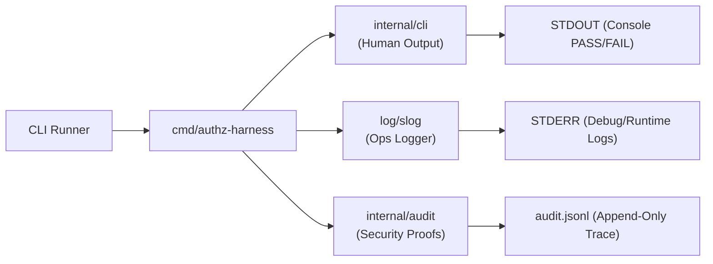

# [마스터 설계] 00-개발환경-및-기반골격-구축

> **상위 문서**: [대시보드](README.md) | [WHY.md](WHY.md) | [PLAN.md](PLAN.md)

---

## 1. 개요 및 배경 (Context)

본 로드맵은 `authz-harness`의 성공적인 구현을 위해 단일 Go 모듈 환경을 정비하고, 저장소의 Zero Leakage 보안 경계를 확립하며, 향후 전체 Phase 0~6의 기반이 될 CLI 진입점과 출력 삼분(Tri-Separation) 골격을 완성하는 마스터 엔지니어링 설계도이다.

---

## 2. As-Is vs To-Be

```text
[As-Is]
- 초기화된 빈 Git 저장소 + 루트 ROADMAP.md 만 존재
- Go 모듈 미지정, 보안 가드레일 부재, 컴포넌트 디렉토리 부재

[To-Be]
- Go 1.27 단일 모듈 (authz-harness) 초기화
- Zero Leakage 보안 가드레일 (gitleaks + pre-commit hook + safety scanner) 활성화
- AGENTS.md 및 ROADMAP_정책.md 기반의 엄격한 거버넌스 체계
- cmd/authz-harness/main.go 기본 CLI 구동 가능
- internal/audit 패키지를 통한 독립 감사 로그(JSONL) 파이프라인 확보
- 3중 출력 채널(stdout: CLI / stderr: slog / audit.jsonl: audit) 분리 완료
```

---

## 3. 시스템 아키텍처 (Tri-Separation)



---

## 4. 사전 점검 및 실패 위험 분석 (Pre-Mortem)

1. **위험: Python 도구체인의 무분별한 침투**
   - *영향*: 불필요한 `.venv`, `pyproject.toml` 잔류로 혼선 발생.
   - *대응*: `.gitignore`에 Python/Go 전방위 무시 규칙 적용, `AGENTS.md`에 Go 전용 프로젝트임을 강제.
2. **위험: 출력 스트림 혼선으로 인한 감사 증거 오염**
   - *영향*: 테스트 출력에 디버그 문구가 섞이거나 감사 로그에 일반 로그가 들어가 감사 신뢰도 훼손.
   - *대응*: `audit.Writer`를 전용 구조체와 인터페이스로 설계하고, CLI 러너와 `slog`가 `audit.jsonl`에 직접 쓰지 못하도록 캡슐화.
3. **위험: Git Hook 우회 및 시크릿 누출**
   - *영향*: 비밀키(`*.pem`)나 토큰이 원격 저장소에 노출.
   - *대응*: `core.hooksPath`를 `scripts/githooks`로 지정하여 로컬 커밋 시 강제 검증.

---

## 5. 4층위 검증망 설계 (Verification Framework)

- **1층위 (자동화 스크립트 검증)**:
  - `python3 scripts/public_safety_scan.py --all`
  - `gitleaks detect --no-git --verbose`
- **2층위 (Go 단위 및 구조 검증)**:
  - `go vet ./...`
  - `go test -v ./...` (감사 기록기 단위 시험)
- **3층위 (정합성 및 격리 검증)**:
  - `audit.jsonl` 파일 생성 및 유효한 JSONL 포맷 여부 확인
- **4층위 (종단간 스모크 검증)**:
  - `go build -o bin/authz-harness ./cmd/authz-harness`
  - `./bin/authz-harness --version` 정상 종료(Code 0)
