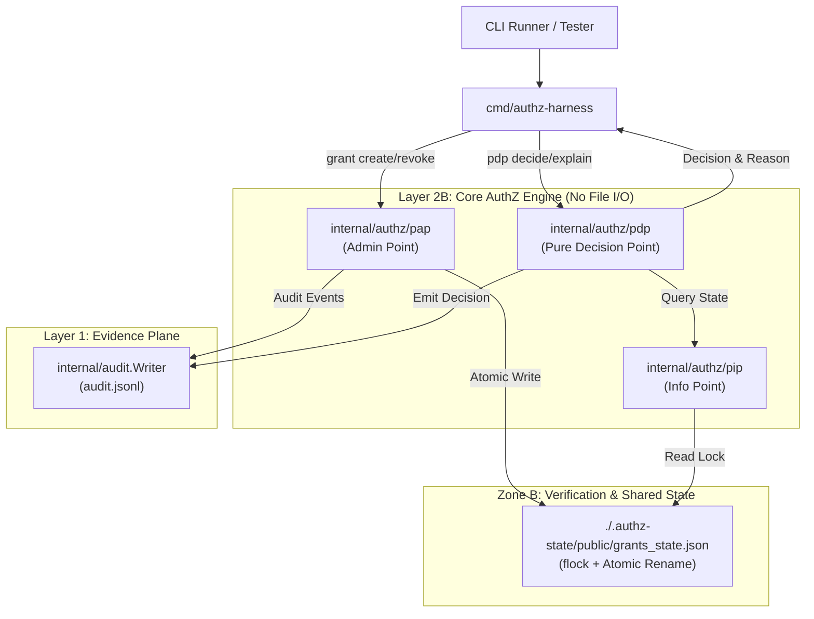

# [마스터 설계] 01-grant-저장소-및-pdp-구현

> **상위 문서**: [대시보드](README.md) | [WHY.md](WHY.md) | [PLAN.md](PLAN.md) | [상위 마스터 로드맵](../MASTER_ROADMAP.md)

---

## 1. 개요 및 배경 (Context)

본 로드맵은 NIST SP 800-162 표준에 따라 정책 관리점(PAP), 정책 정보점(PIP), 그리고 순수 정책 결정점(PDP)을 분리하여 구현하고, 실시간 권한 회수(Revoke) 및 주체별 보안 Epoch 갱신에 따른 즉각적인 거부(Deny)를 시뮬레이션 및 감사 로그로 증명하는 설계도이다.

---

## 2. As-Is vs To-Be

```text
[As-Is (Phase 0 완료 직후)]
- Go 1.27 기반 CLI 및 삼분 배선(stdout/stderr/audit.jsonl) 골격 확보
- 권한 도메인 모델, Grant 저장소, 판정 엔진 부재
- 권한 상태 없이 항상 하드코딩된 상태로만 종료

[To-Be (Phase 1 완료 후)]
- Zone B (.authz-state/public/grants_state.json) 원자적 Grant/Epoch 저장소 확립
- PAP: grant create, grant revoke, grant bump-epoch CLI 제어 지원
- PIP: PDP 요청 시 최신 Grant 활성 상태 및 Epoch 스냅샷 지연 없이 제공
- PDP: 파일 I/O 의존성 0% 순수 인가 결정 엔진 (Allow/Deny + Reason)
- CLI UX: 초보자 친화적 pdp decide 및 pdp explain 시각적 차단 사유 출력
- L1 테스트: 테이블 주도 결정표 단위 테스트 100% 통과
```

---

## 3. 시스템 아키텍처 (NIST SP 800-162 & 3-Zone)



---

## 4. 사전 점검 및 실패 위험 분석 (Pre-Mortem)

1. **위험: PDP 내부에서 `os` 또는 `path/filepath` 패키지를 직접 호출하는 결합 오염**
   - *영향*: 결정 로직이 파일 시스템 경로 존재 여부에 종속되어 계층 분리 원칙 위반 (안티패턴 AP-03).
   - *대응*: `internal/authz/pdp` 패키지 import 목록에서 `os`, `path/filepath`, `internal/jail`을 원천 배제하고 CI/테스트에서 정적 검증.
2. **위험: 다중 프로세스에서 Grant 저장소 갱신 시 상태 파일 손상 (Torn Read / Partial Write)**
   - *영향*: JSON 파일 파싱 에러 및 비정상 종료.
   - *대응*: 파일 쓰기 시 임시 파일(`grants_state.json.tmp`)에 기록 후 `os.Rename`으로 교체하고, 배타적 `syscall.Flock` 적용.
3. **위험: Epoch 회수 누락으로 인한 만료 전 토큰 재사용 허용**
   - *영향*: 권한이 회수되었음에도 토큰 수명 동안 인가가 허용되는 치명적 보안 결함.
   - *대응*: PDP 결정 공식에 `token.epoch == pip.current_epoch` 불변식을 1순위로 강제.

---

## 5. 4층위 검증 범위 설계 및 완료 조건

1. **1층위 (자동화 스크립트)**: `scripts/` 기반 빌드 및 린트 통과.
2. **2층위 (단위 및 구조 검증)**: `go test ./internal/authz/...`를 통해 PDP 결정표(Grant 유효, Revoke됨, Epoch 불일치, Scope 불일치) 100% 통과.
3. **3층위 (상태 및 정합성 검증)**: `grant create` → `grant revoke` 수행 시 `audit.jsonl`에 누락 없이 해시 체인으로 기록되고 `audit verify` 통과.
4. **4층위 (CLI 시동 검증)**:
   - `authz-harness pdp decide --sub worker-01 --action file:read --resource docs/plan.txt` → `DENY (NO_ACTIVE_GRANT)`
   - `authz-harness grant create --sub worker-01 --action file:read --resource docs/plan.txt`
   - 동일 질의 재수행 → `ALLOW (AUTHORIZED)`
   - `authz-harness grant revoke --id <grant_id>`
   - 동일 질의 재수행 → 즉시 `DENY (GRANT_REVOKED)` 관찰.
