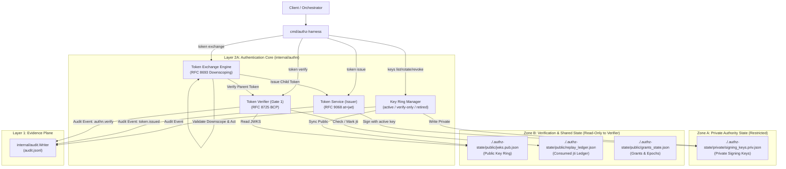

# [마스터 설계] 02-oauth21-토큰-및-축소위임-구현

> **상위 문서**: [대시보드](README.md) | [WHY.md](WHY.md) | [PLAN.md](PLAN.md) | [상위 마스터 로드맵](../MASTER_ROADMAP.md)

---

## 1. 개요 및 배경 (Context)

본 로드맵은 OAuth 2.1 및 RFC 9068(JSON Web Token Profile for OAuth 2.0 Access Tokens) 표준에 따라 Bearer Access Token의 서명·검증 체계를 구축하고, RFC 7517(JWK) 키 수명주기(`active` -> `verify-only` -> `retired`) 관리와 RFC 8693(OAuth 2.0 Token Exchange) 기반의 오케스트레이터→서브에이전트 축소 위임(Downscoping) 엔진을 완성하는 설계도이다.

---

## 2. As-Is vs To-Be

```text
[As-Is (Phase 1 완료 직후)]
- Zone B (.authz-state/public/grants_state.json) 원자적 Grant/Epoch 저장소 확립
- PAP/PIP 엔진 및 파일 I/O 의존성 0% 순수 인가 결정 엔진 PDP 구축
- 토큰 발급, 서명 검증, 키 수명주기, 위임 체인 부재 (클레임 수기 주입 상태)

[To-Be (Phase 2 완료 후)]
- Zone A (.authz-state/private/signing_keys.priv.json) 비밀 서명 키 저장소 구축
- Zone B (.authz-state/public/jwks.pub.json) 공개 검증 키 링(JWKS) 동기화
- RFC 9068 `typ: at+jwt` 서명 발급 및 RFC 8725 BCP 기반 엄격한 Gate 1 토큰 검증기
- RFC 7517 무중단 키 회전(`keys rotate`) 및 키 폐기(`keys revoke`) 즉시 무효화
- RFC 8693 Token Exchange 축소 위임: 부모 토큰 검증, Scope/TTL 부분집합 강제, `act` 위임 계보 기록
- Replay 방지 원장 (`replay_ledger.json`) 및 결함 주입 스위치(--tamper-*, --clock-offset) 완비
```

---

## 3. 시스템 아키텍처 (Layer 2A AuthN & RFC 8693 Exchange)



---

## 4. 사전 점검 및 실패 위험 분석 (Pre-Mortem)

1. **위험: Zone A 개인 서명 키가 로그, CLI 출력, 또는 서브프로세스에 유출 (Zero Leakage 위반)**
   - *영향*: 키 유출 시 비인가 주체가 임의로 유효한 토큰을 위조 가능 (치명적 보안 결함).
   - *대응*: Zone A 디렉토리 퍼미션 엄격 제한, 패키지 의존성 격리(Issuer 외 패키지에서 Zone A 로드 금지), 감사 로그 및 운영 로그에 raw JWT 및 개인키 일절 배제(`jti`만 기록).
2. **위험: RFC 8693 축소 위임 검증 시 Scope 부분집합 판단 오류 (Prefix 착시 등)**
   - *영향*: 부모가 `file:read:docs/plan` 권한만 가졌는데 자식이 `file:read:docs/plan_secret.txt`나 상위 디렉토리를 위임받는 권한 상승 발생.
   - *대응*: 단순 문자열 접두사 비교를 금지하고, 액션 및 리소스 경로를 구조화된 파싱 단위로 대조하여 자식이 부모의 엄격한 부분집합($S_{child} \subseteq S_{parent}$)인지 검증.
3. **위험: 가상 시간 및 시간 경계값 처리 오류 (`time.Now()` 직접 호출로 인한 flaky 테스트)**
   - *영향*: 만료 시각 경계($now == exp$) 검증 오류 및 CI 환경 시계 오차로 인한 비결정적 테스트 실패.
   - *대응*: 전 모듈에 주입 가능한 `Clock` 포트를 일관 적용하고, `--clock-offset` 플래그로만 시간을 조작하여 검증.

---

## 5. 4층위 검증 범위 설계 및 완료 조건

1. **1층위 (자동화 스크립트)**: `scripts/` 기반 빌드, `go vet`, Gitleaks 시크릿 스캔 통과.
2. **2층위 (단위 및 퍼징 검증)**:
   - `go test ./internal/authn/...` 키 회전/폐기 상태 머신 테스트.
   - `FuzzTokenParser`를 통한 변조 헤더, 비정상 Base64, 악의적 페이로드 크래시 방어 검증.
   - RFC 8693 부분집합 불변식 및 초과 위임 거부 단위 테스트 100% 통과.
3. **3층위 (상태 및 정합성 검증)**:
   - `keys rotate` -> `keys revoke` 수행 시 `jwks.pub.json`의 `kid` 상태 전이 확인.
   - `token verify` 재수행 시 `replay_ledger.json`에 `jti`가 기록되고 즉시 재사용 차단 확인.
   - 모든 이벤트가 `audit.jsonl`에 누락 없이 해시 체인으로 기록되고 `audit verify` 통과.
4. **4층위 (CLI 시동 검증)**:
   - `authz-harness keys list` -> 활성 키 확인.
   - `authz-harness token issue --sub worker-01 --scope file:read:docs/plan.txt` -> 토큰 정상 발급.
   - `authz-harness token verify --token <token>` -> `Gate 1 VALID`.
   - `authz-harness token exchange --parent-token <token> --child-sub worker-02 --scope file:read:docs/plan.txt` -> 정상 위임 발급 (`act` 확인).
   - 부모 권한을 초과하는 `--scope file:write:docs/plan.txt` 요청 시 -> `DELEGATION_SCOPE_EXCEEDED` 거부 관찰.
   - `authz-harness keys revoke --kid <kid>` 후 동일 토큰 검증 -> `TOKEN_KEY_RETIRED` 즉시 거부 관찰.
