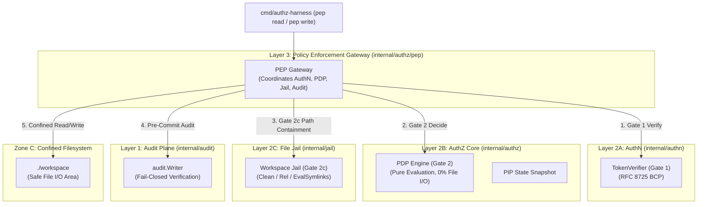

# [마스터 설계] 03-pep-및-workspace-jail-구현

> **상위 문서**: [대시보드](README.md) | [WHY.md](WHY.md) | [PLAN.md](PLAN.md) | [상위 마스터 로드맵](../MASTER_ROADMAP.md)

---

## 1. 개요 및 배경 (Context)

본 로드맵은 Gate 1(AuthN TokenVerifier)과 Gate 2(Pure PDP)의 판정 결과를 물리적 파일 I/O 실행과 안전하게 연동하는 정책 집행점(PEP, Policy Enforcement Point) 및 Workspace File Jail을 구축하는 설계도이다.

상위 경로 탈출(`../`) 및 심볼릭 링크를 이용한 샌드박스 우회 시도를 원천 차단하고, 감사 기록 실패 시 작업을 즉각 중단(Fail-Closed)하는 전 과정의 보안 불변식을 완성한다.

---

## 2. As-Is vs To-Be

```text
[As-Is (Phase 2 완료 직후)]
- Zone A/B 서명 키 분리 및 RFC 9068 Access Token 발급·Gate 1 검증기 확립
- RFC 8693 Token Exchange 기반 축소 위임(Downscoping) 엔진 구축
- 파일 시스템 격리(Jail) 및 정책 집행 게이트웨이(PEP) 부재 (실제 I/O 연동 없음)
- 클라이언트가 유효한 토큰을 획득해도 실제 파일 작업 시 관문 통합 집행 불가

[To-Be (Phase 3 완료 후)]
- Layer 2C: internal/jail 기반 Workspace Root 물리적 경계 격리 엔진 확립
  - 경로 정규화(filepath.Clean), 상대 경로 계산(filepath.Rel), 심볼릭 링크 해석(EvalSymlinks) 강제
  - 탈출 시 파일 I/O 직전 EXIT_PATH_VIOLATION(13) 즉시 차단
- Layer 3: internal/authz/pep 기반 단일 집행 게이트웨이 확립
  - Gate 1(AuthN) -> Gate 2(PDP) -> Gate 2c(Jail) -> Pre-Commit Audit -> Confined File I/O의 5단계 관문 실행
  - Fail-Closed: 감사 로그 기록 실패 시 쓰기 작업 중단 및 EXIT_AUDIT_FAILURE(15) 반환
  - 거부 시 파일 부작용 0바이트 불변식 보장
- CLI: authz-harness pep read / pep write 서브커맨드 및 결함 주입 스위치 완비
```

---

## 3. 시스템 아키텍처 및 5단계 관문 파이프라인

### 3.1 6계층 단방향 DAG 내 PEP 및 Jail의 위치



### 3.2 5단계 관문 집행 상태 머신

```text
[요청 도착 (pep read / write)]
      │
      v
[Stage 1: Gate 1 - AuthN Token Verification]
  ├── Bearer 토큰 서명, kid, typ(at+jwt), exp, jti Replay 검증
  └── 실패 시 ──> [DENY -> Audit 기록 -> EXIT_TOKEN_INVALID (11)]
      │ (성공: VerifiedClaims)
      v
[Stage 2: Gate 2 - Pure PDP Authorization]
  ├── PIP 상태 스냅샷 로드 (Grant 유효성, Epoch 일치, Scope 매칭)
  └── 실패 시 ──> [DENY -> Audit 기록 -> EXIT_AUTHZ_DENIED (12)]
      │ (성공: Decision == ALLOW)
      v
[Stage 3: Gate 2c - Workspace Jail Boundary Verification]
  ├── filepath.Clean 및 filepath.EvalSymlinks 해석
  ├── filepath.Rel(workspaceRoot, targetPath) 상대 경로 검증 (상위 '..' 탈출 차단)
  └── 실패 시 ──> [DENY -> Audit 기록 -> EXIT_PATH_VIOLATION (13)]
      │ (성공: Confined Safe Path)
      v
[Stage 4: Pre-Commit Audit Verification (Fail-Closed)]
  ├── audit.Writer로 'pep.execute' 감사 이벤트 기록 시도
  └── 실패 시 (주입 또는 I/O 오류) ──> [ABORT (파일 쓰기 0바이트) -> EXIT_AUDIT_FAILURE (15)]
      │ (성공: Audit Written)
      v
[Stage 5: Confined File I/O Execution]
  ├── 격리된 실제 파일 읽기/쓰기 수행
  └── 성공 시 ──> [SUCCESS -> 종료 코드 0 (ExitSuccess)]
```

---

## 4. 사전 점검 및 실패 위험 분석 (Pre-Mortem)

1. **위험: 심볼릭 링크 생성/쓰기 시 파일 미존재로 인한 `EvalSymlinks` 우회**
   - *영향*: 새 파일 쓰기 요청 시 파일이 아직 존재하지 않으면 `os.Stat`이나 `EvalSymlinks`가 실패하여 에러를 내거나, 검증을 건너뛸 경우 심볼릭 링크 디렉토리 내부를 통해 상위로 탈출 가능.
   - *대응*: 파일이 아직 존재하지 않는 경우, 존재하는 가장 가까운 상위 부모 디렉토리를 순회하여 `EvalSymlinks`를 수행하고, 계산된 최종 디렉토리가 Workspace Root 하위인지 검증한 뒤 파일명을 결합.
2. **위험: 단순 접두사(`strings.HasPrefix`) 검사로 인한 디렉토리 착시 우회**
   - *영향*: `/path/to/workspace-evil/secret.txt`는 `/path/to/workspace`로 시작하므로 접두사 검사를 통과해 탈출 허용(OWASP 인가 치명적 취약점).
   - *대응*: 접두사 문자열 비교를 원천 금지하고, 반드시 `filepath.Rel(root, target)`가 `.` 또는 `..`로 시작하지 않고 하위 경로인지 검증.
3. **위험: 감사 쓰기 실패 시 이미 파일 쓰기가 수행되어 무증거 변경 발생 (Fail-Open 취약점)**
   - *영향*: `--inject-audit-failure` 시 파일이 이미 변경되어 사후 감사 증적 없는 침해 발생.
   - *대응*: Pre-Commit 감사 원칙을 적용하여, 감사 로그 쓰기가 성공적으로 디스크에 플러시된 것을 확인한 후에만 파일 생성/수정(`os.OpenFile`)을 수행. 거부나 감사 실패 시 파일 부작용 0바이트 불변식 사수.

---

## 5. 4층위 검증 범위 설계 및 완료 조건

1. **1층위 (자동화 스크립트)**: `scripts/public_safety_scan.py --tree` Zero Leakage 스캔 및 `go vet` 통과.
2. **2층위 (단위 및 퍼징 검증)**:
   - `internal/jail`: `..`, 절대 경로, 상대 경로, 심볼릭 링크, 중첩 디렉토리, 존재하지 않는 파일 쓰기 단위 테스트.
   - `FuzzPathJail`: 무작위 경로 문자열, 널 바이트(`\x00`), UTF-8 특수문자, 초장문 경로 퍼징 테스트 크래시 제로(0).
   - `internal/authz/pep`: Mock Verifier, Mock PDP, Mock Jail, Mock AuditSink를 이용한 5단계 관문 상태 머신 단위 테스트.
3. **3층위 (상태 및 정합성 검증)**:
   - 거부(`11`, `12`, `13`, `15`) 발생 시 Workspace 내 대상 파일이 생성되거나 수정되지 않았음을 파일 해시 및 `os.Stat`으로 증명.
   - 감사 로그(`audit.jsonl`)의 이벤트 순서(`pep.denied`, `pep.allowed`) 및 해시 체인 무결성 검증.
4. **4층위 (CLI 통합 검증)**:
   - `authz-harness pep read` 및 `authz-harness pep write` 실행 시 정상 케이스 종료 코드 `0` 반환.
   - `--inject-audit-failure` 주입 시 인가 허용이어도 종료 코드 `15` 반환 및 파일 미변경 검증.
