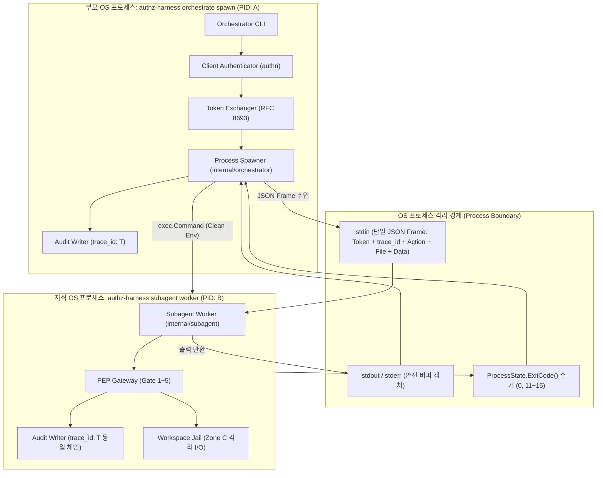
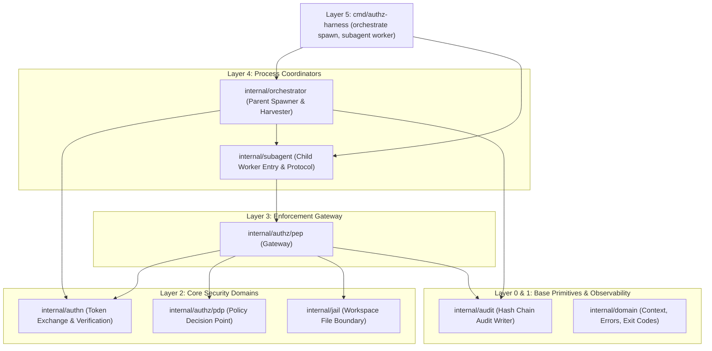

# [마스터 설계] 04-오케스트레이터-및-서브프로세스-격리

> **상위 문서**: [대시보드](README.md) | [WHY.md](WHY.md) | [PLAN.md](PLAN.md) | [상위 마스터 로드맵](../MASTER_ROADMAP.md)

---

## 1. 개요 및 배경 (Context)

본 로드맵은 팀장 오케스트레이터(Layer 4: `internal/orchestrator`)가 중앙 서버로부터 발급받은 RFC 8693 축소 위임(Downscoping) Access Token을 들고, 완전히 독립된 OS 자식 프로세스로 서브에이전트 워커(Layer 4: `internal/subagent`)를 생성(`os/exec`)하여 파일 작업을 안전하게 위임·집행·수거하는 프로세스 격리 실행 사슬의 마스터 설계도이다.

고루틴 공유로 인한 메모리 오염 및 비밀키 탈취 위험을 원천 배제하고, 환경변수 격리 및 `stdin` JSON 프레임 프로토콜을 통해 `ps` 인자 노출 없는 안전한 자격 증명 주입과 단일 `trace_id` 감사 연쇄를 달성한다.

---

## 2. As-Is vs To-Be

```text
[As-Is (Phase 3 완료 직후)]
- Layer 2C: internal/jail 기반 파일 탈출(상대경로, 심볼릭링크) 방어 엔진 구축
- Layer 3: internal/authz/pep 기반 5단계 관문 집행 및 Fail-Closed 감사 방어 게이트웨이 구축
- CLI: authz-harness pep read / pep write 직접 실행 지원
- 한계: 서브에이전트를 별도 OS 프로세스로 스폰하거나 부모-자식 간 프레임 프로토콜 및 자식 프로세스 종료 코드(Exit Code)를 체계적으로 수거하는 오케스트레이터 부재

[To-Be (Phase 4 완료 후)]
- Layer 4 (Process Coordinators):
  - internal/subagent: stdin JSON 단일 프레임 수신, trace_id 전파, PEP 게이트웨이 호출, 표준 Exit Code 반환 워커
  - internal/orchestrator: 클린 환경 기반 os/exec 서브프로세스 스포너, stdin 파이프 주입, stdout/stderr 캡처, Exit Code(11~15) 수거
- CLI 명령 확립:
  - authz-harness orchestrate spawn: 토큰 교환 -> 자식 프로세스 스폰 -> 종료 코드 수거 -> 부모 감사 기록 전체 흐름 실행
  - authz-harness subagent worker (내부 워커 엔트리): stdin 프레임을 수신하여 PEP 관문 실행
- 동시성 및 결함 주입 검증:
  - --inject-revoke-before-io 스위치를 통한 TOCTOU 레이스 컨디션 방어 입증
  - go test -race 전 계층 데이터 레이스 0건 보장
```

---

## 3. 시스템 아키텍처 및 프로세스 격리 모델

### 3.1 부모-자식 격리 토폴로지



### 3.2 6계층 단방향 DAG 내 오케스트레이터 및 서브에이전트 위치



---

## 4. `stdin` JSON 프레임 프로토콜 명세

`ps -ef` 등의 프로세스 목록 조회 시 토큰, 파일명, 데이터 등이 노출되는 것을 방지하기 위해 모든 작업 지시는 `stdin` 스트림의 단일 JSON 객체로 전달한다.

### 4.1 요청 프레임 (`SubagentRequest`)
```json
{
  "version": "1.0",
  "trace_id": "tr-0192a8b3-c4d5-7e8f-9a0b-1c2d3e4f5a6b",
  "token": "<downscoped_access_token_jwt>",
  "action": "file:read",
  "file_path": "docs/task.txt",
  "data": "",
  "inject_revoke_before_io": false
}
```

### 4.2 응답 프레임 (`SubagentResponse`)
표준 출력(`stdout`)으로 자식 프로세스가 반환하는 구조화된 JSON 결과:
```json
{
  "trace_id": "tr-0192a8b3-c4d5-7e8f-9a0b-1c2d3e4f5a6b",
  "exit_code": 0,
  "action": "file:read",
  "file_path": "docs/task.txt",
  "bytes_read": 42,
  "output": "Task description content...",
  "error": ""
}
```

---

## 5. 클린 환경변수 화이트리스트 명세

자식 프로세스를 생성할 때 부모 프로세스의 전체 환경(`os.Environ()`)을 상속하지 않고 오직 최소 필수 변수만 전달한다.

| 환경변수 키 | 상속 여부 | 이유 |
|---|---|---|
| `PATH` | 허용 | 기본 시스템 바이너리 탐색에 필수 |
| `TMPDIR` / `TEMP` / `TMP` | 허용 | 임시 파일 디렉토리 지정에 필요 |
| `HOME` | 허용 | 시스템 사용자 홈 경로 참조 |
| `ZONE_A_*`, `SECRET_*`, `AUTHZ_KEY_*` | **차단** | 서명 개인키 및 자격 증명 누출 원천 방지 |
| `GO*`, `DEBUG*` | 차단 | 내부 디버깅 플래그 오염 방지 |

---

## 6. 동시성 및 결함 주입 (`--inject-revoke-before-io`) 메커니즘

1. **TOCTOU 시나리오 검증**:
   - 팀장이 유효한 토큰을 발급받아 자식에게 전달함.
   - 자식 프로세스가 토큰을 수신하여 Gate 1(AuthN)을 통과한 직후, 실제 I/O 집행 전에 외부 또는 부모가 Grant를 `Revoke`함 (`--inject-revoke-before-io`).
   - Gate 2(PDP) 검증 시점에 실시간 상태가 `revoked`로 판정되어 즉시 `EXIT_AUTHZ_DENIED(12)`로 종료되고 파일 수정 0바이트를 보장해야 함.
2. **동시성 무결성**:
   - 다중 자식 프로세스가 동시에 실행되더라도 `audit.jsonl` 파일 락(`flock`)과 해시 체인이 깨지지 않고 보존됨을 `go test -race`로 검증.

---

## 7. 사전 점검 및 실패 위험 분석 (Pre-Mortem)

| 위험 요소 | 실패 시나리오 | 방어 설계 (Countermeasure) |
|---|---|---|
| **파이프 데드락** | 자식이 대량의 `stderr`를 쏟아내고 버퍼가 차서 멈춤 | `cmd.StdoutPipe()` 및 `cmd.StderrPipe()`를 별도 버퍼로 동시 수거하거나 `io.ReadAll`을 고루틴/`CombinedOutput` 패턴으로 안전 배선 |
| **자식 프로세스 좀비화/타임아웃** | 자식이 종료되지 않고 무한 대기 | `context.WithTimeout` 기반 `exec.CommandContext` 강제 적용 (기본 10초 타임아웃) |
| **토큰 유출 위험** | 명령행 인자(`argv`)에 토큰 노출 | 모든 토큰 및 민감 페이로드는 오직 `stdin` 프레임 파이프로만 전송 |
| **Data Race** | 동시 프로세스/스레드에서 상태 파일 또는 감사 파일 쓰기 충돌 | Zone B 원자적 파일 락 및 `audit.Writer`의 `flock` 상호 배제 적용 |

---

## 8. 4층위 검증 범위 설계 (Verification Grid)

- **1층위 (단위 및 직렬화 검증)**:
  - `internal/subagent`: `SubagentRequest`/`Response` JSON 프레임 인코딩/디코딩 단위 테스트
  - `internal/orchestrator`: 클린 환경 화이트리스트 필터 단위 테스트
- **2층위 (스포너 및 Exit Code 계약 검증)**:
  - Mock/실제 프로세스 스폰 후 표준 Exit Code(`0`, `11`, `12`, `13`, `14`, `15`) 정상 수거 테스트
- **3층위 (감사 체인 및 상태 정합성 검증)**:
  - 부모 `trace_id`와 자식 `trace_id`가 일치하는지 `audit.jsonl`에서 해시 체인 및 이벤트 순서 검증
  - 거부 시 대상 파일 변경 0바이트 확인
- **4층위 (동시성 및 CLI 통합 검증)**:
  - `authz-harness orchestrate spawn` CLI 실행 및 `--inject-revoke-before-io` 결함 주입 검증
  - `go test -race ./...` 동시성 테스트 통과

---

## 9. 3단계 세부 구현 및 인수 조건

| 단계 | 세부 작업 | 인수 테스트 기준 |
|---|---|---|
| **010** | 서브에이전트 워커 모듈 및 `stdin` JSON 프레임 프로토콜 | `stdin` 프레임으로 들어온 유효 요청 정상 처리(Exit Code 0), 토큰 위조/누락 시 Exit Code 11, 경로 탈출 시 Exit Code 13 반환 |
| **020** | 오케스트레이터 Spawner 및 Exit Code 수거 모듈 | `exec.CommandContext` 기반 클린 환경 자식 실행, Exit Code(11~15) 정상 수집 및 부모 감사 이벤트(`ORCHESTRATE_SPAWN`, `ORCHESTRATE_COLLECT`) 기록 |
| **030** | 오케스트레이트 CLI 명령 및 결함 주입/동시성 검증 | `orchestrate spawn` CLI 커맨드 완성, `--inject-revoke-before-io` 시뮬레이션, L3 `go test -race` 무결 통과 |

---

## 10. 다음 단계(Phase 5) 인계 기준

1. `authz-harness orchestrate spawn` 명령으로 단일 워크플로(팀장 토큰 교환 -> 자식 독립 프로세스 실행 -> 결과/종료코드 수거)가 완결된다.
2. 부모-자식 간 `trace_id`가 단일 체인으로 이어져 `audit.jsonl`에 정상 기록된다.
3. `go test -race ./...` 실행 시 모든 패키지가 경합 없이 100% 통과한다.
4. 이 기반 위에서 Phase 5의 30대 전 구간 E2E 자동 시나리오 하네스를 구축할 수 있는 준비가 완료된다.
