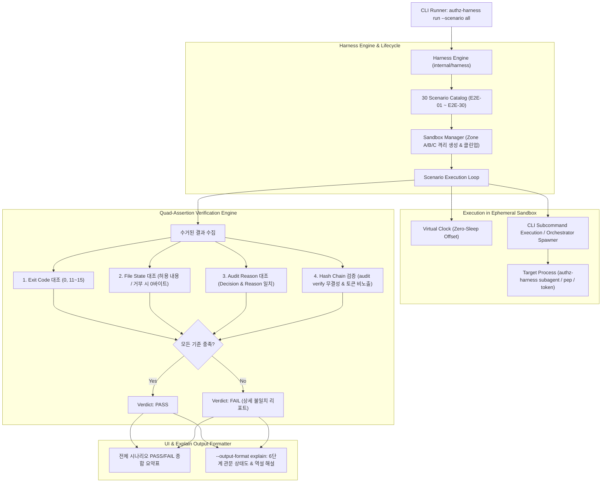
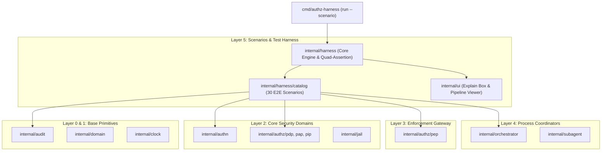

# [마스터 설계] 05-자동-시나리오-테스트-하네스

> **상위 문서**: [대시보드](README.md) | [WHY.md](WHY.md) | [PLAN.md](PLAN.md) | [상위 마스터 로드맵](../MASTER_ROADMAP.md)

---

## 1. 개요 및 배경 (Context)

본 로드맵은 Phase 0부터 Phase 4까지 개별적으로 구축되고 검증된 권한 코어(PDP/PAP/PIP), 워크로드 인증 및 RFC 8693 축소 위임(AuthN/Token), 정책 집행점 및 파일 격리(PEP/Jail), 그리고 오케스트레이터 프로세스 격리 실행기(Orchestrator/Subagent)를 하나로 결합하여, **7대 그룹 30개 전 구간 E2E 시나리오(E2E-01 ~ E2E-30)**를 단일 명령(`authz-harness run --scenario <id|all>`)으로 자동 실행하고 엄격하게 판정하는 **테스트 하네스 및 설명 UX**의 마스터 설계도이다.

단순한 프로세스 종료 코드 확인을 넘어, 파일 상태 0바이트 무변화, 감사 사유 코드 일치, 해시 체인 무결성을 동시에 증명하는 **Quad-Assertion 4중 불변식 엔진**을 구축하고, 초보자도 한눈에 실패와 방어의 원리를 납득할 수 있는 **6단계 관문 상태도(Explain UX)**를 구현한다.

---

## 2. As-Is vs To-Be

```text
[As-Is (Phase 4 완료 직후)]
- Layer 4: internal/orchestrator 및 internal/subagent를 통한 자식 OS 프로세스 격리 실행 및 종료 코드 수거 완성
- CLI: keys, grant, token, pdp, pep, orchestrate, subagent 개별 명령 독립 실행 가능
- 테스트: L1 단위, L2 퍼징, L3 동시성(-race) 테스트는 통과하지만, 30개 전체 공격 시나리오를 한 번에 실행하고 종합 판정표를 출력하는 단일 CLI 러너 부재
- 한계: 공격 시나리오를 확인하려면 개별 명령을 수동으로 조합하거나 별도 셸 스크립트를 짜야 하며, 실패의 역설적 성공(방어 성공)을 설명하는 직관적인 Explain 뷰 부족

[To-Be (Phase 5 완료 후)]
- Layer 5: internal/harness 코어 및 30대 시나리오 카탈로그(E2E-01 ~ E2E-30) 구축
- Quad-Assertion 판정 엔진:
  - Assertion 1: Exit Code (0, 11~15 정확한 표준 코드)
  - Assertion 2: File Mutation (허용 시 기대 데이터 일치, 거부 시 0바이트 무변화 보장)
  - Assertion 3: Audit Reason (감사 로그에 기록된 Decision/Reason 코드 일치)
  - Assertion 4: Hash Chain Integrity & No Leak (해시 체인 검증 VALID, 원시 토큰 비노출)
- Ephemeral Sandbox 격리:
  - 시나리오별 임시 디렉터리 기반 Zone A/B/C 격리 환경 생성 및 자동 클린업
- CLI 명령 및 포매터 완성:
  - authz-harness run --scenario <id|all>
  - --output-format (pretty|explain|json|compact)
  - 6단계 관문 통과/차단 ASCII 파이프라인 및 한국어 방어 원리 해설 박스
- 전 계층 검증 완비:
  - L4 블랙박스 CLI 골든 테스트 및 L5 30대 E2E 하네스 100% PASS (1분 이내 무결 완주)
```

---

## 3. 시스템 아키텍처 및 하네스 구조도

### 3.1 하네스 실행 파이프라인 및 Quad-Assertion 구조



### 3.2 6계층 단방향 DAG 내 하네스 패키지 위치



---

## 4. Quad-Assertion 4중 검증 메커니즘

각 시나리오는 사전에 정의된 `ExpectedAssertion` 명세를 가지며, 하네스는 실행 후 다음 4가지 검증을 일괄 수행한다:

| 검증 항목 | 검증 대상 | 통과 조건 | 실패 판정 시 조치 |
|---|---|---|---|
| **1. Exit Code** | 프로세스 반환값 | 시나리오 기대 종료 코드(`0`, `11`~`15`)와 100% 일치 | 즉시 `FAIL` (`Exit Code Mismatch`) |
| **2. File State** | Zone C 파일시스템 | 허용 시 기대 문자열과 일치, 거부 시 파일 생성 0건 또는 크기 0바이트 보장 | 즉시 `FAIL` (`Unexpected File Mutation`) |
| **3. Audit Reason** | `audit.jsonl` 이벤트 | 마지막 보안 판정의 `decision`(`allow`/`deny`) 및 `reason` 코드가 기대값과 일치 | 즉시 `FAIL` (`Audit Reason Mismatch`) |
| **4. Hash Chain** | `audit.jsonl` 무결성 | SHA-256 해시 체인이 유효하며, 원시 토큰이 포함되지 않고 파손 없음 | 즉시 `FAIL` (`Hash Chain Broken / Leak`) |

---

## 5. 7대 그룹 30개 E2E 시나리오 카탈로그 명세

| 그룹 ID | 시나리오 ID | 시나리오 명칭 | 기대 종료 코드 | 기대 감사 사유 (`Reason`) | 기대 파일 상태 |
|---|---|---|:---:|---|---|
| **G1** | `E2E-01` | 정상 단일 파일 읽기 | `0` | `AUTHORIZED` | 원본 파일 내용 정상 반환 |
| **G1** | `E2E-02` | 정상 단일 파일 쓰기 | `0` | `AUTHORIZED` | 대상 파일에 의도한 바이트 기록 |
| **G1** | `E2E-03` | 동적 전환 [거부→허용→회수 후 즉시 거부] | `12` | `GRANT_REVOKED` | 회수 후 파일 쓰기 0바이트 유지 |
| **G2** | `E2E-04` | 미등록 클라이언트 토큰 요청 거부 | `11` | `AUTHN_UNKNOWN_CLIENT` | 토큰 미발급, I/O 0건 |
| **G2** | `E2E-05` | 잘못된 클라이언트 시크릿 거부 | `11` | `AUTHN_INVALID_SECRET` | 토큰 미발급, I/O 0건 |
| **G2** | `E2E-06` | 정지된(Suspended) 클라이언트 거부 | `11` | `AUTHN_CLIENT_SUSPENDED` | 토큰 미발급, I/O 0건 |
| **G3** | `E2E-07` | 토큰 누락 차단 | `11` | `TOKEN_MISSING` | 파일 읽기/쓰기 0바이트 |
| **G3** | `E2E-08` | 형식 파손(Malformed) 토큰 차단 | `11` | `TOKEN_MALFORMED` | 파일 읽기/쓰기 0바이트 |
| **G3** | `E2E-09` | 페이로드 Scope 변조 토큰 차단 | `11` | `TOKEN_INVALID_SIGNATURE` | 파일 읽기/쓰기 0바이트 |
| **G3** | `E2E-10` | `alg: none` 공격 차단 | `11` | `TOKEN_ALG_NOT_ALLOWED` | 파일 읽기/쓰기 0바이트 |
| **G3** | `E2E-11` | `typ != at+jwt` 불일치 토큰 차단 | `11` | `TOKEN_INVALID_TYPE` | 파일 읽기/쓰기 0바이트 |
| **G3** | `E2E-12` | 서명 키 무중단 회전 후 검증 성공 | `0` | `AUTHORIZED` | verify-only 키로 파일 정상 I/O |
| **G3** | `E2E-13` | 폐기된 서명 키(`retired`) 즉시 거부 | `11` | `TOKEN_UNKNOWN_OR_RETIRED_KEY` | 파일 읽기/쓰기 0바이트 |
| **G4** | `E2E-14` | 만료된 토큰 즉시 거부 | `11` | `TOKEN_EXPIRED` | 파일 읽기/쓰기 0바이트 |
| **G4** | `E2E-15` | 미래 발급/활성(`nbf`) 토큰 거부 | `11` | `TOKEN_NOT_YET_VALID` | 파일 읽기/쓰기 0바이트 |
| **G4** | `E2E-16` | `iss`/`aud` 불일치 토큰 거부 | `11` | `TOKEN_INVALID_ISS_AUD` | 파일 읽기/쓰기 0바이트 |
| **G4** | `E2E-17` | 타 주체 토큰 도용(`sub` 불일치) 거부 | `11` | `TOKEN_SUBJECT_MISMATCH` | 파일 읽기/쓰기 0바이트 |
| **G4** | `E2E-18` | 일회성 토큰 재사용(`jti` Replay) 거부 | `11` | `TOKEN_REPLAY_DETECTED` | 2회차 쓰기 0바이트 유지 |
| **G5** | `E2E-19` | 팀장 Scope 초과 위임 시도 거부 | `12` | `DELEGATION_SCOPE_ESCALATION` | 자식 토큰 미발급, I/O 0건 |
| **G5** | `E2E-20` | 팀장 수명(TTL) 초과 위임 시도 거부 | `12` | `DELEGATION_TTL_EXCEEDED` | 자식 토큰 미발급, I/O 0건 |
| **G5** | `E2E-21` | 최대 위임 깊이(`depth`) 초과 거부 | `12` | `DELEGATION_DEPTH_EXCEEDED` | 다단계 토큰 미발급, I/O 0건 |
| **G5** | `E2E-22` | Read 전용 자식 토큰으로 Write 시도 거부 | `12` | `TOKEN_INSUFFICIENT_SCOPE` | 파일 쓰기 0바이트 유지 |
| **G5** | `E2E-23` | 미허가 리소스 경로 접근 거부 | `12` | `NO_ACTIVE_GRANT` | 파일 접근 차단 |
| **G5** | `E2E-24` | Subject Epoch 증가를 통한 일괄 철회 | `12` | `SUBJECT_EPOCH_REVOKED` | 미만료 토큰 파일 쓰기 차단 |
| **G6** | `E2E-25` | 상대 경로 탈출(`../../etc/passwd`) 차단 | `13` | `PATH_TRAVERSAL_DETECTED` | 감옥 외부 파일 접근 불가 |
| **G6** | `E2E-26` | 루트 접두사 착시(`/workspace-evil`) 차단 | `13` | `PATH_OUTSIDE_WORKSPACE` | 감옥 외부 파일 접근 불가 |
| **G6** | `E2E-27` | 심볼릭 링크 외부 탈출 시도 차단 | `13` | `SYMLINK_ESCAPE_DETECTED` | 링크 대상 파일 접근 불가 |
| **G7** | `E2E-28` | `trace_id` 누락 요청 차단 | `14` | `MISSING_TRACE_CONTEXT` | I/O 수행 전 단계에서 차단 |
| **G7** | `E2E-29` | 감사 기록 실패 시 파일 쓰기 중단 (Fail-Closed) | `15` | `AUDIT_WRITE_FAILED` | 디스크 파일 변경 0바이트 유지 |
| **G7** | `E2E-30` | 사후 감사 로그 변조 적발 (`audit verify`) | `15` | `AUDIT_INTEGRITY_BROKEN` | 해시 체인 불일치 적발 |

---

## 6. 초보자용 Explain UX 및 6단계 관문 상태도 설계

`--output-format explain` 실행 시 아래와 같이 6단계 관문 통과/차단 상태도와 한국어 원리 해설 박스가 터미널에 렌더링된다:

```text
================================================================================
 시나리오 [E2E-22]: 축소 위임 토큰(file:read)으로 파일 쓰기(file:write) 공격
================================================================================
 [관문 상태 파이프라인]
  [Gate 0: 컨텍스트 검증] ──▶ PASS (trace_id: trc-928341)
  [Gate 1: 토큰 & 서명]   ──▶ PASS (kid: key-v1, alg: ES256, typ: at+jwt)
  [Gate 2: 위임 & 스코프] ──▶ BLOCKED ❌ (요청: file:write / 보유: file:read)
  [Gate 3: 실시간 Grant]  ──▶ SKIPPED (선행 관문 차단)
  [Gate 4: Jail 경로격리] ──▶ SKIPPED
  [Gate 5: 감사 & I/O]    ──▶ SKIPPED (부작용 0바이트 보장)

 [💡 초보자를 위한 보안 원리 해설 (부정 테스트의 역설)]
  - 질문: 왜 실패(Exit Code 12)했는데 하네스는 PASS(통과)라고 하나요?
  - 해설: 팀장은 파일 읽기 권한만 자식에게 떼어주었는데(Downscoping),
          자식 워커가 권한을 속여 쓰기를 시도했습니다.
          Gate 2에서 정확히 이 권한 초과를 감지하고 0바이트 쓰기 차단과 함께
          종료 코드 12를 반환했으므로, 보안 시스템이 완벽히 방어에 '성공'한 것입니다.
================================================================================
```

---

## 7. 사전 점검 및 실패 위험 분석 (Pre-Mortem)

| 위험 요소 | 실패 시나리오 | 방어 설계 (Countermeasure) |
|---|---|---|
| **시나리오 간 상태 누수** | 이전 시나리오가 만든 Grant나 임시 파일이 다음 시나리오에 남아 간섭 | 각 시나리오마다 `t.TempDir()` 또는 독립 임시 디렉터리를 생성하여 격리된 Sandbox 실행 |
| **테스트 실행 시간 폭증** | 토큰 만료를 위해 `time.Sleep`을 호출하여 전체 실행이 느려짐 | `time.Sleep` 일체 배제, `Clock` 주입 및 초 단위 가상 오프셋으로 0.001초 만료 시뮬레이션 |
| **감사 해시 체인 경합** | 단일 시나리오 내 다중 이벤트 발생 시 해시 체인 인덱스 불일치 | `audit.Writer`의 내부 Mutex 및 파일 레벨 잠금을 통해 직렬화 보장 |
| **플랫폼 경로 구분자 불일치** | Windows(`\`)와 POSIX(`/`) 간 경로 분리 기호 차이로 Jail 판정 오작동 | 모든 Jail 경로는 Go `filepath` 패키지 및 정규화(`Clean`, `Rel`) 기반으로 플랫폼 독립 검증 |

---

## 8. 4층위 검증 범위 설계 (Verification Grid)

- **1층위 (단위 및 구조 검증)**:
  - `internal/harness`: Quad-Assertion 로직(종료코드, 파일 0바이트, 감사 사유, 해시 체인) 단위 테스트
- **2층위 (시나리오 실행기 검증)**:
  - 개별 시나리오(G1~G7)의 독립 실행 및 Sandbox 수명주기 단위/통합 테스트
- **3층위 (Explain UX 및 포매터 검증)**:
  - 관문 파이프라인 렌더링 및 해설 박스 골든 출력 테스트
- **4층위 (CLI E2E 종합 검증)**:
  - `authz-harness run --scenario all` 실행으로 30개 시나리오 전 항목 PASS 및 1분 이내 완주 검증

---

## 9. 3단계 세부 구현 및 인수 조건

| 단계 | 세부 작업 | 인수 테스트 기준 |
|---|---|---|
| **010** | Quad-Assertion 검증 엔진 및 시나리오 하네스 코어 구현 | Sandbox 격리 생성/정리, 4중 불변식(Exit Code + File 0-mutation + Audit Reason + Hash Chain) 동시 검증 단위 테스트 100% 통과 |
| **020** | 7대 그룹 30개 E2E 시나리오 카탈로그 구현 | E2E-01 ~ E2E-30 전 시나리오 등록, 무대기(Zero-Sleep) 가상 시계 기반 30개 항목 개별 실행 및 검증 통과 |
| **030** | `run` CLI 명령 통합, 초보자용 Explain UX 및 L4/L5 전 구간 검증 | `authz-harness run --scenario all` 단일 명령 전 항목 PASS 요약 표 렌더링, `--output-format explain` 상태도 출력, L4/L5 테스트 완주 |

---

## 10. 다음 단계(Phase 6) 인계 기준

1. `authz-harness run --scenario all` 명령 실행 시 30개 시나리오가 1분 이내에 모두 `PASS`하고 프로세스 종료 코드 `0`을 반환한다.
2. 각 시나리오의 실행 과정이 감사 로그(`audit.jsonl`)에 단일 `trace_id`로 기록되고 해시 체인이 유효하다.
3. 초보자용 `--output-format explain` 뷰가 각 게이트별 차단 이유를 명확한 ASCII 파이프라인으로 출력한다.
4. 이 완성된 하네스를 기반으로 Phase 6에서 최종 README.md, 아키텍처 다이어그램 및 포트폴리오 패키징을 수행할 수 있는 완벽한 준비를 갖춘다.
