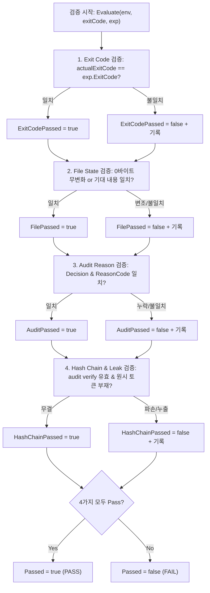

# 010. Quad-Assertion 검증 엔진 및 시나리오 하네스 코어 구현지시서

> **상태**: `Draft`
> **선행 조건**: Phase 4 (오케스트레이터 및 서브프로세스 격리) 완료
> **상위 대시보드**: [README.md](../README.md) | **마스터 설계**: [ROADMAP.md](../ROADMAP.md)

---

## 1. 목적 (Context & Why)

본 지시서는 7대 그룹 30개 E2E 시나리오(E2E-01 ~ E2E-30)의 자동 검증을 총괄할 **시나리오 하네스 코어(`internal/harness`)**와 단순 종료 코드 확인을 넘어 파일 상태, 감사 사유, 해시 체인 무결성을 동시에 증명하는 **Quad-Assertion 4중 불변식 판정 엔진**을 구축하는 작업이다.

보안 불변식에 따라:
1. **Quad-Assertion 4중 불변식 강제**:
   - 단순히 종료 코드만 맞추는 겉핥기 테스트를 전면 배제한다.
   - ① 기대 표준 Exit Code(`0`, `11`~`15`) 일치, ② 파일 상태(허용 시 기대 데이터 일치, 거부 시 0바이트 무변화 보장), ③ 감사 로그의 판정(`Decision`) 및 사유(`Reason`) 일치, ④ 감사 해시 체인(`prev_hash` 무결성 및 원시 토큰 비노출)을 동시에 검증하여 모두 만족할 때만 `PASS`로 판정한다.
2. **시나리오 간 완전한 샌드박스 격리 (Ephemeral Sandbox Isolation)**:
   - 시나리오 간 상태 누수나 오염을 원천 차단하기 위해, 각 시나리오 실행 시 임시 디렉터리 기반 Sandbox에 Zone A(서명키), Zone B(공개키, Grant, Replay 원장), Zone C(Workspace Jail), `audit.jsonl` 구조를 자동 생성하고 완료 후 안전하게 정리(Cleanup)한다.
3. **무대기(Zero-Sleep) 결정론적 가상 시계 지원**:
   - `time.Sleep`을 일체 사용하지 않고, 주입 가능한 `clock.Clock` 및 시간 오프셋 메커니즘을 통해 30개 시나리오를 수 초 내 초고속으로 완주한다.
4. **시나리오 인터페이스 및 라이프사이클 표준화**:
   - `Setup(env) -> Execute(env) -> QuadAssert(env) -> Teardown(env)` 수명주기를 표준화하여, 후속 단계(020)에서 30개 시나리오 카탈로그를 플러그인 형태로 손쉽게 등록·실행할 수 있도록 한다.

---

## 2. 패키지 배치 및 6계층 DAG 구조

```text
Layer 5:  [cmd/authz-harness]
                │
                v
Layer 5:  [internal/harness] (Core Harness, Sandbox & Quad-Assertion)
           ├── sandbox.go    (Zone A/B/C Ephemeral Sandbox Manager)
           ├── assertion.go  (Quad-Assertion Evaluation Engine)
           ├── scenario.go   (Scenario Interface & Metadata Schema)
           └── runner.go     (Scenario Execution Coordinator)
                │
                v
Layer 4:  [internal/orchestrator, internal/subagent]
Layer 3:  [internal/authz/pep]
Layer 2:  [internal/authn, internal/authz/pdp, internal/jail]
Layer 0/1: [internal/audit, internal/domain, internal/clock]
```

- **Layer 5 (`internal/harness`)**:
  - `sandbox.go`: 시나리오별 격리 환경 생성 및 자동 클린업
  - `assertion.go`: 4중 검증(Exit Code + File 0-mutation + Audit Reason + Hash Chain) 엔진
  - `scenario.go`: 시나리오 인터페이스 및 메타데이터 정의
  - `runner.go`: 등록된 시나리오 순차 실행 및 결과 수집기
- **금지 결합 (Forbidden Couplings)**:
  - `internal/harness`는 비즈니스 인가 규칙(PDP 결정 로직)을 직접 조작하지 않는다.
  - 시나리오 간 전역 상태나 디스크 디렉터리를 공유하지 않는다.

---

## 3. 세부 설계 및 인터페이스 계약

### 3.1 샌드박스 환경 관리자 (`internal/harness/sandbox.go`)

```go
package harness

import (
	"context"
	"os"
	"path/filepath"
	"time"

	"authz-harness/internal/audit"
	"authz-harness/internal/clock"
)

// SandboxConfig 는 격리 샌드박스 생성 설정이다.
type SandboxConfig struct {
	BaseDir   string        // 임시 루트 디렉터리 (공백 시 os.MkdirTemp 사용)
	ClockTime time.Time     // 가상 시계 기준 시각
}

// SandboxEnvironment 는 단일 시나리오가 실행되는 독립된 3-Zone 파일 및 감사 공간이다.
type SandboxEnvironment struct {
	RootDir      string      // 샌드박스 루트 경로
	PrivKeyPath  string      // Zone A: 서명 개인키 파일 경로
	PubJWKSPath  string      // Zone B: 공개 검증 키(JWKS) 파일 경로
	StatePath    string      // Zone B: Grant/Epoch 상태 파일 경로
	ReplayPath   string      // Zone B: Replay 방지 원장 파일 경로
	WorkspaceDir string      // Zone C: Workspace 격리 디렉터리 경로
	AuditPath    string      // 감사 로그 (audit.jsonl) 경로
	MockClock    clock.Clock // 결정론적 가상 시계
}

// NewSandboxEnvironment 는 독립된 임시 디렉터리에 Zone A/B/C 구조를 생성하고 초기화한다.
func NewSandboxEnvironment(cfg SandboxConfig) (*SandboxEnvironment, error)

// Cleanup 은 생성된 샌드박스 디렉터리와 모든 임시 리소스를 안전하게 제거한다.
func (env *SandboxEnvironment) Cleanup() error

// ReadWorkspaceFile 은 Zone C Workspace 디렉터리 내의 파일을 안전하게 읽는다.
func (env *SandboxEnvironment) ReadWorkspaceFile(relPath string) ([]byte, error)

// WorkspaceFileExists 는 Zone C Workspace 내 파일 존재 여부를 확인한다.
func (env *SandboxEnvironment) WorkspaceFileExists(relPath string) bool

// GetWorkspaceFileSize 는 Zone C Workspace 내 파일 크기(바이트)를 반환한다 (없으면 0).
func (env *SandboxEnvironment) GetWorkspaceFileSize(relPath string) int64

// ReadAuditEvents 는 샌드박스 내 audit.jsonl의 모든 감사 이벤트를 파싱하여 반환한다.
func (env *SandboxEnvironment) ReadAuditEvents() ([]audit.Event, error)
```

### 3.2 Quad-Assertion 4중 불변식 엔진 (`internal/harness/assertion.go`)

```go
package harness

import (
	"authz-harness/internal/domain"
)

// FileExpectation 은 파일 시스템 검증 명세다.
type FileExpectation struct {
	RelPath             string // 검증 대상 리소스 상대 경로
	ExpectExist         bool   // 파일 존재 여부 기대
	ExpectedContent     string // 허용 시 기대 파일 내용 (공백 시 내용 무검사)
	ExpectZeroMutation  bool   // 거부 시 파일 생성 0건 또는 0바이트 유지 보장
}

// AuditExpectation 은 감사 로그 검증 명세다.
type AuditExpectation struct {
	RequireEvent      bool              // 감사 이벤트 기록 필수 여부
	ExpectedAction    string            // 기대 액션 (예: "pep.allow", "pep.deny", "agent.exit")
	ExpectedDecision  string            // 기대 판정 ("allow", "deny", "")
	ExpectedReason    domain.ReasonCode // 기대 사유 코드 (예: domain.ReasonTokenExpired)
	ExpectedTraceID   string            // 단일 체인 trace_id 기대값
}

// HashChainExpectation 은 감사 해시 체인 및 데이터 무결성 검증 명세다.
type HashChainExpectation struct {
	RequireValidChain bool // SHA-256 해시 체인 무결성 검증 필수
	NoRawTokenLeak    bool // 원시 JWT Bearer 토큰 문자열 비노출 보장
}

// ExpectedAssertion 은 4중 불변식 검증 기준 명세다.
type ExpectedAssertion struct {
	ExitCode  domain.ExitCode       // 기대 표준 종료 코드 (0, 11~15)
	File      FileExpectation       // 파일 상태 기대값
	Audit     AuditExpectation      // 감사 로그 사유 기대값
	HashChain HashChainExpectation  // 감사 해시 체인 기대값
}

// AssertionResult 는 4중 검증 수행 결과다.
type AssertionResult struct {
	Passed             bool              // 4가지 검증 모두 통과 시 true
	ExitCodePassed     bool              // 1. 종료 코드 검증 결과
	ExitCodeActual     domain.ExitCode   // 실제 수거된 종료 코드
	FilePassed         bool              // 2. 파일 상태 검증 결과
	FileDetails        string            // 파일 상태 상세 내용
	AuditPassed        bool              // 3. 감사 로그 사유 검증 결과
	AuditActualReason  domain.ReasonCode // 실제 기록된 사유 코드
	AuditActualDecision string           // 실제 기록된 판정
	HashChainPassed    bool              // 4. 해시 체인 무결성 검증 결과
	FailureReasons     []string          // 실패 사유 목록
}

// Evaluator 는 샌드박스 실행 결과에 대해 Quad-Assertion을 수행하는 인터페이스다.
type Evaluator interface {
	Evaluate(env *SandboxEnvironment, actualExitCode domain.ExitCode, exp ExpectedAssertion) AssertionResult
}
```

### 3.3 시나리오 인터페이스 및 메타데이터 (`internal/harness/scenario.go`)

```go
package harness

import (
	"context"
	"time"

	"authz-harness/internal/domain"
)

// ScenarioMetadata 는 시나리오의 정적 설명 및 카탈로그 정보이다.
type ScenarioMetadata struct {
	ID                 string            `json:"id"`                  // "E2E-01" ~ "E2E-30"
	Group              string            `json:"group"`               // "G1" ~ "G7"
	Name               string            `json:"name"`                // 시나리오 명칭
	Description        string            `json:"description"`         // 시나리오 설명
	AttackClass        string            `json:"attack_class"`        // 정상 또는 공격 유형
	ParadoxExplanation string            `json:"paradox_explanation"` // 초보자용 역설 해설
	Expected           ExpectedAssertion `json:"expected"`            // 기대 4중 검증 스펙
}

// Scenario 는 하네스가 독립적으로 실행하고 검증할 수 있는 단위 시나리오 규약이다.
type Scenario interface {
	// Metadata 는 시나리오의 정적 정보와 기대 검증 스펙을 반환한다.
	Metadata() ScenarioMetadata

	// Setup 은 샌드박스 환경 내에 시나리오에 필요한 초기 상태(키, Grant, 파일 등)를 구성한다.
	Setup(ctx context.Context, env *SandboxEnvironment) error

	// Execute 는 시나리오의 실제 공격 또는 정상 워크플로를 실행하고 종료 코드를 반환한다.
	Execute(ctx context.Context, env *SandboxEnvironment) (domain.ExitCode, error)
}
```

### 3.4 하네스 러너 코어 (`internal/harness/runner.go`)

```go
package harness

import (
	"context"
	"time"
)

// ScenarioResult 는 단일 시나리오의 종합 실행 결과다.
type ScenarioResult struct {
	Metadata  ScenarioMetadata  `json:"metadata"`
	Passed    bool              `json:"passed"`
	Duration  time.Duration     `json:"duration"`
	Assertion AssertionResult   `json:"assertion"`
	Error     string            `json:"error,omitempty"`
}

// Runner 는 시나리오들을 등록하고 독립 샌드박스에서 실행하는 오케스트레이터다.
type Runner interface {
	// Register 는 카탈로그에 시나리오를 등록한다.
	Register(s Scenario) error

	// Get 은 ID로 시나리오를 조회한다.
	Get(id string) (Scenario, bool)

	// List 는 등록된 모든 시나리오 메타데이터 목록을 반환한다.
	List() []ScenarioMetadata

	// RunScenario 는 단일 시나리오를 격리 샌드박스에서 실행하고 Quad-Assertion을 수행한다.
	RunScenario(ctx context.Context, id string) (ScenarioResult, error)

	// RunAll 은 등록된 모든 시나리오를 순차 실행하고 결과를 수집한다.
	RunAll(ctx context.Context) ([]ScenarioResult, error)
}
```

---

## 4. Quad-Assertion 판정 불변식 및 알고리즘

`Evaluator.Evaluate(env, actualExitCode, exp)`는 다음 4단계 알고리즘을 순차적으로 수행한다:



1. **Assertion 1 (Exit Code)**:
   - `actualExitCode == exp.ExitCode` 대조.
   - 불일치 시 `FailureReasons`에 `"exit code mismatch: expected %d, got %d"` 기록.
2. **Assertion 2 (File State / Zero Mutation)**:
   - `exp.File.ExpectZeroMutation == true`인 경우:
     - 파일이 존재하지 않거나, 파일 크기가 0바이트여야 함. 크기가 1바이트 이상이면 즉시 실패.
   - `exp.File.ExpectExist == true`인 경우:
     - 파일이 존재해야 하고, `ExpectedContent`가 주어졌다면 내용이 100% 일치해야 함.
3. **Assertion 3 (Audit Reason)**:
   - `audit.jsonl`에서 해당 시나리오 `TraceID`의 이벤트들을 역순 탐색하여 최종 인가/인증 결정 이벤트(`pdp.decide`, `pep.allow`, `pep.deny`, `agent.exit`)의 `decision` 및 `reason`을 추출.
   - 기대한 `ExpectedDecision` 및 `ExpectedReason`과 대조.
4. **Assertion 4 (Hash Chain Integrity & Stream Purity)**:
   - `audit.VerifyHashChain`을 호출하여 SHA-256 해시 체인이 유효한지 검증.
   - 감사 레코드의 `Metadata`나 문자열 필드에 서명된 원시 Bearer 토큰(JWT `eyJ...`)이 노출되지 않았는지 정규식/스트링 스캔 검사.

---

## 5. 10대 인수 테스트 시나리오 선기술 (Pre-Written Acceptance Tests)

구현 착수 전, `internal/harness` 패키지에서 독립적으로 만족해야 하는 10대 인수 테스트 시나리오를 정의한다:

| 순번 | 테스트 함수명 | 입력 조건 | 기대 결과 |
|:---:|---|---|---|
| **AT-01** | `TestSandboxEnvironment_CreateAndLayout` | 기본 `SandboxConfig`로 환경 생성 | Zone A 개인키, Zone B JWKS/State/Replay, Zone C Workspace, Audit 파일 경로가 올바른 권한(`0700`/`0600`)으로 생성됨 |
| **AT-02** | `TestSandboxEnvironment_Cleanup` | 샌드박스 생성 후 파일 쓰기 및 `Cleanup()` 호출 | 루트 임시 디렉터리가 디스크에서 완전히 삭제되고 잔여 파일 0건 |
| **AT-03** | `TestQuadAssertion_SuccessCase` | 정상 읽기: Exit 0, 파일 일치, Audit `AUTHORIZED`, 유효 해시 체인 | `Passed: true`, 4개 검증 플래그 모두 true |
| **AT-04** | `TestQuadAssertion_ExitCodeMismatch` | Exit Code 기대값 0, 실제 반환값 11 | `Passed: false`, `ExitCodePassed: false`, 적절한 실패 사유 기록 |
| **AT-05** | `TestQuadAssertion_FileZeroMutationViolation` | 인가 거부(Zero Mutation 기대)인데 1바이트 파일 기록 발생 | `Passed: false`, `FilePassed: false`, 파일 불법 변조 적발 |
| **AT-06** | `TestQuadAssertion_AuditReasonMismatch` | 사유 기대값 `TOKEN_EXPIRED`, 실제 감사 사유 `NO_ACTIVE_GRANT` | `Passed: false`, `AuditPassed: false`, 사유 불일치 적발 |
| **AT-07** | `TestQuadAssertion_HashChainBroken` | 감사 로그 임시 수정하여 `prev_hash` 손상 유발 | `Passed: false`, `HashChainPassed: false`, 무결성 파손 적발 |
| **AT-08** | `TestQuadAssertion_RawTokenLeakDetection` | 감사 이벤트 메타데이터에 원시 JWT 토큰 주입 | `Passed: false`, `HashChainPassed: false`, 비밀값 누출 적발 |
| **AT-09** | `TestHarnessRunner_LifecycleSmoke` | 더미 긍정/부정 시나리오 등록 후 `RunScenario` 호출 | `Setup -> Execute -> QuadAssert -> Teardown` 순차 완주 및 정확한 `ScenarioResult` 반환 |
| **AT-10** | `TestHarnessRunner_NoCrossContamination` | 시나리오 A(Grant 생성 및 파일 쓰기) 후 시나리오 B(클린 상태 기대) 연속 실행 | 시나리오 B 실행 시 시나리오 A의 파일 및 Grant가 전혀 존재하지 않음 (상호 오염 0건) |

---

## 6. 사전 점검 및 실패 위험 분석 (Pre-Mortem)

| 위험 요소 | 실패 시나리오 | 방어 설계 (Countermeasure) |
|---|---|---|
| **임시 디렉터리 누수** | 테스트 도중 패닉이나 비정상 종료 시 임시 파일이 누적됨 | Go 테스트의 `t.TempDir()` 및 샌드박스의 `defer env.Cleanup()` 안전 보장 |
| **시간 의존성 오류** | 토큰 만료 검증 시 실제 시스템 시간에 의존하여 불안정하게 실패 | `clock.NewMockClock`을 샌드박스에 주입하여 결정론적 가상 시계 유지 |
| **감사 파싱 동시성 오류** | 다중 고루틴이나 프로세스가 감사 파일을 파싱하는 도중 쓰기 발생 | 샌드박스 단위로 시나리오가 격리되므로 각 시나리오는 독립된 `audit.jsonl` 파일 전용 소유 |
| **원시 토큰 오탐/미탐** | 마스킹되지 않은 토큰이 감사에 기록되는 위험 | 정규식 `eyJ[A-Za-z0-9-_=]+\.[A-Za-z0-9-_=]+\.?[A-Za-z0-9-_.+/=]*` 패턴 매칭 검증 |

---

## 7. 완료 조건 및 체크리스트

- [ ] `internal/harness/sandbox.go`: Zone A/B/C 구조의 Ephemeral Sandbox 생성 및 안전 클린업 구현
- [ ] `internal/harness/assertion.go`: Quad-Assertion 4중 불변식(Exit Code + File 0-mutation + Audit Reason + Hash Chain) 검증 엔진 구현
- [ ] `internal/harness/scenario.go`: `ScenarioMetadata` 및 `Scenario` 인터페이스 명세 구현
- [ ] `internal/harness/runner.go`: 시나리오 등록, 단일 및 일괄 실행 러너 구현
- [ ] `internal/harness/harness_test.go`: 10대 인수 테스트(AT-01 ~ AT-10) 100% 통과
- [ ] `go test -race ./internal/harness/...` 실행 시 Data Race 0건
- [ ] [05-자동-시나리오-테스트-하네스 대시보드](../README.md) 상태 갱신
