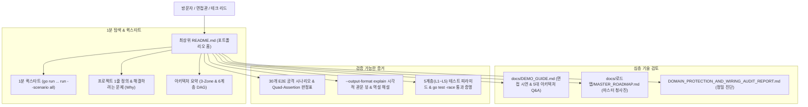

# [마스터 설계] 06-포트폴리오-패키징-및-문서화

> **상위 문서**: [대시보드](README.md) | [WHY.md](WHY.md) | [PLAN.md](PLAN.md) | [상위 마스터 로드맵](../MASTER_ROADMAP.md)

---

## 1. 개요 및 배경 (Context)

본 로드맵은 Phase 0부터 Phase 5까지 완성된 **Go 언어 기반 단일 리포지토리 로컬 권한 검증 및 테스트 하네스(Authorization Test Harness)**의 모든 엔지니어링 산출물을 외부 테크 리더, 아키텍트, 채용 담당자 관점에서 즉시 검토하고 재현할 수 있도록 최상위 문서(`README.md`), 기술 시연 가이드(`docs/DEMO_GUIDE.md`), 아키텍처 다이어그램 및 전 계층 테스트(L1~L5) 최종 무결성을 패키징하는 최종 마일스톤 설계도이다.

본 프로젝트가 증명하는 핵심 역량인:
1. **OAuth 2.1 및 RFC 8693 최소 권한 축소 위임(Downscoping)**
2. **NIST SP 800-162 기반 4대 인가 분리 (PAP/PIP/PDP/PEP)**
3. **Zone A/B/C 3-Zone 물리·논리 상태 격리**
4. **OS 서브프로세스 분리 및 Clean Env / Stdin JSON 격리 IPC**
5. **감사(Audit JSONL) ≠ 운영 로그(Stderr slog) ≠ 터미널 출력(Stdout)의 삼분 관측성**
6. **7대 그룹 30개 E2E 시나리오 및 Quad-Assertion 4중 불변식 자동 판정**

을 하나의 군더더기 없는 스토리로 엮어내어, **"1분 퀵스타트 한 줄로 실행하고 5분 안에 아키텍처 의도를 납득할 수 있는 포트폴리오"**로 완성한다.

---

## 2. As-Is vs To-Be

```text
[As-Is (Phase 5 완료 직후)]
- 코드 및 기능:
  - 6계층 전 패키지(Layer 0~5) 및 30개 E2E 시나리오 카탈로그 100% 동작 완비
  - Quad-Assertion 4중 불변식 엔진으로 120ms 만에 30개 공격 시나리오 완주 증명
- 문서화 상태:
  - 루트 디렉터리에 최상위 README.md 부재 (ROADMAP.md 포인터만 존재)
  - docs/로드맵/ 내부에 방대한 분석 보고서와 설계도가 있으나 외부인이 1분 안에 읽기에는 진입 장벽 존재
  - 면접이나 기술 리뷰 시 어떤 명령을 순서대로 보여주며 설명해야 하는지 표준 시연 가이드(Demo Script) 부재
- 한계:
  - 시스템의 엔지니어링 가치가 코드와 로드맵 폴더 내부에만 묻혀 있어, 저장소 홈 화면 방문자가 즉시 매력을 파악하기 어려움

[To-Be (Phase 6 완료 후)]
- 최상위 README.md 완비:
  - 1분 퀵스타트 (클론 직후 go run 명령 한 줄로 30개 시나리오 1초 내 실행)
  - 3-Zone 토폴로지 (Zone A 비밀키, Zone B 원장, Zone C 격리 공간)
  - 6계층 비순환 의존성(DAG) 다이어그램
  - 6단계 인가 관문(Gate 1~6) 상태 머신 다이어그램
  - 7대 그룹 30개 공격 시나리오 요약표 및 표준 종료 코드(0, 11~16) 매핑
  - 초보자용 Explain UX 및 "부정 테스트의 역설" 해설
- 기술 시연 가이드 (docs/DEMO_GUIDE.md):
  - 면접관을 사로잡는 5분 핵심 요약 스피치 (Elevator Pitch)
  - 8대 CLI 핵심 시연 시나리오 (정상 위임, 키 회전, 권한 회수, 탈출 차단, 장부 변조 적발)
  - 기술 면접 예상 질문 및 5대 아키텍처 방어 논리 (Q&A)
- 전 계층 무결성 증명:
  - L1(단위) ~ L2(퍼징) ~ L3(동시성 -race) ~ L4(CLI 계약) ~ L5(30대 E2E) 무결 완주 확인
  - 빌드 및 실행 간 수치/옵션명/종료코드 불일치 0건 보장
```

---

## 3. 문서 및 포트폴리오 패키징 구조도



---

## 4. 4층위 검증 범위 설계 (Four-Tier Verification)

| 층위 | 검증 목적 | 검증 대상 및 도구 | 완료 기준 |
|:---:|---|---|---|
| **1층위**<br>(수동 반복 배제) | 문서에 기재된 모든 CLI 명령어가 실제로 정상 동작하는지 자동 스크립트로 검증 | `scripts/` 또는 명령행 테스트 실행 | `README.md` 및 `DEMO_GUIDE.md`에 적힌 예시 명령어 복사-붙여넣기 시 100% 정상 작동 |
| **2층위**<br>(문서 정합성 검증) | 문서에 기술된 종료 코드, 플래그명, 사유 코드와 실제 Go 코드 상수 일치 | `internal/domain` 및 CLI 코드 대조 | 불일치 0건 (상수 오기, 잘못된 플래그 옵션 0건) |
| **3층위**<br>(동시성 & 보안 무결성) | 데이터 레이스 및 시크릿 유출 없는 완벽한 보안성 증명 | `go test -race ./...` | 전 패키지 동시성 경합 0건, Zero-Leakage 사수 |
| **4층위**<br>(하네스 완주 검증) | 30대 시나리오 전 구간 일괄 실행 및 Quad-Assertion 통과 | `authz-harness run --scenario all` | 30건 전 항목 PASS, 1초 이내 완주, 종료 코드 `0` |

---

## 5. 사전 점검 및 실패 위험 분석 (Pre-Mortem)

1. **위험 1: 문서에 적힌 CLI 명령어와 실제 플래그명의 불일치**
   - *위험 시나리오*: 방문자가 `README.md`에 적힌 명령어를 복사했는데 `--state-dir`이나 `--fail-audit-mode` 같은 플래그명이 실제 코드와 달라 에러가 발생하는 경우.
   - *방어책*: 작성된 모든 CLI 예시를 실제 셸에서 직접 실행하고 결과를 그대로 발췌하여 문서에 수록한다.
2. **위험 2: 구현되지 않은 기능의 과장 서술 (Resume Fraud / Spec Drifting)**
   - *위험 시나리오*: 마스터 청사진에는 구상되었으나 실제 코드에는 빠져 있는 기능을 마치 완벽히 구현된 것처럼 과장 기재하여 기술 면접에서 신뢰를 잃는 경우.
   - *방어책*: 실제 소스 코드와 30개 시나리오에서 증명된 내용만을 단호하게 기술하며, 이상(Future Scope)과 현실(Current Implementation)의 경계를 명확히 분리한다.
3. **위험 3: 다이어그램의 복잡성으로 인한 가독성 저하**
   - *위험 시나리오*: 지나치게 복잡한 다이어그램으로 인해 1분 안에 시스템의 핵심을 이해하지 못하고 이탈하는 경우.
   - *방어책*: 최상위 `README.md`에는 3-Zone 토폴로지와 6단계 인가 관문 파이프라인의 핵심만 단순하고 직관적인 Mermaid 다이어그램 및 ASCII 아트로 표현하고, 복잡한 세부 명세는 `docs/` 하위 정본으로 링크한다.

---

## 6. 단계별 상세 계획 (Instructions Breakdown)

### 010: 리포지토리 최상위 `README.md` 및 아키텍처 다이어그램 완비
- **주요 산출물**: `README.md`
- **핵심 내용**:
  1. 프로젝트 1줄 정의 및 해결하려는 핵심 문제 (Why OAuth 2.1 & Least Privilege)
  2. 1분 퀵스타트 가이드 (원클릭 빌드 및 `run --scenario all` 30대 시나리오 즉시 검증)
  3. 3-Zone 상태 격리 토폴로지 (Zone A 비밀키, Zone B 원장, Zone C 격리 작업장) 다이어그램
  4. 6계층 비순환 의존성(DAG) 아키텍처 다이어그램
  5. 6단계 인가 관문(Gate 1~6) 상태 머신 및 판정 흐름도
  6. 7대 그룹 30개 E2E 시나리오 매핑표 및 Quad-Assertion 4중 불변식 설명
  7. 초보자 친화적 Explain UX 및 부정 테스트 역설 해설

### 020: 면접관용 기술 시연 가이드(`docs/DEMO_GUIDE.md`) 및 아키텍처 Q&A 작성
- **주요 산출물**: `docs/DEMO_GUIDE.md`
- **핵심 내용**:
  1. 5분 핵심 요약 엘리베이터 피치 (Elevator Pitch)
  2. 8대 핵심 CLI 시연 시나리오 (정상 토큰 발급, RFC 8693 축소 위임, 키 무중단 회전, 폐기 즉시 차단, 경로 탈출 방어, 감사 장부 변조 적발)
  3. 기술 면접 예상 질문 & 5대 아키텍처 방어 논리 (Q&A):
     - Q1. 왜 PDP와 PEP를 엄격하게 분리했는가?
     - Q2. 서브프로세스 분리와 `stdin` JSON 프레임 방식을 왜 택했는가?
     - Q3. 감사 로그에 왜 해시 체인을 달았고 Fail-Closed 정책은 왜 중요한가?
     - Q4. 축소 위임(Downscoping)에서 수학적 부분집합은 어떻게 보장하는가?
     - Q5. TOCTOU 경합(권한 회수와 I/O 실행 사이)을 어떻게 방어하는가?
  4. Zero Leakage 감사 증거 및 원시 토큰 비노출 증명

### 030: 전 계층(L1~L5) 테스트 최종 검증 및 마스터 로드맵 마감
- **주요 산출물**: 전 패키지 테스트 검증 로그, `docs/로드맵/` 전체 대시보드 마감 결산
- **핵심 내용**:
  1. `go test -race ./...` 전 패키지 동시성 무결성 최종 완주 검증
  2. `authz-harness run --scenario all` 30/30 PASS 1초 내 완주 최종 확인
  3. `docs/로드맵/README.md` 및 `ROADMAP.md` 전체 로드맵 상태 최종 동기화
  4. Phase 06 완료 결산 및 최종 마감
