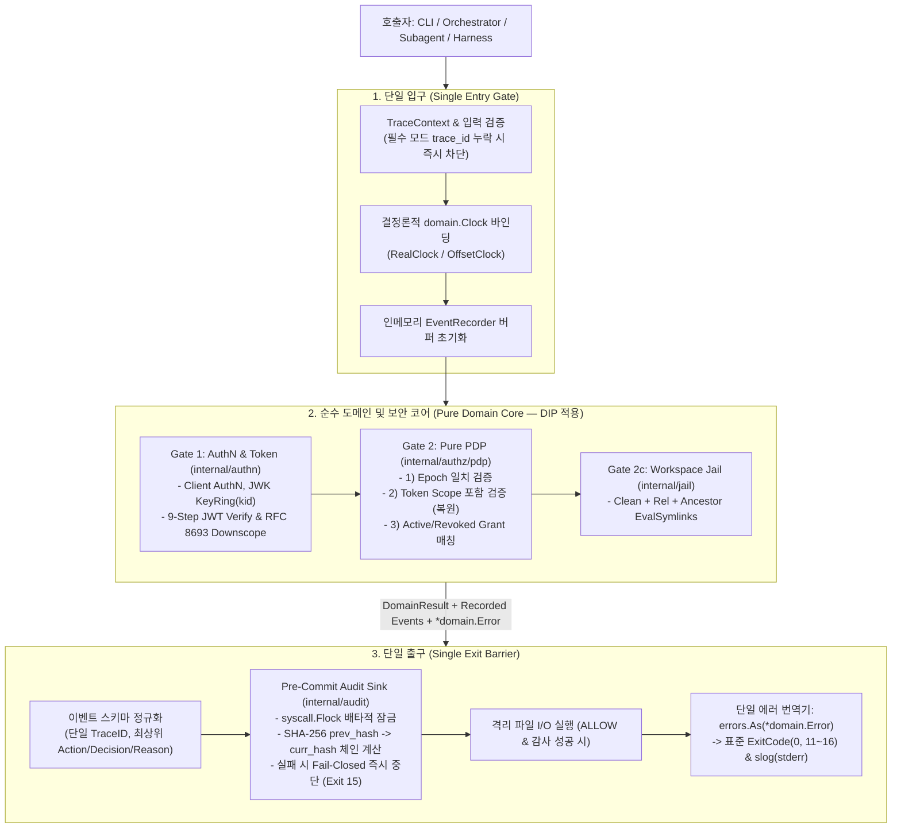

# [마스터 설계] 07-도메인보호-및-단일입출구-배선-고도화

> **상위 문서**: [대시보드](README.md) | [WHY.md](WHY.md) | [PLAN.md](PLAN.md) | [상위 마스터 로드맵](../MASTER_ROADMAP.md) | [감사 보고서](../../../DOMAIN_PROTECTION_AND_WIRING_AUDIT_REPORT.md)

---

## 1. 개요 및 배경 (Context)

본 로드맵은 00번~06번 로드맵 구현 완료 후 수행된 전수 코드 감사([DOMAIN_PROTECTION_AND_WIRING_AUDIT_REPORT.md](../../../DOMAIN_PROTECTION_AND_WIRING_AUDIT_REPORT.md))에서 도출된 **12대 안티패턴(AP-01 ~ AP-12)**을 구조적으로 제거하고, **순수 도메인 보호 및 의존성 역전(DIP)**과 **단일 입구 · 단일 출구(Single Entry / Single Exit, SESE) 감사·로그 배선 아키텍처**를 확립하는 마스터 설계도이다.

주문·결제 MSA 및 분산 멀티 에이전트 시스템의 엔터프라이즈 표준 패턴을 본 시뮬레이터에서 한 치의 왜곡 없이 재현하기 위해, ① 구조화된 도메인 에러(`*domain.Error`), ② 순수 PDP의 Scope·Epoch·Grant 통합 결정, ③ 단일 출구 SHA-256 해시 체인 및 `syscall.Flock` 감사 기록, ④ 비신뢰 워커의 신뢰 경계 복원(데코레이터 분리), ⑤ 공통 인프라 통합, ⑥ 동어반복(Vacuous Pass) 없는 엄격한 4중 검증 및 도메인·배선 분리 테스트를 6개 단계(`010`~`060`)에 걸쳐 완성한다.

---

## 2. As-Is vs To-Be

```text
[As-Is (06번 로드맵 완료 직후 — 12대 안티패턴 존재 상태)]
- 도메인 침투 및 월권:
  - AP-01: 토큰 Scope 검증(tokenScopeAllows)이 순수 PDP가 아닌 PEP(pep/gateway.go)에 구현되어 있으며 "*"/"admin" 임의 우회 존재
  - AP-02: 6개 핵심 서비스(pdp, pap, keys, issuer, verifier, exchange)가 직접 디스크 감사 I/O 호출
  - AP-03: 비신뢰 자식 워커(subagent/worker.go)가 Zone B state.Store를 직접 주입받아 모든 Grant를 Revoke함
- 다중 출구 배선 파편화:
  - AP-04: 서비스마다 audit.Event의 최상위 Decision/Reason vs Metadata["reason"] 기록 위치와 Action 명칭이 제각각임
  - AP-05: pdp.Decide, pap 등이 상위 TraceID를 무시하고 "pdp-%d" 등 독자적 TraceID를 즉석 생성해 추적 단절
  - AP-06: audit.JSONLWriter에 syscall.Flock 및 SHA-256 해시 체인(prev_hash/curr_hash) 계산 로직이 없음
- 동어반복(가짜 통과) 테스트 및 강결합:
  - AP-07: assertion.go가 해시 필드가 비어 있으면 해시 검증을 건너뛰어 가짜 통과(Vacuous Pass)시키며, E2E-30은 RequireValidChain: false로 변조 검사를 회피함
  - AP-08: assertion.go가 ExpectedAction 불일치 시 if !found 폴백으로 필터를 버리고 아무 이벤트나 매칭함
  - AP-09: E2E-28(trace_id 누락)이 실제로는 빈 Action("")으로 ExitBadInput을 유도하며, 카탈로그에 실제 서브프로세스 E2E 경유 검증이 빠짐
  - AP-10~12: strings.Contains 에러 문자열 분기, 스택 조립 5중 복제(FD 누수), 저장소 3중 복제, 기본 Audience("authz-service" vs "authz-harness") 불일치 및 keys.Clock 중복

[To-Be (07번 로드맵 완료 후 — 엔터프라이즈 SESE & DIP 표준 완성)]
- 철저한 도메인 보호 및 의존성 역전 (DIP):
  - Layer 0 (internal/domain): 구조화된 *domain.Error(Reason, Stage, ExitCode 내장), 단일 Clock, TraceContext, EventRecorder 계약 보유
  - Layer 2B (internal/authz/pdp): Evaluate 순수 함수가 [1. Epoch -> 2. Token Scope -> 3. Active/Revoked Grant]를 통합 판정 (파일 I/O 의존성 0%)
  - Layer 4 (internal/subagent): 워커에서 state.Store 완전 제거, 결함 주입은 PEP/Audit 데코레이터로만 외부 조립
- 단일 입구 · 단일 출구 (Single Entry / Single Exit) 배선:
  - 단일 입구: 진입 시 TraceID 검증(필수 모드 누락 시 MISSING_TRACE_CONTEXT 거부), 단일 Clock 및 EventRecorder 바인딩
  - 단일 출구: 최상위 Action/Decision("allow"|"deny")/Reason/TraceID 일원화, syscall.Flock 잠금 하에 SHA-256 prev_hash -> curr_hash 체인 강제 기록 및 VerifyHashChain 검증, errors.As(*domain.Error) 단일 종료 코드 번역
- 정직한 4중 검증(Quad-Assertion) 및 직교 분리 테스트:
  - 가짜 통과(Vacuous Pass) 및 무단 폴백 완전 제거, E2E-28·E2E-30 정직한 검증 복원, 서브프로세스 E2E 검증 포함
  - Track A(무-I/O 순수 도메인 테스트)와 Track B(단일 입출구 배선 독립 테스트) 완비
```

---

## 3. 시스템 아키텍처 (SESE 파이프라인 및 의존성 역전 구조)

### 3.1 단일 입구 · 단일 출구 (Single Entry / Single Exit) 실행 흐름도



### 3.2 의존성 역전(DIP) 및 6계층 비순환 의존성 구조

```text
Layer 5: [cmd/authz-harness]  [internal/cli]  [internal/harness]  [internal/ui]
               │ (단일 스택 빌더 & 데코레이터 조립)
               v
Layer 4: [internal/orchestrator] (Parent Spawner)   [internal/subagent] (Child Worker — state.Store 참조 0%)
               │
               v
Layer 3: [internal/authz/pep] (Single Entry -> Gate 1 -> Gate 2 -> Gate 2c -> Single Exit 조율 + Fault Decorators)
               │
       ┌───────┴───────────────────────────┬───────────────────────────┐
       v                                   v                           v
Layer 2A: [internal/authn]          Layer 2B: [internal/authz]  Layer 2C: [internal/jail]
  (keys, token, exchange)             (pap, pip, pdp)             (WorkspaceJail)
  * domain.Clock 단일 사용            * pdp.Evaluate:             * 물리 경로 격리
  * *domain.Error 반환                  Epoch+Scope+Grant 통합
       │                                   │                           │
       └───────┬───────────────────────────┴───────────────────────────┘
               v
Layer 1: [internal/audit] (syscall.Flock + SHA-256 HashChain + VerifyHashChain)
               │
               v
Layer 0: [internal/domain] (*domain.Error, Reason->ExitCode 매핑, Clock, Trace, Constants)
```

---

## 4. 파급 범위와 무영향 근거 증명 (Impact & Non-Impact Proof)

| 대상 영역 | 변경 범위 (Touched) | 무영향 보장 범위 및 근거 (Untouched / Preserved) |
|---|---|---|
| **도메인 기초 (`internal/domain`)** | `error.go`(`*domain.Error`), `DefaultAudience = "authz-harness"` 상수, Scope 매칭 헬퍼 추가 | 기존 `ExitCode(0, 11~16)`, `Reason` 상수값, `Grant`, `Epoch`, `TokenClaims`, `JWK` JSON 직렬화 태그는 100% 하위 호환 유지. |
| **인가 결정 및 집행 (`pdp`, `pep`)** | `pep`의 `tokenScopeAllows`를 `pdp.Evaluate`로 이관하고 `pdp.Request`에 `Scope` 필드 추가(비어 있을 경우 하위 호환 옵션 지원) | 기존 `pdp_test.go` 및 `pep_test.go`의 정상/거부 판정 결과와 종료 코드는 그대로 유지되면서 Scope 검증 누락만 보강됨. |
| **감사 기록기 (`internal/audit`)** | `Event`에 `PrevHash`, `CurrHash` 추가(및 `Metadata` 동기화), `JSONLWriter`에 `syscall.Flock` 및 SHA-256 체인 자동 계산, `VerifyHashChain` 추가 | 기존 `audit.Writer` 인터페이스(`Log(Event) error`, `Close() error`) 시그니처가 동일하므로 호출부 인터페이스가 깨지지 않음. |
| **워커 및 데코레이터 (`subagent`, `pep`)** | `subagent.SubagentWorker` 내부의 `stateStore` 직접 수정 코드를 `pep.Gateway` 데코레이터로 분리 | `stdin` JSON 프레임(`SubagentRequest`/`SubagentResponse`) 스키마와 CLI 플래그(`--inject-revoke-before-io`) 동작은 100% 동일하게 보존됨. |
| **시나리오 하네스 (`internal/harness`)** | `assertion.go`의 해시 체인 강제 검증 및 `ExpectedAction` 정규화, `E2E-28`·`E2E-30` 검증 정직화 | 30대 시나리오 ID(`E2E-01`~`E2E-30`), 그룹(`G1`~`G7`), CLI `run --scenario all` 인터페이스는 변함없이 유지됨. |

---

## 5. 사전 점검 및 실패 위험 분석 (Pre-Mortem)

| 위험 요소 | 실패 시나리오 | 방어 설계 (Countermeasure) |
|---|---|---|
| **하위 호환성 파손 위험** | `pdp.Evaluate`에 `Scope` 검증을 필수화했을 때, 토큰 없이 순수 Grant만 실험하는 기존 `pdp decide` CLI나 단위 테스트가 `TOKEN_INSUFFICIENT_SCOPE`로 실패함 | `pdp.Request`에서 `Scope`가 명시된 경우(PEP 경유 또는 `--scope` 지정 시)에만 Scope 포함 여부를 강제하고, 순수 Grant 조회 모드와 토큰 결합 모드를 명확히 구분하여 기존 `pdp_test.go` 100% 호환 보장. |
| **다중 프로세스 해시 체인 계산 경합** | 부모(`orchestrator`)와 자식(`subagent`)이 별도 프로세스에서 `audit.NewJSONLWriter`를 열 때 메모리의 `prevHash`만 믿으면 체인이 어긋남 | `JSONLWriter.Log`가 `syscall.Flock(LOCK_EX)`을 획득한 직후 파일 끝(마지막 유효 JSON 줄)에서 직전 `curr_hash`를 읽어 체인을 잇도록 설계하여 다중 프로세스 간에도 단일 해시 체인 정합성 100% 보장. |
| **해시 계산 시 JSON 역직렬화 타입 불일치 및 자기 참조 모순** | `Event`에 `curr_hash`를 넣은 뒤 다시 마샬링할 때 필드 순서나 JSON 역직렬화 시 `int64`가 `float64`로 바뀌어 사후 검증 시 해시가 어긋남 | `audit.ComputeEventHash(prevHash, event)`를 임의 JSON 직렬화에 의존하지 않고, 불변 핵심 필드(PrevHash, Timestamp(RFC3339Nano), TraceID, Actor, Action, Resource, Decision, Reason, Success)의 고정 구분자(`\|`) 파이프 포맷으로 규정하여 100% 결정론적 해시 일치 보장. |
| **엄격화된 `assertion.go`에서의 액션명 불일치** | `pep`는 `"pep.file:read"`를 기록하고 카탈로그는 `"pep.allow"`/`"pep.deny"`를 기대하여 1차 검색이 실패함 | 단일 출구 감사 기록 시 `Step`에 세부 단계를 남기고 `Action`을 표준 이벤트명(`pep.allow`, `pep.deny`, `token.issue.deny`, `token.exchange.deny`, `pdp.decide`)으로 정규화하여 폴백 없이 1차 검색에서 정확히 일치시킴. |
| **`E2E-30` 감사 변조 적발 실행 절차 불일치** | 감사 파일을 변조하기만 하고 `PEP.Execute`의 정상 종료 코드(0)를 반환하면 검증기와 종료 코드 불일치 발생 | `e2e30Scenario.Execute` 내부에서 파일 변조 직후 `audit.VerifyHashChain`을 직접 호출하여 반환된 에러를 `domain.ExitCodeFromError`로 번역함으로써 실제 종료 코드 `15`(`ExitAuditFailure`)를 명시적으로 반환. |
| **서브프로세스 경유 시 컴파일 바이너리 부재 위험** | 30대 카탈로그 전체를 서브프로세스로 강제 전환하면 `go test` 환경에서 바이너리 미존재 시 전체 테스트가 실패함 | 일상 회귀 검증(30대 카탈로그)은 고속 단일 스택(`StackBuilder`)을 유지하고, OS 서브프로세스 격리 E2E 검증은 `internal/orchestrator/spawner_test.go` 및 전용 통합 테스트(`TestSubprocessE2E`)로 역할을 명확히 분리. |

---

## 6. 4층위 검증 범위 설계 (Verification Grid)

1. **1층위 (자동화 스크립트 및 정적 아키텍처 검증)**:
   - `go vet ./...` 및 AST 정적 검사 테스트를 통해:
     - `internal/authz/pdp`가 `os`, `path/filepath`, `internal/jail`을 import하지 않음을 증명.
     - `internal/subagent`가 `internal/authz/state`를 import하거나 직접 수정하지 않음을 증명.
     - 코드베이스 내 `strings.Contains(err.Error(), ...)` 패턴이 0건임을 증명.
2. **2층위 (단위 및 구조 분리 검증 — Track A & Track B)**:
   - **Track A (순수 도메인 무-I/O 단위 테스트)**: 디스크나 임시 파일 없이 메모리 구조체만으로 `pdp.Evaluate`(Epoch + Scope + Grant), `exchange.ValidateDownscope`, `*domain.Error` 매핑 검증.
   - **Track B (단일 입출구 배선 독립 테스트)**: Stub 도메인을 연결하여 단일 `TraceID` 스탬핑, 최상위 `Decision`/`Reason` 정규화, 해시 체인 생성 및 에러→`ExitCode` 번역 검증.
3. **3층위 (상태 및 정합성 검증)**:
   - 다중 고루틴/다중 프로세스가 동시에 `audit.JSONLWriter`에 기록할 때 `audit.VerifyHashChain`이 단 한 줄의 깨짐 없이 통과하고, 파일 중 1바이트만 변조해도 즉시 `ErrAuditIntegrityBroken`(`REASON_AUDIT_INTEGRITY_BROKEN`)을 반환함을 검증.
4. **4층위 (전체 통합 검증 — L4 CLI 계약 & L5 30대 E2E 하네스)**:
   - `go test -race ./...` 전 패키지 통과.
   - `authz-harness run --scenario all` 실행 시 해시 체인 가짜 통과나 폴백 우회 없이 30개 시나리오 전 항목 진정한 `PASS` 달성.

---

## 7. 세부 단계 구성 및 인수 조건 (`010` ~ `060`)

| 단계 | 세부 작업 명칭 | 해결 대상 결함 | 핵심 인수 테스트 기준 |
|:---:|---|---|---|
| **010** | [구조화 도메인 에러 및 단일 시계·상수 통합](instructions/010_구조화_도메인_에러_및_단일_시계_상수_통합.md) | `AP-10`, `AP-12` | `*domain.Error` 및 `errors.As` 도입, 코드 내 `strings.Contains(err.Error())` 0건, 기본 `Audience` `"authz-harness"` 통일, `keys.Clock` 제거 및 `domain.Clock` 일원화 |
| **020** | [순수 PDP 스코프 검증 복원 및 도메인 이벤트 분리](instructions/020_순수_pdp_스코프_검증_복원_및_도메인_이벤트_분리.md) | `AP-01`, `AP-02` | `pep`의 `tokenScopeAllows`를 `pdp.Evaluate`로 이관(`"*"`/`"admin"` 우회 제거), Write Grant가 있어도 Read 토큰 제시 시 `pdp.Evaluate`가 `TOKEN_INSUFFICIENT_SCOPE` 반환 |
| **030** | [단일 출구 감사 해시 체인·`flock` 및 추적성 정규화](instructions/030_단일출구_감사_해시체인_flock_및_추적성_정규화.md) | `AP-04`, `AP-05`, `AP-06` | `audit.JSONLWriter`에 `syscall.Flock` + SHA-256 `prev_hash`/`curr_hash` 자동 부착 및 `VerifyHashChain` 구현, `pdp.Decide` 등에 상위 `TraceID` 전파, 최상위 `Action`/`Decision`/`Reason` 정규화 |
| **040** | [워커 신뢰 경계 복원 데코레이터 및 공통 인프라 통합](instructions/040_워커_신뢰경계_복원_데코레이터_및_공통_인프라_통합.md) | `AP-03`, `AP-11` | `subagent/worker.go`에서 `stateStore` 완전 제거 및 `pep.Gateway` 데코레이터 분리, 공통 원자적 파일 저장소 및 단일 스택 빌더(`Close` 포함) 도입 |
| **050** | [하네스 4중 검증 엄격화 및 30대 시나리오 진실성 복원](instructions/050_하네스_4중검증_엄격화_및_30대_시나리오_진실성_복원.md) | `AP-07`, `AP-08`, `AP-09` | `assertion.go`에서 빈 해시 통과 및 `if !found` 폴백 제거, `E2E-28`(진짜 `TraceID` 누락) 및 `E2E-30`(변조 시 해시 체인 파손 적발) 정직화, 서브프로세스 E2E 시나리오 검증 통과 |
| **060** | [도메인·배선 분리 테스트 확립 및 전체 무결성 마감](instructions/060_도메인_배선_분리_테스트_및_전체_무결성_마감.md) | 전 항목 종합 | Track A(무-I/O 순수 도메인 테스트) + Track B(단일 입출구 배선 테스트) 완비, `go test -race ./...` 및 `run --scenario all` 30/30 무결 통과, `결과정리및리뷰.md` 작성 |

---

## 8. 완료 및 마감 기준

1. 감사 보고서의 12대 안티패턴(`AP-01` ~ `AP-12`)이 코드상에서 100% 제거되었음이 정적 분석 테스트와 단위·통합 테스트로 증명된다.
2. 도메인 로직 테스트(Track A)는 디스크 I/O 없이 실행되고, 배선 테스트(Track B)는 도메인 정책 변경과 무관하게 독립 통과한다.
3. `authz-harness run --scenario all` 실행 시 30개 시나리오 전체가 실제 SHA-256 해시 체인 검증과 정확한 `TraceID`/`Action`/`Reason` 매칭 하에 100% `PASS`한다.
