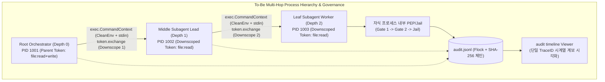
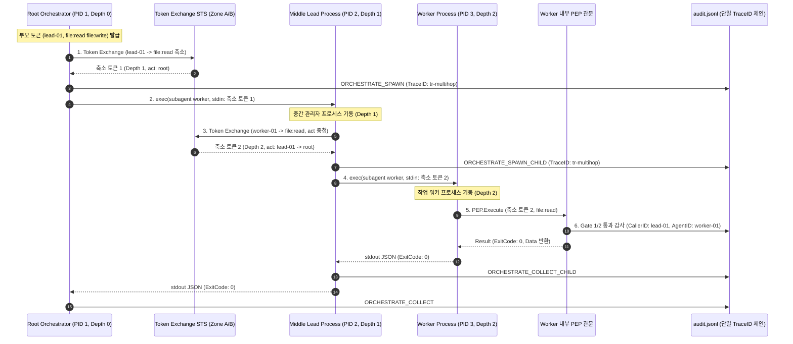

# [마스터 설계] 08-서브프로세스-전구간-e2e-통합-및-다단계-위임-실증

> **문서 상태**: `Draft (Plan Approved)`  
> **상위 색인**: [전체 로드맵 색인](../README.md) | 대시보드: [README.md](README.md) | 작업 계획: [PLAN.md](PLAN.md) | 배경과 의도: [WHY.md](WHY.md) | 근거 보고서: [005-다중프로세스 권한위임 아키텍처 재점검 보고서](../../보고서/005-다중프로세스_권한위임_시뮬레이션_증명역량_및_차기로드맵_보고서.md)

---

## 1. 아키텍처 배경 및 As-Is / To-Be 비교

### 1.1 As-Is (현재 상태의 한계)
- **E2E 하네스 인메모리 호출 국한**: `authz-harness run --scenario all` 실행 시 30대 카탈로그가 `stack.PEP.Execute()`를 직접 인메모리로 호출. 단위 프로세스 통합 테스트([`internal/cli/orchestrate_test.go`](../../../internal/cli/orchestrate_test.go))에서만 실제 서브프로세스를 검증함.
- **다단계(Multi-Hop) 프로세스 연쇄 미실증**: 토큰 교환기(`ExchangeService`)는 `DelegationDepth`와 `act` 중첩 체인을 완비하고 있으나, 실제 OS 프로세스 3대(부모 → 중간자 → 워커)가 연쇄 스폰되는 통합 시나리오가 부재함.
- **감사 로그 시계열 시각화 부재**: `audit.jsonl`이 기계 판독용 JSON 라인으로만 누적되어 복잡한 다중 프로세스의 인가 흐름을 인간이 직관적으로 파악하기 어려움.
- **의존성 조립 코드 5중 중복**: `cli/pep.go`, `cli/subagent.go`, `cli/orchestrate.go`, `catalog/helpers.go` 등에 스택 초기화 보일러플레이트가 산재함.

### 1.2 To-Be (08번 로드맵 완료 후의 모습)
- **전 구간 실제 OS 서브프로세스 실행 (`--execution-mode subprocess`)**: 하네스 실행 시 실제 임시 바이너리를 통해 격리된 자식 프로세스를 스폰하고 `stdin` JSON 주입 및 OS Exit Code를 수거하여 4중 검증(Quad-Assertion) 수행.
- **다단계(Multi-Hop) 2-Hop 프로세스 체인 실증 (`E2E-31`, `E2E-32`)**: 부모(Depth 0) → 팀장(Depth 1) → 워커(Depth 2)로 이어지는 연쇄 스폰 및 RFC 8693 위임 축소 검증을 32대 카탈로그로 확장.
- **감사 타임라인 CLI (`authz-harness audit timeline`)**: 단일 `trace_id` 하에 기록된 다중 프로세스의 인가 사건들을 프로세스 계보 트리(`CallerID` → `AgentID`)와 시간순 파이프라인으로 터미널 시각화.
- **단일 합성 루트(`internal/app/builder.go`) 및 제네릭 저장소**: 전역 조립 인프라를 일원화하고 Control Plane의 감사 에러 전파 무결성을 완성.

---

## 2. 3-Zone 서브프로세스 IPC 및 위임 토폴로지

### 2.1 프로세스 간 격리 및 통신 불변식
1. **환경 격리 (Zero Inherited Secrets)**: 부모 프로세스는 자식 서브프로세스를 스폰할 때 `SanitizeEnv`를 거쳐 `ZONE_A_*`, `PRIVATE_KEY_*` 등 민감 환경변수를 전면 박탈하고, 최소한의 시스템 환경변수(`PATH`, `TMPDIR` 등)만 전달한다.
2. **토큰 전달 채널 (Zero ps aux Leak)**: CLI 인자(`args`)에 토큰 문자열을 노출하지 않고 오직 `stdin` 파이프 단일 프레임(`subagent.SubagentRequest` JSON)으로만 주입한다.
3. **단일 감사 해시 체인 직렬화**: 여러 프로세스가 동시에 기동되더라도 `audit.jsonl` 기록 시 OS 수준 `syscall.Flock` 배타적 파일 잠금을 획득하여 줄 깨짐 및 해시 체인 단절을 원천 방지한다.

### 2.2 2-Hop 다단계 위임 시퀀스 다이어그램

---

## 3. 사전 점검 및 실패 위험 분석 (Pre-Mortem)

> **"만약 이 구현이 실패하거나 불안정해진다면 무엇 때문일까?"**

| 위험 요인 | 실패 시나리오 | 선제적 방어책 및 설계 |
|---|---|---|
| **1. 테스트 실행 속도 저하** | 32개 시나리오마다 `go build`를 반복 호출할 경우 테스트 완주 시간이 수십 초 이상 지연됨 | 테스트 스위트 진입 시 `sync.Once`를 통해 임시 바이너리를 1회만 컴파일하고 전체 시나리오가 동일 바이너리 경로를 공유하도록 캐싱 |
| **2. OS 파이프 버퍼 데드락** | 자식 프로세스가 대량의 `stdout`/`stderr`를 쏟아낼 때 부모가 `cmd.Wait()`를 먼저 호출하면 OS 파이프 버퍼(64KB)가 가득 차 영구 정지됨 | `cmd.Stdout`, `cmd.Stderr`에 `bytes.Buffer`를 바인딩하여 `cmd.Run()`이 I/O 드레인을 완결한 후 종료 코드를 수거하도록 안전 배선 |
| **3. 다단계 프로세스 좀비 누수** | 중간 프로세스가 패닉 또는 타임아웃될 경우 손자(Grandchild) 프로세스가 고아(Orphan) 프로세스로 남음 | 부모 컨텍스트(`context.WithTimeout`)를 자식 프로세스 트리에 전파하고, 프로세스 그룹 종료 또는 하네스 클린업에서 확실한 정리 보장 |
| **4. 동시 다중 프로세스 해시 경쟁** | 부모, 중간자, 자식 프로세스가 동일한 `audit.jsonl`에 동시 기록할 때 `prev_hash` 충돌 발생 위험 | `internal/audit/audit.go`의 `syscall.Flock` 구간 내에서 파일의 마지막 해시를 실시간 재조회(Tail Seek)하여 해시 체인을 연결하는 원자적 추가 메커니즘 보장 |

---

## 4. 4층위 검증 범위 설계

- **1층위 (수동 반복 배제)**:
  - `authz-harness run --execution-mode subprocess --scenario all` 단일 명령으로 32대 시나리오 전체 자동 판정.
- **2층위 (단위 및 구조 검증)**:
  - `internal/storage/atomic_test.go`: 제네릭 `AtomicFileStore[T]`의 동시성 파일 쓰기 및 잠금 검증.
  - `internal/app/builder_test.go`: 단일 합성 루트의 인스턴스 초기화 및 리소스 해제(`Close`) 검증.
- **3층위 (상태 및 정합성 검증)**:
  - `audit verify`: 다중 프로세스 동시 기록 후 `audit.jsonl`의 SHA-256 해시 체인 무결성 검증.
  - `authz-harness audit timeline`: 단일 `trace_id`의 계보 트리 정합성 검증.
- **4층위 (전체 통합 검증)**:
  - `E2E-31`, `E2E-32`: 2-Hop 실제 서브프로세스 연쇄 위임 및 차단에 대한 Quad-Assertion (종료 코드, 파일 무변화, 감사 사유, 해시 체인) 검증.

---

## 5. 단계별 상세 작업 명세 요약

### [010] 단일 합성 루트(Composition Root) 및 공통 빌더 일원화
- `internal/storage/atomic.go`: 제네릭 `AtomicFileStore[T]` 구현 (`flock`, atomic temp rename).
- `internal/app/builder.go`: 단일 스택 빌더 도입 (`AppStack` 구조체 및 안전한 `Close`).
- `spawner.go`, `exchange/service.go`, `keys/manager.go` 내 `_ = audit.Log(...)` 전면 제거 및 에러 반환 정규화.

### [020] E2E 하네스 서브프로세스 실행 모드 도입
- `internal/cli/run.go`: `--execution-mode subprocess|inproc` 플래그 도입 (기본값: `subprocess`).
- `internal/harness/catalog/helpers.go`: 서브프로세스 스포너 어댑터 배선 및 바이너리 빌드 캐시 인프라 구축.
- G1~G7 핵심 시나리오가 자식 OS 프로세스 경계를 통과하여 실행되도록 지원.

### [030] 다단계(Multi-Hop) 프로세스 위임 스포너 및 E2E-31/32 구현
- `internal/orchestrator/multi_hop.go`: 2-Hop OS 프로세스 연쇄 스폰 및 토큰 교환 오케스트레이터 구현.
- `internal/harness/catalog/g5_delegation_pdp.go`: `E2E-31`(2-Hop 정상 위임/실행) 및 `E2E-32`(중간 초과 위임 차단) 등록.

### [040] 다중 프로세스 감사 타임라인 및 위임 계보(Genealogy) CLI 구현
- `cmd/authz-harness/main.go`: `audit` 서브커맨드 라우팅 및 `audit timeline` 플래그 지원.
- `internal/cli/audit.go` & `internal/ui/timeline.go`: `CallerID` → `AgentID` 계보 트리 및 시계열 타임라인 렌더러 구현.

### [050] 32대 시나리오 서브프로세스 4중 검증 및 전 계층 최종 마감
- 전체 32대 시나리오 풀 서브프로세스 모드 완주 검증 (`authz-harness run --scenario all`).
- AST 아키텍처 가드레일(`internal/harness/architecture_test.go`) 갱신 및 무결성 확인.
- 전체 문서(README, MASTER_ROADMAP, 보고서) 최종 동기화 및 08번 로드맵 결산.
