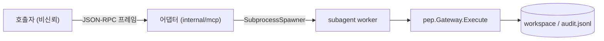

# ROADMAP — 09 MCP/Tool-Call 보안 게이트웨이 어댑터 (마스터 설계)

> 상위 색인: [전체 로드맵 색인](../README.md) | 대시보드: [README.md](README.md) | 계획: [PLAN.md](PLAN.md) | 배경: [WHY.md](WHY.md) | 결정: [ADR 0001](../../adr/0001-mcp-tool-call-어댑터-범위-및-프로토콜.md)

## 1. As-Is / To-Be

| 구분 | As-Is (Phase 08 완료 시점) | To-Be (Phase 09) |
|---|---|---|
| 호출 입구 | CLI(`orchestrate spawn`)와 E2E 러너뿐 | 위 입구에 더해 stdio JSON-RPC `tools/call` 입구 추가 |
| 토큰 전달 | CLI 플래그, 서브프로세스 stdin 프레임 | 어댑터는 `params._meta.authz_token`으로 수신, 서브프로세스에는 기존 stdin 프레임으로 전달 |
| 집행 | `SubprocessSpawner` → `subagent worker` → `pep.Gateway.Execute` | 동일 경로 재사용 (신규 집행 경로 없음) |
| 시나리오 | 32대(G1~G7) | 신규 G8 그룹 `E2E-33`~ 추가 |

## 2. 아키텍처 및 신뢰 경계

- 어댑터는 **프레임 파싱과 전달만** 한다. PDP, 상태 저장소(Zone A/B), 파일 시스템, `jail`을 직접 import하지 않는다.
- 호출자는 비신뢰다. 잘못된 프레임, 알 수 없는 도구, 누락·변조 토큰은 모두 거부(Fail-Closed)한다.
- 새 패키지 후보: `internal/mcp` (프로토콜·서버), 기존 `internal/cli`에 `mcp serve` 서브커맨드 추가.

## 3. 파급 범위와 무영향 근거

- **변경**: `internal/mcp` [신규], `internal/cli`(서브커맨드 1개), `internal/harness/catalog`(G8 추가), `internal/harness/architecture_test.go`(가드레일 추가).
- **무영향**: `internal/authz/*`, `internal/authn/*`, `internal/jail`, `internal/audit`의 공개 계약은 변경하지 않는다. 기존 `E2E-01`~`E2E-32` 판정 기준도 그대로다. 단계 060에서 전체 회귀로 증명한다.

## 4. 사전 점검 (Pre-Mortem): 이 로드맵이 실패한다면 무엇 때문인가

| 위험 | 방어책 |
|---|---|
| 어댑터가 편의상 파일 I/O나 토큰 검증을 직접 수행해 PEP를 우회 | AST 가드레일 `TC-090-01`로 금지 import 자동 검출 |
| JSON-RPC 프레임 파싱 오류가 허용으로 이어짐 | 파싱 실패는 `ExitBadInput`, 부정 테스트 필수 |
| 원시 토큰이 `stderr`, 감사, 오류 메시지에 유출 | 040 단계에서 JWT 정규식 유출 검사, 로깅은 `jti`만 |
| 호출자가 `_meta` 외 경로(인자, 도구 이름)로 권한을 주입 | 도구 이름은 화이트리스트 2종, 인자 스키마 엄격 검증 |
| 동시 호출 시 감사 해시 체인 손상 | 기존 `flock` 경로 재사용, 동시 호출 테스트 포함 |
| 범위가 커져 실제 MCP 호환 요구로 확대 | ADR 0001로 범위 고정, 확대는 별도 로드맵 |

## 5. 4층위 검증 설계

| 층위 | 대상 | 방법 |
|:---:|---|---|
| 1 | 반복 수동 검증 배제 | `go test ./internal/mcp/... ./internal/cli/...` 스크립트화 |
| 2 | 단위·구조 | 프레임 파서·도구 매핑 table-driven 테스트, AST 가드레일 |
| 3 | 상태·정합성 | 호출 후 `audit.jsonl` 해시 체인 검증, 거부 시 workspace 0바이트 변화 |
| 4 | 통합 | `authz-harness run --scenario E2E-33..` 및 기존 32대 회귀 |

## 6. 단계 의존 관계

`010 → 020 → 030 → 040 → 050 → 060` (번호순 = 실행순, 각 단계는 직전 단계 `Done`이 선행 조건)
