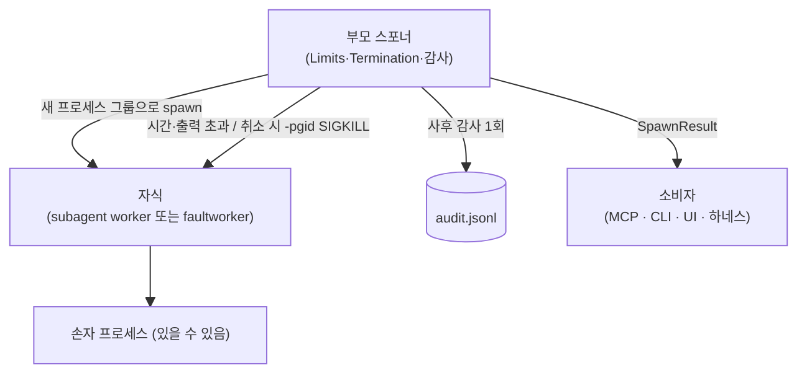

# ROADMAP — 10 서브프로세스 자원·수명 통제 (마스터 설계)

> 상위 색인: [전체 로드맵 색인](../README.md) | 대시보드: [README.md](README.md) | 계획: [PLAN.md](PLAN.md) | 배경: [WHY.md](WHY.md) | 결정: [ADR 0003](../../adr/0003-차기-로드맵-범위-개정-비목표-조건부-해제.md) | 재편 근거: [019번 보고서](../../보고서/019-10번로드맵_구조결함_및_기존구조_견고성_검토보고서.md)

## 1. As-Is / To-Be

| 구분 | As-Is (Phase 09 완료 시점, 코드 확인) | To-Be (Phase 10) |
|---|---|---|
| 수명 통제 | [`spawner.go`](../../../internal/orchestrator/spawner.go)의 `context.WithTimeout`(기본 10초)과 `CommandContext` 기본 종료만 사용. 종료 대상은 자식 프로세스 1개 | 자식을 **새 프로세스 그룹**(`Setpgid`)으로 띄우고 만료·취소 시 **그룹 전체**(`-pgid`)에 SIGKILL. `WaitDelay`(기본 500ms)로 파이프 대기 상한 |
| 출력 통제 | stdout/stderr를 상한 없는 `bytes.Buffer`에 수집 | `limitedBuffer`(stdout·stderr 각 1 MiB). 초과 즉시 `cancel()` → 그룹 종료 |
| 결과 모델 | `ExitCode`에 자식 종료 코드를 그대로 담음. 타임아웃이면 `1`, panic이면 `2` 같은 표준 밖 코드가 그대로 나감 | 부모 관찰 사실 `Termination` + 순수 함수 `classifyExit`가 표준 코드를 한 곳에서 도출. 코드 공간 `{0, 11..17}` 닫힘 |
| 종료 사유 | `0`, `11`~`16` | `17`(`ExitResourceLimit`) = `RESOURCE_TIMEOUT`·`RESOURCE_OUTPUT_LIMIT`, 원인 불명 종료 = `16` + `SUBPROCESS_ABNORMAL_EXIT` |
| 설정 | `SpawnConfig.Timeout`, `MultiHopConfig.Timeout` | `orchestrator.Limits` 단일 원천 |
| 판정기·증거 경로 | `runner.go:216`이 0이 아닌 코드에서 `execErr` 무시, MCP 종료 코드를 문자열 `Contains`로 복원 | `harness.InvariantViolation`, MCP `structuredContent` 구조화 오류 |
| 시험 자식 | (없음) | 별도 실행 파일 `internal/harness/faultworker`(프로덕션과 분리) |
| 시나리오 | 39대(G1~G8) | G9 5대(`E2E-40`~`E2E-44`), 총 44대 |

## 2. 아키텍처 및 신뢰 경계

- **통제 주체는 부모(스포너) 하나뿐이다.** 자식은 자기 한계를 풀 수단이 없다. 자식이 무엇이든(우리 워커든 임의 프로그램이든) 같은 방식으로 통제한다.
- **부모 관찰과 자식 보고를 섞지 않는다.** `Termination`은 부모가 OS에서 본 사실이고, `Response`는 자식이 정상 종료했을 때만 믿는 자식의 보고다.
- **시험용 결함 자식은 신뢰 경계 밖에 둔다.** `faultworker`는 `authz-harness/` 패키지를 import하지 않으며, 이를 아키텍처 테스트로 강제한다. 프로덕션 바이너리에는 결함 모드가 없다([ADR 0003](../../adr/0003-차기-로드맵-범위-개정-비목표-조건부-해제.md) C-7 개정).
- 감사는 기존 경로(`audit.Writer`)로만 기록한다. 감사 실패 시 fail-closed(`15`)는 그대로다.

## 3. 파급 범위와 무영향 근거

- **변경**: `internal/domain`(종료 코드 `17`, Reason 3종), `internal/orchestrator`(Limits, Termination, 프로세스 그룹, limitedBuffer, 사후 감사), `internal/mcp`(`structuredContent`, Reason 전파), `internal/harness`(판정기, 실행 모드 선언, 결함 워커 프로바이더, `faultworker`), `internal/harness/catalog`(G9, MCP 경로 공유), `internal/cli`(필드 이름, 출력, Skipped 집계), `internal/ui`(실행 감독 줄).
- **무영향**: PDP, PEP 판정 로직, 토큰 발급·검증, jail, 기존 종료 코드 `11`~`16`의 의미, 기존 `E2E-01`~`E2E-39` 판정 기준, 프로덕션 CLI의 명령 체계. 단계마다 39/39 회귀로 증명하고, 060에서 44/44로 마감한다.

## 4. 사전 점검 (Pre-Mortem): 이 로드맵이 실패한다면 무엇 때문인가

| 위험 | 방어책 |
|---|---|
| 같은 함수의 종료 판정을 여러 단계가 나눠 고쳐 분기가 겹침 | 종료 판정은 020 한 단계에서 `classifyExit` 한 곳에 완결(D-07, D-08) |
| 자원 한계가 아닌 종료를 "자원 한계"로 기록해 감사 증거가 사실과 다른 원인을 주장함 | `17`은 부모가 강제한 시간·출력 초과만. 취소·외부 신호·표준 밖 코드는 `16`(D-09) |
| 결함 모드가 프로덕션에 섞이거나, 하네스가 릴리스와 다른 바이너리를 시험함 | 결함 워커는 별도 실행 파일, 프로덕션은 태그 없이 빌드(D-06) |
| 부가 증거(손자 소멸 등) 실패가 판정기에서 무시되어 가짜 PASS | `harness.Invariantf` + 판정기 수정(010) |
| 손자 프로세스 시나리오가 타이밍에 의존해 들쭉날쭉함 | PID 생존 확인(`kill(pid, 0)` → `ESRCH`) 재시도 루프로 판정, 고정 sleep 금지. 시간 상한은 300ms로 기동 여유 확보 |
| 출력 초과 시 그룹 SIGKILL 때문에 신호 종료로 오분류됨 | `Termination` 판정에서 출력 초과를 첫 순위로 둠 |
| 감사 메타데이터 변경이 기존 시나리오 감사 매칭을 바꿈 | `ORCHESTRATE_COLLECT`에는 `reason` 키를 넣지 않음(D-13) |
| 정상 워커가 기본 한계에 걸려 기존 시나리오가 회귀함 | 기본값을 기존 동작과 같게(`10s`), 출력 1 MiB는 정상 프레임보다 훨씬 큼. 단계마다 39/39 회귀 |

## 5. 4층위 검증 설계

| 층위 | 대상 | 방법 |
|:---:|---|---|
| 1 | 반복 수동 검증 배제 | `go test -race ./...` 단일 명령(빌드 태그 없음) |
| 2 | 단위·구조 | `Limits`·`classifyExit`·`limitedBuffer` table-driven, 판정기 불변식 테스트, `faultworker` import 가드 |
| 3 | 상태·정합성 | 종료 후 PID 생존 0(`ESRCH`), `audit.jsonl` 해시 체인 `VALID`와 `agent.limit_exceeded`, workspace 무변화 |
| 4 | 통합 | `run --scenario all` 44/44, `--execution-mode inproc`에서 G9 `Skipped`·실패 0건 |

## 6. 단계 의존 관계

`010 → 020 → 030 → 040 → 050 → 060` (번호순 = 실행순, 각 단계는 직전 단계 `Done`이 선행 조건)

## 7. 단계 분해표 및 구현지시서 색인

| 단계 | 구현지시서 | 목표 | 완료 기준 | 대표 인수 시나리오 (입력 → 기대 결과) |
|:---:|---|---|---|---|
| **010** | [010_하네스_판정기_및_mcp_구조화_오류_보강.md](instructions/010_하네스_판정기_및_mcp_구조화_오류_보강.md) | 증거 경로의 기존 결함 2건 제거 | 불변식 위반이 항상 FAIL, MCP 종료 코드 구조적 읽기, 39/39 | `(12, Invariantf(...))` 반환 + 기대 `12` → `FAIL` |
| **020** | [020_스포너_감독_계층_일괄_구현.md](instructions/020_스포너_감독_계층_일괄_구현.md) | 감독 상태 기계 완결 | `classifyExit` 표 전수, 그룹 종료·출력 상한·감사, 39/39 | `spawn_child_hang` + 300ms → `17`, `RESOURCE_TIMEOUT`, 손자 `ESRCH` / 부모 취소 → `16` |
| **030** | [030_소비자_배선_mcp_cli_ui.md](instructions/030_소비자_배선_mcp_cli_ui.md) | 결과 소비 배선 | MCP Reason 전파, CLI 출력, UI 실행 감독 줄 | 가짜 Spawner `17` → `structuredContent.exit_code == 17`, 관문 전부 `SKIPPED` |
| **040** | [040_결함_워커_전용_실행파일_및_실행모드_선언.md](instructions/040_결함_워커_전용_실행파일_및_실행모드_선언.md) | 시험 자식과 실행 모드 선언 | `faultworker` 3모드, import 가드, `Skipped` 집계 | `RequiresSubprocess` + inproc → `Skipped`, 호출 0회 |
| **050** | [050_g9_e2e_시나리오.md](instructions/050_g9_e2e_시나리오.md) | G9 5대 Quad-Assertion | 5/5 PASS, 변이 검증 FAIL 확인 | `run --group G9` → 5/5 PASS |
| **060** | [060_전체_회귀_검증_및_마감.md](instructions/060_전체_회귀_검증_및_마감.md) | 전체 회귀·문서 동기화 | `-race` 통과, 44/44, 문서 불일치 0 | `run --scenario all` → 44/44, 종료 코드 `0` |

## 8. 선행 조건 및 확정된 설계 기준

- **선행 조건**: [ADR 0003](../../adr/0003-차기-로드맵-범위-개정-비목표-조건부-해제.md) `Accepted` (C-5, C-7). 2026-11-04 C-7 개정 후에도 상태는 `Proposed`다.
- **확정 사항**: [README.md §4 결정 표](README.md) D-06~D-13.

## 9. 인수인계 (다음 에이전트용)

- **코드 사실 확인 포인터**: [`spawner.go`](../../../internal/orchestrator/spawner.go) 94·104·120행, [`multi_hop.go`](../../../internal/orchestrator/multi_hop.go) `Timeout`, [`runner.go`](../../../internal/harness/runner.go) 216행, [`g8_mcp_adapter.go`](../../../internal/harness/catalog/g8_mcp_adapter.go) `executeMCPCall`, [`executor.go`](../../../internal/mcp/executor.go) 70행, [`errors.go`](../../../internal/mcp/errors.go) `ErrorDetail`, [`pipeline.go`](../../../internal/ui/pipeline.go) 관문 표. 문서가 아닌 실제 코드를 먼저 확인할 것.
- **금지 사항**: PEP·PDP 판정 로직 수정, 기존 종료 코드 의미 변경, 프로덕션 CLI에 결함 모드 추가, 빌드 태그 도입, 고정 sleep 기반 판정, 감사 기록 에러 무시(`_ = err`), 판정 통과를 위한 종료 코드 바꿔치기.
- **착수 순서**: ADR 0003 `Accepted` 확인 → 사용자의 「구현해라」 지시 확인 → `010`부터 한 단계씩 실행·검증·커밋 후 정지·보고.
- **이후 로드맵과의 접점**: 로드맵 11·15·16은 `internal/harness/faultworker`에 모드를 추가해 재사용한다. 해당 로드맵 문서의 `testworker` 빌드 태그 기술(11 `ROADMAP.md`·`040`·`060`, 16 `070`)은 ADR 0003 C-7 개정과 어긋나므로, 각 로드맵 착수 전 점검 때 갱신한다.
