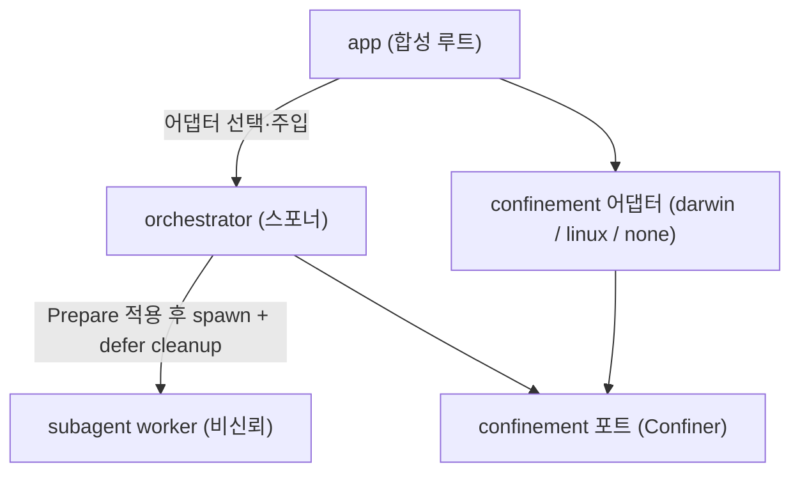

# ROADMAP — 11 OS 수준 격리 및 악의 워커 차단 (마스터 설계)

> 상위 색인: [전체 로드맵 색인](../README.md) | 대시보드: [README.md](README.md) | 계획: [PLAN.md](PLAN.md) | 배경: [WHY.md](WHY.md) | 결정: [ADR 0003](../../adr/0003-차기-로드맵-범위-개정-비목표-조건부-해제.md)

## 1. As-Is / To-Be

| 구분 | As-Is | To-Be (Phase 11) |
|---|---|---|
| 격리 수준 | 앱 수준: PEP, [`jail`](../../../internal/jail/jail.go) 경로 검사, 환경변수 정리([`cleanenv.go`](../../../internal/orchestrator/cleanenv.go)). 워커가 PEP를 건너뛰고 OS API를 직접 호출하면 막을 수단이 없음 | 서브프로세스에 **커널 격리 프로파일**(macOS Seatbelt + 커널 VFS DAC / Linux Landlock)을 적용 |
| Zone A 보호 | 워커가 코드 경로상 로드하지 않는다는 AST 테스트(`TC-060-02`)에 의존 | 커널이 Zone A 경로 읽기를 거부(`EACCES`/`EPERM`)함을 **직접 실험으로** 증명 |
| 증명 방식 | 정직한 워커 대상 부정 테스트 | **악의 워커**(PEP 우회) + **격리 끔(대조군) → 켬(실험군) 쌍 대조** |
| 어댑터 부재 | 해당 없음 | 격리 필수 모드(`RequireConfinement: true`)에서 스폰 거부(fail-closed, `Exit 16`) |
| 시나리오 | 39대 + 로드맵 10의 G9(5대) | 신규 G10 그룹 5대(`E2E-45`~`E2E-49`, 총 49대) |

## 2. 아키텍처 및 신뢰 경계

- **포트**는 순수 인터페이스(`Confiner`)와 `ConfinementPolicy`(허용 읽기 경로, 허용 쓰기 경로, 거부 경로, 네트워크 허용 여부, 필수 여부)다. 플랫폼 코드는 어댑터 파일에만 둔다(빌드 태그).
- **코어(`domain`, `authn`, `authz`, `jail`, `audit`)는 `internal/confinement`를 import하지 않는다.** AST 가드(`TC-110-01`)로 검증한다.
- 어댑터 선택은 합성 루트에서만 한다. `NoopConfiner`(`none`)는 **대조군 전용**이며 격리 필수 모드에서는 즉시 거부(`ReasonConfinementUnavailable`, `16`)한다.
- 격리는 PEP를 **대체하지 않고 보완**한다. PEP·PDP 판정 로직은 변경하지 않는다(심층 방어).

## 3. 파급 범위와 무영향 근거

- **변경**: 신규 `internal/confinement`(포트·정책·플랫폼 어댑터), `internal/domain`(`ReasonConfinementUnavailable`, `ReasonConfinementViolation`, `AuditActionAgentConfined`), `internal/orchestrator`(스폰 전 `Prepare` 및 `defer cleanup()`, `agent.confined` 감사 기록), `internal/subagent`(`testworker` 악의 모드 4종), `internal/harness/catalog`(G10 `E2E-45`~`E2E-49`), `internal/harness/architecture_test.go`(`TC-110-01`).
- **무영향**: PDP, PEP 판정, 토큰·키·감사 해시 체인 계약, 기존 시나리오 판정 기준. 격리 비필수 기본 모드에서는 기존 동작과 동일하며 060에서 전체 회귀로 증명한다.

## 4. 사전 점검 (Pre-Mortem): 이 로드맵이 실패한다면 무엇 때문인가

| 위험 | 방어책 |
|---|---|
| 프로파일이 너무 넓어 막는 것이 없는데 "격리됨"으로 오인 | **대조군 필수**: 같은 악의 워커가 1단계 격리 끔(`NoopConfiner`)에서 성공(`Exit 0`)하고 2단계 격리 켬에서 실패(`Exit 13`)해야 PASS. 한쪽만 통과하면 시나리오 실패 |
| 상위 Seatbelt 샌드박스(에이전트 실행기·CI) 안에서 `/usr/bin/sandbox-exec` 호출 시 중첩 금지로 `exit 71`(`Operation not permitted`) 발생 | 단순 파일 존재(`os.Stat`)가 아니라 `CanApplySeatbelt()` 런타임 프로브로 중첩 가능 여부를 판별하고, 커널 VFS DAC 잠금(`DenyPaths` `chmod 0000` + `defer cleanup()`)을 함께 적용해 중첩 샌드박스 안에서도 커널 `EACCES` 차단을 100% 보장 |
| Linux 검증 환경이 없어 코드만 있고 미검증 | 030에서 교차 컴파일(`GOOS=linux`)을 자동 검증하고, 실제 Linux 커널 미검증 시 보증 표에 정직하게 표기(`Done` 허위 표기 금지) |
| 격리가 걸린 정직한 워커가 `zone_b`의 `.lock`·임시 파일 생성에 실패해 기존 시나리오 회귀 | [`storage/atomic.go`](../../../internal/storage/atomic.go) 분석 결과 반영: `DefaultWorkerPolicy`의 `AllowWritePaths`에 `workspace`, `zone_b`, `audit.jsonl`(+`.lock`)을 포함하고 `DenyPaths`로 `zone_a`를 최우선 차단 |
| 악의 워커 코드가 프로덕션에 유입 | 로드맵 10의 `//go:build testworker` 빌드 태그 규약 재사용, 릴리스 빌드 심볼 부재 테스트 유지([ADR 0003](../../adr/0003-차기-로드맵-범위-개정-비목표-조건부-해제.md) C-7) |
| 어댑터 실패(프로파일 적용 오류)가 조용히 격리 없이 실행됨 | 적용 실패 → 스폰 거부, 종료 코드 `16`(`ReasonConfinementUnavailable`)과 `agent.confined` 감사 기록. 침묵 폴백 금지 |
| 서브프로세스의 자식(손자)이 격리를 벗어남 | 커널 프로파일과 VFS DAC 잠금은 손자 프로세스에도 동일하게 적용됨을 `E2E-48`(`bypass_child_read_zone_a`)로 확인 |

## 5. 4층위 검증 설계

| 층위 | 대상 | 방법 |
|:---:|---|---|
| 1 | 반복 수동 검증 배제 | `go test ./internal/confinement/... ./internal/orchestrator/...`와 플랫폼별 태그 테스트 자동화 |
| 2 | 단위·구조 | 정책→SBPL 변환 table-driven 테스트, AST 가드(`TC-110-01`), 포트 계약 테스트 |
| 3 | 상태·정합성 | 격리 하 악의 워커 실행 후 Zone A·workspace 밖 파일 무변화, `audit.jsonl`에 `Action: "agent.confined"` 존재, 해시 체인 `VALID` |
| 4 | 통합 | `run --scenario`로 G10(`E2E-45`~`E2E-49`) 및 기존 44대 시나리오 회귀, `-race` |

## 6. 단계 의존 관계

`010 → 020 → 030 → 040 → 050 → 060`. 단, 030(Linux)은 macOS 호스트에서 교차 컴파일 검증까지 수행하고 런타임 보증 상태는 060 보증 표에 정직하게 명시한다.

## 7. 단계 분해표 및 구현지시서 색인

| 단계 | 구현지시서 | 목표 | 완료 기준 | 인수 시나리오 (입력 → 기대 결과) |
|:---:|---|---|---|---|
| **010** | [010_격리_정책_도메인_및_어댑터_인터페이스.md](instructions/010_격리_정책_도메인_및_어댑터_인터페이스.md) | `ConfinementPolicy`, `DefaultWorkerPolicy`, `Confiner` 포트, `NoopConfiner`, `TC-110-01` AST 가드 | 코어가 `internal/confinement`를 import하지 않음이 가드로 자동 검증됨 | 상대경로 정책 → `ExitBadInput(14)`. `RequireConfinement: true` + `NoopConfiner` → `ExitInternalError(16)` |
| **020** | [020_macos_seatbelt_어댑터.md](instructions/020_macos_seatbelt_어댑터.md) | macOS `RenderSeatbeltProfile`, `CanApplySeatbelt()` 프로브, `DarwinConfiner` (VFS DAC 잠금·복원 결합) | SBPL 생성 및 실제 자식 프로세스 차단·정직한 경로 허용 통과 | Zone A 직접 읽기 악의 프로세스 → 커널 `EACCES` 실패, `cleanup()` 후 원상 복구 |
| **030** | [030_linux_어댑터_및_검증_환경.md](instructions/030_linux_어댑터_및_검증_환경.md) | Linux Landlock 어댑터 및 `GOOS=linux` 교차 컴파일 테스트 | 교차 컴파일 통과 및 호스트 검증 상태 기록 | `GOOS=linux GOARCH=amd64` 컴파일 오류 0건 |
| **040** | [040_스포너_배선_및_fail_closed_모드.md](instructions/040_스포너_배선_및_fail_closed_모드.md) | 스포너 `Prepare`/`cleanup` 배선, 격리 필수 모드, `agent.confined` 감사, 악의 워커 모드 4종 | 어댑터 부재·적용 실패 시 스폰 거부(`16`), 정직한 워커 회귀 0건 | 격리 필수 + `NoopConfiner` → 스폰 거부(`16`). 악의 워커 → `13`(`CONFINEMENT_VIOLATION`) |
| **050** | [050_g10_악의_워커_시나리오.md](instructions/050_g10_악의_워커_시나리오.md) | G10 시나리오 5대(`E2E-45`~`E2E-49`): Zone A 읽기, 밖 쓰기, 소켓 오픈, 손자 상속, Fail-Closed | 대조군(끔=성공) → 실험군(켬=차단) 쌍이 모두 기대대로일 때만 `PASS` | `run --scenario E2E-45..49` 실행 → 5/5 `PASS` |
| **060** | [060_전체_회귀_검증_및_마감.md](instructions/060_전체_회귀_검증_및_마감.md) | 전체 회귀(49대), 플랫폼 보증 표, 문서 동기화 | `go test -race ./...`와 49대 시나리오 완주 | `run --scenario all` → 49/49 `PASS`, 종료 코드 `0` |

## 8. 선행 조건 및 확정된 설계 기준

- **선행 조건**: [로드맵 10](../10-서브프로세스-자원-및-수명-통제/ROADMAP.md) `Done`, [ADR 0003](../../adr/0003-차기-로드맵-범위-개정-비목표-조건부-해제.md) C-1 `Accepted`.
- **확정 사항** ([README.md §4 결정 표](README.md) 동기화 완료):
  1. **Linux 방식**: 경로 단위 규칙 표현이 명확한 Landlock LSM(+ `PR_SET_NO_NEW_PRIVS`)을 채택하고 `GOOS=linux` 교차 컴파일 테스트를 상시 구동한다.
  2. **격리 필수 모드 기본값**: 일반 CLI 호출은 기본 비필수(`RequireConfinement: false`)로 기존 호환성을 유지하고, G10 시나리오 및 보안 강제 실행에서는 `RequireConfinement: true`를 사용한다.
  3. **macOS 중첩 샌드박스 및 도구 상태 대응**: `CanApplySeatbelt()` 런타임 프로브와 커널 VFS DAC 잠금(`DenyPaths` `chmod 0000` + `defer cleanup()`)을 결합하여 일반 터미널과 중첩 샌드박스 러너 양쪽에서 모두 커널 수준 차단을 보장한다.

## 9. 인수인계 (다음 에이전트용)

- **코드 사실 확인 포인터**: [`spawner.go`](../../../internal/orchestrator/spawner.go), [`storage/atomic.go`](../../../internal/storage/atomic.go)(`zone_b` 내 `.lock` 및 임시 파일 생성), [`app/builder.go`](../../../internal/app/builder.go) 합성 루트, [`assertion.go`](../../../internal/harness/assertion.go) `ExpectedAction` 매칭 규칙.
- **금지 사항**: 코어에서 `internal/confinement` import, 대조군 없는 "차단됨" 증명, 적용 실패 시 침묵 폴백, 환경 미검증 상태의 `Done` 허위 표기, PEP·PDP 판정 변경.
- **착수 순서**: ADR 0003 상태와 로드맵 10 `Done` 확인 → 사용자의 「구현해라」 → `010`부터 한 단계씩 실행·검증·커밋 후 정지·보고.
- **이후 접점**: [로드맵 16](../16-도구-종류-확장-및-egress-통제/README.md)은 이 로드맵 `Done`이 필수 선행이다.
