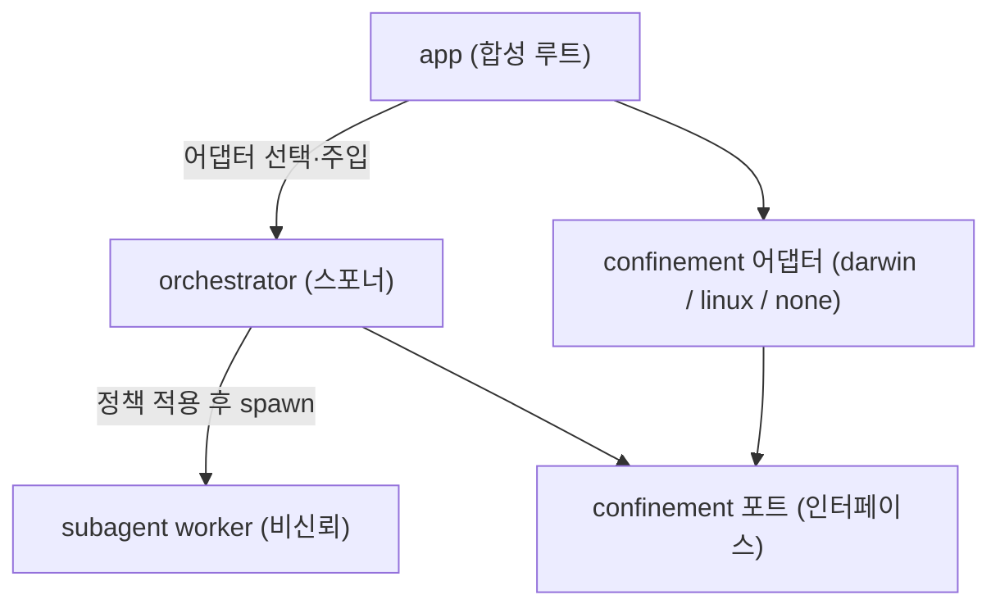

# ROADMAP — 11 OS 수준 격리 및 악의 워커 차단 (마스터 설계)

> 상위 색인: [전체 로드맵 색인](../README.md) | 대시보드: [README.md](README.md) | 계획: [PLAN.md](PLAN.md) | 배경: [WHY.md](WHY.md) | 결정: [ADR 0003](../../adr/0003-차기-로드맵-범위-개정-비목표-조건부-해제.md)

## 1. As-Is / To-Be

| 구분 | As-Is | To-Be (Phase 11) |
|---|---|---|
| 격리 수준 | 앱 수준: PEP, [`jail`](../../../internal/jail/jail.go) 경로 검사, 환경변수 정리([`cleanenv.go`](../../../internal/orchestrator/cleanenv.go)). 워커가 PEP를 건너뛰고 OS API를 직접 호출하면 막을 수단이 없음 | 서브프로세스에 **커널 프로파일**(파일 접근 허용 경로, 네트워크 금지)을 적용 |
| Zone A 보호 | 워커가 코드 경로상 로드하지 않는다는 AST 테스트(`TC-060-02`)에 의존 | 커널이 Zone A 경로 읽기를 거부함을 **직접 실험으로** 증명 |
| 증명 방식 | 정직한 워커 대상 부정 테스트 | **악의 워커**(PEP 우회) + **격리 켬/끔 대조군** |
| 어댑터 부재 | 해당 없음 | 격리 필수 모드에서 스폰 거부(fail-closed) |
| 시나리오 | 39대 + 로드맵 10의 G9 | 신규 G10 그룹 |

## 2. 아키텍처 및 신뢰 경계

- **포트**는 순수 인터페이스와 `ConfinementPolicy`(허용 읽기 경로, 허용 쓰기 경로, 네트워크 허용 여부)다. 플랫폼 코드는 어댑터 패키지에만 둔다(빌드 태그).
- **코어(domain, authn, authz, jail, audit)는 플랫폼 코드를 import하지 않는다.** AST 가드로 검증한다.
- 어댑터 선택은 합성 루트에서만 한다. `none` 어댑터는 **대조군 전용**이며 격리 필수 모드에서는 선택 불가다.
- 격리는 PEP를 **대체하지 않고 보완**한다. PEP·PDP 판정 로직은 변경하지 않는다(심층 방어).

## 3. 파급 범위와 무영향 근거

- **변경**: 신규 `internal/confinement`(후보명, 포트와 정책), 어댑터 하위 패키지(빌드 태그), `internal/orchestrator`(spawn 전 정책 적용), `internal/app`(주입), `internal/harness/catalog`(G10), `internal/harness/architecture_test.go`(가드).
- **무영향**: PDP, PEP 판정, 토큰·키·감사 해시 체인 계약, 기존 시나리오 판정 기준. 격리 비필수 기본 모드에서는 기존 동작과 동일해야 하며 060에서 전체 회귀로 증명한다.

## 4. 사전 점검 (Pre-Mortem): 이 로드맵이 실패한다면 무엇 때문인가

| 위험 | 방어책 |
|---|---|
| 프로파일이 너무 넓어 막는 것이 없는데 "격리됨"으로 오인 | **대조군 필수**: 같은 악의 워커가 격리 끔에서 성공하고 켬에서 실패해야 PASS. 한쪽만 통과하면 시나리오 실패 |
| macOS `sandbox-exec`가 폐기 예고 상태라 장기적으로 불안정 | 어댑터 인터페이스로 격리해 교체 가능하게 하고, 보증 표에 "도구 상태" 칸을 둠. 사용 불가 시 대체 경로를 ADR로 결정 |
| Linux 검증 환경이 없어 코드만 있고 미검증 | 030에서 검증 환경(컨테이너 사용 여부)을 먼저 결정([ADR 0003](../../adr/0003-차기-로드맵-범위-개정-비목표-조건부-해제.md) §5). 불가하면 Linux는 `Blocked`로 남기고 `Done` 표기 금지 |
| 격리가 걸린 워커가 정상 동작까지 못 해 기존 시나리오 회귀 | 정책에 워커 실행에 필요한 최소 경로를 포함. 정직한 워커의 허용 시나리오(읽기/쓰기 성공)를 격리 하에서도 통과시켜 PASS로 확인 |
| 악의 워커 코드가 프로덕션에 유입 | 로드맵 10의 빌드 태그 규약 재사용, 릴리스 빌드 심볼 부재 테스트([ADR 0003](../../adr/0003-차기-로드맵-범위-개정-비목표-조건부-해제.md) C-7) |
| 어댑터 실패(프로파일 적용 오류)가 조용히 격리 없이 실행됨 | 적용 실패 → 스폰 거부, 종료 코드 `16`(내부 오류)과 감사 기록. 침묵 폴백 금지 |
| 서브프로세스의 자식(손자)이 격리를 벗어남 | 커널 프로파일은 자식에게 상속됨을 테스트로 확인(손자 악의 시나리오 포함) |

## 5. 4층위 검증 설계

| 층위 | 대상 | 방법 |
|:---:|---|---|
| 1 | 반복 수동 검증 배제 | `go test ./internal/confinement/... ./internal/orchestrator/...`와 플랫폼별 태그 테스트를 스크립트화 |
| 2 | 단위·구조 | 정책→프로파일 변환 table-driven 테스트, AST 가드(코어의 플랫폼 코드 import 금지), 포트 계약 테스트 |
| 3 | 상태·정합성 | 격리 하 악의 워커 실행 후 Zone A·workspace 밖 파일 무변화, `audit.jsonl`에 `agent.confined` 존재, 해시 체인 `VALID` |
| 4 | 통합 | `run --scenario`로 G10 및 기존 시나리오 회귀, `-race` |

## 6. 단계 의존 관계

`010 → 020 → 030 → 040 → 050 → 060`. 단, 030(Linux)이 환경 문제로 `Blocked`가 되어도 020·040·050은 macOS 기준으로 진행하고, 060에서 보증 표에 Linux 상태를 명시한다(`Done` 허위 표기 금지).

## 7. 단계 분해표 (구현지시서 작성의 입력)

| 단계 | 목표 | 완료 기준 | 인수 시나리오 (입력 → 기대 결과) |
|:---:|---|---|---|
| **010** | `ConfinementPolicy`, 어댑터 포트, `none` 어댑터(대조군 전용), AST 가드 | 코어가 플랫폼 코드를 import하지 않음이 가드로 자동 검증됨 | 정책 값 → 어댑터 입력 변환 단위 테스트 통과. 코어 패키지에 플랫폼 import 추가 → 가드 테스트 실패 |
| **020** | macOS Seatbelt 어댑터 (프로파일 생성, 적용) | 프로파일이 정책을 정확히 반영 | 읽기 허용 경로 밖 파일을 읽는 악의 워커 → OS 오류로 실패, 정상 경로 읽기는 성공 |
| **030** | Linux 어댑터(Landlock/seccomp 중 택일, 선택 근거 기록)와 검증 환경 결정 | 환경이 있으면 020과 같은 인수 시나리오 통과, 없으면 `Blocked` 사유 기록 | 020과 동일한 악의 워커 → 같은 기대 결과. 환경 불가 → `Blocked` 기록, 완료 표기 없음 |
| **040** | 스포너 배선, 격리 필수 모드, `agent.confined` 감사 이벤트 | 어댑터 부재·적용 실패 시 스폰 거부, 정상 시나리오 회귀 없음 | 격리 필수 + 어댑터 없음 → 스폰 거부(`16`)와 감사 기록. 정직한 워커 허용 시나리오 → 격리 하에서도 성공 |
| **050** | G10 시나리오: (a) Zone A 개인키 직접 읽기 (b) workspace 밖 쓰기 (c) 소켓 열기 시도 (d) 손자 악의 — 각각 **격리 끔(성공) / 켬(실패) 쌍** | 쌍이 모두 기대대로일 때만 `PASS`, 실패 후 파일 무변화 | 악의 워커 (a)~(d) 격리 끔 → 성공, 켬 → OS 오류. 둘 중 하나라도 어긋나면 시나리오 `FAIL` |
| **060** | 전체 회귀, 플랫폼 보증 표, 문서 동기화 | `go test -race ./...`와 기존 시나리오 완주, 보증 표에 플랫폼별 상태·도구 상태 기재 | `run --scenario all` → 종료 코드 `0` |

## 8. 선행 조건·결정 필요 사항

- [로드맵 10](../10-서브프로세스-자원-및-수명-통제/ROADMAP.md) `Done`, [ADR 0003](../../adr/0003-차기-로드맵-범위-개정-비목표-조건부-해제.md) C-1 `Accepted`.
- 미결: ① Linux 방식(Landlock 대 seccomp) ② Linux 검증 환경 ③ 격리 필수 모드의 기본값(권장: 기본 비필수, 하네스 시나리오에서만 필수) ④ macOS 도구 상태 변동 시 대체 경로.

## 9. 인수인계 (다음 에이전트용)

- **코드 사실 확인 포인터**: [`spawner.go`](../../../internal/orchestrator/spawner.go), [`cleanenv.go`](../../../internal/orchestrator/cleanenv.go), [`architecture_test.go`](../../../internal/harness/architecture_test.go)의 `TC-060-0x` 가드 형식, [`app/builder.go`](../../../internal/app/builder.go) 합성 루트.
- **금지 사항**: 코어에서 플랫폼 코드 import, 대조군 없는 "차단됨" 증명, 적용 실패 시 침묵 폴백, 환경 미검증 상태의 `Done` 표기, PEP·PDP 판정 변경.
- **착수 순서**: ADR 0003 상태와 로드맵 10 `Done` 확인 → 010 지시서 작성 → 사용자의 「구현해라」 → 한 단계씩.
- **이후 접점**: [로드맵 16](../16-도구-종류-확장-및-egress-통제/README.md)은 이 로드맵 `Done`이 필수 선행이다. 정책 필드(네트워크 허용 목록 등) 확장을 염두에 두고 `ConfinementPolicy`를 설계할 것.
