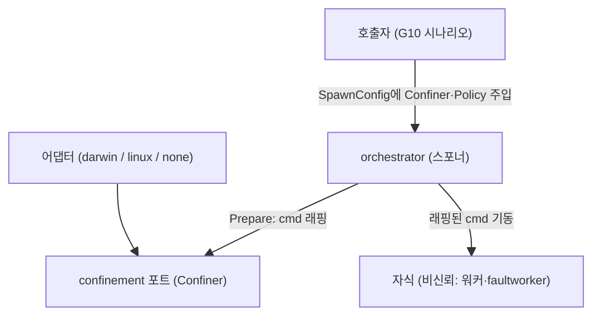

# ROADMAP — 11 OS 수준 격리 및 악의 워커 차단 (마스터 설계)

> 상위 색인: [전체 로드맵 색인](../README.md) | 대시보드: [README.md](README.md) | 계획: [PLAN.md](PLAN.md) | 배경: [WHY.md](WHY.md) | 결정: [ADR 0003](../../adr/0003-차기-로드맵-범위-개정-비목표-조건부-해제.md) | 교정 기준: [020번 보고서](../../보고서/020-11번로드맵_구조결함_및_진행가능성_검증보고서.md)

## 1. As-Is / To-Be

| 구분 | As-Is | To-Be (Phase 11) |
|---|---|---|
| 격리 수준 | 앱 수준: PEP, [`jail`](../../../internal/jail/jail.go) 경로 검사, 환경변수 정리([`cleanenv.go`](../../../internal/orchestrator/cleanenv.go)). 워커가 PEP를 건너뛰고 OS API를 직접 호출하면 막을 수단이 없음 | 서브프로세스에 **커널 격리 프로파일**(macOS Seatbelt / Linux Landlock)을 적용 |
| Zone A 보호 | 워커가 코드 경로상 로드하지 않는다는 AST 테스트(`TC-060-02`)에 의존 | 커널이 Zone A 경로 읽기를 거부함을 **직접 실험으로** 증명 |
| 증명 방식 | 정직한 워커 대상 부정 테스트 | **악의 워커**(PEP 우회) + **격리 끔(대조군) → 켬(실험군) 쌍 대조** + **부모 관찰 오라클** |
| 어댑터 부재 | 해당 없음 | 격리 필수 모드(`Require: true`)에서 스폰 거부(fail-closed, `Exit 16`) |
| 시나리오 | 44대(G1~G9) | 신규 G10 그룹 5대(`E2E-45`~`E2E-49`, 총 49대) |

## 2. 아키텍처 및 신뢰 경계

- **포트**는 순수 인터페이스 `Confiner`와 **허용 목록** 정책 `Policy`(`ProtectedRoot`, `ReadPaths`, `WritePaths`, `AllowNetwork`, `Require`)다. `ProtectedRoot` 아래는 목록에 없는 한 읽기·쓰기 모두 거부한다(Deny-by-Default). 거부 목록이나 읽기 전용 예외는 두지 않는다. Linux Landlock이 허용 규칙만 표현할 수 있어서, 어댑터마다 같은 의미로 집행할 수 있는 형태가 허용 목록뿐이기 때문이다(020번 보고서 L-4).
- **어댑터는 cmd를 래핑한다.** macOS는 `/usr/bin/sandbox-exec -p <SBPL>`, Linux는 신뢰 런처 `authz-harness confine-exec`로 감싼다. 부모가 자기 자신을 격리하지 않으므로 부모·동시 시나리오에 영향이 없다.
- **코어(`domain`, `authn`, `authz`, `jail`, `audit`)는 `internal/confinement`를 import하지 않는다.** AST 가드(`TC-110-01`)로 검증한다.
- **배선 지점은 `SpawnConfig`다.** `Confiner`·`Confinement` 영값은 격리 꺼짐이며 기존 동작과 같다. 기존 스포너 생성 7곳은 고치지 않고, G10 시나리오만 격리를 켠다(020번 보고서 L-6). `NoopConfiner`는 **대조군 전용**이며 필수 모드에서는 즉시 거부(`16`)한다.
- **판정은 부모가 한다.** 스포너는 부모가 아는 사실(격리를 적용했는가)만 감사한다. 커널이 막았는지는 시나리오가 canary·파일·리스너를 관찰해 판정한다. 자식의 종료 코드나 자기보고는 판정 근거가 아니다(020번 보고서 L-3).
- 격리는 PEP를 **대체하지 않고 보완**한다. PEP·PDP 판정 로직은 변경하지 않는다(심층 방어).

## 3. 파급 범위와 무영향 근거

- **변경**:
  - 신규 `internal/confinement`: 정책·포트·`NoopConfiner`(010), darwin 어댑터(020), linux 어댑터(030)
  - `internal/domain`: `ReasonConfinementUnavailable`(`16`) 1개
  - `internal/cli`: 숨김 하위명령 `confine-exec`(Linux 신뢰 런처, 030). 다른 플랫폼에서는 즉시 `16`
  - `internal/orchestrator/spawner.go`: `SpawnConfig` 필드, `Prepare`(cmd 래핑) 1곳, Fail-Closed, `agent.confined` 감사, 상수 `AuditActionAgentConfined`(040)
  - `internal/harness/faultworker/main.go`: 악의 모드 4종(050)
  - `internal/harness`: `ScenarioMetadata.RequiresConfinement`와 러너 `Skipped` 처리(050)
  - `internal/harness/catalog`: G10 `E2E-45`~`E2E-49`(050)
  - `internal/ui`: G10 및 `CONFINEMENT_UNAVAILABLE` 해설(050)
  - `internal/harness/architecture_test.go`: `TC-110-01`(010)
- **무영향**: PDP, PEP 판정, 토큰·키·감사 해시 체인 계약, 기존 시나리오 판정 기준, 프로덕션 워커(`subagent worker`) 코드, 기존 스포너 생성 지점 7곳. 격리 꺼짐(영값) 기본 모드에서는 기존 동작과 동일하며 060에서 전체 회귀로 증명한다.

## 4. 사전 점검 (Pre-Mortem): 이 로드맵이 실패한다면 무엇 때문인가

| 위험 | 방어책 |
|---|---|
| 프로파일이 너무 넓어 막는 것이 없는데 "격리됨"으로 오인 | **대조군 필수**: 같은 악의 워커가 1단계 격리 끔에서 공격에 성공함을 부모가 관찰하고, 2단계 격리 켬에서 차단됨을 부모가 관찰해야 PASS. 한쪽만 성립하면 `InvariantViolation`으로 FAIL |
| 보안 경계가 아닌 장치를 차단으로 오인 (예: `chmod`, rlimit) | 같은 UID가 되돌릴 수 있는 장치는 쓰지 않는다. 커널 정책(Seatbelt·Landlock)만 쓴다. 악의 모드는 "정직하게 실패"하지 않고 우회를 먼저 시도한다(예: `bypass_read_zone_a`는 읽기 전에 `chmod`로 권한 복구를 시도) |
| 자식이 "막혔다"고 거짓 보고 | 판정 근거는 부모 관찰뿐이다: 실행마다 무작위 canary 미유출, 대상 파일 미생성, 부모 리스너 accept 0건 |
| 정직한 워커의 PEP 거부(`13`)가 커널 차단으로 오기록 | 스포너는 종료 코드 `13`을 재해석하지 않는다. `agent.confined`는 Prepare 시점에만 기록 |
| 상위 Seatbelt 샌드박스(에이전트 실행기·CI) 안에서 `sandbox-exec`가 `exit 71` | `CanApplySeatbelt()` 런타임 프로브. 실패하면 `Available() == false` → 필수 모드는 스폰 거부(`16`), G10은 `Skipped`. **폴백 없음** |
| Linux 검증 환경이 없어 코드만 있고 미검증 | 030에서 교차 컴파일(`GOOS=linux`)을 자동 검증하고, 실제 Linux 커널 미검증 시 보증 표에 정직하게 표기(`Done` 허위 표기 금지) |
| 격리가 걸린 정직한 워커가 `zone_b`의 `.lock`·임시 파일·`grants_state.json` 갱신에 실패 | [`storage/atomic.go`](../../../internal/storage/atomic.go)는 같은 디렉터리에 `.lock`·임시 파일을 만들고 `rename`하며, 워커는 `grants_state.json`을 갱신한다([`cli/subagent.go`](../../../internal/cli/subagent.go) 103행). 그래서 `zone_b` 디렉터리 전체를 `WritePaths`에 둔다. Zone B 무결성은 PDP·Epoch의 몫이다 |
| 악의 워커 코드가 프로덕션에 유입 | [ADR 0003](../../adr/0003-차기-로드맵-범위-개정-비목표-조건부-해제.md) C-7(개정): 악의 모드는 `internal/harness/faultworker`에만 둔다. `TC-040-AG`가 faultworker의 내부 패키지 import 0건을 강제한다 |
| 어댑터 실패(프로파일 적용 오류)가 조용히 격리 없이 실행됨 | 적용 실패 → 스폰 거부, 종료 코드 `16`(`ReasonConfinementUnavailable`)과 `agent.confined`(`deny`) 감사. 침묵 폴백 금지 |
| 서브프로세스의 자식(손자)이 격리를 벗어남 | Seatbelt·Landlock은 커널에서 자손에 상속된다. `E2E-48`(`bypass_child_read_zone_a`)로 부모가 관찰해 확인 |

## 5. 4층위 검증 설계

| 층위 | 대상 | 방법 |
|:---:|---|---|
| 1 | 반복 수동 검증 배제 | `go test ./internal/confinement/... ./internal/orchestrator/...` 자동화. 플랫폼 코드는 파일명 접미사(`_darwin.go`, `_linux.go`)로 분리하고 커스텀 빌드 태그는 쓰지 않는다 |
| 2 | 단위·구조 | 정책→SBPL 변환 table-driven 테스트, AST 가드(`TC-110-01`), 포트 계약 테스트 |
| 3 | 상태·정합성 | 격리 하 악의 워커 실행 후 canary 미유출, Zone A·샌드박스 밖 파일 무변화, `audit.jsonl`에 `Action: "agent.confined"` 존재, 해시 체인 `VALID` |
| 4 | 통합 | `run --scenario`로 G10(`E2E-45`~`E2E-49`) 및 기존 44대 시나리오 회귀, `-race` |

## 6. 단계 의존 관계

`010 → 020 → 030 → 040 → 050 → 060`. 단계는 **모듈 경계**로 나눈다(020번 보고서 L-8). 010은 포트, 020·030은 어댑터, 040은 스포너, 050은 시험 측(faultworker·catalog·harness·ui)이다. 030(Linux)은 macOS 호스트에서 교차 컴파일 검증까지 수행하고 런타임 보증 상태는 060 보증 표에 정직하게 명시한다.

## 7. 단계 분해표 및 구현지시서 색인

| 단계 | 구현지시서 | 목표 | 완료 기준 | 인수 시나리오 (입력 → 기대 결과) |
|:---:|---|---|---|---|
| **010** | [010_격리_정책_도메인_및_어댑터_인터페이스.md](instructions/010_격리_정책_도메인_및_어댑터_인터페이스.md) | 허용 목록 `Policy`, `WorkerPolicy`, `Confiner` 포트, `NoopConfiner`, `ReasonConfinementUnavailable`, `TC-110-01` | 코어가 `internal/confinement`를 import하지 않음이 가드로 자동 검증됨 | 상대경로 정책 → `ExitBadInput(14)`. `Require: true` + `NoopConfiner` → `ExitInternalError(16)` |
| **020** | [020_macos_seatbelt_어댑터.md](instructions/020_macos_seatbelt_어댑터.md) | `RenderSeatbeltProfile`, `CanApplySeatbelt()` 프로브, `SeatbeltConfiner` | SBPL 생성 및 실제 자식 프로세스 차단·허용 경로 통과 (프로브 실패 시 Skip) | 격리된 자식의 Zone A 읽기 → 실패, 부모의 같은 파일 읽기 → 성공 |
| **030** | [030_linux_어댑터_및_검증_환경.md](instructions/030_linux_어댑터_및_검증_환경.md) | `confine-exec` 신뢰 런처, `LandlockConfiner`, 교차 컴파일 테스트 | 교차 컴파일 통과 및 호스트 검증 상태 기록 | `GOOS=linux GOARCH=amd64` 컴파일 오류 0건 |
| **040** | [040_스포너_배선_및_fail_closed_모드.md](instructions/040_스포너_배선_및_fail_closed_모드.md) | 스포너 `Prepare` 배선, Fail-Closed, Prepare 시점 `agent.confined` 감사 | 어댑터 부재·적용 실패 시 스폰 거부(`16`), 영값 설정 회귀 0건 | 필수 + `NoopConfiner` → 자식 미기동, `16`. 영값 설정 → 감사 2이벤트(기존과 동일) |
| **050** | [050_g10_악의_워커_시나리오.md](instructions/050_g10_악의_워커_시나리오.md) | faultworker 악의 모드 4종, G10 5대: Zone A 읽기, 밖 쓰기, 소켓, 손자 상속, Fail-Closed | 대조군(공격 성공 관찰) → 실험군(차단 관찰) 쌍이 모두 기대대로일 때만 `PASS`. 격리 불가 환경에서 `Skipped` | `run --scenario E2E-45,...,E2E-49` → 5/5 `PASS` (또는 격리 불가 환경 5/5 `Skipped`) |
| **060** | [060_전체_회귀_검증_및_마감.md](instructions/060_전체_회귀_검증_및_마감.md) | 전체 회귀(49대), 플랫폼 보증 표, 문서 동기화 | `go test -race ./...`와 49대 시나리오 완주 | `run --scenario all` → 49/49 `PASS`, 종료 코드 `0` |

## 8. 선행 조건 및 확정된 설계 기준

- **선행 조건**: [로드맵 10](../10-서브프로세스-자원-및-수명-통제/ROADMAP.md) `Done`(충족), [ADR 0003](../../adr/0003-차기-로드맵-범위-개정-비목표-조건부-해제.md) C-1·C-7 `Accepted`(충족).
- **확정 사항** ([README.md §4 결정 표](README.md) D-04~D-09와 동기화):
  1. **정책 모델**: 허용 목록(`ProtectedRoot` + `ReadPaths`/`WritePaths`). `DenyPaths`·`ReadOnlyPaths` 없음.
  2. **macOS**: Seatbelt 단일 계층. 프로브 실패 시 폴백 없이 `Available() == false`.
  3. **Linux**: Landlock LSM + `PR_SET_NO_NEW_PRIVS`를 신뢰 런처 `confine-exec`가 자신에 적용한 뒤 대상으로 `exec`한다.
  4. **격리 필수 모드 기본값**: 일반 CLI 호출은 격리 꺼짐(영값)으로 기존 호환성을 유지한다. G10 시나리오에서만 켠다.
  5. **판정 주체**: 부모 관찰. 스포너는 `13`을 재해석하지 않고 `agent.confined`를 Prepare 시점에 한 번 기록한다.

## 9. 인수인계 (다음 에이전트용)

- **코드 사실 확인 포인터**: [`spawner.go`](../../../internal/orchestrator/spawner.go)(Prepare 삽입 위치: `cmd` 조립 후 `cmd.Run()` 전), [`termination.go`](../../../internal/orchestrator/termination.go)(감사 액션 상수 위치 선례, `classifyExit`는 수정하지 않음), [`faultworker/main.go`](../../../internal/harness/faultworker/main.go), [`runner.go`](../../../internal/harness/runner.go) 178행(`Skipped` 선례), [`g9_resource_limits.go`](../../../internal/harness/catalog/g9_resource_limits.go)(자체 스포너를 만드는 시나리오 선례), [`storage/atomic.go`](../../../internal/storage/atomic.go), [`assertion.go`](../../../internal/harness/assertion.go)(`ExpectedAction` 역순 매칭).
- **금지 사항**: 코어에서 `internal/confinement` import, 대조군 없는 "차단됨" 증명, 자식 자기보고에 의한 판정, `chmod`·rlimit 같은 같은 UID가 되돌릴 수 있는 장치, 적용 실패 시 침묵 폴백, 프로덕션 CLI에 결함 모드, 환경 미검증 상태의 `Done` 허위 표기, PEP·PDP 판정 변경.
- **착수 순서**: 사용자의 「구현해라」 → `010`부터 한 단계씩 실행·검증·커밋 후 정지·보고.
- **이후 접점**: [로드맵 16](../16-도구-종류-확장-및-egress-통제/README.md)은 이 로드맵 `Done`이 필수 선행이다. 16의 `exec:run`·`net:fetch` 도구는 이 로드맵의 `Policy.AllowNetwork`와 `WritePaths`를 그대로 쓴다.
