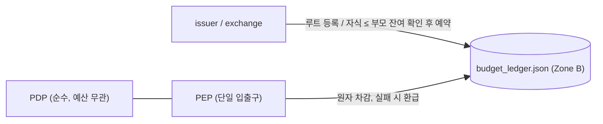

# ROADMAP — 12 예산 축소 위임 (마스터 설계)

> 상위 색인: [전체 로드맵 색인](../README.md) | 대시보드: [README.md](README.md) | 계획: [PLAN.md](PLAN.md) | 배경: [WHY.md](WHY.md) | 결정: [ADR 0003](../../adr/0003-차기-로드맵-범위-개정-비목표-조건부-해제.md) | 교정 근거: [021번 보고서](../../보고서/021-12번로드맵_구조결함_및_진행가능성_검증보고서.md)

## 1. As-Is / To-Be

| 구분 | As-Is | To-Be (Phase 12) |
|---|---|---|
| 위임 불변식 | 권한 부분집합, 수명 상한, 깊이 제한 3종([`exchange/validator.go`](../../../internal/authn/exchange/validator.go)) | 여기에 **예산 부분 상한($B_{child} \le B_{parent\_remaining}$)**을 4번째 단조 축소로 추가 |
| 횟수·양 통제 | 없음. PEP가 Gate 1에서 모든 토큰을 Replay 원장으로 1회 소비([`verifier.go`](../../../internal/authn/token/verifier.go) 233~238행, `RecordReplay: true`) | `Budget != nil` 토큰은 예산 원장이 호출 횟수·읽기 바이트·쓰기 바이트를 통제(`Budget == nil`은 기존 1회성 유지) |
| 상태 저장 | 토큰은 불변, 소비 개념 없음 | 소비는 Zone B 예산 원장(`zone_b/budget_ledger.json`, `internal/authn/budget`, `AtomicFileStore`)에서 배타 잠금으로 원자 차감. 정책 파일 `grants_state.json`과 분리 |
| 소진 사유 | 없음 | 인가 거부 `12`(`ExitAuthzDenied`) + `BUDGET_EXHAUSTED`, 교환 거부 `DELEGATION_BUDGET_EXCEEDED` |
| 시나리오 | 49대(`G1`~`G10`) | 신규 G11 5대(`E2E-50`~`E2E-54`, 총 54대) |

## 2. 아키텍처 및 신뢰 경계

- **토큰은 상한만 담는다**(클레임 `budget`). 소비량은 토큰에 적지 않는다(복제 우회 방지).
- **집행은 PEP 한 곳**: 상태를 소비하는 것은 기존 Replay 원장처럼 판정자 밖에서 원자적으로 집행한다. PDP·PIP는 예산을 보지 않으므로 PDP 순수성(`TC-060-01`)은 손대지 않고 보존된다.
- **원장은 Replay 원장과 같은 구조**: `internal/authn/budget`, 파일 하나, `AtomicFileStore` 경유(직접 `syscall.Flock` 금지, `TC-081-01`). 경로는 `AppConfig.BudgetPath`, 비면 `filepath.Join(filepath.Dir(ReplayPath), "budget_ledger.json")`. 모든 `BuildStack` 호출부가 `ReplayPath`를 넘기므로([`app/builder.go`](../../../internal/app/builder.go) 138행) 기존 `-replay-file` 플래그만으로 부모·자식·CLI가 같은 원장을 본다.
- **PEP 단일 출구(`TC-060-04`) 보존**: 차감·환급은 `runPipeline` 안에서 처리하고 `Gateway.Execute`는 바꾸지 않는다.
- **Fail-Closed**: 원장 미배선·손상(16), 부모 엔트리 없음(`DELEGATION_BUDGET_EXCEEDED`), 소비 엔트리 없음(`BUDGET_EXHAUSTED`). 원장에 없는 부모를 클레임으로 자동 초기화하지 않는다.
- **보장 범위(범위 밖 명시)**: 워커 격리 정책([`confinement/policy.go`](../../../internal/confinement/policy.go) `WorkerPolicy`)은 `zone_b` 쓰기를 허용하고 PEP는 워커 안에서 돈다. 따라서 예산 보장은 **PEP를 거치는 정직한 워커**에 한정된다. 악의 워커의 원장 직접 변조는 기존 `grants_state.json`과 같은 한계로 범위 밖이다.

## 3. 파급 범위와 무영향 근거

- **변경**: `internal/domain`(`Budget`, `TokenClaims.Budget`, Reason 2종), `internal/authn/budget`(신규 원장), `internal/authn/token`(루트 등록, 예산 토큰 Replay 분리), `internal/authn/exchange`(정적·원장 2단 검사와 예약), `internal/app`(`BudgetPath` 파생, `AppStack.BudgetLedger`·`ExchangeService`, PEP 주입), `internal/authz/pep`(`StageBudget`·환급), `internal/harness/catalog`·`internal/ui`(G11).
- **변경하지 않음**: `internal/authz/pdp`, `internal/authz/pip`, `internal/authz/state`, 기존 `NewExchangeService` 호출부 6곳(예산 미요청이므로 기존 동작, 예산 토큰은 Fail-Closed).
- **무영향**: `Budget == nil` 토큰은 기존과 100% 동일하다. 기존 49대 판정 기준은 변하지 않으며 060에서 회귀로 증명한다.

## 4. 사전 점검 (Pre-Mortem): 이 로드맵이 실패한다면 무엇 때문인가

| 위험 | 방어책 |
|---|---|
| PEP Gate 1의 1회성 Replay 소비 때문에 `MaxCalls: 2` 토큰이 2번째 호출에서 `TOKEN_REPLAY_DETECTED(11)`로 죽음 | `claims.Budget != nil`이면 Replay 소비를 건너뛰고 예산 원장이 횟수를 통제(`E2E-18` 보존, TC-030-08) |
| `MaxCalls: 3`만 지정한 토큰의 바이트 `0`이 「잔여 0바이트」로 오판되거나, 소진 `0`이 「무제한」으로 풀림 | 엔트리에 `Initial`·`Remaining` 분리. 바이트 한도는 `Initial`이 양수일 때만 검사·차감 |
| 동시 자식이 같은 잔량을 읽고 각자 차감해 합계 초과(TOCTOU) | 검사와 차감을 `AtomicFileStore.Update` 한 임계 구역에서 수행. PDP 사전 검사를 두지 않아 비원자 판정이 없음. `-race` + 6개 서브프로세스 경합(`E2E-52`) |
| 자식 크래시로 예약분 영구 소실(누수) | 엔트리에 토큰 `ExpiresAt` 기록, 다음 원장 쓰기 트랜잭션에서 만료 자식 미사용분을 깊은 것부터 부모로 회수(`E2E-53`) |
| 발급·교환 쪽과 워커 쪽이 다른 원장을 봄 | `ReplayPath` 디렉터리 기준 파생(토큰 CLI에는 `StatePath`가 없음, [021번](../../보고서/021-12번로드맵_구조결함_및_진행가능성_검증보고서.md) B-2) |
| 원장 삭제·롤백으로 예산이 되살아남 | 부모 자동 초기화 금지, `Init` 중복 jti 거부, 손상 시 `16` |
| 원장 미배선 경로에서 예산 토큰이 예약 없이 발급 | 발급자·교환 서비스 모두 원장 `nil`이면 거부(`16`). 예약 실패한 자식 토큰은 반환하지 않으며, 남아도 원장 엔트리가 없어 PEP가 거부 |
| 다단계(2-Hop)에서 예산 이중 계상 | 루트 잔여 + 중간 잔여 + 워커 잔여 + 소비량 == 초기 루트 예산(TC-030-05, `E2E-54`). 회수된 엔트리의 `Refund`는 무시 |

## 5. 4층위 검증 설계

| 층위 | 대상 | 방법 |
|:---:|---|---|
| 1 | 반복 수동 검증 배제 | `go test -race ./internal/domain/... ./internal/authn/... ./internal/authz/... ./internal/app` 자동화 |
| 2 | 단위·구조 | 단조 축소·합계 보존 table-driven, 원장 원자성, AST 가드(`TC-060-01`, `TC-060-04`, `TC-081-01`) |
| 3 | 상태·정합성 | 다중 프로세스 경합 후 원장 잔량 `0`, 환급 후 잔량 원복, 해시 체인 `VALID`, 거부 후 workspace 무변화 |
| 4 | 통합 | G11(`E2E-50`~`E2E-54`) 및 기존 49대 회귀 |

## 6. 단계 의존 관계

`010 → 020 → 030 → 040 → 050 → 060`

## 7. 단계 분해표 및 구현지시서 색인

| 단계 | 구현지시서 | 목표 (변경 모듈) | 완료 기준 | 인수 시나리오 (입력 → 기대 결과) |
|:---:|---|---|---|---|
| **010** | [010_예산_모델_adr_및_도메인_정의.md](instructions/010_예산_모델_adr_및_도메인_정의.md) | ADR 0004, `domain.Budget`(`Within` 포함), `TokenClaims.Budget`, Reason 2종 (`domain`) | ADR 0004 `Accepted`, 도메인 테스트 통과 | `MaxCalls <= 0`·음수 바이트 → `14`. `Budget == nil` → 기존 포맷 |
| **020** | [020_예산_원장_zone_b.md](instructions/020_예산_원장_zone_b.md) | `budget.FileLedger`(`Init`/`Reserve`/`Consume`/`Refund`/`Get`, 만료 회수) (`authn/budget`) | 임계 구역 원자성, 다중 프로세스 경합, `TC-081-01` | 잔량 3에 동시 10차감 → 정확히 3 성공. 만료 자식 미사용분 → 부모 회수 |
| **030** | [030_교환_서비스_단조_축소_검증.md](instructions/030_교환_서비스_단조_축소_검증.md) | 루트 등록, Replay 분리, 교환 2단 검사·예약, `BuildStack` 조립 (`authn/token`, `authn/exchange`, `app`) | 초과·원장 부재 거부, 2-Hop 합계 보존 | 부모 잔여 4, 자식 5 → `DELEGATION_BUDGET_EXCEEDED(12)`. 원장 없음 → `16` |
| **040** | [040_pip_pdp_pep_소비_배선.md](instructions/040_pip_pdp_pep_소비_배선.md) | PEP `StageBudget`·지연 환급·읽기 사후 차감 (`authz/pep`, `app`) | `TC-060-01`·`TC-060-04` 통과, 소진 시 `12` | `MaxCalls: 1` 2번째 호출 → `BUDGET_EXHAUSTED(12)`. 감사 실패 → 환급 |
| **050** | [050_g11_e2e_시나리오.md](instructions/050_g11_e2e_시나리오.md) | G11 5대 (`catalog`, `ui`) | 5대 `PASS` | 6개 서브프로세스, 예산 3 → 정확히 3 성공·3 거부 |
| **060** | [060_전체_회귀_검증_및_마감.md](instructions/060_전체_회귀_검증_및_마감.md) | 전체 회귀, MASTER Phase 12 서술 동기화 (문서) | `go test -race ./...`, 54대 완주 | `run --scenario all` → 54/54 `PASS` |

## 8. 선행 조건 및 확정된 설계 기준

- **선행 조건**: [로드맵 10](../10-서브프로세스-자원-및-수명-통제/README.md)·[로드맵 11](../11-os-수준-격리-및-악의-워커-차단/README.md) `Done` (충족). 원자 저장소는 [`storage/atomic.go`](../../../internal/storage/atomic.go) `AtomicFileStore[T]`, 구조 선례는 [`authn/token/replay.go`](../../../internal/authn/token/replay.go).
- **확정 사항** ([README.md §4 결정 표](README.md), 010 ADR 0004에 기록):
  1. **배분 방식**: 예약+정산, 만료 시 lazy 회수.
  2. **`Initial` vs `Remaining`**: `MaxCalls > 0` 필수, 바이트 한도는 `Initial`이 양수일 때만.
  3. **Replay 분리**: `Budget != nil` 토큰은 예산 원장이 횟수 통제.
  4. **원장 위치·집행 지점**: 별도 원장 `budget_ledger.json` + PEP 단일 집행(2026-11-04 사용자 결정).
  5. **Fail-Closed**: §2 목록.

## 9. 인수인계 (다음 에이전트용)

- **코드 사실 확인 포인터**: [`verifier.go`](../../../internal/authn/token/verifier.go) 233~238행(Replay 소비 조건), [`issuer.go`](../../../internal/authn/token/issuer.go) `IssueRequest`, [`exchange/service.go`](../../../internal/authn/exchange/service.go) 111행(`RecordReplay: false`)·130~134행(act 체인)·155행(자식 발급), [`pep/gateway.go`](../../../internal/authz/pep/gateway.go) `runPipeline`, [`app/builder.go`](../../../internal/app/builder.go) 138행, [`harness/sandbox.go`](../../../internal/harness/sandbox.go) `fixedClock`.
- **금지 사항**: 토큰에 사용량 기록, PDP·PIP에 예산 추가, `internal/authn` 내 직접 `syscall.Flock`(`TC-081-01`), `Gateway.Execute`에 조기 `return`(`TC-060-04`), 검사와 차감의 분리(비원자), 원장 부재 시 클레임 자동 초기화, 기존 `NewExchangeService` 호출부 리팩터링(범위 밖).
- **착수 순서**: 사용자의 「구현해라」 → `010`부터 한 단계씩 실행·검증·커밋 후 정지·보고.
- **먼저 읽을 것**: [021번 보고서](../../보고서/021-12번로드맵_구조결함_및_진행가능성_검증보고서.md) §1(결함과 교정 이유), 본 문서 §2·§4, 해당 단계 지시서. 교정 전 설계(원장 `grants_state.json` 통합, PDP 예산 판정, `Version++`, `BudgetSnapshotReader`)는 폐기되었으므로 다른 문서에서 보이더라도 따르지 않는다.
- **후속 로드맵 영향 (지금 고치지 않음)**: 15번 `030`·`040`, 16번 `040`, 17번 `010`, [MASTER_ROADMAP.md](../MASTER_ROADMAP.md) Phase 12 서술은 교정 전 설계를 전제한다. MASTER는 본 로드맵 `060`에서, 15·16·17번은 각자의 점검 차례에 12번 완료 코드와 대조해 교정한다.
