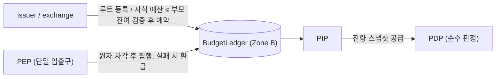

# ROADMAP — 12 예산 축소 위임 (마스터 설계)

> 상위 색인: [전체 로드맵 색인](../README.md) | 대시보드: [README.md](README.md) | 계획: [PLAN.md](PLAN.md) | 배경: [WHY.md](WHY.md) | 결정: [ADR 0003](../../adr/0003-차기-로드맵-범위-개정-비목표-조건부-해제.md)

## 1. As-Is / To-Be

| 구분 | As-Is | To-Be (Phase 12) |
|---|---|---|
| 위임 불변식 | 권한 부분집합, 수명 상한, 깊이 제한 3종([`exchange/validator.go`](../../../internal/authn/exchange/validator.go)) | 여기에 **예산 부분 상한($B_{child} \le B_{parent\_remaining}$)**을 4번째 단조 축소로 추가 |
| 횟수·양 통제 | 없음. Gate 1 `ReplayLedger`가 모든 토큰을 1회용으로만 소비([`verifier.go`](../../../internal/authn/token/verifier.go)) | `Budget != nil` 토큰은 `BudgetLedger`가 호출 횟수·읽기 바이트·쓰기 바이트 예산을 통제 (`Budget == nil`은 기존 1회성 유지) |
| 상태 저장 | 토큰은 불변, 소비 개념 없음 | 소비는 Zone B 원장(`zone_b/budget_ledger.json`, `AtomicFileStore` 기반)에서 배타 잠금으로 원자 차감 |
| 소진 사유 | 없음 | 인가 거부 `12`(`ExitAuthzDenied`) + Reason `BUDGET_EXHAUSTED`, 교환 거부 `DELEGATION_BUDGET_EXCEEDED` |
| 시나리오 | 39대 + 로드맵 10~11의 G9~G10(49대) | 신규 G11 그룹 5대(`E2E-50`~`E2E-54`, 총 54대) |

## 2. 아키텍처 및 신뢰 경계

- **토큰은 상한만 담는다**(클레임 `budget`). 소비량은 토큰에 적지 않는다(복제 우회 방지).
- **PDP는 순수 유지**: 잔량은 PIP가 공급하고 PDP는 `allow/deny + reason`만 낸다. PDP가 원장 파일을 직접 열지 않는다(기존 AST 가드 `TC-060-01` 유지).
- **원장 변경은 `internal/storage.AtomicFileStore` 경로로만**: 직접 `syscall.Flock`을 호출하지 않아 `TC-081-01` 가드를 준수하고, `app.BuildStack`에서 `filepath.Dir(StatePath)/budget_ledger.json`으로 경로를 자동 파생해 부모와 자식 워커가 동일 원장을 공유한다.
- **PEP 단일 출구(`TC-060-04`) 보존**: 차감과 실패 시 환급(`Refund`)은 `runPipeline` 내부에서 처리하여 `Gateway.Execute`의 단일 `return` 문을 그대로 유지한다.

## 3. 파급 범위와 무영향 근거

- **변경**: `internal/domain`(`Budget`, `TokenClaims.Budget`, Reason 2종), `internal/authn/budget` 신규 (`BudgetLedger`), `internal/authn/token`(`IssueToken` 원장 초기화, `VerifyToken` 다회성 예산 토큰 분기), `internal/authn/exchange`(정적·동적 예산 축소 검증 및 예약), `internal/authz/pip`·`pdp`·`pep`(배선), `internal/app`(`BuildStack` 자동 경로 파생), `internal/harness/catalog`(G11 `E2E-50`~`E2E-54`).
- **무영향**: 예산 클레임이 **없는 토큰(`Budget == nil`)**은 기존과 100% 동일하게 동작한다. 기존 49대 시나리오 판정 기준은 변하지 않으며 060에서 회귀로 증명한다.

## 4. 사전 점검 (Pre-Mortem): 이 로드맵이 실패한다면 무엇 때문인가

| 위험 | 방어책 |
|---|---|
| `Verifier.VerifyToken`의 9단계 `replayLedger.CheckAndConsume` 때문에 `MaxCalls: 2` 토큰이 2번째 호출에서 `Exit 11`(`TOKEN_REPLAY_DETECTED`)로 죽음 | `claims.Budget != nil`인 토큰은 `BudgetLedger`가 횟수를 통제하므로 Gate 1의 1회성 `replayLedger` 소비를 건너뛰고, `claims.Budget == nil`인 토큰만 기존 1회성 `replayLedger`를 적용(`E2E-18` 보존) |
| `MaxCalls: 3`만 지정하고 바이트 한도는 `0`으로 둔 토큰이 "잔여 0바이트"로 오판되어 첫 읽기/쓰기가 거부되거나, 반대로 바이트 소진(`Remaining == 0`)이 "무제한"으로 풀림 | `BudgetEntry`에 `Initial`과 `Remaining`을 분리 저장. `MaxCalls > 0`은 필수이며, 바이트 한도는 `Initial.HasReadLimit()`(`Initial.MaxReadBytes > 0`) / `Initial.HasWriteLimit()`가 참일 때만 `Remaining` 바이트를 검사·차감 |
| 동시 자식이 같은 잔량을 읽고 각자 차감해 총합이 초과 (TOCTOU) | 검사와 차감을 `AtomicFileStore.Update` **단일 flock 임계 구역**에서 수행. `-race` + 6개 다중 **서브프로세스** 경합 시나리오(`E2E-52`)로 총 성공 호출 == 3 증명 |
| 자식이 크래시해 예약분이 영구 소실(누수) | 예약 엔트리에 토큰 `ExpiresAt` 기록, 다음 원장 트랜잭션 진입 시 만료된 자식 미사용분을 부모에게 자동 귀속(`reclaimExpiredLocked`, `E2E-53`) |
| 부모와 자식 서브프로세스가 서로 다른 원장 경로를 바라봄 | `app.BuildStack`에서 `filepath.Join(filepath.Dir(StatePath), "budget_ledger.json")`으로 자동 파생하여 기존 `-state-file` 플래그만으로 부모·자식이 같은 Zone B 원장을 공유 |
| 원장 파일 손상·롤백으로 예산이 되살아남 | 원장 갱신을 `AtomicFileStore` 원자 경로로 수행. 손상 감지 시 fail-closed(`16`) |
| 다단계(2-Hop)에서 예산이 이중 계상됨 | 단계별 예약-정산 체인이 합계 보존(루트 잔여 + 중간 잔여 + 워커 잔여 + 소비량 == 초기 루트 예산)을 만족함을 `TC-030-04` 및 `E2E-54`로 증명 |

## 5. 4층위 검증 설계

| 층위 | 대상 | 방법 |
|:---:|---|---|
| 1 | 반복 수동 검증 배제 | `go test -race ./internal/domain/... ./internal/authn/... ./internal/authz/...` 자동화 |
| 2 | 단위·구조 | 단조 축소·합계 보존 table-driven, 원장 원자성, AST 가드(`TC-060-01`, `TC-060-04`, `TC-081-01`) |
| 3 | 상태·정합성 | 다중 프로세스 경합 후 원장 잔량 `0`, 해시 체인 `VALID`, 거부 후 workspace 무변화 |
| 4 | 통합 | G11(`E2E-50`~`E2E-54`) 및 기존 49대 시나리오 회귀 |

## 6. 단계 의존 관계

`010 → 020 → 030 → 040 → 050 → 060`

## 7. 단계 분해표 및 구현지시서 색인

| 단계 | 구현지시서 | 목표 | 완료 기준 | 인수 시나리오 (입력 → 기대 결과) |
|:---:|---|---|---|---|
| **010** | [010_예산_모델_adr_및_도메인_정의.md](instructions/010_예산_모델_adr_및_도메인_정의.md) | ADR 0004 수립, `domain.Budget`, `TokenClaims.Budget`, Reason `BUDGET_EXHAUSTED`·`DELEGATION_BUDGET_EXCEEDED`(`12`) | ADR 0004 확정, 도메인 단위 테스트 통과 | `MaxCalls <= 0` 또는 음수 바이트 → `ExitBadInput(14)`. `Budget == nil` → 기존 동작 |
| **020** | [020_예산_원장_zone_b.md](instructions/020_예산_원장_zone_b.md) | Zone B `BudgetLedger`(`AtomicFileStore`), 원자 예약·차감·환급·만료 회수 | 임계 구역 내 검사+차감 원자성, `TC-081-01` 통과 | 잔량 3에 동시 10차감 → 정확히 3 성공 7 거부(`12`). 만료 자식 미사용분 → 부모 자동 회수 |
| **030** | [030_교환_서비스_단조_축소_검증.md](instructions/030_교환_서비스_단조_축소_검증.md) | `IssueToken` 등록, `VerifyToken` Replay 분리, `Exchange` 자식 예산 ≤ 부모 잔여 검증·예약 | 초과 요청 거부(`12`), 2-Hop 합계 보존 | 부모 잔여 10, 자식 요청 11 → `DELEGATION_BUDGET_EXCEEDED(12)`. 요청 6 → 성공 후 부모 잔여 4 |
| **040** | [040_pip_pdp_pep_소비_배선.md](instructions/040_pip_pdp_pep_소비_배선.md) | `BuildStack` 자동 경로 파생, PIP 공급, 순수 PDP 판정, PEP 원자 차감·환급 | `TC-060-01`·`TC-060-04` 통과, 소진 시 `12` | `MaxCalls: 1` 자식이 2번째 호출 → `BUDGET_EXHAUSTED(12)`, 파일 무변화 |
| **050** | [050_g11_e2e_시나리오.md](instructions/050_g11_e2e_시나리오.md) | G11 시나리오 5대(`E2E-50`~`E2E-54`: 초과 위임 거부, 소진, 6-프로세스 경합, 크래시 회수, 2-Hop 보존) | 5대 시나리오 `PASS` | 자식 6개 서브프로세스 동시 스폰, 예산 3 → 정확히 3 성공(`0`), 3 거부(`12`) |
| **060** | [060_전체_회귀_검증_및_마감.md](instructions/060_전체_회귀_검증_및_마감.md) | 전체 회귀(54대), 문서 동기화 | `go test -race ./...` 통과, 54대 시나리오 완주 | `run --scenario all` → 54/54 `PASS`, 종료 코드 `0` |

## 8. 선행 조건 및 확정된 설계 기준

- **선행 조건**: [로드맵 10](../10-서브프로세스-자원-및-수명-통제/ROADMAP.md) `Done`. 상태저장소는 [`storage/atomic.go`](../../../internal/storage/atomic.go)의 `AtomicFileStore[T]`를 재사용한다.
- **확정 사항** ([README.md §4 결정 표](README.md) 및 `010` ADR 0004 명세 동기화 완료):
  1. **배분 방식**: 예약+정산(부모 잔여에서 예약, 만료 시 `reclaimExpiredLocked`로 lazy 자동 회수).
  2. **`Initial` vs `Remaining` 바이트 한도 규칙**: `MaxCalls > 0` 필수, 바이트 한도는 `Initial.HasReadLimit()` / `Initial.HasWriteLimit()`가 참일 때만 적용하여 `0`값 모호성 제거.
  3. **Gate 1 `ReplayLedger` 분리**: `Budget != nil` 토큰은 `BudgetLedger`가 사용 횟수를 통제하고, `Budget == nil` 토큰은 기존 1회성 `ReplayLedger`를 유지.

## 9. 인수인계 (다음 에이전트용)

- **코드 사실 확인 포인터**: [`verifier.go`](../../../internal/authn/token/verifier.go) 225행(`RecordReplay`), [`issuer.go`](../../../internal/authn/token/issuer.go), [`exchange/service.go`](../../../internal/authn/exchange/service.go), [`pdp/service.go`](../../../internal/authz/pdp/service.go), [`pep/gateway.go`](../../../internal/authz/pep/gateway.go) `runPipeline`, [`app/builder.go`](../../../internal/app/builder.go).
- **금지 사항**: 토큰에 사용량 기록, PDP의 파일·원장 직접 접근(`TC-060-01`), `internal/authn` 내 직접 `syscall.Flock` 호출(`TC-081-01`), `Gateway.Execute`에 조기 `return` 추가(`TC-060-04`), 검사와 차감의 분리(비원자).
- **착수 순서**: 로드맵 10 `Done` 확인 → 사용자의 「구현해라」 → `010`부터 한 단계씩 실행·검증·커밋 후 정지·보고.
