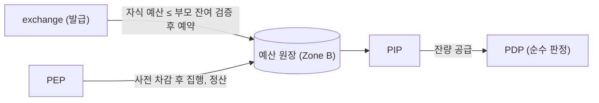

# ROADMAP — 12 예산 축소 위임 (마스터 설계)

> 상위 색인: [전체 로드맵 색인](../README.md) | 대시보드: [README.md](README.md) | 계획: [PLAN.md](PLAN.md) | 배경: [WHY.md](WHY.md) | 결정: [ADR 0003](../../adr/0003-차기-로드맵-범위-개정-비목표-조건부-해제.md)

## 1. As-Is / To-Be

| 구분 | As-Is | To-Be (Phase 12) |
|---|---|---|
| 위임 불변식 | 권한 부분집합, 수명 상한, 깊이 제한 3종([`exchange/validator.go`](../../../internal/authn/exchange/validator.go)) | 여기에 **예산 부분 상한**을 4번째 단조 축소로 추가 |
| 횟수·양 통제 | 없음. 허락된 호출은 무제한 | 호출 횟수, 읽기 바이트, 쓰기 바이트 예산 |
| 상태 저장 | 토큰은 불변, 소비 개념 없음 | 소비는 Zone B 원장(`AtomicFileStore` 기반)에서 flock으로 원자 차감 |
| 소진 사유 | 없음 | 인가 거부 `12` + Reason `BUDGET_EXHAUSTED`, 교환 거부 `DELEGATION_BUDGET_EXCEEDED` |
| 시나리오 | 39대 + 로드맵 10~11의 G9~G10 | 신규 G11 그룹 |

## 2. 아키텍처 및 신뢰 경계

- **토큰은 상한만 담는다**(클레임 `budget`). 소비량은 토큰에 적지 않는다(복제 우회 방지).
- **PDP는 순수 유지**: 잔량은 PIP가 공급하고 PDP는 `allow/deny + reason`만 낸다. PDP가 원장 파일을 직접 열지 않는다(기존 AST 가드 `TC-060-01` 유지).
- **원장 변경은 중앙 코어 경로로만**: 예약·차감·반환은 `exchange`와 PEP 정산 경로만 수행한다. 워커 코드는 원장 쓰기 권한이 없다(Zone B 쓰기 금지 유지).
- **차감과 집행의 순서**: PEP 사전 감사(Stage 4) 직전에 차감(사전 차감 방식), I/O 실패 시 정산에서 반환. 감사 실패 fail-closed와 충돌하지 않게 순서를 010 ADR에서 확정한다.

## 3. 파급 범위와 무영향 근거

- **변경**: `internal/domain`(Budget, Reason), `internal/authn/exchange`(검증·예약), `internal/authn/token`(클레임 필드 추가), 신규 원장 저장소(`internal/storage` 재사용), `internal/authz/pip`·`pdp`·`pep`(배선), `internal/orchestrator`(종료 시 반환 트리거), `internal/harness/catalog`(G11).
- **무영향**: 예산 클레임이 **없는 토큰**은 기존과 동일하게 동작해야 한다(하위 호환, 무제한이 아니라 "예산 미적용" 정책임을 ADR에 명시). 기존 시나리오 판정 기준은 변하지 않으며 060에서 회귀로 증명한다.

## 4. 사전 점검 (Pre-Mortem): 이 로드맵이 실패한다면 무엇 때문인가

| 위험 | 방어책 |
|---|---|
| 동시 자식이 같은 잔량을 읽고 각자 차감해 총합이 초과 (TOCTOU) | 검사와 차감을 **하나의 flock 임계 구역**에서 수행. `-race` + N개 다중 **프로세스** 경합 시나리오로 총합 ≤ 상한 증명 |
| 자식이 크래시해 예약분이 영구 소실(누수) | 예약에 만료(exp) 부여, 다음 접근 시 만료 예약 회수. 크래시 주입 시나리오(`kill -9` 상당)로 누수 0 증명 |
| 예약 반환을 워커가 직접 호출해 예산을 위조 | 반환은 오케스트레이터 수거 경로와 중앙 코어만. 워커의 원장 쓰기 시도는 AST 가드와 시나리오로 차단 |
| 예산 없는 토큰이 "무제한"으로 오해되어 우회 경로가 됨 | 정책 명시: 예산 클레임 부재 = 예산 통제 비적용(기존 동작). 하네스 시나리오에서 필수 모드 토글 제공, 필수 모드에서 부재 토큰은 거부 |
| 원장 파일 손상·롤백으로 예산이 되살아남 | 원장 갱신을 기존 `AtomicFileStore` 원자 경로로 수행. 손상 감지 시 fail-closed(`16`) |
| 감사와 원장이 불일치해 사후 재구성 불가 | 예약·차감·반환·회수를 모두 감사 이벤트로 기록해 원장 상태를 감사에서 재현할 수 있어야 함(재현 테스트) |
| 읽기 바이트를 사전에 알 수 없어 차감 시점이 모호 | 010 ADR에서 결정: 사전 상한 확인 + 사후 정산 방식 또는 파일 크기 사전 조회. 결정 전 구현 금지 |
| 다단계(2-Hop)에서 예산이 이중 계상됨 | 단계별 예약-정산 체인이 합계 보존(부모 예약 = 자식 예약 + 자기 잔여)을 단위 테스트로 증명 |

## 5. 4층위 검증 설계

| 층위 | 대상 | 방법 |
|:---:|---|---|
| 1 | 반복 수동 검증 배제 | `go test -race ./internal/authn/... ./internal/authz/... ./internal/storage/...`를 스크립트화 |
| 2 | 단위·구조 | 단조 축소·합계 보존 table-driven, 원장 원자성, `FuzzBudgetClaim`(기형 클레임) |
| 3 | 상태·정합성 | 원장 최종 상태가 감사 이벤트 재생 결과와 일치, 해시 체인 `VALID`, 거부 후 workspace 무변화 |
| 4 | 통합 | G11 및 기존 시나리오 회귀, 다중 프로세스 경합 |

## 6. 단계 의존 관계

`010 → 020 → 030 → 040 → 050 → 060`

## 7. 단계 분해표 (구현지시서 작성의 입력)

| 단계 | 목표 | 완료 기준 | 인수 시나리오 (입력 → 기대 결과) |
|:---:|---|---|---|
| **010** | 예산 모델 ADR(`Accepted`), `Budget` 클레임(호출, 읽기·쓰기 바이트), Reason `BUDGET_EXHAUSTED`·`DELEGATION_BUDGET_EXCEEDED` | ADR이 §8 미결 4건을 모두 결정, 도메인 단위 테스트 통과 | 음수·오버플로 예산 클레임 → 거부. 예산 클레임 부재 토큰 → 기존 동작 |
| **020** | 예산 원장(Zone B), 원자 예약·차감·반환·만료 회수 | 임계 구역에서 검사+차감이 원자적, 손상 시 fail-closed | 잔량 3에 동시 5차감 → 정확히 3 성공 2 거부. 손상 파일 → `16` |
| **030** | `exchange`의 자식 예산 ≤ 부모 잔여 검증과 예약 | 초과 요청 거부, 합계 보존 | 부모 잔여 10, 자식 요청 11 → `DELEGATION_BUDGET_EXCEEDED`. 요청 4 → 성공 후 부모 잔여 6 |
| **040** | PIP 잔량 공급, PDP 순수 판정, PEP 사전 차감·정산 | PDP가 파일·원장 접근 0(AST 가드 유지), 소진 시 `12` | 예산 1인 자식이 2번째 호출 → `BUDGET_EXHAUSTED`, 종료 코드 `12`, 파일 무변화 |
| **050** | G11: 소진, N-프로세스 경합, 크래시 회수, 2-Hop 합계 보존, 필수 모드 | 모든 시나리오 `PASS` | 자식 8개 동시, 총 예산 20 → 총 성공 호출 ≤ 20. 자식 `kill -9` → 만료 후 부모 잔여 복구, 누수 0 |
| **060** | 전체 회귀, 문서 동기화 | `go test -race ./...` 통과, 기존 시나리오 완주 | `run --scenario all` → 종료 코드 `0` |

## 8. 선행 조건·결정 필요 사항

- [로드맵 10](../10-서브프로세스-자원-및-수명-통제/ROADMAP.md) `Done`. 상태저장소는 [`storage/atomic.go`](../../../internal/storage/atomic.go)의 `AtomicFileStore[T]`를 재사용한다.
- 010의 ADR이 결정할 미결 4건: ① 예약+정산(권장) 대 공유 풀 ② 읽기 바이트 차감 시점 ③ 예산 클레임 부재 토큰의 정책 ④ 만료 회수 시점(lazy 대 명시).

## 9. 인수인계 (다음 에이전트용)

- **코드 사실 확인 포인터**: [`exchange/service.go`](../../../internal/authn/exchange/service.go), [`exchange/validator.go`](../../../internal/authn/exchange/validator.go), [`pdp/service.go`](../../../internal/authz/pdp/service.go), [`pep/gateway.go`](../../../internal/authz/pep/gateway.go)의 Stage 4~5 순서, [`domain/token.go`](../../../internal/domain/token.go).
- **금지 사항**: 토큰에 사용량 기록, PDP의 파일·원장 직접 접근, 워커의 원장 쓰기, 검사와 차감의 분리(비원자), 감사 에러 무시.
- **착수 순서**: 로드맵 10 `Done` 확인 → 010에서 예산 ADR 작성(번호는 직전 ADR+1) → 사용자 검토 후 구현.
- **접점**: 예산 소진은 로드맵 15의 ask 결정과 구분되는 **하드 거부**다. 두 개념을 섞지 말 것.
