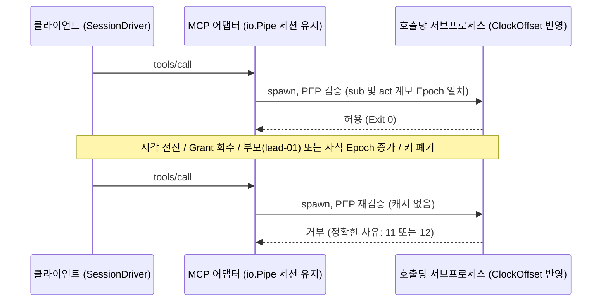

# ROADMAP — 13 장기 실행 및 토큰 수명 검증 (마스터 설계)

> 상위 색인: [전체 로드맵 색인](../README.md) | 대시보드: [README.md](README.md) | 계획: [PLAN.md](PLAN.md) | 배경: [WHY.md](WHY.md) | 결정: [ADR 0003](../../adr/0003-차기-로드맵-범위-개정-비목표-조건부-해제.md) C-4 | 근거: [011번 보고서](../../보고서/011-권한관리_본질_코어파이프라인_안티패턴_및_분산적응형_기본구조_전문가진단_보고서.md)

## 1. As-Is / To-Be

| 구분 | As-Is | To-Be (Phase 13) |
|---|---|---|
| 호출 모델 | MCP `tools/call`마다 서브프로세스를 새로 띄움([ADR 0001](../../adr/0001-mcp-tool-call-어댑터-범위-및-프로토콜.md) A-5). 하네스 `executeMCPCall`은 1줄 요청 후 즉시 EOF 종료 | `io.Pipe()` 기반 `SessionDriver`로 **단일 MCP 세션 안의 다중 호출**에서 만료·회수·키 상태 변화를 검증 |
| 시간 전파 및 시계 순수성 | `pep.Request.ClockOffset`은 존재하나 [`worker.go`](../../../internal/subagent/worker.go)에서 미전달, `spawner.go`·`pip`·`state`·`audit`에 직접 `time.Now()` 호출 잔재 | `SubagentRequest.ClockOffsetSeconds` → `worker.go` → `pep.Request.ClockOffset` 전 구간 연결 및 코어 `time.Now()` 직접 호출 금지(`TC-130-01`) |
| 위임 계보 `Epoch` | [`exchange/service.go:146`](../../../internal/authn/exchange/service.go)이 자식 토큰에 부모 `Epoch`를 덮어쓰고, [`pdp/service.go:64`](../../../internal/authz/pdp/service.go)는 자식 `Epoch`만 검사하여 부모 `bump-epoch` 시 하위 토큰이 살아남음 | `ActorClaim.Epoch`에 상위자 `Epoch`를 보존하고 자식 토큰에는 자식 `Epoch`를 부여하며, `pdp.Evaluate`가 **`sub` 및 모든 `act` 조상의 `Epoch`를 전수 대조(Subtree Kill-Switch)** |
| 갱신 | 갱신 개념 없음(Refresh 비목표) | 만료 후 유효한 부모 토큰 기반 **재교환(re-exchange)** 검증. 새 토큰도 부모 한도 안에서만 발급 |
| 회수 반영 | 실시간 PIP 조회로 Gate 2에서 검사 | Gate 2 이전(`Window A/B`: 현재 호출 거부)과 Gate 2 이후(`Window C`: 현재 호출 완료 후 다음 호출 즉시 거부) **TOCTOU 창**을 구분해 실측 |
| 시나리오 | 39대 + 로드맵 10~12 그룹(54대) | 신규 G12 그룹 6대(`E2E-55`~`E2E-60`, 총 60대) |

## 2. 아키텍처 및 신뢰 경계

- **코어 시간 결정론 완성**: `RealClock.Now()` 구현체를 제외한 모든 프로덕션 코드에서 `time.Now()` 직접 호출을 제거하고 `domain.Clock`으로 일원화한다(`TC-130-01`).
- **위임 계보 연쇄 회수(Cascading Lineage Revocation)**: 상위 위임자(`lead-01`)의 `Epoch`가 증가하면 그 위임자가 발급한 모든 하위/손자 토큰(`worker-01`)도 `pdp.Evaluate`의 `act` 체인 Epoch 대조에 의해 즉시 `ReasonSubjectEpochRevoked(12)`로 차단된다.
- **세션 무캐시 원칙**: 호출마다 토큰 검증과 PDP 결정을 다시 수행한다.

## 3. 파급 범위와 무영향 근거

- **변경**: `internal/domain/token.go`(`ActorClaim.Epoch`), `internal/authn/exchange`(`ChildEpoch` 분리 및 `ActorClaim.Epoch` 스탬핑), `internal/authz/pip`·`internal/authz/pdp`(`SubjectEpochs` 공급 및 `act` 체인 Epoch 연쇄 검증), `internal/subagent`(`ClockOffsetSeconds` 배선), `internal/orchestrator`·`state`·`audit`(`domain.Clock` 일원화), `internal/harness`(`TC-130-01` 가드 및 `SessionDriver`·G12 `E2E-55`~`E2E-60`).
- **무영향**: 기존 54대 시나리오 판정 기준 불변(부모와 자식이 모두 기본 `Epoch: 1`인 기존 시나리오와 100% 하위 호환).

## 4. 사전 점검 (Pre-Mortem): 이 로드맵이 실패한다면 무엇 때문인가

| 위험 | 방어책 |
|---|---|
| 부모(`Epoch 2`)와 자식(`Epoch 1`)의 Epoch가 다를 때 토큰 교환 후 PDP에서 `2 != 1`로 오거부 | `ExchangeRequest` 또는 `EpochProvider`를 통해 자식 토큰 본체에는 자식의 `Epoch`를, `ActorClaim.Epoch`에는 부모의 `Epoch`를 분리 기록 |
| 오염된 상위 에이전트(`lead-01`)의 Epoch를 올렸는데 이미 발급된 자식 토큰(`worker-01`)이 계속 실행됨 | `pip.SubjectSnapshot`에 `SubjectEpochs map[string]domain.Epoch`를 담고, `pdp.Evaluate`가 `req.Actor` 연결 리스트를 끝까지 순회하며 조상 Epoch 불일치 시 즉시 `ReasonSubjectEpochRevoked(12)` 반환 |
| 코어 패키지 어딘가에 남아 있는 `time.Now()`가 가상 시계 시뮬레이션을 무력화 | `TC-130-01` AST 가드레일로 `internal/` 내 직접 `time.Now()` 호출을 원천 차단 |
| 세션 중 같은 토큰 `T1`으로 2번째 호출 시 `TOKEN_REPLAY_DETECTED(11)` 발생 | 다회 호출 세션 시나리오(`E2E-55`~`E2E-57`)는 세션 예산(`Budget{MaxCalls: 5}`) 토큰을 사용하고, 일회성 재사용 차단(`E2E-58`)은 `Budget == nil` 토큰 사용 |

## 5. 4층위 검증 설계

| 층위 | 대상 | 방법 |
|:---:|---|---|
| 1 | 반복 수동 검증 배제 | `go test -race ./internal/subagent/... ./internal/mcp/... ./internal/harness/...` 자동화 |
| 2 | 단위·구조 | `TC-130-01`(`time.Now()` 금지 가드), 워커 시계 오프셋 테스트, 재교환 및 부모·자식 Epoch 분리 테스트, `act` 체인 조상 Epoch 연쇄 회수 테스트 |
| 3 | 상태·정합성 | 상태 변화 전후 감사 이벤트 시퀀스 검증, 해시 체인 `VALID`, 거부 후 workspace 무변화 |
| 4 | 통합 | G12(`E2E-55`~`E2E-60`) 세션 시나리오와 기존 54대 시나리오 회귀 |

## 6. 단계 의존 관계

`010 → 020 → 030 → 040 → 050 → 060`

## 7. 단계 분해표 및 구현지시서 색인

| 단계 | 구현지시서 | 목표 | 완료 기준 | 인수 시나리오 (입력 → 기대 결과) |
|:---:|---|---|---|---|
| **010** | [010_세션_수명_모델_및_시간_시뮬레이션_규약.md](instructions/010_세션_수명_모델_및_시간_시뮬레이션_규약.md) | `SubagentRequest.ClockOffsetSeconds` 배선, 코어 `time.Now()` 제거 및 `TC-130-01` AST 가드 | `sleep` 0초로 서브프로세스 만료 판정 통과, `TC-130-01` 통과 | TTL 5분 토큰 + `ClockOffsetSeconds: 301` → 즉시 `Exit 11`(`TOKEN_EXPIRED`) |
| **020** | [020_세션_시나리오_러너_확장.md](instructions/020_세션_시나리오_러너_확장.md) | `io.Pipe()` 기반 지속형 MCP 세션 드라이버(`SessionDriver`) | 단일 MCP 세션 내 허용 → 상태 변화 → 거부 전이 통과 | 세션 내 1차 허용 → `AdvanceClock` / `RevokeGrant` → 2차 즉시 거부 |
| **030** | [030_재교환_흐름_검증.md](instructions/030_재교환_흐름_검증.md) | `ActorClaim.Epoch` 도입(부모·자식 Epoch 분리) 및 만료 자식 토큰 재교환 검증 | 부모(`Epoch 2`) → 자식(`Epoch 1`) 위임 정상 통과, 부모 만료 후 재교환 거부 | 자식 만료 후 유효 부모로 재교환 → 성공. 부모 잔여 2분인데 자식 5분 요청 → `DELEGATION_TTL_EXCEEDED(12)` |
| **040** | [040_회수_전파_및_toctou_창_측정.md](instructions/040_회수_전파_및_toctou_창_측정.md) | `act` 체인 조상 Epoch 연쇄 회수(Subtree Kill-Switch) 및 Window A/B/C 구간별 TOCTOU 실측 | 부모 `bump-epoch` 시 자식·손자 토큰 즉시 거부(`12`), 구간별 TOCTOU 테스트 통과 | `lead-01` Epoch 증가 → `worker-01` 위임 토큰 호출 즉시 `SUBJECT_EPOCH_REVOKED(12)` |
| **050** | [050_g12_e2e_시나리오.md](instructions/050_g12_e2e_시나리오.md) | G12 시나리오 6대(`E2E-55`~`E2E-60`: 세션 중 만료, 계보 연쇄 Epoch 회수, 키 회전·폐기, 일회성 재사용, 재교환 성공, 부모 만료 후 재교환 거부) | 모든 시나리오 `PASS`, 거부 후 파일 무변화 | 세션 중 `RevokeKey` → 다음 호출 `TOKEN_KEY_RETIRED(11)`. 부모/자식 `BumpEpoch` → `SUBJECT_EPOCH_REVOKED(12)` |
| **060** | [060_전체_회귀_검증_및_마감.md](instructions/060_전체_회귀_검증_및_마감.md) | 전체 회귀(60대), 재교환 충분성 결론 기록 | `go test -race ./...` 통과, 60대 시나리오 완주 | `run --scenario all` → 60/60 `PASS`, 종료 코드 `0` |
