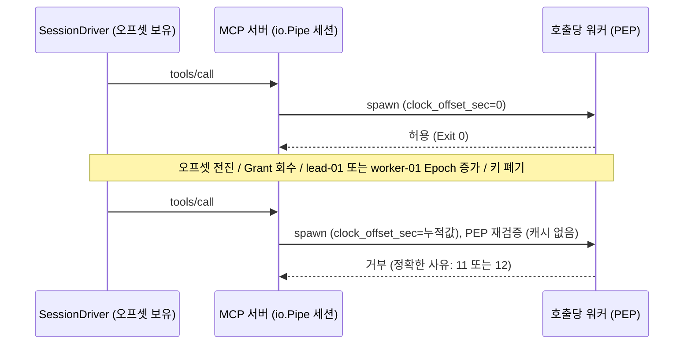

# ROADMAP — 13 장기 실행 및 토큰 수명 검증 (마스터 설계)

> 상위 색인: [전체 로드맵 색인](../README.md) | 대시보드: [README.md](README.md) | 계획: [PLAN.md](PLAN.md) | 배경: [WHY.md](WHY.md) | 결정: [ADR 0003](../../adr/0003-차기-로드맵-범위-개정-비목표-조건부-해제.md) C-4 | 근거: [011번 보고서](../../보고서/011-권한관리_본질_코어파이프라인_안티패턴_및_분산적응형_기본구조_전문가진단_보고서.md), [022번 보고서](../../보고서/022-13번로드맵_구조결함_및_진행가능성_검증보고서.md)(현행 교정 기준)

## 1. As-Is / To-Be

| 구분 | As-Is (로드맵 12 완료 시점) | To-Be (Phase 13) |
|---|---|---|
| 호출 모델 | MCP `tools/call`마다 서브프로세스를 새로 띄움([ADR 0001](../../adr/0001-mcp-tool-call-어댑터-범위-및-프로토콜.md) A-5). 하네스 `executeMCPCall`은 1줄 요청 후 즉시 EOF 종료([`g8_mcp_adapter.go`](../../../internal/harness/catalog/g8_mcp_adapter.go) 52행) | `io.Pipe()` 기반 `SessionDriver`로 **단일 MCP 세션 안의 다중 호출**에서 만료·회수·키 상태 변화를 검증 |
| 시간 전파 | `pep.Request.ClockOffset`은 Gate 1 검증기까지 이어져 있으나([`gateway.go`](../../../internal/authz/pep/gateway.go) 249행), [`worker.go`](../../../internal/subagent/worker.go)·[`inProcSpawnerBridge`](../../../internal/harness/catalog/g8_mcp_adapter.go)·[`ActionRequest`](../../../internal/harness/catalog/helpers.go)가 전달하지 않음. 인프로세스 교환·발급은 스택 자신의 시계만 봄 | `SubagentRequest.ClockOffsetSeconds`(음수 거부) → `pep.Request.ClockOffset` 전 구간 연결. 인프로세스 교환·발급은 오프셋 시계 스택 |
| 시계 순수성 | 코어 `time.Now()` 잔재: [`spawner.go`](../../../internal/orchestrator/spawner.go) 91·133·168·221행, [`pip/service.go`](../../../internal/authz/pip/service.go) 77행, [`state/store.go`](../../../internal/authz/state/store.go) 27·134행, [`audit.go`](../../../internal/audit/audit.go) 65행. [`builder.go`](../../../internal/app/builder.go) 185행은 PDP에 Clock 미전달 | `domain.Clock` 일원화와 `TC-130-01`(허용: `RealClock.Now`, spawner 프로세스 실행 시간 측정) |
| 위임 계보 `Epoch` | [`exchange/service.go`](../../../internal/authn/exchange/service.go) 181행이 자식 토큰에 부모 `Epoch`를 복사, 161~165행 `act`에는 Epoch 없음. [`pdp/service.go`](../../../internal/authz/pdp/service.go) 65행은 주체 Epoch만 검사 → 부모 `bump-epoch` 시 자식 생존, 부모·자식 Epoch가 다르면 정상 위임 거부 | 자식 토큰 Epoch = `ExchangeRequest.ChildEpoch`(0이면 1), `act.epoch` = 부모 Epoch. `pdp.Evaluate`가 **`sub`와 모든 `act` 고리를 동등 비교** |
| 갱신 | 갱신 개념 없음(Refresh 비목표) | 만료 후 유효한 부모 토큰 기반 **재교환(re-exchange)** 검증. 새 토큰도 부모 한도 안에서만 발급 |
| 회수 반영 | 실시간 PIP 조회로 Gate 2에서 검사 | Gate 2 이전(`Window A/B`: 현재 호출 거부)과 Gate 2 이후(`Window C`: 현재 호출 완료, 다음 호출 거부) **TOCTOU 창**을 구분해 실측 |
| 시나리오 | 54대(`E2E-01`~`E2E-54`, `G1`~`G11`) | 신규 G12 그룹 6대(`E2E-55`~`E2E-60`, 총 60대) |

## 2. 아키텍처 및 신뢰 경계

- **시간이 흐르는 자리**: `SessionDriver`의 누적 오프셋 하나. 도구 호출은 `Spawner` 데코레이터가 `SubagentRequest.ClockOffsetSeconds`에 담아 보낸다(서브프로세스·인프로세스 공통). 재교환·발급처럼 하네스 프로세스 안에서 일어나는 일은 `domain.NewOffsetClock(env.MockClock, offset)`을 시계로 한 스택(같은 파일 경로)으로 수행한다(12번 E2E-53 선례).
- **음수 오프셋 금지**: 발급자는 `nbf = iat = now`로 서명하므로([`issuer.go`](../../../internal/authn/token/issuer.go) 176~177행) 음수 오프셋의 효과는 만료 토큰 부활뿐이다. 워커는 음수 값을 `ExitBadInput(14)`로 거부한다. 오프셋은 부모(하네스)만 넣으며 MCP `tools/call` 인자로는 넣을 수 없다.
- **코어 시간 결정론**: 코어 6개 패키지에서 `time.Now()` 직접 호출을 제거하고 `domain.Clock`으로 일원화한다(`TC-130-01`). 프로세스 실행 시간 측정은 실제 시간이어야 하므로 허용 목록에 둔다.
- **위임 계보 연쇄 회수**: 상위 위임자(`lead-01`)의 Epoch가 증가하면 그 위임자를 `act` 사슬에 가진 모든 하위 토큰이 `pdp.Evaluate`의 동등 비교로 `ReasonSubjectEpochRevoked(12)` 거부된다. `act` 고리의 Epoch가 1 미만이면 검사를 건너뛰지 않고 거부한다.
- **세션 무캐시 원칙**: 호출마다 토큰 검증과 PDP 결정을 다시 수행한다.
- **범위 밖 (명시)**: ① 교환은 부모 토큰의 서명·수명만 검증하고 Epoch를 보지 않는다([`exchange/service.go`](../../../internal/authn/exchange/service.go) 126~128행). Epoch가 올라간 부모도 자식을 발급받을 수 있으나 그 자식은 사용 시 PEP에서 거부된다(집행점은 PEP 하나). ② 보장은 PEP를 거치는 정직한 워커에 한정된다. PEP를 건너뛰는 악의 워커는 로드맵 12의 B-15와 같은 한계다.

## 3. 파급 범위와 무영향 근거

- **변경**: `internal/subagent`(`ClockOffsetSeconds`, 음수 거부), `internal/harness/catalog`(헬퍼·브리지 오프셋 전달, `SessionDriver`, G12), `internal/orchestrator`·`internal/authz/state`·`internal/authz/pip`·`internal/audit`·`internal/app`(`domain.Clock` 일원화), `internal/harness`(`TC-130-01`), `internal/domain/token.go`(`ActorClaim.Epoch`), `internal/authn/exchange`(`ChildEpoch`, `act.epoch` 스탬핑), `internal/authz/pip`·`internal/authz/pdp`(`SubjectEpochs`, `act` 사슬 동등 비교), `internal/authz/pep`(`Config.StageObserver`), `internal/ui`(G12 해설).
- **무변경**: `internal/mcp`(시간 시뮬레이션은 하네스의 일, `TC-090-01` 감시 경계), `internal/authn/token` 검증 로직(오프셋 지원이 이미 있음), `internal/authn/budget`.
- **무영향**: 기존 54대 시나리오 판정 기준 불변. 기존 시나리오는 부모·자식이 모두 `Epoch: 1`이고, 교환이 `act.epoch`에 부모 Epoch(발급자가 항상 ≥1로 보정)를 넣으므로 동등 비교를 통과한다. `ClockOffsetSeconds` 기본값 0은 기존 동작과 같다.

## 4. 사전 점검 (Pre-Mortem): 이 로드맵이 실패한다면 무엇 때문인가

| 위험 | 방어책 |
|---|---|
| 부모(`Epoch 2`)와 자식(`Epoch 1`)의 Epoch가 다를 때 교환 후 PDP에서 `2 != 1`로 오거부 | 자식 토큰 본체에는 `ExchangeRequest.ChildEpoch`(0이면 1)를, `act.epoch`에는 부모 Epoch를 기록. 값이 틀리면 PDP가 거부하므로 Fail-Closed |
| `lead-01`의 Epoch를 올렸는데 이미 발급된 `worker-01` 위임 토큰이 계속 실행됨 | PIP 스냅샷에 `SubjectEpochs`(같은 `Load`의 `st.Epochs` 사본)를 담고 `pdp.Evaluate`가 `req.Actor` 사슬을 끝까지 순회하며 동등 비교 |
| Epoch가 비어 있는 `act` 고리가 검사를 건너뜀 | 고리 Epoch < 1이면 `ReasonSubjectEpochRevoked(12)` 거부 |
| 워커 프레임의 음수 오프셋으로 만료 토큰이 되살아남 | 워커가 음수를 `ExitBadInput(14)`로 거부(TC-010-03) |
| 오프셋이 서브프로세스에만 가고 인프로세스 교환은 과거 시각에서 판정 | 교환·발급은 오프셋 시계 스택으로 수행(D-07) |
| 세션 중 같은 토큰 `T1`으로 2번째 호출 시 `TOKEN_REPLAY_DETECTED(11)` 발생 | 다회 호출 시나리오(`E2E-55`~`E2E-57`, TC-040-03)는 예산 토큰 사용. 예산 토큰은 Replay 소비를 건너뜀([`verifier.go`](../../../internal/authn/token/verifier.go) 234행) |
| 코어에 남은 `time.Now()`가 가상 시계를 무력화 | `TC-130-01` AST 가드. 프로세스 실행 시간 측정은 허용 목록으로 명시 |

## 5. 4층위 검증 설계

| 층위 | 대상 | 방법 |
|:---:|---|---|
| 1 | 반복 수동 검증 배제 | `go test -race ./internal/subagent/... ./internal/authn/exchange/... ./internal/authz/... ./internal/harness/...` 자동화 |
| 2 | 단위·구조 | `TC-130-01`, 워커 시계 오프셋·음수 거부 시험, 재교환 및 부모·자식 Epoch 분리 시험, `act` 사슬 연쇄 회수 시험, Window A/B/C 시험 |
| 3 | 상태·정합성 | 상태 변화 전후 감사 이벤트 시퀀스, 해시 체인 `VALID`, 거부 후 workspace 무변화 |
| 4 | 통합 | G12(`E2E-55`~`E2E-60`) 세션 시나리오와 기존 54대 시나리오 회귀 |

## 6. 단계 의존 관계

`010 → 020 → 030 → 040 → 050 → 060`

## 7. 단계 분해표 및 구현지시서 색인

| 단계 | 구현지시서 | 목표 | 완료 기준 | 인수 시나리오 (입력 → 기대 결과) |
|:---:|---|---|---|---|
| **010** | [010_세션_수명_모델_및_시간_시뮬레이션_규약.md](instructions/010_세션_수명_모델_및_시간_시뮬레이션_규약.md) | 워커·하네스 오프셋 배선(음수 거부), 코어 `domain.Clock` 일원화, `TC-130-01` | `sleep` 0초로 서브프로세스 만료 판정 통과, `TC-130-01` 통과 | TTL 5분 토큰 + `ClockOffsetSeconds: 301` → `Exit 11`(`TOKEN_EXPIRED`). `-300` → `Exit 14` |
| **020** | [020_세션_시나리오_러너_확장.md](instructions/020_세션_시나리오_러너_확장.md) | `io.Pipe()` 기반 `SessionDriver`, 오프셋 Spawner 데코레이터, 오프셋 시계 스택 | 단일 MCP 세션 내 허용 → 상태 변화 → 거부 전이 통과 | 세션 내 1차 허용 → `AdvanceClock` / `RevokeGrant` → 2차 거부 |
| **030** | [030_재교환_흐름_검증.md](instructions/030_재교환_흐름_검증.md) | `ActorClaim.Epoch`, `ExchangeRequest.ChildEpoch`, 재교환 검증 | 부모(`Epoch 2`) → 자식(`Epoch 1`) 위임 정상 통과, 부모 만료 후 재교환 거부 | 자식 만료 후 유효 부모로 재교환 → 성공. 부모 잔여 2분인데 자식 5분 요청 → `DELEGATION_TTL_EXCEEDED(12)` |
| **040** | [040_회수_전파_및_toctou_창_측정.md](instructions/040_회수_전파_및_toctou_창_측정.md) | `act` 사슬 연쇄 회수, `StageObserver`, Window A/B/C 실측 | 상위 `bump-epoch` 시 하위 토큰 거부(`12`), 구간별 시험 통과 | `lead-01` Epoch 증가 → `worker-01` 위임 토큰 호출 `SUBJECT_EPOCH_REVOKED(12)` |
| **050** | [050_g12_e2e_시나리오.md](instructions/050_g12_e2e_시나리오.md) | G12 6대(세션 중 만료, 계보 연쇄 회수, 키 회전·폐기, 일회성 재사용, 재교환 성공, 부모 만료 후 재교환 거부) | 모든 시나리오 `PASS`, 거부 후 파일 무변화 | 세션 중 `RevokeKey` → 다음 호출 `TOKEN_KEY_RETIRED(11)`. `lead-01` `BumpEpoch` → 자식 호출 `SUBJECT_EPOCH_REVOKED(12)` |
| **060** | [060_전체_회귀_검증_및_마감.md](instructions/060_전체_회귀_검증_및_마감.md) | 전체 회귀(60대), 재교환 충분성 결론, MASTER 동기화 | `go test -race ./...` 통과, 60대 완주 | `run --scenario all` → 60/60 `PASS`, 종료 코드 `0` |
