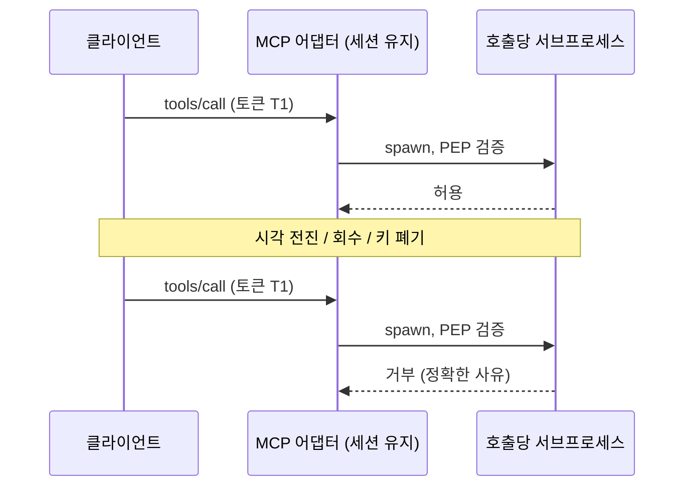

# ROADMAP — 13 장기 실행 및 토큰 수명 검증 (마스터 설계)

> 상위 색인: [전체 로드맵 색인](../README.md) | 대시보드: [README.md](README.md) | 계획: [PLAN.md](PLAN.md) | 배경: [WHY.md](WHY.md) | 결정: [ADR 0003](../../adr/0003-차기-로드맵-범위-개정-비목표-조건부-해제.md) C-4

## 1. As-Is / To-Be

| 구분 | As-Is | To-Be (Phase 13) |
|---|---|---|
| 호출 모델 | MCP `tools/call`마다 서브프로세스를 새로 띄움([ADR 0001](../../adr/0001-mcp-tool-call-어댑터-범위-및-프로토콜.md) A-5). 세션은 어댑터 프로세스가 유지 | 동일 모델 유지. **세션 안의 다중 호출**에서 만료·회수·키 상태 변화를 검증 |
| 만료·회수 시험 | 단일 호출 단위 시나리오(`E2E-14`, `E2E-24`, `E2E-13` 등) | 한 세션 안에서 `허용 → 상태 변화 → 거부`를 시계열로 증명 |
| 시간 | `--clock-offset` 가상 시계 존재 | 세션 러너가 단계마다 시각을 전진시켜 결정론적으로 재현 |
| 갱신 | 갱신 개념 없음(Refresh 비목표) | 만료 임박 시 **재교환(re-exchange)** 검증. 새 토큰도 부모 한도 안에서만 발급 |
| 회수 반영 | 실시간 PIP 조회로 호출 직전 검사 | 호출 진행 중 회수가 일어나는 **TOCTOU 창**을 정의·측정 |
| 시나리오 | 39대 + 로드맵 10~12 그룹 | 신규 G12 그룹 |

## 2. 아키텍처 및 신뢰 경계

- 새로운 컴포넌트는 만들지 않는다. **기존 검증 경로가 시간 경과 후에도 같은 규칙을 적용하는지**를 시험한다.
- 재교환은 기존 `exchange` 서비스를 그대로 사용한다. 부모 토큰 `exp` 이후에는 재교환 자체가 거부된다(기존 불변식).
- 세션은 신뢰 상태를 **캐시하지 않는다**: 호출마다 토큰 검증과 PDP 결정을 다시 수행해야 한다(호출 단위 재검증 원칙). 어댑터에 토큰·판정 캐시를 두는 구현은 금지한다.

## 3. 파급 범위와 무영향 근거

- **변경**: `internal/harness`(세션 시나리오 러너 확장), `internal/harness/catalog`(G12), 필요 시 `internal/mcp`(테스트에서 시각 주입 지점. 프로덕션 동작 변경 없음), 문서(TOCTOU 창 정의).
- **무영향**: 토큰·PDP·PEP 판정 로직은 **변경하지 않는다**. 이 로드맵은 새 기능이 아니라 기존 불변식의 시간 축 검증이다. 검증 중 결함이 발견되면 중단하고 보고한다(결함 수정은 별도 지시).

## 4. 사전 점검 (Pre-Mortem): 이 로드맵이 실패한다면 무엇 때문인가

| 위험 | 방어책 |
|---|---|
| 실제 sleep으로 시험해 느리고 플레이키 | 가상 시계만 사용, 고정 sleep 금지. 러너가 시각을 명시적으로 전진 |
| 어댑터가 토큰·판정을 캐시해 만료·회수가 늦게 반영 | 호출 단위 재검증 원칙을 시나리오로 증명(상태 변화 직후 첫 호출이 거부) |
| 재교환이 부모 한도를 넘는 토큰을 발급 | 재교환 결과의 권한·수명이 부모 이내임을 단조 축소 테스트로 확인. 부모 만료 후 재교환은 거부 |
| TOCTOU 창을 "없다"고 과장 | 창을 정의(Gate 1 통과 ~ Stage 4 사전 감사 완료 ~ Stage 5 I/O)하고, 주입 테스트(`--inject-revoke-before-io` 계열)로 각 구간의 결과를 표로 기록. 구간별 허용·거부를 문서화 |
| 키 폐기 직후 이미 발급된 토큰이 일정 시간 통과 | 기존 `E2E-13` 동작과 일치하는지 세션 시나리오로 확인, 불일치 시 결함 보고 |
| 일회성 토큰(`one_time`)이 세션 내 재사용 | 같은 세션 내 두 번째 사용 거부(Replay 원장)를 시나리오에 포함 |
| 재교환 도입이 사실상 Refresh Token이 되어 비목표 위반 | 재교환은 **부모 토큰 제시가 필수**. 부모 없이 갱신하는 경로가 없음을 AST·시나리오로 확인. 부족 판정 시 별도 ADR |

## 5. 4층위 검증 설계

| 층위 | 대상 | 방법 |
|:---:|---|---|
| 1 | 반복 수동 검증 배제 | `go test -race ./internal/harness/... ./internal/mcp/...`를 스크립트화 |
| 2 | 단위·구조 | 재교환 단조 축소 table-driven, 어댑터에 캐시 필드가 없음을 구조 검사 |
| 3 | 상태·정합성 | 상태 변화 전후 감사 이벤트 시퀀스 검증, 해시 체인 `VALID`, 거부 후 workspace 무변화 |
| 4 | 통합 | G12 세션 시나리오와 기존 시나리오 회귀 |

## 6. 단계 의존 관계

`010 → 020 → 030 → 040 → 050 → 060`

## 7. 단계 분해표 (구현지시서 작성의 입력)

| 단계 | 목표 | 완료 기준 | 인수 시나리오 (입력 → 기대 결과) |
|:---:|---|---|---|
| **010** | 세션 수명 모델 문서화(호출 단위 재검증 원칙), 가상 시계 시험 규약 | 문서 승인, 규약이 기존 `--clock-offset`과 일관됨을 확인 | 규약 문서 → 모든 후속 시나리오가 sleep 없이 시각을 전진시킴 |
| **020** | 한 세션 안에서 호출 → 상태 변화 → 호출을 수행하는 러너 확장 | 기존 시나리오 판정 불변, 단계 간 시각 전진 가능 | 세션: 호출 허용 → 시각 전진(만료 이후) → 호출 → `TOKEN_EXPIRED` |
| **030** | 재교환 흐름 검증 | 새 토큰이 부모 권한·수명 이내, 부모 만료 후 거부 | 만료 임박 자식 토큰 → 부모 토큰으로 재교환 성공 후 새 토큰으로 호출 허용. 부모 만료 후 재교환 → `DELEGATION_*` 거부 |
| **040** | 회수 전파와 TOCTOU 창 측정·문서화 | 구간별(Gate 1 후, Stage 4 후, Stage 5 중) 결과 표 확정 | Gate 1 통과 직후 Revoke 주입 → 거부(Gate 2). Stage 4 이후 Revoke → 해당 호출 완료 허용 여부를 표로 확정하고 다음 호출은 거부 |
| **050** | G12: 세션 중 만료, Grant 회수, Epoch bump, 키 회전·폐기, 일회성 재사용, 재교환 | 모든 시나리오 `PASS`, 거부 후 파일 무변화 | 세션 중 `keys revoke` → 다음 호출 `TOKEN_UNKNOWN_OR_RETIRED_KEY`. Epoch bump → `SUBJECT_EPOCH_REVOKED` |
| **060** | 전체 회귀, 결론 기록(재교환으로 충분한가) | `go test -race ./...` 통과, 결론이 README 결정 표에 기록 | `run --scenario all` → 종료 코드 `0`. 부족 판정 시 후속 ADR 제안 |

## 8. 선행 조건·결정 필요 사항

- [ADR 0003](../../adr/0003-차기-로드맵-범위-개정-비목표-조건부-해제.md) C-4 `Accepted`. 로드맵 12 `Done` 권장.
- 미결: ① TOCTOU 창 구간 정의의 정확한 경계(사전 감사 완료 시점을 허용 확정점으로 볼지) ② 상주 워커 도입 여부(권장: 이번 범위 밖, 후속 로드맵 후보) ③ 일회성 토큰의 세션 단위 정책.

## 9. 인수인계 (다음 에이전트용)

- **코드 사실 확인 포인터**: [`mcp/server.go`](../../../internal/mcp/server.go)(세션 유지), [`mcp/executor.go`](../../../internal/mcp/executor.go)(호출당 spawn), [`authn/exchange/service.go`](../../../internal/authn/exchange/service.go), [`authn/token/verifier.go`](../../../internal/authn/token/verifier.go), [`pep/gateway.go`](../../../internal/authz/pep/gateway.go) Stage 순서, 기존 TOCTOU 테스트 `TestOrchestrateRunner_TC09`.
- **금지 사항**: 어댑터에 토큰·판정 캐시 추가, 실제 sleep 사용, 판정 로직 수정(결함 발견 시 중단·보고), 부모 없는 갱신 경로 추가.
- **착수 순서**: ADR 0003 C-4 상태 확인 → 010 지시서 작성 → 사용자의 「구현해라」 → 한 단계씩.
