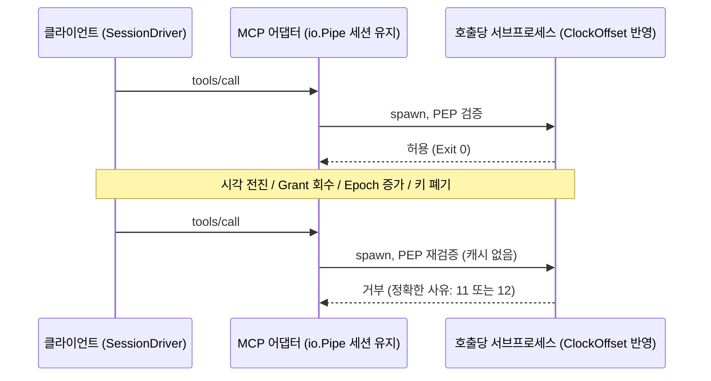

# ROADMAP — 13 장기 실행 및 토큰 수명 검증 (마스터 설계)

> 상위 색인: [전체 로드맵 색인](../README.md) | 대시보드: [README.md](README.md) | 계획: [PLAN.md](PLAN.md) | 배경: [WHY.md](WHY.md) | 결정: [ADR 0003](../../adr/0003-차기-로드맵-범위-개정-비목표-조건부-해제.md) C-4

## 1. As-Is / To-Be

| 구분 | As-Is | To-Be (Phase 13) |
|---|---|---|
| 호출 모델 | MCP `tools/call`마다 서브프로세스를 새로 띄움([ADR 0001](../../adr/0001-mcp-tool-call-어댑터-범위-및-프로토콜.md) A-5). 하네스 `executeMCPCall`은 1줄 요청 후 즉시 EOF 종료 | `io.Pipe()` 기반 `SessionDriver`로 **단일 MCP 세션 안의 다중 호출**에서 만료·회수·키 상태 변화를 검증 |
| 만료·회수 시험 | 단일 호출 단위 시나리오(`E2E-14`, `E2E-24`, `E2E-13` 등) | 한 세션 안에서 `허용 → 상태 변화 → 거부`를 시계열로 증명 |
| 시간 전파 | `pep.Request.ClockOffset`은 존재하나 [`worker.go`](../../../internal/subagent/worker.go)에서 미전달 | `SubagentRequest.ClockOffsetSeconds` → `worker.go` → `pep.Request.ClockOffset` 전 구간 연결 |
| 갱신 | 갱신 개념 없음(Refresh 비목표) | 만료 후 유효한 부모 토큰 기반 **재교환(re-exchange)** 검증. 새 토큰도 부모 한도 안에서만 발급 |
| 회수 반영 | 실시간 PIP 조회로 Gate 2에서 검사 | Gate 2 이전(`Window A/B`: 현재 호출 거부)과 Gate 2 이후(`Window C`: 현재 호출 완료 후 다음 호출 즉시 거부) **TOCTOU 창**을 구분해 실측 |
| 시나리오 | 39대 + 로드맵 10~12 그룹(54대) | 신규 G12 그룹 6대(`E2E-55`~`E2E-60`, 총 60대) |

## 2. 아키텍처 및 신뢰 경계

- 새로운 프로덕션 도메인 컴포넌트는 만들지 않는다. **기존 검증 경로가 시간 경과 및 상태 변이 후에도 같은 규칙을 적용하는지**를 시험한다.
- 재교환은 기존 `exchange` 서비스를 그대로 사용한다. 부모 토큰 `exp` 이후에는 재교환 자체가 `ReasonTokenExpired`(`11`)로 거부된다.
- 세션은 신뢰 상태를 **캐시하지 않는다**: 호출마다 토큰 검증과 PDP 결정을 다시 수행해야 한다(호출 단위 재검증 원칙).

## 3. 파급 범위와 무영향 근거

- **변경**: `internal/subagent`(`SubagentRequest.ClockOffsetSeconds` 및 `worker.go` 배선), `internal/mcp`(`SubprocessExecutor` 시계 오프셋 콜백), `internal/authz/pep`(`OnStagePassed` 테스트 훅), `internal/harness/catalog`(`SessionDriver` 및 G12 `E2E-55`~`E2E-60`).
- **무영향**: 토큰·PDP·PEP의 인가 판정 규칙은 변경하지 않는다. 기존 54대 시나리오 판정 기준 불변.

## 4. 사전 점검 (Pre-Mortem): 이 로드맵이 실패한다면 무엇 때문인가

| 위험 | 방어책 |
|---|---|
| 세션 중 같은 토큰 `T1`으로 2번째 호출을 했을 때 만료·회수 사유 대신 `TOKEN_REPLAY_DETECTED(11)`가 나옴 | 로드맵 12를 필수 선행으로 두어, 다회 호출 세션 시나리오(`E2E-55`~`E2E-57`)는 세션 예산(`Budget{MaxCalls: 5}`)이 부여된 토큰을 사용하고, 일회성 재사용 차단(`E2E-58`)은 `Budget == nil` 토큰을 사용 |
| `SessionDriver`에서 `bytes.Buffer`를 써서 1차 호출 직후 MCP 서버가 `io.EOF`로 종료됨 | `io.Pipe()` 양방향 스트림과 `bufio.Reader`로 세션이 닫힐 때까지 단일 `mcp.Server.Serve` 루프를 유지 |
| 실제 sleep으로 시험해 느리고 플레이키 | `SubagentRequest.ClockOffsetSeconds` → `worker.go` → `pepReq.ClockOffset` 배선으로 `sleep` 0초만에 자식 서브프로세스 시각을 전진 |
| TOCTOU 창을 "없다"고 과장하거나 `WithBeforeIOHook`의 위치를 오해 | [`decorator.go`](../../../internal/authz/pep/decorator.go)와 [`gateway.go`](../../../internal/authz/pep/gateway.go) 실제 코드에 맞춰 Window A(진입 전), Window B(Gate 1 후 ~ Gate 2 전: 현재 호출 거부), Window C(Gate 2 통과 후 ~ Stage 5 I/O: 물리적 TOCTOU 창으로 현재 호출은 완료되고 직후 다음 호출이 거부됨)를 정직하게 실측·문서화 |
| 키 폐기 시 기대 Reason 상수명 착오 | 실제 코드([`constants.go`](../../../internal/domain/constants.go), [`verifier.go`](../../../internal/authn/token/verifier.go))의 상수명인 `ReasonTokenKeyRetired`(`"TOKEN_KEY_RETIRED"`)로 통일 |
| 재교환 도입이 사실상 Refresh Token이 되어 비목표 위반 | 재교환은 **유효한 부모 토큰 제시가 필수**. 부모 만료 후 재교환 시도(`E2E-60`)가 `TOKEN_EXPIRED(11)`로 거부됨을 증명 |

## 5. 4층위 검증 설계

| 층위 | 대상 | 방법 |
|:---:|---|---|
| 1 | 반복 수동 검증 배제 | `go test -race ./internal/subagent/... ./internal/mcp/... ./internal/harness/...` 자동화 |
| 2 | 단위·구조 | 워커 시계 오프셋 단위 테스트, 재교환 단조 축소 table-driven, Window A/B/C TOCTOU 단위 테스트 |
| 3 | 상태·정합성 | 상태 변화 전후 감사 이벤트 시퀀스 검증, 해시 체인 `VALID`, 거부 후 workspace 무변화 |
| 4 | 통합 | G12(`E2E-55`~`E2E-60`) 세션 시나리오와 기존 54대 시나리오 회귀 |

## 6. 단계 의존 관계

`010 → 020 → 030 → 040 → 050 → 060`

## 7. 단계 분해표 및 구현지시서 색인

| 단계 | 구현지시서 | 목표 | 완료 기준 | 인수 시나리오 (입력 → 기대 결과) |
|:---:|---|---|---|---|
| **010** | [010_세션_수명_모델_및_시간_시뮬레이션_규약.md](instructions/010_세션_수명_모델_및_시간_시뮬레이션_규약.md) | `SubagentRequest.ClockOffsetSeconds` 추가 및 `worker.go` → `pep.Request.ClockOffset` 배선 | `sleep` 0초로 서브프로세스 토큰 만료·미래 토큰 판정 통과 | TTL 5분 토큰 + `ClockOffsetSeconds: 301` → 즉시 `Exit 11`(`TOKEN_EXPIRED`) |
| **020** | [020_세션_시나리오_러너_확장.md](instructions/020_세션_시나리오_러너_확장.md) | `io.Pipe()` 기반 지속형 MCP 세션 드라이버(`SessionDriver`) 및 `SubprocessExecutor` 시계 콜백 | 단일 MCP 세션 내 허용 → 상태 변화 → 거부 전이 통과 | 세션 내 1차 허용 → `AdvanceClock` / `RevokeGrant` → 2차 즉시 거부 |
| **030** | [030_재교환_흐름_검증.md](instructions/030_재교환_흐름_검증.md) | 만료 자식 토큰의 부모 기반 재교환 및 수명·권한 단조 축소 검증 | 새 토큰이 부모 잔여 수명 이내, 부모 만료 후 재교환 거부 | 자식 만료 후 유효 부모로 재교환 → 성공. 부모 잔여 2분인데 자식 5분 요청 → `DELEGATION_TTL_EXCEEDED(12)` |
| **040** | [040_회수_전파_및_toctou_창_측정.md](instructions/040_회수_전파_및_toctou_창_측정.md) | `OnStagePassed` 훅 및 Window A/B/C 구간별 TOCTOU 실측·문서화 | 구간별(Gate 1 전, Gate 1~2 사이, Gate 2 통과 후) 결과 표 테스트 통과 | Window A/B Revoke → 현재 호출 거부(`12`). Window C(Gate 2 후) Revoke → 현재 호출 완료(`0`), 직후 다음 호출 거부(`12`) |
| **050** | [050_g12_e2e_시나리오.md](instructions/050_g12_e2e_시나리오.md) | G12 시나리오 6대(`E2E-55`~`E2E-60`: 세션 중 만료, Epoch 회수, 키 회전·폐기, 일회성 재사용, 재교환 성공, 부모 만료 후 재교환 거부) | 모든 시나리오 `PASS`, 거부 후 파일 무변화 | 세션 중 `RevokeKey` → 다음 호출 `TOKEN_KEY_RETIRED(11)`. `BumpEpoch` → `SUBJECT_EPOCH_REVOKED(12)` |
| **060** | [060_전체_회귀_검증_및_마감.md](instructions/060_전체_회귀_검증_및_마감.md) | 전체 회귀(60대), 재교환 충분성 결론 기록 | `go test -race ./...` 통과, 60대 시나리오 완주 | `run --scenario all` → 60/60 `PASS`, 종료 코드 `0` |

## 8. 선행 조건 및 확정된 설계 기준

- **선행 조건**: [ADR 0003](../../adr/0003-차기-로드맵-범위-개정-비목표-조건부-해제.md) C-4 `Accepted`, [로드맵 12](../12-예산-축소-위임/README.md) `Done` (다회 호출 세션 토큰 지원).
- **확정 사항**:
  1. **TOCTOU 창 경계**: Gate 2(`StageGate2AuthZ`) 진입 전 회수는 In-Flight 호출을 즉시 차단하고, Gate 2 통과 이후의 회수는 물리적 TOCTOU 창으로서 In-Flight 호출 완료 후 다음 호출부터 차단한다.
  2. **상주 워커 미도입**: 호출당 서브프로세스 모델([ADR 0001](../../adr/0001-mcp-tool-call-어댑터-범위-및-프로토콜.md) A-5)을 유지한다.
  3. **세션 토큰과 일회성 토큰 분리**: 다회 호출 세션 토큰은 `Budget{MaxCalls: N}`을 부여하고, 일회성 토큰은 `Budget == nil`로 구분한다.

## 9. 인수인계 (다음 에이전트용)

- **코드 사실 확인 포인터**: [`mcp/server.go`](../../../internal/mcp/server.go), [`mcp/executor.go`](../../../internal/mcp/executor.go), [`subagent/worker.go`](../../../internal/subagent/worker.go) 38행, [`authn/keys/manager.go`](../../../internal/authn/keys/manager.go), [`authn/token/verifier.go`](../../../internal/authn/token/verifier.go), [`pep/gateway.go`](../../../internal/authz/pep/gateway.go), [`pep/decorator.go`](../../../internal/authz/pep/decorator.go).
- **금지 사항**: 어댑터에 토큰·판정 캐시 추가, 실제 `time.Sleep` 사용, 부모 없는 갱신 경로 추가.
- **착수 순서**: ADR 0003 C-4 및 로드맵 12 `Done` 확인 → 사용자의 「구현해라」 → `010`부터 한 단계씩 실행·검증·커밋 후 정지·보고.
