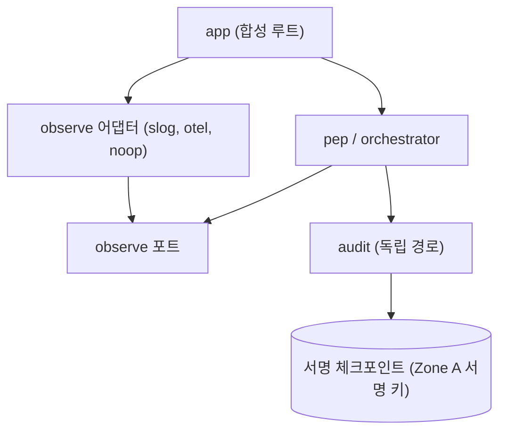

# ROADMAP — 14 감사 확장 및 관측성 포트 (마스터 설계)

> 상위 색인: [전체 로드맵 색인](../README.md) | 대시보드: [README.md](README.md) | 계획: [PLAN.md](PLAN.md) | 배경: [WHY.md](WHY.md) | 결정: [ADR 0002](../../adr/0002-관측성-포트-분리-및-오픈텔레메트리-전환.md), [ADR 0003](../../adr/0003-차기-로드맵-범위-개정-비목표-조건부-해제.md)

## 1. As-Is / To-Be

| 구분 | As-Is (코드 확인) | To-Be (Phase 14) |
|---|---|---|
| 운영 로그 결합 | `slog`는 [`pep/gateway.go`](../../../internal/authz/pep/gateway.go) `Config.Logger *slog.Logger`, [`app/builder.go`](../../../internal/app/builder.go), [`mcp/server.go`](../../../internal/mcp/server.go), [`cli/mcp.go`](../../../internal/cli/mcp.go), [`cmd/authz-harness/main.go`](../../../cmd/authz-harness/main.go)에서 직접 사용. `domain`은 비의존 | 구체 타입 대신 **관측성 포트**를 받고, 구현은 어댑터(slog, OTel, noop)로 분리 |
| 감사 무결성 | 해시 체인(`prev_hash`/`curr_hash`)과 flock. 중간 변조는 탐지 | 끝부분 삭제와 전체 재작성도 **서명 체크포인트**로 탐지. 로테이션 시 체인 연결 유지 |
| 감사 내용 | 이벤트·사유·`jti` 등. 도구 인자·결과 정보 부족 | `schema_version`과 인자·결과 **해시**, 마스킹 정책 |
| 상관 | 문자열 `trace_id` ([`domain/event.go`](../../../internal/domain/event.go)) | W3C 호환 `trace_id`/`span_id`, 자식 프로세스에 stdin 프레임으로 `traceparent` 전달 |
| 뷰 | `audit timeline` | 부모→자식 **위임 트리 뷰**(`audit tree`) 추가 |
| 시나리오 | 39대 + 로드맵 10~13 그룹 | 신규 G13 그룹 |

## 2. 아키텍처 및 신뢰 경계

- **포트와 감사는 서로 호출하지 않는다.** 감사는 샘플링·비동기·드롭이 없는 fail-closed 경로이고, 포트는 best-effort다.
- **서명 키는 Zone A에 두고 감사 전용 `kid`로 분리**한다. 토큰 서명 키와 섞지 않는다(키 회전·폐기 영향 분리). 워커는 접근 불가.
- **원시 토큰은 포트 속성에도 금지**한다. 속성 필터를 포트 계층에 두어 `jti`와 요약만 통과시킨다([ADR 0002](../../adr/0002-관측성-포트-분리-및-오픈텔레메트리-전환.md) B-7).
- **코어는 slog·OTel을 import하지 않는다**: `domain`, `authn`, `authz/pdp`, `jail`, `audit`.

## 3. 파급 범위와 무영향 근거

- **변경**: 신규 `internal/observe`(후보), `pep.Config`·`app.Config`의 로거 필드, `internal/audit`(스키마 확장, 체크포인트), `internal/authn/keys`(감사 서명 키 종류 추가 시), `internal/cli`(`audit checkpoint`, `audit tree`), `internal/orchestrator`·`internal/subagent`(`traceparent` 프레임 필드), `internal/harness`(가드와 G13), OTel 어댑터(의존성 격리).
- **무영향**: PDP·PEP 판정 로직, 토큰 검증, 기존 감사 레코드의 검증 가능성(**구버전 레코드가 새 검증기에서 `VALID`**), 기존 시나리오 판정 기준.

## 4. 사전 점검 (Pre-Mortem): 이 로드맵이 실패한다면 무엇 때문인가

| 위험 | 방어책 |
|---|---|
| 스키마 변경으로 기존 `audit.jsonl`이 `INTEGRITY_BROKEN` | `schema_version` 도입. 검증기는 버전별 해시 입력 규칙을 보존. **구버전 샘플 파일을 픽스처로 두고 회귀 테스트** |
| `trace_id` 형식 변경이 해시 체인·기존 시나리오·골든 출력을 파손 | [ADR 0002](../../adr/0002-관측성-포트-분리-및-오픈텔레메트리-전환.md) 미결 2번을 먼저 확정. 기본 권장: 기존 `trace_id`는 유지하고 W3C 필드를 **추가**(매핑 필드) |
| 해시 체인만으로는 끝부분 삭제를 못 잡음 | 서명 체크포인트(체인 head + 줄 수 + 시각)를 주기적 또는 종료 시 기록. 체크포인트보다 적은 줄 수 → 삭제 탐지 시나리오 |
| 체크포인트 서명 키를 워커·PEP가 접근 | Zone A 한정, 서명은 별도 코어 경로. AST 가드로 워커 패키지의 키 저장소 import 금지 |
| 로테이션 시 체인 단절로 검증 불가 | 새 파일의 첫 레코드가 이전 파일 마지막 해시를 `prev_hash`로 승계. 로테이션 전후 연속 검증 테스트 |
| 인자·결과 해시가 비밀 추측 공격(저엔트로피 값 사전 대입)에 취약 | 해시에 **솔트 또는 키 기반 해시(HMAC)** 사용 여부를 030에서 결정. 기본 권장: 키 기반. 마스킹 정책은 필드 allow-list 방식 |
| 포트 추상화가 과해 slog·OTel 고유 기능을 잃음 | 포트는 소비자가 필요한 최소 연산만. 범위는 ADR 0002 미결 1번에서 확정 |
| OTel SDK 도입이 코어 의존성을 오염 | 어댑터 격리, 필요 시 별도 모듈 분리(`go.mod` 영향은 060 시작 전 결정). 020의 AST 가드로 코어 import 금지 |
| 포트 호출 실패가 요청 실패로 번짐 | 포트 구현은 에러를 삼키지 않되 **요청 결과에 영향 주지 않음**을 테스트(포트가 panic·에러여도 인가 결과 불변). 감사 실패만 fail-closed |
| 기존 slog 결합이 로드맵 10~13의 신규 코드로 번짐 | 로드맵 10~13 구현 시 신규 로깅은 `pep.Config.Logger` 등 **기존 주입 지점만** 사용하고 신규 `slog` 직접 import 금지. 14에서 일괄 치환 |

## 5. 4층위 검증 설계

| 층위 | 대상 | 방법 |
|:---:|---|---|
| 1 | 반복 수동 검증 배제 | `go test -race ./internal/audit/... ./internal/observe/...` 등 스크립트화 |
| 2 | 단위·구조 | AST 가드(코어 import 금지), 스키마 버전별 해시 table-driven, `FuzzAuditLine`, 속성 필터 테스트 |
| 3 | 상태·정합성 | 구버전 픽스처 `VALID`, 끝부분 삭제·재작성·로테이션 시나리오, 해시 체인·체크포인트 서명 검증 |
| 4 | 통합 | G13 및 기존 시나리오 회귀, 다중 프로세스 동시 기록 중 체크포인트 |

## 6. 단계 의존 관계

`010 → 020 → 030 → 040 → 050 → 060 → 070 → 080`. 030~040(감사)과 010~020(포트)은 독립이나 번호순 실행을 기본으로 한다.

## 7. 단계 분해표 (구현지시서 작성의 입력)

| 단계 | 목표 | 완료 기준 | 인수 시나리오 (입력 → 기대 결과) |
|:---:|---|---|---|
| **010** | 관측성 포트, slog·noop 어댑터, `pep.Config.Logger`와 `app` 로거를 포트로 교체 | 기존 stderr 출력 형식·테스트 불변, 코어에 구체 로거 타입 없음 | 포트에 noop 주입 → 인가 결과 불변. slog 어댑터 → 기존 로그 필드(`caller_id` 등) 유지 |
| **020** | AST 가드: 코어의 `log/slog`·OTel import 금지 | 가드가 위반을 검출 | `domain`에 `log/slog` import 추가 → 가드 테스트 실패 |
| **030** | `schema_version`, 인자·결과 해시, 마스킹 | 구버전 픽스처 `VALID`, 신규 필드에 원문·원시 JWT 없음 | 구버전 `audit.jsonl` → `VALID`. 인자에 비밀 문자열 → 감사에 해시만 존재 |
| **040** | 감사 서명 키(Zone A), 체크포인트, 로테이션 연결 | 끝부분 삭제·전체 재작성 탐지 | 마지막 N줄 삭제 → `audit verify`가 체크포인트 불일치로 `AUDIT_INTEGRITY_BROKEN(15)`. 로테이션 전후 연속 검증 `VALID` |
| **050** | `audit tree`, W3C 호환 id, stdin `traceparent` | 부모→자식 트리가 `caller_id` 연쇄와 일치, 환경변수 전달 없음 | 2-Hop 실행 → 트리 뷰가 Depth 0→1→2 계보와 일치, 자식 프로세스 환경에 `traceparent` 없음 |
| **060** | OTel 어댑터, 속성 필터 | 코어 import 가드 통과, 원시 토큰이 속성에 없음 | OTel 어댑터 주입 → 인가 결과 불변, 속성에 JWT 정규식 매칭 0건 |
| **070** | G13: 삭제, 재작성, 로테이션, 상관 id, 유출, 포트 장애 | 모든 시나리오 `PASS` | 포트 구현이 에러·panic → 인가 결과 불변, 감사 정상 기록 |
| **080** | 전체 회귀, 문서 동기화 | `go test -race ./...` 통과, AGENTS.md 로깅 서술 개정안 제출 | `run --scenario all` → 종료 코드 `0` |

## 8. 선행 조건·결정 필요 사항

- [ADR 0002](../../adr/0002-관측성-포트-분리-및-오픈텔레메트리-전환.md) `Accepted` (미결 4건 해소 필수).
- 미결(030, 040 착수 전): ① 해시 방식(키 기반 HMAC 대 솔트) ② 체크포인트 주기(종료 시 대 N건마다) ③ 감사 서명 키 관리(키 종류 추가 시 [`keys`](../../../internal/authn/keys/manager.go) 영향) ④ OTel 별도 모듈 여부.

## 9. 인수인계 (다음 에이전트용)

- **코드 사실 확인 포인터**: [`audit/audit.go`](../../../internal/audit/audit.go)(해시 입력 필드, `VerifyHashChain`), [`domain/event.go`](../../../internal/domain/event.go), [`harness/architecture_test.go`](../../../internal/harness/architecture_test.go) 가드 형식, [`app/builder.go`](../../../internal/app/builder.go).
- **금지 사항**: 감사를 OTel로 대체·연결, 감사 경로에 샘플링·비동기 도입, 서명 키의 워커 접근, 구버전 레코드 검증 불가화, 원시 토큰을 속성·로그에 기록, ADR 0002 미확정 상태의 구현.
- **착수 순서**: ADR 0002 `Accepted` 확인 → 010 지시서 작성 → 사용자의 「구현해라」 → 한 단계씩. 080 마감 시 [AGENTS.md](../../../AGENTS.md) 로깅 삼분 서술 개정을 **제안**으로 보고(직접 수정은 별도 지시).
- **접점**: [로드맵 16](../16-도구-종류-확장-및-egress-통제/README.md)은 도구 인자 해시(030)를 활용하는 것이 권장된다.
