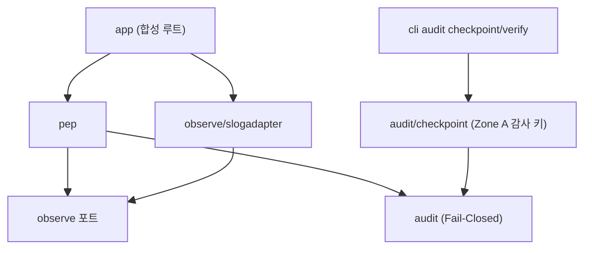

# ROADMAP — 14 감사 확장 및 관측성 포트 (마스터 설계)

> 상위 색인: [전체 로드맵 색인](../README.md) | 대시보드: [README.md](README.md) | 계획: [PLAN.md](PLAN.md) | 배경: [WHY.md](WHY.md) | 결정: [ADR 0002](../../adr/0002-관측성-포트-분리-및-오픈텔레메트리-전환.md), [ADR 0003](../../adr/0003-차기-로드맵-범위-개정-비목표-조건부-해제.md) | 교정: [023번 보고서](../../보고서/023-14번로드맵_구조결함_및_진행가능성_검증보고서.md)

## 1. As-Is / To-Be

| 구분 | As-Is (2026-11-04 코드 확인) | To-Be (Phase 14) |
|---|---|---|
| 운영 로그 결합 | 코어 중 [`pep/gateway.go`](../../../internal/authz/pep/gateway.go)만 `Config.Logger *slog.Logger`(99행)로 slog에 직접 의존한다(호출 8곳). `AppConfig.Logger`는 설정하는 호출자가 0건이라 PEP는 늘 `slog.Default()`를 쓴다. 비코어인 `app`, `mcp`, `cli/mcp.go`, `cmd`, `confinement/seatbelt_darwin.go`도 slog를 쓴다 | 코어는 **관측성 포트(`observe.Observer`)**만 받는다. 구현은 `slogadapter` 하나다. `pep.Config`와 `AppConfig`의 `Logger`는 `Observer`로 바뀐다. 13번 `StageObserver`(시험 훅)는 그대로 둔다 |
| 감사 무결성 | 해시 체인(`prev_hash`/`curr_hash`)과 flock. 중간 변조는 탐지한다. 꼬리 절단·전체 재작성은 못 잡고, **파일이 없으면 VALID**([`audit.go`](../../../internal/audit/audit.go) 303행) | Zone A 감사 전용 키의 **서명 체크포인트**로 꼬리 절단·전체 재작성·파일 삭제를 탐지한다 |
| 감사 내용과 보호 범위 | 해시는 9필드만 보호한다(46~60행). `token_jti`, `agent_id`, `metadata`는 고쳐도 VALID | 항상 `schema_version: 2`. v2 해시는 `token_jti`·`agent_id`·인자·결과 **SHA-256 지문(`arg_hash`, `result_hash`)**까지 보호한다. 다운그레이드는 거부한다. `metadata`는 계속 비보호(한계) |
| authn 감사 오류 | `issuer.go` 117행, `exchange.recordAuditDenied` 267행, `verifier.logAudit` 276행이 `_ =`로 오류를 버린다. 검증 **성공** 경로(243행)는 Fail-Open | 세 곳 모두 감사 실패 시 `AUDIT_LOG_FAILED`(15) |
| 위임 뷰 | `audit timeline`의 `renderProcessTree`(`timeline.go` 101~129행)는 등장 순서대로 선형 들여쓰기만 한다 | 토큰 계보(`parent_jti → child_jti`)로 그린 **위임 트리 뷰**(`audit tree`, 보기 전용) |
| 시나리오 | 60대(`E2E-01`~`E2E-60`, `G1`~`G12`) | G13 추가(`E2E-61`~`E2E-66`), 66대 |

## 2. 아키텍처 및 신뢰 경계

- **포트와 감사는 서로 호출하지 않는다.** 감사는 샘플링·비동기·드롭이 없는 Fail-Closed 경로다. 포트는 `SafeObserver`로 감싼 best-effort다.
- **감사 서명 키는 토큰 서명 키와 분리한다.** Zone A `audit_signing_key.priv.json`, Zone B `audit_verification_key.pub.json`이며, 토큰 키 회전·폐기(`keys rotate`/`revoke`)와 간섭하지 않는다. 서명 코드는 `internal/audit/checkpoint` 패키지에 두고, 워커(`internal/subagent`)는 이를 import하지 않는다(`TC-060-02` 확대).
- **원시 토큰 탐지 규칙은 `domain`에 하나만 둔다.** 감사 검증과 포트 속성 필터(`SanitizeAttrs`)가 같은 규칙을 쓴다([ADR 0002](../../adr/0002-관측성-포트-분리-및-오픈텔레메트리-전환.md) B-7).
- **코어는 slog·OTel을 import하지 않는다** (`TC-140-01`): `domain`, `authn/...`, `authz/...`, `jail`, `audit/...`, `storage`, `observe`(포트 패키지). `confinement`는 OS 어댑터라 제외한다.
- **범위 밖으로 명시하는 한계**:
  - `metadata`·`step`·`error_class`는 v2에서도 해시 비보호다. 그래서 이를 근거로 그린 `audit tree`는 보기 전용이다.
  - 체크포인트는 서명 시점까지만 보호한다. 그 뒤의 꼬리 절단과, 옛 체크포인트로 되돌리는 공격(rollback)은 검증자가 최신 체크포인트를 따로 보관해야 막을 수 있다.
  - 인자·결과 지문은 비솔트 SHA-256이라 추측하기 쉬운 입력은 사전 대입으로 되돌릴 수 있다.

## 3. 파급 범위와 무영향 근거

- **변경**:
  - 신규: `internal/observe`(`port.go`, `slogadapter`), `internal/audit/checkpoint`, `internal/ui/tree.go`, `domain`의 `DataDigest`·원시 토큰 규칙·이유 코드 2종
  - 수정: `pep.Config.Observer`, `app.AppConfig.Observer`, `internal/audit`(v2), `authn`(감사 오류 3곳), `internal/cli`(`audit checkpoint`, `audit verify --checkpoint`, `audit tree`), `cmd`(`NewAuditRunner` 경로), `internal/harness`(`TC-140-01`, `TC-080-01`·`TC-060-02` 확대, G13)
- **무영향**:
  - PDP·PEP 판정 로직
  - 토큰 서명 키 상태 머신(`internal/authn/keys`)
  - 기존 v1 감사 레코드의 검증 가능성
  - `SubagentRequest` 프레임
  - `audit timeline` 출력
  - `go.mod`(외부 의존성 0개)
  - 기존 60대 시나리오의 판정 기준

## 4. 사전 점검 (Pre-Mortem): 이 로드맵이 실패한다면 무엇 때문인가

| 위험 | 방어책 |
|---|---|
| `pep.Config`에 `*slog.Logger`가 남아 `TC-140-01` 실패 | `Logger`를 완전히 제거하고 `Observer`로 일원화한다. `TC-060-05-6`은 `slogadapter.New(testLogger)`를 주입한다(010) |
| Observer와 `StageObserver`를 합쳐 TOCTOU 시험 훅의 panic이 삼켜짐 | 둘은 따로 둔다. `StageObserver`는 감싸지 않는다(010 TC-010-06) |
| v2 필드를 v1 레코드에 끼워 넣어도 VALID | 항상 v2로 쓰고, 검증기가 v1의 v2 필드·알 수 없는 버전·v2 뒤 v1을 거부한다(030) |
| 스키마 변경으로 기존 `audit.jsonl`이 `INTEGRITY_BROKEN` | v1 레코드는 v1 공식 그대로 검증하고, writer는 마지막 줄의 `curr_hash`를 승계한다(030 TC-030-01·02, E2E-66) |
| 지문 함수가 `audit`에 있어 15번 PDP가 `audit`을 import | `domain.DataDigest`로 둔다(030) |
| 감사 키를 토큰 키 저장소에 섞어 키 회전 시 체크포인트가 깨짐 | 별도 파일과 별도 패키지 `internal/audit/checkpoint`를 쓴다(040) |
| 파일을 지우거나 비우면 검증이 VALID | 체크포인트 검증은 줄 수 부족(0 포함)을 `AUDIT_TRUNCATION_DETECTED`로 판정한다(040 TC-040-03) |
| 체크포인트 검증 재료(공개키·체크포인트)가 없을 때 통과 | `AUDIT_CHECKPOINT_MISMATCH`(Fail-Closed)로 판정하고, 검증 측은 키를 생성하지 않는다(040 TC-040-04·06, E2E-63) |
| 체크포인트를 만드는 도중 다른 프로세스가 기록해 줄 수와 HeadHash가 어긋남 | `<audit>.lock` 공유 잠금 안에서 둘을 함께 읽는다. 잠금 안에서 다른 잠금은 잡지 않는다(040) |
| 트리가 형제 워커나 같은 주체의 두 토큰을 잘못 합침 | 노드를 jti로 하고, 간선은 `parent_jti → child_jti` 하나만 쓴다(050 TC-050-02·03) |
| 포트 호출 실패가 요청 실패로 번짐 | `SafeObserver`가 panic을 복구한다(010 TC-010-04, E2E-65) |
| authn 거부 경로의 감사 실패가 조용히 사라짐 | 세 기록 함수가 오류를 반환하고 `AUDIT_LOG_FAILED`(15)로 올린다(020) |

## 5. 4층위 검증 설계

| 층위 | 대상 | 방법 |
|:---:|---|---|
| 1 | 반복 수동 검증 배제 | `go test -race ./internal/audit/... ./internal/observe/... ./internal/authz/pep` 등 스크립트화 |
| 2 | 단위·구조 | AST 가드(`TC-140-01`, 확대된 `TC-080-01`·`TC-060-02`), 버전별 해시 table-driven, `SanitizeAttrs` 마스킹 |
| 3 | 상태·정합성 | v1 픽스처 `VALID`, 다운그레이드 거부, 꼬리 절단·재작성·파일 삭제, 체크포인트 Ed25519 서명 |
| 4 | 통합 | G13(`E2E-61`~`E2E-66`) 및 기존 60대 회귀 |

## 6. 단계 의존 관계

`010 → 020 → 030 → 040 → 050 → 070 → 080` (`060` `Dropped`). 010~020(포트·가드)과 030~040(감사)은 서로 독립이지만, 번호순 실행을 기본으로 한다.

## 7. 단계 분해표 (구현지시서 작성의 입력)

| 단계 | 목표 | 완료 기준 | 인수 시나리오 (입력 → 기대 결과) |
|:---:|---|---|---|
| **010** | 포트(4메서드, `OnError`), `slogadapter`, `SafeObserver`, `SanitizeAttrs`, `Observer` 전환, ADR 0002 `Accepted` | 기존 stderr 문구·수준·필드 불변, `pep`에 `log/slog` import 0건 | noop 주입 → 판정 불변. panic Observer → 판정·감사 정상 |
| **020** | `TC-140-01`, authn 감사 오류 무시 3곳 제거, `TC-080-01` 확대 | 가드가 위반 검출, 감사 실패 → 15 | 유효 토큰 검증 + 감사 실패 → `AUDIT_LOG_FAILED` |
| **030** | 항상 v2, v2 공식, 다운그레이드 거부, `domain.DataDigest`, PEP 지문 | v1 픽스처 `VALID`, v2 필드 변조·주입 탐지, 평문 0건 | v1에 `arg_hash` 주입 → `INTEGRITY_BROKEN` |
| **040** | `internal/audit/checkpoint`, 이유 코드 2종, `audit checkpoint`·`verify --checkpoint` | 꼬리 절단·재작성·파일 삭제·키 부재 탐지, 토큰 키와 무간섭 | 마지막 줄 삭제 → `AUDIT_TRUNCATION_DETECTED(15)` |
| **050** | `audit tree`(jti 노드, `parent_jti → child_jti`) | 트리가 실제 교환 계보와 일치 | 2-Hop → Depth 0→1→2, 형제 → 같은 Depth 1 |
| **060** | (`Dropped`) | - | - |
| **070** | G13(`E2E-61`~`E2E-66`) | 6대 `PASS`, `lastScenarioID = 66` | panic Observer → 판정 불변, 감사 정상 |
| **080** | 전체 회귀, 문서 동기화 | `go test -race ./...` 통과, AGENTS.md 로깅 서술 개정안 **제안** | `run --scenario all` → 종료 코드 `0` |

## 8. 선행 조건·결정 확정 사항

- **선행 조건**: 로드맵 13 `Done`(충족). [ADR 0002](../../adr/0002-관측성-포트-분리-및-오픈텔레메트리-전환.md)의 `Accepted` 전환과 §6 개정은 010의 산출물이다.
- **사전 확정된 설계 결정**:
  1. **포트**: `internal/observe.Observer`(`OnStageStart`, `OnStageEnd`, `OnExecutionEnd`, `OnError`) + `Attr` + `SafeObserver`. 어댑터는 `observe/slogadapter` 하나다.
  2. **상관 ID**: 기존 `trace_id` 문자열 그대로다. W3C `span_id`/`parent_span_id`와 `traceparent` 전파는 두지 않는다(023 결정 1).
  3. **v2 해시 (030)**: v1 9필드 + `token_jti|agent_id|arg_hash|result_hash`. 새 레코드는 항상 v2이고, 지문은 `domain.DataDigest`(`sha256:<hex>`)다. 원문 기록은 금지한다(023 결정 2).
  4. **체크포인트 (040)**: 감사 전용 Ed25519 키(`kid: audit-ckpt-<hex>`), Zone B `audit_checkpoint.json` 1개. CLI `audit checkpoint`와 API `checkpoint.Create`로 만든다. 로테이션은 없다(023 결정 3).
  5. **OTel (060)**: `Dropped`. `go.mod`는 바뀌지 않는다.

## 9. 인수인계 (다음 에이전트용)

- **코드 사실 확인 포인터**:
  - [`audit/audit.go`](../../../internal/audit/audit.go): `jwtTokenPattern` 20행, `ComputeEventHash` 46행, `NormalizeEvent` 63행, `Log` 211행, `VerifyHashChain` 300행
  - [`authz/pep/gateway.go`](../../../internal/authz/pep/gateway.go): `Config` 93~102행, `runStage`, Stage 4 337행, `refundBudget` 397행, `finalize` 409행, `logEvent` 470행
  - [`gateway_test.go`](../../../internal/authz/pep/gateway_test.go): `TC-060-05-6` 1274행
  - [`harness/architecture_test.go`](../../../internal/harness/architecture_test.go): `TC-060-02` 72행, `TC-080-01` 210행
  - [`app/builder.go`](../../../internal/app/builder.go): `AppConfig` 24행, PEP 조립 202행
  - [`cli/audit.go`](../../../internal/cli/audit.go)
  - [`cmd/authz-harness/main.go`](../../../cmd/authz-harness/main.go) 126행
- **금지 사항**:
  - 감사를 텔레메트리로 대체하거나 연결하기
  - 감사 경로에 샘플링·비동기 넣기
  - 서명 키·`internal/audit/checkpoint`를 워커가 다루게 하기
  - v1 레코드를 검증 불가로 만들기
  - 원시 토큰을 속성·로그에 남기기
  - `pep.Config`에 `*slog.Logger`를 남기기
  - v2 필드를 해시 밖에 두기
- **착수 순서**: `010`(ADR 0002 전환 포함)부터 한 단계씩 진행한다. `080` 마감 때 [AGENTS.md](../../../AGENTS.md) 로깅 삼분 서술 개정은 **제안**으로만 보고한다.
- **접점**: [로드맵 15](../15-pdp-승인-결정-ask/README.md)(승인 `ArgHash`)와 [로드맵 16](../16-도구-종류-확장-및-egress-통제/README.md)(`exec:run` 인자)은 `domain.DataDigest`를 써야 한다. 각 로드맵의 점검 차례에 반영한다.
