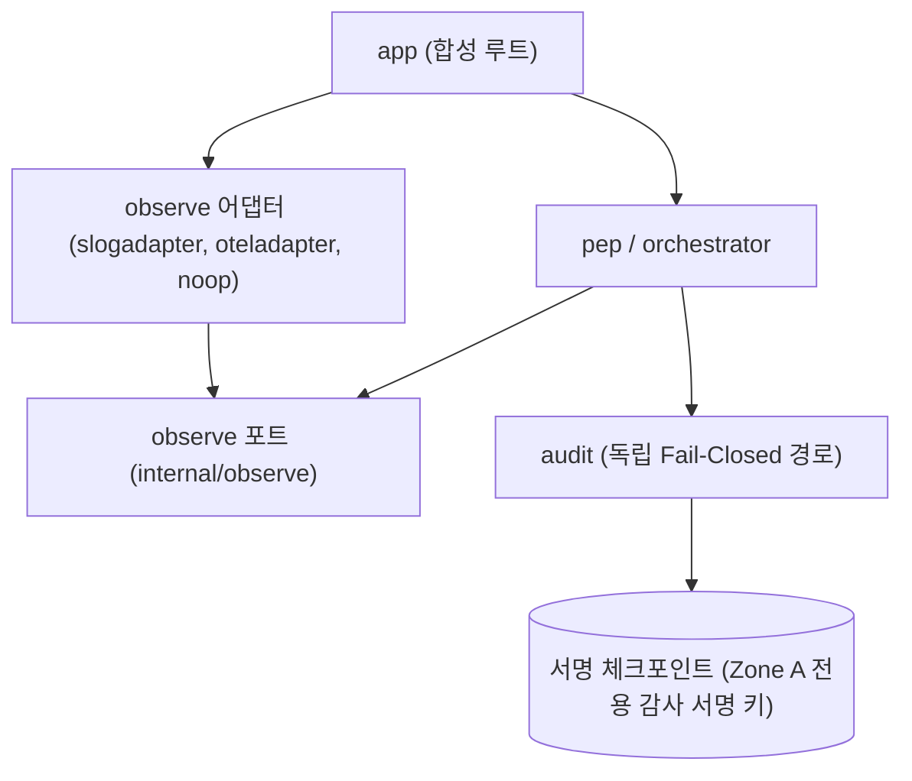

# ROADMAP — 14 감사 확장 및 관측성 포트 (마스터 설계)

> 상위 색인: [전체 로드맵 색인](../README.md) | 대시보드: [README.md](README.md) | 계획: [PLAN.md](PLAN.md) | 배경: [WHY.md](WHY.md) | 결정: [ADR 0002](../../adr/0002-관측성-포트-분리-및-오픈텔레메트리-전환.md), [ADR 0003](../../adr/0003-차기-로드맵-범위-개정-비목표-조건부-해제.md)

## 1. As-Is / To-Be

| 구분 | As-Is (코드 확인) | To-Be (Phase 14) |
|---|---|---|
| 운영 로그 결합 | `slog`는 [`pep/gateway.go`](../../../internal/authz/pep/gateway.go) `Config.Logger *slog.Logger`, [`app/builder.go`](../../../internal/app/builder.go), [`mcp/server.go`](../../../internal/mcp/server.go), [`cli/mcp.go`](../../../internal/cli/mcp.go), [`cmd/authz-harness/main.go`](../../../cmd/authz-harness/main.go)에서 직접 사용. `domain`은 비의존 | 코어(`pep.Config` 등)는 구체 타입 대신 **관측성 포트(`observe.Observer`)**만 받고, 구현은 어댑터(`slogadapter`, `oteladapter`, `noop`)로 분리 (합성 루트 `app.AppConfig`만 하위 호환 래핑 제공) |
| 감사 무결성 | 해시 체인(`prev_hash`/`curr_hash`)과 flock. 중간 변조는 탐지 | 끝부분 삭제와 전체 재작성도 **서명 체크포인트**로 탐지. 로테이션 시 제네시스 `prev_hash` 승계 검증 유지 |
| 감사 내용 | 이벤트·사유·`jti` 등. 도구 인자·결과 정보 부족 | `schema_version`과 인자·결과 **SHA-256 해시(`arg_hash`, `result_hash`)**, 원문·원시 토큰 비노출 |
| 상관 | 문자열 `trace_id` ([`domain/event.go`](../../../internal/domain/event.go)) | 기존 `trace_id` 유지 + W3C 호환 `span_id`/`parent_span_id`, 자식 프로세스에 `stdin` 프레임으로 전달 |
| 뷰 | `audit timeline` (`renderProcessTree`가 등장 순서대로 선형 들여쓰기만 수행) | 실제 `caller_id → agent_id` 및 `parent_span_id → span_id` 관계를 반영한 부모→자식 **위임 트리 뷰**(`audit tree`) 추가 |
| 시나리오 | 39대 + 로드맵 10~13 그룹 | 신규 G13 그룹 (`E2E-61`~`E2E-66`) |

## 2. 아키텍처 및 신뢰 경계

- **포트와 감사는 서로 호출하지 않는다.** 감사는 샘플링·비동기·드롭이 없는 fail-closed 경로이고, 포트는 `SafeObserver`로 감싼 best-effort다.
- **서명 키는 Zone A에 두고 토큰 서명 키 저장소(`signing_keys.priv.json`)와 물리적으로 분리된 감사 전용 키 파일(`audit_signing_key.priv.json`)로 관리**한다. 이로써 토큰 서명 키 회전·폐기(`keys rotate`/`revoke`)가 감사 체크포인트 검증에 영향을 주지 않으며, 워커(`internal/subagent`)는 접근할 수 없다.
- **원시 토큰은 포트 속성에도 금지**한다. 속성 필터(`SanitizeAttrs`)를 포트 계층에 두어 `jti`와 요약만 통과시킨다([ADR 0002](../../adr/0002-관측성-포트-분리-및-오픈텔레메트리-전환.md) B-7).
- **코어는 slog·OTel을 import하지 않는다**: `domain`, `authn`, `authz`(`pap`, `pip`, `pdp`, `pep`, `state`), `jail`, `audit`.

## 3. 파급 범위와 무영향 근거

- **변경**: 신규 `internal/observe`(`port.go`, `slogadapter`, `oteladapter`), `pep.Config.Observer`(기존 `Logger *slog.Logger` 제거) 및 `app.AppConfig`(`Observer` 추가 및 `Logger` 자동 래핑), `internal/audit`(스키마 v2 확장, `checkpoint.go`, 제네시스 해시 승계 검증), `internal/cli`(`audit checkpoint`, `audit tree`), `internal/ui/tree.go`, `internal/subagent`(`parent_span_id` 프레임 필드), `internal/harness`(`TC-140-01` 가드와 G13).
- **무영향**: PDP·PEP 판정 로직, 토큰 서명 키 상태머신(`internal/authn/keys`), 기존 감사 레코드의 검증 가능성(**구버전 v1 레코드가 새 검증기에서 100% `VALID`**), `go.mod` 외부 의존성 0개 유지, 기존 시나리오 판정 기준.

## 4. 사전 점검 (Pre-Mortem): 이 로드맵이 실패한다면 무엇 때문인가

| 위험 | 방어책 |
|---|---|
| `010`에서 `pep.Config.Logger *slog.Logger`를 하위 호환용으로 남겨두어 `020`의 AST 가드(`TC-140-01`)가 실패 | `pep.Config`에서는 `Logger`를 완전히 제거하고 `Observer observe.Observer`로 일원화. 하위 호환 래핑은 합성 루트인 `app.AppConfig`에서만 수행하고, `gateway_test.go`의 `TC-060-05-6`은 `slogadapter.New(testLogger)`를 주입하도록 갱신 |
| 스키마 변경으로 기존 `audit.jsonl` 및 `TestQuadAssertion_SuccessCase`가 `INTEGRITY_BROKEN` | `NormalizeEvent`에서 `ArgHash`/`ResultHash`가 비어 있는 기존 이벤트는 `SchemaVersion <= 1`을 그대로 유지하여 기존 9필드 해시 공식 결과를 100% 보존. `SchemaVersion == 2`일 때만 `\|v2\|argHash\|resultHash` 해시 공식 적용 |
| 감사 체크포인트 키를 `signing_keys.priv.json`에 섞어 넣어 토큰 키 회전·폐기 시 체크포인트나 토큰 발급이 깨짐 | `internal/authn/keys`를 수정하지 않고 `internal/audit/checkpoint.go`에서 `storage.AtomicFileStore` 기반으로 Zone A 전용 `audit_signing_key.priv.json`(`0600`) 및 Zone B `audit_verification_key.pub.json`(`0644`)을 독립 관리 |
| 해시 체인만으로는 끝부분 삭제(tail truncation)와 전체 재작성(full rewrite)을 못 잡음 | Zone A Ed25519 서명 체크포인트(줄 수 + HeadHash + 타임스탬프 + kid + sig)를 기록하고, 검증 시 줄 수 부족(`ReasonAuditTruncationDetected`) 및 해시·서명 불일치(`ReasonAuditCheckpointMismatch`)를 구분 적발 |
| 로테이션 시 새 파일 첫 레코드가 `prev_hash: ""`로 시작해 체인 단절 | `VerifyHashChainWithGenesis(path, expectedGenesisPrevHash)` 및 `RotateJSONLWriter`를 통해 새 파일의 첫 레코드 `prev_hash`가 이전 파일의 체크포인트 `HeadHash`를 승계했는지 검증 |
| `ui/timeline.go`처럼 등장 순서대로 선형 들여쓰기만 하여 형제 워커가 부모·자식처럼 왜곡됨 | `internal/ui/tree.go`는 `ParentSpanID → SpanID`, `parent_sub → child_sub`, `caller_id → agent_id` 간선을 그래프로 재구성해 형제 워커(`worker-01`, `worker-02`)를 동일 부모 아래 나란히 렌더링 |
| OTel SDK 도입이 `go.mod` 외부 의존성을 오염시키거나 오프라인 샌드박스 빌드를 깨뜨림 | `internal/observe/oteladapter`는 외부 패키지 추가 없이 표준 라이브러리 기반 W3C Trace Context / OTLP JSON Span Recorder 어댑터로 구현하여 `go.mod` 서드파티 의존성 0개 원칙을 유지 |
| 포트 호출 실패가 요청 실패로 번짐 | `SafeObserver` 래퍼가 panic과 에러를 복구하여 포트 장애 시에도 PEP 인가 결과와 Fail-Closed 감사 기록이 영향받지 않음을 검증(`TC-010-04`, `E2E-65`) |

## 5. 4층위 검증 설계

| 층위 | 대상 | 방법 |
|:---:|---|---|
| 1 | 반복 수동 검증 배제 | `go test -race ./internal/audit/... ./internal/observe/...` 등 스크립트화 |
| 2 | 단위·구조 | AST 가드(`TC-140-01`: 코어 `log/slog`·OTel import 금지), 스키마 버전별 해시 table-driven, `SanitizeAttrs` 원시 토큰 마스킹 테스트 |
| 3 | 상태·정합성 | 구버전 v1 픽스처 `VALID`, 끝부분 삭제·재작성·로테이션 시나리오, 체크포인트 Ed25519 서명 검증 |
| 4 | 통합 | G13(`E2E-61`~`E2E-66`) 및 기존 시나리오 전체 회귀 |

## 6. 단계 의존 관계

`010 → 020 → 030 → 040 → 050 → 060 → 070 → 080`. 030~040(감사)과 010~020(포트)은 독립이나 번호순 실행을 기본으로 한다.

## 7. 단계 분해표 (구현지시서 작성의 입력)

| 단계 | 목표 | 완료 기준 | 인수 시나리오 (입력 → 기대 결과) |
|:---:|---|---|---|
| **010** | 관측성 포트, `slogadapter`·`noop`, `pep.Config.Observer` 전환 | 기존 stderr 출력 문구(`pep stage entering` 등)·테스트 불변, `pep`에 `log/slog` import 0건 | 포트에 noop 주입 → 인가 결과 불변. `slogadapter` → 기존 로그 문구·필드(`caller_id` 등) 유지 |
| **020** | AST 가드(`TC-140-01`): 코어의 `log/slog`·OTel import 금지 | 가드가 위반을 검출 | 코어 패키지에 `log/slog` import 추가 → 가드 테스트 즉시 실패 |
| **030** | `schema_version`, 인자·결과 해시(`arg_hash`, `result_hash`) | 구버전 픽스처 `VALID`, 신규 필드에 원문·원시 JWT 없음 | 구버전 `audit.jsonl` → `VALID`. 인자에 비밀 문자열 → 감사에 SHA-256 해시만 존재 |
| **040** | 감사 전용 서명 키(Zone A), 체크포인트, 로테이션 연결 | 끝부분 삭제·전체 재작성 탐지, 토큰 키 회전과 무간섭 | 마지막 N줄 삭제 → `AUDIT_TRUNCATION_DETECTED(15)`. 로테이션 전후 연속 검증 `VALID` |
| **050** | `audit tree`, W3C 호환 `span_id`/`parent_span_id`, stdin 전파 | 부모→자식 트리가 실제 위임 계보와 일치, 환경변수 전달 없음 | 2-Hop 실행 → 트리 뷰가 Depth 0→1→2 계보와 일치, 자식 프로세스 환경에 `TRACEPARENT` 없음 |
| **060** | 표준 라이브러리 기반 OTel 스팬 어댑터(`oteladapter`), 속성 필터 | 코어 import 가드 통과, `go.mod` 외부 의존성 0건, 원시 토큰 0건 | `oteladapter` 주입 → 인가 결과 불변, 수집된 스팬에 JWT 정규식 매칭 0건 |
| **070** | G13(`E2E-61`~`E2E-66`): 절단, 재작성, 로테이션, 해시, 포트 장애, 하위 호환 | 6대 시나리오 `PASS` | 포트 구현이 에러·panic → 인가 결과 불변, 감사 정상 기록 |
| **080** | 전체 회귀, 문서 동기화 | `go test -race ./...` 통과, AGENTS.md 로깅 서술 개정안 제출 | `run --scenario all` → 종료 코드 `0` |

## 8. 선행 조건·결정 확정 사항

- **선행 조건**: [ADR 0002](../../adr/0002-관측성-포트-분리-및-오픈텔레메트리-전환.md) `Accepted` 전환 (착수 시 미결 4건을 아래 확정안으로 반영 후 진행).
- **사전 확정된 설계 결정 (구현 시 혼선 방지)**:
  1. **포트 인터페이스 및 패키지명**: `internal/observe.Observer`로 확정하며, 단계 시작/종료(`OnStageStart`/`OnStageEnd`), 실행 종료(`OnExecutionEnd`), 감사 기록 오류(`OnAuditError`) 최소 연산과 `SafeObserver` panic 복구 래퍼로 구성한다.
  2. **상관 ID 및 해시 체인 호환**: 기존 `TraceID` 문자열과 v1 9필드 해시 공식은 100% 그대로 유지하고, W3C 호환 `SpanID`/`ParentSpanID`(16-hex)를 선택적 필드로 추가하며 `oteladapter` 내부에서 `TraceID`를 32-hex W3C 형식으로 정규화 매핑한다.
  3. **인자·결과 해시 방식 (030)**: 결정론적 사후 대조를 위해 `len(data) > 0`일 때 표준 SHA-256 16진수 지문(`sha256:<hex>`)을 `ArgHash`/`ResultHash`에 기록하고 `SchemaVersion = 2`로 마킹한다(원문 기록 절대 금지).
  4. **감사 서명 키 분리 및 체크포인트 (040)**: 토큰 서명 키(`signing_keys.priv.json`)와 섞이지 않도록 Zone A의 `audit_signing_key.priv.json`(`0600`) 및 Zone B의 `audit_verification_key.pub.json`(`0644`)에 감사 전용 Ed25519 키(`kid: "audit-ckpt-key-..."`)를 분리 저장하며, CLI(`audit checkpoint`) 및 프로그래밍 API(`CreateCheckpoint`)로 체크포인트를 생성한다.
  5. **OTel 어댑터 무의존성 원칙 (060)**: `go.mod`의 서드파티 의존성 0개 원칙과 오프라인 샌드박스 호환성을 지키기 위해 `internal/observe/oteladapter`는 외부 SDK를 `go get`하지 않고 표준 라이브러리만으로 W3C/OTLP 호환 인메모리·JSON 스팬 익스포터를 구현한다.

## 9. 인수인계 (다음 에이전트용)

- **코드 사실 확인 포인터**: [`audit/audit.go`](../../../internal/audit/audit.go)(`ComputeEventHash`, `NormalizeEvent`, `VerifyHashChain`), [`authz/pep/gateway.go`](../../../internal/authz/pep/gateway.go) 및 [`gateway_test.go`](../../../internal/authz/pep/gateway_test.go)(`TC-060-05-6` 로그 검증 문구), [`harness/architecture_test.go`](../../../internal/harness/architecture_test.go) 가드 형식, [`app/builder.go`](../../../internal/app/builder.go).
- **금지 사항**: 감사를 OTel로 대체·연결, 감사 경로에 샘플링·비동기 도입, 서명 키의 워커 접근, 구버전 v1 레코드 검증 불가화, 원시 토큰을 속성·로그에 기록, `pep.Config`에 `*slog.Logger` 잔류.
- **착수 순서**: ADR 0002 `Accepted` 전환 → `010`부터 한 단계씩 구현. `080` 마감 시 [AGENTS.md](../../../AGENTS.md) 로깅 삼분 서술 개정을 **제안**으로 보고(직접 수정은 별도 지시).
- **접점**: [로드맵 16](../16-도구-종류-확장-및-egress-통제/README.md)은 도구 인자 해시(`030`)를 활용하는 것이 권장된다.
