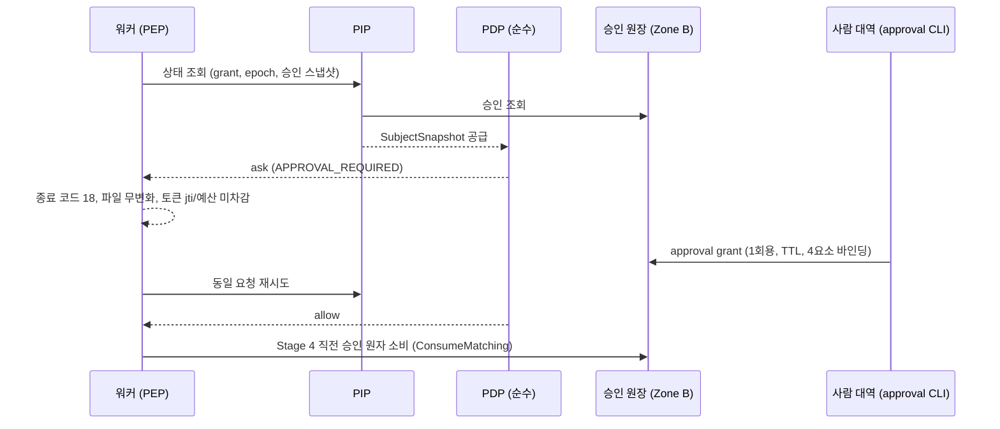

# ROADMAP — 15 PDP 승인 결정(ask) (마스터 설계)

> 상위 색인: [전체 로드맵 색인](../README.md) | 대시보드: [README.md](README.md) | 계획: [PLAN.md](PLAN.md) | 배경: [WHY.md](WHY.md) | 결정: [ADR 0003](../../adr/0003-차기-로드맵-범위-개정-비목표-조건부-해제.md) C-5

## 1. As-Is / To-Be

| 구분 | As-Is | To-Be (Phase 15) |
|---|---|---|
| 결정 값 | `allow`/`deny` 2값 ([`pdp/service.go`](../../../internal/authz/pdp/service.go)) | `allow`/`deny`/`ask` 3값 (`DecisionAsk = "ASK"`) |
| 승인 개념 | 없음 | 승인 원장(Zone B `approvals_state.json`), `approval grant/list` PAP 명령 |
| 종료 코드 | `0`, `11`~`16` | 신규 `18`(`ExitApprovalRequired`, 승인 필요). `17`은 로드맵 10 예약 |
| 감사 | `pdp.decide`, `pep.allow/deny` (`NormalizeEvent`가 `"allow"`/`"deny"`만 허용) | `NormalizeEvent` 및 `pep.logEvent`에서 `decision: "ask"` 보존, `approval.granted/consumed` 이벤트 |
| 시나리오 | 39대 + 로드맵 10~14 그룹 | 신규 G14 그룹 (`E2E-67`~`E2E-72`) |

## 2. 아키텍처 및 신뢰 경계

- **PDP 순수성 유지**: 승인 존재 여부는 PIP가 `SubjectSnapshot.Approvals`(및 `StateVersion`)로 공급하고, 평가 시각(`Now`), `TokenJTI`, `ArgHash`(`sha256(req.Data)`)는 `pdp.Request`로 전달한다. PDP는 원장·파일·OS 시계를 직접 열지 않는다(AST 가드 `TC-060-01` 유지).
- **승인 바인딩 (AI 에이전트 Confused Deputy 방어)**: 승인은 `(sub, action, resource, token_jti)` 4요소에 묶이며, `approval.ArgHash != ""`인 경우 5번째 요소인 실행 인자 해시(`ArgHash`)까지 일치해야 한다. 다른 주체·액션·리소스·토큰 또는 승인 후 변조된 실행 인자 페이로드의 승인은 무효(`ReasonApprovalMismatch`)다.
- **소비는 원자적 + `StateVersion` 단조 증가**: 승인 생성·소비는 하나의 `AtomicFileStore` flock 임계 구역에서 수행하며 `ApprovalsState.Version++`을 단조 증가시킨다. 승인은 소비 후 재사용 불가다.
- **`ask` 반환 시 토큰 `jti`/예산 미소진**: `Gate 2(PDP)`에서 `DecisionAsk(18)`로 멈춘 요청은 아직 실행되지 않았으므로, 사람이 해당 `jti`에 승인을 발급한 뒤 워커가 동일 토큰으로 재시도할 수 있도록 `ask` 시점에는 단회성 토큰 `jti`나 호출 예산을 소진하지 않는다.
- **ask는 fail-closed**: 승인이 없으면 deny와 동일하게 파일을 건드리지 않는다. 종료 코드만 `18`로 구분해 호출자가 승인을 요청할 수 있게 한다.
- **승인 원장 쓰기 주체**: PAP 경로(`approval` 명령)와 PEP의 소비 경로뿐. 워커(`internal/subagent`)는 승인 발급 권한이 없다(`TC-060-02` 자기 승인 금지).

## 3. 파급 범위와 무영향 근거

- **변경**: `internal/domain`(결정 값 `DecisionAsk`, Reason 3종, `ExitApprovalRequired(18)`, `Grant.RequiresApproval`, `Approval`), `internal/authz/state`(`ApprovalStore`), `internal/authz/pap`(`CreateApproval`), `internal/authz/pip`(`Approvals` 스냅샷 공급 및 `WithClock`), `internal/authz/pdp`(`TokenJTI`·`Now` 기반 `ask` 판정), `internal/authz/pep`(`ask` 종료, `jti` 비소진 보존, `ConsumeMatching`, `logEvent` `"ask"` 기록), `internal/audit`(`NormalizeEvent` `"ask"` 보존), `internal/app/builder.go`(`approvals_state.json` 자동 경로 파생), `internal/cli`(`approval`), `internal/mcp`·`internal/ui`(종료 코드 `18` 매핑), `internal/harness/catalog`(G14).
- **무영향**: `RequiresApproval == false`인 기존 Grant는 기존 2값 동작과 100% 동일하며, 기존 시나리오와 종료 코드 `11`~`16`의 의미는 변하지 않는다.

## 4. 사전 점검 (Pre-Mortem): 이 로드맵이 실패한다면 무엇 때문인가

| 위험 | 방어책 |
|---|---|
| `Gate 1`에서 단회성 토큰 `jti`를 선소비해 버려, `Gate 2`에서 `ask(18)` 후 승인받고 동일 토큰으로 재시도하면 `Exit 11(TOKEN_REPLAY_DETECTED)` 발생 | `PEP`에서 `Gate 1` 검증 시 `RecordReplay: false`로 먼저 검증하고 `Gate 2(PDP)`가 `DecisionAllow`를 반환한 뒤(`DecisionAsk`가 아닐 때) 토큰 `jti`를 소비하거나, `DecisionAsk` 시 `ReplayLedger` 소비를 확정하지 않도록 배선 |
| `E2E-68`(`TC-040-02`)에서 1차 실행 성공 후 동일 토큰으로 2차 실행 시 승인 재사용(`Exit 18`) 대신 토큰 리플레이(`Exit 11`)가 먼저 터짐 | `TC-040-02`와 `E2E-68`에서는 토큰 자체는 2회 이상 호출 가능한 세션 토큰(`MaxCalls >= 2` 또는 리플레이 비활성 검증 옵션)을 사용하여, `Gate 1`을 통과한 뒤 `Gate 2/PEP`에서 **승인 원장의 1회성 소비(`Exit 18 / APPROVAL_REQUIRED`)**가 정확히 작동하는지 검증 |
| `pdp.Request`에 `TokenJTI`·`Now`가 없고 `pipService`가 `time.Now()`를 직접 호출해 가상 시계(`E2E-71`)가 동작하지 않음 | `pip.NewService`에 `pip.WithClock`을 추가하고 `pdp.Request`에 `TokenJTI`와 `Now time.Time`을 추가해 `pdp.Evaluate`가 주입된 가상 시계로만 만료(`now.Unix() >= exp`)를 판정하도록 강제 |
| `pep/gateway.go`의 `logEvent`가 실패 시 무조건 `Decision: "deny"`를 기록해 `DefaultEvaluator` 역순 감사 검증(`ExpectedDecision: "ask"`)이 실패 | `audit.NormalizeEvent`에서 `"ask"`를 보존함과 동시에 `pep/gateway.go`의 `logEvent`에서도 `ExitCodeForReason(reason) == ExitApprovalRequired(18)`일 때 `Decision: "ask"`를 기록 |
| 부모 프로세스와 자식 워커(`subagent worker`) 간 `approvals_state.json` 경로 불일치 | `app.BuildStack`에서 `cfg.ApprovalPath == ""`이고 `cfg.StatePath != ""`이면 `filepath.Join(filepath.Dir(cfg.StatePath), "approvals_state.json")`으로 자동 파생해 `PAP`·`PIP`·`PEP`에 일괄 주입 |
| 승인 후 권한 회수(Grant revoke/Epoch bump) 시 승인으로 우회 | 승인은 Grant의 **추가 조건**일 뿐 대체 아님. `pdp.Evaluate`에서 Epoch·Scope·활성 Grant 검사를 모두 통과한 뒤에만 `RequiresApproval`을 평가(`TC-030-04`, `E2E-72`) |
| 자기 승인(워커가 스스로 approval 발급) | 승인 원장 쓰기는 PAP 경로 한정. 워커 패키지의 `state`·`pap` import 금지 AST 가드(`TC-060-02`) 유지 |

## 5. 4층위 검증 설계

| 층위 | 대상 | 방법 |
|:---:|---|---|
| 1 | 반복 수동 검증 배제 | `go test -race ./internal/authz/... ./internal/audit/...` 스크립트화 |
| 2 | 단위·구조 | PDP 3값 결정표 table-driven, 4요소 바인딩 불일치, AST 가드(`TC-060-01`, `TC-060-02`, `TC-060-04`, `TC-081-01`) |
| 3 | 상태·정합성 | 승인 원장 상태가 감사 이벤트(`decision: "ask"`, `approval.granted/consumed`)와 일치, 해시 체인 `VALID`, ask 후 workspace 무변화 |
| 4 | 통합 | G14(`E2E-67`~`E2E-72`) 및 기존 시나리오 회귀, 동시 소비 경합(다중 고루틴/프로세스) |

## 6. 단계 의존 관계

`010 → 020 → 030 → 040 → 050 → 060`

## 7. 단계 분해표 (구현지시서 작성의 입력)

| 단계 | 목표 | 완료 기준 | 인수 시나리오 (입력 → 기대 결과) |
|:---:|---|---|---|
| **010** | 결정 값 `ask`, Reason 3종, `ExitApprovalRequired=18`, ADR 0005(`Accepted`) | ADR이 §8 미결 3건 확정, 도메인 단위 테스트 통과 | 4요소 바인딩 불일치·만료 경계값(`now == exp`) → `ExitCode 18` 매핑 |
| **020** | 승인 원장(Zone B `ApprovalStore`), `approval grant/list`, `BuildStack` 자동 배선 | `AtomicFileStore` 임계 구역 내 확인+소비 | 같은 승인에 동시 소비 5건 → 정확히 1건 성공, 4건 `APPROVAL_REQUIRED(18)` |
| **030** | PIP 승인·시계 공급, 순수 PDP 3값 판정(`TokenJTI`, `Now`) | PDP 파일·원장 import 0(`TC-060-01`) | `RequiresApproval` Grant + 승인 없음 → `ask`. 승인 있음 → `allow`. Grant 회수 시 승인이 있어도 `deny(12)` |
| **040** | PEP `ask` 종료 경로, `jti` 선소비 방지, 승인 소비, `logEvent`/`NormalizeEvent` `"ask"` 보존 | `ask` 시 Stage 5 미진입 및 `jti` 보존, 소비 후 재사용 불가 | `ask` → 종료 코드 `18`, 파일 무변화, 감사 `decision: "ask"` → 승인 발급 후 동일 토큰 재시도 시 `Exit 0` 성공 |
| **050** | G14(`E2E-67`~`E2E-72`): 미승인, 1회 소비 후 재사용, 도용(리소스·토큰별), 만료, 회수 | 6대 시나리오 `PASS` | 승인 1회 후 같은 요청 반복 → 2번째 `18`. 다른 `jti` 토큰으로 승인 사용 → `18(APPROVAL_MISMATCH)` |
| **060** | 전체 회귀, 문서 동기화 | `go test -race ./...` 통과 | `run --scenario all` → 종료 코드 `0` |

## 8. 선행 조건·결정 확정 사항

- **선행 조건**: [ADR 0003](../../adr/0003-차기-로드맵-범위-개정-비목표-조건부-해제.md) C-5 `Accepted`.
- **010의 ADR 0005에 반영할 사전 확정 사항 (구현 시 혼선 방지)**:
  1. **ask 대상 지정 방식**: `domain.Grant`의 `RequiresApproval bool` (`json:"requires_approval,omitempty"`) 플래그 방식으로 확정한다.
  2. **승인 소비 시점 및 I/O 실패 시 처리 정책**: PEP의 Stage 4(사전 커밋 감사) 직전에 `ApprovalStore.ConsumeMatching`으로 원자 소비하며, 한 번 소비된 승인은 이후 Stage 4/5 실패 시에도 복원(Refund)하지 않고 소멸(재승인 필요)시키는 Fail-Closed 정책으로 확정한다. 단, `Gate 2(PDP)`에서 `DecisionAsk(18)`로 거부된 경우에는 승인도 토큰 `jti`도 소비되지 않는다.
  3. **승인 TTL 기본값과 상한**: 기본 TTL `5m`(`DefaultApprovalTTL = 5 * time.Minute`), 최대 상한 `1h`(`MaxApprovalTTL = 1 * time.Hour`)로 확정하며, `ttl <= 0` 또는 `ttl > MaxApprovalTTL` 입력 시 `ReasonInvalidArguments(14)`로 거부한다.

## 9. 인수인계 (다음 에이전트용)

- **코드 사실 확인 포인터**: [`pdp/service.go`](../../../internal/authz/pdp/service.go), [`pip/service.go`](../../../internal/authz/pip/service.go), [`pap/service.go`](../../../internal/authz/pap/service.go), [`pep/gateway.go`](../../../internal/authz/pep/gateway.go), [`audit/audit.go`](../../../internal/audit/audit.go), [`harness/assertion.go`](../../../internal/harness/assertion.go), [`app/builder.go`](../../../internal/app/builder.go).
- **금지 사항**: PDP의 원장 직접 접근, 승인으로 Grant·Epoch 검사 대체, 워커의 승인 발급, 승인 비원자 소비, `ask(18)` 반환 시 단회성 토큰 `jti` 소진, 예산 소진과의 개념 혼합([로드맵 12](../12-예산-축소-위임/README.md)는 하드 거부 `12`).
- **착수 순서**: ADR 0003 C-5 확인 → `010`에서 ADR 0005 작성 및 도메인 구현부터 순차 진행.
