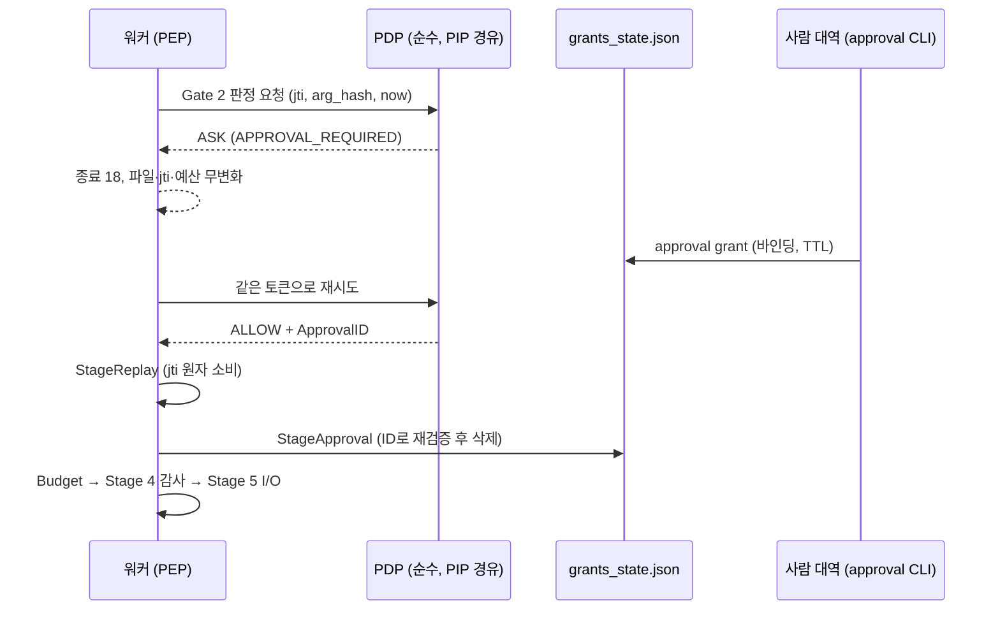

# ROADMAP — 15 PDP 승인 결정(ask) (마스터 설계)

> 상위 색인: [전체 로드맵 색인](../README.md) | 대시보드: [README.md](README.md) | 계획: [PLAN.md](PLAN.md) | 배경: [WHY.md](WHY.md) | 결정: [ADR 0003](../../adr/0003-차기-로드맵-범위-개정-비목표-조건부-해제.md) C-5 | 교정: [024번 보고서](../../보고서/024-15번로드맵_구조결함_및_진행가능성_검증보고서.md)

## 1. As-Is / To-Be

| 구분 | As-Is (로드맵 14 완료 시점) | To-Be (Phase 15) |
|---|---|---|
| 결정 값 | `ALLOW`/`DENY` 2값 ([`pdp/service.go`](../../../internal/authz/pdp/service.go) 16~19행) | `ALLOW`/`DENY`/`ASK` 3값, `Decision.ApprovalID` |
| 승인 개념 | 없음 | `GrantsState.Approvals`(`grants_state.json`), `approval grant/list` PAP 명령, `Grant.RequiresApproval` |
| jti 소비 | Gate 1에서 즉시 소비(`gateway.go` 243행 `RecordReplay: true`) | Gate 1은 읽기 확인만, PDP allow 직후 `StageReplay`에서 원자 소비 |
| 종료 코드 | `0`, `11`~`17`. 스포너는 자식 코드 `0`, `11`~`16`만 통과([`termination.go`](../../../internal/orchestrator/termination.go) 31행) | 신규 `18`(`ExitApprovalRequired`). 스포너·MCP·UI가 18을 그대로 전파 |
| 감사 | `pdp.decide`, `pep.allow/deny` | `decision: "ask"`(`pdp.decide`는 자동, `pep.logEvent`는 18일 때), `approval.granted`/`approval.consumed` |
| 시나리오 | 66대(`E2E-01`~`E2E-66`, `G1`~`G13`) | G14 7대 추가(`E2E-67`~`E2E-73`), 총 73대 |

## 2. 아키텍처 및 신뢰 경계

- **PDP 순수성 유지**: 승인은 PIP가 Grant와 같은 `Load`에서 `SubjectSnapshot.Approvals`로 공급한다. `TokenJTI`·`ArgHash`(`state.argHash` = `domain.DataDigest(req.Data)`)·`Now`는 `pdp.Request`로 받는다. PDP는 원장·파일·OS 시계를 열지 않는다(`TC-060-01`).
- **승인 바인딩 (Confused Deputy 방어)**: 승인은 `(sub, action, resource, token_jti)`에 묶인다. `ArgHash != ""`이면 실행 인자 지문까지 일치해야 한다. 매칭 규칙은 `domain.SelectApproval`/`Approval.Matches` 한 곳뿐이다.
- **승인은 Grant의 추가 조건이다**: Epoch·act 사슬·Scope·활성 Grant 검사를 모두 통과한 뒤에만 승인을 본다. 맞는 활성 Grant 중 하나라도 `RequiresApproval`이면 승인이 필요하다.
- **소비는 원자적이다**: PEP `StageApproval`이 `Decision.ApprovalID`로 `state.Store.Update` 한 번 안에서 찾고, 바인딩·만료를 다시 검증하고, 지운다. 동시 소비는 정확히 1건만 성공한다. 감사는 `Update`를 반환한 뒤 기록한다(중첩 잠금 금지).
- **ask는 fail-closed이고 아무것도 태우지 않는다**: Gate 2에서 멈추므로 jti(`StageReplay`)·승인·예산(Stage 3b)·파일 어느 것도 바뀌지 않는다.
- **승인 쓰기 주체**: 생성은 PAP(`approval grant`), 소비는 PEP다. 정직한 워커 경로(VerifyOnly 스택)에는 PAP가 없다(`AppStack.PAP == nil`). 악의 워커의 Zone B 직접 변조는 기존 신뢰 한계다([WHY.md](WHY.md)).

## 3. 파급 범위와 무영향 근거

- **변경**:
  - `internal/domain`: `ExitApprovalRequired`, Reason 3종, `Grant.RequiresApproval`, `approval.go`.
  - `internal/orchestrator/termination.go`, `internal/mcp/errors.go`, `internal/ui`: 18 전파와 해설.
  - `internal/authz/state`: `GrantsState.Approvals`, 승인 생성·소비 함수.
  - `internal/authz/pap`: `CreateApproval`, `ListApprovals`, `CreateGrantRequest.RequiresApproval`.
  - `internal/authz/pip`: `SubjectSnapshot.Approvals`.
  - `internal/authz/pdp`: `DecisionAsk`, `Request.TokenJTI/ArgHash/Now`, `Decision.ApprovalID`.
  - `internal/authn/token`: `ReplayLedger.IsConsumed`, `VerifyOptions.CheckReplay`, `TokenVerifier.ConsumeReplay`.
  - `internal/authz/pep`: `StageReplay`, `StageApproval`, `Config.ApprovalConsumer`, `logEvent`.
  - `internal/app/builder.go`: `ApprovalConsumer` 배선.
  - `internal/cli`, `cmd`: `approval` 명령.
  - `internal/harness/catalog`: G14.
- **무영향**:
  - `RequiresApproval == false`인 Grant는 승인 단계를 거치지 않는다.
  - 재사용 토큰은 계속 Gate 1에서 11로 거부된다(E2E-18, TC-PEP-05, E2E-60 무수정 통과).
  - 예산 토큰은 지금처럼 리플레이 원장을 건너뛴다.
  - 교환(`RecordReplay: false`)과 `token verify` CLI는 바뀌지 않는다.
  - `audit.NormalizeEvent`와 해시 공식은 바뀌지 않는다.
- **의도된 동작 변경**: PDP가 거부한 일회성 토큰은 더 이상 소비되지 않는다(실행이 없었으므로 1회 실행 의미는 유지된다).

## 4. 사전 점검 (Pre-Mortem): 이 로드맵이 실패한다면 무엇 때문인가

| 위험 | 방어책 |
|---|---|
| 서브프로세스 모드에서 자식의 18이 부모에서 16(`SUBPROCESS_ABNORMAL_EXIT`)으로 바뀜 | 010에서 `classifyExit` 허용 목록에 18 추가(17은 계속 부모 전용), TC-010-05 |
| Gate 1이 jti를 먼저 소비해서 ask 뒤 재시도가 11 | Gate 1은 `CheckReplay`(읽기만), allow 직후 `StageReplay`에서 `ConsumeReplay`(D-06). 롤백 연산 금지 |
| 같은 토큰 동시 요청 두 건이 모두 통과 | `ConsumeReplay`는 기존 `CheckAndConsume` 한 번(원자). 패자는 11(TC-040-03) |
| PEP가 승인이 필요 없는 요청에서 남의 승인을 태움 | `Decision.ApprovalID`가 있을 때만 소비(D-07) |
| 판정과 소비 규칙이 어긋남 | `domain.SelectApproval`/`Matches` 단일 원천. 소비 시 같은 `Now`로 재검증 |
| 중복 Grant로 승인 우회 | 맞는 활성 Grant 중 하나라도 `RequiresApproval`이면 승인 요구(TC-030-07) |
| 가상 시계(`ClockOffset`)가 승인 만료에 반영되지 않음 | `pdp.Request.Now = clock.Now().Add(ClockOffset)`(E2E-72) |
| `pep.logEvent`가 18을 `"deny"`로 기록해 역순 감사 검증 실패 | 종료 코드 18이면 `Decision: "ask"` |
| 승인 경합 패자가 예산을 차감 | `StageApproval`을 Stage 3b Budget 앞에 둠(TC-040-06) |
| 경로 위반 요청이 승인을 태움 | `StageApproval`을 Jail 뒤에 둠(TC-040-05) |
| 승인 후 Grant 회수·Epoch 증가 시 승인으로 우회 | 승인 검사는 Epoch·Grant 검사 뒤(TC-030-05, E2E-73) |
| 승인 원장이 무한히 커짐 | 소비 = 삭제, 만료분은 쓰기 때 정리(D-07) |

## 5. 4층위 검증 설계

| 층위 | 대상 | 방법 |
|:---:|---|---|
| 1 | 반복 수동 검증 배제 | `go test -race ./...` |
| 2 | 단위·구조 | `domain.SelectApproval` 결정표, PDP 3값 결정표, AST 가드(`TC-060-01`, `TC-060-02`, `TC-060-04`, `TC-081-01`) |
| 3 | 상태·정합성 | 원장 상태와 감사(`decision: "ask"`, `approval.granted/consumed`) 일치, 해시 체인 `VALID`, ask 후 파일·jti·예산 무변화 |
| 4 | 통합 | G14(`E2E-67`~`E2E-73`) 인메모리·서브프로세스 양 모드, 기존 66대 회귀, 동시 소비 경합 |

## 6. 단계 의존 관계

`010 → 020 → 030 → 040 → 050 → 060`

## 7. 단계 분해표

| 단계 | 목표 | 완료 기준 | 인수 시나리오 (입력 → 기대 결과) |
|:---:|---|---|---|
| **010** | ADR 0005, 18·Reason 3종, `domain.Approval`, 18 전파 | 도메인·스포너·MCP·UI 단위 시험 통과 | `classifyExit(TermExited, 18)` → 18. 만료 경계 `now == ExpiresAt` → `APPROVAL_EXPIRED` |
| **020** | 승인 원장, PAP, CLI | `Update` 한 번 안에서 찾기·재검증·삭제 | 같은 승인에 동시 소비 5건 → 1건 성공, 4건 `APPROVAL_REQUIRED(18)` |
| **030** | PIP 공급, 순수 PDP 3값 | `TC-060-01` 유지 | 승인 필요 Grant + 승인 없음 → `ASK`. 승인 있음 → `ALLOW` + `ApprovalID`. Grant 회수 → `DENY(12)` |
| **040** | PEP 배선 | ask 시 Stage 2c 이후 미진입, jti·예산 무변화 | ask(18) → 승인 → 같은 일회성 토큰 재시도 → 0 |
| **050** | G14 7대 | 7대 `PASS`(양 모드) | 승인 1회 후 예산 토큰 재사용 → 18. 다른 jti → `APPROVAL_MISMATCH` |
| **060** | 전체 회귀, 문서 동기화 | `go test -race ./...` 통과 | `run --scenario all` → 73/73, 종료 코드 0 |

## 8. 선행 조건·결정 확정 사항

- **선행 조건**: ADR 0003 C-5 `Accepted`(충족), 로드맵 14 `Done`(충족).
- **010의 ADR 0005에 반영할 확정 사항**: 대시보드 D-01~D-10. 핵심은 다음과 같다.
  1. ask 대상은 `Grant.RequiresApproval`이고, 맞는 Grant 중 하나라도 해당하면 승인을 요구한다.
  2. jti는 PDP allow 뒤에 소비한다(D-06).
  3. 승인 소비는 ID로 찾아 재검증한 뒤 삭제한다. 이후 단계가 실패해도 되돌리지 않는다(D-07).
  4. TTL은 기본 `5m`, 상한 `1h`다. `ttl < 0` 또는 `ttl > 1h`이면 `INVALID_ARGUMENTS(14)`, `ttl == 0`이면 기본값이다.
  5. 악의 워커의 Zone B 직접 변조는 범위 밖이다. ADR 0003 C-7의 faultworker 모드는 추가하지 않는다(막을 수 없는 것을 시연하는 모드는 차단을 증명하지 못한다).

## 9. 인수인계 (다음 에이전트용)

- **코드 사실 확인 포인터**: [`pdp/service.go`](../../../internal/authz/pdp/service.go), [`pip/service.go`](../../../internal/authz/pip/service.go), [`state/store.go`](../../../internal/authz/state/store.go), [`pap/service.go`](../../../internal/authz/pap/service.go), [`pep/gateway.go`](../../../internal/authz/pep/gateway.go), [`token/verifier.go`](../../../internal/authn/token/verifier.go), [`token/replay.go`](../../../internal/authn/token/replay.go), [`orchestrator/termination.go`](../../../internal/orchestrator/termination.go), [`app/builder.go`](../../../internal/app/builder.go), [`harness/assertion.go`](../../../internal/harness/assertion.go).
- **금지 사항**: PDP의 원장 직접 접근, PDP의 예산 판정, 승인으로 Grant·Epoch 검사 대체, 승인 매칭 규칙의 복제, 리플레이 원장 롤백, ask(18)에서 jti·승인·예산 소비, 잠금 안 감사 기록.
- **착수 순서**: `010`에서 ADR 0005 작성 및 도메인 구현부터 순차 진행.
