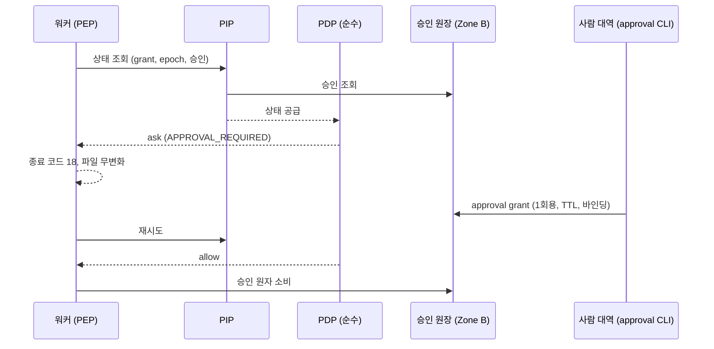

# ROADMAP — 15 PDP 승인 결정(ask) (마스터 설계)

> 상위 색인: [전체 로드맵 색인](../README.md) | 대시보드: [README.md](README.md) | 계획: [PLAN.md](PLAN.md) | 배경: [WHY.md](WHY.md) | 결정: [ADR 0003](../../adr/0003-차기-로드맵-범위-개정-비목표-조건부-해제.md) C-5

## 1. As-Is / To-Be

| 구분 | As-Is | To-Be (Phase 15) |
|---|---|---|
| 결정 값 | `allow`/`deny` 2값 ([`pdp/service.go`](../../../internal/authz/pdp/service.go)) | `allow`/`deny`/`ask` 3값 |
| 승인 개념 | 없음 | 승인 원장(Zone B), `approval grant/deny/list` PAP 명령 |
| 종료 코드 | `0`, `11`~`16` | 신규 `18`(승인 필요). `17`은 로드맵 10 예약 |
| 감사 | `pdp.decide`, `pep.allow/deny` | `pdp.ask`, `approval.granted/consumed/expired` 이벤트 |
| 시나리오 | 39대 + 로드맵 10~14 그룹 | 신규 G14 그룹 |

## 2. 아키텍처 및 신뢰 경계

- **PDP 순수성 유지**: 승인 존재 여부는 PIP가 `Input`으로 공급한다. PDP는 원장·파일을 직접 열지 않는다(AST 가드 `TC-060-01` 유지).
- **승인 바인딩**: 승인은 `(sub, action, resource, token jti)`에 묶인다. 다른 주체·액션·리소스·토큰의 승인은 무효다.
- **소비는 원자적**: 승인 확인과 소비는 하나의 flock 임계 구역에서 수행한다. 승인은 소비 후 재사용 불가다.
- **ask는 fail-closed**: 승인이 없으면 deny와 동일하게 파일을 건드리지 않는다. 종료 코드만 `18`로 구분해 호출자가 승인을 요청할 수 있게 한다.
- **승인 원장 쓰기 주체**: PAP 경로(`approval` 명령)와 PEP의 소비 경로뿐. 워커 코드는 승인 발급 권한이 없다(자기 승인 금지).

## 3. 파급 범위와 무영향 근거

- **변경**: `internal/domain`(결정 값, Reason, ExitCode), `internal/authz/pap`(승인 명령), `internal/authz/pip`(승인 공급), `internal/authz/pdp`(ask 판정), `internal/authz/pep`(ask 종료, 승인 소비), 신규 승인 저장소(`internal/storage` 재사용), `internal/cli`(`approval`), `internal/mcp`(오류 매핑), `internal/harness/catalog`(G14).
- **무영향**: `requires_approval`이 없는 기존 Grant는 기존 2값 동작과 동일해야 한다. 기존 시나리오와 종료 코드 `11`~`16`의 의미는 변하지 않는다.

## 4. 사전 점검 (Pre-Mortem): 이 로드맵이 실패한다면 무엇 때문인가

| 위험 | 방어책 |
|---|---|
| ask 처리 경로 어딘가에서 fail-open(승인 없이 통과) | 모든 ask 시나리오에서 파일 무변화를 Quad-Assertion으로 확인. ask 이외 값(알 수 없는 결정)은 deny 처리하는 기본값 테스트 |
| PDP가 승인 원장을 직접 읽어 순수성 훼손 | 승인은 `Input` 필드로만 전달. AST 가드로 PDP의 storage·OS import 금지 확인 |
| 승인 재사용(Replay) | 소비 시 원자적 `consumed` 표시, 같은 승인으로 두 번째 요청 → 거부 시나리오 |
| 다른 주체·리소스·토큰의 승인 도용 | 바인딩 4요소 모두 일치 시에만 유효. 요소별 불일치 table-driven 테스트 |
| 승인 후 권한 회수(Grant revoke/Epoch bump) 시 승인으로 우회 | 승인은 Grant의 **추가 조건**일 뿐 대체 아님. Grant 회수 → 승인이 있어도 deny 시나리오 |
| 승인 발급과 소비 사이 TOCTOU | 소비를 PEP 사전 감사 직전의 임계 구역에서 수행하고, I/O 실패 시 승인 소비 여부를 정책으로 명시(권장: 소비된 것으로 간주, 재승인 필요) |
| 자기 승인(워커가 스스로 approval 발급) | 승인 원장 쓰기는 PAP 경로 한정. 워커 패키지의 PAP·원장 import 금지 AST 가드 |
| 승인 만료 시각 처리 불일치 | 주입 `Clock`만 사용, 경계값(`now == exp`) table-driven |
| 종료 코드 `18`이 기존 표·MCP·UI에서 누락 | 매핑 표 전수 테스트(로드맵 10 040 단계와 동일 방식) |

## 5. 4층위 검증 설계

| 층위 | 대상 | 방법 |
|:---:|---|---|
| 1 | 반복 수동 검증 배제 | `go test -race ./internal/authz/... ./internal/storage/...` 스크립트화 |
| 2 | 단위·구조 | PDP 3값 결정표 table-driven, 바인딩 요소별 불일치, AST 가드, `FuzzApprovalRecord` |
| 3 | 상태·정합성 | 승인 원장 상태가 감사 이벤트와 일치, 해시 체인 `VALID`, ask 후 workspace 무변화 |
| 4 | 통합 | G14 및 기존 시나리오 회귀, 동시 소비 경합(다중 프로세스) |

## 6. 단계 의존 관계

`010 → 020 → 030 → 040 → 050 → 060`

## 7. 단계 분해표 (구현지시서 작성의 입력)

| 단계 | 목표 | 완료 기준 | 인수 시나리오 (입력 → 기대 결과) |
|:---:|---|---|---|
| **010** | 결정 값 `ask`, Reason `APPROVAL_REQUIRED`, `ExitApprovalRequired=18`, ask 판정 ADR(`Accepted`) | ADR이 §8 미결 3건 결정, 도메인 단위 테스트 통과 | 알 수 없는 결정 값 → deny 처리. 기존 결정표 전부 불변 |
| **020** | 승인 원장(Zone B), `approval grant/deny/list`, 원자 소비 | 임계 구역 내 확인+소비 | 같은 승인에 동시 소비 2건 → 정확히 1건 성공 |
| **030** | PIP 승인 공급, PDP 3값 판정 | PDP 파일·원장 import 0 | `requires_approval` Grant + 승인 없음 → `ask`. 승인 있음 → `allow`. 일반 Grant → 기존 동작 |
| **040** | PEP ask 종료 경로, 승인 소비, 감사 이벤트, MCP·UI 매핑 | ask 시 Stage 5 미진입, 소비 후 재사용 불가 | ask → 종료 코드 `18`, 파일 무변화, 감사에 `pdp.ask`. 승인 후 재시도 → 성공 후 승인 `consumed` |
| **050** | G14: 승인 없음/후, 재사용, 도용(주체·리소스·토큰별), 만료, 승인 후 Grant 회수 | 모든 시나리오 `PASS` | 승인 1회 후 같은 요청 반복 → 2번째 `18`. 다른 `jti` 토큰으로 승인 사용 → 거부 |
| **060** | 전체 회귀, 문서 동기화 | `go test -race ./...` 통과 | `run --scenario all` → 종료 코드 `0` |

## 8. 선행 조건·결정 필요 사항

- [ADR 0003](../../adr/0003-차기-로드맵-범위-개정-비목표-조건부-해제.md) C-5 `Accepted`.
- 010의 ADR이 결정할 미결 3건: ① ask 대상 지정 방식(권장: Grant 속성 `requires_approval`. 대안: 정책 규칙 테이블) ② I/O 실패 시 승인 소비 처리 ③ 승인 TTL 기본값과 상한.

## 9. 인수인계 (다음 에이전트용)

- **코드 사실 확인 포인터**: [`pdp/service.go`](../../../internal/authz/pdp/service.go), [`pip/service.go`](../../../internal/authz/pip/service.go), [`pap/service.go`](../../../internal/authz/pap/service.go), [`pep/gateway.go`](../../../internal/authz/pep/gateway.go), [`domain/grant.go`](../../../internal/domain/grant.go).
- **금지 사항**: PDP의 원장 직접 접근, 승인으로 Grant·Epoch 검사 대체, 워커의 승인 발급, 승인 비원자 소비, 예산 소진과의 개념 혼합([로드맵 12](../12-예산-축소-위임/README.md)는 하드 거부).
- **착수 순서**: ADR 0003 C-5 확인 → 010에서 ask 판정 ADR 작성(번호는 직전 ADR+1) → 사용자 검토 후 구현.
