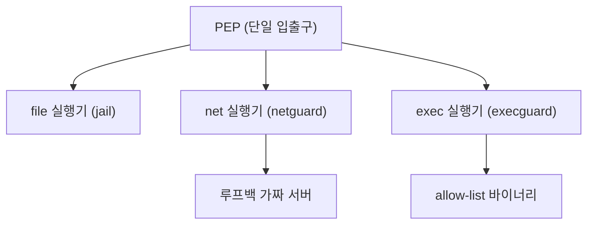

# ROADMAP — 16 도구 종류 확장 및 egress 통제 (마스터 설계)

> 상위 색인: [전체 로드맵 색인](../README.md) | 대시보드: [README.md](README.md) | 계획: [PLAN.md](PLAN.md) | 배경: [WHY.md](WHY.md) | 결정: [ADR 0003](../../adr/0003-차기-로드맵-범위-개정-비목표-조건부-해제.md) C-2, C-3, [ADR 0001](../../adr/0001-mcp-tool-call-어댑터-범위-및-프로토콜.md) A-2

## 1. As-Is / To-Be

| 구분 | As-Is | To-Be (Phase 16) |
|---|---|---|
| Action | `file:read`, `file:write` ([`domain/constants.go`](../../../internal/domain/constants.go), [`domain/scope.go`](../../../internal/domain/scope.go)) | 신규 `net:fetch`, `exec:run` |
| 리소스 문법 | 상대 경로 | `net:fetch:<host>:<port>`(루프백만), `exec:run:<allowlist-id>` |
| 집행 | PEP Stage 5가 파일 I/O 수행(jail 경유) | 도구별 **실행기 포트**를 통해 Stage 5 수행. 입구·출구는 그대로 단일 |
| MCP 도구 | `file_read`, `file_write` 2종 한정(ADR 0001 A-2) | `net_fetch`, `exec_run` 추가 (ADR 0003 C-3로 개정) |
| 방어 | jail 경로 검사 | `netguard`(대상 정규화·allow-list), `execguard`(바이너리 ID·인자·환경) + OS 격리(로드맵 11) |
| 시나리오 | 39대 + 로드맵 10~15 그룹 | 신규 G15 그룹 |

## 2. 아키텍처 및 신뢰 경계

- **실행기 포트**는 `Execute(ctx, 검증된 요청) → 결과`만 갖는 인터페이스다. 각 가드는 PEP 안에서 Gate 2c(경로 격리)와 같은 위치에서 호출된다. 새 입구를 만들지 않는다.
- **PDP는 순수 유지**: 도구 종류는 Action 문자열로만 표현되고 PDP가 소켓·프로세스를 다루지 않는다.
- **allow-list는 설정이 아닌 코드(또는 Zone B 읽기 전용 상태)로 고정**한다. 워커가 allow-list를 변경할 수 없다.
- **OS 격리와의 관계**: 가드는 앱 수준 1차 방어, 로드맵 11의 격리는 2차 방어(심층 방어). 가드 우회 시도(악의 워커)를 격리가 막는지 대조군으로 확인한다.

## 3. 파급 범위와 무영향 근거

- **변경**: `internal/domain`(Action, Scope 문법, Reason), 신규 `internal/netguard`·`internal/execguard`(후보명), `internal/authz/pep`(실행기 디스패치), `internal/mcp`(도구 추가), `internal/harness/catalog`(G15), `internal/harness/architecture_test.go`(가드), `FuzzScopeValidator` 확장.
- **무영향**: 기존 `file:*` 스코프의 의미·파싱 결과, 기존 도구(`file_read`, `file_write`)의 동작, PDP·토큰·감사 계약, 기존 시나리오 판정. 060에서 회귀로 증명한다.

## 4. 사전 점검 (Pre-Mortem): 이 로드맵이 실패한다면 무엇 때문인가

| 위험 | 방어책 |
|---|---|
| URL·호스트 정규화 우회: userinfo(`http://127.0.0.1@evil`), IPv6 표기, 정수·16진 IP, 대소문자·후행 점, 리다이렉트로 외부 이동 | **파싱 후 정규화된 (호스트, 포트) 튜플만** allow-list와 비교. DNS 조회 금지, 리다이렉트 추종 금지, 호스트 문자열 부분 일치 금지. `FuzzNetTarget` 필수 |
| 루프백 서버가 다른 로컬 서비스로 위장(포트 스캔 대용) | 포트까지 allow-list에 고정(와일드카드 금지) |
| 실행 allow-list 우회: 경로 조작(`../`), 심볼릭 링크로 다른 바이너리, `PATH` 변조 | 실행은 **ID → 절대 경로 고정 매핑**으로만. 인자 문자열로 바이너리를 지정하는 경로 없음, 환경변수 비상속(`cleanenv` 재사용), 작업 디렉터리는 jail 안으로 한정 |
| 인자 주입(허용된 바이너리에 옵션을 끼워 위험 동작 유도) | 인자 **스키마(고정 옵션 + 값 타입)** 로만 구성. 임의 문자열 인자 금지 |
| 스코프 문법 확장이 기존 `file:*` 스코프 파싱을 깨뜨리거나 단조 축소 판정을 오염 | 010에서 기존 파서 회귀 테스트 + `FuzzScopeValidator` 확장. 부분집합 판정이 도구별로 올바른지 table-driven |
| 도구가 늘며 PEP 단일 입출구(`TC-060-04`)가 깨짐 | 실행기 디스패치를 `runPipeline` 내부로 한정하고 AST 가드(Execute return 1개) 유지 |
| 응답 크기·시간 무제한(로드맵 10 기능 미적용) | 모든 실행기는 로드맵 10의 한계(시간·출력 상한)를 반드시 적용. 미적용 실행기는 병합 금지 |
| OS 격리 없이 시험해 "막혔다"는 증명이 앱 코드 덕인지 불명 | 모든 G15 시나리오를 격리 켬/끔 쌍으로 구성(로드맵 11 방식) |
| 감사에 대상·인자 원문 기록 | 대상은 정규화된 호스트:포트와 바이너리 ID만, 인자는 해시(로드맵 14 030). 원시 JWT 유출 검사 유지 |
| ADR 0001 A-2와 실제 어댑터 불일치 | 050 착수 전 ADR 0001에 "Superseded in part by ADR 0003" 표기 |

## 5. 4층위 검증 설계

| 층위 | 대상 | 방법 |
|:---:|---|---|
| 1 | 반복 수동 검증 배제 | `go test -race ./internal/netguard/... ./internal/execguard/... ./internal/authz/...` 스크립트화 |
| 2 | 단위·구조 | 정규화 표준 케이스 table-driven, `FuzzNetTarget`, `FuzzScopeValidator`(확장), AST 가드(PEP 단일 return, PDP 순수) |
| 3 | 상태·정합성 | 거부 후 소켓 연결·프로세스 생성 0건(서버 접속 로그·PID 검사), 해시 체인 `VALID`, workspace 무변화 |
| 4 | 통합 | G15 및 기존 시나리오 회귀, 격리 켬/끔 쌍 |

## 6. 단계 의존 관계

`010 → 020 → 030 → 040 → 050 → 060 → 070`. 020과 030은 서로 독립이지만 번호순 실행을 기본으로 한다.

## 7. 단계 분해표 (구현지시서 작성의 입력)

| 단계 | 목표 | 완료 기준 | 인수 시나리오 (입력 → 기대 결과) |
|:---:|---|---|---|
| **010** | 신규 Action 상수, 리소스 문법, 파서·부분집합 판정 확장, Reason(`EGRESS_DENIED`, `EXEC_NOT_ALLOWED` 등) | 기존 `file:*` 파싱 결과 불변, 퍼징 시드 통과 | 기존 스코프 문자열 전체 → 파싱 결과 동일. `net:fetch:127.0.0.1:8080` ⊆ `net:fetch:127.0.0.1:8080`, 포트 다르면 비포함 |
| **020** | `netguard`: 정규화·루프백 전용 allow-list·리다이렉트 금지 | 우회 표기 전부 거부, 퍼징 패닉 0 | `@` 앞에 루프백 주소를 둔 userinfo 위장 URL, `[::1]` 비허용 포트, `2130706433`, 리다이렉트 응답 → 모두 거부, 소켓 연결 0건 |
| **030** | `execguard`: 바이너리 ID 매핑, 인자 스키마, 환경 비상속, jail 작업 디렉터리 | 허용 ID만 실행, 주입 거부 | 등록 ID + 정상 인자 → 실행. 미등록 ID, `../` 경로, 임의 옵션 인자 → 거부, 프로세스 생성 0건 |
| **040** | PEP 도구 디스패처: 실행기 포트, 한계(로드맵 10) 적용 | `Execute` 단일 return 가드 통과, 기존 file 도구 회귀 없음 | `net:fetch` 허용 토큰 → 가짜 서버 응답 반환, 감사에 호스트:포트와 인자 해시만. 토큰에 `net` 스코프 없음 → `12` |
| **050** | MCP `net_fetch`, `exec_run` 도구 추가, ADR 0001 상태 표기 | 어댑터가 소켓·프로세스를 직접 다루지 않음(AST 가드 `TC-090-01` 확장) | MCP `net_fetch` 호출 → 서브프로세스 PEP 경로로만 집행. 알 수 없는 도구 이름 → 거부 |
| **060** | G15: 우회 표기 시도, 실행 주입 시도, 한계 초과, 격리 켬/끔 쌍 | 모든 시나리오 `PASS` | 악의 워커가 가드를 건너뛰고 외부 소켓 연결 시도 → 격리 켬에서 OS 오류, 끔에서 성공(대조군) |
| **070** | 전체 회귀, 문서 동기화 | `go test -race ./...` 통과, 기존 시나리오 완주 | `run --scenario all` → 종료 코드 `0` |

## 8. 선행 조건·결정 필요 사항

- [로드맵 11](../11-os-수준-격리-및-악의-워커-차단/ROADMAP.md) `Done` 필수. [ADR 0003](../../adr/0003-차기-로드맵-범위-개정-비목표-조건부-해제.md) C-2, C-3 `Accepted`. [로드맵 14](../14-감사-확장-및-관측성-포트/ROADMAP.md) 030(인자 해시) 권장.
- 미결(010에서 결정): ① 거부 종료 코드(권장 `12` + 신규 Reason, 대안 `13` 확장) ② 가짜 서버·가짜 바이너리 구성 방식(테스트 전용 빌드 태그 재사용) ③ allow-list 보관 위치(코드 고정 대 Zone B 읽기 전용) ④ `net:fetch`의 메서드·본문 범위(권장: GET 단일, 본문 상한).

## 9. 인수인계 (다음 에이전트용)

- **코드 사실 확인 포인터**: [`domain/scope.go`](../../../internal/domain/scope.go), [`jail/jail.go`](../../../internal/jail/jail.go)(경로 가드의 설계 선례), [`pep/gateway.go`](../../../internal/authz/pep/gateway.go) `runPipeline`/Stage 5, [`mcp/protocol.go`](../../../internal/mcp/protocol.go)·[`mcp/executor.go`](../../../internal/mcp/executor.go), [`jail/fuzz_test.go`](../../../internal/jail/fuzz_test.go) 퍼징 형식.
- **금지 사항**: 로드맵 11 `Done` 전 착수, 외부 네트워크 접속, 임의 셸·임의 인자 실행, DNS 조회, 리다이렉트 추종, 새 입구 신설, 기존 `file:*` 스코프 의미 변경, 어댑터의 직접 소켓·프로세스 호출.
- **착수 순서**: 로드맵 11 `Done`과 ADR 0003 C-2·C-3 확인 → 010 지시서 작성 → 사용자의 「구현해라」 → 한 단계씩.
