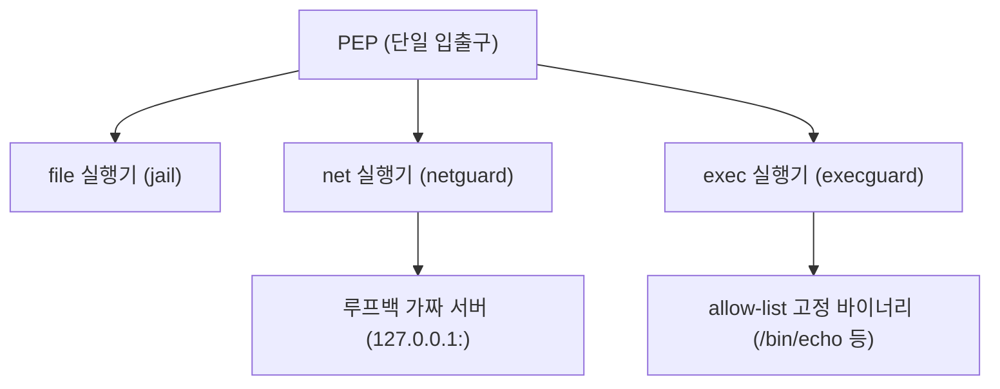

# ROADMAP — 16 도구 종류 확장 및 egress 통제 (마스터 설계)

> 상위 색인: [전체 로드맵 색인](../README.md) | 대시보드: [README.md](README.md) | 계획: [PLAN.md](PLAN.md) | 배경: [WHY.md](WHY.md) | 결정: [ADR 0003](../../adr/0003-차기-로드맵-범위-개정-비목표-조건부-해제.md) C-2, C-3, [ADR 0001](../../adr/0001-mcp-tool-call-어댑터-범위-및-프로토콜.md) A-2

## 1. As-Is / To-Be

| 구분 | As-Is | To-Be (Phase 16) |
|---|---|---|
| Action | `file:read`, `file:write` ([`domain/constants.go`](../../../internal/domain/constants.go), [`domain/scope.go`](../../../internal/domain/scope.go)) | 신규 `net:fetch`, `exec:run` 및 `domain.IsValidAction` 일원화 |
| 리소스 문법 | 상대 경로 | `net:fetch:<host>:<port>`(루프백만), `exec:run:<allowlist-id>` |
| 집행 | PEP Stage 5가 파일 I/O 수행(jail 경유) | PEP 단일 입출구 안에서 Gate 2c(`jail`/`netguard`/`execguard`) 및 Stage 5 도구별 실행기 디스패치 수행 |
| MCP 도구 | `file_read`, `file_write` 2종 한정(ADR 0001 A-2) | `net_fetch`, `exec_run` 추가 (ADR 0003 C-3로 개정, 총 4종) |
| 방어 | jail 경로 검사 | `netguard`(URL·호스트 정규화·루프백 Allow-List·리다이렉트 금지), `execguard`(바이너리 ID·인자 스키마·환경 비상속) + OS 격리(로드맵 11) |
| 시나리오 | 39대 + 로드맵 10~15 그룹 (72개) | 신규 G15 그룹 (`E2E-73`~`E2E-78`, 6개 추가 → 총 78개) |

## 2. 아키텍처 및 신뢰 경계

- **실행기 및 가드 위치**: 각 가드(`jail`, `netguard`, `execguard`)와 실행기는 PEP의 단일 `Execute` 파이프라인 내부에서만 호출된다. 새 입구를 만들지 않는다(`TC-060-04` 유지).
- **PDP는 순수 유지**: 도구 종류는 `Action` 문자열과 정규화된 타겟 식별자(`127.0.0.1:<port>`, `<allowlist-id>`)로만 표현되고 PDP가 소켓·프로세스를 다루지 않는다(`TC-060-01` 유지).
- **allow-list는 코드 및 `pep.Config` 주입으로 고정**한다. 워커(`internal/subagent`)가 allow-list를 변경할 수 없다.
- **OS 격리와의 관계**: 가드는 앱 수준 1차 방어, 로드맵 11의 격리는 2차 방어(심층 방어). 가드 우회 시도(악의 워커)를 격리가 막는지 대조군(`E2E-78`)으로 확인한다.

## 3. 파급 범위와 무영향 근거

- **변경**: `internal/domain`(`Action`, `IsValidAction`, `ScopeMatches`, `ScopeCovers`, `Reason`), `internal/authn/exchange/validator.go`(`ScopeCovers` 연동), 신규 `internal/netguard`·`internal/execguard`, `internal/authz/pep`(Gate 2/2c/Stage 5 디스패치), `internal/subagent/worker.go`(`ActionNetFetch`/`ActionExecRun` 출력 복사), `internal/cli/grant.go`·`pdp.go`·`pep.go`(4종 Action 허용), `internal/mcp`(4종 도구 확장), `internal/harness/catalog`(G15), `internal/harness/architecture_test.go`(`TC-090-01` 가드 확장).
- **무영향**: 기존 `file:*` 스코프의 의미·파싱 결과, 기존 도구(`file_read`, `file_write`)의 동작, PDP·토큰·감사 계약, 기존 시나리오(`E2E-01`~`E2E-72`) 판정.

## 4. 사전 점검 (Pre-Mortem): 이 로드맵이 실패한다면 무엇 때문인가

| 위험 | 방어책 |
|---|---|
| `net:fetch` 요청의 `req.Resource`가 전체 URL(`http://127.0.0.1:18080/status` 또는 `http://127.0.0.1@evil`)인데 Gate 2(PDP)가 Gate 2c(`netguard`)보다 먼저 실행되어 Grant(`127.0.0.1:18080`)와 문자열 불일치로 `NO_ACTIVE_GRANT`가 발생 | PEP에서 `net:fetch` 처리 시 ① 먼저 토큰의 Epoch 및 `net:fetch` 스코프 보유 여부를 확인(미보유 시 `TOKEN_INSUFFICIENT_SCOPE`)한 뒤, ② `netguard.ParseAndNormalizeTarget`으로 URL 정규화·루프백·Allow-List 검증(실패 시 즉시 `ReasonEgressDenied`) 및 정규화된 `host:port` 추출을 수행하여 PDP Grant/3단 스코프와 대조하고, ③ Stage 5에서는 원본 검증 URL로 GET 요청을 수행 |
| `internal/subagent/worker.go:66`이 `normAction == ActionFileRead`일 때만 `resp.Output`을 채워 `net:fetch`/`exec:run` 결과가 빈 문자열로 유실됨 | `worker.go`에서 `ActionFileRead`, `ActionNetFetch`, `ActionExecRun` 모두 `resp.BytesRead = pepRes.BytesRead` 및 `resp.Output = string(pepRes.Data)`를 채우도록 수정 (`cli/grant.go`, `cli/pdp.go`의 2종 Action 하드코딩도 `domain.IsValidAction`으로 일원화) |
| `exec:run` 인자(`arg`) 전달을 위해 `SubagentRequest` 프레임을 깨뜨리거나 감사에 평문 인자가 노출됨 | `exec:run`은 `Resource`(`FilePath`)에 논리 바이너리 ID(`command_id`, 예: `"echo-safe"`), `Data`에 인자 문자열(`arg`)을 매핑. 이로써 프레임 호환성을 유지하고 Stage 4 감사에서 `req.Data`가 자동으로 `ArgHash`(`sha256:...`)로만 기록됨 |
| URL·호스트 정규화 우회: userinfo(`http://127.0.0.1@evil`), IPv6 표기, 정수·16진 IP, 대소문자·후행 점, 리다이렉트로 외부 이동 | **파싱 후 정규화된 `(호스트, 포트)` 튜플만** allow-list와 비교. DNS 조회 금지, 리다이렉트 추종 금지(`http.ErrUseLastResponse` / 에러 반환), 호스트 문자열 부분 일치 금지. `FuzzNetTarget` 필수 |
| 실행 allow-list 우회: 경로 조작(`../`), 심볼릭 링크, `PATH` 변조, 플래그(`-e`) 주입 | 실행은 **논리 ID → 고정 절대 경로 매핑**으로만 수행하고 인자는 고정 정규식(`^[a-zA-Z0-9_.-]{1,64}$`, 선행 `-` 금지)만 허용. 환경변수 비상속(`SanitizeEnv`), 작업 디렉터리는 `WorkspaceDir`로 고정 |
| 응답 크기·시간 무제한(로드맵 10 기능 미적용) | `netguard`와 `execguard` 모두 로드맵 10의 시간(`Timeout`) 및 출력 바이트 상한(`MaxOutputBytes`, 초과 시 `ReasonResourceOutputLimit` / `ExitResourceExhausted = 17`)을 강제 적용 |
| ADR 0001 A-2와 실제 어댑터 불일치 | `050`에서 ADR 0001에 "Superseded in part by ADR 0003" 표기 |

## 5. 4층위 검증 설계

| 층위 | 대상 | 방법 |
|:---:|---|---|
| 1 | 반복 수동 검증 배제 | `go test -race ./internal/netguard/... ./internal/execguard/... ./internal/authz/...` 스크립트화 |
| 2 | 단위·구조 | 정규화 표준 케이스 table-driven, `FuzzNetTarget`, `FuzzScopeMatches`, AST 가드(PEP 단일 return `TC-060-04`, PDP 순수 `TC-060-01`, MCP 직접 소켓·실행 금지 `TC-090-01`) |
| 3 | 상태·정합성 | 거부 후 소켓 연결·프로세스 생성 0건(서버 접속 카운터·출력 검증), 해시 체인 `VALID`, workspace 무변화 |
| 4 | 통합 | G15(`E2E-73`~`E2E-78`) 및 기존 시나리오 회귀, 격리 켬/끔 쌍 |

## 6. 단계 의존 관계

`010 → 020 → 030 → 040 → 050 → 060 → 070`. `020`과 `030`은 서로 독립이지만 번호순 실행을 기본으로 한다.

## 7. 단계 분해표 (구현지시서 작성의 입력)

| 단계 | 목표 | 완료 기준 | 인수 시나리오 (입력 → 기대 결과) |
|:---:|---|---|---|
| **010** | 신규 Action 2종, `IsValidAction`, `ScopeCovers`, Reason 3종(`EGRESS_DENIED`, `EXEC_NOT_ALLOWED`, `EXEC_ARG_REJECTED`) | 기존 `file:*` 파싱 결과 불변, `grant`/`pdp` CLI 4종 액션 지원 | 기존 스코프 문자열 전체 → 파싱 결과 동일. `net:fetch` ⊇ `net:fetch:127.0.0.1:18080`, 포트 다르면 비포함 |
| **020** | `netguard`: 정규화·루프백 전용 allow-list·리다이렉트 금지·출력 상한 | 우회 표기 전부 거부, 퍼징 패닉 0 | `@` userinfo 위장 URL, `[::1]` 비허용 포트, `2130706433`, `302` 리다이렉트 응답 → 모두 거부, 외부 연결 0건 |
| **030** | `execguard`: 바이너리 ID 매핑, 인자 스키마, 환경 비상속, jail 작업 디렉터리·출력 상한 | 허용 ID만 실행, 주입 거부 | 등록 ID + 정상 인자 → 실행. 미등록 ID, `../` 경로, `-` 옵션·`;` 메타문자 인자 → 거부, 프로세스 생성 0건 |
| **040** | PEP 도구 디스패처 및 `subagent/worker.go` 출력 연동 | `Execute` 단일 return 가드 통과, 기존 file 도구 회귀 없음 | `net:fetch` 허용 토큰 → 가짜 서버 응답 반환, 감사에 `host:port`와 해시만 기록. `file:read` 토큰으로 `net:fetch` 호출 → `12` |
| **050** | MCP `net_fetch`, `exec_run` 도구 추가, ADR 0001 상태 표기, `TC-090-01` 확장 | 어댑터가 소켓·프로세스를 직접 다루지 않음 | MCP `net_fetch`/`exec_run` 호출 → 서브프로세스 PEP 경로로만 집행. 알 수 없는 도구 이름 → `-32602` 거부 |
| **060** | G15(`E2E-73`~`E2E-78`): 정상 호출, 우회 표기, 리다이렉트, 실행 주입, 한계 초과, 격리 켬/끔 쌍 | 6대 시나리오 `PASS` | 악의 워커가 가드를 건너뛰고 소켓 연결 시도 → 격리 켬에서 `Exit 13(CONFINEMENT_VIOLATION)`, 끔에서 성공(대조군) |
| **070** | 전체 회귀(78대 시나리오), 문서 동기화 | `go test -race ./...` 통과, 전 시나리오 완주 | `run --scenario all` → 종료 코드 `0` |

## 8. 선행 조건·결정 확정 사항

- **선행 조건**: [로드맵 11](../11-os-수준-격리-및-악의-워커-차단/ROADMAP.md) `Done` 필수. [ADR 0003](../../adr/0003-차기-로드맵-범위-개정-비목표-조건부-해제.md) C-2, C-3 `Accepted`. [로드맵 14](../14-감사-확장-및-관측성-포트/ROADMAP.md) `030`(인자 해시) 권장.
- **사전 확정된 설계 결정 (구현 시 혼선 방지)**:
  1. **거부 종료 코드**: 앱 수준 가드 거부는 `ExitAuthzDenied(12)` + 신규 Reason 3종(`EGRESS_DENIED`, `EXEC_NOT_ALLOWED`, `EXEC_ARG_REJECTED`)으로 매핑한다. 자원 한계(출력 바이트·타임아웃) 초과는 로드맵 10의 `ExitResourceExhausted(17)`(`RESOURCE_OUTPUT_LIMIT`, `RESOURCE_TIMEOUT`), OS 커널 격리 위반은 로드맵 11의 `ExitPathViolation(13)`(`CONFINEMENT_VIOLATION`)으로 매핑한다.
  2. **결정론적 가짜 서버·바이너리 구성**: `net:fetch`는 표준 라이브러리 `net/http/httptest` 루프백 서버(`127.0.0.1:<port>`)를 사용하고, `exec:run`의 기본 등록 ID `"echo-safe"`는 `/bin/echo`(최대 인자 1개, 정규식 `^[a-zA-Z0-9_.-]{1,64}$`)로 고정하여 외부 의존성 없이 모든 macOS/POSIX 환경에서 100% 결정론적으로 동작하게 한다.
  3. **allow-list 보관 위치**: 워커가 파일 수정으로 우회할 수 없도록 코드 내 불변 기본 스펙 + `pep.Config` 생성자 주입(`NetAllowList`, `ExecAllowList`)으로 고정한다.
  4. **`net:fetch` 메서드·본문 범위**: `HTTP GET` 단일 메서드 전용(요청 본문 없음)으로 한정하며, 응답 본문은 `io.LimitReader`로 로드맵 10의 `MaxOutputBytes` 상한을 강제한다.

## 9. 인수인계 (다음 에이전트용)

- **코드 사실 확인 포인터**: [`domain/scope.go`](../../../internal/domain/scope.go), [`authn/exchange/validator.go`](../../../internal/authn/exchange/validator.go), [`pep/gateway.go`](../../../internal/authz/pep/gateway.go), [`subagent/worker.go`](../../../internal/subagent/worker.go), [`cli/grant.go`](../../../internal/cli/grant.go)·[`cli/pdp.go`](../../../internal/cli/pdp.go), [`mcp/protocol.go`](../../../internal/mcp/protocol.go)·[`mcp/executor.go`](../../../internal/mcp/executor.go).
- **금지 사항**: 로드맵 11 `Done` 전 착수, 외부 네트워크 접속, 임의 셸·임의 인자 실행, DNS 조회, 리다이렉트 추종, 새 입구 신설, 기존 `file:*` 스코프 의미 변경, 어댑터의 직접 소켓·프로세스 호출.
- **착수 순서**: 로드맵 11 `Done`과 ADR 0003 C-2·C-3 확인 → `010`부터 한 단계씩 순차 구현.
