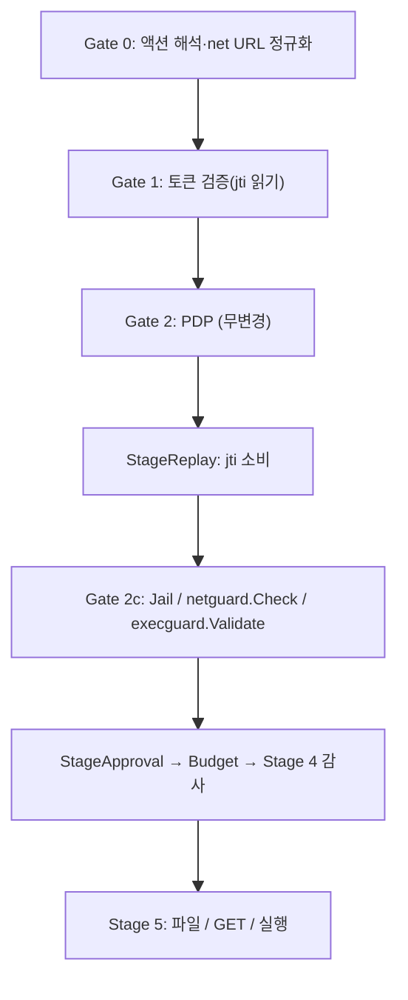

# ROADMAP — 16 도구 종류 확장 및 egress 통제 (마스터 설계)

> 상위 색인: [전체 로드맵 색인](../README.md) | 대시보드: [README.md](README.md) | 계획: [PLAN.md](PLAN.md) | 배경: [WHY.md](WHY.md) | 결정: [ADR 0003](../../adr/0003-차기-로드맵-범위-개정-비목표-조건부-해제.md) C-2, C-3, [ADR 0001](../../adr/0001-mcp-tool-call-어댑터-범위-및-프로토콜.md) A-2 | 교정 보고서: [025번 보고서](../../보고서/025-16번로드맵_구조결함_및_진행가능성_검증보고서.md)

## 1. As-Is / To-Be

| 구분 | As-Is (15번 완료 시점 코드) | To-Be (Phase 16) |
|---|---|---|
| Action | `file:read`, `file:write` ([`domain/grant.go`](../../../internal/domain/grant.go)). PEP Gate 0 `NormalizeAction`·CLI `grant`/`pdp`가 각자 두 값을 하드코딩 | `net:fetch`, `exec:run` 추가. `domain.ParseAction`·`IsValidAction` 단일 원천 |
| 자원 문자열 | 워크스페이스 상대 경로 | `net:fetch` → `127.0.0.1:<port>`·`[::1]:<port>`(Gate 0 정규화), `exec:run` → 등록 ID(`echo-safe`). 3단 스코프 `net:fetch:127.0.0.1:<port>`는 기존 `ScopeMatches`로 이미 맞음 |
| 경계 검사 (Gate 2c) | 액션과 무관하게 Jail | `file:*` → Jail, `net:fetch` → netguard allow-list, `exec:run` → execguard 등록 ID·인자 |
| 실행 (Stage 5) | 파일 읽기·쓰기 | + 루프백 GET, + 고정 바이너리 실행 |
| MCP 도구 | `file_read`, `file_write` (ADR 0001 A-2) | + `net_fetch`, `exec_run` (ADR 0003 C-3, 총 4종) |
| 격리 | `AllowNetwork` 전부/전무, 정직 워커는 격리 미배선 | `AllowConnectPorts`로 포트 단위 허용, 격리 하 정직 워커 실측 |
| 시나리오 | 73대 (`E2E-01`~`E2E-73`, G1~G14) | G15 `E2E-74`~`E2E-79` 추가 → 79대 |

## 2. 아키텍처 및 신뢰 경계

- **단계 순서는 15번 고정 순서 그대로다.** 바뀌는 것은 Gate 0 정규화, Gate 2c 경계 `switch`, Stage 3b 예산 조건, Stage 5 실행 `switch` 네 곳이다. 새 단계·새 파일·새 인터페이스는 만들지 않는다(`TC-060-04` 단일 return 유지).
- **PDP는 순수 유지**: 도구 종류는 `Action` 문자열과 정규화된 자원 문자열로만 표현된다. PDP는 소켓·프로세스를 다루지 않는다(`TC-060-01`). 승인(`ask`)도 새 도구에 그대로 걸린다.
- **allow-list 출처**: 네트워크는 부모가 넘기는 `-net-allow`(무작위 시험 포트), 실행은 코드 고정. 둘 다 Zone B(Grant)와 독립이다.
- **심층 방어**: netguard·execguard가 1차(정직한 워커에 들어온 악의 입력), 커널 포트 규칙이 2차(PEP를 건너뛴 악의 워커).

## 3. 파급 범위와 무영향 근거

- **변경**: `internal/domain`(Action 2종, `ParseAction`·`IsValidAction`, Reason 4종), 신규 `internal/netguard`·`internal/execguard`, `internal/authz/pep`(Gate 0·2c·3b·5), `internal/app`(`AppConfig.NetAllowList`), `internal/cli`(`grant`·`pdp` 액션 검사, `subagent worker`·`mcp serve`의 `-net-allow`), `internal/subagent/worker.go`(출력 전달), `internal/mcp`(도구 2종), `internal/confinement`(`AllowConnectPorts`), `internal/harness/catalog`(G15), `internal/harness/architecture_test.go`(`TC-090-01`), `internal/ui`(G15 해설·새 사유), [ADR 0001](../../adr/0001-mcp-tool-call-어댑터-범위-및-프로토콜.md) 상태 줄.
- **무영향**: PDP·PIP·PAP·토큰 교환(스코프 완전 일치 유지), 감사 스키마(항상 v2), `classifyExit`, `file:*` 요청의 단계·사유·종료 코드, 기존 시나리오 `E2E-01`~`E2E-73` 판정.

## 4. 사전 점검 (Pre-Mortem): 이 로드맵이 실패한다면 무엇 때문인가

| 위험 | 방어책 |
|---|---|
| 가드 상한 초과를 17로 내면 스포너가 16으로 바꾼다 | 가드 상한은 `TOOL_LIMIT_EXCEEDED`(12). 17은 부모만(D-06) |
| 원시 URL을 PDP에 넘겨 Grant `host:port`와 불일치 | Gate 0에서 정규화. PDP는 정규화 자원만 본다(D-04) |
| `net:fetch` 자원이 Jail을 「유효한 상대 경로」로 통과 | Gate 2c는 액션별 `switch`. file 외 자원은 Jail을 타지 않는다 |
| 무작위 시험 포트를 allow-list에 넣을 길이 없음 | `-net-allow` → `AppConfig.NetAllowList` → `pep.Config.NetGuard`(D-05) |
| 검사한 주소와 연결한 주소가 다름(프록시 환경변수, 리다이렉트) | 전용 Transport `Proxy: nil`, `DialContext`가 검증된 `host:port`만 연결, 모든 3xx 거부 |
| URL 표기 우회(userinfo, 정수·8진·16진 IP, `localhost`, 후행 점, 백슬래시) | 파싱 후 리터럴 `127.0.0.1`·`::1`만 허용, 문자열 부분 일치 금지, `FuzzNetTarget` |
| 실행 우회(경로 문자 ID, 플래그·메타문자 인자, `PATH` 변조) | 논리 ID → 고정 절대 경로, 인자 정규식, `cmd.Env = []string{}`(nil 아님), `cmd.Dir` = 워크스페이스 |
| 예산 소진 토큰으로 프로세스가 한 번 더 실행됨 | `exec:run`은 사전 차감(D-09) |
| 경로만 다른 URL이 감사·승인에서 구별되지 않음 | `arg_hash = DataDigest(정규 URL)`(D-10) |
| 격리를 켜면 정상 접속도 막힘 / 원안 E2E가 E2E-47 중복 | `AllowConnectPorts`(055), E2E-79는 「정직 워커 허용 포트 성공 + 우회 워커 비허용 포트 차단」 쌍 |
| 격리 하에서 정직 워커가 Zone B·감사 파일을 못 열어 실패 | 055 TC-055-04에서 먼저 실측. 필요한 경로가 `WorkerPolicy`에 없으면 멈추고 보고 |

## 5. 4층위 검증 설계

| 층위 | 대상 | 방법 |
|:---:|---|---|
| 1 | 반복 수동 검증 배제 | `go test -race ./internal/netguard/... ./internal/execguard/... ./internal/authz/... ./internal/confinement/...` |
| 2 | 단위·구조 | 정규화 표준형 table-driven, `FuzzNetTarget`, AST 가드(`TC-060-01`, `TC-060-04`, `TC-090-01` 확장) |
| 3 | 상태·정합성 | 거부 시 시험 서버 요청 수 0·프로세스 출력 없음, 감사 `resource`·`arg_hash`·`result_hash`, 해시 체인 `VALID`, 워크스페이스 무변화 |
| 4 | 통합 | G15(`E2E-74`~`E2E-79`)와 기존 73대 회귀, 격리 켬/끔 쌍 |

## 6. 단계 의존 관계

`010 → 020 → 030 → 040 → 050 → 055 → 060 → 070`. `020`·`030`은 서로 독립이고, `055`는 `040`(워커 `-net-allow`) 뒤라야 격리 하 정직 워커를 실측할 수 있다.

## 7. 단계 분해표 (구현지시서 작성의 입력)

| 단계 | 목표 | 완료 기준 | 인수 시나리오 (입력 → 기대 결과) |
|:---:|---|---|---|
| **010** | Action 2종, `ParseAction`·`IsValidAction`, Reason 4종, CLI 일원화(PEP Gate 0은 040까지 새 액션 14 거부), ADR 0001 표기 | 기존 file 동작 불변, CLI가 4종 액션 Grant 생성 | `ParseAction("net:fetch")` → 성공, `"net:post"` → 실패. 부모 `file:read` → 자식 `file:read:x` 교환은 지금처럼 거부 |
| **020** | netguard 정규화·allow-list·안전 GET | 우회 표기 전부 거부, 퍼징 패닉 0 | `http://127.0.0.1@evil/`, `http://2130706433:80/`, `localhost`, 302, `HTTP_PROXY` 설정 → 모두 거부·서버/프록시 요청 0 |
| **030** | execguard 등록 ID·인자·실행 | 허용 ID만 실행, 주입 거부 | `echo-safe`+`hello_123` → `"hello_123\n"`. `sh`, `../bin/echo`, `-n`, `a;b` → 거부, 프로세스 0 |
| **040** | PEP 디스패치·예산·지문·워커 출력 | `file:*` 회귀 없음, 가드레일 통과 | `net:fetch` 허용 → 응답 수신·감사 `resource=127.0.0.1:
`. Grant 있는 비허용 포트 → `EGRESS_DENIED` |
| **050** | MCP 도구 2종, `-net-allow` 패스스루, `TC-090-01` | 어댑터가 소켓·프로세스를 직접 다루지 않음 | `tools/list` → 4종. `net_fetch`에 `path` 전달 → `-32602` |
| **055** | 격리 포트 단위 허용 | darwin 실측 통과, Landlock 규칙 컴파일·단위 통과 | 허용 포트 연결 성공, 비허용 포트 연결 실패, 격리 하 정직 워커 `file:read` 성공 |
| **060** | G15 6대 | 6대 `PASS` | 표는 [060](instructions/060_g15_e2e_시나리오.md) |
| **070** | 79대 회귀, 문서 동기화, 기능 동결 | `go test -race ./...`, `run --scenario all` 종료 코드 0 | - |

## 8. 결정 확정 사항

대시보드 [§4 결정 표](README.md) D-01~D-11이 정본이다. 요점:
1. 거부는 12(`EGRESS_DENIED`·`EXEC_NOT_ALLOWED`·`EXEC_ARG_REJECTED`·`TOOL_LIMIT_EXCEEDED`), 부모 상한은 17, 커널 차단은 부모 관찰 사실.
2. 시험 서버는 `net/http/httptest`(무작위 포트), 실행 파일은 `/bin/echo` 하나.
3. 네트워크 allow-list는 `-net-allow`, 실행 allow-list는 코드 고정.
4. `net:fetch`는 GET 단일, 요청 본문 없음(`req.Data` 비어야 함).

## 9. 인수인계 (다음 에이전트용)

- **코드 사실 확인 포인터**: [`pep/gateway.go`](../../../internal/authz/pep/gateway.go)(Gate 0 51행, Gate 2c 327행, Stage 3b 361행, Stage 5 391행), [`orchestrator/termination.go`](../../../internal/orchestrator/termination.go), [`confinement/policy.go`](../../../internal/confinement/policy.go), [`app/builder.go`](../../../internal/app/builder.go), [`cli/subagent.go`](../../../internal/cli/subagent.go)·[`cli/mcp.go`](../../../internal/cli/mcp.go), [`mcp/protocol.go`](../../../internal/mcp/protocol.go), [`subagent/worker.go`](../../../internal/subagent/worker.go), [`catalog/g10_os_confinement.go`](../../../internal/harness/catalog/g10_os_confinement.go).
- **금지 사항**: 외부 네트워크 접속, DNS 조회, 리다이렉트 추종, 프록시 경유, 임의 셸·임의 실행 파일, 새 입구 신설, PDP·교환 검증 변경, `classifyExit` 변경, 어댑터의 직접 소켓·프로세스 호출, faultworker 모드 추가.
- **착수 순서**: `010`부터 한 단계씩 순차 구현.
