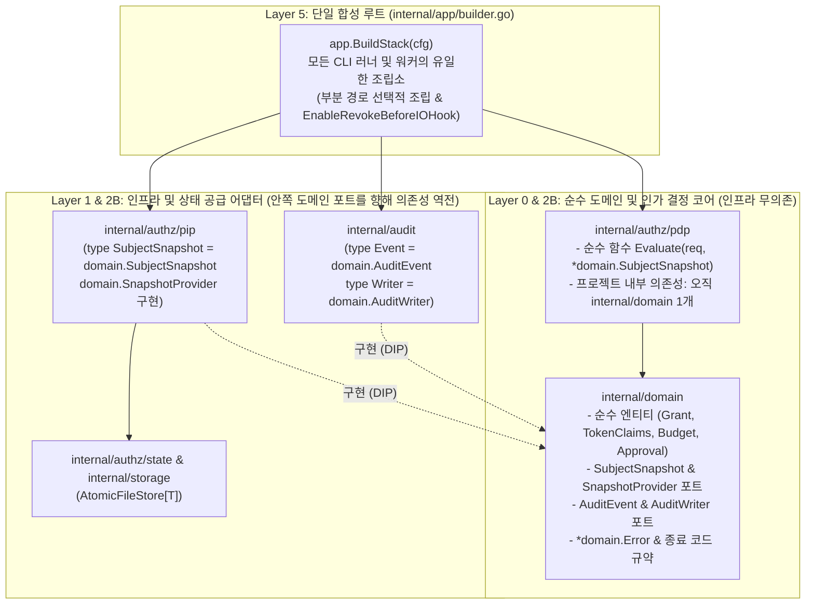

# ROADMAP — 17 도메인 순수성 및 의존성 역전(DIP) 완결 (마스터 설계)

> 상위 색인: [전체 로드맵 색인](../README.md) | 대시보드: [README.md](README.md) | 계획: [PLAN.md](PLAN.md) | 배경: [WHY.md](WHY.md) | 근거: [008번 보고서](../../보고서/008-로드맵16_완주이후_차기방향_및_클린아키텍처_DIP_모범정제_보고서.md), [015번 보고서](../../보고서/015-지속적_수정발생_근본원인_진단_및_과잉설계_제거_구조단순화_보고서.md), **[026번 보고서](../../보고서/026-17번로드맵_구조결함_및_진행가능성_검증보고서.md)**

## 1. As-Is / To-Be

| 구분 | As-Is (Phase 16 완료 시점, 79대 PASS) | To-Be (Phase 17 완결 시점) |
|---|---|---|
| PDP 전이적 의존 방향 | [`pdp/service.go`](../../../internal/authz/pdp/service.go)가 `internal/authz/pip`와 `internal/audit`을 import하여 전이적으로 `pip → state → storage(os, syscall)` 및 `audit(os, syscall)`가 연결됨 | `SubjectSnapshot`·`SnapshotProvider`와 `AuditEvent`·`AuditWriter` 포트를 [`internal/domain`](../../../internal/domain)으로 이동하고 `pip`와 `audit`가 타입 별칭(`=`)으로 이를 구현(DIP). `pdp`의 프로젝트 내부 전이 의존은 오직 `internal/domain` **단 1개**(`pip`, `state`, `audit`, `storage` **0%**) |
| PEP 도구 디스패치 | [`pep/gateway.go`](../../../internal/authz/pep/gateway.go)가 SESE 단일 입출구 아래 Gate 0 / Gate 2c / Stage 5에서 4개 고정 도구를 직접 분기 | 과잉 인터페이스(`ToolHandler` — `020 Dropped`)를 만들지 않고 현행 간결한 SESE 구조를 그대로 유지 ([015번 보고서](../../보고서/015-지속적_수정발생_근본원인_진단_및_과잉설계_제거_구조단순화_보고서.md) §2.3) |
| CLI 의존성 조립 및 워커 경계 | `grant.go`, `pdp.go`, `keys.go`, `approval.go`, `orchestrate.go`, `mcp.go`가 개별적으로 `state.NewFileStore`·`keys.NewFileStore`·`audit.NewJSONLWriter`를 호출하고, `token.go`가 `exchange.NewExchangeService`를 중복 생성하며, `subagent.go`가 `authz/state`를 직접 import함. `pep.go`에 플래그 파싱 루프 중복 | 전 CLI 러너가 `app.BuildStack` 단일 합성 루트와 `Close()`만 사용하며, `subagent.go`의 `BeforeIO` 훅은 `BuildStack`(`EnableRevokeBeforeIOHook`)으로 캡슐화해 `authz/state` import를 제거하고, `pep.go`는 공통 플래그 파서로 중복 제거 |
| 시나리오 카탈로그 | `E2E-01`~`E2E-79`(총 79대) 완주 완료 | 완료된 `g1`~`g15` 시나리오 파일은 단 1줄도 건드리지 않고 보존(OCP 준수, `040 Dropped`) |
| 아키텍처 가드레일 | 파일 내 직접(`direct`) import 위주로만 AST 검사 | `internal/` AST 그래프 재귀 순회 기반 **전이적(Transitive) 의존성 가드(`TC-170-01`)** 및 CLI 수동 조립 금지·워커 CLI 경계 가드(`TC-170-02`) 추가 |

## 2. 목표 아키텍처 및 의존성 역전(DIP) 구조도

## 3. 파급 범위와 무영향 근거

- **변경**: `internal/domain/snapshot.go`(신규), `internal/authz/pdp/service.go`, `internal/authz/pip/service.go`, `internal/audit/audit.go`, `internal/app/builder.go`, `internal/cli/{grant,pdp,keys,approval,token,orchestrate,mcp,subagent,pep}.go`, `cmd/authz-harness/main.go`, `internal/harness/architecture_test.go`, `internal/harness/catalog/catalog_test.go`(주석/문구 `54` → `79`).
- **무영향**: 모든 CLI 명령어 인터페이스, MCP 프로토콜 규격, 감사 로그 JSONL 포맷 및 해시 체인 공식, 완료된 시나리오 파일(`g1`~`g15`), `E2E-01`~`E2E-79` 79대 시나리오의 입출력 및 종료 코드.

## 4. 사전 점검 (Pre-Mortem): 이 로드맵이 실패한다면 무엇 때문인가 ([026번 보고서](../../보고서/026-17번로드맵_구조결함_및_진행가능성_검증보고서.md) 반영)

| 위험 | 방어책 |
|---|---|
| `pip.SubjectSnapshot`과 `audit.Event`/`Writer`를 `domain`으로 옮길 때 기존 테스트·호출부 대량 파손 | `pip`와 `audit` 패키지에 Go 타입 별칭(`type SubjectSnapshot = domain.SubjectSnapshot`, `type Event = domain.AuditEvent`, `type Writer = domain.AuditWriter`)을 두어 기존 코드는 단 1줄의 수정 없이 100% 호환되게 하면서 `pdp`의 `pip`·`audit` import만 제거 |
| `go list -deps` 출력에서 `"os"`·`"syscall"` 문자열을 단순 검색하면 Go 표준 라이브러리(`time` → `os`) 때문에 항상 실패 (`D17-02`) | `go list -deps`에서는 `authz-harness/` 접두사를 가진 프로젝트 내부 패키지만 검사하고, 표준 라이브러리(`"os"`, `"syscall"` 등) 및 내부 인프라 패키지 차단은 `internal/` 패키지들의 AST import 그래프를 재귀 순회하는 `TC-170-01`로 정확히 검증 |
| CLI 러너(`grant`, `pdp`, `approval`, `keys`)를 `app.BuildStack`으로 통합할 때 빈 경로(`PubJWKSPath == ""`, `ReplayPath == ""`)에서 에러가 나거나 현재 디렉터리에 `budget_ledger.json`이 생기고 `pep.NewGateway`가 실패함 (`D17-01`) | `BuildStack`에서 ① `BudgetPath` 파생은 `ReplayPath != ""`일 때만, ② `KeyStore`/`KeyManager`는 `PubJWKSPath != ""`일 때만, ③ `BudgetLedger`/`ReplayLedger`/`Token*`/`ExchangeService`는 `PubJWKSPath != "" && ReplayPath != ""`일 때만, ④ `pep.NewGateway`는 `pdpSvc != nil && tokenVerifier != nil && workspaceJail != nil`일 때만 조립하도록 조건 분기 명시 |
| `BuildStack`이 `keys.NewManager` 생성 직후 또 `RotateKey`를 호출하여 초기 키가 2개 생성될 위험 | `keys.NewManager`가 이미 빈 키 링에서 첫 active 키 1개를 자동 부트스트랩하므로, `BuildStack`의 중복 초기 회전 블록을 제거하여 `NewKeysRunner`와 100% 동일하게 active 키 1개만 생성되도록 보장 |

## 5. 4층위 검증 설계

| 층위 | 대상 | 방법 |
|:---:|---|---|
| 1 | 반복 수동 검증 배제 | `go test -race ./...` 및 `go list -deps` 자동 검사 |
| 2 | 단위·구조 | `TC-170-01`(`pdp`/`domain` 전이적 인프라·OS 의존성 0%), `TC-170-02`(`internal/cli` 내 직접 저장소·감사 로거 생성 0건 및 `cli/subagent.go`의 `authz/state` import 0건) |
| 3 | 상태·정합성 | 79대 시나리오 실행 후 `audit verify` 해시 체인 및 체크포인트 `VALID` |
| 4 | 통합 | `authz-harness run --scenario all` (inproc & subprocess 모드 전수 `PASS`) |

## 6. 단계 의존 관계

`010 → (020 Dropped) → 030 → (040 Dropped) → 050 → 060`

## 7. 단계 분해표

| 단계 | 목표 | 완료 기준 | 인수 시나리오 (입력 → 기대 결과) |
|:---:|---|---|---|
| **010** | PDP-PIP·Audit 의존성 역전(DIP) 완결 | `pdp` 패키지 내 `pip`·`audit` import 0건 | `go list -deps ./internal/authz/pdp`의 `authz-harness/` 패키지가 `domain`과 `pdp` 2개뿐임 |
| **020** | (`Dropped`) PEP `ToolHandler` 전략 포트 추상화 | 과잉 추상화 배제 | - |
| **030** | CLI 합성 루트 일원화 및 플래그 파서 중복 제거 | `internal/cli` 내 수동 스토어·감사 로거 생성 0건, `subagent.go`의 `state` import 0건 | 기존 CLI 통합 테스트(`grant`, `pdp`, `keys`, `approval`, `token`, `pep`, `orchestrate`, `subagent`, `mcp`) 100% 통과 |
| **040** | (`Dropped`) E2E 카탈로그 선언적 픽스처 빌더 정제 | 완료된 `g1`~`g15` 무수정(OCP 준수) | - |
| **050** | 전이적 의존성 및 합성 루트 AST 가드(`TC-170-01`, `TC-170-02`) | 위반 주입 시 즉시 실패 확인 | `pdp`에 인프라 패키지 간접 연결 또는 CLI에 수동 생성 코드 주입 시 변이 테스트 즉시 `FAIL` |
| **060** | 전체 회귀 검증 및 마감 | `go test -race ./...` 및 79대 시나리오 완주 | 종료 코드 `0`, 대시보드 `Done` |
