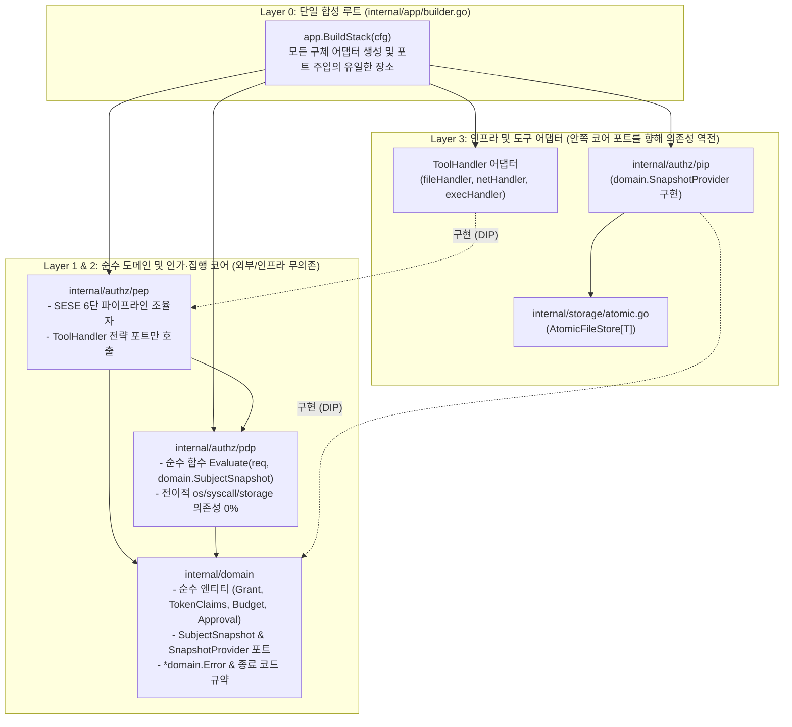

# ROADMAP — 17 도메인 순수성 및 의존성 역전(DIP) 완결 (마스터 설계)

> 상위 색인: [전체 로드맵 색인](../README.md) | 대시보드: [README.md](README.md) | 계획: [PLAN.md](PLAN.md) | 배경: [WHY.md](WHY.md) | 근거: [008번 보고서](../../보고서/008-로드맵16_완주이후_차기방향_및_클린아키텍처_DIP_모범정제_보고서.md)

## 1. As-Is / To-Be

| 구분 | As-Is (Phase 16 완료 시점) | To-Be (Phase 17 완결 시점) |
|---|---|---|
| PDP-PIP 의존 방향 | [`pdp/service.go`](../../../internal/authz/pdp/service.go)가 `internal/authz/pip`를 import하여 전이적으로 `pip → state → storage(os, syscall)`가 연결됨 | `SubjectSnapshot`과 `SnapshotProvider` 인터페이스를 [`internal/domain`](../../../internal/domain)으로 이동하고 `pip`가 이를 구현(DIP). `pdp`의 전이적 `storage`/`os` 의존성 **0%** |
| PEP 도구 디스패치 | [`pep/gateway.go`](../../../internal/authz/pep/gateway.go)가 `jail`, `netguard`, `execguard` 구체 패키지를 직접 알고 분기 | `pep.ToolHandler`(`ValidateTarget`, `Execute`) 전략 인터페이스로 추상화하고 구체 핸들러는 [`app/builder.go`](../../../internal/app/builder.go)에서만 조립 |
| CLI 의존성 조립 | `grant.go`, `pdp.go`, `keys.go`, `orchestrate.go`가 개별적으로 `state.NewFileStore`·`audit.NewJSONLWriter`를 호출하고 `pep.go`에 플래그 파싱 루프 중복 | 전 CLI 러너가 `app.BuildStack` 단일 합성 루트만 사용하며 공통 플래그 파서로 중복 제거 |
| 시나리오 카탈로그 | 각 시나리오마다 `setupHarnessStack`·토큰 발급·실행 보일러플레이트 반복 | 선언적 시나리오 픽스처 빌더로 중복 코드 50% 이상 압축, 각 시나리오의 핵심 의도(Given-When-Then)만 부각 |
| 아키텍처 가드레일 | 파일 내 직접(`direct`) import만 AST로 검사 | `go list -deps` 기반 **전이적(Transitive) 의존성 가드(`TC-170-01`)** 및 CLI 수동 조립 금지 가드(`TC-170-02`) 추가 |

## 2. 목표 아키텍처 및 의존성 역전(DIP) 구조도

## 3. 파급 범위와 무영향 근거

- **변경**: `internal/domain`(스냅샷·포트 정의), `internal/authz/pdp`, `internal/authz/pip`, `internal/authz/pep`, `internal/app/builder.go`, `internal/cli/*.go`, `internal/harness/catalog/*.go`, `internal/harness/architecture_test.go`.
- **무영향**: 모든 CLI 명령어 인터페이스, MCP 프로토콜 규격, 감사 로그 JSONL 포맷 및 해시 체인 공식, `E2E-01`~`E2E-78` 78대 시나리오의 입출력 및 종료 코드.

## 4. 사전 점검 (Pre-Mortem): 이 로드맵이 실패한다면 무엇 때문인가

| 위험 | 방어책 |
|---|---|
| `pip.SubjectSnapshot`을 `domain.SubjectSnapshot`으로 옮길 때 기존 테스트 코드 대량 파손 | `pip` 패키지에 타입 별칭(`type SubjectSnapshot = domain.SubjectSnapshot`)을 두어 기존 단위 테스트 호환성을 100% 유지하면서 `pdp`의 `pip` import만 깔끔하게 제거 |
| 인터페이스 과잉 추상화로 오히려 코드 추적성이 나빠짐 | 구현체가 1개뿐인 내부 헬퍼에는 인터페이스를 만들지 않고, 오직 **아키텍처 경계(PDP↔PIP, PEP↔ToolHandler, Core↔Audit/Observe)**에만 포트를 둠 |
| CLI 러너들을 `app.BuildStack`으로 통합할 때 불필요한 컴포넌트(예: `grant list`에서 `Jail` 생성)가 초기화되어 오류 발생 | `AppConfig`의 선택적 초기화 규칙(`WorkspaceDir == ""`이면 `Jail` 미생성, `VerifyOnly: true`이면 Zone A 미접근)을 그대로 활용하여 각 CLI에 필요한 최소 스택만 조립 |
| 카탈로그 리팩토링 중 특정 시나리오의 미세한 검증 조건이 누락됨 | 리팩토링 전후 78대 시나리오의 감사 이벤트 수, 종료 코드, 변이(Mutation) 실패 감도를 1:1 대조 검증 |

## 5. 4층위 검증 설계

| 층위 | 대상 | 방법 |
|:---:|---|---|
| 1 | 반복 수동 검증 배제 | `go test -race ./...` 및 `go list -deps` 자동 검사 |
| 2 | 단위·구조 | `TC-170-01`(`pdp`/`domain` 전이적 인프라 의존성 0%), `TC-170-02`(`internal/cli` 내 직접 `state.NewFileStore` 호출 0건) |
| 3 | 상태·정합성 | 78대 시나리오 실행 후 `audit verify` 해시 체인 및 체크포인트 `VALID` |
| 4 | 통합 | `authz-harness run --scenario all` (inproc & subprocess 모드 전수 `PASS`) |

## 6. 단계 의존 관계

`010 → 020 → 030 → 040 → 050 → 060`

## 7. 단계 분해표

| 단계 | 목표 | 완료 기준 | 인수 시나리오 (입력 → 기대 결과) |
|:---:|---|---|---|
| **010** | PDP-PIP 의존성 역전(DIP) 완결 | `pdp` 패키지 내 `pip` import 0건 | `go list -deps ./internal/authz/pdp` 실행 결과에 `state`, `storage`, `syscall` 미포함 |
| **020** | PEP `ToolHandler` 전략 포트 추상화 | `pep/gateway.go`에서 도구별 구체 분기 캡슐화, `TC-060-04` 유지 | `ToolHandler` 목(Mock) 주입만으로 `pep.Gateway` 전체 관문 단위 테스트 통과 |
| **030** | CLI 합성 루트 일원화 및 플래그 파서 중복 제거 | `internal/cli` 내 수동 `state.NewFileStore` 호출 0건 | 기존 CLI 통합 테스트(`grant`, `pdp`, `keys`, `pep`, `orchestrate`) 100% 통과 |
| **040** | E2E 카탈로그 선언적 픽스처 빌더 정제 | 중복 셋업 코드 제거 및 가독성 향상 | 78대 시나리오 전수 `PASS` 및 변이 테스트 검출 유지 |
| **050** | 전이적 의존성 및 합성 루트 AST 가드(`TC-170-01`, `TC-170-02`) | 위반 주입 시 즉시 실패 확인 | `pdp`에 인프라 패키지 간접 연결 시 `TC-170-01` 즉시 `FAIL` |
| **060** | 전체 회귀 검증 및 마감 | `go test -race ./...` 및 78대 시나리오 완주 | 종료 코드 `0`, 대시보드 `Done` |
