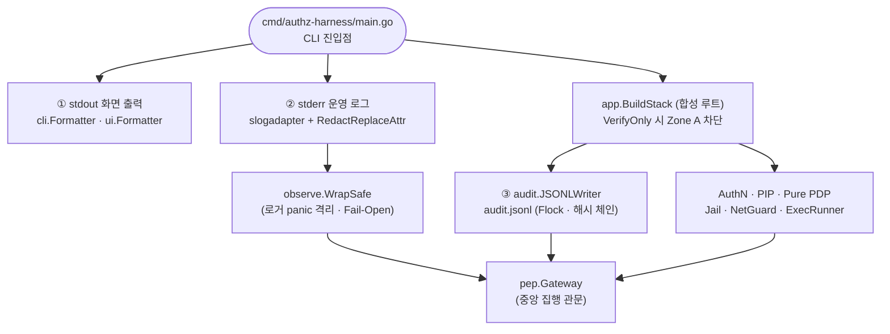
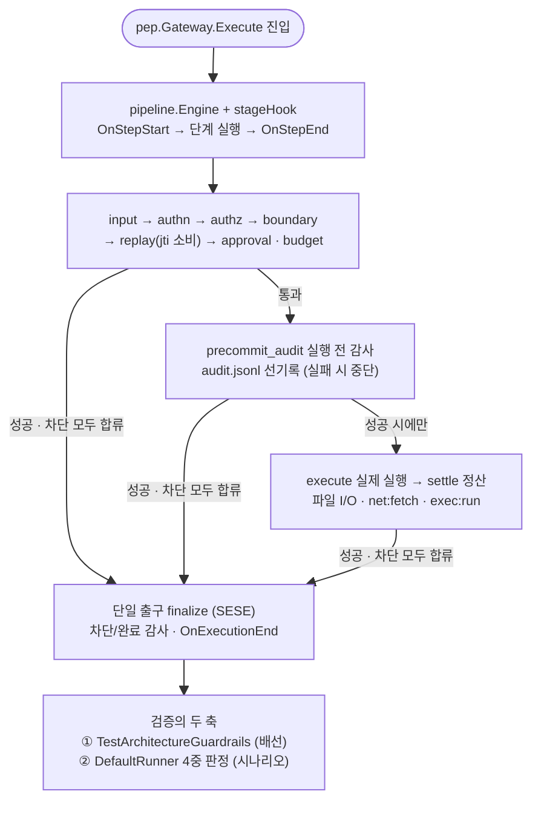

# 000. 전체 설계 철학과 내부 지도 — 이 프로그램은 무엇을 왜 시험하며, 감사·로그·관문·하네스는 안에서 어떻게 배선되어 있나

> **모드**: `[문서작업]` — 소스코드 수정 없이 현재 구현된 `authz-harness` 전체의 설계 철학, 감사(`audit`)와 운영 로그(`observe`)의 분리 배선 및 호출 구조, 자체 정책 결정기(`pdp`)와 집행 관문(`pep`), 그리고 정적 배선 시험과 동적 시나리오 하네스(`harness`)의 내부 지도를 해설합니다.  
> **기준일**: 2026-11-06 · **기준 커밋**: `bf00fca` (이 문서가 설명하는 `cmd/`와 `internal/`을 마지막으로 바꾼 커밋)  
> **검증 범위**: 동작·순서·소유자·시점을 코드와 대조한 결과와 「미확인」은 5부 ③에 있습니다.  
> **이 문서는 구현된 것만 적는다.** 계획·제안·미래형 약속은 적지 않으며, 현재 코드가 하지 않는 것은 「지금은 없다」고만 씁니다.  
> **이 문서의 규칙**: 본문(0~4부, Q&A, 그림, 5부 ①)은 쉬운 개념·설계·이유가 중심입니다. 파일·타입 이름 같은 고유 이름은 첫 등장에 한마디 설명과 함께 쓰고, 구현의 어디인지는 문단 끝 `(구현: 파일 · 함수, 5부 ② 번호)` 귀띔으로 보조합니다. 기준은 [프로그램 설명서 README의 「설명의 기준」과 「이름의 3층」](README.md)입니다.  
> **겹치는 주제**: 이 문서는 열한 편([001편](001-전체요청여정과_5단계관문.md)~[011편](011-위협지도_막는것과_못막는것.md))을 처음 여는 사람을 위한 **총괄 입문 지도**입니다. 터미널에서 직접 따라 쳐 보는 실습 절차와 명령줄 옵션 예시는 [시연 안내서(`DEMO_GUIDE.md`)](../DEMO_GUIDE.md)가 다루므로 이 문서에서는 중복하지 않고, 각 부품을 왜 만들었고 어떻게 맞물려 돌아가는지(설계와 트레이드오프)에 집중합니다. 세부 동작은 각 질문 끝에서 해당 편 링크로 안내합니다.
>
> **다시 확인하는 법**
> ```bash
> git rev-parse --short HEAD
> git log -1 --format=%h -- cmd internal
> # 1. 외부 서드파티 패키지 의존성이 0개(Go 표준 라이브러리만 사용)인지 확인
> cat go.mod
> # 2. 3중 분리 배선(stdout / stderr / audit.jsonl)과 단일 합성 루트(BuildStack) 확인
> grep -n "slog.New\|NewFormatter\|NewJSONLWriter" cmd/authz-harness/main.go
> grep -n "func BuildStack" -A 45 internal/app/builder.go
> # 3. PEP 관문의 단계 조립(assemble), 계측 훅(stageHook), 사전 감사(precommitAudit), 단일 출구(finalize) 확인
> grep -n "func (g \*gateway) Execute\|func (g \*gateway) assemble\|func (h stageHook)\|func (g \*gateway) precommitAudit\|func (g \*gateway) finalize" internal/authz/pep/gateway.go
> # 4. 정적 배선 시험(아키텍처 가드레일) 및 동적 시나리오 하네스 실행
> go test -v ./internal/harness -run "TestArchitectureGuardrails"
> go test -v ./internal/authz/pep/... ./internal/observe/... ./internal/audit/...
> ```

---

## 💡 사용자의 질문 (원문 보존)

> 감사코드와 로그코드가 어떤 구조로 설계되어 있나? 어떻게 작동하나? 감사코드는 어떤 규칙으로 호출하나? 중요한 함수 전에 호출하나? 하드코딩되어 있나 아니면 데코레이터 패턴 같은 걸로 되어 있나? 감사와 로그는 별개다. 별개로 되어 있나? 배선이 다른가 아니면 로거 내에서 분리되나? 그리고 이 프로그램은 정체가 무엇인가? 테스트프로그램으로 설계한 거 같은데 현재를 정의한다면? opa서버는 내장하고 있나? pep를 구현해보고 테스트하기 위한 설계로 이 프로그램 만들었다. 테스트옵션을 정의하고 여러 시나리오를 시험할 수 잇게 되어 있나? 내 질문의 의도를 파악해서 아주 쉽게 설명해라. 리눅스나 윈도우는 설계철학이 있다. 그것은 아주 간단하다. 나는 그런 수준의 간단한 설명을 원하고 점차 파고들면서 이부분과 저부분이 왜 만들어졌는지 어떻게 만들어졌는지 알고 싶다. 트레이드오프결정을 알고 싶다. demo_guide가 이미 있는데 그부분과 중복되는 구체적 옵션과 실행방법은 제외하고 내부가 어떻게 되어 있는지 설계디자인을 알고 싶다. 지도를 보고 싶다. 지도는 누구나 쉽게 볼 수 있다 .약간의 규칙과 원리만 알려주면 누구나 볼수 있다. 누구나 알 수 있는 설명을 원한다. 대체 무엇을 어떻게 테스트하고 왜 하는가? 그런 프로그램의 내부는 어떻게 되어 있나? 배선시험도 이 프로그램의 한축이었다. 실무에도 쓸수 있는 파이프라인과 배선을 만들었고 그 위에서 작동하는 권한시스템이 있다. 몇가지 옵션을 제공한다. 시험해서 결과를 볼수 있게 제동한다. 내 말이 맞나? 설명서를 만들어라.

> 설명서로 만들어라. 작동원리/ 폴더 안에. 000-전체설계철학과_내부지도.md를 만들어라.

---

## 0. 모든 설계 이전에 ‘사람’이 있다 — 부품이 서른 개인데, 큰 그림은 무엇인가

이 저장소를 처음 열면 `internal/` 아래에 열일곱 개의 폴더가 보이고, 명령줄 하위 명령도 열 개가 넘습니다. 시연 안내서(`DEMO_GUIDE.md`)를 따라 명령을 쳐 보면 뭔가 척척 막아내고 표를 그려 주는데, 정작 이 프로그램을 만든 사람이나 처음 읽는 사람은 더 근본적인 질문을 품게 됩니다.

- *「이 프로그램의 진짜 정체는 무엇인가? 단순한 연습용 테스트 스크립트인가, 아니면 실무에 쓸 수 있는 권한 엔진인가?」*
- *「리눅스가 『모든 것은 파일이다』라는 한 줄에서 출발하듯, 이 프로그램을 꿰뚫는 가장 간단한 설계 철학은 무엇인가?」*
- *「보안 감사(`audit`)와 운영 로그(`log`)는 목적이 전혀 다른데, 하나의 로거 안에서 레벨로만 나눈 건가, 아니면 시작점부터 배선이 완전히 다른가?」*
- *「감사 코드는 함수마다 일일이 하드코딩해서 부르나, 아니면 데코레이터나 래퍼 같은 구조로 감싸 두었나? 중요한 파일 작업을 하기 전에 먼저 부르나?」*
- *「정책을 결정할 때 외부 OPA(Open Policy Agent) 같은 서버를 내장해서 쓰나, 아니면 직접 계산하나?」*
- *「실무용 파이프라인과 배선을 먼저 깔아 두고, 그 위에서 옵션을 바꿔가며 제동이 걸리는지 확인하는 시험대라는 내 이해가 맞나?」*

이 설명서는 그 질문들에 답하는 **전체 지도**입니다. 세부 명령어나 플래그 사용법은 덜어내고, 가장 간단한 설계 철학 세 줄에서 출발해 **정체성 → 감사와 로그의 분리 배선과 호출 규칙 → 정책 결정과 관문의 구조 → 배선 시험과 시나리오 하네스 → 각 선택의 트레이드오프**까지 한 단계씩 파고듭니다.

---

## 1부. 왜 이런 설계 철학이 필요하고, 왜 이런 모양인가

### 가장 밑바닥의 이유부터

리눅스가 *「모든 것은 파일이다」*라는 한 문장으로 복잡한 장치를 다루듯, 이 프로그램(`authz-harness`)의 모든 코드는 아래 **세 줄의 설계 철학**에서 갈라져 나왔습니다.

1. **첫째 철학: 「의심하고 줄여서 건넨다」 — 왜 부모 출입증을 그대로 주지 않나?**
   - 상위 프로그램(팀장)이 하위 일꾼 프로세스(서브에이전트)에게 심부름을 시킬 때 자기 마스터 열쇠를 그대로 복사해 주면, 일꾼이 실수하거나 공격당했을 때 시키지 않은 파일까지 지울 수 있습니다.
   - *그건 왜?* 출입증을 확인하는 문지기는 「누가 들고 왔는가」가 아니라 「들고 온 출입증에 무엇이 적혀 있는가」를 보기 때문입니다.
   - *그래서 어떻게 했나?* 일을 시킬 때마다 범위(`Scope`)·유효 시간(`exp`)·위임 깊이(`depth`)·횟수 및 바이트 예산(`Budget`)을 부모보다 작거나 같게 깎은 **새 임시 출입증으로 바꿔서(`Exchange`)** 건네고, 일꾼은 환경변수를 비운 별도 운영체제 프로세스로 띄웁니다.
2. **둘째 철학: 「문고리를 돌리기 직전에 장부를 다시 본다」 — 왜 출입증 서명만 보고 열어 주지 않나?**
   - 줄여서 만든 임시 출입증이라도 만료 시간(예: 30분)이 남아 있는 동안 일꾼이 이상한 행동을 시작하면 즉시 멈춰 세워야 합니다.
   - *출입증만 검사하면 왜 못 멈추나?* 한번 일꾼 손에 넘어간 출입증 적힌 글자는 밖에서 지울 수 없기 때문입니다.
   - *그래서 어떻게 했나?* 문지기(`pep.Gateway`)는 출입증 서명이 진짜인지 확인한 뒤에도, 실제 파일을 열기 직전에 중앙 허가 장부(`grants_state.json`)를 매번 다시 읽어 지금 그 권한이 살아 있는지, 세대 번호(`Epoch`)가 올라가지 않았는지를 판단 두뇌(`pdp.Evaluate`)에게 물어봅니다. 그리고 그 판단 두뇌는 디스크나 네트워크를 전혀 모르게 만들어, 오직 눈앞에 건네받은 요청과 장부 사본만으로 답을 내리게 했습니다.
3. **셋째 철학: 「증거가 안 남으면 실행도 안 한다」 — 왜 감사와 운영 로그를 같은 통에 담지 않나?**
   - 프로그램이 남기는 기록에는 두 종류가 있습니다. 하나는 개발자가 속도와 흐름을 보려는 **운영 로그**이고, 다른 하나는 나중에 「누가 무엇을 건드렸고 왜 막혔는가」를 증명하는 **보안 감사 기록**입니다.
   - *둘을 왜 한 로거에 섞으면 안 되나?* 두 기록은 **고장 났을 때 해야 하는 행동이 정반대**이기 때문입니다. 디버그용 운영 로그가 고장 났다고 정상 파일 읽기가 멈추면 안 되지만(Fail-Open), 반대로 보안 감사 기록이 실패했는데도 파일 덮어쓰기가 그대로 실행되면 흔적 없는 조작이 일어납니다(Fail-Closed).
   - *그래서 어떻게 했나?* 시작점(`main.go`, `app.BuildStack`)부터 사용자 화면 출력(`stdout`), 운영 로그(`stderr`), 보안 감사(`audit.jsonl`)의 **배선을 세 갈래로 완전히 분리**했습니다. 그리고 도구를 실제로 실행(`execute` 단계)하기 직전에 사전 감사(`precommit_audit` 단계)를 먼저 디스크에 밀어 넣고, 실패하면 그 자리에서 브레이크를 밟습니다.
4. **마지막 질문: 왜 「권한 엔진」과 「시험대(하네스)」를 한 몸으로 만들었나?**
   - 보안 장치는 *「잘 돌아간다」*가 아니라 *「안 되는 요청을 넣었을 때 정확히 의도한 관문에서, 의도한 사유와 종료 코드로 멈춰 세운다(제동한다)」*로만 증명할 수 있습니다.
   - *바깥에서 셸 스크립트로 시험하면 왜 부족한가?* 종료 코드(`12`)가 맞게 나왔어도 죽기 직전에 파일을 1바이트라도 건드렸거나, 엉뚱한 관문에서 막혔거나, 코어 패키지가 몰래 파일 시스템을 직접 호출하도록 배선이 꼬인 것은 바깥 스크립트가 알아채지 못합니다.
   - *그래서 어떻게 했나?* 실무에 바로 쓸 수 있는 정석 파이프라인과 배선을 먼저 세우고, 그 배선이 어긋나지 않았는지 소스코드 구조를 검사하는 **정적 배선 시험(`TestArchitectureGuardrails`)**과, 실제 공격 시나리오를 흘려보내 4중 증거를 대조하는 **동적 시나리오 하네스(`harness.DefaultRunner`)**를 한 실행 파일 안에 내장했습니다.

### 흔한 방식과 이 프로그램의 선택

| 구분 | 흔한 방식 (이 저장소에서 확인하지 않은 일반론) | 이 프로그램(`authz-harness`)의 선택 |
|---|---|---|
| **전체 정체성** | 권한 라이브러리와 테스트 스크립트를 따로 만들거나, 모의 객체(Mock)만 끼워 단위 테스트만 돌린다. | 실무형 인가 파이프라인(`authn`·`authz`·`jail`·`confinement`·`mcp`)과 이를 검증하는 시나리오 하네스(`harness`)를 외부 서드파티 패키지 없이(`go.mod` 의존성 0개) 단일 실행 파일로 통합했다. |
| **정책 결정기 (PDP)** | 외부 OPA(Open Policy Agent) 서버를 띄워 네트워크로 물어보거나, 정책 코드 안에서 데이터베이스·파일을 직접 읽는다. | OPA 서버 없이 Go 순수 함수(`pdp.Evaluate`)로 내장하되, 파일·운영체제 패키지를 일절 가져다 쓰지 못하게 막고 장부 사본(`SubjectSnapshot`)만 받아 판정한다. |
| **감사와 로그의 구조** | 하나의 로거(`slog`, `zap` 등) 안에서 로그 레벨이나 태그만 달리해 출력하고, 함수마다 `logger.Info`를 흩어 놓는다. | 입구부터 운영 로그 포트(`observe.Observer` → `stderr`)와 감사 포트(`domain.AuditWriter` → `audit.jsonl`)를 별도 배선으로 가르고, 운영 로그는 파이프라인 엔진에 꽂은 계측 훅(`stageHook`)과 `WrapSafe` 데코레이터로, 감사는 `precommit_audit` 사전 기록과 `finalize` 단일 출구로 묶었다. |
| **얻는 것** | 초기 작성이 빠르고 외부 정책 엔진의 기능을 빌려 쓸 수 있다. | 외부 서버 장애나 통신 지연이 없고, 로거 패닉이 판정을 멈추지 못하며, 감사 누락 없이 모든 허용·거부가 단일 출구로 수렴하고, 배선 위반이 컴파일·테스트 단계에서 즉시 잡힌다. |
| **포기하는 것** | 로거 장애와 감사 실패를 구분해 제어하기 어렵고, 경계가 무너져도 알아차리기 어렵다. | 범용 정책 스크립트 언어(Rego 등)를 런타임에 동적으로 갈아끼우는 유연성을 포기했고, 요청마다 JSON 장부 파일들을 잠그고 읽고 쓰는 디스크 입출력 비용을 감수한다. |

---

## 2부. 질문과 답변으로 풀어보는 핵심 동작 (Q&A)

### Q1. 이 프로그램은 정체가 무엇인가? 테스트 프로그램으로 설계한 것 같은데 현재를 정의한다면?

- **무슨 일이 일어나는가**:
  1. 출발점은 말씀하신 대로 **「PEP(정책 집행 관문)를 제대로 구현해 보고 여러 공격 시나리오를 넣어 시험하기 위한 테스트 하네스」**였습니다.
  2. 하지만 그 시험이 가짜 모의 시험(Mock)이 되지 않으려면, 시험 대상이 되는 파이프라인과 배선 자체가 실무 수준으로 완결되어야 했습니다. 그래서 현재 구현된 실체는 **두 층이 결합된 구조**입니다.
     - **1층 — 실무형 로컬 권한·격리 파이프라인**: Ed25519 서명 키 회전·폐기(`internal/authn/keys`), OAuth 2.1 스타일 토큰 발급·검증·1회용 `jti` 재사용 원장(`internal/authn/token`), 범위·수명·예산 축소 위임 교환(`internal/authn/exchange`, `internal/authn/budget`), 정책 관리·조회·순수 결정(`internal/authz/pap`, `pip`, `pdp`), 10단계 중앙 집행 관문(`internal/authz/pep`), 작업 폴더 경로 격리(`internal/jail`), 루프백 네트워크·등록 명령 가드(`internal/netguard`, `internal/execguard`), 자식 프로세스 감독 및 커널 샌드박스(`internal/orchestrator`, `internal/confinement`), 외부 AI 도구 게이트웨이(`internal/mcp`), 해시 사슬·서명 체크포인트 감사기(`internal/audit`)가 모두 실제 동작하는 코드로 들어 있습니다. (구현: [`builder.go`](../../internal/app/builder.go) · `BuildStack`, 5부 ② 2번)
     - **2층 — 배선 및 시나리오 검증 하네스**: 위 파이프라인 위에 15개 공격·방어 그룹(`G1`~`G15`)을 자동으로 흘려보내 제동이 정확히 걸리는지 4중 증거로 판정하는 시나리오 러너(`internal/harness`)와 소스코드 배선 규칙을 검사하는 아키텍처 가드(`TestArchitectureGuardrails`)가 얹혀 있습니다. (구현: [`runner.go`](../../internal/harness/runner.go) · `DefaultRunner.RunScenario`, [`architecture_test.go`](../../internal/harness/architecture_test.go) · `TestArchitectureGuardrails`, 5부 ② 12·13번)
  3. 또한 [`go.mod`](../../go.mod)를 열어 보면 외부 서드파티 라이브러리가 단 하나도 없이 오직 Go 표준 라이브러리만으로 작성되어 있습니다.
- **한 줄 정의와 명확한 한계(포지셔닝)**: 현재 이 프로그램은 **「외부 의존성 없이 로컬 에이전트 권한·격리·감사 배선을 구현해 보고, 실패해야 할 때 정확히 제동되는지를 증명하는 구현 검증 하네스(Verification Harness) 및 학습·실습 교보재」**입니다. 따라서 상용 정책 서버(OPA/Cedar)나 프로덕션 IAM을 대체하는 범용 솔루션이 아니며, 의도적으로 다음 6가지 한계를 가집니다([보고서 031](../보고서/031-자체권한체계_한계진단_OPA도입비교_및_구현검증하네스_포지셔닝판정보고서.md)):
  1. **정책 표현력**: `pdp.Evaluate`는 `(주체, 행동, 대상)` 1:1 문자열 완전 일치와 `Epoch`·`Approval`만 보는 고정 수식이며, 복잡한 역할·속성·관계 조건식이나 동적 정책 언어(Rego/Cedar)는 없습니다(실무에서는 `pdp.WithEvaluator` 슬롯에 외부 OPA/Cedar를 연결해 사용).
  2. **네트워크 데몬 부재**: 단일 머신 CLI 및 `stdio` 파이프 전용이며, 멀티 노드용 HTTP/gRPC 서버가 없습니다.
  3. **로컬 파일 잠금(`flock`) 저장소**: 분산 DB가 아닌 로컬 JSON 파일과 OS 파일 잠금을 쓰므로 단일 머신 안에서만 동시성을 보장합니다.
  4. **테스트용 인메모리 클라이언트 레지스트리**: 외부 IdP/OIDC 연동 없이 3개 기본 클라이언트 자격증명이 메모리에 고정되어 있습니다.
  5. **원장 자동 청소(GC) 부재**: 회수된 권한이나 만료된 예산 이력을 주기적으로 삭제·회전하는 백그라운드 데몬이 없습니다.
  6. **`internal/` 패키지 잠금**: 다른 Go 프로젝트가 외부 라이브러리로 `import`하는 SDK가 아니라, 이 저장소 자체를 아키텍처 설계도이자 검증 시험대로 쓰는 구조입니다([007편 Q7](007-코드읽는순서와_의존방향.md)).
- **근거**: 5부 ② 항목 1, 2, 12, 13번

### Q2. OPA(Open Policy Agent) 서버를 내장하고 있나? 왜 이렇게 만들었나?

- **무슨 일이 일어나는가**:
  1. **OPA 서버나 Rego 같은 외부 정책 엔진은 내장되어 있지 않습니다.** 외부 프로세스나 소켓으로 정책 서버를 부르는 코드도 전혀 없습니다.
  2. 대신 정책 결정기인 `internal/authz/pdp` 패키지 안에 **순수 Go 함수로 구현된 자체 결정 엔진(`pdp.Evaluate`)**과, 여기에 장부 스냅샷을 공급하고 감사 기록을 남기는 껍데기 서비스(`pdpService.Decide`)가 들어 있습니다. (구현: [`pdp/service.go`](../../internal/authz/pdp/service.go) · `Evaluate`, `pdpService.Decide`, 5부 ② 7번)
  3. `pdp.Evaluate`는 디스크 파일도 열지 않고 운영체제 시계(`time.Now`)도 읽지 않습니다. 오직 `pipService.GetSubjectSnapshot`이 `.authz-state/public/grants_state.json`에서 한 번에 읽어 온 메모리 사본(`domain.SubjectSnapshot`)과 요청(`pdp.Request`) 두 개만 대조해 다음 6단계를 순서대로 판정합니다:
     - ① 주체의 세대 번호(`Epoch`)가 현재 장부와 같은가? (다르면 즉시 `DENY` · `SUBJECT_EPOCH_REVOKED`)
     - ② 위임받은 토큰일 때 상위 위임 조상(`Actor` 사슬)들의 세대 번호도 모두 현재 장부와 같은가? (하나라도 다르면 즉시 `DENY`)
     - ③ 토큰에 적힌 범위(`TokenScope`)가 요청한 행동과 대상을 허용하는가(`domain.ScopeMatches`)?
     - ④ 장부의 활성 권한(`ActiveGrants`)에 일치하는 항목이 있는가? 있고 사람 승인이 필요 없으면 `ALLOW`, 사람 승인이 필요한 권한(`RequiresApproval: true`)이면 토큰 `jti`와 인자 지문(`ArgHash`)까지 묶인 유효한 1회용 승인이 있을 때만 `ALLOW`, 없으면 **`ASK`**(사람 승인 대기, 종료 코드 `18`).
     - ⑤ 취소된 권한 이력(`RevokedGrants`)에 있으면 `DENY` · `GRANT_REVOKED`.
     - ⑥ 어디에도 없으면 기본 거부(`DENY` · `NO_ACTIVE_GRANT`). (구현: [`pdp/service.go`](../../internal/authz/pdp/service.go) · `Evaluate`, 5부 ② 7번)
- **왜 OPA 대신 자체 순수 함수 PDP를 택했나 (트레이드오프)**:
  - **얻은 것**: 외부 정책 서버가 죽거나 통신이 지연될 일이 없고, 판정 함수(`Evaluate`)가 파일·네트워크·시계와 완전히 단절되어 있어 메모리 표 하나만으로 모든 권한 조합을 즉각 시험할 수 있습니다(`TestTrackA_PureDomainDecisionTable`).
  - **포기한 것**: 관리자가 코드를 다시 컴파일하지 않고 외부 정책 언어(Rego, Cedar 등) 파일만 고쳐서 임의의 복잡한 조건식을 추가하는 기능은 포기했습니다.
- **근거**: 5부 ② 항목 7, 8, 12번

### Q3. 감사(`Audit`)와 운영 로그(`Log`)는 별개로 되어 있나? 배선이 다른가, 아니면 로거 내에서 분리되나?

- **무슨 일이 일어나는가**:
  1. **하나의 로거 안에서 갈라지는 것이 아니라, 프로그램 시작점부터 완전히 별개의 배선(포트·어댑터·출력 스트림)으로 분리되어 있습니다.** 코드에서는 이를 사용자 결과(`stdout`), 운영 로그(`stderr`), 보안 감사(`audit.jsonl`)의 **3중 분리(Tri-Separation)**라고 부릅니다. (구현: [`main.go`](../../cmd/authz-harness/main.go) · `main`, [`builder.go`](../../internal/app/builder.go) · `BuildStack`, 5부 ② 1·2번)
  2. **운영 로그 배선 (`internal/observe` → `stderr`)**:
     - 코어 관문(`pep`)이 아는 인터페이스는 [`internal/observe/port.go`](../../internal/observe/port.go)의 `observe.Observer`입니다. 이 인터페이스에는 `OnStageStart`, `OnStageEnd`, `OnExecutionEnd`, `OnError` 네 메서드만 있고 **반환값이 아예 없습니다(`void`)**.
     - 여기서 **포트**는 「그것을 필요로 하는 쪽(관문)이 정해 둔 규격」이고, **어댑터**는 「그 규격에 맞춰 실제 도구(`slog`)를 연결해 주는 구현」입니다. 규격의 주인이 관문이라, 로그 도구를 바꿔도 관문 코드는 그대로입니다. (구현: `observe.Observer`가 포트, `slogadapter`가 어댑터)
     - 실제 출력은 어댑터인 [`internal/observe/slogadapter/adapter.go`](../../internal/observe/slogadapter/adapter.go)가 Go 표준 로거(`log/slog`)를 통해 표준 에러(`os.Stderr`)로 내보냅니다. 이때 `observe.SanitizeAttrs`와 `slogadapter.RedactReplaceAttr`가 문자열과 에러 안에 섞인 원시 JWT 토큰(`eyJ...`)을 자동으로 `[REDACTED_TOKEN]`으로 가립니다.
     - 결정적으로, 관문(`NewGateway`)은 주입받은 `Observer`를 항상 **`observe.WrapSafe` 안전 데코레이터**로 한 번 감싸서 보관합니다. `WrapSafe`는 각 메서드 안에서 `defer func() { _ = recover() }()`를 실행하므로, 운영 로거가 고장 나거나 패닉(`panic`)을 던져도 그 자리에서 삼켜지고 인가 판정이나 감사 기록에는 티끌만큼도 영향을 주지 못합니다(**Fail-Open**). (구현: [`observe/port.go`](../../internal/observe/port.go) · `Observer`, `WrapSafe`, `SanitizeAttrs`, [`slogadapter/adapter.go`](../../internal/observe/slogadapter/adapter.go) · `New`, [`slogadapter/redact.go`](../../internal/observe/slogadapter/redact.go) · `RedactReplaceAttr`, 5부 ② 5·6번)
  3. **보안 감사 배선 (`internal/domain.AuditWriter` → `internal/audit` → `audit.jsonl`)**:
     - 감사가 따르는 인터페이스는 [`internal/domain/audit.go`](../../internal/domain/audit.go)의 `domain.AuditWriter`(`audit.Writer`는 그 별칭)이며, 메서드 서명은 `Log(event AuditEvent) error`로 **반드시 에러를 반환**합니다.
     - 실제 구현체인 [`internal/audit/audit.go`](../../internal/audit/audit.go)의 `audit.JSONLWriter`는 `audit.jsonl.lock` 파일에 운영체제 배타 잠금(`syscall.Flock`, `LOCK_EX`)을 걸고, 파일 마지막 바이트가 줄바꿈(`\n`)으로 끝나는지 확인한 뒤, 직전 줄의 해시(`prev_hash`)를 읽어 이번 줄의 길이 접두 SHA-256 해시(`curr_hash`, 새 기록은 스키마 v4로 v3 입력에 단계 값(`stage`)을 더해 계산)를 계산해 붙이고 `file.Sync()`로 디스크에 강제 기록합니다.
     - 디스크가 가득 찼거나 잠금에 실패하거나 이전 줄이 깨져 있으면 `Log`가 즉시 에러를 반환하며, 이를 부른 관문이나 서비스는 작업을 멈추고 감사 실패(`ExitAuditFailure`, 종료 코드 `15`)로 제동합니다(**Fail-Closed**). (구현: [`domain/audit.go`](../../internal/domain/audit.go) · `AuditWriter`, [`audit/audit.go`](../../internal/audit/audit.go) · `JSONLWriter.Log`, `ComputeEventHash`, 5부 ② 3·4번)
- **왜 로거 안에서 분리하지 않고 아예 배선을 갈랐나**:
  - 만약 하나의 로거 안에서 레벨로만 나눴다면, 운영 로그는 에러를 무시해야 하고 감사 로그는 에러 시 전체 작업을 멈춰야 하는 상반된 규칙을 함수 서명(`error` 반환 유무)으로 강제할 수 없기 때문입니다.
  - 배선을 아예 갈라 둔 덕분에 아키텍처 가드 시험(`TC-080-01`)으로 *「프로덕션 코드 전체에서 `.Log(...)`의 반환 에러를 `_ =`로 무시한 곳이 단 한 군데라도 있으면 빌드 실패」*라는 엄격한 규칙을 걸 수 있었습니다([006편 Q7](006-OS격리_관측성과_감사체크포인트.md), [007편 Q4](007-코드읽는순서와_의존방향.md)).
- **근거**: 5부 ② 항목 1, 2, 3, 4, 5, 6, 12번

### Q4. 감사 코드와 로그 코드는 어떤 규칙으로 호출하나? 중요한 함수 전에 호출하나? 하드코딩인가 데코레이터/래퍼 패턴인가?

- **무슨 일이 일어나는가**:
  1. **운영 로그(`observe.Observer`) 호출 규칙 — 단계 계측 훅(`stageHook`) + 안전 데코레이터(`WrapSafe`)**:
     - 관문(`pep.Gateway`) 안의 각 단계(`input` 입력 검사 ~ `settle` 사후 정산)마다 로그 호출 코드를 일일이 복붙(하드코딩)하지 않습니다.
     - 대신 [`gateway.go`](../../internal/authz/pep/gateway.go)의 `NewGateway`가 단계 목록(`assemble`)과 함께 **계측 훅(`stageHook`)** 하나를 파이프라인 엔진(`pipeline.Engine`, [`pipeline.go`](../../internal/pipeline/pipeline.go))에 꽂습니다. 엔진은 단계를 부르기 전과 후에 이 훅을 부를 뿐 단계의 내용은 모릅니다.
     - 엔진이 단계 하나를 실행하면 ① 시작 직전 `OnStepStart`가 단계 시작 시각을 재고 `g.obs.OnStageStart`를 부르고, ② 단계가 실행되고, ③ 끝난 직후 `OnStepEnd`가 걸린 시간(`duration_ms`)을 계산해 성공이면 `g.obs.OnStageEnd(..., true)`, 실패면 에러에서 표준 거부 사유(`domain.Reason`)를 꺼내 `g.obs.OnStageEnd(..., false)`를 자동으로 부릅니다. 이 요청에 해당 없어 건너뛴 단계(승인·예산·정산)에는 훅이 불리지 않습니다. 그리고 전체 실행이 끝나는 단일 출구 `finalize`에서 `g.obs.OnExecutionEnd`를 한 번 부릅니다. (구현: [`gateway.go`](../../internal/authz/pep/gateway.go) · `stageHook.OnStepStart`, `stageHook.OnStepEnd`, `gateway.finalize`, 5부 ② 9·10번)
  2. **보안 감사(`AuditWriter.Log`) 호출 규칙 — ① 중요 함수 실행 직전 Pre-Commit 호출 + ② 단일 출구(`finalize`) 일괄 마감 + ③ 상태 변경 지점 명시 호출**:
     - **규칙 A (중요한 일 전에 호출 — `precommit_audit` 단계)**: 질문하신 대로 **실제 파일을 읽고 쓰거나 네트워크·명령을 실행하는 가장 중요한 단계(`execute`) 바로 앞에 `precommit_audit` 단계를 두고, 거기서 감사 코드를 먼저 호출**합니다(`g.logEvent(c.st, domain.StagePrecommitAudit, true, domain.ReasonAuthorized, "pre-commit audit check passed", "")`). 이 사전 감사 기록이 디스크에 무사히 찍히지 않으면(또는 `--inject-audit-failure` 스위치가 켜져 있으면) `execute` 단계는 아예 실행되지 않고 종료 코드 `15`로 멈춥니다. 이 순서는 사람의 주의가 아니라 엔진이 지킵니다. 기록(`record`) 단계를 실행(`execute`) 단계 뒤에 놓는 식으로 성격 등급이 내려가는 조립은 시작할 때 거부됩니다. (구현: [`gateway.go`](../../internal/authz/pep/gateway.go) · `gateway.precommitAudit`, `gateway.assemble`, [`pipeline.go`](../../internal/pipeline/pipeline.go) · `pipeline.New`, 5부 ② 9번)
     - **규칙 B (단일 출구 마감 — `finalize` SESE 패턴)**: `input`부터 `settle`까지 어느 단계에서 거부가 나든 그 자리에서 각각 차단 감사를 찍고 `return`하지 않습니다. 모든 단계는 에러만 반환하고, `gateway.Execute`의 유일한 출구인 `gateway.finalize` 한 곳으로 모입니다. `finalize`는 실패 시 차단 감사(`pep.deny`)를, 성공 시 결과물의 SHA-256 지문(`result_hash`)을 담은 완료 감사(`pep.allow`)를 단 한 곳에서 기록합니다. 차단 감사 기록마저 실패하면 거부 결론은 유지하되 종료 코드를 `15`(`AUDIT_LOG_FAILED`)로 격상합니다. (구현: [`gateway.go`](../../internal/authz/pep/gateway.go) · `gateway.Execute`, `gateway.finalize`, `gateway.logEvent`, 5부 ② 9·10번)
     - **규칙 C (개별 도메인 사건의 명시적 호출)**: 관문 바깥이나 관문 내부 하위 부품이 자기 고유의 상태 변경·검증을 할 때는 그 자리에서 주입받은 `audit.Writer`를 명시적으로 부릅니다. 예를 들어 `authn` 토큰 검증 실패(`Verifier.VerifyToken` → `authn.verify`), `authz` 정책 결정(`pdpService.Decide` → `pdp.decide`), `approval` 사람 승인 소비(`gateway.logApprovalConsumed` → `approval.consumed`), `budget` 예산 차감(`gateway.logBudgetConsumed` → `budget.consumed`), 키 회전·폐기(`keys.Manager`), 토큰 발급·교환(`token.Service`, `exchange.Service`), 권한 부여·회수(`pap.Service`), 자식 프로세스 격리·기동·회수(`SubprocessSpawner.Spawn`)가 각자의 책임 지점에서 감사 기록을 남기며, 모두 실패 시 작업을 중단(Fail-Closed)합니다. (구현: [`pdp/service.go`](../../internal/authz/pdp/service.go) · `pdpService.Decide`, [`gateway.go`](../../internal/authz/pep/gateway.go) · `gateway.logApprovalConsumed`, [`spawner.go`](../../internal/orchestrator/spawner.go) · `SubprocessSpawner.Spawn`, 5부 ② 7·10·11번)
  3. **관문은 세 층으로 되어 있다 — 조립, 순서, 내용**:
     - **조립(한 번)**: `NewGateway`가 설정(`Config`) 하나를 받아 토큰 검증기·정책 결정기·울타리·감사 기록기·시계·로그 창구·예산 장부 같은 부품을 한 번 꽂아 관문을 만듭니다. 이때 로그 창구를 `WrapSafe`로 감싸는 일도 같이 끝나므로, 계측 훅(`stageHook`)과 단계 코드는 이미 감싸진 창구를 쓰기만 합니다. 같은 때에 단계 목록(`assemble`)을 엔진에 넘기고, 엔진은 목록의 순서와 성격이 규칙(ADR 0007)에 맞는지 검사합니다.
     - **순서(요청마다 한 번)**: 요청이 한 건 들어오면 `Execute`가 그 요청만의 새 작업 상태(`Call`과 `pipelineState`)를 만들고 엔진(`engine.Run`)을 한 번 돌립니다. 엔진이 단계를 조립 목록의 순서대로 부르고, 한 단계라도 실패하면 거기서 멈추며, 이미 끝낸 단계 중 보상이 있는 것(예산 환급)을 거꾸로 한 번씩 부릅니다. 컨베이어 벨트가 계속 돌거나 별도 스레드가 일을 이어받는 구조가 아니라, 요청 한 건이 처음부터 끝까지 한 번 지나가고 `finalize`로 마감됩니다.
     - **내용(단계마다)**: 각 단계가 실제로 하는 검사는 `gateway`의 메서드 하나씩(`input`, `authn`, `authz`, `boundary`, `replay`, `approval`, `budget`, `precommitAudit`, `execute`, `settle`)입니다. 앞 단계가 알아낸 것(예: 주체, 토큰 식별자)은 요청별 작업 상태(`pipelineState`)에 적어 두므로 뒤 단계가 이어 받아 씁니다. 도구마다 다른 부분(입력 정규화, 경계 검사, 예산 방식, 실행)은 도구 전략(`pep.Tool` 인터페이스, 파일 읽기·파일 쓰기·`net:fetch`·`exec:run` 4개)이 맡습니다. 엔진은 이 내용을 전혀 모르고 순서와 보상만 다룹니다.
     - **바깥에서 내용을 끼워 넣을 수 있나**: 단계 목록은 `assemble`에 고정되어 있어서, 바깥에서 바꿀 수 있는 것은 요청의 내용과 조립 때 꽂는 부품(`Config`)뿐입니다. 고정한 이유를 적은 문서는 찾지 못했습니다. 고정의 결과로 확인되는 것은 단계 순서(특히 사전 감사가 실제 실행보다 앞선다는 점)가 코드 한 군데에서 읽히고, 그 순서가 `domain.PEPStages()`와 어긋나면 시험(`stage_order_test.go`)이 실패한다는 것입니다. (구현: [`gateway.go`](../../internal/authz/pep/gateway.go) · `NewGateway`, `gateway.Execute`, `gateway.assemble`, 5부 ② 9번)
- **왜 관문 바깥에 데코레이터(`GatewayDecorator`)를 씌우지 않고 내부 계측 훅(`stageHook`) + `finalize` 구조를 택했나**:
  - 실제로 과거 버전(`5e33be1^`)에는 `pep.Gateway` 바깥을 감싸는 데코레이터(`WithBeforeIOHook` 등)가 있었던 적이 있습니다. 하지만 관문 바깥에서 감싸는 껍데기를 두면 `finalize` 단일 출구 바깥으로 빠져나가는 두 번째 출구가 생겨 감사 마감이나 상태 정리가 어긋날 위험이 있었기 때문에, 바깥 데코레이터를 폐기하고 관문 내부의 계측 훅(`stageHook`)과 `finalize` 단일 출구로 일원화했습니다([006편 Q12](006-OS격리_관측성과_감사체크포인트.md), [007편 4부 3번](007-코드읽는순서와_의존방향.md)).
- **근거**: 5부 ② 항목 5, 7, 9, 10, 11번

### Q5. 실무에도 쓸 수 있는 파이프라인과 배선은 어디서 조립되고, 배선 자체가 맞는지 어떻게 시험하나?

- **무슨 일이 일어나는가**:
  1. **단일 합성 루트(`app.BuildStack`)에서 한 번에 배선**:
     - 명령줄 하위 명령(`grant`, `approval`, `pdp`, `keys`, `token`, `pep`, `orchestrate`, `subagent`, `mcp`)은 각자 파일 저장소나 감사 기록기를 직접 생성하지 않습니다.
     - 대신 [`internal/app/builder.go`](../../internal/app/builder.go)의 `app.BuildStack(cfg)` 함수 한 곳이 설정(`AppConfig`)을 받아 필요한 폴더를 준비하고, `AuditWriter` → `KeyStore`/`KeyManager` → `BudgetLedger` → `TokenIssuer`/`ReplayLedger`/`TokenVerifier`/`ExchangeService` → `StateStore`/`PAP`/`PIP`/`PDP` → `Jail`/`NetGuard`/`ExecRunner` → `PEP Gateway` 순서로 의존성을 조립해 `AppStack` 묶음으로 돌려줍니다.
     - 특히 자식 워커(`subagent worker`)나 `pep` 명령처럼 **검증만 해야 하는 실행 경로**는 `VerifyOnly: true` 옵션을 켜서 `BuildStack`을 부릅니다. 그러면 `BuildStack`이 시작부터 Zone A 비밀키 경로(`privPath = ""`)를 끊어 버리고 토큰 발급기(`TokenIssuer`), 교환기(`ExchangeService`), 권한 관리기(`PAP`)를 아예 조립하지(`nil`) 않습니다. 배선 수준에서 자식의 비밀키 접근과 권한 변조 가능성을 잘라내는 것입니다. (구현: [`builder.go`](../../internal/app/builder.go) · `AppConfig`, `AppStack`, `BuildStack`, 5부 ② 2번)
  2. **배선 시험 (`TestArchitectureGuardrails`) — 코드가 배선 규칙을 어기면 테스트가 즉시 제동**:
     - 말씀하신 대로 **「배선 시험」 자체가 이 프로그램의 핵심 한 축**입니다. [`internal/harness/architecture_test.go`](../../internal/harness/architecture_test.go)의 `TestArchitectureGuardrails`는 Go 표준 `go/parser`와 `go/ast`로 저장소의 모든 프로덕션 `.go` 파일을 정적 분석해 다음 배선 불변식을 강제합니다.
     - `TC-060-01` & `TC-170-01` & `TC-170-04`: `domain`과 `pdp`가 직·간접(전이적)으로 파일·OS·장부·감사·격리 패키지를 가져다 쓰지 않는지(허용 목록 외 `import` 0건).
     - `TC-170-06`: 관문(`pep`)이 허용된 13개 패키지(표준 4개 + 내부 9개, 단계 엔진 `pipeline` 포함) 외에 `os`나 장부 원본(`authz/state`)을 직접 가져다 쓰지 않는지.
     - `TC-060-02`: 자식 워커(`subagent`)가 중앙 상태 저장소(`state`), 권한 관리(`pap`), 서명 키(`keys`), 감사 체크포인트(`audit/checkpoint`)를 가져다 쓰지 않는지.
     - `TC-090-01`: 외부 도구 어댑터(`mcp`)가 관문을 건너뛰고 `os`, `net`, `os/exec`, `pdp`, `jail`을 직접 가져다 쓰지 않는지.
     - `TC-170-02`: CLI 파일들이 `BuildStack`을 우회해 저장소나 감사 기록기 생성 함수를 직접 부르지 않는지.
     - `TC-170-08`: 토큰 교환 서비스(`exchange.NewExchangeService`)를 합성 루트(`app`)와 `exchange` 패키지 밖(`internal/` 전체)에서 직접 만들지 않는지.
     - `TC-060-04`: `pep.Gateway.Execute` 함수 본문에 `return` 문이 단 1개(`finalize` 단일 출구)만 있는지. 토큰 교환 `Exchange`도 `return`이 1개뿐이며, `engineErr` 조립 실패 분기(Fail-Closed)와 `finalize` 호출이 있는지 같이 본다(`TC-060-04-E`).
     - `TC-080-01` & `TC-140-01` & `TC-130-01`: 감사 에러 무시(`_ = ...Log`) 0건, 코어의 `log/slog` 직접 참조 0건, 코어의 비제어 `time.Now()` 호출 0건. (구현: [`architecture_test.go`](../../internal/harness/architecture_test.go) · `TestArchitectureGuardrails`, 5부 ② 12번)
- **근거**: 5부 ② 항목 2, 12번

### Q6. 대체 무엇을 어떻게 테스트하고, 어떤 옵션을 바꿔가며 결과를 보고 제동하나?

- **무슨 일이 일어나는가**:
  1. **무엇을 테스트하나 (15개 위협 그룹 `G1`~`G15`)**:
     - 정상 읽기·쓰기와 실시간 회수(`G1`), 클라이언트 인증 거부(`G2`), 토큰 위조·키 회전·폐기(`G3`), 만료·클레임 불일치·1회용 `jti` 재사용(`G4`), 축소 위임 초과·2-Hop 연쇄 위임·세대 번호 `Epoch` 철회(`G5`), 작업 폴더 경로 탈출과 심볼릭 링크(`G6`), `trace_id` 누락·사전 감사 실패·사후 감사 변조(`G7`), MCP 도구 게이트웨이 격리(`G8`), 자식 프로세스 무한 대기·무한 출력·손자 프로세스 강제 종료(`G9`), 관문을 우회하는 악의 워커에 대한 커널 격리(`G10`), 횟수·바이트 예산 차감과 동시 경합(`G11`), 장기 실행 세션(`G12`), 서명 체크포인트·인자 지문·로거 패닉 격리(`G13`), 사람의 1회용 승인 `ask`(`G14`), 루프백 네트워크 조회·등록 명령 가드(`G15`)까지 에이전트 권한 체계의 전 구간을 시험합니다([008편 Q9](008-시나리오하네스와_4중판정.md), [011편](011-위협지도_막는것과_못막는것.md)). (구현: [`catalog.go`](../../internal/harness/catalog/catalog.go) · `AllScenarios`, 5부 ② 14번)
  2. **어떤 옵션과 스위치를 제공하나**:
     - **실행 격리 모드 (`--execution-mode subprocess | inproc`)**: 실제 자식 OS 프로세스(`subagent worker`)를 띄워 환경변수 정제와 표준 입력 파이프까지 시험할지(`subprocess`, 기본값), 아니면 같은 프로세스 메모리 안에서 `PEP.Execute`를 고속으로 직접 부를지(`inproc`) 선택합니다.
     - **가상 시계와 오프셋 (`ClockOffset`, `MockClock`)**: 30분짜리 토큰 만료를 시험하려고 실제로 30분을 기다리지 않고, 시계를 앞으로 감아(`--clock-offset 10m` 등) 즉시 만료 제동을 시험합니다(단, 만료된 토큰을 되살리는 음수 오프셋은 거부 — [009편 Q4](009-권한회수_Epoch_시간과_TOCTOU창.md)).
     - **사전 감사 실패 주입 (`--inject-audit-failure` / `InjectAuditFailure`)**: 디스크 장애로 `precommit_audit` 사전 감사가 실패한 상황을 시뮬레이션해 `execute` 파일 쓰기가 제동(0바이트 무변화 + 종료 코드 `15`)되는지 시험합니다.
     - **악의적 결함 워커 (`faultworker`)**: 정직하게 관문을 지나는 워커 대신, 관문을 아예 건너뛰고 직접 파일 열기·소켓 연결·무한 루프를 시도하는 별도 바이너리([`internal/harness/faultworker/main.go`](../../internal/harness/faultworker/main.go))를 스포너에 물려 커널 샌드박스(`Seatbelt`/`Landlock`)와 자원 감독기가 제동하는지 대조군·실험군으로 시험합니다.
     - **출력 뷰 (`--output-format summary | explain | json`)**: 전체 성적표(`summary`), 어느 관문에서 왜 막혔고 왜 거부 코드가 방어 성공(`PASS`)인지 풀어 주는 관문 다이어그램 해설(`explain`), 기계 판독용(`json`)으로 결과를 확인합니다. (구현: [`run.go`](../../internal/cli/run.go) · `RunRunner.Run`, [`pep.go`](../../internal/cli/pep.go) · `PEPRunner.runRead`, [`runner.go`](../../internal/harness/runner.go) · `DefaultRunner.RunScenario`, 5부 ② 13·15번)
  3. **어떻게 판정하고 제동하나 (`Quad-Assertion` + `InvariantViolation`)**:
     - 시나리오 하나가 끝날 때마다 [`internal/harness/assertion.go`](../../internal/harness/assertion.go)의 `DefaultEvaluator.Evaluate`가 **① 종료 코드 일치 여부 ② 작업 폴더 파일 상태(거부 시 0바이트 무변화 `ExpectZeroMutation`) ③ 감사 장부(`audit.jsonl`)의 정확한 단계·결정·사유(`Reason`) 일치 여부 ④ SHA-256 해시 사슬 무결성 및 원시 JWT 비노출** 네 가지를 동시에 검사합니다.
     - 여기에 더해 손자 프로세스 완전 소멸 여부나 카나리 데이터 미유출 같은 물리적 증거는 `harness.InvariantViolation`으로 한 겹 더 검사해, 단 하나라도 어긋나면 시나리오를 실패(`FAIL`, 종료 코드 `12`)로 판정합니다([008편 Q4·Q5](008-시나리오하네스와_4중판정.md)). (구현: [`assertion.go`](../../internal/harness/assertion.go) · `DefaultEvaluator.Evaluate`, [`invariant.go`](../../internal/harness/invariant.go) · `Invariantf`, 5부 ② 13번)
- **근거**: 5부 ② 항목 13, 14, 15번

### Q7. 관문에서 어디까지가 공통 검문이고, 어디부터가 실제 일인가? 단계 이름은 어떻게 정해져 있나?

- **무슨 일이 일어나는가** (여기서 「공통 검문」은 요청마다 반복되는 확인과 기록을 뜻하고, 앞에서 말한 `BuildStack` 조립과는 다른 말입니다):
  1. 요청 한 건이 지나가는 단계는 열 개입니다. 위에서 아래로 한 번씩 부르고, 실패하면 거기서 멈춥니다. 단계마다 성격(`check`·`decide`·`consume`·`record`·`execute`·`settle`)이 있고, 되돌리기 어려운 일을 하는 단계는 모든 검사 단계 뒤에만 옵니다.

     ```text
      1. input            입력 검사          check    — 행동 종류가 맞는지, 대상이 비어 있지 않은지
      2. authn            신원 확인          check    — 서명·만료·대상. 1회용 번호(jti) 재사용 여부는 읽기만
      3. authz            권한 판정          decide   — 순수 판정 함수(PDP)에게 묻는다
      4. boundary         경계 검사          check    — 파일 경로 / 네트워크 주소 / 등록 명령 중 해당하는 것
      5. replay           재사용 방지        consume  — 모든 검사를 통과한 뒤에야 1회용 번호를 소비
      6. approval         승인 소비          consume  — 사람 승인으로 허가가 난 요청만
      7. budget           예산 차감          consume  — 예산 토큰일 때만. 호출 1회와 쓰기 바이트를 미리 차감
      8. precommit_audit  실행 전 감사 기록  record   — 실패하면 여기서 멈춘다
      9. execute          실행               execute  — 파일 읽기·쓰기, 조회, 명령 실행
     10. settle           사후 정산          settle   — 예산 토큰일 때만. 실행 뒤에야 아는 출력 바이트를 정산
     ```

  2. **1~8단계는 확인과 기록, 9단계가 실제 일, 10단계가 정산입니다.** 앞 여덟 단계는 「이 일을 해도 되는가」를 판단하고 흔적을 남기는 일이고, 허가된 일을 진짜로 하는 곳은 `execute` 하나입니다. 실행은 흉내가 아니라 실제입니다. 파일은 격리 폴더 안에서 실제로 읽고 쓰고, 조회와 명령도 실제로 나갑니다(범위는 Q8).
  3. **소비는 모든 검사가 끝난 뒤에 합니다.** 1회용 번호·사람 승인·예산은 한번 쓰면 되돌리지 않거나 보상이 필요한 자원입니다. 이것을 검사보다 앞에 두면, 뒤 검사에서 거부된 요청이 번호나 승인을 이미 써 버립니다. 그래서 `boundary`까지 검사를 다 마친 뒤에 `replay`, `approval`, `budget` 순으로 소비합니다. 지금은 `authz`가 거부하거나 승인을 요구(`ask`)하거나 `boundary`가 막는 요청이 1회용 번호를 소진하지 않아 같은 토큰으로 다시 시도할 수 있습니다. 이 순서는 성격 등급이 내려가지 않는다는 규칙 하나로 엔진이 강제합니다([ADR 0007](../adr/0007-파이프라인-단계-분류-기준.md)). (구현: [`gateway.go`](../../internal/authz/pep/gateway.go) · `gateway.replay`, `gateway.assemble`, 5부 ② 9번)
  4. **행동별 차이는 도구 전략에 모여 있습니다.** 단계 이름은 모든 행동에 공통이지만, 안에서 하는 일은 도구마다 다릅니다. `input`은 `Tool.Prepare`, `boundary`는 `Tool.CheckBoundary`, 예산은 `Tool.BudgetPlan`, `execute`는 `Tool.Execute`를 부릅니다. 그래서 「공통 검문」이라 부르지만 완전히 행동과 무관하지는 않습니다.
     - **예산 정책은 세 값으로 갈립니다.** `ChargeWriteBytes`는 쓰기·명령의 요청 바이트를 `budget`에서 미리 차감할지, `PostCharge`는 읽기·조회·명령의 출력 바이트를 `settle`에서 정산할지(크기를 실행 뒤에야 알기 때문), `RefundAfterStart`는 실행이 시작된 뒤 실패해도 미리 차감한 것을 환급할지입니다. 환급하지 않는 것은 `exec:run`뿐입니다(시작한 명령은 부작용이 이미 났을 수 있어서). 정산이 실패하면 읽은 내용을 돌려주지 않습니다. (구현: [`tool.go`](../../internal/authz/pep/tool.go) · `Tool`, `BudgetPlan`, `tool_file.go`·`tool_net.go`·`tool_exec.go` · 각 `BudgetPlan`, 5부 ② 9번)
  5. **이름 규칙.** 단계 이름에는 번호를 넣지 않습니다([ADR 0007](../adr/0007-파이프라인-단계-분류-기준.md)).
     - 옛 설계(2026-11-01 ~ 2026-11-06)는 `Gate`와 `Stage` 번호가 섞여 있었고, 중간에 단계를 끼워 넣을 때 번호를 다시 매기지 않고 `2b`·`3a` 같은 이름을 붙였습니다([보고서 034](../보고서/034-단계이름체계_Stage번호_혼재_이력조사_및_표시경로_결함보고서.md)). 로드맵 19에서 번호를 버리고 `input`·`authn`처럼 이름으로 바꿨습니다.
     - **치른 비용**: 이름만 보고 순서를 알 수 없습니다. 순서는 조립 목록(`assemble`)과 `domain.PEPStages()`에서 읽습니다. 감사 기록(`audit.jsonl`)의 단계 값도 새 이름이 되어 과거 기록과 달라지는데, 변환하지 않고 스키마 버전(v4)으로 구분합니다([ADR 0009](../adr/0009-감사-스키마-v4-단계-보호.md)).
  6. **화면에 그려지는 방식.** `pep` 명령이 단계별 합격/불합격을 그려 주는 화면은 단계 순서를 따로 들고 있지 않습니다. 관문이 요청이 실제로 통과한 단계 기록(`Result.Passed`)을 남기고, 화면은 정식 순서(`domain.PEPStages()`)의 열 단계를 그 순서대로 하나씩 그립니다. 통과 기록에 있으면 합격, 거부된 단계면 불합격, 그 뒤 단계는 건너뜀, 이 요청에 해당 없는 승인·예산·정산 단계는 해당 없음(`[N/A]`)으로 그립니다. 단계를 파이프라인에 끼우고 정식 순서에 적지 않으면 시험이 실패합니다. (구현: [`gateway.go`](../../internal/authz/pep/gateway.go) · `Result.Passed`, [`stage.go`](../../internal/domain/stage.go) · `PEPStages`, [`pep.go`](../../internal/cli/pep.go) · `stageBoxes`, 5부 ② 9·15번)

- **근거**: 5부 ② 항목 9, 15번

### Q8. 새 시험을 넣으려면 어디를 고치나? 시험은 무엇을 실제로 실행하나?

- **무슨 일이 일어나는가**:
  1. **새 공격·방어 시나리오를 넣는 일**은 하네스 카탈로그에 시나리오를 추가하는 것으로 끝납니다. 열다섯 그룹(`G1`~`G15`)이 그룹별 파일로 나뉘어 있고, `AllScenarios`가 그것들을 모아 `RegisterAll`이 러너에 등록합니다. 관문(`gateway.go`)은 건드리지 않습니다. 관문이 시험 대상이고 카탈로그가 시험하는 쪽이기 때문입니다. (구현: [`catalog.go`](../../internal/harness/catalog/catalog.go) · `AllScenarios`, `RegisterAll`, 5부 ② 14번)
  2. **관문의 단계 자체를 바꾸는 일**(단계 추가·순서 변경)은 `gateway.go`의 `assemble`을 고쳐야 합니다. 새 단계는 먼저 성격과 조건부 여부와 이후 단계가 실패할 때의 처리를 정하고([ADR 0007](../adr/0007-파이프라인-단계-분류-기준.md)), 정식 단계 목록(`domain.PEPStages()`, [`stage.go`](../../internal/domain/stage.go))에도 같은 순서와 성격으로 적어야 합니다. 어느 한쪽만 고치면 순서 시험(`stage_order_test.go`)이 실패하고, 성격 등급이 내려가는 조립은 엔진이 시작할 때 거부합니다. `pep` 명령의 화면은 그 목록을 읽어 칸을 그리므로 순서를 따로 고칠 필요는 없습니다(칸의 한국어 이름도 같은 목록의 `Label`에 있습니다). 이때 정적 배선 시험(`TestArchitectureGuardrails`)이 단일 출구 같은 규칙을 함께 지키는지도 봅니다.
  3. **시험이 실제로 하는 일의 범위**는 이 앱이 정의한 최소 도구뿐입니다. 이 프로그램은 일을 정의한 앱이 아니라 권한 체계를 시험하는 대상이기 때문입니다.

     | 행동 | 실제로 하는 일 | 제한 |
     |---|---|---|
     | `file:read` / `file:write` | 격리 폴더 안에서 실제 파일 읽기·쓰기 | 작업 폴더 울타리(`Jail`)의 경로 검사 |
     | `net:fetch` | 실제 조회(GET) | 자기 컴퓨터 주소(`127.0.0.1`, `::1`)만 |
     | `exec:run` | 실제 프로세스 실행 | 코드에 고정된 등록표에 있는 명령만. 지금은 `echo-safe`(`/bin/echo`) 하나, 인자는 최대 1개이고 정해진 문자 형식만 |

     새 종류의 명령을 시험하려면 등록표에 항목을 더하거나 관문의 행동별 갈래를 늘려야 합니다. (구현: [`guard.go`](../../internal/execguard/guard.go) · `registry`, `Validate`, [`netguard/guard.go`](../../internal/netguard/guard.go) · `ParseTarget`, `Guard.Fetch`, 5부 ② 16번)
- **근거**: 5부 ② 항목 9, 14, 16번

### Q9. 이 지도를 본 뒤 세부 설명서(`001`~`016`편)는 어떤 순서로 파고들면 되나?

이 문서(000편)로 전체 골격을 잡았다면, 궁금한 질문에 따라 아래 순서로 펼쳐 보면 앞 편에서 본 개념이 다음 편으로 자연스럽게 이어집니다.

| 단계 | 펼쳐 볼 설명서 | 이 편에서 파고드는 핵심 질문 |
|---|---|---|
| **0단계: 존재 이유와 본질** | **[016편 왜 에이전트에겐 기존 IAM이 아니라 PDP·PEP인가](016-왜_에이전트에겐_IAM이_아니라_PDP_PEP인가.md)** | 왜 흔한 백엔드 인가 미들웨어나 정적 IAM(RBAC·API 키)은 에이전트의 혼동된 대리인(Confused Deputy)·다단계 파생 앞에서 무너지며, 왜 `PDP·PEP`와 축소 위임의 결합이 필연인가? (Macaroons/Biscuit·Zanzibar·OPA/Cedar와의 관계 포함) |
| **1단계: 관문과 판정** | **[001편 전체 요청 여정과 관문](001-전체요청여정과_5단계관문.md)**<br/>**[013편 정책 결정(PDP·OPA 모델)과 감사 결합의 교과서적 설계](013-PDP판정과_감사결합의_교과서적설계.md)**<br/>**[014편 도메인 에러·사유 번역과 토큰 비노출 배선](014-도메인에러_사유번역과_토큰비노출배선.md)** | 요청 하나가 `input`부터 `settle`·`finalize`까지 어떤 순서로 흐르며, OPA 원리(`input`+`data` → 순수 함수 `Evaluate` + `pdp.decide` 감사)가 집행 감사와 어떻게 묶이고, 에러 사유(`Reason`→`ExitCode`) 번역과 토큰 비노출(`RedactRawTokens`) 배선은 어떻게 작동하나? |
| **2단계: 출입증과 위임** | **[002편 토큰 발급·축소 위임과 서명 키 회전](002-토큰발급_축소위임과_서명키회전.md)**<br/>**[004편 2-Hop 다단계 위임과 MCP 게이트웨이](004-다단계위임과_MCP도구게이트웨이.md)**<br/>**[015편 4차원 단조 축소 위임과 예산 원장 불변식](015-4차원단조축소위임과_예산원장불변식.md)** | 부모 출입증을 왜 4차원(범위·수명·깊이/비순환·예산)으로 줄여서 교환(`Exchange`)하고, 2단계 연쇄 위임(`act` 사슬)과 예산 예약(`Reserve`)·만료 역순 회수(`reclaimExpiredLocked`)·실패 환급(`Refund`)은 어떻게 돌아가나? |
| **3단계: 승인·예산·회수** | **[005편 사람의 승인·예산·도구 확장](005-승인_예산과_도구확장.md)**<br/>**[009편 권한 회수·Epoch·시간과 TOCTOU 창](009-권한회수_Epoch_시간과_TOCTOU창.md)** | 사람의 1회용 승인(`ask`)과 횟수·바이트 예산은 어떻게 묶이며, 이미 발급된 출입증을 회수하거나 세대 번호(`Epoch`)를 올릴 때 진행 중인 작업(`Window A·B·C`)은 어떻게 되나? |
| **4단계: 프로세스·커널·감사·파일** | **[003편 서브프로세스 격리와 해시 체인 감사](003-서브프로세스격리와_해시체인감사.md)**<br/>**[006편 OS 격리·관측성·감사 체크포인트](006-OS격리_관측성과_감사체크포인트.md)**<br/>**[010편 파일 잠금·원자 교체와 도중 종료](010-파일잠금_원자교체와_도중종료.md)** | 왜 별도 프로세스와 커널(`Seatbelt`·`Landlock`)로 가두고, 여러 프로세스가 동시에 쓰는 장부와 감사 파일을 어떻게 잠그고(`flock`) 서명(`checkpoint`)하고 복구(`recover`)하나? |
| **5단계: 명령줄 배선·코드 구조·시험** | **[012편 명령줄 12종·합성 루트 조건부 배선과 감사 추적 재구성](012-명령줄12종_합성루트배선과_추적재구성.md)**<br/>**[007편 코드를 읽는 순서와 의존 방향](007-코드읽는순서와_의존방향.md)**<br/>**[008편 시나리오 하네스와 4중 판정](008-시나리오하네스와_4중판정.md)**<br/>**[011편 위협 지도: 막는 것과 못 막는 것](011-위협지도_막는것과_못막는것.md)** | 12개 하위 명령이 `BuildStack`에서 어떻게 조건부로 조립되고 `audit timeline`·`tree`가 흔적을 어떻게 재구성하며, 소스코드를 어디부터 읽고 어떤 위협을 막고 무엇은 못 막나? |

---

## 3부. 내부 지도 — 한눈에 보는 전체 배선과 관문·하네스 작동도

**그림 1. 단일 합성 루트(`app.BuildStack`)와 3중 출력·기록 분리 배선도**



(구현: [`main.go`](../../cmd/authz-harness/main.go) — `main`이 표준 에러 `slog` 로거와 CLI 러너를 초기화하고, [`builder.go`](../../internal/app/builder.go) — `BuildStack`이 `audit.JSONLWriter`·`observe.Observer`·`pdp.Service`·`jail.Jail`을 조립해 `pep.NewGateway`에 주입합니다, 5부 ② 1·2·3·5·9번)

**그림 2. PEP 관문 내부의 호출 규칙(엔진 · 단계 계측 훅 · `precommit_audit` · `finalize`)과 두 시험 축**



(구현: [`gateway.go`](../../internal/authz/pep/gateway.go) — `gateway.Execute`가 `engine.Run`으로 `gateway.assemble`이 만든 단계 목록을 `stageHook`과 함께 돌리고, `precommit_audit` 성공 후에만 `execute`로 진입하며 `gateway.finalize` 한 곳으로 반환합니다. 이를 [`architecture_test.go`](../../internal/harness/architecture_test.go)와 [`runner.go`](../../internal/harness/runner.go)가 검증합니다, 5부 ② 9·10·12·13번)

### 어디에 무엇이 남나

| 무엇 | 어디에 | 언제 | 사람이 직접 여는 법 |
|---|---|---|---|
| **CLI 실행 결과 및 시나리오 성적표** | 표준 출력 (`stdout`) | 각 명령(`pep`, `pdp`, `run` 등) 완료 시점 | 터미널 화면에서 바로 읽거나 `--output-format json\|explain\|summary`로 확인 |
| **단계별 진입·통과·차단·소요시간 운영 로그** | 표준 에러 (`stderr`) | 단계 계측 훅(`stageHook`) 진입·종료 시점 및 `finalize` 마감 시점 | 터미널 `stderr` 출력 확인 (`--verbose` 플래그 추가 시 `DEBUG` 단계 진입 로그까지 표시) |
| **불변 보안 감사 증거 (해시 사슬)** | `audit.jsonl` (권한 `0600`) | 키/토큰/권한 변경, `authn`·`authz` 판정, `precommit_audit` 사전 감사, `finalize` 마감 시점 | `cat audit.jsonl` 또는 `authz-harness audit verify` / `audit timeline` / `audit tree` 실행 |
| **서명 비밀키 및 감사 체크포인트 비밀키** | `.authz-state/private/` (Zone A, 권한 `0600`) | 키 생성·회전(`keys rotate`) 및 첫 `audit checkpoint` 실행 시점 | 보안 구역(Zone A)이므로 자식 워커는 접근 불가 (운영자만 관리) |
| **공개 검증키·허가 장부·재사용 원장·예산 원장** | `.authz-state/public/` (Zone B) | 키 회전, 권한/승인 변경, `replay` 단계의 `jti` 소비, `budget` 단계의 차감 시점 | `cat .authz-state/public/*.json`으로 현재 상태 열람 |
| **격리된 실제 작업 파일** | `workspace/` (Zone C) | `precommit_audit` 사전 감사가 성공한 뒤 `execute` 단계의 파일 쓰기 시점 | `ls -la workspace/` 및 `cat workspace/<파일명>` |

### 이상이 생기면

| 상황 | 일어나는 일 |
|---|---|
| **운영 로거(`Observer`) 안에서 `panic`이나 오류가 발생함** | `observe.WrapSafe` 데코레이터가 `recover()`로 삼키므로 관문 판정과 파일 실행, 감사 기록은 멈추지 않고 그대로 진행된다(Fail-Open). |
| **중요 작업 직전 사전 감사(`precommit_audit`) 쓰기가 실패함** | `precommit_audit`에서 즉시 멈추고 `execute` 파일·네트워크·명령 실행으로 넘어가지 않는다(파일 0바이트 무변화, 종료 코드 `15` `ExitAuditFailure`). |
| **앞선 단계(`input`~`budget`)에서 요청이 거부되었는데 `finalize`의 차단 감사 기록마저 실패함** | 허용으로 바뀌지 않고 거부 결론을 유지하되, 사유를 `AUDIT_LOG_FAILED`로 덮어쓰고 종료 코드를 `15`로 격상해 감사 장애를 알린다. |
| **예산을 미리 차감(`budget`)한 뒤 뒤 단계에서 요청이 실패함(예: `precommit_audit` 사전 감사 실패, `execute` 파일 쓰기 실패, `settle` 정산 실패)** | 차감분을 장부에 돌려놓는다(환급, `budget` 단계의 보상). 환급 자체가 실패해도 원래 거부 사유는 바뀌지 않고, 환급 실패는 운영 로그에만 남는다. 이 환급은 호출 1회와 쓰기 바이트의 사전 차감분이고, 읽기·조회의 출력 바이트는 `settle`에서 정산하므로 `settle`이 실패해도 정산할 바이트가 장부에 오르지 않는다. `exec:run`은 시작한 뒤 실패하면 환급하지 않는다. |
| **누군가 코어 패키지(`pdp`, `domain`)에 `os`·`storage`를 `import`하거나 감사 에러를 `_ =`로 무시함** | `go test ./internal/harness -run TestArchitectureGuardrails`(및 `pre-push` 훅)가 정확한 파일·줄 번호·전이 경로를 출력하며 실패한다. |
| **공격 시나리오가 거부 종료 코드를 냈지만 파일을 1바이트라도 건드렸거나 엉뚱한 사유로 막힘** | `DefaultEvaluator.Evaluate`의 4중 판정(`FilePassed` 또는 `AuditPassed`)이 실패를 감지해 해당 시나리오를 `FAIL`(종료 코드 `12`)로 제동한다. |
| **이미 `precommit_audit` 사전 감사를 통과해 `execute` 파일 쓰기가 진행 중일 때 권한이 회수됨 (`Window C`)** | 진행 중인 단건 파일 쓰기를 도중에 끊으면 파일이 반만 적혀 깨지므로 그 호출은 완료하고, **다음 호출부터** `authz`에서 즉시 차단한다([009편 Q5](009-권한회수_Epoch_시간과_TOCTOU창.md)). |
| **커널 격리(`Seatbelt`/`Landlock`)를 켜지 않은 일반 CLI 경로에서 악의적 자식이 관문을 건너뜀** | 코드 수준 관문(`pep.Gateway`)만으로는 직접 시스템 콜을 부르는 악의적 바이너리를 막지 못한다. 이를 막는 커널 격리는 현재 하네스 시나리오(`G10`, `E2E-79`)에 배선되어 있다([006편 Q4](006-OS격리_관측성과_감사체크포인트.md)). |

---

## 4부. 배척한 방식과 그 이유

1. **하나의 로거 안에서 로그 레벨로만 운영 로그와 보안 감사를 구분하는 방식**:
   - **택했다면 무슨 일이 생기는가**: 로거 장애 시 운영 로그는 무시하고 감사 로그는 실행을 중단해야 하는 정반대 정책(Fail-Open vs Fail-Closed)을 타입과 인터페이스로 분리할 수 없고, 디버그 텍스트 사이에 보안 증거가 섞여 해시 사슬 검증이 불가능해집니다.
   - **그 대신 포기한 것**: 로거 하나로 끝내는 단순함을 포기하고, 반환값이 없는 `observe.Observer`(`stderr`)와 에러를 반환하는 `domain.AuditWriter`(`audit.jsonl`) 두 갈래 배선을 따로 유지합니다.
2. **관문 단계마다 조기 반환(`if err != nil { return ... }`)하거나 바깥 데코레이터에서 결과를 가로채는 방식**:
   - **택했다면 무슨 일이 생기는가**: 관문 단계가 늘어날수록 출구가 여러 군데 생겨, 어떤 실패 경로에서는 차단 감사 기록이나 운영 종료 로그가 누락됩니다.
   - **그 대신 포기한 것**: 실패 지점에서 바로 결과를 반환하는 직관적인 코드 모양을 포기하고, 각 단계는 `*domain.Error`만 반환하며 `gateway.Execute`의 단 하나뿐인 `return g.finalize(...)`에서 모든 감사·관측 마감을 일괄 처리하는 SESE 구조를 택했습니다(`TC-060-04`).
3. **파일 작업을 먼저 실행하고 끝난 뒤에 감사 로그를 한 번만 적는 방식 (Post-Commit Audit)**:
   - **택했다면 무슨 일이 생기는가**: 파일 덮어쓰기는 성공했는데 직후 디스크 용량 부족 등으로 감사 기록이 실패하면, 파일은 바뀌었는데 감사 장부에는 아무 기록이 남지 않는 무증거 변경이 발생합니다.
   - **그 대신 포기한 것**: 허용된 작업마다 `precommit_audit`(사전 감사)와 `finalize`(완료 감사) 두 줄을 감사 장부에 기록하는 디스크 동기화(`fsync`) 비용을 감수했습니다.
4. **정책 결정기(`pdp`)에 외부 OPA 서버를 띄우거나 `pdp`가 직접 장부 파일을 읽게 하는 방식**:
   - **택했다면 무슨 일이 생기는가**: 외부 프로세스 통신 지연과 장애 지점이 추가되거나, 정책 결정 함수가 디스크 상태와 얽혀 순수 단위 시험이 불가능해집니다.
   - **그 대신 포기한 것**: 외부 정책 스크립트 언어의 동적 유연성을 포기하고, `domain`만 참조하는 순수 Go 함수 `pdp.Evaluate`로 고정했습니다(`TC-060-01`, `TC-170-01`).
5. **명령줄 러너마다 필요한 저장소와 감사 기록기를 각자 `New...`로 만들어 쓰는 방식**:
   - **택했다면 무슨 일이 생기는가**: 어떤 명령에서는 감사 파일 닫기(`Close`)를 빼먹거나 검증 전용 경로에서 실수로 비밀키(Zone A)를 여는 조립 누수가 발생합니다.
   - **그 대신 포기한 것**: [`internal/app/builder.go`](../../internal/app/builder.go)의 `BuildStack` 함수 하나가 모든 조립 분기(`VerifyOnly` 등)를 책임지도록 집중시켰고, CLI에서 직접 저장소를 생성하면 `TC-170-02` 가드가 실패하도록 막았습니다.

---

## 5부. 한눈에 보는 대조표와 코드 정본

### ① 행동별 안에서 일어나는 일과 지금은 없는 것

| 행동 | 안에서 일어나는 일 | 지금은 없는 것 | 근거 |
|---|---|---|---|
| **3중 출력·기록 초기화 및 스택 조립** | `main`이 `stdout` 포매터와 `stderr` `slog` 로거(`RedactReplaceAttr` 토큰 마스킹 적용)를 세우고, 각 CLI 러너가 `app.BuildStack`을 호출해 `audit.JSONLWriter`와 `observe.Observer`(`WrapSafe` 적용)를 포함한 전체 스택을 조립한다. | 외부 로그 수집 서버나 OpenTelemetry 원격 전송 어댑터는 지금 없다. | 5부 ② 1, 2, 3, 5, 6번 |
| **관문 단계별 운영 로그 계측 (`stageHook`)** | 파이프라인 엔진이 단계 앞뒤로 부르는 `stageHook`이 각 단계 시작(`OnStageStart`)과 종료(`OnStageEnd`, 소요 시간·사유 포함)를 `Observer`에 알리고, `WrapSafe`가 로거 패닉을 삼킨다. | 운영 로그를 파일로 회전 저장하는 기능은 지금 없다(`stderr` 전용). | 5부 ② 5, 6, 9번 |
| **사전 감사(`precommit_audit`) 및 단일 출구 마감(`finalize`)** | `execute` 실행 직전에 `precommit_audit` 단계가 `audit.jsonl`에 사전 감사를 먼저 기록하고(실패 시 실행 중단, 종료 코드 `15`), 모든 성공·차단 경로는 `finalize` 한 곳에서 감사(길이 접두 SHA-256 해시 사슬(새 기록은 스키마 v4: v3 입력에 단계 값을 더함))와 관측을 마감한다. | 되돌리기(롤백)는 모든 경우에 보장되지 않는다. 지금 없는 것: ① `execute` 파일 쓰기 성공 직후 완료 감사만 실패했을 때 이미 쓴 파일을 되돌리는 Undo. ② 예산 환급은 단계가 실패했을 때 엔진이 부르는 `budget` 단계의 보상 한 곳에서만 일어나므로 프로세스가 강제로 죽으면 돌지 않고, 환급이 실패해도 운영 로그(`stderr`)에만 남을 뿐 재시도나 감사 기록이 없다. ③ 일단 소비한 승인(`approval`)과 1회용 번호(`replay`)는 뒤 단계가 실패해도 되살리지 않는다. ④ `exec:run`은 시작한 뒤에는 실패해도 예산을 환급하지 않는다(부작용이 이미 났을 수 있어서). | 5부 ② 3, 4, 9, 10번 |
| **순수 정책 결정 (`pdp.Evaluate`)** | `pipService`가 읽은 `SubjectSnapshot`과 `pdp.Request`만 받아 `Epoch` → 조상 `Epoch` → `Scope` → `ActiveGrants`/`Approvals` → `RevokedGrants` 순으로 `ALLOW`/`ASK`/`DENY`를 계산하고 `pdp.decide` 감사를 남긴다. | OPA/Rego 같은 외부 정책 서버 연동이나 와일드카드(`*`) 스코프 매칭은 지금 없다. | 5부 ② 7, 8번 |
| **정적 배선 시험 (`TestArchitectureGuardrails`)** | AST 정적 분석으로 코어 패키지의 OS·파일·로거 무의존, `Execute` 단일 출구(SESE), 감사 에러 무시 0건, CLI의 `BuildStack` 우회 0건, `faultworker`의 내부 패키지 무의존을 검사하고 변이 테스트로 가드 자체를 검증한다. | 원격 CI(GitHub Actions 등) 자동 실행 설정은 지금 없다(로컬 `go test` 및 `pre-push` 훅에서 실행). | 5부 ② 12번 |
| **동적 시나리오 하네스 (`DefaultRunner` + 4중 판정)** | 시나리오(`G1`~`G15`)마다 독립된 3-Zone 샌드박스를 생성해 `subprocess` 또는 `inproc` 모드로 실행하고, 종료 코드·파일 0바이트 무변화·감사 사유·해시 사슬(4중 판정)과 `InvariantViolation`을 대조해 결과를 `summary`/`explain`/`json`으로 출력한다. | 여러 시나리오를 병렬로 동시에 돌리는 모드는 지금 없다. | 5부 ② 13, 14, 15번 |

### ② 어디서 하나 (코드 정본 색인)

1. **CLI 진입점 및 3중 분리 초기화**: [`cmd/authz-harness/main.go`](../../cmd/authz-harness/main.go) (`main`) — 구현: P00 (`50e98aa` 이전)
2. **단일 합성 루트 스택 빌더**: [`internal/app/builder.go`](../../internal/app/builder.go) (`AppConfig`, `AppStack`, `BuildStack`, `AppStack.Close`) — 구현: P08-010 (`98aafbc`), P17-030 (`ba42aa7`)
3. **보안 감사 도메인 포트 및 이벤트 스키마**: [`internal/domain/audit.go`](../../internal/domain/audit.go) (`AuditEvent`, `AuditWriter`, `AuditContext`) — 구현: P17-010 (`cef8fd5`)
4. **해시 체인 감사 기록기 및 검증기**: [`internal/audit/audit.go`](../../internal/audit/audit.go) (`JSONLWriter`, `NewJSONLWriter`, `JSONLWriter.Log`, `ComputeEventHash`, `VerifyHashChain`) — 구현: P07-030 (`50e98aa` 이전), 계획 008 (`ADR 0006`)
5. **운영 관측성 포트 및 패닉 격리 데코레이터**: [`internal/observe/port.go`](../../internal/observe/port.go) (`Attr`, `Observer`, `NoopObserver`, `WrapSafe`, `SanitizeAttrs`) — 구현: P14-010 (`5b60275`)
6. **표준 에러(`slog`) 어댑터 및 원시 토큰 마스킹**: [`internal/observe/slogadapter/adapter.go`](../../internal/observe/slogadapter/adapter.go) (`New`), [`internal/observe/slogadapter/redact.go`](../../internal/observe/slogadapter/redact.go) (`RedactReplaceAttr`) — 구현: P14-010 (`5b60275`)
7. **순수 정책 결정 함수 및 PDP 서비스**: [`internal/authz/pdp/service.go`](../../internal/authz/pdp/service.go) (`Request`, `Decision`, `Evaluate`, `Service`, `NewService`, `pdpService.Decide`) — 구현: 계획002-S1 (`519005c`), P15
8. **장부 스냅샷 조회(PIP) 및 도메인 스냅샷 계약**: [`internal/authz/pip/service.go`](../../internal/authz/pip/service.go) (`pipService.GetSubjectSnapshot`), [`internal/domain/snapshot.go`](../../internal/domain/snapshot.go) (`SubjectSnapshot`, `SnapshotProvider`) — 구현: P01, P17-010 (`cef8fd5`)
9. **PEP 중앙 관문 파이프라인 및 단계 계측 훅**: [`internal/pipeline/pipeline.go`](../../internal/pipeline/pipeline.go) (`Engine`, `New`, `Run`, `Step`, `Hook`), [`internal/domain/stage.go`](../../internal/domain/stage.go) (`Stage`, `PEPStages`), [`internal/authz/pep/tool.go`](../../internal/authz/pep/tool.go) (`Tool`, `BudgetPlan`), [`internal/authz/pep/gateway.go`](../../internal/authz/pep/gateway.go) (`Gateway`, `Config`, `NewGateway`, `gateway.Execute`, `gateway.assemble`, `stageHook`, `Result.Passed`, `domain.PEPStages`, `domain.StageInput`~`domain.StageSettle`, `pep.Tool`) — 구현: 계획002-S1 (`519005c`), P14·P15·P16
10. **PEP 단일 출구 마감 및 감사 기록 조립**: [`internal/authz/pep/gateway.go`](../../internal/authz/pep/gateway.go) (`gateway.finalize`, `gateway.logEvent`, `gateway.logApprovalConsumed`, `decisionLabel`) — 구현: 계획002-S1 (`519005c`), P14·P15
11. **서브프로세스 스포너 및 격리·감독 감사**: [`internal/orchestrator/spawner.go`](../../internal/orchestrator/spawner.go) (`SubprocessSpawner.Spawn`) — 구현: P03, P09, P11
12. **정적 배선 시험 (아키텍처 적합성 함수)**: [`internal/harness/architecture_test.go`](../../internal/harness/architecture_test.go) (`TestArchitectureGuardrails`, `pdpAllowedImports`, `domainAllowedImports`, `pepAllowedImports`, `transitiveForbidden`, `findIgnoredAuditLog`, `findForbiddenLogImports`) — 구현: P07, P17-050 (`846282d`), 계획 004·006 (`38fecfa`)
13. **시나리오 하네스 러너, 3-Zone 샌드박스, 4중 판정기**: [`internal/harness/runner.go`](../../internal/harness/runner.go) (`ExecutionMode`, `DefaultRunner`, `DefaultRunner.RunScenario`), [`internal/harness/sandbox.go`](../../internal/harness/sandbox.go) (`SandboxEnvironment`, `NewSandboxEnvironment`), [`internal/harness/assertion.go`](../../internal/harness/assertion.go) (`ExpectedAssertion`, `DefaultEvaluator.Evaluate`), [`internal/harness/invariant.go`](../../internal/harness/invariant.go) (`InvariantViolation`, `Invariantf`) — 구현: P05, P09, P10
14. **15개 위협 그룹 시나리오 카탈로그 및 결함 워커**: [`internal/harness/catalog/catalog.go`](../../internal/harness/catalog/catalog.go) (`AllScenarios`, `RegisterAll`), [`internal/harness/faultworker/main.go`](../../internal/harness/faultworker/main.go) (`main`) — 구현: P05~P16
15. **CLI PEP 및 시나리오 실행 러너**: [`internal/cli/pep.go`](../../internal/cli/pep.go) (`PEPRunner.Run`, `PEPRunner.runRead`, `PEPRunner.runWrite`, `stageBoxes`, `renderStageBoxes`), [`internal/cli/run.go`](../../internal/cli/run.go) (`RunRunner.Run`) — 구현: P05, Step 3 (`b5049c5`)
16. **등록 명령 가드와 루프백 조회 가드**: [`internal/execguard/guard.go`](../../internal/execguard/guard.go) (`registry`, `Validate`, `Runner`), [`internal/netguard/guard.go`](../../internal/netguard/guard.go) (`ParseTarget`, `Guard.Check`, `Guard.Fetch`) — 구현: P16

### ③ 검증 범위와 「미확인」

검증 방법: 기존 서술(Q1~Q6, 구 Q7)은 커밋 `5f0ab2a`에서 위 5부 ②의 1~15번 소스 파일과 [`go.mod`](../../go.mod), [`docs/작동원리/README.md`](README.md)를 직접 열어 대조했습니다. 그 뒤 `3d2bcb7`까지 `cmd`·`internal`에서 14개 파일이 바뀌었으나 기존 서술 전체를 다시 대조하지는 못했습니다. 2026-11-06(로드맵 19, 지시서 100-2)에는 PEP 관문을 다룬 서술(Q4, Q7, Q8 일부, 그림 2, 표, 5부 ①·② 9번)을 `bf00fca`의 `pipeline.go`·`gateway.go`·`domain/stage.go`·`tool*.go`·`cli/pep.go`와 대조해 다시 썼습니다. Q1~Q3, Q5, Q6의 PEP와 무관한 서술은 이 개정에서 다시 대조하지 않았습니다. 2026-11-06에 더한 부분(Q3 포트·어댑터 풀이, Q4 세 층, Q7, Q8, 5부 ① 롤백 항목)은 `b947e1f`의 `gateway.go`·`execguard/guard.go`·`netguard/guard.go`·`catalog.go`·`cli/pep.go`를 열어 대조했고, 단계 순서·통과 기록·화면 서술(Q7 「화면에 그려지는 방식」, Q8)은 `3d2bcb7`의 `gateway.go`·`cli/pep.go`와 실제 `pep` 명령 실행 결과로 대조했습니다. 2026-11-06 재대조(PEP와 무관한 서술): Q1~Q3, Q5, Q6의 서술을 `pdp.Evaluate`·`observe`·`audit`·`app.BuildStack`·`architecture_test.go`·`pep` 허용 목록과 열어 대조했고, 백틱으로 적은 식별자·상수·시험 번호가 현재 코드에 있는지 일괄 대조하고(`go build ./...`, 인증·감사·인가·하네스 패키지 시험 통과), 의미를 읽어 대조한 범위는 아래와 같습니다. 그 결과 감사 해시 표기(`v3`→새 기록은 v4), `pep` 허용 목록 개수(13→14, `pipeline` 추가), `WorkspaceJail`→`Jail`, `Reclaim`→`reclaimExpiredLocked`를 고쳤습니다. Q6 4번 이후의 명령줄 스위치는 이름 존재만 확인했고 동작은 다시 실행하지 않았습니다. 2026-11-06 재검증([계획 016](../계획/016-설명서_본편_재대조_및_DEMO_GUIDE_재검증.md), 기준 코드 커밋 `64ae8db`): 본문의 백틱 식별자·링크를 코드와 일괄 대조했고(없는 것은 폐기·과거 방식을 설명하는 이름뿐), 단계 열 개의 이름·순서를 `domain.PEPStages()`와, `TC-170-06` 허용 목록 14개를 `go list`로 본 `pep` 직접 import 14개와, 외부 의존 0개를 `go.mod`와 대조했습니다. 머리의 확인 명령 중 함수 실재 확인(`assemble`·`Execute`·`stageHook`·`precommitAudit`·`finalize`·`BuildStack`)을 다시 실행했습니다. 계획 015(`budget.consumed`) 이후 변경분은 규칙 C 서술에 반영되어 있습니다. 위 확인으로 본문에서 고친 곳은 없습니다. 확인하지 못한 범위: 「왜」 서술과 일반론 비교표는 코드로 증명할 수 없어 대조하지 않았습니다. Q1~Q3·Q5·Q6의 의미는 식별자 실재와 시험 통과까지만 확인했고 줄 단위로 읽지는 않았습니다.

| 항목 | 동작 | 순서 | 소유자 | 시점 | 미확인 사항 |
|---|---|---|---|---|---|
| **Q1·Q2 (정체성, 서드파티 의존성 0개, 자체 순수 함수 PDP, ② 1·2·7·8번)** | 확인 | 확인 | 확인 (`app.BuildStack`, `pdp.Evaluate`, `pdpService.Decide`) | 확인 (`authz` 판정 시점) | 없음 |
| **Q3 (3중 분리 배선, `Observer` vs `AuditWriter`, `WrapSafe` Fail-Open vs `JSONLWriter` Fail-Closed, ② 1~6번)** | 확인 | 확인 | 확인 (`main`, `BuildStack`, `observe.WrapSafe`, `slogadapter`, `audit.JSONLWriter`) | 확인 (기동 시 조립, 단계별/마감 시 기록) | 없음 |
| **Q4 (`stageHook` 계측 훅, `precommit_audit` 사전 감사, `finalize` 단일 출구, ② 7·9·10·11번)** | 확인 | 확인 | 확인 (`gateway.Execute`, `stageHook`, `gateway.assemble`, `gateway.finalize`) | 확인 (`execute` 진입 직전 사전 감사, 종료 직전 `finalize`) | 없음 |
| **Q5 (`BuildStack` 합성 루트, `VerifyOnly` 격리, `TestArchitectureGuardrails` 정적 배선 시험, ② 2·12번)** | 확인 | 확인 | 확인 (`app.BuildStack`, `TestArchitectureGuardrails`) | 확인 (`go test` 및 `pre-push` 실행 시점) | 없음 |
| **Q6 (시나리오 카탈로그 `G1`~`G15`, 테스트 옵션, 4중 판정과 `InvariantViolation`, ② 13·14·15번)** | 확인 | 확인 | 확인 (`DefaultRunner.RunScenario`, `DefaultEvaluator.Evaluate`, `PEPRunner`, `RunRunner`) | 확인 (시나리오별 샌드박스 생성 → `Setup` → `Execute` → `Evaluate` → `Cleanup`) | Linux 커널 `Landlock` 실제 격리 동작은 현재 macOS 환경이라 실행 확인하지 못함 (**미확인**, [006편](006-OS격리_관측성과_감사체크포인트.md)과 동일) |
| **Q4 세 층 (조립 `NewGateway` → 순서 `engine.Run` → 내용 단계 메서드, ② 9번)** | 확인 | 확인 | 확인 (`NewGateway`, `Execute`, `assemble`, `stageHook`) | 확인 (조립 1회, 요청마다 엔진 1회) | 단계 목록을 `assemble`에 고정한 **이유**를 적은 문서는 찾지 못함 |
| **Q7 (열 단계, 검사 후 소비, 도구 전략과 예산 세 값, 단계 이름 규칙, ② 9·15번)** | 확인 | 확인 | 확인 (`assemble`, `PEPStages`, `Tool.BudgetPlan`, `stageBoxes`) | 확인 (단계 순서는 `assemble`과 `PEPStages` 대조, 소비 시점은 `gateway.replay`·`consume_after_check_test.go`) | 옛 번호 체계를 다시 매기지 않은 **이유**는 문서에 없음(그래서 이름으로 교체함, [ADR 0007](../adr/0007-파이프라인-단계-분류-기준.md)). 화면의 합격·불합격·해당 없음 판정은 단위 시험으로 확인했고, 이번에는 `pep` 명령을 다시 실행해 보지 않음 ([보고서 034](../보고서/034-단계이름체계_Stage번호_혼재_이력조사_및_표시경로_결함보고서.md), [계획 013](../계획/013-pep_단계표시_결함_근본수정.md)) |
| **Q8 (시나리오 추가 경로, 실제 실행 범위, ② 9·14·16번)** | 확인 | 확인 | 확인 (`AllScenarios`, `RegisterAll`, `registry`, `ParseTarget`) | 확인 | 시나리오를 실제로 하나 추가해 보는 시험은 하지 않음 |
| **Q9 (세부 설명서 `001`~`016`편 연동 지도)** | 확인 | 확인 | 확인 (`docs/작동원리/001`~`011` 각 편 대조) | 확인 | 없음 |
