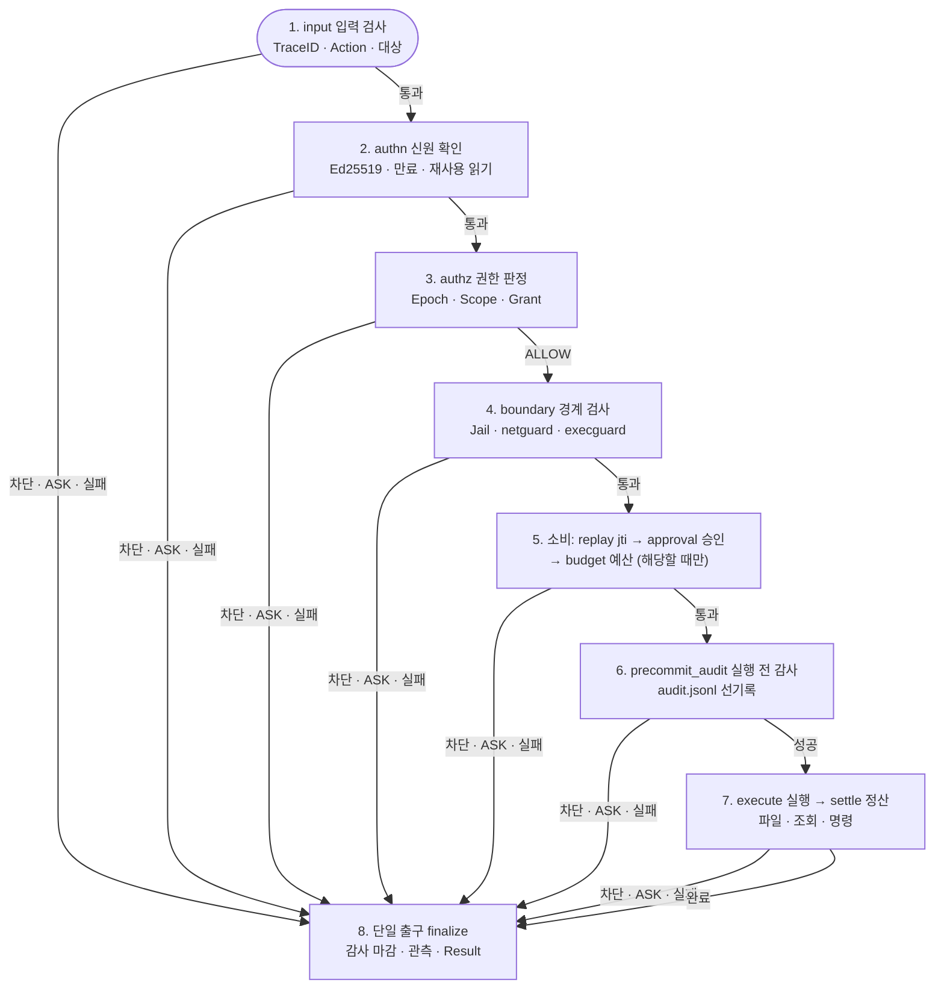

# 001. 전체 요청 여정과 관문 — 일 하나를 시킬 때 안에서 무슨 검사가 어떤 순서로 일어나는가

> **모드**: `[문서작업]` — 소스코드 수정 없이 현재 구현된 요청 집행 관문(`PEP`·`AuthN`·`PDP`·`Jail`·`Audit`)의 실제 동작과 이유(Why)를 해설합니다.  
> **기준일**: 2026-11-06 · **기준 커밋**: `bf00fca` (이 문서가 설명하는 `cmd/`와 `internal/`을 마지막으로 바꾼 커밋)  
> **검증 범위**: 동작·순서·소유자·시점을 코드와 대조한 결과와 「미확인」은 5부 ③에 있습니다.  
> **이 문서는 구현된 것만 적는다.** 계획·제안·미래형 약속은 적지 않으며, 현재 코드가 하지 않는 것은 「지금은 없다」고만 씁니다.  
> **이 문서의 규칙**: 본문(0~4부, Q&A, 그림, 5부 ①)은 쉬운 개념·설계·이유가 중심입니다. 파일·타입 이름 같은 고유 이름은 첫 등장에 한마디 설명과 함께 쓰고, 구현의 어디인지는 문단 끝 `(구현: 파일 · 함수, 5부 ② 번호)` 귀띔으로 보조합니다. 기준은 [프로그램 설명서 README의 「설명의 기준」과 「이름의 3층」](README.md)입니다.  
> **겹치는 주제**: 토큰을 처음 발급하고 권한을 줄여서 교환하는 과정은 [002편](002-토큰발급_축소위임과_서명키회전.md), 부모 프로세스가 자식 프로세스를 띄우는 과정과 감사 해시 사슬은 [003편](003-서브프로세스격리와_해시체인감사.md)이 자세히 다룹니다. 사람의 승인(`ask`)·예산·네트워크 조회와 명령 실행 도구의 세부는 [005편](005-승인_예산과_도구확장.md)이 다루고, 운영체제 격리와 관측 로그의 세부는 [006편](006-OS격리_관측성과_감사체크포인트.md)이 다루며, 이 문서에서는 요약만 합니다. 관문 코드가 판정·어댑터와 어떻게 나뉘어 있고 어디부터 읽으면 되는지는 [007편](007-코드읽는순서와_의존방향.md)이, 시나리오 하네스와 4중 판정은 [008편](008-시나리오하네스와_4중판정.md)이, 권한 회수·세대 번호(`Epoch`)·시간과 진행 중 호출의 경계는 [009편](009-권한회수_Epoch_시간과_TOCTOU창.md)이 다룹니다.
>
> **다시 확인하는 법**
> ```bash
> git rev-parse --short HEAD
> git log -1 --format=%h -- cmd internal
> # 1. 관문 통과 및 차단 시험 실행 (패키지 전체)
> go test -v ./internal/authz/pep/...
> # 2. 정책 결정(PDP) 순수성 규칙 시험 실행
> go test -v ./internal/harness -run "TestArchitectureGuardrails"
> # 3. 관문 단계 이름과 순서 확인
> grep -n "Stage = \"" internal/domain/stage.go
> grep -n "step(domain.Stage" internal/authz/pep/gateway.go
> # 4. 부록 A·B (상태 파일 기본 경로·종료 코드·사유 매핑) 확인
> grep -n "flag.StringVar" cmd/authz-harness/main.go
> grep -n "ExitCode = " internal/domain/constants.go
> grep -n "func ExitCodeForReason" -A 58 internal/domain/error.go
> ```

---

## 💡 사용자의 질문 (원문 보존)

> 1편을 써라.

---

## 0. 모든 설계 이전에 ‘사람’이 있다 — 파일 하나 읽는데 왜 이렇게 여러 번 멈춰 세우나

컴퓨터에서 하위 프로세스(일꾼)에게 일을 시키는 사람을 생각해 봅니다. 일꾼에게 `workspace/plan.txt` 파일 하나만 읽어 오라고 시켰습니다. 그런데 이 프로그램은 파일을 바로 열어 주지 않고, 입구에서부터 여러 번 멈춰 세워 검사를 합니다.

처음 보는 사람은 자연스럽게 이런 의문을 품습니다.
- *「내가 방금 만들어 준 열쇠(토큰)를 들고 왔는데, 그 열쇠만 맞으면 그냥 파일을 열어 주면 되지 않나?」*
- *「왜 열쇠를 확인하고 나서 허가 장부(`grants_state.json`)를 또 뒤져 보나?」*
- *「허가 장부까지 맞았는데 왜 파일 경로를 또 계산해 보고, 심지어 파일을 열기도 전에 감사 장부(`audit.jsonl`)에 글자부터 적나?」*

이 설명서는 그 의문에 답합니다. 일 하나(파일 읽기·쓰기, 그리고 같은 관문을 지나는 네트워크 조회·명령 실행)가 들어왔을 때 안에서 어떤 순서로 무슨 검사를 하는지, 왜 그 중 하나라도 빼먹으면 빈틈이 생기는지를 차례대로 펼쳐 보이고, 그 결과로 디스크 어디에 어떤 파일이 남는지 직접 열어볼 수 있는 방법을 알려 줍니다.

---

## 1부. 왜 여러 단계의 관문이 필요하고, 왜 이런 모양인가

### 가장 밑바닥의 이유부터

1. **왜 일 하나에 검사가 여러 단계로 나뉘어 있나?**  
   「누가 들고 왔나(신원)」, 「이번 심부름에서 어디까지 허락받았나(범위)」, 「그 사이에 허가가 취소되지는 않았나(현재 상태)」, 「손대려는 대상이 안전한 울타리 안쪽인가(물리 위치)」, 「일어난 일을 장부에 남길 수 있는가(증거 기록)」가 모두 서로 다른 질문이기 때문입니다. 앞 질문이 맞았다고 해서 뒷 질문까지 자동으로 맞아떨어지지 않습니다.
2. **그러면 열쇠(`TokenClaims` 토큰 내용물) 하나에 허용된 행동과 파일 이름을 다 적어 두고, 서명만 확인하면 되지 않나?**  
   열쇠는 한 번 만들어서 일꾼 손에 쥐여 주면, 거기에 적힌 만료 시간(`exp`)이 끝날 때까지는 일꾼이 계속 들고 다닙니다. 만약 열쇠를 건넨 지 1초 만에 일꾼이 이상한 행동을 해서 관리자가 허가를 취소(`revoke`)하더라도, 열쇠만 검사하는 문지기는 그 취소 사실을 알 길이 없습니다. 그래서 문지기는 열쇠가 진짜인지 확인한 뒤에도, 문고리를 돌리기 직전에 중앙 허가 장부(`.authz-state/public/grants_state.json`)를 다시 펼쳐 봅니다.
3. **그럴 거면 반대로 열쇠는 쓰지 말고 중앙 허가 장부만 보면 되지 않나?**  
   중앙 허가 장부에는 「일꾼(`worker-01`)에게 평소에 부여된 전체 권한」이 적혀 있습니다. 하지만 팀장이 일꾼에게 이번 심부름 하나만 시킬 때는, 일꾼이 평소 쓰기 권한을 가지고 있더라도 「이번 심부름에서는 읽기(`file:read`)만 해라」라고 범위를 줄여서 시키고 싶을 때가 있습니다. 그래서 열쇠에 적힌 이번 심부름의 범위(`Scope`)와 중앙 장부에 적힌 현재 활성 허가(`Grant`)를 둘 다 만족해야만 통과시킵니다.
4. **열쇠와 장부가 둘 다 맞으면 바로 파일을 열면 되지 않나? 왜 경로 검사를 따로 또 하나?**  
   허가 장부와 열쇠는 글자로 된 이름표를 비교할 뿐, 실제 하드디스크에 어떤 파일이 어떻게 연결되어 있는지는 모릅니다. 만약 요청한 파일 경로에 상위 폴더로 올라가는 `..` 기호가 섞여 있거나, 작업 폴더 안쪽에 있는 파일인 줄 알았는데 실제로는 바깥 폴더의 비밀 파일을 가리키는 바로가기(심볼릭 링크)라면, 글자 비교만으로는 작업 폴더 바깥의 파일이 열리는 것을 막을 수 없습니다. 그래서 실제 디스크 경로를 따라가 보는 격리 검사기(`workspaceJail`)가 따로 필요합니다. 네트워크 조회나 명령 실행처럼 파일이 아닌 일은 같은 자리에서 각자의 울타리 검사기가 같은 질문(「안전한 울타리 안쪽인가」)을 던집니다.
5. **왜 파일을 읽거나 고치기 전에 감사 장부(`audit.jsonl`)에 먼저 적나? 다 끝나고 한 번만 적으면 안 되나?**  
   파일을 먼저 고친 뒤에 디스크 용량이 가득 차거나 감사 파일이 잠겨서 기록에 실패했다고 해 봅시다. 그러면 파일 내용은 이미 바뀌었는데 감사 장부에는 아무 흔적도 남지 않아, 나중에 누가 언제 바꿨는지 추적할 수 없게 됩니다. 그래서 이 프로그램은 파일에 손대기 직전에 「이제 이 작업을 실행한다」는 사전 감사 기록을 먼저 남기고, 그 기록이 디스크에 무사히 저장되었을 때만 실제 파일을 건드립니다.
6. **열쇠를 한 번만 쓰게 하는 표시(일련번호 소비)는 왜 열쇠 검사 때가 아니라 모든 검사가 끝난 뒤에 하나?**  
   어떤 권한은 사람의 승인을 받아야 쓸 수 있고, 허가가 났어도 울타리 검사에서 막힐 수 있습니다. 열쇠 검사 때 바로 「사용함」 도장을 찍어 버리면, 이런 이유로 거절당한 뒤 사람이 승인을 해 주거나 경로를 고쳐도 같은 열쇠로 다시 시도할 수 없습니다. 그래서 열쇠 검사 때는 「이미 쓴 열쇠인가」만 확인하고, 실제 도장은 허가 판정과 울타리 검사까지 모두 통과한 뒤에 찍습니다. 이 순서는 사람의 주의에 맡기지 않고 단계의 성격 규칙(소비 단계는 모든 검사 단계 뒤, [ADR 0007](../adr/0007-파이프라인-단계-분류-기준.md))으로 파이프라인 엔진이 강제합니다.
   어떤 권한은 사람의 승인을 받아야 쓸 수 있습니다. 열쇠 검사 때 바로 「사용함」 도장을 찍어 버리면, 「승인이 필요하다」는 이유로 거절당한 뒤 사람이 승인을 해 줘도 같은 열쇠로 다시 시도할 수 없습니다. 그래서 열쇠 검사 때는 「이미 쓴 열쇠인가」만 확인하고, 실제 도장은 허가 판정이 난 직후에 찍습니다.

### 흔한 방식과 이 프로그램의 선택

| 구분 | 흔한 방식 (이 저장소에서 확인하지 않은 일반론) | 이 프로그램(`authz-harness`)의 선택 |
|---|---|---|
| **모양** | 로그인이나 토큰 서명만 한 번 확인하면 곧바로 파일 읽기·쓰기 함수를 호출하고, 끝난 뒤에 화면이나 일반 로그에 한 줄 남긴다. | 모든 요청을 중앙 집행 관문인 `pep.Gateway` 하나로 모으고, 입력 검사(`input`) → 신원 확인(`authn`) → 권한 판정(`authz`) → 경계 검사(`boundary`) → 재사용 방지(`replay`) → (해당할 때만) 승인 소비(`approval`)·예산 차감(`budget`) → 실행 전 감사 기록(`precommit_audit`) → 실행(`execute`) → (해당할 때만) 사후 정산(`settle`) → 단일 출구 마감의 순서를 거친다. |
| **얻는 것** | 코드가 짧고 디스크를 한 번만 읽으므로 속도가 빠르다. | 만료 전인 토큰이라도 장부에서 권한을 회수하면 다음 접근 때 즉시 막히고, 사전 감사 기록이 실패하면 파일이 바뀌지 않으며, 어느 단계에서 왜 막혔는지 정해진 종료 코드(`0`, `11`~`18`)와 감사 기록으로 남는다. |
| **포기하는 것** | 토큰 발급 뒤 만료 전까지 실시간 차단이 어렵고, 감사 로그가 누락되어도 파일이 바뀔 수 있다. | 요청 하나마다 공개키 장부(`jwks.pub.json`), 재사용 방지 장부(`replay_ledger.json`), 권한 장부(`grants_state.json`), 감사 장부(`audit.jsonl`)를 차례로 읽고 쓰므로 디스크 입출력이 여러 번 일어난다. |

---

## 2부. 질문과 답변으로 풀어보는 핵심 동작 (Q&A)

### Q1. 요청이 들어오면 제일 먼저 무엇을 하나?
- **무슨 일이 일어나는가**:
  1. 명령줄(`pep read`/`pep write`)이나 자식 프로세스 워커(`SubagentWorker`)가 작업 요청서인 `pep.Request` 구조체를 만들어 중앙 집행 관문인 `pep.Gateway`의 `Execute` 함수로 넘깁니다. 명령줄 `pep`은 파일 읽기·쓰기만 받고, 네트워크 조회(`net:fetch`)와 명령 실행(`exec:run`)은 자식 워커나 외부 도구 서버(`mcp serve`, [004편](004-다단계위임과_MCP도구게이트웨이.md))를 거쳐 같은 관문으로 들어옵니다. (구현: [`pep.go`](../../internal/cli/pep.go) · `PEPRunner.runRead`, 5부 ② 1번 / [`worker.go`](../../internal/subagent/worker.go) · `SubagentWorker.Execute`, 5부 ② 2번)
  2. `Execute`는 요청서에 추적 번호(`TraceID`)가 비어 있으면 현재 시각을 붙인 임시 번호(`pep-<나노초>`)를 만들고, 진행 상태를 담아 둘 내부 기록판(`pipelineState`)을 준비합니다. 이때 쓰기 내용 같은 요청 데이터는 원문 대신 지문(`domain.DataDigest`, SHA-256 값)만 기록판에 적어 둡니다. 그다음 파이프라인 엔진(`pipeline.Engine`)에 요청서와 기록판을 넘겨 열 개의 단계를 정해진 순서로 돌립니다(`engine.Run`). 엔진은 단계가 무엇을 하는지는 모르고, 순서대로 부르다 한 단계가 실패하면 멈추는 일만 합니다. (구현: [`gateway.go`](../../internal/authz/pep/gateway.go) · `gateway.Execute`, 5부 ② 3번 / [`pipeline.go`](../../internal/pipeline/pipeline.go) · `Engine.Run`, 5부 ② 5번)
  3. 각 단계에 들어가기 직전과 직후에는 엔진이 계측 훅인 `stageHook`을 불러, 관측 창구(`observe.Observer`)에 「어느 단계에 들어갔다」와 「몇 밀리초 만에 통과했거나 막혔다」를 알립니다. 기본 조립에서는 이 창구가 표준 에러 화면(`stderr`)에 운영 로그(`slog`)로 `pep stage entering` / `pep stage passed` / `pep stage blocked`를 남깁니다. 관측 창구에서 오류가 나도 판정에는 영향을 주지 않습니다. (구현: [`gateway.go`](../../internal/authz/pep/gateway.go) · `stageHook.OnStepStart`·`OnStepEnd`, 5부 ② 4번 / [`adapter.go`](../../internal/observe/slogadapter/adapter.go), 5부 ② 15번)
  4. 첫 번째 단계인 `input`(입력 검사)에서는 추적 번호가 필수인 모드(`RequireTraceID: true`)일 때 원래 요청서의 `TraceID`가 비어 있지는 않은지, 요청한 행동이 네 가지(`file:read`, `file:write`, `net:fetch`, `exec:run`, 그리고 별칭 `read`/`write`) 중 하나인지, 대상 이름이 비어 있지 않은지를 확인합니다. 네트워크 조회라면 여기서 주소를 미리 정규화하고, 형식이 틀린 주소는 원문 대신 지문만 남기고 막습니다. 행동이 정해지면 그 행동에 맞는 도구 전략(`pep.Tool`)을 고르고, 도구마다 다른 입력 정리(`Prepare`)를 시킵니다. 하나라도 어긋나면 뒤쪽 단계는 쳐다보지도 않고 즉시 멈춥니다. (구현: [`gateway.go`](../../internal/authz/pep/gateway.go) · `gateway.input`, [`tool.go`](../../internal/authz/pep/tool.go) · `Tool.Prepare`, 5부 ② 5번)
- **왜 그렇게 하나**: 무엇을 할지, 어느 대상을 건드릴지조차 적히지 않은 빈 요청을 들고 비싼 암호 서명 검사나 디스크 장부 조회를 할 이유가 없기 때문입니다. 데이터 원문 대신 지문만 남기는 이유는, 감사 장부에 비밀 내용이 그대로 남지 않으면서도 「무엇을 보냈는지」를 나중에 대조할 수 있게 하기 위해서입니다.
- **근거**: 5부 ② 항목 1, 2, 3, 4, 5, 15번

### Q2. 열쇠(토큰)가 위조되지 않았고 한 번만 쓰이는지는 어떻게 확인하나?
- **무슨 일이 일어나는가**:
  1. 입력 검사를 통과하면 두 번째 단계인 `authn`(신원 확인)이 토큰 검증기인 `token.Verifier`의 `VerifyToken`을 부릅니다. (구현: [`gateway.go`](../../internal/authz/pep/gateway.go) · `gateway.authn`, 5부 ② 5번)
  2. `VerifyToken`은 문자열이 마침표(`.`)로 나뉜 세 조각(머리말·내용물·서명)인지, 머리말(`JWTHeader`)의 종류가 `at+jwt`이고 서명 방식이 `EdDSA`인지 차례로 확인합니다. 서명 없음을 뜻하는 `none`이나 다른 방식이면 여기서 바로 거부합니다. (구현: [`verifier.go`](../../internal/authn/token/verifier.go) · `Verifier.VerifyToken`, 5부 ② 6번)
  3. 머리말에 적힌 열쇠 번호(`kid`)로 공개키 장부(`.authz-state/public/jwks.pub.json`)를 조회합니다. 없는 열쇠 번호이거나 이미 폐기(`retired`)된 열쇠면 거부하고, 살아 있는 열쇠(`active` 또는 `verify-only`)면 Ed25519 공개키로 디지털 서명이 내용물과 일치하는지 대조합니다. (구현: [`manager.go`](../../internal/authn/keys/manager.go) · `Manager.GetVerificationKey`, 5부 ② 7번)
  4. 서명이 맞으면 내용물(`domain.TokenClaims`)을 풀어 발급자(`iss`), 수신자(`aud`), 주체(`sub`), 유효 시작 시각(`nbf`), 만료 시각(`exp`)을 현재 시계(`domain.Clock`)와 비교합니다.
  5. 마지막으로 열쇠의 고유 일련번호(`jti`)가 재사용 방지 장부(`.authz-state/public/replay_ledger.json`)에 이미 있는지 **읽기만** 합니다. 이미 쓰인 번호면 재사용 공격(`TOKEN_REPLAY_DETECTED`)으로 막습니다. 여기서는 장부에 등록하지 않습니다(등록은 Q5의 `replay` 단계). 통과하면 검증된 신원(`Subject`), 일련번호(`TokenJTI`), 그리고 상위 위임자가 있다면 그 이름(`Actor.Subject` → `callerID`)을 기록판에 적어 둡니다. 예산이 붙은 토큰(`Budget`)은 여러 번 쓰도록 만든 토큰이라 재사용 검사와 소비를 하지 않고, 대신 예산 장부가 조립되어 있지 않으면 여기서 거부합니다. (구현: [`verifier.go`](../../internal/authn/token/verifier.go) · `Verifier.VerifyToken`, 5부 ② 6번)
- **왜 그렇게 하나**: 내용물이나 권한을 따지기 전에, 그 내용물을 적은 종이가 믿을 수 있는 발급자가 서명한 진짜 종이인지, 남이 가로채서 두 번째 쓰는 종이는 아닌지부터 확인해야 위조된 신원에 속지 않기 때문입니다. 도장(소비)을 미루는 이유는 1부 6번에 있습니다.
- **근거**: 5부 ② 항목 5, 6, 7번

### Q3. 열쇠가 진짜인데도 왜 허가 장부(`grants_state.json`)를 다시 펼쳐 보나?
- **무슨 일이 일어나는가**:
  1. 토큰 검증을 통과하면 세 번째 단계인 `authz`(권한 판정)가 정책 결정 서비스인 `pdpService.Decide`를 부릅니다. (구현: [`pdp/service.go`](../../internal/authz/pdp/service.go) · `pdpService.Decide`, 5부 ② 8번)
  2. `Decide`는 먼저 정책 정보 조회기인 `pipService.GetSubjectSnapshot`을 불러 `.authz-state/public/grants_state.json` 파일을 읽고, 그 주체(`Subject`)의 현재 세대 번호(`CurrentEpoch`), 위임 조상들의 세대 번호(`SubjectEpochs`), 살아 있는 허가 목록(`ActiveGrants`), 취소된 허가 목록(`RevokedGrants`), 사람이 내려 둔 승인 목록(`Approvals`)을 한 묶음(`domain.SubjectSnapshot`)으로 가져옵니다. (구현: [`pip/service.go`](../../internal/authz/pip/service.go) · `pipService.GetSubjectSnapshot`, 5부 ② 9번)
  3. 이어서 디스크나 운영체제를 전혀 건드리지 않는 순수 계산 함수인 `pdp.Evaluate`가 순서대로 따집니다. (구현: [`pdp/service.go`](../../internal/authz/pdp/service.go) · `Evaluate`, 5부 ② 8번)
     - 첫째, 토큰에 적힌 세대 번호(`Epoch`)가 장부의 현재 세대 번호와 같은가? 다르면 일괄 철회(`SUBJECT_EPOCH_REVOKED`)로 거부합니다.
     - 둘째, 이 토큰이 위임받은 토큰이라면, 위임 사슬(`act`)에 적힌 조상마다 그 조상의 세대 번호가 장부와 같은가? 하나라도 다르면 같은 이유로 거부합니다. 중간 관리자 한 명의 세대 번호만 올려도 그 아래로 발급된 열쇠가 모두 막히는 이유입니다([002편](002-토큰발급_축소위임과_서명키회전.md)).
     - 셋째, 토큰에 적힌 범위(`TokenScope`)가 지금 하려는 행동과 대상을 허용하는가(`domain.ScopeMatches`)? 읽기 전용 토큰으로 쓰기를 시도했다면 범위 부족(`TOKEN_INSUFFICIENT_SCOPE`)으로 거부합니다. (구현: [`scope.go`](../../internal/domain/scope.go) · `ScopeMatches`, 5부 ② 10번)
     - 넷째, 장부의 살아 있는 허가 목록에 이 주체·행동·대상이 모두 일치하는 항목이 있는가? 있고 그 허가가 사람 승인을 요구하지 않으면 승인(`ALLOW`)합니다. 사람 승인을 요구하는 허가라면 이 요청에 딱 맞는 승인이 장부에 있을 때만 승인하고, 없으면 세 번째 결론인 「사람에게 물어봐야 함」(`ASK`)을 냅니다. `ASK`는 승인이 오기 전까지는 거부와 똑같이 멈추며, 종료 코드는 `18`입니다.
     - 다섯째, 살아 있는 허가에는 없고 취소된 허가 목록에 있는가? 있으면 권한 회수(`GRANT_REVOKED`)로, 아예 한 번도 받은 적이 없으면 권한 없음(`NO_ACTIVE_GRANT`)으로 거부합니다.
  4. 판정이 끝나면 `Decide`는 감사 장부(`audit.jsonl`)에 `pdp.decide` 기록을 한 줄 남기고 결과를 돌려줍니다. 만약 이 감사 기록 저장 자체가 실패하면 승인 결과를 돌려주지 않고 에러를 반환합니다. (구현: [`pdp/service.go`](../../internal/authz/pdp/service.go) · `pdpService.Decide`, 5부 ② 8번)
  5. 판정이 `ALLOW`여도 이 단계에서는 일련번호에 도장을 찍지 않습니다. 울타리 검사(Q4)까지 통과한 뒤에야 `replay`가 도장을 찍습니다(Q5). 판정이 `DENY`나 `ASK`로 끝난 요청은 도장이 찍히지 않으므로, 사람이 승인한 뒤 같은 열쇠로 다시 시도할 수 있습니다. (구현: [`gateway.go`](../../internal/authz/pep/gateway.go) · `gateway.authz`, 5부 ② 5번)
- **왜 그렇게 하나**: 토큰(열쇠)은 「발급받을 당시의 약속」이고 장부(`grants_state.json`)는 「지금 이 순간의 허락 상태」입니다. 또한 판단 로직(`pdp.Evaluate`)을 파일 읽기와 분리해 두어야, 나중에 디스크 없이 메모리 값만 넣고도 정책 계산이 맞는지 시험할 수 있기 때문입니다. 사람 승인이 무엇에 묶이고 왜 한 번 쓰면 사라지는지는 [005편](005-승인_예산과_도구확장.md)이 다룹니다.
- **근거**: 5부 ② 항목 6, 8, 9, 10번

### Q4. 허가까지 났는데 왜 파일 경로를 또 검사하나?
- **무슨 일이 일어나는가**:
  1. 권한 판정이 `ALLOW`로 끝나면 `boundary`(경계 검사)가 도구 전략의 `CheckBoundary`를 통해 하려는 일의 종류에 따라 갈라집니다. 파일 읽기·쓰기는 격리 담당 객체인 `workspaceJail.ResolvePath`를 부릅니다. (구현: [`jail.go`](../../internal/jail/jail.go) · `workspaceJail.ResolvePath`, 5부 ② 11번)
  2. `ResolvePath`는 경로에 널 문자(`\x00`)가 들어 있으면 즉시 거부(`INVALID_PATH`)하고, 기준 작업 폴더(`workspaceRoot`)와 요청 경로를 합쳐 정리(`filepath.Clean`)한 뒤 기준 폴더 바깥(`..`)으로 나가는지 1차로 확인합니다. 나가면 경로 이탈(`PATH_TRAVERSAL`)로 막습니다.
  3. 그다음 심볼릭 링크(바로가기)를 실제로 따라가 봅니다(`filepath.EvalSymlinks`). 읽기 요청이거나 이미 있는 파일에 대한 쓰기 요청이면 그 파일의 실제 물리 경로를 확인하고, 아직 만들어지지 않은 새 파일에 대한 쓰기 요청이면 가장 가까운 존재하는 부모 폴더까지 거슬러 올라가 그 부모 폴더의 실제 물리 경로가 작업 폴더 안쪽인지 확인합니다. 바깥을 가리키고 있으면 심볼릭 링크 탈출(`SYMLINK_ESCAPE`)로 막습니다. (구현: [`jail.go`](../../internal/jail/jail.go) · `workspaceJail.ResolvePath`, 5부 ② 11번)
  4. 네트워크 조회는 허용 목록(자기 컴퓨터 안 주소만)에 있는 주소인지를 네트워크 가드(`netguard.Guard`)가, 명령 실행은 미리 등록된 실행 번호와 인자 형식인지를 실행 가드(`execguard.Validate`)가 같은 자리에서 확인합니다. 가드가 조립되어 있지 않으면 해당 일은 무조건 막습니다(`16`). 이 단계에서 막힌 요청은 일련번호를 소비하지 않습니다. (구현: [`gateway.go`](../../internal/authz/pep/gateway.go) · `gateway.boundary`, `Tool.CheckBoundary`, 5부 ② 5번)
- **왜 그렇게 하나**: 겉보기 이름이 `workspace/link.txt`처럼 작업 폴더 안쪽인 것처럼 보여도, 그 파일이나 상위 폴더가 작업 폴더 바깥을 가리키는 바로가기일 수 있기 때문입니다. 허가 장부는 「이 일을 해도 된다」만 말하고 「그 대상이 실제로 어디 있는가」는 모릅니다.
- **근거**: 5부 ② 항목 5, 11번

### Q5. 일련번호·승인·예산은 언제 쓰이나?
- **무슨 일이 일어나는가**:
  1. 경계 검사까지 모두 통과하면 `replay`(재사용 방지) 단계가 Q2에서 미뤄 둔 도장을 찍습니다. 재사용 방지 장부를 잠그고 한 번에 「확인 후 등록」(`CheckAndConsume`)하므로, 같은 열쇠를 든 두 요청이 동시에 와도 하나만 통과하고 진 쪽은 `TOKEN_REPLAY_DETECTED`(`11`)로 막힙니다. 예산이 붙은 토큰은 여러 번 쓰도록 만든 토큰이라 이 도장을 찍지 않습니다. (구현: [`verifier.go`](../../internal/authn/token/verifier.go) · `Verifier.ConsumeReplay`, 5부 ② 6번 / [`gateway.go`](../../internal/authz/pep/gateway.go) · `gateway.replay`, 5부 ② 5번)
  2. 정책 결정이 「사람 승인 덕분에 허가」였다면, 다음 단계인 `approval`(승인 소비)이 그 승인을 장부에서 지웁니다. 승인은 한 번 쓰면 사라지고, 뒤 단계가 실패해도 되살리지 않습니다. 지운 사실은 감사 장부에 `approval.consumed`로 남습니다. (구현: [`gateway.go`](../../internal/authz/pep/gateway.go) · `gateway.approval`, 5부 ② 5번)
  3. 예산이 붙은 토큰이면 `budget`(예산 차감) 단계가 호출 1회를 예산 장부(`budget_ledger.json`)에서 미리 깎고, 쓰기와 명령 실행이면 보낸 데이터 바이트도 함께 깎습니다. 깎은 사실은 감사에 `budget.consumed`로 남기며(표지만, 차감량은 없음), 이 기록이 실패하면 바로 되돌리고 감사 실패(`15`)로 멈춥니다. 이 뒤 어느 단계에서든 실패하면 파이프라인 엔진이 깎은 만큼 되돌립니다(`exec:run`은 시작한 뒤 실패하면 되돌리지 않습니다). 읽기·조회·명령의 출력 크기는 실행해 봐야 알 수 있어 실행 뒤의 `settle`(사후 정산)이 깎습니다(Q6). (구현: [`gateway.go`](../../internal/authz/pep/gateway.go) · `gateway.budget`, `gateway.logBudgetConsumed`, `gateway.refund`, [`tool.go`](../../internal/authz/pep/tool.go) · `BudgetPlan`, 5부 ② 5번)
  4. 승인이 필요 없는 허가이고 예산 토큰도 아니면 `approval`·`budget` 단계는 아예 실행되지 않습니다.
- **왜 그렇게 하나**: 일련번호·승인·예산은 모두 한 번 쓰면 되돌리기 어렵거나 보상이 필요한 「장부 상태를 바꾸는」 일이라서, 울타리 검사처럼 상태를 바꾸지 않는 검사가 모두 끝난 뒤에 해야 헛되이 소모되지 않기 때문입니다. 승인이 무엇에 묶이는지, 예산을 왜 부모보다 크게 줄 수 없는지는 [005편](005-승인_예산과_도구확장.md)이 다룹니다.
- **근거**: 5부 ② 항목 5, 6번

### Q6. 왜 실행 전에 감사 장부에 먼저 적고, 마지막 출구는 왜 한 곳뿐인가?
- **무슨 일이 일어나는가**:
  1. 앞 단계를 모두 통과하면 `precommit_audit`(실행 전 감사 기록 단계)에서 `gateway.logEvent`를 불러 감사 장부(`audit.jsonl`)에 `pep.allow`(`pre-commit audit check passed`)를 먼저 기록합니다. 결함 주입 스위치(`InjectAuditFailure: true`)가 켜져 있거나 디스크 쓰기가 실패하면, 여기서 즉시 멈추고 다음 단계로 넘어가지 않습니다. (구현: [`gateway.go`](../../internal/authz/pep/gateway.go) · `gateway.precommitAudit`, 5부 ② 5번)
  2. 사전 감사가 성공했을 때만 `execute`(실행 단계)로 들어갑니다. 파일이면 `workspaceJail.ReadFile` 또는 `WriteFile`로 실제 파일을 읽거나 씁니다. 쓰기를 할 때는 임시 파일(`.tmp-jail-*`)에 먼저 적고 디스크에 동기화(`Sync`)한 뒤 이름을 바꾸는(`os.Rename`) 방식을 쓰고, 임시 파일 생성에 실패하면 일반 파일 쓰기(`os.WriteFile`)로 대체합니다. 네트워크 조회와 명령 실행은 각 가드가 실행합니다. 예산 토큰으로 읽기·조회·명령을 한 요청은 실행이 끝난 뒤 `settle`(사후 정산)이 출력 바이트를 예산에서 깎고, 이 정산이 실패하면 결과를 돌려주지 않고 막습니다. (구현: [`jail.go`](../../internal/jail/jail.go) · `workspaceJail.WriteFile`, [`gateway.go`](../../internal/authz/pep/gateway.go) · `gateway.execute`, `gateway.settle`, 5부 ② 5·11번)
  3. 앞선 단계 어디서 막혔든 끝까지 성공했든, 모든 흐름은 마지막에 단일 출구 함수인 `gateway.finalize` 한 곳으로 모입니다. (구현: [`gateway.go`](../../internal/authz/pep/gateway.go) · `gateway.finalize`, 5부 ② 12번)
  4. `finalize`는 중간에 에러가 났다면 그 에러 안에 담긴 표준 사유(`domain.Reason`)와 종료 코드(`domain.ExitCode`, `11`~`18`)를 꺼내어 `pep.deny` 차단 감사 기록을 남깁니다. 이 차단 감사 기록마저 실패하면 거부 결론은 그대로 두되 사유를 감사 실패(`AUDIT_LOG_FAILED`, 종료 코드 `15`)로 바꿔 돌려줍니다. 감사 장부의 `decision` 칸에는 `allow`/`deny`, 그리고 승인 대기로 막힌 경우 `ask`가 적힙니다. 성공했다면 `pep.allow` 완료 감사 기록을 남긴 뒤 최종 결과(`pep.Result`)를 돌려줍니다. 감사 기록에는 원시 토큰 문자열을 빼고 일련번호(`TokenJTI`), 실행 주체(`AgentID`), 상위 위임자(`Metadata["caller_id"]`), 요청 데이터 지문(`arg_hash`), 완료 시 결과 지문(`result_hash`), 그리고 이전 줄과 이어지는 SHA-256 해시(`prev_hash`, `curr_hash`)가 적힙니다. (구현: [`gateway.go`](../../internal/authz/pep/gateway.go) · `gateway.logEvent`, 5부 ② 12번 / [`audit.go`](../../internal/audit/audit.go) · `JSONLWriter.Log`, 5부 ② 13번)
- **왜 그렇게 하나**: 출구가 여러 곳으로 흩어져 있으면 어떤 실패에서는 감사 기록이나 운영 로그가 빠지기 쉽고, 사전 감사 없이 파일을 먼저 고치면 기록 없는 파일 변경이 생길 수 있기 때문입니다. 차단 기록이 실패했을 때 종료 코드를 `15`로 바꾸는 이유는, 「막았지만 막은 기록은 없다」는 상태를 겉으로 드러내기 위해서입니다.
- **예외 없음**: 관문에 들어온 요청의 결과는 모두 `finalize` 한 곳을 지나 나갑니다. 관문을 바깥에서 감싸 따로 결과를 만들어 내보내는 장치는 없습니다. 다만 자식 워커는 요청 프레임이 깨졌거나 모르는 필드가 있으면 관문을 부르기 전에 `ExitBadInput`(`14`)으로 거부합니다. 이 거부는 관문에 들어가기 전이라 관문의 감사 기록은 없고, 부모 쪽 사후 감사에 자식의 종료 코드로 남습니다([003편](003-서브프로세스격리와_해시체인감사.md) Q1, [006편](006-OS격리_관측성과_감사체크포인트.md) Q12).
- **근거**: 5부 ② 항목 5, 11, 12, 13, 16번

---

## 3부. 내부 지도 — 한 번의 여정과 직접 확인하는 법



(구현: [`gateway.go`](../../internal/authz/pep/gateway.go) — `gateway.Execute`가 `engine.Run`으로 단계를 돌린 뒤 모든 성공·차단 경로를 `gateway.finalize` 단일 출구로 모아 마감합니다, 5부 ② 3·5·12번)

### 어디에 무엇이 남나

| 무엇 | 어디에 | 언제 | 사람이 직접 여는 법 |
|---|---|---|---|
| **관문 통과 표와 파일 내용** | 표준 출력 (`stdout`) | `pep read` 또는 `pep write` 실행이 끝난 직후 | 터미널 화면에서 바로 읽거나 `--output-format json` 옵션을 붙여 JSON으로 확인한다 |
| **단계별 진입·차단·소요시간 로그** | 표준 에러 (`stderr`) | 각 단계에 들어가고 나올 때마다(`stageHook`) 및 `finalize` 마감 시점 | 명령 실행 시 터미널 `stderr` 출력을 보거나 전역 `--verbose` 플래그를 붙여 `DEBUG` 진입 로그까지 확인한다 |
| **토큰 재사용 방지 기록** | `.authz-state/public/replay_ledger.json` | 경계 검사까지 통과한 뒤 `replay` 단계(`CheckAndConsume`) 시점 | `cat .authz-state/public/replay_ledger.json`으로 소비된 토큰 `jti`와 만료 시각을 열어 본다 |
| **예산 사용량** | `.authz-state/public/budget_ledger.json` (재사용 방지 장부와 같은 폴더) | 예산 토큰일 때 `budget` 사전 차감 또는 `settle` 사후 정산 시점 | `cat`으로 열어 토큰별 남은 횟수·바이트를 본다 |
| **승인 소비** | `grants_state.json`의 승인 목록에서 해당 항목이 사라짐 + `audit.jsonl`의 `approval.consumed` | 승인으로 허가된 요청의 `approval` 시점 | `grep approval.consumed audit.jsonl` |
| **보안 감사 기록과 해시 체인** | `audit.jsonl` | `authn`(`authn.verify`), `authz`(`pdp.decide`), `precommit_audit`(사전 감사), `finalize`(차단 또는 완료 감사) 시점 | `cat audit.jsonl`로 한 줄씩 확인한다 (`prev_hash`와 `curr_hash`, `agent_id`, `caller_id`, `arg_hash`, `result_hash` 포함) |
| **실제 읽거나 쓴 대상 파일** | `workspace/` 하위 경로 | `precommit_audit` 사전 감사가 성공한 뒤 `execute` 파일 쓰기 시점 | `ls -la workspace/` 및 `cat workspace/<파일명>`으로 확인한다 |

### 이상이 생기면

| 상황 | 일어나는 일 |
|---|---|
| **추적 번호(`TraceID`)가 필수인데 비어 있거나, 행동·대상 인자가 잘못됨** | `input`에서 멈추고, `finalize`가 `audit.jsonl`에 `pep.deny`(`MISSING_TRACE_CONTEXT` 또는 `INVALID_ARGUMENTS`)를 기록한 뒤 종료 코드 `14`(`ExitBadInput`)를 돌려준다. 네트워크 조회 주소 형식이 틀리면 `EGRESS_DENIED`(`12`)이며 감사에는 주소 대신 지문만 남는다. |
| **토큰 형식이 깨졌거나, 서명 불일치·폐기된 키·만료·재사용(`jti` 중복)이 발견됨** | `authn`(재사용은 `authn`의 확인 또는 `replay`의 소비 경합)에서 멈추고, `Verifier`가 `authn.verify`(`deny`)를 기록한 뒤 `finalize`가 `pep.deny`와 종료 코드 `11`(`ExitTokenInvalid`)을 돌려준다. |
| **토큰은 유효하나 세대 번호(`Epoch`)가 올랐거나, 조상의 세대 번호가 올랐거나, `Scope`가 부족하거나, 활성 `Grant`가 없음** | `authz`에서 멈추고, `pdpService`가 `pdp.decide`(`deny`)를 기록한 뒤 `finalize`가 `pep.deny`와 종료 코드 `12`(`ExitAuthzDenied`)를 돌려준다. `jti`는 소비되지 않는다. |
| **허가는 사람 승인을 요구하는데 맞는 승인이 없음** | `authz`에서 `ASK`로 멈추고, 감사 `decision`은 `ask`, 종료 코드는 `18`(`ExitApprovalRequired`)이다. `jti`는 소비되지 않으므로 승인 뒤 같은 토큰으로 다시 시도할 수 있다. |
| **요청 경로에 `..` 탈출이나 작업 폴더 밖을 가리키는 심볼릭 링크가 있음** | `boundary`에서 멈추고, 파일을 열지 않은 채 `finalize`가 `pep.deny`(`PATH_TRAVERSAL` 또는 `SYMLINK_ESCAPE`)와 종료 코드 `13`(`ExitPathViolation`)을 돌려준다. `jti`는 소비되지 않는다. |
| **허용 목록 밖 주소 조회, 등록되지 않은 명령 실행, 예산 부족** | 각각 `boundary` 또는 `budget`에서 멈추고 종료 코드 `12`(`EGRESS_DENIED`, `EXEC_NOT_ALLOWED`·`EXEC_ARG_REJECTED`, `BUDGET_EXHAUSTED`)를 돌려준다. 예산을 미리 깎은 뒤 뒤 단계가 실패하면 깎은 만큼 되돌린다. |
| **파일을 고치기 전 사전 감사(`precommit_audit`) 기록이 실패함** | `precommit_audit`에서 즉시 멈추고 `execute` 실행을 건너뛰며, 종료 코드 `15`(`ExitAuditFailure`)를 돌려준다. 작업 폴더의 파일은 바뀌지 않는다. 단, 이미 소비한 `jti`와 승인은 되살아나지 않는다. |
| **사전 감사는 성공했으나 `execute` 실행이 실패함** | `finalize`가 실패 사유(대개 `INTERNAL_ERROR`, 종료 코드 `16`)와 차단 감사를 남긴다. 이 차단 감사 기록마저 실패하면 종료 코드 `15`로 바꿔 돌려준다. |
| **`execute`가 성공한 직후 완료 감사 기록이 실패함** | 결과는 성공으로 돌려주고 `stderr`에 에러 로그(`failed to record completion audit event`)만 남긴다. 이미 쓰인 파일을 되돌리지는(롤백하지는) 못한다. |
| **예산 토큰의 사후 정산(`settle`)이 실패함 (예산 부족)** | 실행은 끝났지만 읽은 내용을 돌려주지 않고 `finalize`가 차단 감사를 남긴다. 읽기·조회는 미리 깎은 호출 1회분을 환급하고, 이미 시작한 `exec:run`은 환급하지 않는다. |

---

## 4부. 배척한 방식과 그 이유

1. **관문마다 실패 즉시 `return`으로 함수를 빠져나가는 방식 (다중 조기 반환)**:
   - **택했다면 무슨 일이 생기는가**: 관문이 열 개 가까이 되면 출구도 그만큼 생겨, 어느 관문에서는 감사 기록을 남기고 어느 관문(예: 파일 입출력 에러)에서는 감사 기록과 운영 로그를 빠뜨린 채 함수를 나가 버리는 누락이 생깁니다.
   - **그 대신 포기한 것**: 실패한 자리에서 바로 결과를 만들어 돌려주는 단순함을 포기하고, 각 단계가 `*domain.Error`만 돌려주면 `finalize` 한 곳에서 종료 코드 변환·감사 마감·관측 로그 출력을 일괄 처리하는 구조를 택했습니다. 그래서 관문 바깥에서 따로 결과를 만들어 내보내는 출구는 두지 않습니다.
2. **파일 읽기·쓰기를 먼저 하고 끝난 뒤에 감사 로그를 한 번만 적는 방식 (Post-Commit Audit)**:
   - **택했다면 무슨 일이 생기는가**: 감사 로그를 한 번만 쓰므로 디스크 쓰기 횟수는 줄어들지만, 파일 쓰기가 끝난 직후 감사 파일 기록이 실패하면 디스크 파일은 이미 바뀌었는데 감사 장부에는 흔적이 남지 않습니다.
   - **그 대신 포기한 것**: 성공한 요청 하나당 감사 장부에 사전 감사(`precommit_audit`)와 완료 감사(`finalize`의 `pep.allow`)가 연달아 기록되는 디스크 쓰기 비용을 감수하고, 사전 감사가 성공해야만 실행하는 순서를 택했습니다.
3. **토큰 검사(`authn`)에서 바로, 또는 권한 판정 직후에 `jti`를 소비하는 방식**:
   - **택했다면 무슨 일이 생기는가**: 정책 결정에서 `ASK`나 `DENY`로 막힌 요청, 또는 판정 뒤의 경계 검사에서 막힌 요청도 열쇠를 써 버리게 됩니다. 사람이 승인을 내려 줘도 같은 열쇠로 재시도할 수 없어 새 열쇠를 다시 발급받아야 합니다.
   - **그 대신 포기한 것**: 검사와 소비를 한 번에 끝내는 단순함을 포기하고, `authn`에서는 읽기만 하고 모든 검사를 통과한 뒤 `replay` 단계에서 잠금과 함께 소비하는 두 단계를 택했습니다. 그 사이에 같은 열쇠를 든 다른 요청이 끼어들면 소비 경합에서 진 쪽이 `11`로 막힙니다.
4. **정책 결정기(`pdp`) 안에서 직접 실제 파일이나 폴더 경로를 열어 확인하는 방식**:
   - **택했다면 무슨 일이 생기는가**: 정책 결정 함수(`pdp.Evaluate`)가 하드디스크 상태와 얽혀 버려, 임시 폴더와 실제 파일을 매번 만들지 않고는 권한 계산 규칙을 시험할 수 없게 됩니다.
   - **그 대신 포기한 것**: 한 함수 안에서 권한과 물리 경로를 한꺼번에 처리하는 편의를 포기하고, `pdp` 패키지는 `os`나 `path/filepath`, `jail` 패키지를 아예 가져다 쓰지 못하게 분리했습니다(시험 함수 `TestArchitectureGuardrails`의 `TC-060-01`, 그리고 간접 의존까지 보는 `TC-170-01`이 이를 검사합니다).
5. **경로 문자열의 앞부분(`strings.HasPrefix`)만 보고 작업 폴더 안쪽인지 판단하는 방식**:
   - **택했다면 무슨 일이 생기는가**: 기준 폴더가 `/workspace`일 때 `/workspace-evil/secret.txt`처럼 앞글자만 같은 바깥 폴더가 통과되거나, `/workspace/link`라는 심볼릭 링크가 바깥 `/etc/passwd`를 가리키는 경우를 막지 못합니다.
   - **그 대신 포기한 것**: 문자열 비교 한 줄로 끝내는 간편함을 포기하고, `filepath.Rel` 상대 경로 검사와 조상 폴더를 거슬러 올라가는 `filepath.EvalSymlinks` 실제 경로 추적을 택했습니다.

---

## 5부. 한눈에 보는 대조표와 코드 정본

### ① 행동별 안에서 일어나는 일과 지금은 없는 것

| 행동 | 안에서 일어나는 일 | 지금은 없는 것 | 근거 |
|---|---|---|---|
| **스택 조립 및 요청 진입** (`pep read` / `pep write` / `subagent worker`) | `app.BuildStack`이 검증 전용(`VerifyOnly: true`)으로 장부·검증기·`PDP`·`Jail`·가드·`PEP`를 조립하고 `gateway.Execute`를 호출한다. | 네트워크 소켓(HTTP/gRPC)으로 원격 요청을 받는 입구는 지금은 없다. 명령줄 `pep`으로 `net:fetch`·`exec:run`을 직접 보내는 하위 명령은 지금은 없다. | 5부 ② 1, 2, 3, 14번 |
| **`input`: 기본 입력 검사** | `RequireTraceID`일 때 `TraceID` 존재 여부, `Action` 4종 유효성, `Resource` 공백 여부를 검사하고, 도구 전략의 `Prepare`로 `net:fetch`면 주소를 정규화한다. | 파일 크기 상한이나 확장자 종류를 `input`에서 미리 제한하는 규칙은 지금은 없다. | 5부 ② 4, 5번 |
| **`authn`: 신원 확인** | `Verifier.VerifyToken`이 3단 구조, `typ: at+jwt`, `alg: EdDSA`, `jwks.pub.json` 공개키 상태, Ed25519 서명, 만료(`exp`), `replay_ledger.json` 재사용 여부(읽기만)를 검사한다. | 원격 인증 서버(HTTPS JWKS URL)에 네트워크로 키를 물어보는 동작은 지금은 없다. | 5부 ② 5, 6, 7번 |
| **`authz`: 권한 판정** | `pipService.GetSubjectSnapshot`이 `grants_state.json`을 읽고, `pdp.Evaluate`가 `Epoch` → 조상 `Epoch` → `ScopeMatches` → `ActiveGrants`(승인 필요 시 `Approvals`) → `RevokedGrants` 순으로 `ALLOW`/`ASK`/`DENY`를 판정해 `pdp.decide` 감사를 남긴다. | 와일드카드(`*`)나 정규식으로 여러 폴더 경로를 한꺼번에 묶어 비교하는 스코프 규칙은 지금은 없다. | 5부 ② 6, 8, 9, 10번 |
| **`boundary`: 경계 검사** | 파일은 `workspaceJail.ResolvePath`가 널 바이트, `filepath.Rel` 상대 경로 이탈, 파일 및 조상 디렉터리의 실제 경로를 검사한다. 조회·실행은 `netguard`·`execguard`가 검사한다. | 이 단계 자체는 운영체제 기능을 쓰지 않는 프로그램 안의 검사다. 운영체제 수준 격리(`internal/confinement`)는 부모가 자식 프로세스를 띄울 때 적용되며, 지금은 시나리오 하네스(G10·G15)에서만 배선되어 있다([003편](003-서브프로세스격리와_해시체인감사.md)). | 5부 ② 5, 11번 |
| **`replay`: 재사용 방지 (`jti` 소비)** | 모든 검사를 통과한 요청에 한해 `ConsumeReplay`가 재사용 방지 장부를 잠그고 `jti`를 소비한다. 예산 토큰은 소비하지 않는다. | 소비한 `jti`를 뒤 단계 실패 시 되살리는 동작은 지금은 없다(의도한 동작). | 5부 ② 5, 6번 |
| **`approval`·`budget`: 승인 소비와 예산 차감** | 승인으로 허가된 요청이면 승인을 장부에서 지우고 `approval.consumed`를 남긴다. 예산 토큰이면 호출 1회(쓰기·명령은 데이터 바이트도)를 미리 깎고, 이후 실패 시 되돌린다. | 소비한 승인을 실패 시 되살리는 동작은 지금은 없다(의도한 동작). | 5부 ② 5번 |
| **`precommit_audit`·`execute`·`settle`: 사전 감사, 실행, 정산, `finalize` 마감** | `precommit_audit`에서 `audit.jsonl`에 사전 감사를 먼저 기록하고 성공 시에만 실행한다. 읽기·조회·명령의 출력 바이트는 `settle`이 예산에서 정산한다. 마지막으로 `finalize`에서 단일 출구 감사(`AgentID`, `caller_id`, `arg_hash`, `result_hash`, 해시 체인)와 관측 로그를 남긴다. | `execute` 파일 쓰기 도중이나 직후에 장애가 났을 때 이미 쓰인 파일을 이전 내용으로 되돌리는 롤백(Undo) 기능은 지금은 없다. | 5부 ② 5, 11, 12, 13, 16번 |

### ② 어디서 하나 (코드 정본 색인)

1. **명령줄 PEP 러너**: [`internal/cli/pep.go`](../../internal/cli/pep.go) (`NewPEPRunner`, `PEPRunner.Run`, `PEPRunner.runRead`, `PEPRunner.runWrite`) — 구현: Step 3 (`b5049c5`)
2. **서브에이전트 워커 입구 위임**: [`internal/subagent/worker.go`](../../internal/subagent/worker.go) (`SubagentWorker.Execute`) — 구현: 계획002-S2 (`43d15ab`)
3. **PEP 중앙 관문 진입점**: [`internal/authz/pep/gateway.go`](../../internal/authz/pep/gateway.go) (`NewGateway`, `gateway.Execute`, `pipelineState`) — 구현: 계획002-S1 (`519005c`)
4. **단계별 전/후 관측 계측 훅**: [`internal/pipeline/pipeline.go`](../../internal/pipeline/pipeline.go) (`Hook`, `Engine.Run`), [`internal/authz/pep/gateway.go`](../../internal/authz/pep/gateway.go) (`stageHook`) — 구현: 계획002-S1 (`519005c`), P14-010, 로드맵 19 지시서 020·040
5. **관문 순차 파이프라인과 단계 이름**: [`internal/domain/stage.go`](../../internal/domain/stage.go) (`Stage`, `PEPStages`, `StageInput`~`StageSettle`), [`internal/pipeline/pipeline.go`](../../internal/pipeline/pipeline.go) (`Engine`, `New`, `Run`), [`internal/authz/pep/gateway.go`](../../internal/authz/pep/gateway.go) (`gateway.assemble`, `NormalizeAction`, 단계 메서드 `input`~`settle`, `gateway.refund`), [`internal/authz/pep/tool.go`](../../internal/authz/pep/tool.go) (`Tool`, `BudgetPlan`) — 구현: 계획002-S1 (`519005c`), P12·P15·P16, 로드맵 19 지시서 010~040
6. **`authn` 토큰 검증기와 `replay`의 `jti` 소비**: [`internal/authn/token/verifier.go`](../../internal/authn/token/verifier.go) (`Verifier.VerifyToken`, `Verifier.ConsumeReplay`) — 구현: P07-030 (`50e98aa` 이전), P15
7. **공개키 조회 및 폐기(`retired`) 키 거부**: [`internal/authn/keys/manager.go`](../../internal/authn/keys/manager.go) (`Manager.GetVerificationKey`) — 구현: P02 (`50e98aa` 이전)
8. **`authz` 정책 결정 서비스 및 순수 평가 함수**: [`internal/authz/pdp/service.go`](../../internal/authz/pdp/service.go) (`pdpService.Decide`, `Evaluate`, `DecisionAllow`/`DecisionAsk`/`DecisionDeny`) — 구현: 계획002-S1 (`519005c`), P13·P15
9. **실시간 권한·세대 번호 스냅샷 조회(PIP)**: [`internal/authz/pip/service.go`](../../internal/authz/pip/service.go) (`pipService.GetSubjectSnapshot`), 스냅샷 타입 [`internal/domain/snapshot.go`](../../internal/domain/snapshot.go) (`SubjectSnapshot`, `SnapshotProvider`) — 구현: P01 (`50e98aa` 이전), P17-010
10. **토큰 범위(`Scope`) 매칭 순수 함수**: [`internal/domain/scope.go`](../../internal/domain/scope.go) (`ScopeMatches`) — 구현: P07-020 (`50e98aa` 이전)
11. **`boundary` 작업 폴더 경로 격리 및 파일 읽기·쓰기**: [`internal/jail/jail.go`](../../internal/jail/jail.go) (`workspaceJail.ResolvePath`, `workspaceJail.ReadFile`, `workspaceJail.WriteFile`) — 구현: P03 (`50e98aa` 이전)
12. **PEP 단일 출구 마감 및 감사 이벤트 조립**: [`internal/authz/pep/gateway.go`](../../internal/authz/pep/gateway.go) (`gateway.finalize`, `gateway.logEvent`, `decisionLabel`, `gateway.logApprovalConsumed`) — 구현: 계획002-S1 (`519005c`), P14·P15
13. **파일 잠금(`flock`) 및 SHA-256 해시 체인 감사 기록기**: [`internal/audit/audit.go`](../../internal/audit/audit.go) (`JSONLWriter.Log`, `NormalizeEvent`, `ComputeEventHash`) — 구현: P07-030 (`50e98aa` 이전)
14. **단일 합성 루트 스택 빌더**: [`internal/app/builder.go`](../../internal/app/builder.go) (`BuildStack`, `AppStack`, `AppConfig.VerifyOnly`) — 구현: 08-010 (`98aafbc`), Step 3 (`b5049c5`), P17-030
15. **관측 창구와 기본 `slog` 어댑터**: [`internal/observe/port.go`](../../internal/observe/port.go) (`Observer`, `WrapSafe`), [`internal/observe/slogadapter/adapter.go`](../../internal/observe/slogadapter/adapter.go) — 구현: P14-010
16. **자식 워커 요청 프레임 엄격 해석**: [`internal/subagent/worker.go`](../../internal/subagent/worker.go) (`SubagentWorker.ExecuteStream`의 `DisallowUnknownFields`), 단계 사이 경합 시험은 시험 전용 `pep.Config.StageObserver` ([`toctou_window_test.go`](../../internal/authz/pep/toctou_window_test.go)) — 구현: 계획 005 S2 (`33f0adf`)
17. **시험**: [`internal/authz/pep/gateway_test.go`](../../internal/authz/pep/gateway_test.go) (`Test10AcceptanceScenarios`, `TestInputStageValidation` 등), 같은 폴더의 `approval_test.go`·`budget_test.go`·`tool_dispatch_test.go`, [`internal/harness/architecture_test.go`](../../internal/harness/architecture_test.go)의 `TestArchitectureGuardrails` (개수는 `go test ./...`로 확인)
18. **부록 A·B (상태 파일 경로·저장소 및 종료 코드·사유 매핑)**: [`cmd/authz-harness/main.go`](../../cmd/authz-harness/main.go) (`main`), [`internal/domain/constants.go`](../../internal/domain/constants.go) (`ExitCode`, `ExitSuccess`, `ExitTokenInvalid`, `ExitAuthzDenied`, `ExitPathViolation`, `ExitBadInput`, `ExitAuditFailure`, `ExitInternalError`, `ExitResourceLimit`, `ExitApprovalRequired`, `Reason`), [`internal/domain/error.go`](../../internal/domain/error.go) (`Error`, `NewError`, `ReasonFromError`, `ExitCodeFromError`, `ExitCodeForReason`), [`internal/authn/keys/store.go`](../../internal/authn/keys/store.go) (`ZoneAPrivateState`, `FileStore`, `NewFileStore`, `FileStore.LoadPrivate`, `FileStore.LoadPublic`, `FileStore.Save`), [`internal/authn/token/replay.go`](../../internal/authn/token/replay.go) (`ReplayData`, `FileReplayLedger`, `NewFileReplayLedger`, `FileReplayLedger.CheckAndConsume`, `FileReplayLedger.IsConsumed`), [`internal/authn/budget/ledger.go`](../../internal/authn/budget/ledger.go) (`LedgerState`, `FileLedger`, `NewFileLedger`, `FileLedger.Init`, `FileLedger.Reserve`, `FileLedger.Consume`, `FileLedger.Refund`, `FileLedger.Get`), [`internal/authz/state/store.go`](../../internal/authz/state/store.go) (`GrantsState`, `FileStore`, `NewFileStore`, `FileStore.Load`, `FileStore.Save`, `FileStore.Update`), [`internal/authz/state/approval.go`](../../internal/authz/state/approval.go) (`ApprovalConsumer`, `NewApprovalConsumer`), [`internal/audit/checkpoint/checkpoint.go`](../../internal/audit/checkpoint/checkpoint.go) (`Checkpoint`, `EnsureKeyPair`, `Create`, `Verify`), [`internal/cli/audit.go`](../../internal/cli/audit.go) (`NewAuditRunner`), [`internal/orchestrator/termination.go`](../../internal/orchestrator/termination.go) (`Termination`, `classifyExit`), [`internal/storage/atomic.go`](../../internal/storage/atomic.go) (`AtomicFileStore`), [`internal/storage/file.go`](../../internal/storage/file.go) (`WithFileLock`, `AtomicWriteFile`)

### ③ 검증 범위와 「미확인」

검증 방법: 위 5부 ②의 1~18번 소스 파일을 직접 열어 코드를 대조했습니다. 2026-11-06 개정(로드맵 19, 지시서 100-2)에서는 PEP 단계 서술(Q1~Q6, 그림, 5부 ①·②, 부록의 단계 이름)을 `bf00fca`의 `gateway.go`·`pipeline.go`·`domain/stage.go`·`tool*.go`와 다시 대조했고, 그 밖의 서술은 기준 커밋 `5f0ab2a`의 대조 그대로입니다. 본문과 부록 A·B에 인용한 단계 이름·함수·기본 경로·사유 코드·종료 코드는 `grep -rn`으로 실재를 확인했습니다. macOS(darwin) 환경에서 `go test ./internal/authz/pep/...`가 통과함을 확인했습니다. 2026-11-06 재대조(PEP와 무관한 서술): 본문·부록의 식별자·사유 코드·종료 코드 이름이 현재 코드에 있는지 일괄 대조해 `ORCHESTRATE_COLLECT`→`orchestrator.collect`(감사 어휘 정규화), `WorkspaceJail`→`Jail`을 고쳤습니다. 부록 A·B의 파일 경로와 내용은 이 대조에서 의미까지 다시 읽지는 않았습니다. 2026-11-06 재검증([계획 016](../계획/016-설명서_본편_재대조_및_DEMO_GUIDE_재검증.md), 기준 코드 커밋 `64ae8db`): 본문의 식별자·링크, 부록 B의 종료 코드 9개와 이름, 사유 코드 8종, 도구 행동 4종, 상태 파일 기본 경로(`main.go`·`app/builder.go`·`cli/audit.go`)를 코드와 대조했고, `settle`·`BudgetPlan`·`pep` 하위 명령·완료 감사 실패 로그 문구를 코드에서 읽어 확인했습니다. `go test -race ./internal/authz/pep/ -run "TestTOCTOUWindow|TestLineageRevocation"` 포함 관련 시험이 통과했습니다. 위 확인으로 본문에서 고친 곳은 없습니다. 확인하지 못한 범위: 「왜」 서술과 일반론 비교표는 코드로 증명할 수 없어 대조하지 않았습니다. 3부 표의 모든 행(필드 기록 시점 등)은 식별자 실재까지만 확인했습니다.

| 항목 | 동작 | 순서 | 소유자 | 시점 | 미확인 사항 |
|---|---|---|---|---|---|
| **Q1 (입구 진입, 계측 훅, `input`, ② 1~5, 15번)** | 확인 | 확인 | 확인 (`PEPRunner` / `SubagentWorker` → `gateway.Execute`, `stageHook` → `Observer`) | 확인 (엔진의 첫 단계) | 없음 |
| **Q2 (`authn` 서명·만료·재사용 확인, ② 5~7번)** | 확인 | 확인 | 확인 (`Verifier.VerifyToken`, `Manager.GetVerificationKey`) | 확인 (`input` 통과 직후, `CheckReplay`만 수행) | 없음 |
| **Q3 (`authz` PIP 조회·PDP 3값 결정, ② 8~10번)** | 확인 | 확인 | 확인 (`pipService.GetSubjectSnapshot`, `pdp.Evaluate`, `pdpService.Decide`) | 확인 (`authn` 통과 직후) | 없음 |
| **Q4 (`boundary` 경계 검사, ② 5, 11번)** | 확인 | 확인 | 확인 (`workspaceJail.ResolvePath`, `netguard.Guard.Check`, `execguard.Validate`) | 확인 (`authz` 직후, 소비 단계 앞) | Linux·Windows 파일시스템에서의 심볼릭 링크 및 파일 잠금(`syscall.Flock`) 동작은 macOS 환경이라 직접 실행해 확인하지 못함 (**미확인**) |
| **Q5 (`replay` 일련번호 소비·`approval` 승인 소비·`budget` 예산 차감, ② 5, 6번)** | 확인 | 확인 | 확인 (`Verifier.ConsumeReplay`, `ApprovalConsumer.ConsumeApproval`, `budget.Ledger.Consume`/`Refund`) | 확인 (`boundary` 뒤, `precommit_audit` 앞) | 없음 |
| **Q6 (`precommit_audit` 사전 감사, `execute` 실행, `settle` 정산, `finalize` 단일 출구, ② 5, 11~13번)** | 확인 | 확인 | 확인 (`gateway.assemble`, `workspaceJail`, `gateway.finalize`, `JSONLWriter.Log`) | 확인 (사전 감사 성공 후 실행, 종료 전 `finalize` 마감) | 없음 |
| **부록 A·B (상태 파일 지도·종료 코드 사전, ② 13, 14, 18번)** | 확인 (`main.go`·`builder.go`·`constants.go`·`error.go` 대조) | 확인 | 확인 (각 저장소·러너·`ExitCodeForReason`·`classifyExit`) | 확인 | 없음 |

---

## 부록 A. 상태 파일 지도

이 프로그램이 디스크에 만들고 읽는 모든 파일과 폴더를 구역(Zone)별로 모은 찾아보기 표입니다. 자식 프로세스(`subagent worker`)가 Zone A 비밀키에 접근하지 않는 이유와 검증 방식은 [003편](003-서브프로세스격리와_해시체인감사.md) Q2 및 [006편](006-OS격리_관측성과_감사체크포인트.md) Q3·Q10에서, 원자적 파일 저장소(`AtomicFileStore`)의 구조 패턴은 [007편](007-코드읽는순서와_의존방향.md) Q6 3번에서, 다중 프로세스 파일 잠금(`flock`)·원자 교체·디렉터리 `fsync`와 도중 종료 시 감사 잘린 꼬리 복구(`audit recover`)는 [010편](010-파일잠금_원자교체와_도중종료.md)에서 자세히 다룹니다.

| 파일 | Zone | 무엇이 들어 있나 | 쓰는 쪽 (프로세스·패키지) | 읽는 쪽 | 자식(`subagent worker`) 접근 여부 | 기본 경로 (`main.go`·`builder.go` 기준) | 원자 저장·잠금 방식 |
|---|:---:|---|---|---|---|---|---|
| **토큰 서명 비밀키** (`signing_keys.priv.json`) | **Zone A** | Ed25519 비밀 시드(`priv`), 공개키(`pub`), 키 상태(`active`·`verify-only`·`retired`), `active_kid` (`keys.ZoneAPrivateState`) | 부모·관리 명령(`keys`, `token`): `keys.FileStore.Save` (`NewManager` 초기 생성, `RotateKey`, `RevokeKey`) | 부모·관리 명령(`keys`, `token`): `keys.FileStore.LoadPrivate` (`GetActiveSigningKey`, `RotateKey`, `RevokeKey`) | **미접근** (`VerifyOnly: true`로 `privPath = ""` 전달, `-priv-key-file` 미전달 — [003편](003-서브프로세스격리와_해시체인감사.md) Q2) | `.authz-state/private/signing_keys.priv.json` (`-priv-key-file`) | `storage.AtomicFileStore[ZoneAPrivateState]` (권한 `0600`, `<privPath>.lock` 배타 잠금 `LOCK_EX` + 임시 파일 `Sync` 후 `os.Rename`, 이어서 부모 디렉터리 `fsync`) |
| **감사 체크포인트 서명 비밀키** (`audit_signing_key.priv.json`) | **Zone A** | 감사 체크포인트 서명용 Ed25519 비밀키와 `kid` | 관리 명령(`audit checkpoint`): `checkpoint.EnsureKeyPair` (최초 1회 생성) | 관리 명령(`audit checkpoint`): `checkpoint.Create` (`EnsureKeyPair`, `loadPriv`) | **미접근** (`subagent`는 `audit/checkpoint` 미임포트, `TC-060-02` — [006편](006-OS격리_관측성과_감사체크포인트.md) Q10) | `.authz-state/private/audit_signing_key.priv.json` (`cli.NewAuditRunner`: `filepath.Dir(privKeyPath)` 하위) | `storage.AtomicWriteFile` (권한 `0600`, 임시 파일 `Sync` 후 `os.Rename`, 이어서 부모 디렉터리 `fsync`) |
| **토큰 검증 공개키(JWKS)** (`jwks.pub.json`, 하네스 샌드박스는 `jwks.json`) | **Zone B** | 비밀 시드를 뺀 Ed25519 공개키 목록 (`domain.JWKS`: `kid`, `status`, `x`) | 부모·관리 명령(`keys`, `token`): `keys.FileStore.Save` (`ZoneAPrivateState.ToJWKS` 투영) | 부모·관리·자식(`keys`, `token`, `pep`, `subagent worker`): `keys.FileStore.LoadPublic` (`GetVerificationKey`, `ListKeys`) | **읽기 전용** (`-pub-jwks-file` 전달, `authn` 서명·폐기 키 검증) | `.authz-state/public/jwks.pub.json` (`-pub-jwks-file`) | `storage.AtomicFileStore[domain.JWKS]` (권한 `0644`, `privPath` 유무에 따라 `<privPath>.lock` 또는 `<pubPath>.lock` 배타 잠금 + 원자 교체) |
| **감사 체크포인트 검증 공개키** (`audit_verification_key.pub.json`) | **Zone B** | 감사 체크포인트 검증용 Ed25519 공개키와 `kid` | 관리 명령(`audit checkpoint`): `checkpoint.EnsureKeyPair` (최초 1회 생성) | 관리 명령(`audit checkpoint`, `audit verify --checkpoint`): `checkpoint.EnsureKeyPair`, `checkpoint.Verify` (`loadPub`) | **미접근** (체크포인트 검증은 운영자 `audit verify` 명령이 수행) | `.authz-state/public/audit_verification_key.pub.json` (`cli.NewAuditRunner`: `filepath.Dir(pubJWKSPath)` 하위) | `storage.AtomicWriteFile` (권한 `0644`, 임시 파일 `Sync` 후 `os.Rename`, 이어서 부모 디렉터리 `fsync`) |
| **서명된 감사 체크포인트** (`audit_checkpoint.json`) | **Zone B** | 서명 시점의 감사 줄 수(`line_count`), 마지막 해시(`head_hash`), 시각, `key_id`, Ed25519 서명 (`checkpoint.Checkpoint`) | 관리 명령(`audit checkpoint`): `checkpoint.Create` | 관리 명령(`audit verify --checkpoint`): `checkpoint.Verify` | **미접근** (체크포인트 생성·검증 전용) | `.authz-state/public/audit_checkpoint.json` (`cli.NewAuditRunner` 기본값, `--out`·`--checkpoint`로 변경 가능) | 감사 파일 읽기는 `<auditPath>.lock` 공유 잠금(`LOCK_SH`), 체크포인트 저장은 `storage.AtomicWriteFile` (권한 `0644`) |
| **허가·세대 번호·승인 장부** (`grants_state.json`) | **Zone B** | 활성·회수 권한(`grants`), 주체별 세대 번호(`epochs`), 1회용 승인(`approvals`), `version`, `updated_at` (`state.GrantsState`) | 관리 명령(`grant`, `approval`): `papService`(`CreateGrant`, `RevokeGrant`, `BumpEpoch`, `CreateApproval`) / 관문·자식(`pep`, `subagent worker`): `state.ApprovalConsumer.ConsumeApproval` (`approval` 승인 소비) | 관리·관문·자식(`grant`, `approval`, `pdp`, `pep`, `subagent worker`): `pipService.GetSubjectSnapshot` (`authz` 조회), `papService.ListGrants`·`ListApprovals` | **읽기 + 조건부 쓰기** (`authz`에서 공유 잠금으로 읽고, `ask` 승인이 붙은 요청이 `approval`을 지날 때만 배타 잠금으로 해당 승인을 소비·삭제) | `.authz-state/public/grants_state.json` (`-state-file`) | `storage.AtomicFileStore[GrantsState]` (권한 `0644`, 읽기 `LOCK_SH`·쓰기 `LOCK_EX` `<statePath>.lock` + 원자 교체) |
| **1회성 토큰 재사용 방지 원장** (`replay_ledger.json`) | **Zone B** | 소비된 1회성 토큰의 `jti`, 소비 시각(`consumed_at`), 만료 시각(`expires_at`) 목록 (`token.ReplayData`) | 관문·자식(`pep`, `subagent worker`): `token.FileReplayLedger.CheckAndConsume` (`replay` 소비 및 만료 항목 정리), 초기 생성 시 `NewFileReplayLedger` | 관문·자식·교환(`pep`, `subagent worker`, `token exchange`): `FileReplayLedger.IsConsumed` (`authn`의 9b단계 읽기 확인) | **읽기 + 쓰기** (`authn`에서 공유 잠금으로 읽고, 예산 없는 토큰이 `boundary`까지 통과한 뒤 `replay`에서 배타 잠금으로 `jti` 등록) | `.authz-state/public/replay_ledger.json` (`-replay-file`) | `storage.AtomicFileStore[ReplayData]` (권한 `0644`, 읽기 `LOCK_SH`·쓰기 `LOCK_EX` `<replayPath>.lock` + 원자 교체) |
| **예산 원장** (`budget_ledger.json`) | **Zone B** | 예산 토큰(`jti`)별 초기 상한(`initial`), 잔여량(`remaining`), 부모 `parent_jti`, 만료 시각, 회수 여부 (`budget.LedgerState`) | 토큰 발급·교환(`token`): `budget.FileLedger.Init`·`Reserve` / 관문·자식(`pep`, `subagent worker`): `FileLedger.Consume`·`Refund` (및 만료 자식 미사용분 환수) | 토큰 발급·교환·관문·자식: `FileLedger.Get` 및 `Update` 내부 조회 | **읽기 + 쓰기** (예산 토큰일 때 `budget` 사전 차감·실패 시 환급, `settle` 읽기·조회 사후 정산) | `.authz-state/public/budget_ledger.json` (`app.BuildStack`: `BudgetPath`가 비면 `filepath.Dir(ReplayPath)/budget_ledger.json`) | `storage.AtomicFileStore[LedgerState]` (권한 `0644`, 읽기 `LOCK_SH`·쓰기 `LOCK_EX` `<budgetPath>.lock` + 원자 교체) |
| **잘린 꼬리 보존 파일** (`audit.jsonl.partial-<시각>`) | **공통 감사** | `audit recover`가 떼어 낸, 기록 도중 잘린 마지막 줄의 바이트 | 운영 명령(`audit recover`): `audit.RecoverIncompleteTail` (깨진 꼬리 T1을 복구한 때만 생성. 줄바꿈만 빠진 T2는 `\n`만 덧붙이고 만들지 않음) | 사람(증거 보존용), 사슬의 `audit.recover` 이벤트가 파일 이름과 SHA-256을 가리킴 | 접근하지 않음 | `audit.jsonl` 옆 (`<auditPath>.partial-<UTC 시각>`) | `storage.AtomicWriteFile` (권한 `0600`, 임시 파일 `Sync` → `os.Rename` → 부모 디렉터리 `fsync`) |
| **보안 감사 장부** (`audit.jsonl`) | **공통 감사** | 전 계층 감사 이벤트 JSON Lines (`domain.AuditEvent`, `prev_hash`·`curr_hash` SHA-256 해시 사슬, 스키마 버전 `4`) | 모든 명령과 부모·자식 프로세스: `audit.JSONLWriter.Log` (Append-only) | `JSONLWriter.Log` (직전 해시 조회), `audit.VerifyHashChain`, `cli.AuditRunner`(`timeline`, `verify`, `tree`, `checkpoint`), `SandboxEnvironment.ReadAuditEvents` | **읽기(끝 줄 해시) + 덧붙이기 쓰기** (`-audit-file` 전달, `authn`·`authz`·`precommit_audit`·`finalize` 감사 기록) | `audit.jsonl` (`-audit-file`) | `sync.Mutex` + `syscall.Flock` 배타 잠금(`<auditPath>.lock`, 권한 `0600`) 아래 끝 줄 해시 읽기 → 한 줄 추가(`O_APPEND`, 권한 `0600`) → `file.Sync()` |
| **격리 작업 폴더** (`workspace/`) | **Zone C** | 일꾼이 실제로 읽고 쓰는 대상 작업 파일들 | 관문·자식(`pep write`, `subagent worker`의 `file:write`): `jail.workspaceJail.WriteFile` | 관문·자식(`pep read`, `subagent worker`의 `file:read`, `exec:run` 작업 폴더): `workspaceJail.ReadFile`, `execguard.Runner` | **읽기 + 쓰기** (`precommit_audit` 사전 감사 성공 후 `execute`에서만 `workspaceJail`을 통해 접근, 커널 격리 시에도 쓰기 허용) | `workspace` (`-workspace`) | `workspaceJail.ResolvePath` 경로·심볼릭 링크 검증 후, 쓰기는 임시 파일(`.tmp-jail-*`) 작성·`Sync`·`os.Rename` 원자 교체(실패 시 `os.WriteFile` 폴백) |

(구현: `main.go` · `main`, `builder.go` · `BuildStack`, `keys/store.go` · `NewFileStore`, `FileStore.Save`, `replay.go` · `NewFileReplayLedger`, `FileReplayLedger.CheckAndConsume`, `ledger.go` · `NewFileLedger`, `state/store.go` · `NewFileStore`, `FileStore.Update`, `checkpoint.go` · `EnsureKeyPair`, `Create`, `Verify`, `audit.go` · `JSONLWriter.Log`, `jail.go` · `workspaceJail.WriteFile`, 5부 ② 11·13·14·18번)

---

## 부록 B. 종료 코드 사전

[`internal/domain/constants.go`](../../internal/domain/constants.go)에 정의된 아홉 가지 표준 프로세스 종료 코드(`0`, `11`~`18`)와 [`internal/domain/error.go`](../../internal/domain/error.go)의 `ExitCodeForReason` 매핑, 그리고 다른 코드와 헷갈리기 쉬운 경계를 모은 사전입니다.

| 코드 | 상수 이름 | 뜻 | 주로 나오는 단계·상황 | 대표 사유 (`domain.Reason`) | 다른 코드와 헷갈리기 쉬운 점 |
|:---:|---|---|---|---|---|
| **`0`** | `ExitSuccess` | 요청이 정상 인가되어 끝까지 수행됨 (또는 관리·감사·하네스 명령 정상 완료) | 관문 `execute` 실행 및 `finalize` 완료, `grant`·`keys`·`token`·`approval`·`audit`·`run` 성공 | `AUTHORIZED` | ① `execute` 실행이 성공한 직후 `finalize`의 완료 감사 기록이 실패해도 이미 바뀐 파일은 되돌리지 못하므로 종료 코드는 `0`으로 나가고 `stderr`에만 에러가 찍힌다(실행 전 사전 감사 `precommit_audit` 실패가 `15`로 막히는 것과 다름). ② `run` 명령에서는 개별 공격 시나리오가 기대한 거부 코드(`11`~`18`)로 막혔을 때 하네스 전체 종료 코드가 `0`이 된다([008편](008-시나리오하네스와_4중판정.md) Q1). |
| **`11`** | `ExitTokenInvalid` | 클라이언트 신원 인증 실패, 또는 출입증(토큰) 누락·파손·서명 불일치·폐기 키·만료·수신자 불일치·1회성 재사용(`Replay`) | 토큰 발급·교환 시 클라이언트 인증, 관문 `authn`(`Verifier.VerifyToken`) 및 `replay`(`ConsumeReplay`) | `AUTHN_UNKNOWN_CLIENT`, `AUTHN_INVALID_SECRET`, `AUTHN_CLIENT_SUSPENDED`, `INVALID_TOKEN`, `TOKEN_MALFORMED`, `TOKEN_INVALID_TYPE`, `TOKEN_ALG_NOT_ALLOWED`, `TOKEN_KEY_NOT_FOUND`, `TOKEN_KEY_RETIRED`, `TOKEN_INVALID_SIGNATURE`, `TOKEN_INVALID_ISS_AUD`, `TOKEN_SUBJECT_MISMATCH`, `TOKEN_NOT_YET_VALID`, `TOKEN_EXPIRED`, `TOKEN_REPLAY_DETECTED` | 토큰 자체의 결함·만료·키 폐기·1회성 `jti` 재사용은 모두 `11`이지만, **토큰 서명과 수명은 유효한데 그 안에 적힌 권한 범위(`Scope`)가 부족하거나 세대 번호(`Epoch`)·예산이 안 맞는 경우**는 인증(`11`)이 아니라 인가 거부(`12`)다. |
| **`12`** | `ExitAuthzDenied` | 토큰은 유효하나 권한 범위·세대 번호·활성 권한·위임 규칙·예산·네트워크 및 명령 허용 목록에서 거부됨 (또는 `run`에서 시나리오 판정 실패) | 관문 `authz`(`pdp.Evaluate`), `boundary`(`netguard`·`execguard`), `budget`(`budget.FileLedger`), 토큰 축소 교환(`ExchangeService.Exchange`) | `NO_ACTIVE_GRANT`, `GRANT_REVOKED`, `SUBJECT_EPOCH_REVOKED`, `TOKEN_INSUFFICIENT_SCOPE`, `DELEGATION_SCOPE_EXCEEDED`, `DELEGATION_TTL_EXCEEDED`, `DELEGATION_DEPTH_EXCEEDED`, `DELEGATION_SELF_LOOP`, `DELEGATION_SCOPE_EMPTY`, `DELEGATION_BUDGET_EXCEEDED`, `BUDGET_EXHAUSTED`, `EGRESS_DENIED`, `EXEC_NOT_ALLOWED`, `EXEC_ARG_REJECTED`, `TOOL_LIMIT_EXCEEDED` | ① 파일 경로 탈출은 `13`이지만, 같은 `boundary`에서 검사하는 네트워크 조회(`net:fetch`) 허용 목록 위반(`EGRESS_DENIED`)과 명령 실행(`exec:run`) 위반(`EXEC_NOT_ALLOWED`·`EXEC_ARG_REJECTED`)은 `12`다. ② 가드 내부의 응답·출력 상한 초과(`TOOL_LIMIT_EXCEEDED`)는 `12`이고, 부모 스포너가 워커 프로세스 전체를 시간·출력 한계로 끊는 것은 `17`이다. ③ 사람 승인이 필요한 권한(`RequiresApproval: true`)이라도 권한 자체가 회수(`GRANT_REVOKED`)되었으면 `18`이 아니라 `12`가 나온다. |
| **`13`** | `ExitPathViolation` | 작업 폴더 울타리(`Jail`) 경계 침범(상대 경로 `..`, 접두사 착시, 심볼릭 링크 외부 탈출, 널 바이트) 또는 OS 커널 격리 차단 시나리오 판정 | 관문 `boundary`(`workspaceJail.ResolvePath`), 시나리오 하네스 `G10`·`G15` 커널 격리 실험군 | `PATH_VIOLATION`, `PATH_TRAVERSAL`, `SYMLINK_ESCAPE`, `INVALID_PATH` | 관문은 `authz`(권한 판정)를 `boundary`(울타리 검사)보다 먼저 실행한다. 따라서 토큰 범위(`Scope`)나 활성 `Grant`조차 없는 외부 경로를 요청하면 `13`까지 가지 않고 `authz`에서 `12`(`TOKEN_INSUFFICIENT_SCOPE` 또는 `NO_ACTIVE_GRANT`)로 먼저 막힌다. `13`은 `authz`를 통과한 뒤 물리 경로·심볼릭 링크 추적에서 탈출이 적발되었을 때 나온다. |
| **`14`** | `ExitBadInput` | 명령줄 플래그 오류, 필수 인자(`trace_id`, `action`, `resource`) 누락·형식 위반, 자식 요청 프레임의 모르는 필드 또는 음수 시계 오프셋 | CLI 플래그 파싱, 자식 워커 입구(`SubagentWorker.ExecuteStream`·`Execute`), 관문 `input`, `PAP` 입력 검증 | `INVALID_ARGUMENTS`, `MISSING_TRACE_CONTEXT` | ① `net:fetch`에서 URL 형식이 깨졌을 때는 `input`에서 막히지만 사유가 `EGRESS_DENIED`라 `14`가 아니라 `12`가 나온다. ② 자식 워커가 모르는 JSON 필드나 음수 `clock_offset_sec`을 받아 `14`로 끝날 때는 관문 진입 전이라 관문 감사(`pep.deny`)는 남지 않고 부모의 `orchestrator.collect` 감사에만 남는다. |
| **`15`** | `ExitAuditFailure` | 사전 감사·차단 감사·관리 감사 기록 실패(`Fail-Closed`), 또는 감사 해시 사슬·서명 체크포인트 검증 실패 | 관문 `precommit_audit`, `authn`·`authz`·`finalize`·`PAP`·`orchestrator` 감사 기록 실패, `audit verify` / `audit checkpoint` / `audit recover` | `AUDIT_LOG_FAILED`, `AUDIT_INTEGRITY_BROKEN`, `AUDIT_TAIL_INCOMPLETE`(기록 도중 충돌로 잘린 꼬리: 깨진 조각, 또는 JSON은 온전하나 줄바꿈만 빠진 기록. `audit recover`로 복구), `AUDIT_TRUNCATION_DETECTED`, `AUDIT_CHECKPOINT_MISMATCH` | 원래 요청이 토큰 만료(`11`)나 권한 없음(`12`)으로 막혔더라도, `authn`·`authz`나 마지막 단일 출구(`finalize`)에서 **그 차단 사실을 `audit.jsonl`에 적는 데 실패하면** 원래 종료 코드 대신 `15`(`ExitAuditFailure`)로 바꿔 돌려준다(Q6, 「막았지만 막은 기록은 남지 않았음」을 드러내기 위함). |
| **`16`** | `ExitInternalError` | 복구할 수 없는 내부 오류, 필수 부품·격리 미비(`CONFINEMENT_UNAVAILABLE`), 또는 자식의 비정상 종료(`SUBPROCESS_ABNORMAL_EXIT`) | `app.BuildStack` 초기화 실패, 필수 가드·승인 소비기 미배선, 커널 격리 불가 환경의 격리 필수 스폰, 부모 스포너 `classifyExit` | `INTERNAL_ERROR`, `CONFINEMENT_UNAVAILABLE`, `SUBPROCESS_ABNORMAL_EXIT` | 자식 프로세스가 표준 종료 코드(`0`, `11`~`16`, `18`) 밖의 숫자로 끝나거나 외부 신호·취소로 죽으면, 부모(`orchestrator.classifyExit`)는 자식이 낸 숫자를 그대로 쓰지 않고 모두 `16`(`SUBPROCESS_ABNORMAL_EXIT`)으로 바꾼다([003편](003-서브프로세스격리와_해시체인감사.md) Q1). |
| **`17`** | `ExitResourceLimit` | 부모 스포너가 자식 워커의 실행 시간 상한(`Timeout`) 또는 출력 바이트 상한(`MaxOutputBytes`) 초과를 감지해 프로세스 그룹 전체를 강제 종료함 | 부모 스포너(`SubprocessSpawner.Spawn` → `classifyExit`) 및 `MCP` 어댑터 감독 계층 | `RESOURCE_TIMEOUT`, `RESOURCE_OUTPUT_LIMIT` | 자식 워커 스스로 `17`을 내고 끝나는 것이 아니라, **부모가 시간·출력 상한으로 자식을 강제 종료했을 때만** 부모의 `classifyExit`가 부여한다(자식이 스스로 `17`을 내고 끝나면 `classifyExit`의 `TermExited` 허용 목록 `0`, `11`~`16`, `18`에 없어 비정상 종료인 `16`으로 바뀐다). 관문 안의 가드가 자체 상한을 넘기는 것(`TOOL_LIMIT_EXCEEDED`, `12`)과도 구분된다. |
| **`18`** | `ExitApprovalRequired` | 권한(`Grant`)은 살아 있으나 사람 승인(`RequiresApproval: true`)이 필요한데 유효한 승인이 없거나 만료·불일치함(`ask` 결정) | 관문 `authz`(`pdp.Evaluate` → `DecisionAsk`, `domain.SelectApproval`) | `APPROVAL_REQUIRED`, `APPROVAL_EXPIRED`, `APPROVAL_MISMATCH` | `12`(`DENY`)와 똑같이 파일은 한 바이트도 바뀌지 않고 멈추지만, **1회성 토큰의 `jti`가 소비되지 않는다**(`replay`가 `authz`와 `boundary`를 통과한 뒤에 있기 때문). 따라서 사람이 해당 `jti`와 인자 지문(`arg_hash`)에 승인을 내주면 같은 토큰으로 다시 시도해 통과할 수 있다([005편](005-승인_예산과_도구확장.md) Q1·Q2). |

(구현: `constants.go` · `ExitCode`, `Reason`, `error.go` · `ExitCodeForReason`, `ExitCodeFromError`, `gateway.go` · `gateway.finalize`, `termination.go` · `classifyExit`, 5부 ② 12·18번)

