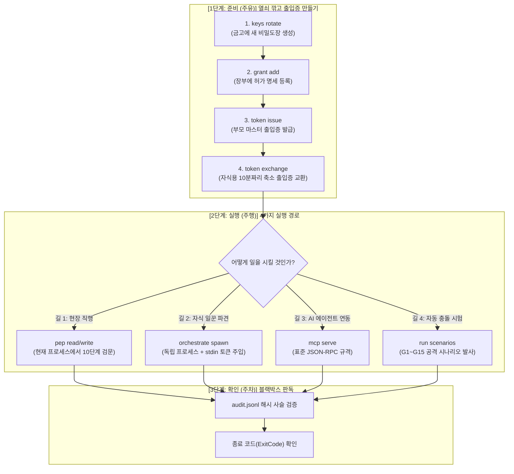

# 001. 프로그램 정체성과 전체 생애주기 — 이 프로그램은 무엇이고, 내 컴퓨터에서 무엇을 하나?

> **모드**: `[문서작업]` — 소스코드 수정 없이 `authz-harness`의 존재 이유, 내 컴퓨터 안의 4대 공간, 그리고 준비(주유) → 주행(4가지 길) → 확인(주차)의 전체 생애주기를 친절한 일상의 비유와 문답으로 해설합니다.  
> **기준일**: 2026-11-07 · **기준 커밋**: `f2d93ac`  
> **다시 확인하는 법**:  
> ```bash
> # 1. 프로그램 기본 시동 및 3중 분리 배선 확인
> go run ./cmd/authz-harness
> # 2. 관리 명령 정상 동작 확인 (도장 회전 및 권한 부여)
> go run ./cmd/authz-harness keys rotate
> go run ./cmd/authz-harness grant list
> # 3. 아키텍처 정합성 시험 실행
> go test -v ./internal/harness -run "TestArchitectureGuardrails"
> ```

---

## 1. 프로그램의 본질과 존재 이유

### Q. 이 프로그램이 대체 뭐하는 프로그램이야? 복잡한 부품 말고 일상적인 비유로 쉽게 설명해줘.

#### 1) 일상의 비유: "내 집에 들어온 외주 청소부와 스마트 홈캠"
집주인(사용자)이 집을 비우며 외주 청소부(자식 에이전트/워커)에게 청소를 맡긴다고 상상해 보세요.
* **집주인의 걱정**:
  "안방 옷장에는 패물과 집문서(`~/.ssh`, API 키)가 있는데, 청소부가 거실만 닦지 않고 옷장을 뒤지면 어쩌지?"
* **위험한 방식 (기존의 흔한 방식)**:
  집주인의 마스터 열쇠를 통째로 쥐여주거나, "옷장은 열지 마세요"라고 말(프롬프트)로만 부탁하는 것. 청소부가 호기심을 갖거나 악당에게 속으면 집 전체가 털립니다.
* **이 프로그램(`authz-harness`)이 하는 일**:
  1. **임시 카드키 발급**: 마스터 열쇠 대신, **"오늘 오후 2시부터 3시까지, 오직 거실 바닥만 닦을 수 있는 1회용 카드키(축소 토큰)"**를 쥐여줍니다.
  2. **물리적 차단벽**: 옷장과 서재 문은 잠가두고, 거실 밖으로 발을 뻗으면 커널 경비원(OS 샌드박스)이 즉시 발을 묶어버립니다.
  3. **위조 불가 블랙박스**: 청소부가 문고리를 잡을 때마다 스마트 홈캠이 1초도 빠짐없이 녹화하여, 조작할 수 없는 공증 장부(`audit.jsonl`)에 도장을 찍어 남깁니다.

한마디로, **"내 컴퓨터 안에서 자율 에이전트(LLM·스크립트)에게 안전하게 심부름을 시키고, 허락받지 않은 곳을 건드리지 못하게 틀어막는 로컬 인가 관제소이자 충돌 시험장"**입니다.

---

### Q. 왜 기존 웹 IAM(역할 기반 권한, 고정 API 키)을 쓰지 않고 이렇게 복잡하게 만들었어?

#### 1) 고정 API 키는 에이전트 환경에서 무력하게 털리기 때문입니다
* 웹 서버는 사람이 로그인하면 정적인 권한(관리자, 일반 사용자)을 주면 끝납니다.
* 하지만 AI 에이전트는 **자기가 받은 마스터 권한을 가지고 여러 하위 프로세스와 도구를 동적으로 엮어서 실행**합니다.
* 만약 에이전트에게 마스터 API 키를 그대로 주면, 인터넷 문서를 읽다가 악의적인 해킹 프롬프트(Prompt Injection)를 만나는 순간 조종당해 내 컴퓨터의 중요 파일을 삭제하거나 외부로 유출합니다.

#### 2) 이 프로그램의 3대 철학 (불변의 원칙)
1. **의심하고 줄여서 건넨다 (Monotonic Downscoping)**:
   * 팀장 에이전트가 큰 권한을 가졌더라도, 자식 일꾼에게 일을 시킬 때는 작업 범위(`Scope`), 유효 시간(`exp`), 사용 예산(`Budget`)을 **부모보다 절대 커질 수 없게 깎아낸 하위 토큰으로 교환(`Exchange`)해서만 건넵니다**.
2. **문고리를 돌리기 직전에 장부를 다시 본다 (Real-time Evaluation)**:
   * 출입증 서명이 진짜여도, 실제 파일을 열기 직전에 중앙 장부(`grants_state.json`)를 다시 확인합니다. 관리자가 1초 전에 권한을 회수(`revoke`)했다면 그 즉시 문을 열어주지 않습니다.
3. **증거가 안 남으면 실행도 안 한다 (Pre-commit Audit, Fail-Closed)**:
   * 파일을 건드리기 직전에 블랙박스(`audit.jsonl`)에 "나 이제 실행한다"고 먼저 씁니다. 만약 디스크 용량이 꽉 차서 감사 기록에 실패하면? **작업 자체를 즉각 중단하고 문을 닫아버립니다.**

---

## 2. 내 컴퓨터 안의 4대 디스크 공간 (어디에 무엇이 생기나?)

### Q. 이 프로그램을 실행하면 내 컴퓨터 어디에 무슨 파일이 생겨?

이 프로그램은 외부 데이터베이스나 클라우드 서버를 일절 쓰지 않습니다. 모든 상태는 내 프로젝트 루트의 로컬 폴더 4곳에 저장됩니다:

```text
authz-harness/
├── .authz-state/          ── [1. 금고 & 장부] (비밀키와 중앙 허가 명부)
│    ├── private/          ── (Zone A) 출입증에 도장을 찍는 비밀 서명키
│    └── public/           ── (Zone B) 공개키, 권한 장부(grants_state.json), 예산 원장
│
├── workspace/             ── [2. 격리 작업장] (자식 일꾼이 일하는 방)
│    └── sandbox/          ── 일꾼은 오직 이 폴더 안의 파일만 읽고 쓸 수 있음
│
├── audit.jsonl            ── [3. 위변조 불가 블랙박스] (모든 출입과 거부 기록)
│
└── stderr / stdout        ── [4. 실시간 보고 통로] (운영 디버그와 화면 출력)
```

1. **`.authz-state/private/` (Zone A 금고)**:
   * 외부 유출이 절대 안 되는 비대칭 암호키(Ed25519) 원본이 보관됩니다. (chmod 0700)
2. **`.authz-state/public/` (Zone B 공증 장부)**:
   * "누가 무슨 작업을 할 수 있는가"가 적힌 권한 장부(`grants_state.json`)와 돈(바이트) 장부가 들어 있습니다.
3. **`workspace/` (격리 작업장)**:
   * 일꾼이 실제로 파일 읽기/쓰기를 하는 격리 샌드박스입니다. `../../etc/passwd`처럼 상위 폴더로 탈출(`..`)하려는 시도는 경계 검문소(`Jail`)에서 물리적으로 차단됩니다.
4. **`audit.jsonl` (블랙박스)**:
   * 모든 요청의 성공/실패가 블록체인처럼 이전 줄의 해시값과 엮여(Hash Chain) 한 줄씩 추가됩니다. 한 글자라도 위조하거나 삭제하면 즉시 사슬이 깨져 발각됩니다.

---

## 3. 프로그램 전체 생애주기 (준비 ➔ 주행 ➔ 주차)

### Q. 자동차처럼 설명해줘. 기름(준비)은 어떻게 넣고, 주행(실행)은 어떻게 하며, 주차(확인)는 어떻게 하나?



---

### 1단계: 준비 (주유 — 기름 넣기)
차가 달리려면 연료(열쇠와 장부)가 있어야 합니다.
1. **도장 만들기 (`keys rotate`)**:
   * 토큰에 찍을 비대칭 암호키를 금고에 생성합니다.
2. **허가 장부 작성 (`grant add`)**:
   * "Manager 주체에게 `file:read`, `file:write` 권한을 부여한다"고 장부에 등록합니다.
3. **마스터 출입증 발급 (`token issue`)**:
   * 부모가 쥐고 있을 24시간짜리 마스터 토큰을 발급받습니다.
4. **자식용 출입증 교환 (`token exchange`)**:
   * 일꾼에게 심부름을 보내기 전, 마스터 토큰을 창구에 내밀고 **"딱 10분 동안, `file:read`만 할 수 있는 하위 토큰"**으로 안전하게 바꿔옵니다.

---

### 2단계: 실행 (주행 — 목적지로 달리기)
발급받은 출입증을 들고 실제로 일을 시키는 4가지 주행 코스입니다:

* **길 1: 직접 관문 통과 (`pep read / write`)**
  * 테스트나 간단한 작업 시, 현재 터미널 프로세스에서 10단계 검문소를 거쳐 파일을 바로 읽고 씁니다.
* **길 2: 독립 자식 일꾼 파견 (`orchestrate spawn`) — ★ 가장 중요한 실무 경로**
  * 부모가 직접 일하지 않고, 자기 복제(`os.Executable ➔ worker`)로 자식 프로세스를 띄웁니다.
  * 토큰은 `stdin` 파이프로 은밀히 주입하고, OS 커널 감옥(Seatbelt/Landlock)에 가둔 뒤 일을 시킵니다.
* **길 3: 외부 AI 에이전트 연동 (`mcp serve`)**
  * Claude Desktop 같은 외부 AI 에이전트가 표준 MCP(Model Context Protocol)로 접속하여 도구를 호출할 수 있도록 열어주는 관문입니다.
* **길 4: 자동 충돌 시험장 (`run scenarios`)**
  * "방어벽이 진짜 튼튼한가?"를 검증하기 위해, 해킹 시도(위조 토큰, 권한 상승, 탈옥 시도 등)를 자동으로 퍼붓고 차단 여부를 채점합니다.

---

### 3단계: 확인 (주차 — 계기판과 블랙박스 판독)
목적지에 도착했으면 시동을 끄고 운행 기록을 검증합니다:
1. **블랙박스 사슬 검증 (`audit verify`)**:
   * `audit.jsonl` 파일의 처음부터 끝까지 해시 사슬이 훼손되지 않았는지 전수 조사합니다.
2. **표준 종료 코드(Exit Code) 확인**:
   * 정상 허용되었으면 `0` (`ALLOW`).
   * 만약 거부되었다면 `11` (토큰 이상), `12` (권한 없음), `13` (격리 탈옥 시도), `14` (예산 초과) 등 약속된 표준 번호로 정확히 실패했는지 확인합니다.

---

## 4. 코드 정본 찾아보기

- **프로그램 CLI 진입점**: [cmd/authz-harness/main.go](../../cmd/authz-harness/main.go)
- **단일 컴포넌트 조립소**: [internal/app/buildstack.go](../../internal/app/buildstack.go) (`BuildStack`)
- **PEP 10단계 인가 관문**: [internal/authz/pep/gateway.go](../../internal/authz/pep/gateway.go) (`NewGateway`, `Execute`)
- **토큰 교환 및 단조 축소**: [internal/authn/exchange/service.go](../../internal/authn/exchange/service.go) (`Exchange`)
- **프로세스 격리 오케스트레이터**: [internal/orchestrator/spawner.go](../../internal/orchestrator/spawner.go) (`SubprocessSpawner`)
- **해시 사슬 감사 기록기**: [internal/audit/writer.go](../../internal/audit/writer.go) (`JSONLWriter`)
