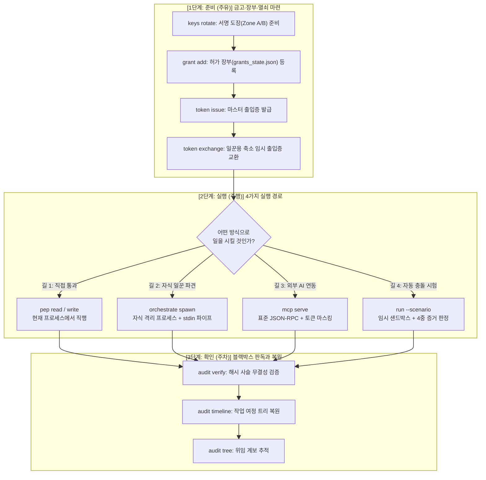

# 001. 프로그램 정체성과 전체 생애주기 — 이 프로그램은 무엇에 쓰는 물건이고, 어떻게 준비·실행·확인하나

> **모드**: `[문서작업]` — 소스코드 수정 없이 현재 구현된 `authz-harness`의 용도, 4대 디스크 저장소, 준비(주유) → 주행(4가지 실행 길) → 확인(주차)의 전체 생애주기를 해설합니다.  
> **기준일**: 2026-11-07 · **기준 커밋**: `33ff98a` (`git log -1 --format=%h -- cmd internal`)  
> **다시 확인하는 법**:
> ```bash
> git rev-parse --short HEAD
> git log -1 --format=%h -- cmd internal
> # 1. 프로그램 기본 시동 및 3중 분리 배선 확인
> go run ./cmd/authz-harness
> # 2. 관리 명령 정상 동작 확인 (도장 회전 및 권한 부여)
> go run ./cmd/authz-harness keys rotate
> go run ./cmd/authz-harness grant list
> # 3. 아키텍처 정합성 시험 실행
> go test -v ./internal/harness -run "TestArchitectureGuardrails"
> ```

---

## 💡 사용자의 질문 (원문 보존)

> 이 프로그램이 뭐하는 프로그램인지조차 개념이 없다. 자동차 부품을 설명하지 말고 자동차가 어디 쓰는 것이고 어떻게 사용하는지, 주차는 어떻게 하는지 기름은 어디서 어디로 넣는지 같은 걸 설명해라. 전체 큰 그림을 보여줘라.

---

## 0. 모든 설계 이전에 ‘사람’이 있다 — 내 컴퓨터를 만지는 자식 일꾼을 어떻게 믿을 것인가

현대 개발 환경에서 우리는 점점 더 많은 일을 자율 AI 에이전트(또는 자동화된 서브프로세스 일꾼)에게 맡깁니다. 일꾼에게 "내 프로젝트 폴더의 계획서(`plan.txt`)를 읽고 요약해라"라거나 "테스트를 돌리고 결과를 파일로 써라"라고 심부름을 시킵니다.

하지만 컴퓨터의 주인인 사람의 마음속에는 늘 불안이 남습니다.
- *「일꾼이 버그를 일으키거나 해커의 악의적인 프롬프트 주입(Prompt Injection)에 속아서, 읽으라고 하지도 않은 내 홈 디렉터리의 비밀 개인키(`~/.ssh/id_rsa`)나 AWS 설정 파일을 읽어 외부로 빼돌리면 어쩌지?」*
- *「기존 웹 개발에서 쓰던 정적 API 키나 IAM 로그인 방식은 왜 이런 자율 에이전트 환경에서 무력하게 뚫리는가?」*
- *「내가 자식 프로세스를 띄울 때 도대체 내 컴퓨터 어디에 무슨 파일이 생기고, 자식은 무엇을 건드릴 수 있으며, 나중에 무슨 일이 있었는지 어떻게 증명할 수 있는가?」*

이 설명서는 그 불안과 의문에 답하는 **자동차 운전 교본이자 전체 지도**입니다. 자동차의 피스톤 밸브 부품 번호가 아니라, **이 차가 어디에 쓰는 차이고, 기름(키·권한·토큰)을 어디서 어떻게 넣으며, 어떤 길(4가지 실행 경로)로 달리고, 주차 후 블랙박스를 어떻게 확인하는가**를 한눈에 펼쳐 보입니다.

---

## 1부. 이것은 무엇에 쓰는 장치이고, 왜 이런 모양인가 (용도와 Why)

### 1. 어디에 쓰는 물건인가 (자동차의 용도와 운전석 시점)

이 프로그램(`authz-harness`)은 한마디로 **「내 컴퓨터 안에서 돌아가는 자율 AI 에이전트를 위한 로컬 안전 운전 통제소이자 자동 충돌 시험장」**입니다.

1. **로컬 권한 및 안전 통제소 (The Control Unit)**:
   - 일꾼에게 심부름을 시킬 때 마스터 열쇠를 통째로 주지 않고, 이번 심부름에 필요한 만큼만 **권한·시간·예산을 깎아 낸 임시 출입증**을 만들어 줍니다.
   - 일꾼은 환경변수를 깨끗이 비운 별도 OS 프로세스로 띄우고, 실제 파일을 만지기 직전에 **10단계 검문소(`pep.Gateway`)**에서 실시간 취소 여부와 물리적 폴더 탈출(`..`) 여부를 검사합니다.
   - 모든 검사 통과와 차단 내역은 누구도 조작할 수 없는 **암호학적 해시 사슬 블랙박스(`audit.jsonl`)**에 실시간으로 기록됩니다.
2. **자동 충돌 시험 하네스 (The Crash Test Harness)**:
   - 보안 장치는 "정상 작동한다"는 말로 증명되지 않습니다. "인가되지 않은 탈출 시도나 만료된 토큰 공격이 들어왔을 때, **정확히 의도된 검문소에서 정확한 종료 코드와 사유로 차단(제동)된다**"는 증거가 있어야 합니다.
   - 이 프로그램은 격리된 가상 시험장(샌드박스)을 짓고 15개 그룹(`G1`~`G15`)의 수십 가지 공격 시나리오를 자동으로 발사하여, 방어벽이 한 치의 오차 없이 제동되는지를 **4중 증거(종료 코드·파일 상태·감사 사유·해시 사슬)**로 채점해 줍니다.

### 2. 가장 밑바닥의 이유부터 (끝까지 되묻는 Why)

1. **왜 전통적인 웹 IAM(역할 기반 RBAC, 고정 API 키)을 쓰면 안 되나?**
   - 전통적인 서버는 로그인한 사용자에게 정적인 역할(Admin, User)을 줍니다. 하지만 AI 에이전트는 하나의 거대한 마스터 권한을 가진 채로 수많은 하위 도구를 동적으로 엮어서 실행합니다.
   - 만약 일꾼에게 마스터 API 키를 그대로 쥐여 주면, 일꾼이 악의적인 문서를 읽는 순간 조종당해(Confused Deputy 공격) 허락받지 않은 파일 삭제나 외부 데이터 전송을 저지릅니다.
2. **그래서 어떻게 했나? (첫째 철학: 의심하고 줄여서 건넨다)**
   - 팀장 에이전트가 넓은 권한을 가졌더라도, 하위 일꾼에게 일을 시킬 때는 **작업 범위(`Scope`), 유효 시간(`exp`), 호출 횟수 및 바이트 예산(`Budget`)을 부모보다 같거나 작게 깎은 새 임시 출입증(토큰)으로 교환(`Exchange`)해서 건넵니다.**
   - (구현: [`validator.go`](../../internal/authn/exchange/validator.go) · `ValidateDownscope`)
3. **출입증 서명만 확인하고 바로 파일을 열어 주면 왜 안 되나?**
   - 한번 발급된 출입증은 만료 시간까지 일꾼의 손에 쥐여 있습니다. 만약 일꾼이 수상한 짓을 하여 관리자가 장부에서 권한을 박탈하더라도, 종이 출입증만 보는 검문소는 권한이 취소된 사실을 알 길이 없습니다.
4. **그래서 어떻게 했나? (둘째 철학: 문고리를 돌리기 직전에 장부를 다시 본다)**
   - 출입증 서명이 진짜여도, 실제 파일을 열기 직전에 중앙 허가 장부(`.authz-state/public/grants_state.json`)를 매번 새로 열어 지금 이 순간 권한이 살아 있는지, 일괄 철회 번호(`Epoch`)가 올라가지 않았는지를 두뇌(`pdp.Evaluate`)에게 물어봅니다.
   - (구현: [`service.go`](../../internal/authz/pdp/service.go) · `Evaluate`)
5. **감사 기록은 왜 일반 로그와 섞지 않고, 왜 실행 전에 먼저 쓰나? (셋째 철학: 증거가 안 남으면 실행도 안 한다)**
   - 개발자가 디버깅하려고 보는 운영 로그(`stderr`)는 실패해도 시스템이 멈추면 안 됩니다(Fail-Open). 하지만 보안 감사 기록(`audit.jsonl`)은 기록에 실패했는데도 파일이 수정되면 '흔적 없는 조작'이 발생합니다(Fail-Closed).
   - 따라서 파일을 수정하기 직전에 블랙박스에 "나 이제 실행한다"는 **사전 감사(`precommit_audit`)**를 먼저 적고 디스크에 완전히 내려앉은 뒤에만 실제 파일에 손을 댑니다.
   - (구현: [`gateway.go`](../../internal/authz/pep/gateway.go) · `precommitAudit`)

### 3. 흔한 방식과 이 프로그램의 선택

| 구분 | 흔한 방식 (일반적 구현) | 이 프로그램(`authz-harness`)의 선택 |
|---|---|---|
| **정체성** | 권한 라이브러리와 외부 테스트 스크립트가 겉돌거나 Mock 기반 단위 시험에 의존 | 실무형 인가 엔진과 자동 공격 시나리오 시험장을 **외부 의존성 0개(`go.mod` 깨끗함)**의 단일 실행 파일로 완결 |
| **정책 판정** | 외부 OPA 데몬 서버를 띄워 통신하거나, 판정 코드 안에서 디스크·네트워크를 직접 뒤짐 | OPA 데몬 없이 Go 순수 계산 함수(`pdp.Evaluate`)로 구현하여 디스크/네트워크를 일절 모르게 격리 |
| **로그와 감사** | 단일 로거(`slog` 등) 안에서 레벨로만 나누고 사후에 로그를 남김 | 화면(`stdout`), 디버그(`stderr`), 보안감사(`audit.jsonl`) **3중 분리 배선** 및 실행 전 사전 기록 |
| **얻은 것** | 빠른 개발 속도, 범용 정책 스크립트(Rego) 사용 | 외부 장애 전파 제로, 찰나의 틈(TOCTOU) 방어, 완벽한 위변조 불가 감사 증거 |
| **포기한 것** | 세밀한 제어 권한, 철저한 안전 보장 | 런타임에 동적으로 정책 언어를 갈아끼우는 유연성, 매 요청마다 로컬 장부를 읽고 쓰는 디스크 I/O 비용 |

---

## 2부. 처음부터 끝까지 따라가는 전체 생애주기 여정 (준비 → 실행 → 확인)

자동차가 움직이려면 **기름을 넣고(준비) → 시동을 걸어 목적지로 달린 뒤(실행) → 주차 후 계기판과 블랙박스를 확인(확인)**해야 합니다. 이 프로그램의 전체 작동 생애주기는 다음과 같습니다.



### 1. 디스크에 만들어지는 4대 공간 (차의 필수 장치들)

명령을 실행하기 전에, 이 프로그램이 하드디스크 어디에 무엇을 만드는지 알아야 합니다.
1. **비밀 금고 (`.authz-state/private/`, Zone A)**:
   - 출입증에 디지털 서명 도장을 찍는 **비밀 서명 키(`signing_keys.priv.json`)**가 들어 있습니다. 오직 관리자(부모)만 열어볼 수 있으며, 자식 일꾼은 이 폴더의 경로조차 모릅니다.
2. **공개 장부 선반 (`.authz-state/public/`, Zone B)**:
   - 부모와 자식, 검문소가 함께 읽는 공유 장부입니다.
   - `jwks.pub.json`: 서명 도장이 진짜인지 대조하는 공개키 목록.
   - `grants_state.json`: 현재 누구에게 무슨 권한이 살아 있는지 적힌 허가 원장.
   - `replay_ledger.json`: 한번 쓴 1회용 출입증 번호(`jti`) 목록.
   - `budget_ledger.json`: 출입증별로 남은 횟수와 바이트를 기록하는 예산 장부.
3. **격리 작업장 (`workspace/`, Zone C)**:
   - 자식 일꾼이 실제로 파일을 읽고 쓰도록 허락된 유일한 모래놀이터입니다. 이 폴더 바깥으로 나가는 탈출 시도는 검문소와 OS 커널에 의해 원천 차단됩니다.
4. **블랙박스 (`audit.jsonl`)**:
   - 부모와 자식이 수행한 모든 인증·인가·도구 실행 결과가 한 줄씩 기록되는 감사 장부입니다. 각 줄은 이전 줄의 해시값을 품고 있어 위변조가 불가능합니다.

---

### 2. 준비 단계 (기름 넣기와 열쇠 깎기)

터미널에서 실제로 다음 명령들을 순서대로 쳐서 차를 출발시킵니다.

1. **서명 도장 만들기 (`keys rotate`)**:
   ```bash
   ./authz-harness keys rotate
   ```
   비밀 금고(Zone A)에 비밀키를 만들고, 공개 선반(Zone B)에 누구나 검증할 수 있는 공개키(`jwks.pub.json`)를 게시합니다.
2. **허가 장부에 권한 적기 (`grant add`)**:
   ```bash
   ./authz-harness grant add --subject "worker-01" --action "file:read" --resource "plan.txt"
   ```
   중앙 허가 장부(`grants_state.json`)에 "일꾼 `worker-01`은 `plan.txt` 파일을 읽을 수 있다"고 등록합니다.
3. **마스터 출입증 발급 (`token issue`)**:
   ```bash
   TOKEN=$(./authz-harness token issue --subject "lead-01" --scope "file:read:plan.txt file:write:report.txt" --ttl 3600)
   ```
   팀장(`lead-01`)용 1시간짜리 마스터 출입증을 발급받습니다.
4. **일꾼용 임시 출입증 교환 (`token exchange`)**:
   ```bash
   WORKER_TOKEN=$(./authz-harness token exchange --token "$TOKEN" --subject "worker-01" --scope "file:read:plan.txt" --ttl 300)
   ```
   팀장의 마스터 토큰을 제시하고, 5분 동안 `plan.txt` 읽기만 허락된 좁고 안전한 **자식 일꾼용 출입증**으로 교환합니다.

---

### 3. 실행 단계 (4가지 길로 달리기)

준비된 출입증(`WORKER_TOKEN`)을 들고 목적지로 달리는 4가지 방법입니다.

- **길 1. 직접 검문소 통과 (`pep read` / `pep write`)**:
  ```bash
  ./authz-harness pep read --token "$WORKER_TOKEN" --file "plan.txt"
  ```
  별도 프로세스를 띄우지 않고, 현재 프로세스에서 곧바로 10단계 검문소를 통과해 `workspace/plan.txt`를 읽어 화면에 출력합니다.
- **길 2. 자식 일꾼 파견 (`orchestrate spawn`) — 가장 중요한 실무 경로**:
  ```bash
  ./authz-harness orchestrate spawn --token "$WORKER_TOKEN" --action "file:read" --file "plan.txt"
  ```
  부모 프로세스가 자식 프로세스를 독립 기동하고, 비밀 토큰을 `stdin` 파이프로 안전하게 주입해 심부름을 시킨 뒤 결과를 돌려받습니다 (상세 여정은 [002편](002-요청_패킷의_E2E_왕복여정과_검문소.md) 참조).
- **길 3. 외부 AI 도구 서버 연동 (`mcp serve`)**:
  ```bash
  ./authz-harness mcp serve
  ```
  Claude 데스크톱이나 Cursor 같은 외부 AI와 표준 JSON-RPC 프로토콜로 연결되어, AI가 요청하는 도구 실행을 길 2(자식 일꾼)로 대리 집행하고 토큰을 마스킹해 돌려줍니다.
- **길 4. 자동 충돌 시험장 (`run --scenario`)**:
  ```bash
  ./authz-harness run --scenario all --output-format explain
  ```
  수십 가지의 해킹·변조·탈출 시나리오를 자동으로 실행하고, 모든 공격이 검문소에서 정확히 제동되는지 채점표를 보여줍니다.

---

### 4. 확인 단계 (주차 후 블랙박스 판독)

심부름이 끝난 뒤 무슨 일이 일어났는지 검증합니다.

1. **블랙박스 사슬 무결성 검증 (`audit verify`)**:
   ```bash
   ./authz-harness audit verify
   ```
   `audit.jsonl` 파일의 처음부터 끝까지 해시 사슬을 맞춰 보아, 중간에 글자가 지워지거나 변조되지 않았음을 수학적으로 증명합니다.
2. **시간순 작업 여정 복원 (`audit timeline`)**:
   ```bash
   ./authz-harness audit timeline --latest
   ```
   방금 실행된 심부름의 전체 과정을 `부모 스폰 → 토큰 검증 → 정책 결정 → 사전 감사 → 실제 실행 → 결과 수거`의 예쁜 트리 구조로 터미널에 출력합니다.

---

## 3부. 질문과 답변으로 파고드는 세부 동작 (Q&A)

### Q1. 디스크에 생기는 파일들은 사람이 직접 지우거나 수정해도 되나?
- **무슨 일이 일어나는가**:
  `.authz-state/public/grants_state.json` 같은 장부 파일은 일반 JSON 파일이므로 에디터로 열어볼 수 있습니다. 하지만 사람이 직접 수정하면 동시성 잠금(`flock`)을 거치지 않아 프로세스가 작업 중일 때 파일이 깨질 수 있으며, `audit.jsonl`을 손으로 고치면 해시 사슬이 깨져 `audit verify`가 즉시 거부(`15`)를 뿜어냅니다.
- **왜 그렇게 하나**:
  장부의 무결성은 OS 파일 잠금과 원자적 교체(`AtomicWriteFile`)가 지키고 있으므로, 상태 변경은 반드시 `./authz-harness grant`나 `keys rotate` 같은 정식 CLI 명령을 통해서만 수행해야 안전합니다.
- (구현: [`atomic.go`](../../internal/storage/atomic.go) — `AtomicWriteFile`, 5부 ② 1번)

### Q2. 프로그램 실행 중 에러가 나면 어떻게 구별하나?
- **무슨 일이 일어나는가**:
  이 프로그램의 모든 에러는 정해진 9개의 표준 종료 코드(`0`, `11`~`18`)로 정규화되어 나옵니다.
  화면에 뜨는 에러 문구가 달라도, 종료 코드 숫자 하나만 보면 어디서 왜 막혔는지 즉시 알 수 있습니다 (아래 부록 B 참조).
- (구현: [`constants.go`](../../internal/domain/constants.go) — `ExitCode`, 5부 ② 2번)

---

## 4부. 배척한 방식과 그 이유

1. **인메모리 전용 데이터베이스(SQLite 등)를 내장하는 방식**:
   - **택했다면 무슨 일이 생기는가**: 복잡한 SQL 쿼리를 쓸 수 있어 초기 구현이 편해집니다.
   - **그 대신 포기한 것**: 외부 CGo 라이브러리 의존성이 생기고, 사람이 텍스트 에디터나 `cat` 명령으로 상태 파일과 감사 장부를 투명하게 들여다볼 수 없게 됩니다. 이 프로그램은 의존성 0개와 극도의 투명성을 위해 **순수 JSON 파일과 OS 원자적 교체**를 택했습니다.
2. **관리 평면 데몬(HTTP 백그라운드 서버)을 항상 띄워 두는 방식**:
   - **택했다면 무슨 일이 생기는가**: 포트를 열고 상시 대기하므로 네트워크 호출은 빨라질 수 있습니다.
   - **그 대신 포기한 것**: 포트 충돌, 데몬 프로세스 좀비화, 로컬 포트 탈취 공격 위험이 생깁니다. 이 프로그램은 **단일 CLI 바이너리와 파일 기반 잠금**으로 완결되는 가장 안전하고 단순한 방식을 택했습니다.

---

## 5부. 한눈에 보는 요약표와 코드 정본 색인

### ① 핵심 요약 대조표

| 단계 / 동작 | 안에서 일어나는 일 | 지금은 없는 것 (한계) | 근거 (구현 위치) |
|---|---|---|---|
| **준비 (주유)** | `keys rotate`로 키 생성, `grant add`로 권한 장부 기록, `token issue/exchange`로 출입증 발급 | LDAP/OIDC 같은 외부 중앙 계정 서버 연동은 지금은 없다 (로컬 JSON 관리) | 5부 ② 3, 4, 5번 |
| **실행 (주행)** | 직접 실행(`pep`), 자식 격리(`orchestrate`), 외부 연동(`mcp`), 자동 시험(`run`) 4가지 경로 제공 | 원격 분산 노드로 자식을 띄우는 네트워크 클러스터링은 지금은 없다 (단일 머신 격리) | 5부 ② 6, 7, 8번 |
| **확인 (주차)** | `audit verify`로 사슬 무결성 검증, `timeline`·`tree`로 시각적 복원 | 웹 UI 기반 대시보드는 지금은 없다 (CLI 터미널 텍스트 트리 제공) | 5부 ② 9, 10번 |

### ② 어디서 하나 (코드 정본 색인)

1. **원자적 파일 저장소**: [`internal/storage/atomic.go`](../../internal/storage/atomic.go) (`AtomicFileStore`, `AtomicWriteFile`)
2. **표준 종료 코드 및 도메인 에러**: [`internal/domain/constants.go`](../../internal/domain/constants.go) (`ExitCode`), [`internal/domain/error.go`](../../internal/domain/error.go) (`ExitCodeForReason`)
3. **키 관리자**: [`internal/authn/keys/manager.go`](../../internal/authn/keys/manager.go) (`Manager.RotateKey`)
4. **권한 관리자(PAP)**: [`internal/authz/pap/service.go`](../../internal/authz/pap/service.go) (`papService.CreateGrant`)
5. **토큰 발급 및 축소 교환**: [`internal/authn/token/issuer.go`](../../internal/authn/token/issuer.go) (`TokenIssuer`), [`internal/authn/exchange/service.go`](../../internal/authn/exchange/service.go) (`ExchangeService.Exchange`)
6. **중앙 검문소(PEP)**: [`internal/authz/pep/gateway.go`](../../internal/authz/pep/gateway.go) (`gateway.Execute`)
7. **자식 일꾼 스포너**: [`internal/orchestrator/spawner.go`](../../internal/orchestrator/spawner.go) (`SubprocessSpawner.Spawn`)
8. **외부 도구 서버(MCP)**: [`internal/mcp/server.go`](../../internal/mcp/server.go) (`Server.Run`)
9. **감사 기록 및 검증기**: [`internal/audit/audit.go`](../../internal/audit/audit.go) (`JSONLWriter`, `VerifyHashChain`)
10. **타임라인 시각화기**: [`internal/ui/timeline.go`](../../internal/ui/timeline.go) (`TimelineFormatter.RenderTimeline`)

---

## 부록 A. 상태 파일 지도 (어느 파일이 어디에 생기나)

| 구역 (Zone) | 파일명 | 역할 및 내용물 | 읽는 주체 | 쓰는 주체 |
|:---:|---|---|---|---|
| **Zone A** (비밀 금고) | `signing_keys.priv.json` | Ed25519 서명 비밀키. 출입증 위조 방지용 도장 | 관리자 (`keys`, `token`) | 관리자 (`keys rotate`) |
| **Zone B** (공개 선반) | `jwks.pub.json` | 서명 검증용 Ed25519 공개키 목록 | 부모, 자식, 검문소 | 관리자 (`keys rotate`) |
| **Zone B** (공개 선반) | `grants_state.json` | 활성 권한 목록, 주체별 세대 번호(`Epoch`), 승인 목록 | 검문소 (`authz` 단계) | 관리자 (`grant`, `approval`) |
| **Zone B** (공개 선반) | `replay_ledger.json` | 소비된 1회용 토큰 번호(`jti`) 목록 | 검문소 (`authn` 확인) | 검문소 (`replay` 소비) |
| **Zone B** (공개 선반) | `budget_ledger.json` | 토큰별 남은 호출 횟수 및 바이트 예산 | 검문소 (`budget`, `settle`) | 검문소, 교환소 |
| **Zone C** (격리 작업장) | `workspace/` | 일꾼이 실제로 읽고 쓸 수 있는 안전한 작업 폴더 | 자식 일꾼 (`file:read`) | 자식 일꾼 (`file:write`) |
| **공통** (블랙박스) | `audit.jsonl` | 전체 작업 이력이 담긴 SHA-256 해시 사슬 원장 | 관리자 (`audit verify`) | 부모, 자식 검문소 |

---

## 부록 B. 표준 종료 코드 사전 (에러 숫자 한눈에 보기)

| 종료 코드 | 상수 이름 | 뜻 (어디서 왜 막혔는가) | 대표 사유 (`Reason`) |
|:---:|---|---|---|
| **`0`** | `ExitSuccess` | 요청이 인가되어 정상 완료됨 | `AUTHORIZED` |
| **`11`** | `ExitTokenInvalid` | 출입증 자체의 결함 (서명 불일치, 만료됨, 이미 쓴 토큰 재사용) | `TOKEN_EXPIRED`, `TOKEN_INVALID_SIGNATURE`, `TOKEN_REPLAY_DETECTED` |
| **`12`** | `ExitAuthzDenied` | 출입증은 진짜지만 권한이 없음 (허가 없음, 세대 번호 취소됨, 예산 초과) | `NO_ACTIVE_GRANT`, `SUBJECT_EPOCH_REVOKED`, `BUDGET_EXHAUSTED` |
| **`13`** | `ExitPathViolation` | 작업장(`workspace/`) 밖으로 탈출 시도 (`..` 또는 바깥 심볼릭 링크) | `PATH_TRAVERSAL`, `SYMLINK_ESCAPE` |
| **`14`** | `ExitBadInput` | 입력 인자 오류 (필수값 누락, 모르는 필드 포함) | `INVALID_ARGUMENTS`, `MISSING_TRACE_CONTEXT` |
| **`15`** | `ExitAuditFailure` | 블랙박스 기록 실패 또는 무결성 파손 (증거 누락 방지 제동) | `AUDIT_LOG_FAILED`, `AUDIT_INTEGRITY_BROKEN` |
| **`16`** | `ExitInternalError` | 자식 비정상 종료, 커널 격리 적용 불가 등 내부 시스템 오류 | `INTERNAL_ERROR`, `CONFINEMENT_UNAVAILABLE` |
| **`17`** | `ExitResourceLimit` | 자식 일꾼이 제한 시간(기본 10초)이나 출력 상한(1MB)을 초과해 부모가 강제 처형함 | `TIME_LIMIT_EXCEEDED`, `OUTPUT_LIMIT_EXCEEDED` |
| **`18`** | `ExitApprovalRequired` | 사람의 1회용 승인이 필요한 작업인데 승인이 아직 등록되지 않음 | `APPROVAL_REQUIRED` |
