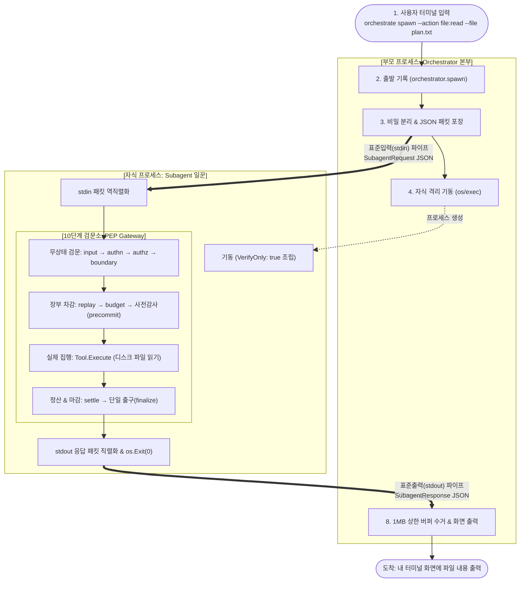

# 002. 요청 패킷의 E2E 왕복여정과 검문소 — 터미널에서 엔터를 치면 내 눈앞에 결과가 오기까지 무슨 일이 일어나는가

> **모드**: `[문서작업]` — 소스코드 수정 없이 현재 구현된 요청 패킷의 생성, 부모-자식 파이프 통신, 10단계 검문소 검사, 4종 실제 도구 실행, 사후 정산, 화면 출력까지의 끊김 없는 8단계 E2E 왕복 여정을 해설합니다.  
> **기준일**: 2026-11-07 · **기준 커밋**: `33ff98a` (`git log -1 --format=%h -- cmd internal`)  
> **다시 확인하는 법**:
> ```bash
> git rev-parse --short HEAD
> git log -1 --format=%h -- cmd internal
> # 1. 자식 프로세스 격리 스폰 및 툴 실행 왕복 테스트
> go test -v ./internal/orchestrator/... -run "TestSubprocessSpawner"
> # 2. 10단계 검문소(PEP) 파이프라인 통과 시험
> go test -v ./internal/authz/pep/... -run "Test10AcceptanceScenarios"
> # 3. CLI를 통한 실제 E2E 왕복 시연 (DEMO 장면 1)
> go run ./cmd/authz-harness orchestrate spawn --token "<유효토큰>" --action file:read --file plan.txt
> ```

---

## 💡 사용자의 질문 (원문 보존)

> 하나의 패킷이 생성되어서 구글 본사 서버를 거쳐서 목적지에 도착하는 거 설명 못하나? 그런 식의 설명 안 되나? 중간에 라우터 있고 OSI 계층을 통과하고 넷마스크 씌워서 체크하고 보내고 등등 못하나? 나는 아직도 자식이 어떻게 툴을 실행하고 어떤 명령을 전달하는지 어떻게 결과를 받는지 모른다. 함수 이름 파일 이름만 잔뜩 적힌 문서뿐이다. e2e를 설명해라.

---

## 0. 모든 설계 이전에 ‘사람’이 있다 — 내가 엔터를 친 명령은 자식에게 어떻게 건너가서 어떻게 돌아오나

터미널 화면에서 명령을 하나 입력하는 사람을 생각해 봅니다.
```bash
./authz-harness orchestrate spawn --token "eyJ..." --action "file:read" --file "plan.txt"
```
명령을 치고 엔터를 누르면, 잠시 후 터미널 화면에 파일의 내용이 주르륵 출력되거나, 권한이 없다며 빨간색 에러 메시지가 뜹니다.

겉보기에는 단순해 보이지만, 코드를 모르는 사람도 자연스럽게 이런 궁금증을 품게 됩니다.
- *「부모 프로세스는 저 비밀 토큰과 작업 지시를 자식에게 어떻게 넘겨주는가? 자식을 띄울 때 명령줄 인자로 넘겨주면 위험하지 않나?」*
- *「깨어난 자식 일꾼은 저 요청을 받아서 어떻게 검문소를 통과하고, 실제 파일은 누가 열어서 바이트를 읽어 오는가?」*
- *「읽어 온 파일 내용은 어떤 길을 통해 부모에게 거슬러 올라가고, 최종적으로 내 눈앞 화면에 어떻게 찍히는가?」*

이 설명서는 네트워크 패킷이 출발지 브라우저에서 생성되어 물리 케이블과 라우터, 방화벽을 통과하고 목적지 서버에 닿은 뒤 응답 패킷으로 되돌아오는 것처럼, **요청 패킷 하나가 태어나서 돌아오기까지의 끊김 없는 8단계 E2E(End-to-End) 왕복 여정**을 완벽하게 해체하여 보여줍니다.

---

## 1부. 이것은 무엇에 쓰는 장치이고, 왜 이런 모양인가 (용도와 Why)

### 1. 어디에 쓰는 물건인가 (도로와 검문소의 비유)

이 여정은 **「특수 보안 구역에 심부름꾼(자식 일꾼)을 파견하여 물건(파일 내용)을 안전하게 가져오게 하는 왕복 통로」**입니다.
- **부모 프로세스(본부)**: 명령을 받아 심부름 지시서를 밀봉하고, 일꾼을 안전한 작업복으로 갈아입혀 격리된 방으로 들여보냅니다.
- **파이프(밀폐된 통신관)**: 외부에서 도청하거나 가로챌 수 없도록, 부모와 자식 사이에 단 둘만 통하는 전용 표준입력(`stdin`)·표준출력(`stdout`) 파이프를 연결합니다.
- **10단계 검문소(중앙 게이트웨이)**: 일꾼이 작업장에 들어가기 직전에 출입증의 위조 여부, 만료 여부, 실제 허가 여부, 울타리 탈출 여부를 10번 확인합니다.
- **도구(집게손)**: 검문소를 통과한 뒤에야 비로소 도구가 실제 하드디스크의 파일을 집어 올려 데이터를 읽어 냅니다.

### 2. 가장 밑바닥의 이유부터 (끝까지 되묻는 Why)

1. **왜 토큰과 지시서를 자식의 명령줄 인자(`--token ...`)로 넘기지 않고 `stdin` 파이프로 넘기나?**
   - 명령줄 인자로 넘기면 호스트 OS에서 `ps aux`나 `/proc/<pid>/cmdline`을 실행하는 다른 사용자나 악성 프로세스에게 비밀 토큰(`eyJ...`)이 그대로 노출되기 때문입니다.
   - `stdin` 파이프는 프로세스 내부 메모리 간의 전용 스트림이므로 외부 프로세스 목록에 전혀 노출되지 않습니다(Zero Leakage).
2. **왜 검문소는 함수 호출 10개를 위에서 아래로 나열하지 않고 순서를 엄격히 강제하나?**
   - 검사 단계(돈을 안 쓰는 단계)가 모두 끝나기 전에 1회용 토큰 번호나 승인, 예산(돈을 쓰는 단계)을 먼저 소모해 버리면, 경로 탈출 같은 에러로 거절당했을 때 억울하게 토큰만 날아가기 때문입니다.
3. **왜 실제 파일에 손대기 직전에 감사 장부(`audit.jsonl`)에 먼저 적나?**
   - 파일을 읽거나 고친 뒤에 디스크 용량이 차서 감사 기록에 실패하면 '흔적 없는 파일 조작'이 생기기 때문입니다. 증거가 디스크에 물리적으로 기록되지 않으면 실행도 하지 않습니다.
4. **왜 자식이 읽어 온 파일 내용을 감사 장부에 그대로 적지 않나?**
   - 읽어 온 파일 안에 비밀번호나 개인정보가 들어 있을 수 있는데, 이를 감사 장부에 그대로 적으면 감사 로그 자체가 보안 누출 구멍이 되기 때문입니다. 따라서 감사 장부에는 SHA-256 지문(`result_hash`)만 남기고 원문은 오직 부모를 거쳐 사용자의 화면으로만 전달합니다.

---

## 2부. 처음부터 끝까지 따라가는 8단계 E2E 패킷 왕복 여정

터미널에서 엔터를 친 순간부터 결과가 출력되기까지, 요청 데이터가 어떻게 변하고 어디를 통과하는지 보여주는 전체 흐름도입니다.



---

### 단계별 상세 메커니즘과 데이터의 흐름

#### [1단계: 내 터미널 입력]
사용자가 터미널에서 다음 명령을 실행합니다:
```bash
./authz-harness orchestrate spawn --token "eyJhbGciOi..." --action "file:read" --file "plan.txt"
```
명령행 파서가 플래그들을 읽어 부모 오케스트레이터 러너에게 전달합니다.

#### [2단계: 부모의 출발 준비와 비밀 분리]
부모 프로세스는 자식을 띄우기 전에 두 가지 안전 조치를 취합니다.
1. **블랙박스 출발 도장**: 감사 장부(`audit.jsonl`)에 "내가 지금 이 작업을 위해 자식 일꾼을 띄운다(`orchestrator.spawn`)"는 사실을 먼저 기록합니다.
2. **명령행(CLI)과 파이프(stdin)의 철저한 분리**:
   - 자식을 실행할 OS 명령행 인자에는 공개 장부 경로 5개(`-workspace`, `-pub-jwks-file`, `-state-file`, `-replay-file`, `-audit-file`)만 넣습니다. 비밀 토큰은 절대 넣지 않습니다.
   - 환경변수를 8개 기본 변수(`PATH`, `HOME` 등)만 남기고 깨끗이 씻어냅니다(`SanitizeEnv`). 부모의 비밀 환경변수가 자식에게 상속되는 것을 막기 위함입니다.
   - 실제 작업 지시서와 비밀 토큰은 JSON 패킷으로 포장하여 자식의 **표준입력(`stdin`) 파이프**에 연결합니다.
   ```json
   {"version":"1.0","trace_id":"orch-9876","token":"eyJhbGciOi...","action":"file:read","file_path":"plan.txt"}
   ```

#### [3단계: 자식 프로세스 기동과 패킷 개봉]
자식 프로세스가 OS 위에서 깨어납니다.
1. **검증 전용 조립**: 자식은 넘겨받은 5개 공개 경로만 가지고 스택을 조립합니다(`VerifyOnly: true`). 비밀 서명키의 위치를 아예 모르므로, 자식은 해킹당하더라도 스스로 새 출입증을 위조할 수 없습니다.
2. **패킷 개봉**: 자기 표준입력(`stdin`)에서 JSON 패킷을 읽어 내부 요청서(`pep.Request`)로 변환합니다. 이때 모르는 필드가 섞여 있거나 시계를 과거로 돌리려는 시도(음수 오프셋)가 있으면 검문소에 가기도 전에 즉시 거부(`ExitBadInput`, `14`)합니다.

#### [4단계: 자식 내부 10단계 검문소 통과]
자식은 요청서를 들고 10단계 중앙 검문소(`pep.Gateway`)로 들어갑니다. 검문소는 정해진 순서대로 검사를 진행합니다.
1. **1단계 `input` (기본 검사)**: 행동(`file:read`)과 대상(`plan.txt`)이 비어 있지 않은지 확인합니다.
2. **2단계 `authn` (신원 확인)**: 공개키(`jwks.pub.json`)로 Ed25519 디지털 서명이 맞는지, 만료 시간이 지나지 않았는지 확인합니다.
3. **3단계 `authz` (실시간 권한 판정)**: 중앙 허가 장부(`grants_state.json`)를 다시 열어 일꾼의 세대 번호(`Epoch`)가 유효하고, 출입증 범위(`Scope`)와 장부의 허가(`Grant`)가 둘 다 `plan.txt` 읽기를 허락하는지 순수 함수로 판정합니다.
4. **4단계 `boundary` (물리 울타리 검사)**: 요청 경로에 상위 폴더 탈출(`..`)이나 작업장(`workspace/`) 바깥을 가리키는 심볼릭 링크가 없는지 실제 디스크 경로를 따라가 봅니다.
5. **5단계 `replay` (토큰 소비)**: 1~4단계 검사를 모두 무사히 통과했으므로, 재사용 장부(`replay_ledger.json`)를 잠그고 출입증 고유 번호(`jti`)에 '사용 완료' 도장을 찍습니다.
6. **6단계 `approval` / `budget` (승인·예산 처리)**: 승인이 필요 없는 일반 요청이므로 승인 단계는 건너뛰고, 예산 토큰일 경우 횟수를 사전 차감합니다.
7. **7단계 `precommit_audit` (실행 전 사전 감사)** ★:
   실제 파일을 건드리기 직전에, 감사 장부(`audit.jsonl`)에 "나 이제 `plan.txt` 읽는다"는 기록을 먼저 쓰고 디스크에 동기화(`fsync`)합니다. 만약 디스크가 꽉 차서 기록에 실패하면 파일은 손도 대지 않고 즉시 중단(`ExitAuditFailure`, `15`)합니다.

#### [5단계: 실제 도구 실행과 바이트 포획]
사전 감사까지 통과하면 8단계인 `execute`에서 도구가 실행됩니다.
- 격리 작업장 감옥(`workspaceJail`)이 `workspace/plan.txt`를 열어 실제 바이트 데이터를 읽어 옵니다.
- 도구는 읽어 온 데이터 바이트와 바이트 수(`pep.Output{Data: []byte("프로젝트 계획서 내용..."), BytesRead: 42}`)를 검문소 내부 상태에 담아 돌려줍니다.

#### [6단계: 사후 정산 및 단일 출구 마감]
1. **9단계 `settle` (사후 정산)**: 도구가 실제로 읽어 온 바이트 수(42바이트)만큼 예산 장부에서 정산합니다. 예산이 부족하면 읽어 온 데이터를 즉시 파기하고 거부로 바꿉니다.
2. **10단계 `finalize` (단일 출구 마감)**:
   - 모든 성공과 실패가 모이는 단 하나의 출구입니다.
   - 감사 장부(`audit.jsonl`)에 최종 성공 완료(`pep.allow`)를 기록합니다. 이때 비밀 유출을 막기 위해 파일 본문 대신 SHA-256 지문(`domain.DataDigest(Data)`)만 남깁니다.
   - 읽어 온 원본 데이터가 담긴 최종 결과 객체(`pep.Result`)를 자식 워커에게 건넵니다.

#### [7단계: 자식의 응답 패킷 발사 및 정상 종료]
자식 워커는 건네받은 결과 객체에서 바이트 데이터를 문자열로 변환하여 응답 JSON 패킷을 만듭니다.
```json
{"trace_id":"orch-9876","action":"file:read","file_path":"plan.txt","exit_code":0,"reason":"AUTHORIZED","output":"프로젝트 계획서 내용...","bytes_read":42}
```
자식은 이 JSON을 자기 **표준출력(`stdout`) 파이프**에 쏘아 보내고, 종료 코드 0(`os.Exit(0)`)으로 생을 마감합니다.

#### [8단계: 부모 프로세스의 수거 및 내 눈앞 화면 출력]
1. 부모 프로세스는 1MB 상한 메모리 버퍼(`limitedBuffer`)를 통해 자식의 `stdout` 파이프를 받아냅니다 (자식이 무한 루프를 돌며 테라바이트급 쓰레기 출력을 뿜어 부모 메모리를 터뜨리는 공격을 방어하기 위함).
2. 자식이 정상 종료(Exit Code 0)했음을 확인하고, 감사 장부에 "자식 일꾼 회수 완료(`orchestrator.collect`)" 도장을 찍습니다.
3. 마침내 사용자의 눈앞 터미널 화면(`stdout`)에 결과를 출력합니다:
```text
=== Orchestrate Spawn Execution ===
Trace ID: orch-9876
Child Exit Code: 0
Termination: exited
Reason: AUTHORIZED
Duration: 8.42ms
Output:
프로젝트 계획서 내용...
Bytes Read: 42
```

---

### 이상이 생기면 (어디서 멈추고 무엇이 찍히나)

| 사고 상황 | 멈추는 단계 | 일어나는 일과 화면 출력 |
|---|:---:|---|
| **출입증이 5분 유효기간을 넘겨 만료됨** | 2단계 `authn` | 검문소 입구에서 막히며, 자식 종료 코드 `11`(`ExitTokenInvalid`), 사유 `TOKEN_EXPIRED`가 화면에 찍힘. 도구는 실행되지 않음 |
| **팀장이 준 출입증으로 다른 파일(`secret.txt`)을 읽으려 함** | 3단계 `authz` | 장부 대조에서 막히며, 자식 종료 코드 `12`(`ExitAuthzDenied`), 사유 `TOKEN_INSUFFICIENT_SCOPE`가 화면에 찍힘 |
| **경로에 `../etc/passwd` 탈출 기호가 들어 있음** | 4단계 `boundary` | 울타리 검사에서 즉시 차단되며, 자식 종료 코드 `13`(`ExitPathViolation`), 사유 `PATH_TRAVERSAL`이 찍힘. 디스크 경로는 열리지도 않음 |
| **사전 감사 기록 중 디스크 용량이 꽉 참** | 7단계 `precommit_audit` | 도구 실행 직전에 제동이 걸리며, 자식 종료 코드 `15`(`ExitAuditFailure`)가 찍힘. 대상 파일은 1바이트도 건드리지 않음 |
| **자식 일꾼이 무한 루프에 빠져 10초 동안 안 끝남** | 부모 감시 타이머 | 부모가 10초 타임아웃을 감지하고 자식 프로세스 그룹에 `SIGKILL`을 날려 강제 종료시킴. 화면에 종료 코드 `17`(`ExitResourceLimit`)과 `TIMED_OUT`이 찍힘 |

---

## 3부. 질문과 답변으로 파고드는 세부 동작 (Q&A)

### Q1. 파일 읽기 외에 네트워크 조회나 명령어 실행도 똑같은 여정을 거치나?
- **무슨 일이 일어나는가**:
  완벽히 동일한 여정을 거칩니다. 요청 패킷의 행동(`action`)만 `net:fetch`나 `exec:run`으로 바뀔 뿐입니다.
  - 4단계 경계 검사에서 파일 대신 네트워크 방화벽 가드(`netguard`)와 명령 실행 가드(`execguard`)가 검사합니다.
  - 8단계 실행 단계에서 각 가드가 루프백 HTTP 요청을 보내거나 등록된 명령을 실행해 출력 바이트를 받아 옵니다.
  - 9단계 사후 정산에서 네트워크로 받은 데이터나 명령의 출력 크기만큼 바이트 예산을 사후 정산하고 똑같이 `stdout` 파이프로 반환합니다.
- (구현: [`tool.go`](../../internal/authz/pep/tool.go) — `Tool.Execute`, 5부 ② 3번)

### Q2. 외부 AI가 연동되는 `mcp serve`는 이 여정과 어떻게 맞물리나?
- **무슨 일이 일어나는가**:
  외부 AI가 표준 JSON-RPC 프로토콜로 `tools/call`을 보내오면, MCP 서버는 이를 받아서 위에서 설명한 [2단계]의 부모 오케스트레이터 역할을 그대로 수행합니다. 즉, 자식 격리 프로세스를 똑같이 띄워 심부름을 시키고, 결과를 받아 혹시 섞여 있을지 모를 원시 토큰을 마스킹한 뒤 AI에게 JSON-RPC 응답으로 돌려줍니다.
- (구현: [`executor.go`](../../internal/mcp/executor.go) — `ExecuteTool`, 5부 ② 4번)

---

## 4부. 배척한 방식과 그 이유

1. **부모 프로세스 안에서 고루틴(Go Routine)으로 자식을 띄우는 방식 (In-Process)**:
   - **택했다면 무슨 일이 생기는가**: 프로세스를 새로 띄우는 비용(약 5~10ms)이 들지 않아 속도는 매우 빠릅니다.
   - **그 대신 포기한 것**: 고루틴은 부모와 동일한 힙 메모리 공간을 공유합니다. 일꾼 코드가 오염되면 부모 메모리에 있는 비밀 서명키(Zone A)를 메모리 포인터로 훔쳐볼 수 있습니다. 이 프로그램은 속도 10ms를 희생하고 **완벽한 OS 가상 메모리 분리(Subprocess)**를 택했습니다.
2. **도구 실행을 검문소 바깥의 워커에게 도로 맡기는 방식**:
   - **택했다면 무슨 일이 생기는가**: 검문소 코드가 단순해집니다.
   - **그 대신 포기한 것**: 검문소를 통과한 시점과 실제 파일을 쓰는 시점 사이에 공격자가 파일을 심볼릭 링크로 바꿔치기하는 찰나의 틈(TOCTOU)이 생깁니다. 검문소가 도구를 직접 품고 실행해야만 검사와 사용 사이의 시간 간극이 0초가 됩니다.

---

## 5부. 한눈에 보는 요약표와 코드 정본 색인

### ① 핵심 요약 대조표

| 단계 | 데이터와 패킷의 위치 | 수행되는 핵심 작업 | 근거 (구현 위치) |
|:---:|---|---|---|
| **1~2단계** | 터미널 ➔ 부모 프로세스 | 명령 인자 파싱, 출발 감사 기록, 명령행 인자와 `stdin` JSON 분리 | 5부 ② 1, 2번 |
| **3~4단계** | `stdin` 파이프 ➔ 자식 검문소 | `VerifyOnly` 스택 조립, 무상태 4단계 검사, 토큰 소비, 사전 감사 선기록 | 5부 ② 2, 3번 |
| **5~6단계** | 자식 검문소 내부 도구 | 4종 도구 실행, 바이트 포획, 사후 예산 정산, 단일 출구 지문 마감 | 5부 ② 3번 |
| **7~8단계** | `stdout` 파이프 ➔ 부모 ➔ 터미널 | 응답 JSON 직렬화, 부모 1MB 상한 버퍼 수거, 회수 감사 기록, 화면 출력 | 5부 ② 1, 2번 |

### ② 어디서 하나 (코드 정본 색인)

1. **부모 프로세스 러너 및 결과 렌더링**: [`internal/cli/orchestrate.go`](../../internal/cli/orchestrate.go) (`OrchestrateRunner.Run`, `renderSpawnResult`)
2. **서브프로세스 스포너 및 자식 워커**: [`internal/orchestrator/spawner.go`](../../internal/orchestrator/spawner.go) (`SubprocessSpawner.Spawn`), [`internal/subagent/worker.go`](../../internal/subagent/worker.go) (`SubagentWorker.ExecuteStream`)
3. **중앙 10단계 검문소 및 4종 도구**: [`internal/authz/pep/gateway.go`](../../internal/authz/pep/gateway.go) (`gateway.Execute`, `finalize`), [`internal/authz/pep/tool.go`](../../internal/authz/pep/tool.go) (`Tool`)
4. **외부 AI 연동 MCP 도구 집행기**: [`internal/mcp/executor.go`](../../internal/mcp/executor.go) (`ExecuteTool`)
