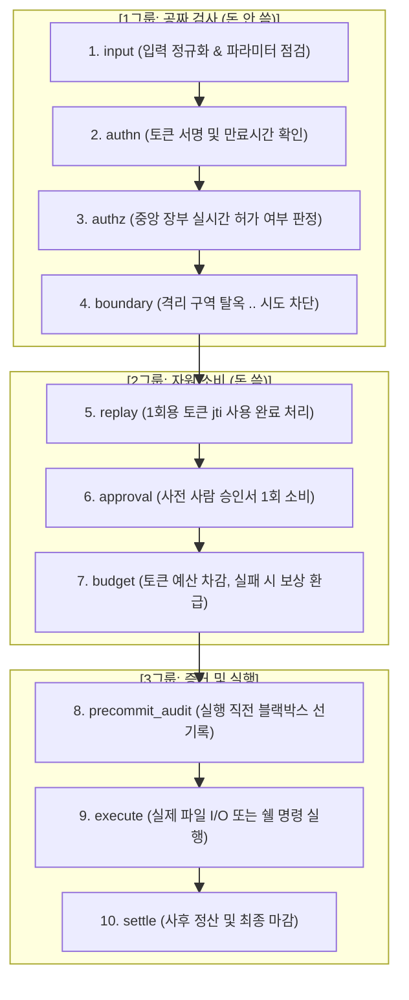

# 002. 요청 패킷의 E2E 왕복여정과 검문소 — 터미널 엔터부터 내 화면 출력까지 8단계 여행기

> **모드**: `[문서작업]` — 소스코드 수정 없이 터미널 명령 입력부터 부모-자식 격리 통신, 10단계 검문소(PEP), 실제 도구(파일/쉘) 실행, 그리고 화면 출력까지의 E2E 패킷 왕복 여정을 친절한 일상의 비유와 문답으로 해설합니다.  
> **기준일**: 2026-11-07 · **기준 커밋**: `519a727`  
> **다시 확인하는 법**:  
> ```bash
> # 1. 자식 프로세스 격리 스폰 및 툴 실행 왕복 테스트
> go test -v ./internal/orchestrator/... -run "TestSubprocessSpawner"
> # 2. 10단계 검문소(PEP) 파이프라인 통과 시험
> go test -v ./internal/authz/pep/... -run "Test10AcceptanceScenarios"
> # 3. CLI를 통한 실제 E2E 왕복 시연 (DEMO)
> ./authz-harness orchestrate spawn --token "<유효토큰>" --action file:read --file plan.txt
> ```

---

## 1. E2E 왕복 여정의 큰 그림

### Q. 네트워크 패킷처럼 설명해줘. 내가 터미널에서 엔터를 치면 내 눈앞에 결과가 오기까지 안에서 무슨 일이 일어나?

#### 1) 일상의 비유: "공항 국제선 탑승 수속과 노란 서류 봉투의 여행"
승객(사용자)이 비행기(파일 읽기/쉘 실행)를 타려고 공항에 들어서는 과정을 떠올려 보세요.

```text
[터미널 입력]
      │
      ▼
[1. 부모 오케스트레이터] ─── "비밀 출입증을 노란 서류 봉투(JSON)에 밀봉"
      │
      │ (밀폐된 파이프 통로: stdin)
      ▼
[2. 자식 워커 에이전트] ─── "격리실에서 깨어나 봉투를 들고 10개 검문소 통과"
      │
      │ (10단계 검문: authn ➔ authz ➔ boundary ➔ execute)
      ▼
[3. 손자 도구 프로세스] ─── "실제 비행기 탑승 (파일 I/O 또는 쉘 실행)"
      │
      │ (수거: stdout 바이트 버퍼)
      ▼
[4. 결과 역방향 회수] ─── "자식 워커가 결과를 부모에게 전달하고 종료"
      │
      │ (부모의 파이프 수거: stdout)
      ▼
[사용자 화면에 출력]
```

1. **여권과 탑승권 포장**: 부모는 승객의 비밀 출입증(토큰)과 심부름 지시서를 **노란 서류 봉투(`SubagentRequest` JSON)**에 깔끔하게 넣고 밀봉합니다.
2. **비밀 지하 통로로 전달 (`stdin` 파이프)**: 공항 로비(OS 프로세스 목록 `ps aux`)에 노출되지 않도록, 부모와 자식 사이에 단둘만 연결된 지하 파이프라인(`stdin`)으로 봉투를 쏙 밀어 넣습니다.
3. **공항 10대 검색대 통과 (PEP Gateway)**: 격리실에서 깨어난 자식 일꾼은 봉투를 들고 10개의 검색대를 차례로 통과합니다. 여권(토큰) 위조 여부, 위험물(격리 탈옥 `..`) 소지 여부를 전수 검사받습니다.
4. **기내 도구 실행 (Tool Execute)**: 모든 검색대를 통과한 뒤에야 손자 도구(집게)를 꺼내 실제 하드디스크의 파일을 열거나 쉘을 실행합니다.
5. **결과 수거 후 부모 보고 (`stdout` 파이프)**: 도구가 꺼내온 파일 내용(바이트)을 안전하게 챙겨서, 자식의 표준출력(`stdout`) 파이프를 통해 부모에게 거슬러 올려보냅니다.
6. **화면 표시**: 부모가 결과를 받아 터미널 화면에 예쁘게 찍어줍니다.

---

## 2. 10단계 검문소(PEP)는 무엇을 어떤 순서로 검사하나?

### Q. 왜 10단계나 검사를 해? 함수 10개를 순서 없이 대충 돌리면 안 돼?

#### 1) 검문소의 불변 순서: "돈(자원)을 쓰는 단계는 반드시 공짜 검사가 끝난 뒤에 연다"
만약 공항 검색대에서 여권 위조 검사도 하기 전에 면세점 쇼핑(예산 차감)부터 시켜주면 어떻게 될까요? 여권 위조로 걸려서 쫓겨났을 때 승객의 돈만 억울하게 날아갑니다.  
따라서 10개 검문소는 **"절대 순서가 뒤집히면 안 되는 엄격한 등급(Rank)"**으로 배치되어 있습니다.



---

### Q. 각 검문소에서 실제로 일어나는 일을 설명해줘.

* **1단계 `input` (안내 데스크)**:
  "요청서에 필수 항목이 빠지지 않았는가?"를 확인하고, 공백이나 경로를 표준 형식으로 정규화합니다.
* **2단계 `authn` (여권 감별기)**:
  출입증(JWT)에 찍힌 서명이 우리 회사 비밀도장으로 찍은 진짜인지, 유효기간(`exp`)이 지나지 않았는지 암호학적으로 검증합니다.
* **3단계 `authz` (중앙 명부 대조)**:
  출입증이 진짜라도, 지금 이 순간 중앙 장부(`grants_state.json`)에서 권한이 박탈(`revoke`)되지 않았는지 실시간으로 대조합니다.
* **4단계 `boundary` (금속 탐지기 & 울타리)**:
  `../../etc/passwd`처럼 격리된 샌드박스 밖으로 탈옥(`..`)하려는 경로 조작이나, 허용되지 않은 쉘 명령어가 있는지 물리적으로 차단합니다.
* **5단계 `replay` (1회용 입장권 파기)**:
  이 출입증 고유번호(`jti`)가 이미 쓰인 적이 없는지 장부를 뒤져보고, 처음 쓰는 것이면 '사용 완료' 도장을 찍습니다.
* **6단계 `approval` (특수 허가증 회수)**:
  파일 쓰기나 위험한 쉘 실행처럼 "관리자 사전 승인"이 필요한 작업인 경우, 발급된 1회용 승인서를 찾아 파기(소비)합니다.
* **7단계 `budget` (지갑에서 돈 빼기)**:
  이 출입증에 부여된 예산(예: 호출 1회, 100바이트)을 원장에서 미리 차감합니다. (만약 다음 단계에서 에러가 나면 Saga 보상 트랜잭션으로 도로 환급해 줍니다!)
* **8단계 `precommit_audit` (CCTV 녹화 시작)**:
  실제 파일에 손대기 1밀리초 전에, "나 이제 진짜로 파일 연다"는 증거를 블랙박스(`audit.jsonl`)에 먼저 물리적으로 기록합니다. (디스크가 꽉 차서 실패하면 즉시 문 닫고 중단)
* **9단계 `execute` (진짜 일하기)**:
  드디어 안전이 100% 보장된 상태에서, 도구(손자 툴)가 하드디스크의 파일을 읽거나 쉘 명령을 실행합니다.
* **10단계 `settle` (사후 정산 및 영수증 발행)**:
  실제 실행 결과로 발생한 바이트 크기를 최종 계산하여 장부를 마감하고 성공 영수증을 상태봉투에 넣습니다.

---

## 3. 부모와 자식, 그리고 도구(손자) 간의 입출력 통신

### Q. 자식이 툴을 실행할 때 파일 내용이나 쉘 출력이 어떻게 부모에게 돌아가?

1. **손자 도구 ➔ 자식 워커**:
   * 손자 툴(쉘)이 실행되면서 화면에 뱉어낸 표준출력(`stdout`) 글자들을 자식 워커가 메모리 버퍼(`capWriter`)로 긁어모읍니다 (`[]byte`).
2. **자식 워커 ➔ 부모 오케스트레이터**:
   * 자식 워커는 이 데이터를 `SubagentResponse`라는 구조화된 JSON 메시지로 포장하여, **자기 자신의 표준출력(`stdout`) 파이프로 쏩니다.**
   * 이때 중요한 점: **감사 로그(`audit.jsonl`)에는 읽어 온 원문 파일 내용을 절대 적지 않고, SHA-256 지문(`result_hash`)만 남깁니다.** (파일 안의 비밀번호나 개인정보 누출 방지)
3. **부모 오케스트레이터 ➔ 사용자**:
   * 부모 프로세스는 자식이 파이프로 보내온 JSON을 받아 압축을 풀고, 그 안에 들어 있는 파일 내용(`Data`)을 터미널 콘솔 화면에 뿌려줍니다.

---

## 4. 코드 정본 찾아보기

- **오케스트레이터 프로세스 스포너 (부모 본부)**: [internal/orchestrator/spawner.go](../../internal/orchestrator/spawner.go) (`Spawn`, `configureProcessGroup`)
- **서브에이전트 워커 진입점 (자식 일꾼)**: [internal/subagent/worker.go](../../internal/subagent/worker.go) (`ExecuteStream`)
- **PEP 10단계 검문소 파이프라인**: [internal/authz/pep/gateway.go](../../internal/authz/pep/gateway.go) (`assemble`, `Execute`)
- **도구 실행 및 stdout 버퍼 캡처 (손자 툴)**: [internal/execguard/guard.go](../../internal/execguard/guard.go) (`Run`, `capWriter`)
- **블랙박스 감사 기록기**: [internal/audit/writer.go](../../internal/audit/writer.go) (`Log`, `precommitAudit`)
