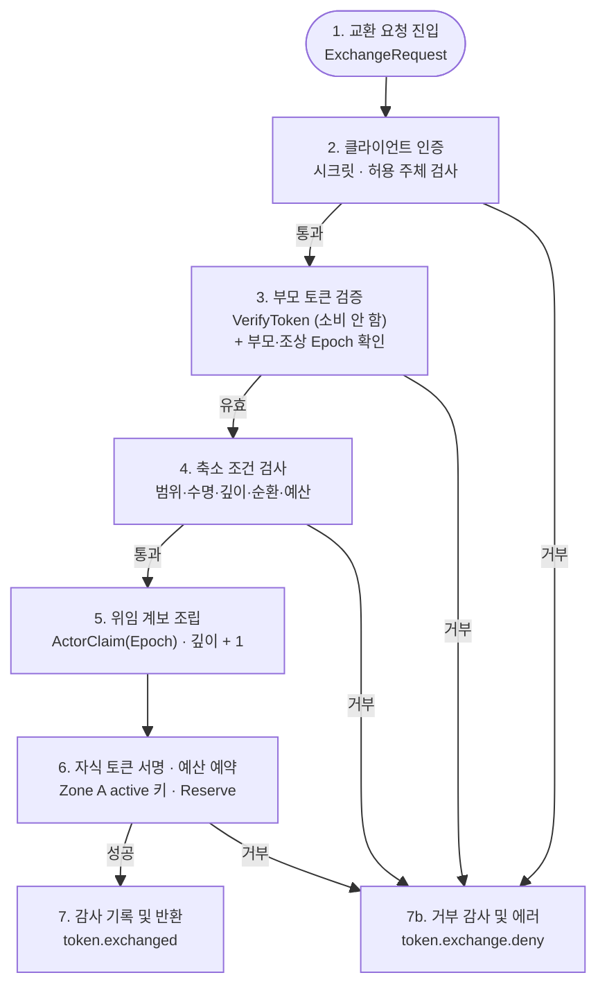

# 002. 토큰 발급·축소 위임(Exchange)과 서명 키 회전 — 부모 권한을 줄여서 자식에게 넘기고 위조·재사용을 막는 원리

> **모드**: `[문서작업]` — 소스코드 수정 없이 현재 구현된 토큰 발급(`issuer`), 축소 위임 교환(`exchange`), 서명 키 수명주기(`keys`), 재사용 방지 원장(`replay`)의 실제 동작과 이유(Why)를 해설합니다.  
> **기준일**: 2026-11-05 · **기준 커밋**: `5e77c45` (이 문서가 설명하는 `cmd/`와 `internal/`을 마지막으로 바꾼 커밋)  
> **검증 범위**: 동작·순서·소유자·시점을 코드와 대조한 결과와 「미확인」은 5부 ③에 있습니다.  
> **이 문서는 구현된 것만 적는다.** 계획·제안·미래형 약속은 적지 않으며, 현재 코드가 하지 않는 것은 「지금은 없다」고만 씁니다.  
> **이 문서의 규칙**: 본문(0~4부, Q&A, 그림, 5부 ①)은 쉬운 개념·설계·이유가 중심입니다. 파일·타입 이름 같은 고유 이름은 첫 등장에 한마디 설명과 함께 쓰고, 구현의 어디인지는 문단 끝 `(구현: 파일 · 함수, 5부 ② 번호)` 귀띔으로 보조합니다. 기준은 [프로그램 설명서 README의 「설명의 기준」과 「이름의 3층」](README.md)입니다.  
> **겹치는 주제**: 발급된 토큰이 일을 하기 직전에 관문에서 어떻게 검사받는지(`jti` 소비 시점 포함)는 [001. 전체 요청 여정과 관문](001-전체요청여정과_5단계관문.md)에서 다룹니다. 토큰에 붙는 예산(`Budget`)과 세대 번호(`Epoch`)는 이 문서에서 발급·교환 때 무엇을 검사하는지만 요약합니다. 예산이 어디서 생겨 자식에게 나뉘고 언제 얼마나 깎이는지는 [005편](005-승인_예산과_도구확장.md) Q4·Q5가 자세히 다룹니다.
>
> **다시 확인하는 법**
> ```bash
> git rev-parse --short HEAD
> git log -1 --format=%h -- cmd internal
> # 1. 토큰 발급·검증·재사용 차단 시험 실행
> go test -v ./internal/authn/token/... -run "Test"
> # 2. 축소 위임(Downscoping) 불변식 및 토큰 교환 시험 실행
> go test -v ./internal/authn/exchange/... -run "Test"
> # 3. 서명 키 생성·회전(rotate)·폐기(revoke) 시험 실행
> go test -v ./internal/authn/keys/... -run "Test"
> # 4. 핵심 함수 위치 확인
> grep -n "func " internal/authn/token/issuer.go internal/authn/exchange/service.go internal/authn/keys/manager.go
> ```

---

## 💡 사용자의 질문 (원문 보존)

> 다음편 써라

---

## 0. 모든 설계 이전에 ‘사람’이 있다 — 내 출입증을 그냥 빌려주면 편한데 왜 매번 새로 바꿔서 주나

팀장(`lead-01`)이 이미 파일 읽기(`file:read`)와 쓰기(`file:write`)를 모두 할 수 있는 1시간짜리 출입증(부모 토큰)을 받아 두었습니다. 이제 하위 일꾼(`worker-01`)에게 보고서 파일 하나만 읽어 오라고 심부름을 시키려 합니다.

사람의 눈에는 팀장이 가진 출입증을 그대로 복사해서 일꾼에게 넘겨주는 것이 가장 빨라 보입니다. 그런데 이 프로그램은 그렇게 하지 못하게 막고, 굳이 토큰 교환소(`ExchangeService`)를 찾아가 권한을 깎고 시간을 줄인 새 출입증(자식 토큰)을 발급받아 넘기게 합니다. 게다가 그 출입증에 도장을 찍는 열쇠 파일도 비밀 폴더(`.authz-state/private/`)와 공개 폴더(`.authz-state/public/`) 두 군데로 나누어 놓고, 도장을 새것으로 바꿀 때(`keys rotate`) 예전 도장을 바로 버리지도 않습니다.

읽는 사람은 이런 의문을 품게 됩니다.
- *「팀장 출입증을 그대로 빌려주면 왜 안 되나?」*
- *「권한을 줄여서 새 출입증을 만들 때, 팀장이 직접 적어서 주지 않고 왜 중앙 발급기(`TokenIssuer`)에 가서 도장을 받아야 하나?」*
- *「도장(서명 키)을 바꿨으면 예전 도장은 바로 버려야지, 왜 확인 전용(`verify-only`)이라는 상태로 남겨 두나?」*

이 설명서는 출입증 하나가 태어나서 일꾼용으로 줄어들고, 도장이 바뀌거나 폐기될 때 안에서 무슨 일이 일어나는지를 순서대로 펼쳐 보입니다.

---

## 1부. 왜 토큰을 줄여서 바꾸고, 왜 열쇠를 두 곳으로 나누어 돌리나

### 가장 밑바닥의 이유부터

1. **왜 팀장의 출입증(부모 토큰)을 일꾼에게 그대로 복사해 주면 안 되나?**  
   팀장 출입증에는 파일 읽기와 쓰기가 모두 허락되어 있고 남은 시간도 깁니다. 그 출입증을 그대로 받은 일꾼 프로세스가 버그를 일으키거나 공격자에게 조종당하면, 원래 시킨 파일 읽기만 하는 것이 아니라 중요 설정 파일을 덮어쓰는 일까지 팀장 이름으로 해버릴 수 있기 때문입니다. 또한 사고가 나도 팀장이 직접 한 일인지 일꾼이 한 일인지 구분할 수 없습니다.
2. **그러면 일꾼에게 일을 시킬 때 왜 권한을 더 늘려 줄 수는 없고 줄이는 것(`Downscoping`)만 되나?**  
   내가 가진 권한보다 더 큰 권한을 남에게 만들어 줄 수 있다면, 읽기 권한밖에 없는 사람이 일꾼을 하나 만들어 쓰기 권한을 쥐여 주는 식으로 권한 제한을 우회할 수 있기 때문입니다. 그래서 자식 출입증의 권한 범위(`Scope`)는 부모 출입증 범위의 부분집합이어야 하고, 만료 시각(`exp`)도 부모 출입증보다 같거나 더 빨라야 합니다.
3. **팀장이 자기 메모리에서 직접 「읽기 전용」이라고 적은 출입증을 만들면 안 되나? 왜 중앙 발급기(`TokenIssuer`)의 서명이 필요한가?**  
   누구나 출입증 글자를 고쳐 쓰고 스스로 도장을 찍을 수 있다면, 일꾼도 자기 손에 들어온 「읽기 전용」 출입증을 「쓰기 가능」으로 고쳐 쓸 수 있습니다. 출입증에 찍는 진짜 도장(Ed25519 개인키)은 오직 중앙 발급기만 쥐고 있어야 글자를 한 글자라도 바꿨을 때 서명 불일치(`TOKEN_INVALID_SIGNATURE`)로 잡아낼 수 있습니다.
4. **왜 도장을 찍는 비밀키(`signing_keys.priv.json`)와 도장을 대조하는 공개키(`jwks.pub.json`)를 다른 폴더로 갈라놓았나?**  
   파일을 열기 직전에 출입증을 검사하는 관문([001편](001-전체요청여정과_5단계관문.md)의 `pep.Gateway`)과 자식 일꾼(`subagent worker`)은 「이 도장이 진짜인가」만 확인할 수 있으면 됩니다. 만약 확인용 파일 안에 도장을 찍는 비밀 씨앗(`PrivSeed`)까지 함께 들어 있으면, 검증만 해야 하는 프로세스가 새 출입증을 위조할 수 있는 비밀키까지 메모리에 읽어 들이게 됩니다. 그래서 비밀키는 `0600` 권한의 Zone A에 숨기고, 비밀키를 뺀 공개키 목록만 `0644` 권한의 Zone B로 내보냅니다.
5. **도장을 새것으로 바꿀 때(`keys rotate`) 왜 예전 도장을 바로 폐기(`retired`)하지 않고 확인 전용(`verify-only`)으로 남겨 두나?**  
   운영자가 오후 2시 정각에 도장을 새것(`key-02`)으로 바꿨다고 해 봅시다. 그런데 1시 59분에 예전 도장(`key-01`)으로 찍힌 출입증을 받아 막 일을 하러 출발한 일꾼이 있습니다. 예전 도장을 즉시 폐기해 버리면, 아직 유효기간이 남은 정상 출입증까지 문 앞에서 전부 가짜로 몰려 작업이 끊깁니다. 그래서 정기 교체(`rotate`) 때는 「새 출입증에는 새 도장(`active`)만 찍되, 이미 나간 출입증을 검사할 때는 예전 도장(`verify-only`)도 인정한다」는 중간 단계를 두었습니다. 반대로 도장 자체가 유출되었을 때는 기존 출입증도 즉시 막아야 하므로 폐기(`keys revoke` → `retired`) 명령을 따로 두었습니다.

### 흔한 방식과 이 프로그램의 선택

| 구분 | 흔한 방식 (이 저장소에서 확인하지 않은 일반론) | 이 프로그램(`authz-harness`)의 선택 |
|---|---|---|
| **모양** | 환경변수에 고정 API 키 하나를 넣어 두고 부모와 자식 프로세스가 같은 키를 돌려 쓰거나, 단일 대칭키(HMAC 시크릿) 하나로 서명과 검증을 모두 처리한다. | Ed25519 비대칭키 쌍을 사용해 서명용 개인키(Zone A)와 검증용 공개키(Zone B)를 물리 파일로 분리하고, 자식에게 일을 시킬 때는 `ExchangeService`를 통해 권한과 수명이 줄어든 새 JWT 토큰을 발급받는다. |
| **얻는 것** | 별도의 토큰 교환 절차나 키 파일 분리 없이 설정 한 줄로 끝난다. | 검증 전용 프로세스(`VerifyOnly: true`)는 개인키 파일을 열지 않으므로 토큰을 위조할 수 없고, 자식 토큰이 유출되어도 허용된 좁은 스코프와 짧은 수명 안에서만 작동하며, `act` 클레임으로 누가 누구에게 시켰는지 계보가 남는다. |
| **포기하는 것** | 자식 프로세스가 부모와 똑같은 전체 권한을 갖게 되고, 검증하는 쪽도 대칭키를 알아야 하므로 키 유출 위험이 커진다. | 자식에게 일을 시킬 때마다 부모 토큰 검증 → 축소 조건 검사 → 자식 토큰 서명 및 감사 기록 과정을 거쳐야 한다. |

---

## 2부. 질문과 답변으로 풀어보는 핵심 동작 (Q&A)

### Q1. 처음 출입증(토큰)을 달라고 할 때(`token issue`) 자격은 어떻게 확인하고 어디서 도장을 찍나?
- **무슨 일이 일어나는가**:
  1. 명령줄(`token issue`)이나 내부 서비스가 발급 요청서인 `token.IssueRequest`를 만들어 토큰 발급 서비스인 `token.Service`의 `IssueToken` 함수를 부릅니다. (구현: [`cli/token.go`](../../internal/cli/token.go) · `TokenRunner.runIssue`, 5부 ② 1번 / [`issuer.go`](../../internal/authn/token/issuer.go) · `Service.IssueToken`, 5부 ② 2번)
  2. `IssueToken`은 먼저 클라이언트 등록부인 `InMemoryClientRegistry.AuthenticateClient`를 불러 요청한 `client_id`가 등록되어 있는지, 정지(`Active == false`)된 상태는 아닌지, 그리고 제출한 비밀번호(`client_secret`)가 맞는지 확인합니다. 이때 비밀번호 비교는 글자 길이나 틀린 위치에 따라 걸리는 시간이 달라지지 않도록 정시성 비교 함수(`subtle.ConstantTimeCompare`)를 씁니다. 인증에 실패하면 감사 장부(`audit.jsonl`)에 `token.issue.deny`를 남기고 중단합니다. 이 거부 기록마저 실패하면 원래 거부 대신 감사 실패(`AUDIT_LOG_FAILED`)로 중단합니다. (구현: [`client.go`](../../internal/authn/token/client.go) · `InMemoryClientRegistry.AuthenticateClient`, 5부 ② 3번)
     - *참고*: 기본 등록된 세 클라이언트(`client-orchestrator`, `client-subagent`, `client-admin`)의 비밀번호는 외부 DB 없이 로컬에서 바로 시험할 수 있도록 [`client.go`](../../internal/authn/token/client.go) 코드 안에 고정 문자열로 적혀 있으며, 왜 그 문자열 값인지는 별도의 수학적 이유가 없는 시험용 상수입니다.
  3. 클라이언트가 맞으면 `ClientInfo.IsSubjectAllowed`로 그 클라이언트가 해당 주체(`Subject`) 이름의 출입증을 신청할 자격이 있는지 확인합니다. 예를 들어 `client-orchestrator`는 모든 주체(`*`)를 신청할 수 있지만, `client-subagent`는 `worker-01`, `worker-02`, `worker-03` 세 이름만 신청할 수 있습니다. (구현: [`client.go`](../../internal/authn/token/client.go) · `ClientInfo.IsSubjectAllowed`, 5부 ② 3번)
  4. 자격이 확인되면 키 관리자(`keys.Manager.GetActiveSigningKey`)에게 현재 활성(`active`) 상태인 Zone A 개인키(`domain.SigningKey`)를 받아 옵니다. (구현: [`manager.go`](../../internal/authn/keys/manager.go) · `Manager.GetActiveSigningKey`, 5부 ② 4번)
  5. 난수 16바이트를 뽑아 32자리 16진수 일련번호(`jti`)를 만들고(`generateJTI`), 머리말(`typ: "at+jwt"`, `alg: "EdDSA"`, `kid`)과 내용물(`domain.TokenClaims`, 주체의 세대 번호 `epoch` 포함 — 지정하지 않으면 `1`, 명령줄 `--epoch`)을 Base64URL로 인코딩해 점(`.`)으로 이어 붙인 뒤 Ed25519 개인키로 서명합니다. 예산이 붙은 토큰(`Budget`: 호출 횟수·읽기·쓰기 바이트 상한)을 위임 없이 처음 발급하는 경우에는 예산 장부(`budget_ledger.json`)에 이 `jti`의 예산 칸을 만들어 둡니다(`Ledger.Init`). 예산 장부가 조립되어 있지 않으면 발급하지 않습니다. 마지막으로 원시 토큰 문자열은 뺀 채 `jti`, `kid`, `subject`, `scope`, `epoch`만 감사 장부(`audit.jsonl`)에 `token.issued`로 기록하고 토큰을 돌려줍니다. 만약 이 감사 기록이 실패하면 발급된 토큰을 돌려주지 않고 에러를 반환합니다. (구현: [`issuer.go`](../../internal/authn/token/issuer.go) · `Service.IssueToken`, 5부 ② 2번)
- **왜 그렇게 하나**: 아무 프로그램이나 팀장(`lead-01`) 명의의 토큰을 신청하지 못하게 클라이언트별 허용 주체(`AllowedSubs`)를 묶어 두고, 발급 사실이 감사 장부에 남지 않은 유령 토큰이 나가는 것을 막기 위해서입니다.
- **근거**: 5부 ② 항목 1, 2, 3, 4, 13번

### Q2. 팀장이 자기 출입증을 들고 와서 일꾼용 출입증으로 바꿔 달라고 하면(`token exchange`) 안에서 무엇을 따지나?
- **무슨 일이 일어나는가**:
  1. 교환 서비스인 `ExchangeService.Exchange`는 먼저 Q1과 똑같이 교환을 요청한 클라이언트의 비밀번호와 자식 주체(`ChildSubject`) 허용 여부를 검사합니다. 이후 어느 단계에서 거부하든 `token.exchange.deny`를 남기며, 이 거부 기록이 실패하면 감사 실패(`AUDIT_LOG_FAILED`)로 중단합니다. (구현: [`exchange/service.go`](../../internal/authn/exchange/service.go) · `ExchangeService.Exchange`, 5부 ② 5번)
  2. 그다음 팀장이 제출한 부모 토큰(`ParentToken`)을 `Verifier.VerifyToken`으로 검증합니다. 이때 `RecordReplay: false` 옵션을 주어서, 부모 토큰의 서명·만료·키 상태는 모두 검사하되 부모 토큰의 일련번호(`jti`)를 재사용 방지 장부에 사용 완료로 소모시키지는 않습니다. 부모가 같은 토큰으로 여러 자식에게 차례로 일을 나눠 줄 수 있어야 하기 때문입니다. 장부 사본 공급자(`WithSnapshotProvider`)가 배선된 기본 조립에서는 이어서 `lineage_epoch` 단계가 부모와 모든 `act` 조상의 세대 번호를 장부와 대조해, 취소된 계보면 `SUBJECT_EPOCH_REVOKED`로 이 자리에서 거부합니다([015편](015-4차원단조축소위임과_예산원장불변식.md) Q2). (구현: [`exchange/service.go`](../../internal/authn/exchange/service.go) · `ExchangeService.Exchange`, 5부 ② 5번)
  3. 부모 토큰이 진짜임이 확인되면 축소 검증기인 `DefaultDownscopeValidator.ValidateDownscope`가 다섯 가지 규칙을 순서대로 검사하고, 예산이 관련되면 여섯 번째 규칙을 더 검사합니다. (구현: [`validator.go`](../../internal/authn/exchange/validator.go) · `DefaultDownscopeValidator.ValidateDownscope`, 5부 ② 6번)
     - **① 빈 권한 거부**: 요청한 `Scope`가 비어 있으면 거부(`DELEGATION_SCOPE_EMPTY`)합니다.
     - **② 권한 부분집합 검사**: 요청한 자식 스코프들을 공백 기준으로 쪼개어(`ParseScopes`), 부모 토큰의 스코프 목록에 없는 항목이 하나라도 있으면 권한 초과(`DELEGATION_SCOPE_EXCEEDED`)로 거부합니다.
     - **③ 수명 상한 검사**: 현재 시각에 요청한 유효기간(`TTL`, 기본 1시간, CLI 기본 30분)을 더한 자식 만료 시각이 부모 토큰의 만료 시각(`parentClaims.ExpiresAt`)보다 뒤면 수명 초과(`DELEGATION_TTL_EXCEEDED`)로 거부합니다.
     - **④ 위임 깊이 상한 검사**: 부모의 위임 깊이(`DelegationDepth`)에 `1`을 더한 값이 최대 허용 깊이(`MaxDelegationDepth = 3`)를 넘으면 깊이 초과(`DELEGATION_DEPTH_EXCEEDED`)로 거부합니다. (왜 최대 깊이가 4나 5가 아니라 `3`인지는 다단계 위임을 시험하기 위해 정한 상수일 뿐 그 이상의 특별한 이유는 없습니다.)
     - **⑤ 자기 위임 및 순환 위임 차단**: 자식 주체(`ChildSubject`)가 부모 주체(`parentClaims.Subject`)와 같거나, 부모 토큰의 `Actor` 사슬(`act.act...`) 안에 이미 등장한 주체면 순환 위임(`DELEGATION_SELF_LOOP`)으로 거부합니다.
     - **⑥ 예산 축소 검사** (부모나 자식 어느 한쪽에 예산이 있을 때만): 부모에게 예산이 있으면 자식도 반드시 예산을 가져야 하고 그 값이 부모 상한 안이어야 합니다. 부모에게 예산이 없는데 자식만 예산을 요청해도 거부합니다(예산은 처음 발급에서만 시작). 어기면 예산 초과(`DELEGATION_BUDGET_EXCEEDED`)로 거부합니다. (구현: [`validator.go`](../../internal/authn/exchange/validator.go) · `ValidateBudgetDownscope`, 5부 ② 6번)
  4. 검사를 모두 통과하면 부모의 `Subject`, `JWTID`, 부모의 세대 번호(`Epoch`), 그리고 부모가 물려받았던 기존 `Actor`를 새 `domain.ActorClaim` 구조체로 감싸서 자식 토큰의 `act` 칸에 넣고, `DelegationDepth`를 1 늘려 `issuer.IssueToken`으로 자식 토큰을 발급합니다. 자식 자신의 세대 번호는 요청서의 `ChildEpoch`(비우면 `1`)를 씁니다. 교환소는 이 값이 장부와 맞는지 확인하지 않으며, 틀리면 자식이 일을 하려 할 때 관문의 정책 결정이 거부합니다([001편](001-전체요청여정과_5단계관문.md) Q3). 명령줄 `token exchange`에는 이 값을 정하는 옵션이 없어 항상 `1`입니다.
  5. 예산이 관련되면 자식 토큰을 서명한 직후 예산 장부에서 부모 잔여분 일부를 떼어 자식 칸으로 옮깁니다(`Ledger.Reserve`). 부모 칸이 없거나 잔여가 모자라면 거부하고, 이미 서명된 자식 토큰은 돌려주지 않습니다(이때 `token.issued` 기록은 이미 남아 있습니다).
  6. 마지막으로 감사 장부에 `parent_jti`, `parent_sub`, `child_jti`, `child_sub`, `delegation_depth`, `parent_epoch`, `child_epoch`를 담은 `token.exchanged` 이벤트를 기록합니다. 이 기록이 실패하면 자식 토큰을 돌려주지 않습니다. (구현: [`exchange/service.go`](../../internal/authn/exchange/service.go) · `ExchangeService.Exchange`, 5부 ② 5번)
- **왜 그렇게 하나**: 일꾼이 손에 쥔 자식 토큰 하나만 열어 보아도 「누가(`act.sub`) 어떤 토큰(`act.jti`)으로 몇 단계(`delegation_depth`)에 걸쳐 위임했는지」를 알 수 있어야, 나중에 파일을 열 때([001편](001-전체요청여정과_5단계관문.md)의 `pep.Gateway`) 상위 위임자(`caller_id`)를 감사 장부에 남길 수 있기 때문입니다.
- **근거**: 5부 ② 항목 5, 6, 13번

### Q3. 도장(서명 키)을 새로 만들거나 회전(`rotate`)·폐기(`revoke`)할 때 두 장부는 어떻게 어긋나지 않게 저장되나?
- **무슨 일이 일어나는가**:
  1. 키 관리자(`keys.NewManager`)가 처음 켜질 때, 비밀키 장부(`.authz-state/private/signing_keys.priv.json`)와 공개키 장부(`.authz-state/public/jwks.pub.json`)가 둘 다 비어 있고 검증 전용 모드가 아니면 첫 번째 Ed25519 키 쌍(`key-<시각>-01`, 상태 `active`)을 자동으로 만들어 저장합니다. 반면 검증 전용 모드(`VerifyOnly: true`로 `privPath`가 빈 문자열인 경우)에서는 공개키가 이미 있으면 개인키 생성을 건너뜁니다. (구현: [`manager.go`](../../internal/authn/keys/manager.go) · `NewManager`, 5부 ② 4번)
  2. 키 회전(`Manager.RotateKey`)을 실행하면 새 Ed25519 키 쌍을 만들어 `active`로 지정하고, 기존에 `active`였던 키들의 상태를 모두 `verify-only`로 바꾸며 회전 시각(`RotatedAt`)을 기록합니다. (구현: [`manager.go`](../../internal/authn/keys/manager.go) · `Manager.RotateKey`, 5부 ② 4번)
  3. 키 폐기(`Manager.RevokeKey`)를 실행하면 지정한 `kid`의 상태를 `retired`로 바꾸고 폐기 시각(`RetiredAt`)을 기록합니다. 만약 현재 `active`였던 키를 폐기했다면 `ActiveKID` 칸을 비워 버립니다. (구현: [`manager.go`](../../internal/authn/keys/manager.go) · `Manager.RevokeKey`, 5부 ② 4번)
  4. 변경된 키 상태를 디스크에 저장할 때(`FileStore.Save`), `storage.WithFileLock`으로 `.lock` 파일에 배타 잠금(`LOCK_EX`)을 먼저 건 상태에서 ① 비밀 씨앗(`PrivSeed`)이 포함된 전체 상태를 Zone A 파일(`0600`)에 임시 파일 작성 후 이름 바꾸기(Atomic Rename)로 저장하고, ② 곧바로 `ToJWKS()`를 호출해 `PrivSeed` 필드를 제거한 공개키 목록만 Zone B 파일(`0644`)에 똑같이 원자적으로 저장합니다. (구현: [`keys/store.go`](../../internal/authn/keys/store.go) · `FileStore.Save`, `ZoneAPrivateState.ToJWKS`, 5부 ② 7번 / [`storage/atomic.go`](../../internal/storage/atomic.go) · `AtomicFileStore.WriteUnlocked`, [`storage/file.go`](../../internal/storage/file.go) · `WithFileLock`, 5부 ② 8번)
  5. 토큰을 발급하는 조립(`app.BuildStack`에 재사용 방지 장부 경로가 있고 검증 전용이 아닌 경우: `token` 명령 등)은 시작할 때 활성 키가 없으면 스스로 `RotateKey`를 한 번 불러 새 활성 키를 만듭니다(감사 추적 번호 `builder-init-rotation`). 키 관리 명령(`keys`)은 재사용 방지 장부 경로 없이 조립되므로 이 자동 회전을 하지 않습니다. (구현: [`builder.go`](../../internal/app/builder.go) · `BuildStack`, 5부 ② 14번)
- **왜 그렇게 하나**: 비밀키 장부와 공개키 장부를 따로 고치다가 중간에 다른 프로세스가 끼어들면 「새 토큰은 새 키로 서명되었는데 공개키 장부에는 아직 새 키가 없는」 불일치가 생기므로, 하나의 파일 잠금 안에서 두 파일을 함께 갱신하기 위해서입니다.
- **근거**: 5부 ② 항목 4, 7, 8, 9, 14번

### Q4. 한 번 쓴 출입증을 다시 쓰지 못하게 막는 장부(`replay_ledger.json`)는 어떻게 관리되나?
- **무슨 일이 일어나는가**:
  1. 일을 집행하는 관문(`pep.Gateway`)은 정책 결정이 `ALLOW`를 낸 직후(`Verifier.ConsumeReplay`), `--record-replay` 옵션을 켠 `token verify`는 검증을 마칠 때 `FileReplayLedger.CheckAndConsume(jti, expiresAt)`을 부릅니다. 관문의 토큰 검사 단계는 소비하지 않고 `IsConsumed`로 이미 쓰였는지 읽기만 합니다. 예산이 붙은 토큰은 여러 번 쓰는 토큰이라 재사용 방지 장부를 아예 거치지 않습니다. (구현: [`verifier.go`](../../internal/authn/token/verifier.go) · `Verifier.VerifyToken`, `Verifier.ConsumeReplay`, 5부 ② 10번)
  2. `CheckAndConsume`은 `storage.AtomicFileStore[ReplayData].Update`를 통해 배타적 파일 잠금(`flock`)을 걸고 `.authz-state/public/replay_ledger.json`을 읽습니다. (구현: [`replay.go`](../../internal/authn/token/replay.go) · `FileReplayLedger.CheckAndConsume`, 5부 ② 11번)
  3. 장부의 `Entries` 목록에 같은 `jti`가 이미 들어 있으면 재사용 공격(`ErrReplayDetected`, `TOKEN_REPLAY_DETECTED`) 에러를 돌려주고 장부를 고치지 않습니다.
  4. 처음 보는 `jti`라면, 기존 목록 중에서 이미 만료 시각(`ExpiresAt`)이 현재 시각(`now`)보다 지난 오래된 항목들을 먼저 걸러내어 버리고(청소), 그 뒤에 새 `jti`와 소비 시각(`ConsumedAt`), 만료 시각(`ExpiresAt`)을 추가해 임시 파일 교체 방식으로 저장합니다. (구현: [`replay.go`](../../internal/authn/token/replay.go) · `FileReplayLedger.CheckAndConsume`, 5부 ② 11번)
- **왜 그렇게 하나**: 쓰인 일련번호를 영원히 모아 두기만 하면 장부 파일이 끝없이 커지는데, 어차피 만료 시각(`exp`)이 지난 토큰은 장부에 없어도 앞선 시간 검사 단계에서 만료(`TOKEN_EXPIRED`)로 막히므로 만료된 일련번호는 지워도 안전하기 때문입니다.
- **근거**: 5부 ② 항목 8, 10, 11번

---

## 3부. 내부 지도 — 한 번의 여정과 직접 확인하는 법



(구현: [`exchange/service.go`](../../internal/authn/exchange/service.go) — `ExchangeService.Exchange`가 클라이언트 인증, 부모 토큰 검증, `ValidateDownscope`·`ValidateBudgetDownscope` 축소 검사, `ActorClaim` 조립, `IssueToken` 서명, 예산 예약을 차례로 수행합니다, 5부 ② 2·5·6·13번)

### 어디에 무엇이 남나

| 무엇 | 어디에 | 언제 | 사람이 직접 여는 법 |
|---|---|---|---|
| **발급·교환된 토큰과 위임 요약 표** | 표준 출력 (`stdout`) | `token issue`, `token exchange`, `keys list/rotate/revoke` 실행 직후 | 터미널 화면에서 읽거나 `authz-harness token inspect --token "<토큰>"`으로 머리말·내용물을 JSON으로 풀어 본다 |
| **서명용 비밀키 원장 (Zone A)** | `.authz-state/private/signing_keys.priv.json` | 최초 기동 부트스트랩, `keys rotate`, `keys revoke` 실행 시점 | `cat .authz-state/private/signing_keys.priv.json`으로 `active_kid`와 `priv`(비밀 씨앗)를 확인한다 (권한 `0600`) |
| **검증용 공개키 원장 (Zone B)** | `.authz-state/public/jwks.pub.json` | `FileStore.Save`가 Zone A를 저장할 때마다 동시에 투영 저장 | `cat .authz-state/public/jwks.pub.json` 또는 `authz-harness keys list`로 비밀키가 빠진 공개키 목록과 상태(`active`/`verify-only`/`retired`)를 확인한다 |
| **일회성 토큰 소비 원장 (Zone B)** | `.authz-state/public/replay_ledger.json` | 관문의 정책 결정 `ALLOW` 직후 또는 `token verify --record-replay` 통과 시점 | `cat .authz-state/public/replay_ledger.json`으로 사용 완료된 `jti` 목록을 확인한다 |
| **예산 원장 (Zone B)** | `.authz-state/public/budget_ledger.json` (재사용 방지 장부와 같은 폴더) | 예산 루트 토큰 발급(`Init`), 예산 교환(`Reserve`), 사용(`Consume`) 시점 | `cat`으로 토큰별 남은 횟수·바이트와 부모-자식 연결을 확인한다 |
| **발급·교환·키변경 감사 기록** | `audit.jsonl` | 토큰 발급(`token.issued`/`token.issue.deny`), 교환(`token.exchanged`/`token.exchange.deny`), 키 변경(`key.created`/`key.rotated`/`key.revoked`), 키 변경의 거부(`key.rotate.deny`/`key.revoke.deny`)와 이미 폐기된 키의 재폐기(`key.revoke.noop`) 시점 | `cat audit.jsonl`로 원시 토큰 없이 기록된 `parent_jti`, `child_jti`, `old_active_kid`, `new_active_kid`를 확인한다 |

### 이상이 생기면

| 상황 | 일어나는 일 |
|---|---|
| **미등록 클라이언트, 정지된 클라이언트, 또는 틀린 시크릿으로 발급·교환 시도** | `AuthenticateClient`가 에러(`AUTHN_UNKNOWN_CLIENT`, `AUTHN_CLIENT_SUSPENDED`, `AUTHN_INVALID_SECRET`)를 내고, `token.issue.deny` 또는 `token.exchange.deny` 감사를 남긴 뒤 종료 코드 `11`(`ExitTokenInvalid`)을 돌려준다. `token issue`·`token verify`·`token exchange`는 오류의 사유에 따른 종료 코드를 돌려주며, 인증 실패는 사유 코드가 `11`이라 그대로 `11`이다. |
| **클라이언트가 허용되지 않은 주체(`Subject`) 명의로 토큰 신청** | 예: `client-subagent`가 `lead-01` 명의로 신청하면 `IsSubjectAllowed`가 거부하고 `NO_ACTIVE_GRANT` 에러를 돌려준다. |
| **부모 예산보다 큰 예산, 부모에 예산이 있는데 예산 없는 자식, 또는 부모 예산 잔여 부족** | `ValidateBudgetDownscope` 또는 `Ledger.Reserve`가 거부하고(`DELEGATION_BUDGET_EXCEEDED` 등, 종료 코드 `12`) `token.exchange.deny`를 남긴다. 잔여 부족으로 예약에서 막히면 이미 서명된 자식 토큰은 버려진다. |
| **부모 토큰에 없는 권한(`Scope`)이나 부모 만료 시각보다 긴 `TTL`로 자식 토큰 교환 시도** | `ValidateDownscope`가 `DELEGATION_SCOPE_EXCEEDED` 또는 `DELEGATION_TTL_EXCEEDED` 에러를 내고 `token.exchange.deny` 감사를 남긴다. 자식 토큰은 만들어지지 않는다. |
| **위임 깊이(`DelegationDepth`)가 3을 넘거나, 부모 자신 또는 이미 `act` 사슬에 있는 주체로 위임 시도** | `ValidateDownscope`가 `DELEGATION_DEPTH_EXCEEDED` 또는 `DELEGATION_SELF_LOOP` 에러를 내고 교환을 중단한다. |
| **현재 `active` 서명 키를 `keys revoke`로 폐기한 뒤 새 키를 회전(`rotate`)하지 않고 토큰 발급 시도** | `RevokeKey`가 `ActiveKID`를 빈 문자열로 비운다. 그러나 `token issue`를 실행하면 그 조립 과정(`BuildStack`)이 활성 키 없음을 보고 자동으로 새 키를 회전해 만들고(`key.rotated`, 추적 번호 `builder-init-rotation`) 발급은 그 새 키로 진행된다. 같은 프로세스 안에서 조립 뒤에 폐기한 경우에만 `GetActiveSigningKey`가 `ErrNoActiveKey`를 내며 발급이 멈춘다. |
| **발급·교환·검증의 성공 또는 거부 시점에 감사 파일(`audit.jsonl`) 쓰기가 실패함** | 성공 감사(`token.issued`, `token.exchanged`)는 감사 쓰기 실패 시 토큰을 돌려주지 않고 에러를 반환한다. 키 관리의 `key.rotated`·`key.revoked`·`key.created`는 저장이 끝난 뒤에 기록하므로, 감사 쓰기가 실패해도 회전·폐기·최초 키 생성은 되돌리지 않고 적용된 채 `AUDIT_LOG_FAILED`(종료 코드 `15`)로 알린다(ADR 0010, 계획 018). 운영자는 감사를 복구한 뒤 `keys list`로 상태를 확인한다. 발급 거부(`token.issue.deny`), 교환 거부(`recordAuditDenied`), 토큰 검증 거부(`Verifier.logAudit`)도 감사 쓰기가 실패하면 원래 거부 사유 대신 `AUDIT_LOG_FAILED`(종료 코드 `15`)를 돌려준다. `token issue`의 실패는 입구(`IssueToken`)에서 한 곳에서 `token.issue.deny`로 남는다. 허용되지 않은 주체(`NO_ACTIVE_GRANT`)·빈 주체(`INVALID_ARGUMENTS`)·클레임 검증 실패·활성 서명 키 없음(`INTERNAL_ERROR`)도 모두 기록하고, 종료 코드는 사유를 따른다(허용되지 않은 주체는 `12`). 감사 파일이 망가진 상태의 `token issue`·`verify`·`exchange`는 `15`, 교환의 축소 위임 위반은 사유별 코드(`12`)다. |

---

## 4부. 배척한 방식과 그 이유

1. **부모 토큰을 자식에게 그대로 건네주거나, 오케스트레이터가 직접 토큰을 서명하는 방식**:
   - **택했다면 무슨 일이 생기는가**: 교환 절차가 없어져 구현은 단순해지지만, 자식 워커가 부모의 모든 권한을 행사할 수 있게 되거나 오케스트레이터가 Zone A 개인키 파일을 직접 읽어야 해서 신뢰 경계가 무너집니다.
   - **그 대신 포기한 것**: 부모 토큰을 그대로 전달하는 간편함을 포기하고, 오케스트레이터도 `ExchangeService`에 부모 토큰을 제출해 축소된 자식 토큰을 발급받아 넘기는 구조를 택했습니다.
2. **개인키와 공개키를 한 파일에 두고 모든 프로세스가 같이 읽는 방식**:
   - **택했다면 무슨 일이 생기는가**: 키 저장소 파일이 하나뿐이라 관리하기 편하지만, 토큰 검증만 수행하는 `pep`나 `subagent` 프로세스도 메모리에 서명용 개인키 시드를 올리게 됩니다.
   - **그 대신 포기한 것**: 단일 키 파일의 단순함을 포기하고, `FileStore.Save`가 저장할 때마다 비밀 시드를 포함한 `signing_keys.priv.json`(Zone A, `0600`)과 공개키만 추려낸 `jwks.pub.json`(Zone B, `0644`) 두 파일로 분리해 기록하고 검증 전용 스택(`VerifyOnly: true`)은 Zone A 경로를 아예 비워 두는 방식을 택했습니다.
3. **키 회전(`rotate`) 시 이전 키를 즉시 삭제하거나 `retired`로 만들어 버리는 방식**:
   - **택했다면 무슨 일이 생기는가**: 키 상태가 `active`와 `retired` 두 가지만 있으면 되어 코드가 간단해지지만, 키를 회전하는 순간 기존 키로 방금 발급된 유효 토큰들이 전부 서명 검증에 실패합니다.
   - **그 대신 포기한 것**: 이분법적인 키 상태를 포기하고, 신규 서명에는 쓰지 않되 기존 토큰 검증만 허용하는 `verify-only` 상태를 두어 `active` → `verify-only`(회전 시) → `retired`(폐기 시)의 3단계 수명주기를 택했습니다.
4. **클라이언트 시크릿을 일반 문자열 비교(`==`)로 검사하는 방식**:
   - **택했다면 무슨 일이 생기는가**: 첫 글자가 틀릴 때와 마지막 글자가 틀릴 때 함수가 끝나는 미세한 시간 차이가 생겨, 반복 측정으로 비밀번호를 추측하는 여지가 생깁니다.
   - **그 대신 포기한 것**: `==` 연산자 대신 바이트 길이를 비교하며 일정한 시간이 걸리는 `subtle.ConstantTimeCompare`를 사용했습니다.

---

## 5부. 한눈에 보는 대조표와 코드 정본

### ① 행동별 안에서 일어나는 일과 지금은 없는 것

| 행동 | 안에서 일어나는 일 | 지금은 없는 것 | 근거 |
|---|---|---|---|
| **클라이언트 인증 및 주체 자격 확인** | `InMemoryClientRegistry.AuthenticateClient`가 정시성 비교로 시크릿을 확인하고, `ClientInfo.IsSubjectAllowed`가 요청한 `Subject` 허용 여부를 확인한다. | 외부 파일이나 데이터베이스에서 클라이언트 목록을 동적으로 읽어 오거나 CLI로 새 클라이언트를 추가하는 기능은 지금은 없다. | 5부 ② 2, 3, 5번 |
| **신규 토큰 서명 발급** (`token issue`) | `Manager.GetActiveSigningKey`로 Zone A `active` 키를 가져와 난수 `jti`와 클레임을 채우고 Ed25519로 서명한 뒤 `token.issued` 감사를 남긴다. | 장기 갱신용 리프레시 토큰(Refresh Token) 발급은 지금은 없다. | 5부 ② 1, 2, 4번 |
| **축소 위임 토큰 교환** (`token exchange`) | 부모 토큰을 소비 없이 검증한 뒤 `ValidateDownscope`로 범위 부분집합·수명 상한·깊이(`<=3`)·순환 위임을, 예산이 관련되면 `ValidateBudgetDownscope`로 예산 축소를 검사하고, 부모 `Epoch`를 담은 `ActorClaim`을 중첩해 새 자식 토큰을 발급한 뒤 예산을 예약한다. | 부모 토큰의 스코프가 와일드카드이거나 정규식일 때 패턴 매칭으로 부분집합을 계산하는 기능은 지금은 없다(정확히 일치하는 스코프 문자열 집합 비교만 수행). 교환 시 `ChildEpoch`를 장부와 대조하는 검사와 명령줄에서 `ChildEpoch`·예산을 지정하는 옵션은 지금은 없다. | 5부 ② 1, 5, 6, 13번 |
| **서명 키 회전 및 폐기** (`keys rotate` / `revoke`) | `RotateKey`는 기존 `active`를 `verify-only`로 옮기고 새 `active` 키를 만들며, `RevokeKey`는 대상 키를 `retired`로 바꾸고 `FileStore.Save`로 Zone A·B에 동시 반영한다. 발급 조립은 활성 키가 없으면 시작 시 한 번 자동 회전한다. | 일정 시간이 지나면 자동으로 키를 회전하거나 오래된 `retired` 키를 파일에서 자동 삭제하는 스케줄러는 지금은 없다. | 5부 ② 4, 7, 8, 9번 |
| **일회성 토큰 소비 및 만료 청소** (`CheckAndConsume`, 관문에서는 `ALLOW` 직후) | `FileReplayLedger`가 `replay_ledger.json`에 배타 잠금을 걸고 중복 `jti`를 거부하며, 새 `jti` 등록 시 이미 만료된 항목을 함께 지운다. | 여러 대의 서버가 네트워크(Redis 등)로 공유하는 분산 Replay 원장은 지금은 없다(로컬 파일 잠금 기반). | 5부 ② 8, 10, 11번 |

### ② 어디서 하나 (코드 정본 색인)

1. **명령줄 토큰 러너 (`issue`/`inspect`/`verify`/`exchange`)**: [`internal/cli/token.go`](../../internal/cli/token.go) (`NewTokenRunner`, `TokenRunner.runIssue`, `TokenRunner.runInspect`, `TokenRunner.runVerify`, `TokenRunner.runExchange`) — 구현: Step 3 (`b5049c5`)
2. **토큰 발급 서비스**: [`internal/authn/token/issuer.go`](../../internal/authn/token/issuer.go) (`NewService`, `Service.IssueToken`, `generateJTI`) — 구현: 08-010 (`98aafbc`)
3. **클라이언트 등록부 및 정시성 인증**: [`internal/authn/token/client.go`](../../internal/authn/token/client.go) (`NewInMemoryClientRegistry`, `InMemoryClientRegistry.AuthenticateClient`, `ClientInfo.IsSubjectAllowed`) — 구현: P07-010 (`50e98aa` 이전)
4. **서명 키 수명주기 관리자 (`active`/`verify-only`/`retired`)**: [`internal/authn/keys/manager.go`](../../internal/authn/keys/manager.go) (`NewManager`, `Manager.GetActiveSigningKey`, `Manager.GetVerificationKey`, `Manager.RotateKey`, `Manager.RevokeKey`) — 구현: 08-010 (`98aafbc`)
5. **RFC 8693 토큰 교환 서비스**: [`internal/authn/exchange/service.go`](../../internal/authn/exchange/service.go) (`NewExchangeService`, `ExchangeService.Exchange`, `ExchangeService.recordAuditDenied`) — 구현: 08-010 (`98aafbc`)
6. **축소 위임(`Downscoping`) 불변식 검증기**: [`internal/authn/exchange/validator.go`](../../internal/authn/exchange/validator.go) (`DefaultDownscopeValidator.ValidateDownscope`, `ValidateBudgetDownscope`, `ParseScopes`, `MaxDelegationDepth`) — 구현: P07-010 (`50e98aa` 이전), P12
7. **Zone A(비밀키) · Zone B(공개키) 분리 저장소**: [`internal/authn/keys/store.go`](../../internal/authn/keys/store.go) (`NewFileStore`, `FileStore.LoadPrivate`, `FileStore.LoadPublic`, `FileStore.Save`, `ZoneAPrivateState.ToJWKS`, `GenerateEd25519Entry`) — 구현: Step 2 (`36a76bc`)
8. **제네릭 원자적 파일 저장소 및 `flock` 잠금**: [`internal/storage/atomic.go`](../../internal/storage/atomic.go) (`NewAtomicFileStore`, `AtomicFileStore.Update`, `AtomicFileStore.WriteUnlocked`), [`internal/storage/file.go`](../../internal/storage/file.go) (`WithFileLock`, `AtomicWriteFile`) — 구현: Step 1 (`243ff06`), 계획003
9. **명령줄 키 관리 러너 (`list`/`rotate`/`revoke`)**: [`internal/cli/keys.go`](../../internal/cli/keys.go) (`NewKeysRunner`, `KeysRunner.runList`, `KeysRunner.runRotate`, `KeysRunner.runRevoke`) — 구현: P02 (`50e98aa` 이전)
10. **토큰 9단계 검증기와 `jti` 소비**: [`internal/authn/token/verifier.go`](../../internal/authn/token/verifier.go) (`Verifier.VerifyToken`, `Verifier.ConsumeReplay`, `Verifier.InspectToken`) — 구현: P07-030 (`50e98aa` 이전), P15
11. **일회성 `jti` 재사용 방지 원장**: [`internal/authn/token/replay.go`](../../internal/authn/token/replay.go) (`NewFileReplayLedger`, `FileReplayLedger.CheckAndConsume`, `FileReplayLedger.IsConsumed`, `FileReplayLedger.PruneExpired`) — 구현: Step 2 (`36a76bc`)
12. **시험**: [`internal/authn/token/token_test.go`](../../internal/authn/token/token_test.go), [`internal/authn/exchange/exchange_test.go`](../../internal/authn/exchange/exchange_test.go)(같은 폴더의 `budget_exchange_test.go`, `reexchange_test.go`, `audit_failclosed_test.go` 포함), [`internal/authn/keys/keys_test.go`](../../internal/authn/keys/keys_test.go)의 `Test...` 함수들 (개수는 `go test ./...`로 확인)
13. **예산 원장과 예산 타입**: [`internal/authn/budget/ledger.go`](../../internal/authn/budget/ledger.go) (`Ledger`, `FileLedger.Init`, `FileLedger.Reserve`, `FileLedger.Consume`, `FileLedger.Refund`), [`internal/domain/budget.go`](../../internal/domain/budget.go) (`Budget`, `Budget.Within`) — 구현: P12
14. **발급 조립 시 자동 키 회전**: [`internal/app/builder.go`](../../internal/app/builder.go) (`BuildStack`의 초기 `RotateKey` 블록) — 구현: 08-010 (`98aafbc`), P17-030

### ③ 검증 범위와 「미확인」

검증 방법: 위 5부 ②의 1~14번 소스 파일을 기준 커밋 `5e77c45`에서 직접 열어 코드를 대조하고, macOS(darwin) 환경에서 `go test ./internal/authn/...`를 실행해 통과를 확인했습니다. 2026-11-06 재대조: Q2의 교환 서술을 `exchange/service.go`(파이프라인 단계 순서)와 읽어 대조해 `lineage_epoch` 단계(부모·조상 세대 번호 조기 확인)를 더했고, 나머지 순서(서명 → 예약 → 성공 감사)는 이미 맞았습니다. 백틱 식별자 일괄 대조에서 누락은 없었습니다.

| 항목 | 동작 | 순서 | 소유자 | 시점 | 미확인 사항 |
|---|---|---|---|---|---|
| **Q1 (클라이언트 인증 및 신규 토큰 서명 발급, ② 1~4번)** | 확인 | 확인 | 확인 (`InMemoryClientRegistry`, `token.Service`, `keys.Manager`) | 확인 (`token issue` 또는 내부 발급 호출 시) | 없음 |
| **Q2 (부모 토큰 검증, 축소·예산 불변식 검사, `ActorClaim` 중첩 교환, 예산 예약, ② 5, 6, 13번)** | 확인 | 확인 | 확인 (`ExchangeService.Exchange`, `ValidateDownscope`, `ValidateBudgetDownscope`, `FileLedger.Reserve`) | 확인 (`token exchange` 또는 라이브러리 교환 호출 시) | 없음 |
| **Q3 (Zone A 개인키 · Zone B 공개키 분리 저장, `rotate`/`revoke` 상태 전이, 발급 조립 자동 회전, ② 4, 7~9, 14번)** | 확인 | 확인 | 확인 (`keys.Manager`, `keys.FileStore`, `storage.AtomicFileStore`) | 확인 (초기 부트스트랩 및 키 회전·폐기 시) | Windows 환경에서의 `0600`/`0644` 파일 퍼미션 강제 및 `syscall.Flock` 동작은 현재 macOS 환경이라 직접 확인하지 못함 (**미확인**) |
| **Q4 (`jti` 재사용 소비 등록 및 만료 항목 청소, ② 8, 10, 11번)** | 확인 | 확인 | 확인 (`Verifier.ConsumeReplay`·`Verifier.VerifyToken` → `FileReplayLedger.CheckAndConsume`) | 확인 (관문 `ALLOW` 직후, 또는 `RecordReplay: true` 검증 통과 시) | 없음 |
