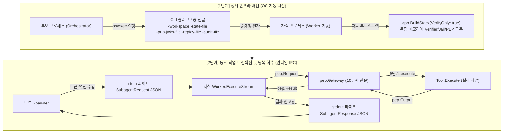
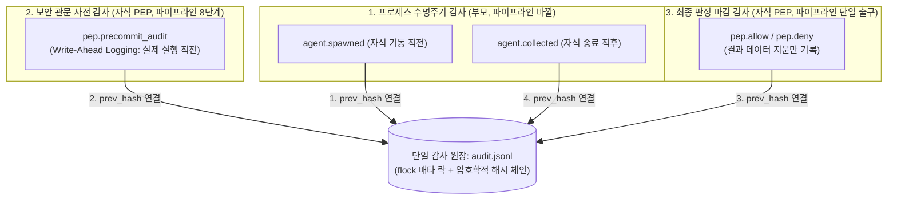

# 003. 부모-자식 서브프로세스 격리와 해시 체인 감사 — 별도 프로세스로 일을 시키고 위변조를 가려내는 원리

> **모드**: `[문서작업]` — 소스코드 수정 없이 현재 구현된 부모-자식 프로세스 격리(`orchestrator`·`subagent`)와 해시 체인 감사(`audit`·`cli/audit`)의 실제 동작과 이유(Why)를 해설합니다.  
> **기준일**: 2026-11-05 · **기준 커밋**: `5f0ab2a` (이 문서가 설명하는 `cmd/`와 `internal/`을 마지막으로 바꾼 커밋)  
> **검증 범위**: 동작·순서·소유자·시점을 코드와 대조한 결과와 「미확인」은 5부 ③에 있습니다.  
> **이 문서는 구현된 것만 적는다.** 계획·제안·미래형 약속은 적지 않으며, 현재 코드가 하지 않는 것은 「지금은 없다」고만 씁니다.  
> **이 문서의 규칙**: 본문(0~4부, Q&A, 그림, 5부 ①)은 쉬운 개념·설계·이유가 중심입니다. 파일·타입 이름 같은 고유 이름은 첫 등장에 한마디 설명과 함께 쓰고, 구현의 어디인지는 문단 끝 `(구현: 파일 · 함수, 5부 ② 번호)` 귀띔으로 보조합니다. 기준은 [프로그램 설명서 README의 「설명의 기준」과 「이름의 3층」](README.md)입니다.  
> **겹치는 주제**: 자식 프로세스 안에서 돌아가는 관문은 [001편](001-전체요청여정과_5단계관문.md)에서, 자식에게 넘길 출입증을 줄여서 발급받는 과정은 [002편](002-토큰발급_축소위임과_서명키회전.md)에서, 2단계(2-Hop) 연쇄 위임과 MCP 게이트웨이는 [004편](004-다단계위임과_MCP도구게이트웨이.md)에서 다룹니다. 운영체제 격리(`internal/confinement`)와 서명 체크포인트(`internal/audit/checkpoint`)의 세부는 [006편](006-OS격리_관측성과_감사체크포인트.md)이 다루며, 이 문서에서는 요약만 합니다.
>
> **다시 확인하는 법**
> ```bash
> git rev-parse --short HEAD
> git log -1 --format=%h -- cmd internal
> # 1. 오케스트레이터 서브프로세스 스폰·환경변수 정제·동시성 시험 실행
> go test -v ./internal/orchestrator/... ./internal/subagent/... -run "Test"
> # 2. 해시 체인 감사 기록·변조 탐지·체크포인트·타임라인 시험 실행
> go test -v ./internal/audit/... ./internal/cli -run "TestAudit|TestOrchestrate"
> # 3. 핵심 함수 위치 확인
> grep -n "func " internal/orchestrator/spawner.go internal/subagent/worker.go internal/audit/audit.go
> ```

---

## 💡 사용자의 질문 (원문 보존)

> 다음편 써라

---

## 0. 모든 설계 이전에 ‘사람’이 있다 — 그냥 함수 하나 부르면 빠를 텐데 왜 새 프로그램을 띄우고 장부에 사슬을 채우나

프로그램 안에서 일꾼에게 파일 하나를 읽어 오라고 시키는 가장 쉬운 방법은 그냥 파일 읽는 함수를 바로 부르거나 가벼운 내부 작업 스레드(Go의 고루틴)를 하나 띄우는 것입니다. 그런데 이 프로그램은 굳이 운영체제에게 새 프로세스(`authz-harness subagent worker`)를 통째로 새로 띄우라고 시키고, 명령줄 인자 대신 보이지 않는 파이프(`stdin`)로 요청을 밀어 넣습니다.

게다가 부모 프로세스와 자식 프로세스가 같은 감사 장부(`audit.jsonl`)에 기록을 남길 때마다, 매번 앞 줄의 암호 요약값(`prev_hash`)을 읽어 와서 새 줄의 요약값(`curr_hash`)에 엮어 넣습니다.

읽는 사람은 이런 의문을 품게 됩니다.
- *「함수 호출이나 고루틴으로 돌리면 훨씬 빠를 텐데, 왜 무겁게 별도 운영체제 프로세스로 띄우나?」*
- *「자식 프로세스를 띄울 때 왜 명령줄 옵션(`-token eyJ...`)으로 토큰을 안 넘기고 표준 입력(`stdin`) 파이프로 넘기나?」*
- *「부모와 자식이 동시에 같은 `audit.jsonl` 파일에 글을 쓰면 줄이 섞이지 않나? 그리고 왜 줄마다 복잡한 해시값을 계산해서 이어 붙이나?」*

이 설명서는 부모가 자식을 별도 프로세스로 격리해 일을 시키는 과정과, 여러 프로세스가 하나의 감사 장부에 빈틈없이 사슬을 이어 기록하는 원리를 순서대로 펼쳐 보입니다.

---

## 1부. 왜 별도 프로세스로 띄우고, 왜 감사 장부를 사슬로 묶나

### 가장 밑바닥의 이유부터

1. **왜 함수 호출이나 고루틴 대신 별도의 운영체제 프로세스(`os/exec`)로 일꾼을 띄우나?**  
   같은 프로세스 안에서 도는 함수나 고루틴은 모두 같은 메모리 방을 씁니다. 만약 일꾼 코드에 결함이 있거나 나쁜 입력을 받아 메모리를 뒤지면, 부모가 메모리에 들고 있던 비밀 열쇠나 다른 작업의 데이터까지 그대로 읽을 수 있습니다. 또한 일꾼이 치명적인 오류로 죽으면 부모 프로세스까지 함께 죽습니다. 운영체제가 나누어 준 별도 프로세스로 띄워야 메모리 방이 분리되고, 일꾼이 죽어도 부모는 종료 코드(`ExitCode`)만 받아 들고 살아남을 수 있기 때문입니다.
2. **별도 프로세스로 띄우기만 하면 충분한가? 왜 부모의 환경변수를 솎아 내고(`SanitizeEnv`) 토큰을 표준 입력(`stdin`)으로 넘기나?**  
   운영체제는 자식 프로세스를 만들 때 부모 프로세스의 환경변수 목록을 기본으로 복사해 줍니다. 만약 부모 환경변수에 비밀키 경로(`ZONE_A_...`)나 시크릿(`SECRET_...`)이 들어 있었다면 자식도 그대로 읽게 됩니다. 또한 자식에게 출입증(토큰)을 넘길 때 명령줄 인자(`authz-harness subagent worker -token eyJ...`)로 넘기면, 같은 컴퓨터에서 돌아가는 다른 프로그램이 프로세스 목록(`ps aux`)을 조회했을 때 토큰 문자열이 그대로 노출됩니다. 그래서 환경변수는 꼭 필요한 기본 8개만 남기고, 토큰은 프로세스 목록에 보이지 않는 표준 입력(`stdin`) 파이프로 한 번 흘려보낸 뒤 닫습니다.
3. **부모와 자식이 같은 감사 장부(`audit.jsonl`)에 적을 때 왜 별도의 잠금 파일(`audit.jsonl.lock`)을 쓰나?**  
   Go 언어 안의 뮤텍스(`sync.Mutex`)는 한 프로세스 안의 고루틴끼리만 순서를 지켜 줄 뿐, 별도로 떠 있는 부모 프로세스와 자식 프로세스 사이에서는 서로의 존재를 모릅니다. 두 프로세스가 동시에 파일 끝에 글을 쓰면 두 줄이 한 줄로 뒤엉켜 JSON 형식이 깨지거나, 둘 다 같은 직전 줄을 보고 해시를 계산해 사슬이 두 갈래로 갈라집니다. 그래서 운영체제 커널이 프로세스들 사이의 순서를 잡아 주는 파일 잠금(`syscall.Flock`)을 먼저 획득한 쪽만 파일 끝을 읽고 쓰게 했습니다.
4. **감사 장부에 그냥 시간순으로 한 줄씩 적으면 되지, 왜 앞 줄의 해시(`prev_hash`)를 다음 줄 해시(`curr_hash`) 계산에 넣나?**  
   일반 로그 파일은 나중에 누군가 텍스트 편집기로 열어 중간에 불리한「차단(`deny`)」기록 한 줄을 지우거나「허용(`allow`)」으로 글자를 바꿔 놓아도 알아차릴 방법이 없습니다. 하지만 1번 줄의 계산 결과(`curr_hash`)를 2번 줄의 `prev_hash`에 적고 그것을 재료로 2번 줄의 `curr_hash`를 계산해 두면, 누군가 1번 줄의 글자 하나만 고치거나 지워도 1번 줄의 해시가 바뀌어 2번 줄부터 맨 끝 줄까지 사슬이 전부 끊어집니다.
5. **해시를 계산할 때 왜 JSON 한 줄 전체를 그대로 넣지 않고 정해진 핵심 항목만 길이를 붙여 이어 붙여 계산하나?**  
   Go 언어에서 JSON 문자열을 다시 구조체로 읽어들일 때(`json.Unmarshal`), 부가 정보 맵(`Metadata`) 안의 숫자 타입이나 시간 나노초 표기 방식이 처음 쓸 때와 미세하게 달라질 수 있습니다. JSON 원문 전체로 해시를 재계산하면 아무도 파일을 건드리지 않았는데도 표기 차이 때문에 변조로 오판(거짓 양성)할 수 있으므로, 변하지 않는 핵심 항목만 골라 계산합니다. 지금 쓰는 기록은 모두 4판 형식(`schema_version: 4`)이며, 항목마다 「글자 수(바이트):값」을 차례로 이어 붙인 문자열(맨 앞에 `authz-audit-v4` 표지)의 SHA-256을 구합니다. 4판은 3판의 항목에 파이프라인 단계 값(`stage`)을 하나 더한 것입니다([ADR 0009](../adr/0009-감사-스키마-v4-단계-보호.md)). 항목은 `prevHash`, `Timestamp`, `TraceID`, `Actor`, `Action`, `Resource`, `Decision`, `Reason`, `Success`, 그리고 토큰 일련번호(`token_jti`), 실행 주체(`agent_id`), 요청 지문(`arg_hash`), 결과 지문(`result_hash`)입니다. 글자 수를 앞에 붙이는 이유는, 옛 방식(항목 사이에 `|`만 끼우는 1·2판)에서는 `Actor="a|b", Action="c"`와 `Actor="a", Action="b|c"`가 똑같은 문자열이 되어 파일을 고치는 사람이 항목 사이 경계만 옮겨도 해시가 그대로였기 때문입니다([ADR 0006](../adr/0006-감사-해시-입력-정규화-v3.md)). 옛 1·2판 줄은 옛 공식 그대로 검증하므로 이미 쓰인 줄의 이 약점은 남아 있습니다. 네 칸(`token_jti` 등)을 고쳐도 사슬이 끊어집니다. 반대로 `Metadata` 안의 값(예: `caller_id`)은 해시에 들어가지 않으므로, 고쳐도 사슬로는 잡히지 않습니다.
6. **해시 사슬만으로 충분한가? 왜 서명 체크포인트를 따로 두나?**  
   해시 사슬은 「중간을 고쳤는가」는 잡지만, 맨 끝 몇 줄을 통째로 잘라 내거나 파일 전체를 지우거나, 처음부터 해시를 새로 계산해 다시 쓴 경우는 사슬 자체가 멀쩡하므로 잡지 못합니다. 그래서 어느 시점의 「줄 수와 마지막 해시」를 감사 전용 비밀키(Zone A)로 서명해 따로 남겨 두는 체크포인트(`audit checkpoint`)를 두고, 검사할 때(`audit verify --checkpoint`) 그 서명과 지금 파일을 대조합니다. 두 장치가 각각 무엇을 잡고 못 잡는지는 [006편](006-OS격리_관측성과_감사체크포인트.md) Q10이 표로 정리합니다.

### 흔한 방식과 이 프로그램의 선택

| 구분 | 흔한 방식 (이 저장소에서 확인하지 않은 일반론) | 이 프로그램(`authz-harness`)의 선택 |
|---|---|---|
| **모양** | 부모가 같은 프로세스 안에서 워커 함수를 직접 부르거나, 자식 프로세스를 띄울 때 부모 환경변수를 그대로 물려주고 명령줄 인자로 토큰을 넘기며, 로그는 잠금 없이 텍스트 파일에 덧붙인다. | `SubprocessSpawner`가 허용된 8개 환경변수만 남긴 자식 프로세스를 띄워 `stdin` JSON 프레임으로 토큰을 넘기고, 감사 기록은 `syscall.Flock` 배타 잠금 아래 SHA-256 해시 체인으로 이어 적는다. |
| **얻는 것** | 프로세스를 새로 띄우는 시간과 파일 잠금 대기 시간이 들지 않는다. | 자식이 부모 메모리에 접근할 수 없고, `ps aux`에 토큰이 노출되지 않으며, 여러 프로세스가 동시에 기록해도 감사 파일 줄이 깨지지 않고 사후 1글자 변조까지 `audit verify`로 잡아낼 수 있다. |
| **포기하는 것** | 워커가 부모 메모리를 오염시킬 수 있고, 명령줄 인자에서 토큰이 새며, 다중 프로세스 동시 기록 시 로그 줄이 섞이거나 사후 삭제를 가려낼 수 없다. | 작업을 실행할 때마다 OS 프로세스 생성 비용과 `audit.jsonl.lock` 파일 잠금·디스크 동기화(`Sync`) 비용이 든다. |

---

## 2부. 질문과 답변으로 풀어보는 핵심 동작 (Q&A)

### Q1. 부모(`orchestrate spawn`)가 자식 프로세스를 띄울 때 환경변수와 출입증은 어떻게 정리해서 넘기나?
- **무슨 일이 일어나는가**:
  1. 명령줄에서 `authz-harness orchestrate spawn`을 실행하면 `OrchestrateRunner.Run`이 필수 인자(`-token`, `-file`, `-action`)를 확인하고, 자식 프로세스가 작업 폴더 위치와 무관하게 같은 장부를 찾도록 상태 파일·공개키·재사용 원장·감사 파일·작업 폴더 경로를 모두 절대 경로(`filepath.Abs`)로 바꿉니다. (구현: [`cli/orchestrate.go`](../../internal/cli/orchestrate.go) · `OrchestrateRunner.Run`, 5부 ② 1번)
  2. 이때 자식 프로세스의 명령줄 인자(`childArgs`)에는 파일 경로들만 넣고, 비밀값인 `-token`은 명령줄 인자에 넣지 않습니다. 대신 `SubagentRequest` 구조체 안에 `TraceID`, `Token`, `Action`, `FilePath`, `Data`를 담아 JSON 바이트 배열로 직렬화합니다. (구현: [`cli/orchestrate.go`](../../internal/cli/orchestrate.go) · `OrchestrateRunner.Run`, 5부 ② 1번 / [`spawner.go`](../../internal/orchestrator/spawner.go) · `SubprocessSpawner.Spawn`, 5부 ② 2번)
  3. `SubprocessSpawner.Spawn`은 자식을 띄우기 직전에 부모 감사 장부(`audit.jsonl`)에 `orchestrator.spawn` 이벤트를 먼저 기록합니다. 만약 이 사전 감사 기록이 실패하면 자식 프로세스를 띄우지 않고 즉시 에러(`AUDIT_LOG_FAILED`)를 돌려줍니다. (구현: [`spawner.go`](../../internal/orchestrator/spawner.go) · `SubprocessSpawner.Spawn`, 5부 ② 2번)
  4. 이어서 제한 시간(`Timeout`, 기본 10초)이 걸린 컨텍스트(`context.WithTimeout`)로 `exec.CommandContext`를 준비하고, 자식을 새 프로세스 그룹(`Setpgid`)에 넣어 끝낼 때 자식이 낳은 손자 프로세스까지 한꺼번에 강제 종료(`SIGKILL`)할 수 있게 합니다. 그다음 `SanitizeEnv` 함수를 불러 부모의 환경변수(`os.Environ()`) 중 `ZONE_A_`, `SECRET_`, `AUTHZ_KEY_`로 시작하는 변수를 모두 쳐내고 허용 목록(`AllowedEnvKeys`: `PATH`, `TMPDIR`, `TEMP`, `TMP`, `HOME`, `USER`, `LANG`, `LC_ALL` 8개)에 있는 변수만 자식에게 넘깁니다. (구현: [`cleanenv.go`](../../internal/orchestrator/cleanenv.go) · `SanitizeEnv`, 5부 ② 3번)
     - *참고*: 왜 기본 제한 시간이 `10초`이고 허용 환경변수가 위 8개인가? 자식 프로세스가 멈춰서 부모까지 영원히 대기하는 일을 막고 운영체제 기본 실행에 필요한 최소 변수만 남기려고 정한 값이며, 왜 15초가 아니라 10초인지는 별도의 수학적 이유가 없는 기본 설정값입니다. 출력 상한(`stdout`·`stderr` 각각 1MB)과 종료 후 파이프 정리 대기(`WaitDelay`, 0.5초)도 같은 성격의 기본값입니다.
  5. 준비된 JSON 바이트를 자식의 `cmd.Stdin`에 연결하고, `cmd.Stdout`과 `cmd.Stderr`를 각각 상한이 걸린 메모리 버퍼(`limitedBuffer`)에 연결합니다. 버퍼가 상한을 넘으면 그 즉시 실행을 취소해 프로세스 그룹을 끝냅니다. 운영체제 격리 장치(`confinement.Confiner`)가 설정된 경우에는 실행 직전에 그 장치가 실행 명령을 감싸고, 그 사실을 `orchestrator.confine`으로 기록합니다(격리를 필수로 요구했는데 적용할 수 없으면 자식을 띄우지 않고 `16`). 그다음 `cmd.Run()`으로 자식 프로세스를 실행합니다.
  6. 자식이 끝나면 부모는 「어떻게 끝났는가」를 직접 관찰한 사실로만 판정합니다(`classifyExit`). 출력 상한 초과나 시간 초과로 부모가 끊었으면 종료 코드 `17`(`ExitResourceLimit`)로 정하고 `orchestrator.limit_exceeded`를 기록합니다. 자식이 스스로 끝냈으면 그 종료 코드가 정해진 값(`0`, `11`~`16`, `18`)일 때만 그대로 믿고, 그 밖의 값이나 예상치 못한 신호로 죽었으면 비정상 종료(`SUBPROCESS_ABNORMAL_EXIT`, `16`)로 바꿉니다. 그 뒤 `stdout`에 담긴 `SubagentResponse` JSON을 읽고, 부모 감사 장부에 `orchestrator.collect`(종료 코드, 소요 밀리초, 종료 형태 포함)를 기록한 뒤 결과를 돌려줍니다. 이 사후 기록이 실패하면 결과 대신 `AUDIT_LOG_FAILED`를 돌려줍니다. (구현: [`termination.go`](../../internal/orchestrator/termination.go) · `classifyExit`, 5부 ② 13번) (구현: [`spawner.go`](../../internal/orchestrator/spawner.go) · `SubprocessSpawner.Spawn`, 5부 ② 2번)
- **왜 그렇게 하나**: 자식 프로세스가 시작되기 전(`orchestrator.spawn`)과 끝난 뒤(`orchestrator.collect` 또는 `orchestrator.limit_exceeded`)를 부모가 양쪽에서 감싸 기록해야, 만약 자식 프로세스가 비정상 종료되거나 시간 초과로 강제 종료되더라도 감사 장부에서 언제 무슨 일이 있었는지 놓치지 않기 때문입니다. 종료 코드 `17`을 부모만 낼 수 있게 한 이유는, 자식이 「시간 초과로 끊겼다」고 스스로 거짓 보고하는 것과 부모가 실제로 끊은 것을 구별하기 위해서입니다.
- **근거**: 5부 ② 항목 1, 2, 3, 4, 13번

### Q1-1. 명령행(CLI)으로도 전달하고 표준입력(stdin)으로도 전달하나? 왜 둘 다 쓰나?
- **무슨 일이 일어나는가**:
  부모는 자식을 띄울 때 두 채널을 철저히 분리해서 씁니다.
  1. **명령행 인자(CLI 플래그 5종)**: 프로세스 기동 순간 단 1회 고정되는 **정적 인프라 배선 경로**(`-workspace`, `-pub-jwks-file`, `-state-file`, `-replay-file`, `-audit-file`)를 전달합니다.
  2. **표준 입력(stdin)**: 기동 완료 후 자식 워커가 대기할 때 밀어 넣는 **1회성 동적 작업 트랜잭션**(`SubagentRequest` JSON: 토큰, 액션, 경로, 데이터)을 전달합니다.
- **왜 그렇게 하나**:
  1. **Zero Leakage (토큰 은닉)**: 축소 위임 토큰(Bearer JWT)을 명령행 플래그(`--token eyJ...`)로 넘기면, OS 터미널에서 `ps -ef`나 `/proc/<pid>/cmdline`을 실행하는 호스트의 다른 사용자나 프로세스에게 토큰이 노출됩니다. stdin 파이프로 넘기면 프로세스 외부에서 토큰이 일절 보이지 않습니다.
  2. **ARG_MAX 한도 극복**: OS 커맨드라인 인자는 커널의 버퍼 길이 제한(macOS 약 256KB~1MB 등)이 있습니다. 반면 파일 쓰기 데이터나 요청 페이로드는 수 MB가 될 수 있으므로 스트림 기반 파이프가 필수적입니다.
  3. **인프라와 트랜잭션의 단일 책임 분리**: 인프라 배선은 프로세스 생성 시 1회 고정되지만, 작업 요청은 언제든 교체될 수 있는 1회성 데이터입니다.
- **근거**: 5부 ② 항목 1, 2, 4번

### Q1-2. CLI 명령인자로 넘어가는 5개 파일은 누가, 어디에, 무엇을 만들어두는가?
- **무슨 일이 일어나는가**:
  자식이 넘겨받는 5가지 경로는 임의의 가상 경로가 아니며, **부모 프로세스(관리 평면)가 자식을 띄우기 직전에 디스크 상에 실체화해 두는 구체적인 파일 및 디렉터리**입니다.
  1. `-workspace`: 자식이 파일 I/O를 수행할 격리 감금 디렉터리(`Jail`). 부모의 `app.BuildStack`이 `0755` 권한으로 생성합니다.
  2. `-pub-jwks-file`: 서명 비밀키(Zone A)에서 **공개키만 추출한 Ed25519 JWKS**(`.authz-state/public/jwks.pub.json`). 부모의 `keys.Manager`가 생성합니다.
  3. `-state-file`: 주체별 활성 인가 권한(`grants`), 승인 목록(`approvals`), 회수 차수(`epochs`)를 담은 JSON 원장(`.authz-state/public/grants_state.json`). 부모의 PAP/State가 관리합니다.
  4. `-replay-file`: 이미 사용된 1회용 토큰 식별자(`jti`) 목록(`.authz-state/public/replay_ledger.json`). 부모의 `token.FileReplayLedger`가 생성합니다.
  5. `-audit-file`: 암호학적 해시 체인으로 엮이는 단일 감사 원장(`audit.jsonl`). 부모의 `audit.JSONLWriter`가 생성합니다.
- **왜 그렇게 하나**: 부모의 비밀 서명키(`.authz-state/private/signing_keys.priv.json`, Zone A) 경로는 자식에게 절대 전달하지 않고 공개 정보(Zone B/C) 경로만 넘김으로써, 프로세스 수준에서 완벽한 권한 격리를 달성하기 위함입니다.
- **근거**: 5부 ② 항목 1, 2, 6번

### Q1-3. 자식 프로세스는 부모의 메모리나 BuildStack 객체를 물려받나?
- **무슨 일이 일어나는가**:
  객체나 힙 메모리 포인터로 전달되지 않습니다. 부모와 자식은 OS 가상 메모리가 물리적으로 분리되어 있으므로, 부모는 CLI 인자로 안전한 파일 경로 5종만 넘기고, 자식 프로세스 진입점([`internal/cli/subagent.go:116`](../../internal/cli/subagent.go#L116))이 자신의 힙 메모리에서 스스로 **`app.BuildStack(VerifyOnly: true)`**를 호출하여 독립된 검증 스택을 자체 조립(Bootstrap)합니다.
- **왜 그렇게 하나**: 자식 프로세스의 메모리에는 서명 개인키(Zone A)나 토큰 발급기(`TokenIssuer`)가 아예 인스턴스화조차 되지 않게(Fail-Closed) 원천 차단하기 위함입니다.
- **근거**: 5부 ② 항목 5, 6번

### Q1-4. 부모에서 자식으로, 툴로, 그리고 그 역순으로 결과는 어떻게 전달되는가?
- **무슨 일이 일어나는가**:
  요청 전파(하향 3단계)와 결과 회수(상향 3단계)의 6단계 왕복 구조로 일어납니다.
  1. **[하향] 부모 → 자식 파이프**: 부모 스포너가 `stdin`에 `SubagentRequest` JSON을 주입합니다.
  2. **[하향] 자식 워커 → PEP 게이트웨이**: 자식의 `ExecuteStream`이 JSON을 파싱하여 `pep.Request`로 조립하고 `w.gateway.Execute(ctx, req)`를 호출합니다.
  3. **[하향] PEP 게이트웨이 → 툴 실행**: 1~8단계 관문(인증·인가·격리·재사용·승인·예산·사전감사)을 통과한 뒤, 9단계 `StageExecute`에서 액션에 맞는 `Tool.Execute`를 호출합니다.
  4. **[상향] 툴 실행 결과 → PEP 게이트웨이**: 도구가 `pep.Output`(`Data []byte`, `BytesRead`, `BytesWrote`)을 반환하고 게이트웨이 파이프라인 상태(`c.st.out`)에 저장됩니다.
  5. **[상향] PEP 게이트웨이 마감 → 자식 워커**: 10단계 `StageSettle`에서 출력 예산을 사후 정산하고, `finalize` 단일 출구 지점에서 성공 감사(`pep.allow`, Zero Leakage 지문 기록)를 마친 뒤 `*pep.Result`를 반환합니다.
  6. **[상향] 자식 워커 → 부모 파이프**: 자식 워커가 `pepRes.Data`를 `SubagentResponse.Output` 문자열에 매핑해 `stdout` 파이프에 JSON으로 인코딩한 뒤 정상 종료(`exit 0`)합니다. 부모는 이를 읽어 `SpawnResult.Response`에 싣고 사후 감사(`agent.collected`)를 남깁니다.
- **왜 그렇게 하나**: 데이터 전송 과정의 단일 입출구(SESE) 통제와, 감사 로그 상의 토큰/데이터 본문 비노출(Zero Leakage)을 완벽히 보장하기 위함입니다.
- **근거**: 5부 ② 항목 2, 4, 8번

### Q2. 깨어난 자식 프로세스(`subagent worker`)는 어떻게 비밀 금고(Zone A)를 건드리지 못하게 막혀 있나?
- **무슨 일이 일어나는가**:
  1. 자식 프로세스로 기동된 `SubagentRunner.Run`은 `app.BuildStack`을 부를 때 `VerifyOnly: true` 옵션을 켜서 스택을 조립합니다. (구현: [`cli/subagent.go`](../../internal/cli/subagent.go) · `SubagentRunner.Run`, 5부 ② 5번)
  2. `app.BuildStack`은 `VerifyOnly: true`이면 서명용 비밀키 경로(`privPath`)를 빈 문자열(`""`)로 지워 버리고, 토큰 발급기(`TokenIssuer`)와 권한 관리기(`PAP`)를 아예 만들지(`nil`) 않습니다. 따라서 자식 프로세스는 공개키(`jwks.pub.json`)와 권한 장부 읽기(`PIP`), 정책 결정(`PDP`), 관문 집행(`PEP`) 부품만 가진 채 깨어납니다. (구현: [`app/builder.go`](../../internal/app/builder.go) · `BuildStack`, 5부 ② 6번)
  3. 또한 `internal/subagent` 패키지 자체는 중앙 권한 저장소(`state`), 권한 관리(`pap`), 키 관리(`keys`), 감사 체크포인트 서명(`audit/checkpoint`) 패키지를 코드 수준에서 가져다 쓰지(import) 못하도록 아키텍처 시험(`TC-060-02`)으로 막혀 있습니다. 자식은 검증만 하고 장부에 쓰지 않으며, 자식 쪽에는 시험용 결함 주입 장치도 없습니다. 요청 프레임에 모르는 필드가 있으면 `ExitBadInput`(`14`)으로 거부합니다. 회수 직후의 거부는 부모 쪽에서 PAP로 먼저 회수한 뒤 자식을 띄워 시험합니다. (구현: [`worker.go`](../../internal/subagent/worker.go) · `ExecuteStream`, 5부 ② 7번)
  4. `SubagentWorker.ExecuteStream`은 표준 입력(`stdin`)에서 `SubagentRequest` JSON 한 줄을 읽어 디코딩한 뒤, `RequireTraceID: true`를 설정해 [001편](001-전체요청여정과_5단계관문.md)에서 본 `pep.Gateway.Execute` 단일 입구로 넘깁니다. 실행이 끝나면 표준 출력(`stdout`)에 `SubagentResponse` JSON을 적고 해당 종료 코드(`0`, `11`~`16`, `18`)를 반환해 프로세스를 마칩니다. (구현: [`subagent/worker.go`](../../internal/subagent/worker.go) · `SubagentWorker.Execute`, `SubagentWorker.ExecuteStream`, 5부 ② 8번)
- **왜 그렇게 하나**: 심부름을 하는 일꾼(`SubagentWorker`)이 스스로 자기 권한을 늘리거나 새 토큰을 찍어낼 수 없도록, 코드 임포트 단계와 런타임 조립 단계 양쪽에서 도구를 빼앗아 두기 위해서입니다.
- **근거**: 5부 ② 항목 4, 5, 6, 7, 8번

### Q3. 여러 프로세스가 동시에 `audit.jsonl`에 기록할 때 어떻게 줄이 섞이지 않고 해시 사슬이 이어지나?
- **무슨 일이 일어나는가**:
  1. 부모나 자식 프로세스 안에서 `JSONLWriter.Log(event)`가 호출되면, 먼저 프로세스 내부 뮤텍스(`w.mu.Lock()`)를 겁니다. 그리고 2단계의 파일 잠금을 얻은 직후 `NormalizeEvent`가 판정(`Decision`: `"allow"`/`"deny"`), 사유(`Reason`), 행동 이름(`pep.allow`/`pep.deny`/`token.exchange.deny`), 시각(`UTC`)을 표준 모양으로 다듬습니다. (구현: [`audit/audit.go`](../../internal/audit/audit.go) · `NormalizeEvent`, `JSONLWriter.Log`, 5부 ② 9번)
  2. 그다음 `audit.jsonl.lock` 파일을 열어 운영체제 배타 잠금(`syscall.Flock(..., syscall.LOCK_EX)`)을 획득합니다. 다른 프로세스가 이미 기록 중이라면 그 프로세스가 잠금을 풀 때까지 여기서 기다립니다.
  3. 잠금을 얻으면 `readLastEvent`가 현재 `audit.jsonl` 파일의 맨 끝 최대 한 줄 상한(`MaxRecordBytes`, 1MB)만큼을 읽어 마지막 줄의 JSON을 풀고, 거기에 적힌 `CurrHash` 값을 꺼내 이번 이벤트의 `PrevHash` 칸에 넣습니다. 파일이 비어 있는 첫 번째 줄이라면 `PrevHash`는 빈 문자열(`""`)이 됩니다. (구현: [`audit/audit.go`](../../internal/audit/audit.go) · `readLastEvent`, 5부 ② 9번)
  4. 이어서 기록에 판 번호(`schema_version: 4`)를 붙이고, `ComputeEventHash`가 위 Q 항목의 열네 칸(3판의 열세 칸과 단계 값)을 「글자 수:값」으로 이어 붙인 문자열의 SHA-256 해시를 계산해 `CurrHash` 칸(및 하위 호환용 `Metadata["curr_hash"]`)에 채웁니다. (구현: [`audit/audit.go`](../../internal/audit/audit.go) · `ComputeEventHash`, 5부 ② 9번)
  5. 완성된 이벤트를 JSON 한 줄로 직렬화합니다. 줄이 1MB(`MaxRecordBytes`)를 넘으면 파일에 쓰기 전에 `AUDIT_LOG_FAILED`로 거부합니다(검증기가 읽을 수 없는 줄을 만들지 않기 위해서입니다). 그렇지 않으면 파일 끝에 쓰고(`w.file.Write`), 운영체제 버퍼에만 머물지 않고 디스크에 바로 내려가도록 `w.file.Sync()`를 호출한 뒤 파일 잠금(`LOCK_UN`)을 풉니다.
- **왜 그렇게 하나**: 메모리에만 마지막 해시(`w.lastHash`)를 기억해 두면, 부모 프로세스가 한 줄을 쓴 뒤 자식 프로세스가 다음 줄을 쓸 때 자식은 부모의 메모리를 모르기 때문에 사슬이 끊어집니다. 그래서 매번 파일 잠금을 걸고 디스크 파일의 실제 마지막 줄에서 직전 해시를 읽어 오도록 만들었습니다.
- **근거**: 5부 ② 항목 9번

### Q4. 기록된 감사 장부가 고쳐지지 않았는지(`audit verify`), 그리고 한 작업의 전체 흐름(`audit timeline`)은 어떻게 확인하나?
- **무슨 일이 일어나는가**:
  1. `authz-harness audit verify` 명령을 실행하면 `AuditRunner.runVerify`가 `audit.VerifyHashChain` 함수를 부릅니다. (구현: [`cli/audit.go`](../../internal/cli/audit.go) · `AuditRunner.runVerify`, 5부 ② 10번 / [`audit/audit.go`](../../internal/audit/audit.go) · `VerifyHashChain`, 5부 ② 9번)
  2. `VerifyHashChain`은 `audit.jsonl`을 첫 줄부터 끝 줄까지 한 줄씩 읽으면서 네 가지를 검사합니다.
     - 첫째, 그 줄에 서명된 원시 JWT 토큰 문자열(`eyJ...` 정규식 `domain.ContainsRawToken`)이 실수로 섞여 들어갔는가?
     - 둘째, 유효한 JSON 형식인가?
     - 셋째, 판 번호가 맞는가? 모르는 판 번호(5판 이상), 판 번호 없이 2판 칸만 채운 줄, 4판 미만인데 단계(`stage`) 칸이 있는 줄, 2판 이상 줄 뒤에 더 낮은 판 줄이 나오는 경우를 거부합니다(옛 판으로 위장해 새 칸을 해시 밖으로 빼는 수법을 막기 위해서입니다). 한 줄이 1MB를 넘어도 무결성 파손으로 봅니다.
     - 넷째, 그 줄에 적힌 `PrevHash`가 바로 윗줄의 `CurrHash`와 정확히 일치하는가?
     - 다섯째, 그 줄의 핵심 필드로 다시 계산한 `ComputeEventHash` 값이 그 줄에 적힌 `CurrHash`와 일치하는가?
     하나라도 어긋나면 즉시 무결성 파손(`AUDIT_INTEGRITY_BROKEN`, 종료 코드 `15`) 에러를 돌려줍니다. 단 한 가지 예외가 있습니다. 기록기는 언제나 줄바꿈(`\n`)으로 끝나는 줄을 쓰므로, 파일의 마지막 바이트가 `\n`이 아니면 기록 도중 프로세스가 죽은 것입니다(구현: `tailState`). 이때 마지막 `\n` 뒤의 조각(꼬리)을 셋으로 가릅니다. ① **깨진 조각(T1)**: JSON으로 풀리지 않고 앞의 모든 줄은 온전합니다. ② **줄바꿈만 빠진 온전한 기록(T2)**: JSON으로 풀리고 판 번호·`prev_hash`·`curr_hash` 규칙도 모두 통과합니다. ①과 ②는 `AUDIT_TAIL_INCOMPLETE`(같은 종료 코드 `15`)이고 메시지로 구별합니다. ③ **변조(T3)**: JSON은 풀리지만 사슬 규칙을 어기면 `AUDIT_INTEGRITY_BROKEN`입니다. 꼬리가 있으면 다음 `Log`도 거부합니다. 줄바꿈 없이 이어 쓰면 정상 기록 두 개가 한 줄로 붙어 되돌릴 수 없기 때문입니다. 운영자가 `authz-harness audit recover`를 실행하면, T1은 잘린 조각을 `audit.jsonl.partial-<시각>`(권한 `0600`)에 보존하고 파일을 마지막 온전한 줄까지 자른 뒤 복구 사실(`audit.recover`, `recovery_kind: tail_moved`)을 사슬에 한 줄 잇습니다. T2는 정상 증거이므로 옆 파일 없이 `\n` 한 바이트만 덧붙이고, `newline-appended:#<레코드 번호>`를 대상으로 한 `audit.recover`(`recovery_kind: newline_appended`)를 잇습니다. 변조는 이 경로로 복구되지 않고 거부됩니다(자동 복구는 증거를 지우는 일이라 하지 않습니다). `--checkpoint <파일>`을 함께 주면 서명 체크포인트(`checkpoint.Verify`)까지 대조해, 끝부분 절단·파일 재작성·삭제도 실패로 잡습니다. (구현: [`checkpoint.go`](../../internal/audit/checkpoint/checkpoint.go) · `Create`, `Verify`, 5부 ② 14번)
  3. `authz-harness audit timeline --trace-id <추적번호>`(또는 `--latest`)를 실행하면 `AuditRunner.runTimeline`이 해당 `TraceID`를 가진 모든 감사 이벤트를 모으고 전체 해시 체인 정상 여부를 확인한 뒤, `ui.TimelineFormatter.RenderTimeline`을 통해 부모 스폰(`orchestrator.spawn`)부터 토큰 검증(`authn.verify`), 정책 결정(`pdp.decide`), 관문 집행(`pep.allow`/`deny`), 결과 수거(`orchestrator.collect`)까지의 흐름을 경과 시간(`+ms`)과 위임 계보(`CallerID` → `AgentID`)와 함께 트리 모양으로 화면(`stdout`)에 그려 줍니다. (구현: [`cli/audit.go`](../../internal/cli/audit.go) · `AuditRunner.runTimeline`, 5부 ② 10번 / [`ui/timeline.go`](../../internal/ui/timeline.go) · `TimelineFormatter.RenderTimeline`, 5부 ② 11번)
  4. `authz-harness audit tree`는 토큰 일련번호(`jti`) 계보를 따라 누가 누구에게 위임했는지를 나무 모양으로 보여 줍니다. 이 보기에는 해시로 보호되지 않는 `Metadata` 값이 섞여 있으므로 검증 결과가 아니라 보기 전용입니다. (구현: [`cli/audit.go`](../../internal/cli/audit.go) · `AuditRunner.runTree`, [`ui/tree.go`](../../internal/ui/tree.go), 5부 ② 10번)
- **왜 그렇게 하나**: `audit.jsonl`에 적힌 날것의 JSON 줄들은 기계가 검증하기에는 좋지만 사람이 눈으로 읽으며 부모와 자식 프로세스 사이의 인과관계를 한눈에 파악하기는 어렵기 때문에, 기계용 검증(`verify`)과 사람용 시간순 보기(`timeline`)를 나누어 두었습니다.
- **근거**: 5부 ② 항목 9, 10, 11, 14번

---

## 3부. 내부 지도 — 한 번의 여정과 직접 확인하는 법



(구현: [`spawner.go`](../../internal/orchestrator/spawner.go) · `SubprocessSpawner.Spawn`이 1단계 배선과 2단계 파이프 입출력을 주도하고, 자식 프로세스의 [`worker.go`](../../internal/subagent/worker.go) · `SubagentWorker.ExecuteStream`과 [`gateway.go`](../../internal/authz/pep/gateway.go) · `pep.Gateway.Execute`가 2단계 인가 판정 및 도구 실행을 수행합니다, 5부 ② 2·6·8번)

### 부모-자식-감사의 3중 계층 구조와 단일 해시 체인 결합



- **3중 감사 계층**: 부모는 프로세스 수명주기(`Tier 1`)를 감싸고, 자식 PEP는 실제 I/O 직전 사전 감사(`Tier 2`)와 마감 감사(`Tier 3`)를 기록합니다.
- **해시 체인 결합**: 서로 다른 프로세스지만 `syscall.Flock` 배타 잠금 아래 직전 줄의 `curr_hash`를 읽어 자신의 `prev_hash`로 연결하므로, 전체 트랜잭션이 단 하나의 끊어지지 않는 사슬로 엮입니다.

### 어디에 무엇이 남나

| 무엇 | 어디에 | 언제 | 사람이 직접 여는 법 |
|---|---|---|---|
| **부모가 수거한 자식 종료 코드와 출력** | 부모 표준 출력 (`stdout`) | `orchestrate spawn` 실행 완료 직후 | 터미널 화면에서 `Child Exit Code`와 `Output`을 읽는다 |
| **자식이 부모에게 돌려주는 응답 프레임** | 자식 표준 출력 파이프 (`cmd.Stdout`) | `SubagentWorker.ExecuteStream` 종료 직전 | `SpawnResult.StdoutRaw`에 담기거나 `subagent worker` 단독 실행 시 화면에 JSON으로 찍힌다 |
| **부모·자식이 이어 쓴 해시 체인 감사 기록** | `audit.jsonl` | `orchestrator.spawn` → (설정 시) `orchestrator.confine` → 자식 `authn.verify` · `pdp.decide` · `pep.allow/deny` → `orchestrator.collect` 또는 `orchestrator.limit_exceeded` 각 시점 | `cat audit.jsonl`로 열거나 `authz-harness audit timeline --latest`로 시간순 트리를, `audit tree`로 위임 계보를 확인한다 |
| **서명 체크포인트** | `audit checkpoint`로 지정한 파일, 서명 키는 Zone A(비밀)·Zone B(공개) | `audit checkpoint` 실행 시점 | `authz-harness audit verify --checkpoint <파일>`로 대조한다 |
| **잘린 꼬리 보존 파일** | `audit.jsonl.partial-<UTC 시각>` (권한 `0600`) | 운영자가 `audit recover`로 깨진 꼬리(T1)를 복구한 때만(줄바꿈만 빠진 T2는 만들지 않음) | `ls audit.jsonl.partial-*`, 사슬에는 `audit.recover` 이벤트(`resource`에 파일 이름)가 남는다 |
| **다중 프로세스 동기화용 잠금 파일** | `audit.jsonl.lock` | `JSONLWriter.Log`가 최초로 배타 잠금을 걸 때 생성 | `ls -la audit.jsonl.lock`으로 파일 존재 및 권한(`0600`)을 확인한다 |

### 이상이 생기면

| 상황 | 일어나는 일 |
|---|---|
| **부모 환경변수에 `ZONE_A_KEY=...`나 `SECRET_TOKEN=...`이 들어 있음** | `SanitizeEnv`가 자식 프로세스 환경변수 목록에서 해당 항목들을 제거하여 자식 프로세스 안에서는 빈 값으로 보인다. |
| **자식 프로세스에 전달된 `stdin` 데이터가 깨진 JSON임** | `SubagentWorker.ExecuteStream`이 디코딩 에러를 잡고 `ExitBadInput`(`14`)과 `INVALID_ARGUMENTS`가 담긴 JSON 응답을 출력한 뒤 종료 코드 `14`로 끝난다. |
| **자식 프로세스가 제한 시간(`Timeout`, 기본 10초) 안에 끝나지 않거나, 출력이 상한(1MB)을 넘음** | 부모가 자식의 프로세스 그룹 전체를 `SIGKILL`로 끝내고, `SpawnResult`에 종료 코드 `17`(`RESOURCE_TIMEOUT` 또는 `RESOURCE_OUTPUT_LIMIT`)을 담아 `orchestrator.limit_exceeded`(`agent.limit_exceeded`) 감사를 남긴다. |
| **자식이 정해지지 않은 종료 코드(예: `17`, `1`)로 스스로 끝나거나 외부 신호로 죽음** | 부모가 그 값을 믿지 않고 `SUBPROCESS_ABNORMAL_EXIT`(종료 코드 `16`)로 바꿔 기록한다. |
| **격리를 필수로 요구했는데 이 실행 환경에서 적용할 수 없음** | 자식을 띄우지 않고 `orchestrator.confine`(`deny`, `CONFINEMENT_UNAVAILABLE`)을 남긴 뒤 종료 코드 `16`을 돌려준다. |
| **기록 도중 프로세스가 죽어 `audit.jsonl` 맨 끝 줄이 잘림** | `audit verify`와 다음 `Log`가 `AUDIT_TAIL_INCOMPLETE`(종료 코드 `15`)로 실패한다(자동 복구 없음). 마지막 바이트가 `\n`이 아니면 JSON이 온전해도(줄바꿈만 빠짐) 같다. `audit recover`가 깨진 조각은 보존하고, 온전한 기록에는 `\n`만 덧붙여 사슬을 잇는다. |
| **누군가 `audit.jsonl`의 중간 줄 글자를 고치거나 한 줄을 지움** | `audit verify`(`VerifyHashChain`) 실행 시 해당 줄 또는 다음 줄에서 `curr_hash mismatch` / `prev_hash mismatch`가 발견되어 `AUDIT_INTEGRITY_BROKEN`(종료 코드 `15`)으로 실패한다. (단, 로컬 파일에 대한 쓰기 권한을 가진 공격자가 첫 줄부터 끝 줄까지 모든 해시를 처음부터 새로 계산해 파일 전체를 덮어쓰거나 끝 줄을 잘라 내는 경우는 해시 사슬만으로는 잡지 못한다. 이런 경우는 미리 만들어 둔 서명 체크포인트와 대조(`audit verify --checkpoint`)해야 잡히며, 체크포인트 이후에 덧붙은 줄은 체크포인트로도 보호되지 않는다.) |
| **감사 기록 안에 실수로 `eyJ...`로 시작하는 원시 JWT 문자열이 들어감** | `VerifyHashChain`의 `domain.ContainsRawToken` 정규식 검사가 `raw token leak detected in audit record` 에러(종료 코드 `15`)를 반환한다. |

---

## 4부. 배척한 방식과 그 이유

1. **자식 워커를 별도 OS 프로세스가 아닌 고루틴(Goroutine)이나 함수 호출로만 실행하는 방식**:
   - **택했다면 무슨 일이 생기는가**: 프로세스 생성 비용이 없어 속도는 빠르지만, 부모와 자식이 동일한 메모리 주소 공간과 환경변수를 공유하여 격리 경계가 사라지고, OS 종료 코드(`ExitCode`) 수거 계약을 시험할 수 없습니다.
   - **그 대신 포기한 것**: 인프로세스 호출의 가벼움을 포기하고, `os/exec.CommandContext`로 실제 실행 파일(`authz-harness subagent worker`)을 별도 프로세스로 띄우는 방식을 택했습니다.
2. **자식 프로세스에 토큰을 명령줄 인자(`--token eyJ...`)로 넘기는 방식**:
   - **택했다면 무슨 일이 생기는가**: 플래그 파싱 코드 한 줄이면 토큰을 받을 수 있어 편하지만, 자식 프로세스가 살아 있는 동안 OS 프로세스 테이블(`ps aux`, `/proc/<pid>/cmdline`)에 서명된 원본 토큰이 평문으로 노출됩니다.
   - **그 대신 포기한 것**: 명령줄 플래그 전달의 단순함을 포기하고, 익명 파이프(`cmd.Stdin`)를 통해 `SubagentRequest` JSON 프레임을 전달하는 방식을 택했습니다.
3. **TOCTOU 결함 주입 시험을 위해 `SubagentWorker` 구조체 안에 `state.Store`를 직접 넣어 주는 방식**:
   - **택했다면 무슨 일이 생기는가**: 워커 코드 안에서 바로 권한 장부를 수정할 수 있어 시험 코드는 간단해지지만, 비신뢰 자식 워커 패키지가 중앙 권한 저장소(`state.Store`)에 대한 참조를 갖게 되어 신뢰 경계가 무너집니다.
   - **그 대신 포기한 것**: 워커 내부에서 직접 상태를 고치는 방식을 버리고(AST 시험 `TC-060-02`로 금지), 자식 실행 경로에는 결함 주입 장치를 두지 않습니다([006편](006-OS격리_관측성과_감사체크포인트.md) Q12). 경합 시험은 부모가 PAP로 회수한 뒤 자식을 띄우거나 시험 전용 `StageObserver`로 합니다. 그 대가로 「검사를 통과한 직후 회수됨」 같은 장면은 실제 자식 프로세스 경로에서는 만들 수 없고, 관문 단위 시험에서만 재현합니다.
4. **해시 체인 계산 시 JSON 한 줄 전체 문자열을 그대로 해시 함수(`sha256.Sum256`)에 넣는 방식**:
   - **택했다면 무슨 일이 생기는가**: `VerifyHashChain`이 JSON을 파싱한 뒤 해시를 재검증할 때, `map[string]interface{}` 키 정렬이나 시간 문자열 표기 차이 때문에 변조되지 않은 정상 로그까지 무결성 오류로 판정할 위험이 있습니다.
   - **그 대신 포기한 것**: 원시 바이트 전체 해싱 대신, 불변 핵심 필드 14개(3판의 13개와 단계 값)를 「글자 수:값」 길이 접두 방식으로 정규화해 결합하는 `ComputeEventHash` 공식(4판)을 택했습니다. 그 결과 `Metadata` 안의 값은 해시로 보호되지 않습니다.
5. **자식이 돌려준 종료 코드를 그대로 믿는 방식**:
   - **택했다면 무슨 일이 생기는가**: 고장 나거나 조종당한 자식이 `17`(자원 초과)이나 `0`이 아닌 아무 숫자를 내도 부모가 그 뜻대로 기록하게 되어, 「부모가 실제로 끊었는가」와 「자식이 그렇게 주장했는가」를 구별할 수 없습니다.
   - **그 대신 포기한 것**: 자식의 보고를 그대로 쓰는 단순함을 포기하고, 부모가 관찰한 종료 형태(시간 초과, 출력 초과, 신호, 스스로 종료)로 판정하는 `classifyExit` 한 곳을 두었습니다.

---

## 5부. 한눈에 보는 대조표와 코드 정본

### ① 행동별 안에서 일어나는 일과 지금은 없는 것

| 행동 | 안에서 일어나는 일 | 지금은 없는 것 | 근거 |
|---|---|---|---|
| **부모의 자식 서브프로세스 스폰** (`orchestrate spawn`) | `orchestrator.spawn` 감사를 먼저 남기고, `SanitizeEnv`로 환경변수를 걸러낸 뒤 새 프로세스 그룹·시간·출력 상한을 걸고 `stdin`으로 `SubagentRequest` JSON을 주입해 자식 프로세스를 실행한다. 끝난 뒤 `classifyExit`로 종료 형태를 판정한다. | 자식 프로세스의 CPU·메모리 사용량을 제한하는 기능은 지금은 없다. 명령줄 `orchestrate spawn`에서 운영체제 격리를 켜는 옵션은 지금은 없다(격리는 시나리오 하네스 G10·G15에서만 배선됨). | 5부 ② 1, 2, 3, 4, 13번 |
| **자식 워커의 검증 전용 기동 및 집행** (`subagent worker`) | `app.BuildStack`(`VerifyOnly: true`)으로 Zone A 개인키 없이 관문을 조립하고, `stdin` 프레임을 읽어 `PEP.Execute`를 거친 뒤 `stdout`으로 JSON 응답을 내보낸다. | 하나의 자식 워커 프로세스를 죽이지 않고 띄워 둔 채 여러 번의 요청을 연속으로 처리하는 상주(Daemon/Pool) 모드는 지금은 없다(1요청 = 1프로세스 스폰). | 5부 ② 5, 6, 7, 8번 |
| **다중 프로세스 해시 체인 감사 기록** (`JSONLWriter.Log`) | `NormalizeEvent`로 필드를 정규화하고 `audit.jsonl.lock`에 `syscall.Flock` 배타 잠금을 건 뒤, 파일 끝에서 직전 `curr_hash`를 읽어 4판 형식의 새 SHA-256 해시를 이어 붙이고 `Sync()`한다. | 감사 파일 전체를 외부 원격 서버로 실시간 전송하거나 하드웨어 보안 모듈(HSM)로 봉인하는 기능은 지금은 없다. 체크포인트를 자동으로 주기 생성하는 기능은 지금은 없다(명령으로만 생성). | 5부 ② 9, 14번 |
| **감사 무결성 검증 및 시각화** (`audit verify` / `timeline` / `tree` / `checkpoint`) | `VerifyHashChain`이 첫 줄부터 끝 줄까지 원시 토큰 유출·JSON 형식·판 번호·`prev_hash`/`curr_hash` 일치를 검사하고, `--checkpoint`면 서명 체크포인트까지 대조한다. `RenderTimeline`이 `TraceID`별 실행 흐름을, `audit tree`가 `jti` 위임 계보를 출력한다. | 변조된 줄을 자동으로 복구하는 기능은 지금은 없다(변조 위치와 이유만 보고하고 종료 코드 `15` 반환). 기록 도중 충돌로 잘린 꼬리만 `audit recover`로 보존·복구한다. 감사 파일 회전(rotation)은 지금은 없다. | 5부 ② 9, 10, 11, 14번 |

### ② 어디서 하나 (코드 정본 색인)

1. **명령줄 오케스트레이터 러너 (`orchestrate spawn`)**: [`internal/cli/orchestrate.go`](../../internal/cli/orchestrate.go) (`NewOrchestrateRunner`, `OrchestrateRunner.Run`) — 구현: P04 (`50e98aa` 이전)
2. **OS 서브프로세스 스포너 및 사전·사후 감사**: [`internal/orchestrator/spawner.go`](../../internal/orchestrator/spawner.go) (`NewSubprocessSpawner`, `SubprocessSpawner.Spawn`, `SpawnConfig`, `SpawnResult`), 상한 [`limits.go`](../../internal/orchestrator/limits.go) (`Limits`, `DefaultLimits`), [`limited_buffer.go`](../../internal/orchestrator/limited_buffer.go), [`procgroup.go`](../../internal/orchestrator/procgroup.go) (`configureProcessGroup`) — 구현: 08-010 (`98aafbc`), P10·P11
3. **자식 프로세스 환경변수 화이트리스트 정제기**: [`internal/orchestrator/cleanenv.go`](../../internal/orchestrator/cleanenv.go) (`SanitizeEnv`, `AllowedEnvKeys`, `BlockedEnvPrefixes`) — 구현: P04 (`50e98aa` 이전)
4. **부모-자식 `stdin`/`stdout` JSON 프레임 규약**: [`internal/subagent/protocol.go`](../../internal/subagent/protocol.go) (`SubagentRequest`, `SubagentResponse`) — 구현: P04 (`50e98aa` 이전)
5. **명령줄 서브에이전트 워커 러너 (`subagent worker`)**: [`internal/cli/subagent.go`](../../internal/cli/subagent.go) (`NewSubagentRunner`, `SubagentRunner.Run`) — 구현: Step 3 (`b5049c5`)
6. **단일 합성 루트(`VerifyOnly: true` Zone A 격리 조립)**: [`internal/app/builder.go`](../../internal/app/builder.go) (`BuildStack`, `AppConfig`) — 구현: 08-010 (`98aafbc`), Step 3 (`b5049c5`)
7. **자식 워커 요청 프레임 엄격 해석**: [`internal/subagent/worker.go`](../../internal/subagent/worker.go) (`SubagentWorker.ExecuteStream`의 `DisallowUnknownFields`) — 구현: 계획 005 S2 (`33f0adf`)
8. **서브에이전트 워커 실행 및 스트림 입출력**: [`internal/subagent/worker.go`](../../internal/subagent/worker.go) (`NewWorker`, `SubagentWorker.Execute`, `SubagentWorker.ExecuteStream`) — 구현: 계획002-S2 (`43d15ab`)
9. **파일 잠금(`flock`) 및 SHA-256 해시 체인 감사 기록·검증기**: [`internal/audit/audit.go`](../../internal/audit/audit.go) (`JSONLWriter.Log`, `readLastEvent`, `ComputeEventHash`, `CurrentSchemaVersion`, `MaxRecordBytes`, `NormalizeEvent`, `VerifyHashChain`, `domain.ContainsRawToken`), 잘린 꼬리 복구 [`internal/audit/recover.go`](../../internal/audit/recover.go) (`RecoverIncompleteTail`), 기록 스키마 [`internal/domain/audit.go`](../../internal/domain/audit.go) (`AuditEvent`) — 구현: P07-030 (`50e98aa` 이전), P14-030
10. **명령줄 감사 러너 (`audit verify`/`timeline`/`tree`/`checkpoint`)**: [`internal/cli/audit.go`](../../internal/cli/audit.go) (`NewAuditRunner`, `AuditRunner.Run`, `AuditRunner.runTimeline`, `AuditRunner.runVerify`, `AuditRunner.runTree`, `AuditRunner.runCheckpoint`), [`internal/ui/tree.go`](../../internal/ui/tree.go) — 구현: 08-040 (`89b22d9`), P14
11. **다중 프로세스 감사 타임라인 트리 렌더러**: [`internal/ui/timeline.go`](../../internal/ui/timeline.go) (`NewTimelineFormatter`, `TimelineFormatter.RenderTimeline`) — 구현: 08-040 (`89b22d9`)
12. **시험**: [`internal/orchestrator/spawner_test.go`](../../internal/orchestrator/spawner_test.go)(같은 폴더의 `termination_test.go`, `limited_buffer_test.go`, `spawner_supervision_test.go` 포함), [`internal/audit/schema_compat_test.go`](../../internal/audit/schema_compat_test.go), [`internal/subagent/worker_test.go`](../../internal/subagent/worker_test.go), [`internal/audit/audit_test.go`](../../internal/audit/audit_test.go), [`internal/cli/orchestrate_test.go`](../../internal/cli/orchestrate_test.go), [`internal/cli/audit_test.go`](../../internal/cli/audit_test.go)의 `Test...` 함수들 (개수는 `go test ./...`로 확인)
13. **부모의 자식 종료 형태 판정**: [`internal/orchestrator/termination.go`](../../internal/orchestrator/termination.go) (`classifyExit`, `Termination`, `AuditActionLimitExceeded`, `AuditActionAgentConfined`) — 구현: P10
14. **감사 서명 체크포인트**: [`internal/audit/checkpoint/checkpoint.go`](../../internal/audit/checkpoint/checkpoint.go) (`EnsureKeyPair`, `Create`, `Verify`) — 구현: P14-040

### ③ 검증 범위와 「미확인」

검증 방법: 위 5부 ②의 1~14번 소스 파일을 기준 커밋 `5f0ab2a`에서 직접 열어 코드를 대조하고, macOS(darwin) 환경에서 `go test ./internal/orchestrator/... ./internal/subagent/... ./internal/audit/...`를 실행해 통과를 확인했습니다. 2026-11-06 재대조: 감사 해시 서술을 `audit.go`(`ComputeEventHash`, `VerifyHashChain`)와 대조해 4판(단계 값 추가, 14칸, 4판 미만의 단계 칸 거부)으로 고치고, 감사 단계 값 어휘 정규화(`ORCHESTRATE_*` → `orchestrator.*`)를 반영했습니다. 이 두 가지 외 서술은 다시 읽지 않았습니다.

| 항목 | 동작 | 순서 | 소유자 | 시점 | 미확인 사항 |
|---|---|---|---|---|---|
| **Q1 (부모 사전 감사, `SanitizeEnv`, 그룹·상한·`stdin` 주입 스폰, 종료 판정, 사후 감사, ② 1~4, 13번)** | 확인 | 확인 | 확인 (`OrchestrateRunner` → `SubprocessSpawner.Spawn` → `classifyExit`) | 확인 (`orchestrate spawn` 호출 시) | 운영체제 격리 어댑터의 실제 차단 동작은 006편 범위이며 여기서는 확인하지 않음 |
| **Q2 (`VerifyOnly: true` Zone A 격리 조립, `ExecuteStream`, ② 5~8번)** | 확인 | 확인 | 확인 (`SubagentRunner`, `app.BuildStack`, `SubagentWorker`) | 확인 (자식 프로세스 기동 및 `stdin` 수신 시) | 없음 |
| **Q3 (`syscall.Flock` 배타 잠금, `readLastEvent`, `ComputeEventHash` 4판(3판 공식 포함), `MaxRecordBytes`, `audit recover`, `Sync`, ② 9번)** | 확인 | 확인 | 확인 (`audit.JSONLWriter.Log`) | 확인 (부모·자식의 모든 감사 이벤트 기록 시) | 네트워크 파일시스템(NFS/SMB)이나 Windows 환경에서의 `syscall.Flock` 배타 잠금 동작은 현재 macOS 로컬 디스크 환경이라 직접 확인하지 못함 (**미확인**) |
| **Q4 (`VerifyHashChain` 변조·토큰 유출·판 번호 적발, 체크포인트 대조, `RenderTimeline`·`tree` 시각화, ② 9~11, 14번)** | 확인 | 확인 | 확인 (`audit.VerifyHashChain`, `checkpoint.Verify`, `AuditRunner`, `TimelineFormatter`) | 확인 (`audit verify` / `timeline` / `tree` 실행 시) | 없음 |
