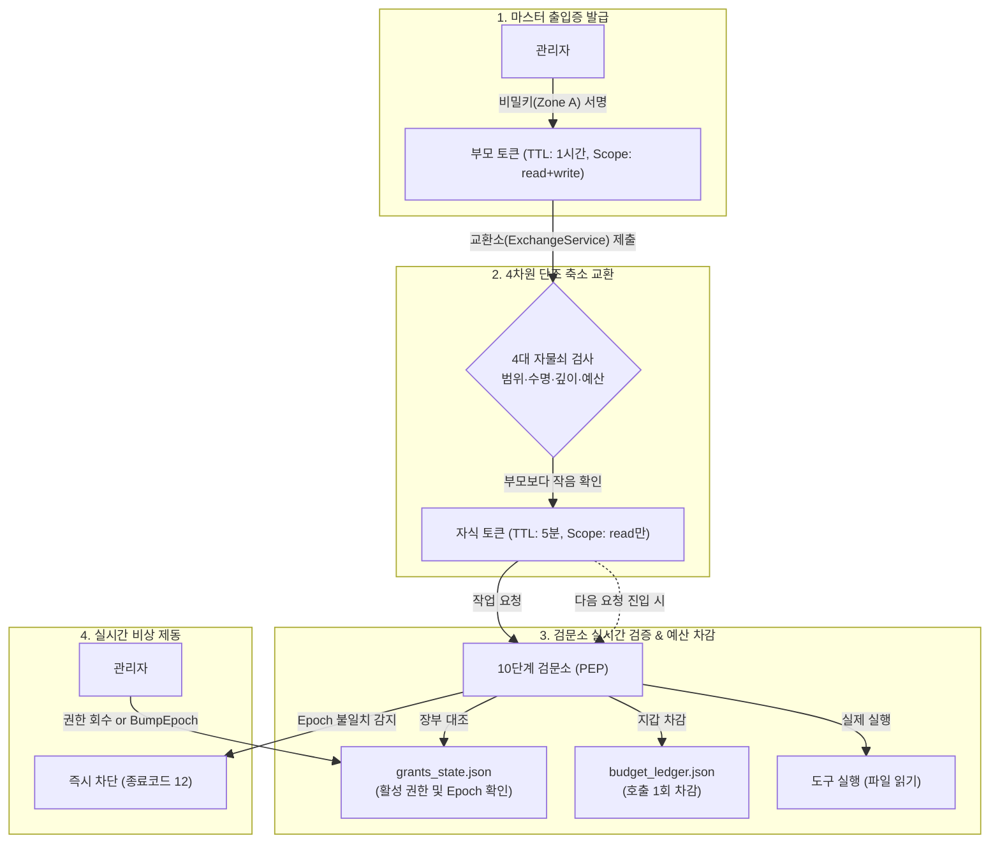

# 003. 출입증 축소위임과 실시간 권한통제 — 내 권한을 깎아서 일꾼에게 넘기고, 위조·월권·경합을 실시간으로 차단하는 원리

> **모드**: `[문서작업]` — 소스코드 수정 없이 현재 구현된 Ed25519 서명 키 회전, 4차원 단조 축소 위임 교환, 2-Hop 연쇄 위임, 예산 원장 생애주기, 1회용 승인, 실시간 권한 회수 및 TOCTOU 방어 원리를 해설합니다.  
> **기준일**: 2026-11-07 · **기준 커밋**: `33ff98a` (`git log -1 --format=%h -- cmd internal`)  
> **다시 확인하는 법**:
> ```bash
> git rev-parse --short HEAD
> git log -1 --format=%h -- cmd internal
> # 1. 토큰 발급 및 축소 위임 교환 단위 시험
> go test -v ./internal/authn/token/... ./internal/authn/exchange/...
> # 2. 예산 차감 및 환급 트랜잭션 시험
> go test -v ./internal/authn/budget/...
> # 3. 권한 회수, 세대 번호(Epoch) 및 TOCTOU 창 시험
> go test -v ./internal/authz/pep/ -run "TestTOCTOUWindow|TestLineageRevocation"
> ```

---

## 💡 사용자의 질문 (원문 보존)

> 팀장이 일꾼에게 심부름을 시킬 때 권한을 왜 줄여서 건네고, 열기 직전에 장부를 왜 다시 보나? 예산은 어떻게 관리되고 이미 발급된 토큰은 어떻게 뺏나? 자식이 스스로 권한을 늘리지 못하게 막는 자물쇠는 무엇인가?

---

## 0. 모든 설계 이전에 ‘사람’이 있다 — 내 마스터 열쇠를 그대로 복사해 줄 수는 없다

회사에서 총괄 팀장이 하위 일꾼에게 "내일까지 기획서 폴더에 들어가서 `plan.txt` 파일 하나만 읽어 오라"고 심부름을 시키는 장면을 상상해 봅니다.
총괄 팀장의 주머니에는 사옥의 모든 문을 열 수 있는 마스터 출입증이 들어 있습니다.

사람의 눈에는 팀장이 가진 마스터 출입증을 그대로 복사해서 일꾼 손에 쥐여 주는 것이 가장 빠르고 간편해 보입니다. 하지만 그렇게 하면 끔찍한 일들이 벌어질 수 있습니다.
- *「일꾼이 심부름을 하러 가다가 딴마음을 품거나, 해커의 공격을 받아 기획서 폴더가 아니라 회계 장부 폴더를 뒤지면 어쩌지?」*
- *「일꾼이 심부름을 마쳤는데도 그 출입증을 버리지 않고 주머니에 넣어 두었다가, 며칠 뒤 밤에 몰래 다시 들어와 회사 기밀을 읽어가면 어쩌지?」*
- *「심부름을 보낸 지 1초 만에 일꾼이 이상한 행동을 보여서 관리자가 권한을 취소했는데, 이미 일꾼 손에 넘어간 종이 출입증을 밖에서 어떻게 빼앗을 것인가?」*

이 설명서는 그 위험을 원천적으로 막기 위해 고안된 **출입증(토큰)의 축소 교환, 다단계 연쇄 위임, 예산 지갑, 그리고 실시간 브레이크(권한 회수)의 메커니즘**을 한눈에 펼쳐 보입니다.

---

## 1부. 이것은 무엇에 쓰는 장치이고, 왜 이런 모양인가 (용도와 Why)

### 1. 어디에 쓰는 물건인가 (임시 출입증과 신용카드의 비유)

이 장치들은 **「일꾼에게 일을 시킬 때 내 신용카드 본카드를 주지 않고, 금액 한도와 사용 시간, 결제처가 딱 제한된 일회용 체크카드를 발급해 쥐여 주는 안전 자물쇠 체계」**입니다.
1. **서명 도장 관리 (`keys`)**: 출입증에 위조 방지 도장을 찍는 비밀 도장(Zone A)과 검문소가 도장을 대조하는 확인용 도장(Zone B)을 나누어 관리하고 정기적으로 교체합니다.
2. **축소 위임 교환소 (`exchange`)**: 부모의 넓은 출입증을 가져오면, 그보다 좁은 범위·짧은 시간·더 적은 예산이 적힌 자식용 새 출입증으로 안전하게 깎아서 바꿔 줍니다.
3. **예산 지갑 (`budget`)**: 출입증마다 쓸 수 있는 호출 횟수와 바이트 크기를 정해 두고, 일을 할 때마다 차감하며 실패하면 되돌려줍니다.
4. **실시간 브레이크 (`revoke` & `Epoch`)**: 이미 일꾼 손에 출입증이 넘어갔더라도, 비상시 중앙 장부에서 스위치를 내리면 그 즉시 일꾼의 출입증이 종이쪽지가 되도록 만듭니다.

### 2. 가장 밑바닥의 이유부터 (끝까지 되묻는 Why)

1. **왜 부모 출입증을 그대로 빌려주지 않고 매번 새로 발급(`Exchange`)받나?**
   - 부모 출입증에는 불필요하게 넓은 권한과 긴 수명이 들어 있습니다. 하위 일꾼이 탈취당했을 때 피해 반경을 이번 심부름 하나로 한정(최소 권한의 원칙)하기 위해, 부모의 권한을 절대로 넘어설 수 없도록 깎아서 건넵니다.
2. **일꾼이 또 다른 말단 일꾼에게 심부름을 시킬 때는 어떻게 하나? (2-Hop 다단계 위임)**
   - 총괄 팀장이 1차 일꾼에게 위임하고, 1차 일꾼이 2차 말단 일꾼에게 재위임할 수 있습니다. 이때 출입증 안에 **"누가 누구에게 위임했는가"를 증명하는 계보 도장(`act` 사슬)**을 줄줄이 찍어 두어, 중간 일꾼이 자기 권한 밖의 일을 시키거나 무한 루프를 돌지 못하게 막습니다.
3. **출입증에 적힌 만료 시간(`exp`)이 남았는데 권한을 취소하려면 어떻게 하나?**
   - 한번 발급된 JWT 토큰은 암호학적으로 봉인되어 있어 밖에서 글자를 고칠 수 없습니다. 그래서 검문소는 출입증만 보지 않고 중앙 허가 장부를 매번 다시 보며, 주체의 **세대 번호(`Epoch`)**를 1 올리는 순간 해당 세대의 출입증 전체가 실시간으로 무효화됩니다.
4. **진행 중인 호출 도중에 권한을 뺏으면 어떻게 되나? (TOCTOU 창의 한계)**
   - 검문소를 통과한 직후(0.001초 뒤)에 권한이 취소되었다면, 이미 시작된 파일 읽기는 끝까지 실행되고 **그다음 호출부터 즉시 차단**됩니다. 진행 중인 OS 시스템 호출을 강제로 찢는 것은 파일 손상을 일으키기 때문입니다. 이 프로그램은 막지 못하는 찰나의 틈(Window C)을 솔직하게 인정하고 기록합니다.

### 3. 흔한 방식과 이 프로그램의 선택

| 구분 | 흔한 방식 (일반론) | 이 프로그램의 선택 |
|---|---|---|
| **위임 방식** | 마스터 API 키를 자식 프로세스 환경변수에 그대로 복사하거나 공유 토큰 전달 | 부모 출입증을 제시하고 4차원(범위·수명·깊이·예산)을 단조 축소한 새 자식 토큰 발급 (`token exchange`) |
| **권한 취소** | 토큰이 자연 만료될 때까지 기다리거나, 메모리 블랙리스트에 토큰 ID 등록 | 중앙 장부의 세대 번호(`Epoch`) 증가로 해당 주체 및 하위 위임 계보 전체를 0초 만에 일괄 즉시 철회 |
| **비용 통제** | 무제한 호출 허용 후 월말 청구서에서 확인 | 출입증마다 횟수·바이트 예산을 할당하고, 사전 예약(`Reserve`) → 사전 차감(`Consume`) → 환급(`Refund`) 트랜잭션 보장 |

---

## 2부. 처음부터 끝까지 따라가는 출입증 생애주기와 권한 통제 여정

출입증 하나가 어떻게 태어나서 깎이고, 쓰이다가 취소되는지의 전체 생애주기입니다.



---

### 1. 4차원 단조 축소 교환의 4대 자물쇠

교환소(`ExchangeService`)는 부모가 가져온 출입증을 자식 출입증으로 바꿔줄 때, 다음 **4가지 부등식(Monotonic Attenuation)**을 단 1비트의 예외도 없이 강제합니다. 하나라도 어긋나면 교환을 즉시 거부(`ExitBadInput`, `14`)합니다.

1. **범위 자물쇠 (`Scope`)**:
   - 자식이 요청한 권한 범위는 반드시 부모 권한 범위의 **진부분집합(Subset)**이어야 합니다.
   - 예: 부모가 `file:read:plan.txt file:write:plan.txt`를 가졌다면, 자식은 `file:read:plan.txt`만 받을 수 있습니다. 부모에게 없는 `file:write:report.txt`를 요구하면 즉시 차단됩니다.
2. **수명 자물쇠 (`TTL`)**:
   - 자식 출입증의 만료 시각(`exp`)은 **부모 출입증의 만료 시각보다 절대 뒤일 수 없습니다.**
   - 부모가 앞으로 10분 남았다면, 자식은 최대 10분까지만 받을 수 있으며 15분을 요구하면 즉시 깎이거나 거부됩니다.
3. **위임 깊이 자물쇠 (`Depth`)**:
   - 총괄(깊이 0) → 1차 팀장(깊이 1) → 2차 일꾼(깊이 2)으로 내려갈 때마다 남은 깊이가 1씩 줄어듭니다. 남은 깊이가 0인 출입증으로는 더 이상 하위 토큰을 교환할 수 없습니다. 자기 자신에게 되돌아오는 순환 위임(Self-Loop)도 원천 차단됩니다.
4. **예산 자물쇠 (`Budget`)**:
   - 자식에게 떼어 주는 호출 횟수와 바이트 예산은 **부모가 가진 남은 잔여 예산보다 클 수 없습니다.** 자식에게 10회를 떼어 주면 부모의 지갑에서는 10회가 즉시 예약(`Reserve`) 차감됩니다.

---

### 2. 다단계 연쇄 위임 도장 (`act` 사슬)

총괄 팀장(`lead-01`)이 1차 일꾼(`agent-01`)에게 위임하고, 그 일꾼이 다시 2차 말단 일꾼(`worker-01`)에게 일을 시킬 때, 출입증 안의 내용물(`claims`)은 다음과 같이 계보 도장을 겹겹이 품게 됩니다.

```json
{
  "iss": "authz-harness",
  "sub": "worker-01",
  "scope": "file:read:plan.txt",
  "act": {
    "sub": "agent-01",
    "act": {
      "sub": "lead-01"
    }
  }
}
```
검문소는 이 출입증을 검사할 때, 말단 일꾼(`worker-01`)의 권한만 보지 않고 **위임 사슬에 적힌 조상들(`agent-01`, `lead-01`)의 허가 상태를 장부에서 함께 대조**합니다. 만약 중간 팀장(`agent-01`)의 권한이 취소되었다면 말단 일꾼의 출입증도 함께 멈춰 섭니다.

---

### 3. 예산 원장의 5단계 트랜잭션 (지갑의 원리)

토큰에 예산(횟수·바이트)이 붙어 있을 때, 돈이 어떻게 안전하게 오가는지 보여주는 흐름입니다.

1. **예약 (`Reserve`)**: 토큰 교환 시점에 부모 지갑에서 자식 몫만큼 예산을 미리 떼어 잠급니다.
2. **사전 차감 (`Consume`)**: 검문소 6단계(`budget`)에서 호출 1회(쓰기라면 입력 바이트도)를 미리 깎습니다.
3. **실패 환급 (`Refund`)**: 만약 7단계(사전감사)나 물리적 디스크 에러로 작업이 실패하면, 파이프라인 엔진이 깎았던 예산을 즉시 지갑으로 원상 복구(환급)합니다. 단, 이미 실행이 시작된 외부 명령(`exec:run`)은 부작용이 발생했을 수 있어 환급하지 않습니다.
4. **사후 정산 (`Settle`)**: 도구가 파일을 실제로 읽은 뒤, 읽어 온 데이터 크기(바이트)만큼 검문소 9단계에서 추가 정산합니다. 예산이 모자라면 데이터를 버리고 거부합니다.
5. **만료 자동 회수 (`Reclaim`)**: 자식 출입증의 시간이 다 끝났는데 예산이 남아 있다면, 부모가 다음 교환을 하거나 조회할 때 자식의 미사용 잔액이 부모 지갑으로 자동 반환됩니다.

---

### 4. 이미 내준 출입증을 실시간으로 뺏는 3가지 방법

1. **개별 권한 박탈 (`grant revoke`)**:
   - 중앙 허가 장부(`grants_state.json`)에서 해당 주체의 특정 권한(`GrantID`)을 취소 목록으로 옮깁니다. 일꾼이 1초 뒤에 같은 출입증을 내밀어도 검문소 3단계(`authz`)에서 `GRANT_REVOKED`(`12`)로 막힙니다.
2. **비상 전체 차단 스위치 (`grant bump-epoch`)**:
   - 일꾼의 계정이 해킹당했다고 의심될 때, 주체의 **세대 번호(`Epoch`)를 1에서 2로 올립니다.**
   - 일꾼이 들고 있는 출입증에는 옛날 번호(`Epoch: 1`)가 박혀 있으므로, 그 일꾼에게 발급되었던 수백 개의 출입증이 0초 만에 전부 무효화(`SUBJECT_EPOCH_REVOKED`, `12`)됩니다.
3. **서명 도장 폐기 (`keys revoke`)**:
   - 서명 비밀키 자체가 유출되었을 때는 해당 열쇠 번호(`kid`)를 폐기(`retired`) 처리합니다. 그 도장으로 찍힌 모든 출입증은 검문소 입구 2단계(`authn`)에서 즉시 거부(`TOKEN_KEY_RETIRED`, `11`)됩니다.

---

## 3부. 질문과 답변으로 파고드는 세부 동작 (Q&A)

### Q1. 사람의 1회용 승인(`ask`)은 출입증과 어떻게 맞물리나?
- **무슨 일이 일어나는가**:
  허가 장부에 `RequiresApproval: true`가 붙은 위험한 작업(예: 핵심 설정 쓰기)은 출입증이 유효해도 검문소에서 즉시 실행되지 않고, 종료 코드 `18`(`ExitApprovalRequired`)과 함께 일단 멈춥니다.
  사람 관리자가 터미널에서 `approval approve` 명령으로 승인 도장을 찍어 준 뒤에 일꾼이 **동일한 출입증으로 다시 요청**하면 비로소 검문소를 통과합니다. 통과하는 순간 승인 도장은 장부에서 영구 삭제(소비)되므로 두 번 다시 쓸 수 없습니다.
- (구현: [`service.go`](../../internal/authz/pdp/service.go) — `DecisionAsk`, [`gateway.go`](../../internal/authz/pep/gateway.go) — `gateway.approval`, 5부 ② 4번)

### Q2. 찰나의 틈(TOCTOU Window)은 정확히 무엇이고 어떻게 방어하나?
- **무슨 일이 일어나는가**:
  - **Window A (검문소 들어가기 전 회수)**: 당연히 100% 완벽 차단됩니다.
  - **Window B (토큰 서명 확인 직후 회수)**: 3단계 권한 판정에서 장부를 실시간 조회하므로 100% 완벽 차단됩니다.
  - **Window C (검문소 통과 직후 도구 실행 도중 회수)**: 이미 시작된 OS 파일 읽기·쓰기는 중단되지 않고 끝까지 수행됩니다. 하지만 그 결과가 끝나고 **그 다음번 호출을 시도하는 순간 100% 차단**됩니다.
- (구현: [`toctou_window_test.go`](../../internal/authz/pep/toctou_window_test.go) — `TestTOCTOUWindow`, 5부 ② 5번)

---

## 4부. 배척한 방식과 그 이유

1. **중앙 인증 서버(OIDC/OAuth 인가 서버)에 매번 네트워크로 물어보는 방식**:
   - **택했다면 무슨 일이 생기는가**: 네트워크 데몬이 필요하고 통신 지연(수십 ms)이 발생하며 오프라인 환경에서 작동하지 않습니다.
   - **그 대신 포기한 것**: 분산 클라우드 환경과의 실시간 동기화를 포기하는 대신, **로컬 Ed25519 서명 검증과 로컬 원자 장부 파일 대조**로 0.1ms 안에 판정하는 가볍고 강력한 로컬 엔진을 택했습니다.
2. **취소된 토큰 목록(블랙리스트)만 끝없이 쌓아 두는 방식**:
   - **택했다면 무슨 일이 생기는가**: 시간이 흐를수록 취소 목록 파일이 수십 MB로 커져 메모리와 디스크 검사 속도가 느려집니다.
   - **그 대신 포기한 것**: 개별 취소 목록뿐 아니라 단 하나의 숫자만 올리면 수천 장의 토큰이 한꺼번에 죽는 **세대 번호(`Epoch`) 체계**를 도입하여 장부 크기를 항상 극소 크기로 유지했습니다.

---

## 5부. 한눈에 보는 요약표와 코드 정본 색인

### ① 핵심 요약 대조표

| 통제 장치 | 안에서 일어나는 일 | 지켜지는 보안 원칙 | 근거 (구현 위치) |
|---|---|---|---|
| **축소 교환 (`Exchange`)** | 부모 토큰 제출 시 범위·수명·깊이·예산 4차원 단조 축소 검증 후 자식 토큰 발급 | 최소 권한의 원칙 (PoLP), Confused Deputy 방어 | 5부 ② 1, 2번 |
| **연쇄 위임 (`act`)** | 2단계 위임 시 조상 주체 계보를 토큰에 기록하고 검문소에서 조상 Epoch까지 동등 대조 | 중간 위임자 월권 방어, 순환 위임 차단 | 5부 ② 1, 3번 |
| **예산 지갑 (`Budget`)** | 호출 횟수·바이트 사전 예약, 1회 사전 차감, 실패 시 즉시 환급, 만료 시 부모 자동 회수 | 자원 고갈(DoS) 방지, 원자적 비용 정산 | 5부 ② 3번 |
| **세대 번호 (`Epoch`)** | 비상시 주체의 Epoch를 올리면 해당 주체와 하위 위임 계보 전체의 토큰 즉시 무효화 | 토큰 누출 시 피해 반경 즉시 차단 (Kill-Switch) | 5부 ② 4, 5번 |

### ② 어디서 하나 (코드 정본 색인)

1. **토큰 축소 위임 검증기**: [`internal/authn/exchange/validator.go`](../../internal/authn/exchange/validator.go) (`DefaultDownscopeValidator.ValidateDownscope`)
2. **토큰 교환 서비스**: [`internal/authn/exchange/service.go`](../../internal/authn/exchange/service.go) (`ExchangeService.Exchange`)
3. **예산 원장 저장소**: [`internal/authn/budget/ledger.go`](../../internal/authn/budget/ledger.go) (`FileLedger.Reserve`, `Consume`, `Refund`)
4. **정책 결정 두뇌(PDP) 및 승인 처리**: [`internal/authz/pdp/service.go`](../../internal/authz/pdp/service.go) (`Evaluate`, `pdpService.Decide`)
5. **권한 관리자(PAP) 및 세대 번호**: [`internal/authz/pap/service.go`](../../internal/authz/pap/service.go) (`papService.BumpEpoch`, `RevokeGrant`)
