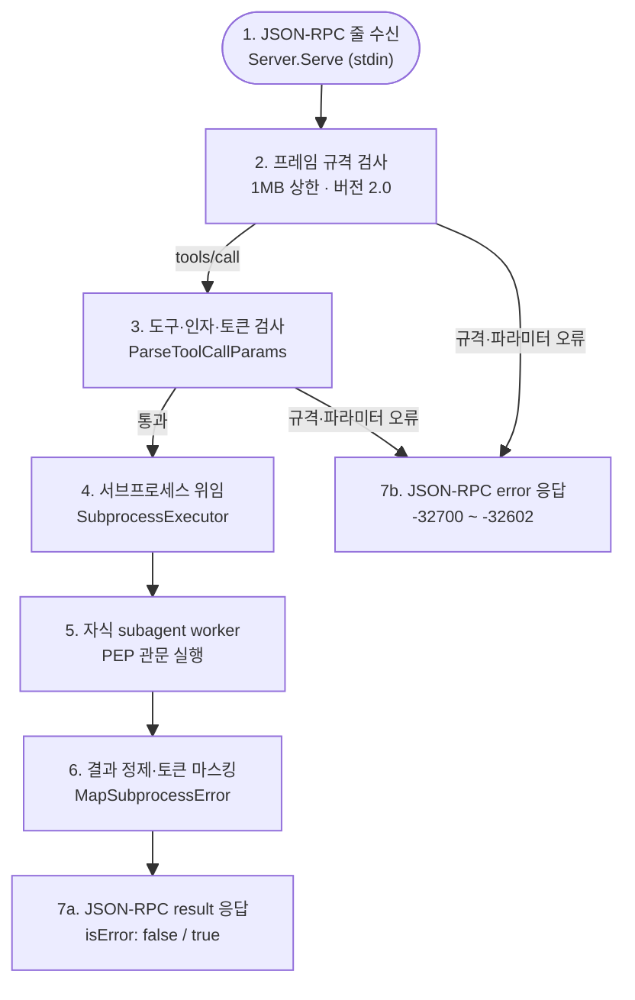

# 004. 2-Hop 다단계 위임과 MCP 도구 게이트웨이 — 연쇄 위임으로 권한을 쪼개고 외부 도구 호출을 격리 집행하는 원리

> **모드**: `[문서작업]` — 소스코드 수정 없이 현재 구현된 2단계 연쇄 위임(`orchestrator/multi_hop.go`)과 MCP(`Model Context Protocol`) 도구 게이트웨이(`internal/mcp`, `cli/mcp.go`)의 실제 동작과 이유(Why)를 해설합니다.  
> **기준일**: 2026-11-05 · **기준 커밋**: `5e77c45` (이 문서가 설명하는 `cmd/`와 `internal/`을 마지막으로 바꾼 커밋)  
> **검증 범위**: 동작·순서·소유자·시점을 코드와 대조한 결과와 「미확인」은 5부 ③에 있습니다.  
> **이 문서는 구현된 것만 적는다.** 계획·제안·미래형 약속은 적지 않으며, 현재 코드가 하지 않는 것은 「지금은 없다」고만 씁니다.  
> **이 문서의 규칙**: 본문(0~4부, Q&A, 그림, 5부 ①)은 쉬운 개념·설계·이유가 중심입니다. 파일·타입 이름 같은 고유 이름은 첫 등장에 한마디 설명과 함께 쓰고, 구현의 어디인지는 문단 끝 `(구현: 파일 · 함수, 5부 ② 번호)` 귀띔으로 보조합니다. 기준은 [프로그램 설명서 README의 「설명의 기준」과 「이름의 3층」](README.md)입니다.  
> **겹치는 주제**: 단일 토큰 교환과 5대 축소 불변식은 [002편](002-토큰발급_축소위임과_서명키회전.md)에서, 자식 서브프로세스 스폰과 해시 체인 감사는 [003편](003-서브프로세스격리와_해시체인감사.md)에서, 자식 내부의 관문은 [001편](001-전체요청여정과_5단계관문.md)에서 다룹니다. 네트워크 조회(`net_fetch`)·명령 실행(`exec_run`) 도구가 관문 안에서 어떻게 제한되는지는 [005편](005-승인_예산과_도구확장.md)이 다룹니다.
>
> **다시 확인하는 법**
> ```bash
> git rev-parse --short HEAD
> git log -1 --format=%h -- cmd internal
> # 1. 2-Hop 다단계 연쇄 위임 시나리오(E2E-31, E2E-32) 및 오케스트레이터 시험 실행
> go test -v ./internal/orchestrator/... ./internal/harness/... -run "Test"
> # 2. MCP JSON-RPC 2.0 서버·프로토콜·서브프로세스 실행기·토큰 마스킹 시험 실행
> go test -v ./internal/mcp/... ./internal/cli -run "TestMCP"
> # 3. 핵심 함수 위치 확인
> grep -n "func " internal/orchestrator/multi_hop.go internal/mcp/server.go internal/mcp/protocol.go internal/mcp/executor.go
> ```

---

## 💡 사용자의 질문 (원문 보존)

> 다음편 써라

---

## 0. 모든 설계 이전에 ‘사람’이 있다 — 중간 관리자를 거치면 왜 두 번 바꾸고, 외부 AI가 부를 때는 왜 또 자식 프로세스를 띄우나

일을 시키다 보면 총괄(`orchestrator-root`)이 말단 일꾼(`worker-01`)에게 직접 시키지 않고, 중간 팀장(`lead-01`)에게 일을 맡긴 뒤 팀장이 다시 말단 일꾼에게 세부 심부름을 시키는 경우가 있습니다. 또한 사람이 직접 명령줄을 치는 대신, 외부 AI 프로그램(MCP 클라이언트)이 표준 JSON-RPC 메시지로 「이 파일 좀 읽어 줘(`tools/call`)」라고 요청할 때도 있습니다.

처음 보는 사람은 이런 의문을 품습니다.
- *「총괄이 팀장을 거쳐 일꾼에게 일을 시킬 때, 왜 총괄 출입증을 바로 일꾼용으로 한 번만 바꾸지 않고 팀장용(1차) → 일꾼용(2차)으로 두 번이나 바꾸나?」*
- *「외부 AI 프로그램이 `mcp serve`에게 파일 읽기를 요청했을 때, `mcp serve`가 직접 파일을 읽어서 돌려주면 빠를 텐데 왜 굳이 또 자식 프로세스(`subagent worker`)를 새로 띄워서 시키나?」*
- *「자식 프로세스가 돌려준 메시지 안에 혹시 토큰 모양(`eyJ...`)이 들어 있으면 왜 `[REDACTED_TOKEN]`이라는 글자로 덮어써서 내보내나?」*

이 설명서는 권한이 여러 단계를 거쳐 내려갈 때 중간 관리자의 월권을 막는 원리와, 외부 AI 도구 호출을 받아 격리된 자식 프로세스로 대리 실행하는 원리를 순서대로 펼쳐 보입니다.

---

## 1부. 왜 다단계로 줄여 넘기고, 왜 외부 도구 어댑터도 직접 파일을 열지 않나

### 가장 밑바닥의 이유부터

1. **왜 총괄(`orchestrator-root`)에서 팀장(`lead-01`), 다시 말단 일꾼(`worker-01`)으로 두 번에 걸쳐 출입증을 바꿔 주나?**  
   조직에서 총괄은 큰 권한(`file:read file:write`)을 가지고 팀장에게 「읽기만 필요한 조사 업무(`file:read`)」를 맡깁니다. 그러면 팀장은 그 안에서 다시 말단 일꾼에게 파일 읽기를 시킵니다. 만약 팀장이 자기가 받은 범위(`file:read`)를 무시하고 말단 일꾼에게 쓰기 권한(`file:write`)을 만들어 줄 수 있다면, 총괄이 팀장의 권한을 줄여 놓은 의미가 사라집니다. 그래서 1차 교환(총괄 → 팀장, 깊이 1)의 결과로 나온 팀장 출입증을 2차 교환(팀장 → 일꾼, 깊이 2)의 부모 토큰으로 삼아, 매 단계마다 앞 단계보다 권한이 커지지 않는지 확인합니다.
2. **외부 AI 프로그램과 대화하는 MCP 서버(`mcp serve`)는 왜 직접 파일을 열지 않고 `SubprocessExecutor`를 통해 자식 프로세스에게 시키나?**  
   `mcp serve`는 외부 프로그램과 표준 입출력(`stdin`/`stdout`)을 열어 두고 계속 대화하는 문지기 프로세스입니다. 만약 이 문지기가 직접 디스크 파일을 읽고 쓰거나 권한 장부를 직접 다루면, [001편](001-전체요청여정과_5단계관문.md)과 [003편](003-서브프로세스격리와_해시체인감사.md)에서 만들어 둔 프로세스 메모리 격리와 환경변수 정제(`SanitizeEnv`)를 우회하는 옆문이 생깁니다. 그래서 MCP 서버는 JSON-RPC 번역만 맡고, 실제 파일 접근은 똑같이 자식 프로세스(`subagent worker`)를 띄워 시킵니다.
3. **왜 MCP 도구 호출에서는 도구를 정해진 네 개(`file_read`, `file_write`, `net_fetch`, `exec_run`)로만 고정하고, 모르는 인자 필드가 하나라도 있으면(`DisallowUnknownFields`) 바로 거부하나?**  
   외부 AI 모델은 문맥을 잘못 이해하거나 프롬프트 공격에 속아 임의 쉘 명령 실행(`shell_exec`) 같은 위험한 도구를 부르거나, 정의되지 않은 추가 인자(`{"path": "a.txt", "force_admin": true}` 등)를 끼워 보낼 수 있습니다. 허용된 네 도구와 도구마다 약속된 인자(`path`·`data`, `url`, `command_id`·`arg`) 외에는 입구에서 모두 거부해야 모호한 입력이 뒤쪽 관문으로 넘어가지 않기 때문입니다. `exec_run`도 아무 명령이나 받는 쉘이 아니라, 미리 등록된 실행 번호(`command_id`)만 받습니다.
4. **자식 프로세스가 돌려준 텍스트에 왜 정규식 마스킹(`domain.RedactRawTokens`)을 돌려 토큰 문자열을 `[REDACTED_TOKEN]`으로 가려 버리나?**  
   MCP 서버의 응답은 외부 AI 모델의 대화창(컨텍스트)으로 그대로 들어갑니다. 만약 에러 메시지나 파일 내용 속에 `eyJ...`로 시작하는 서명된 토큰 원문이 섞여 나가면, 외부 AI 서비스의 대화 기록이나 화면에 살아 있는 출입증이 그대로 노출되기 때문입니다.

### 흔한 방식과 이 프로그램의 선택

| 구분 | 흔한 방식 (이 저장소에서 확인하지 않은 일반론) | 이 프로그램(`authz-harness`)의 선택 |
|---|---|---|
| **모양** | MCP 서버를 실행할 때 환경변수에 고정 토큰 하나를 넣어 두고, 서버 프로세스가 요청받은 파일을 직접 `os.ReadFile`로 열어 돌려준다. | 호출마다 `_meta.authz_token`에 담긴 위임 토큰을 요구하고, `internal/mcp` 패키지는 `os/exec`나 `jail`을 직접 부르지 않고 `SubprocessExecutor`로 자식 프로세스를 띄워 대리 실행한다. |
| **얻는 것** | 호출할 때마다 토큰을 넣어 줄 필요가 없고 서브프로세스를 띄우지 않아 응답이 빠르다. | 호출마다 서로 다른 주체·권한·위임 계보(`act`)를 가진 단기 토큰을 강제할 수 있고, MCP 서버가 침해되어도 서명 개인키(Zone A)나 작업 폴더 밖 파일에 직접 손댈 수 없다. |
| **포기하는 것** | 모든 도구 호출이 똑같은 고정 권한으로 실행되어 호출별 최소 권한 분리가 불가능하다. | 매 `tools/call` 요청마다 `_meta.authz_token`을 함께 보내야 하고, 자식 프로세스 스폰 및 감사 기록 시간이 추가된다. |

---

## 2부. 질문과 답변으로 풀어보는 핵심 동작 (Q&A)

### Q1. 총괄 → 중간 팀장 → 말단 일꾼으로 이어지는 2단계(`2-Hop`) 위임은 안에서 어떤 순서로 돌아가나?
- **무슨 일이 일어나는가**:
  1. `MultiHopSpawner.ExecuteMultiHop` 함수가 호출되면 먼저 추적 번호(`TraceID`)가 비어 있지 않은지 확인하고, 호출자가 요청에 담아 준 토큰 교환 서비스(`Exchange`)가 있는지 확인합니다. 이 서비스는 [002편](002-토큰발급_축소위임과_서명키회전.md)에서 본 `ExchangeService`를 합성 루트(`BuildStack`)가 예산 장부와 계보 Epoch 조회까지 모두 달아 조립한 것이라, 2단계 교환도 조상 Epoch를 다시 대조합니다. 서비스가 없으면 교환을 시작하지 않고 거부합니다. (구현: [`orchestrator/multi_hop.go`](../../internal/orchestrator/multi_hop.go) · `MultiHopSpawner.ExecuteMultiHop`, 5부 ② 1번)
  2. **1차 교환(`Hop 1`, 깊이 0 → 1)**: 루트 오케스트레이터(`client-orchestrator`)가 자신의 루트 토큰(`RootToken`)을 부모 토큰으로 제출하여 중간 관리자(`LeadSubject`, 예: `lead-01`) 명의의 1차 위임 토큰(`LeadScope`, 유효시간 10분)으로 교환합니다. 성공하면 감사 장부(`audit.jsonl`)에 `token.exchanged`(`delegation_depth: 1`)가 기록됩니다.
  3. **2차 교환(`Hop 2`, 깊이 1 → 2)**: 이어서 서브에이전트 클라이언트(`client-subagent`)가 방금 발급된 팀장의 1차 토큰(`leadExchangeRes.TokenString`)을 부모 토큰으로 제출하여 말단 일꾼(`WorkerSubject`, 예: `worker-01`) 명의의 2차 위임 토큰(`WorkerScope`, 유효시간 5분)으로 다시 교환합니다. 만약 팀장이 읽기(`file:read`)만 가진 상태에서 일꾼에게 쓰기(`file:write`)를 주려 했다면 여기서 `DELEGATION_SCOPE_EXCEEDED`로 막히고 종료 코드 `12`(`ExitAuthzDenied`)를 돌려줍니다. 거부 사유가 다르면 그 사유의 종료 코드를 그대로 돌려주며, 예컨대 거부 감사 기록을 쓰지 못하면 `15`입니다. (구현: [`orchestrator/multi_hop.go`](../../internal/orchestrator/multi_hop.go) · `MultiHopSpawner.ExecuteMultiHop`, 5부 ② 1번)
     - *참고*: 왜 1차 교환 유효시간이 `10분`이고 2차 교환 유효시간이 `5분`인가? 자식 토큰 수명이 부모 토큰 수명을 넘지 못한다는 규칙(`ValidateDownscope`)을 만족하도록 코드에 적어 둔 예시 시간이며, 왜 다른 숫자가 아닌 10분·5분인지는 별도의 수학적 이유가 없습니다.
  4. **말단 자식 프로세스 스폰**: 2차 교환이 성공하면 만들어진 말단 토큰(`workerExchangeRes.TokenString`, 안에는 `worker-01` ← `lead-01` ← `orchestrator-root` 2단 중첩 `ActorClaim`이 들어 있음)을 [003편](003-서브프로세스격리와_해시체인감사.md)의 `SubprocessSpawner.Spawn`에 넣어 실제 자식 프로세스(`subagent worker`)를 띄우고 종료 코드를 수거합니다. (구현: [`orchestrator/multi_hop.go`](../../internal/orchestrator/multi_hop.go) · `MultiHopSpawner.ExecuteMultiHop`, 5부 ② 1번)
- **왜 그렇게 하나**: 중간 관리자가 낀 다단계 위임에서도 똑같은 토큰 교환소(`ExchangeService`)를 반복 통과하게 해야, 몇 단계를 거치든 권한이 늘어나지 않고 `TraceID` 하나로 모든 단계의 교환·실행 기록이 감사 장부에 남기 때문입니다.
- **근거**: 5부 ② 항목 1, 9번

### Q2. `mcp serve`를 켜면 외부 프로그램과 어떻게 대화를 시작하고 어떤 도구 목록을 보여 주나?
- **무슨 일이 일어나는가**:
  1. 명령줄에서 `authz-harness mcp serve`를 실행하면 `MCPRunner.runServe`가 감사 기록기(`JSONLWriter`), 자식 프로세스 스포너(`SubprocessSpawner`), 서브프로세스 실행기(`mcp.NewSubprocessExecutor`)를 차례로 조립해 `mcp.Server.Serve` 루프를 시작합니다. (구현: [`cli/mcp.go`](../../internal/cli/mcp.go) · `MCPRunner.runServe`, 5부 ② 2번)
  2. `Server.Serve`는 표준 입력(`stdin`)이 닫힐 때(`io.EOF`)나 컨텍스트가 취소될 때까지 줄바꿈(`\n`) 단위로 한 줄씩 읽어서 `handleLine`으로 넘깁니다. (구현: [`mcp/server.go`](../../internal/mcp/server.go) · `Server.Serve`, `Server.handleLine`, 5부 ② 3번)
  3. `handleLine`은 한 줄의 길이가 `MaxFrameSize`(`1MB`)를 넘으면 크기 초과 에러(`-32600`)를 내보내고, JSON 파싱에 실패하면 파싱 에러(`-32700`)를 내보냅니다. 만약 JSON 안에 요청 번호(`id`)가 없는 알림(Notification) 프레임이면 JSON-RPC 2.0 규칙에 따라 아무 응답도 보내지 않고 넘어가며, `jsonrpc` 버전이 `"2.0"`이 아니거나 `method`가 비어 있으면 규격 위반 에러(`-32600`)를 돌려줍니다. (구현: [`mcp/server.go`](../../internal/mcp/server.go) · `Server.handleLine`, 5부 ② 3번 / [`mcp/protocol.go`](../../internal/mcp/protocol.go) · `ValidateRequestFrame`, 5부 ② 4번)
  4. `method`가 `"initialize"`이면 프로토콜 버전(`"2024-11-05"`)과 서버 이름(`"authz-harness-mcp"`)을 돌려주고(`handleInitialize`), `"tools/list"`이면 `file_read`(`path` 필수), `file_write`(`path`, `data` 필수), `net_fetch`(`url` 필수), `exec_run`(`command_id` 필수, `arg` 선택) 네 도구의 입력 스키마 명세를 돌려줍니다(`handleToolsList`). 그 외에 알 수 없는 메서드면 `-32601`(`Method not found`)을 돌려줍니다. (구현: [`mcp/server.go`](../../internal/mcp/server.go) · `Server.handleInitialize`, `Server.handleToolsList`, 5부 ② 3번)
- **왜 그렇게 하나**: 표준 MCP 클라이언트가 처음 연결될 때 서버가 살아 있는지 확인(`initialize`)하고 어떤 도구를 쓸 수 있는지 목록(`tools/list`)을 먼저 받아 가기 때문입니다.
- **근거**: 5부 ② 항목 2, 3, 4번

### Q3. 외부에서 `tools/call`로 파일 읽기·쓰기를 요청하면 입구에서 무엇을 먼저 걸러내나?
- **무슨 일이 일어나는가**:
  1. `method`가 `"tools/call"`이면 `Server.handleToolsCall`이 `ParseToolCallParams`를 불러 파라미터(`params`)를 세 단계로 검사합니다. (구현: [`mcp/server.go`](../../internal/mcp/server.go) · `Server.handleToolsCall`, 5부 ② 3번 / [`mcp/protocol.go`](../../internal/mcp/protocol.go) · `ParseToolCallParams`, 5부 ② 4번)
  2. **① 도구 이름 화이트리스트 확인(`MapToolToAction`)**: `params.name`이 `"file_read"`면 내부 행동 `file:read`로, `"file_write"`면 `file:write`로, `"net_fetch"`면 `net:fetch`로, `"exec_run"`이면 `exec:run`으로 바꾸고, `"shell_exec"`처럼 목록에 없는 도구 이름이면 `ErrUnknownTool` 에러를 냅니다.
  3. **② 출입증 존재 확인**: `params._meta.authz_token`이 비어 있거나 빠져 있으면 `ErrMissingAuthzToken` 에러를 냅니다.
  4. **③ 인자 스키마 엄격 검사**: 도구마다 정해진 모양으로 `json.NewDecoder`에 `DisallowUnknownFields()`를 켜서 `params.arguments`를 읽습니다(`decodeStrict`). 정의되지 않은 필드가 하나라도 들어 있으면 `ErrUnexpectedArgument` 에러를 내고, 필수 인자(`path`, 쓰기의 `data`, `url`, `command_id`)가 비어 있으면 에러를 냅니다. 주소가 허용 범위인지, 실행 번호가 등록된 것인지는 여기서 보지 않고 자식 안의 관문이 확인합니다([001편](001-전체요청여정과_5단계관문.md) Q4).
  5. 위 세 단계 중 하나라도 어긋나면 자식 프로세스를 띄우지 않고 JSON-RPC 에러 코드 `-32602`(`CodeInvalidParams`)로 즉시 응답합니다. (구현: [`mcp/server.go`](../../internal/mcp/server.go) · `Server.handleToolsCall`, 5부 ② 3번)
- **왜 그렇게 하나**: 도구 이름이나 인자 모양조차 맞지 않는 요청, 혹은 토큰을 아예 안 보낸 요청을 매번 자식 운영체제 프로세스로 띄우는 낭비를 막기 위해서입니다.
- **근거**: 5부 ② 항목 3, 4번

### Q4. 입구 검사를 통과한 MCP 도구 요청은 어떻게 실행되고, 거부되었을 때 에러는 어떻게 다듬어져 나가나?
- **무슨 일이 일어나는가**:
  1. 입구 검사를 통과하면 `SubprocessExecutor.ExecuteTool`이 8바이트 난수로 추적 번호(`mcp-<16진수>`)를 만들고(`generateTraceID`; 난수원이 고장나 번호를 못 만들면 시각으로 대신하지 않고 실패하며 자식 프로세스도 띄우지 않습니다), `SubagentRequest` 구조체를 조립해 `spawner.Spawn`으로 자식 프로세스(`subagent worker`)를 띄웁니다. `mcp serve --net-allow host:port,...`로 받은 네트워크 허용 목록은 자식 워커의 명령줄 인자로 그대로 넘어갑니다. 스폰에는 [003편](003-서브프로세스격리와_해시체인감사.md)의 시간·출력 상한이 그대로 걸립니다. (구현: [`mcp/executor.go`](../../internal/mcp/executor.go) · `SubprocessExecutor.ExecuteTool`, `generateTraceID`, 5부 ② 5번)
     - *참고*: `internal/mcp` 패키지는 직접 파일·네트워크·프로세스나 서명 키, 정책 결정을 건드리지 못하도록 `os`, `io/fs`, `path/filepath`, `os/exec`, `net`, `net/http`, `authz/pdp`, `authz/pip`, `jail`, `authn/keys`, `netguard`, `execguard` 임포트가 아키텍처 시험(`TC-090-01`)으로 금지되어 있습니다. (구현: [`architecture_test.go`](../../internal/harness/architecture_test.go) · `TestArchitectureGuardrails`, 5부 ② 8번)
  2. 자식 프로세스가 모든 관문을 통과해 종료 코드 `0`으로 끝나면, 읽은 내용(파일·조회 결과·실행 출력, 쓰기인 경우 `"successfully wrote N bytes to ..."`)에서 혹시라도 들어 있을 원시 토큰 문자열을 `sanitizeMessage`로 지운 뒤 `ToolExecutionResult{IsError: false}`로 담아 JSON-RPC `result`로 돌려줍니다. (구현: [`mcp/executor.go`](../../internal/mcp/executor.go) · `SubprocessExecutor.ExecuteTool`, 5부 ② 5번)
  3. 반대로 자식 프로세스가 토큰 만료(`11`), 권한 부족·허용 밖 주소·미등록 실행 번호(`12`), 경로 이탈(`13`), 사람 승인 필요(`18`) 등으로 거부되었거나, 부모가 시간·출력 상한으로 끊어(`17`) `0`이 아닌 종료 코드로 끝나면, `MapSubprocessError`가 호출됩니다. (구현: [`mcp/errors.go`](../../internal/mcp/errors.go) · `MapSubprocessError`, `sanitizeMessage`, 5부 ② 6번)
  4. `MapSubprocessError`는 자식이 돌려준 사유 코드(`Reason`, 비어 있으면 종료 코드로 기본 사유 추정)와 에러 메시지에서 원시 토큰(`eyJ...`) 패턴을 `domain.RedactRawTokens`로 모두 `[REDACTED_TOKEN]`으로 바꾼 뒤, `"[REASON] 정제된 메시지 (exit code N)"` 형태의 텍스트와 `IsError: true`를 담은 `ToolExecutionResult`를 만들어 돌려줍니다. (구현: [`mcp/errors.go`](../../internal/mcp/errors.go) · `MapSubprocessError`, 5부 ② 6번)
- **왜 그렇게 하나**: MCP 프로토콜에서는 JSON-RPC 프레임 자체의 문법 오류(`error` 객체 반환)와 도구 실행 중 발생한 권한·비즈니스 거부(`result` 객체 안에 `isError: true` 반환)를 구분하며, 어떤 실패 메시지에서도 원본 JWT 토큰이 외부로 새어 나가지 않게 막아야 하기 때문입니다.
- **근거**: 5부 ② 항목 5, 6, 8번

---

## 3부. 내부 지도 — 한 번의 여정과 직접 확인하는 법



(구현: [`mcp/server.go`](../../internal/mcp/server.go) · `Server.handleLine`이 1~3·7단계를 맡고, [`mcp/executor.go`](../../internal/mcp/executor.go) · `SubprocessExecutor.ExecuteTool`과 [`mcp/errors.go`](../../internal/mcp/errors.go) · `MapSubprocessError`가 4~6단계를 수행합니다, 5부 ② 3·4·5·6번)

### 어디에 무엇이 남나

| 무엇 | 어디에 | 언제 | 사람이 직접 여는 법 |
|---|---|---|---|
| **JSON-RPC 2.0 응답 줄 (`result` 또는 `error`)** | MCP 서버 표준 출력 (`stdout`) | `initialize`, `tools/list`, `tools/call` 각 요청 처리 직후 | `echo '{"jsonrpc":"2.0","id":1,"method":"tools/list"}' \| authz-harness mcp serve`로 확인한다 |
| **MCP 서버 및 자식 프로세스 진단 로그** | 표준 에러 (`stderr`) | 알림 프레임 무시 또는 응답 쓰기 실패 시점 | 터미널 `stderr` 출력에서 확인한다 |
| **2-Hop 교환 및 MCP 서브프로세스 감사 사슬** | `audit.jsonl` | 2-Hop의 `token.exchanged`(hop1·hop2) 및 MCP `tools/call`이 띄운 `orchestrator.spawn` → 자식 `pep.allow/deny` → `orchestrator.collect` 시점 | `cat audit.jsonl` 또는 `authz-harness audit timeline --latest`로 확인한다 |
| **격리 작업 폴더의 파일 변경** | `workspace/` 하위 경로 | `file_write` 도구 호출이 자식 프로세스의 관문을 모두 통과한 시점 | `cat workspace/<파일명>`으로 확인한다 |

### 이상이 생기면

| 상황 | 일어나는 일 |
|---|---|
| **2-Hop 위임에서 중간 관리자(`lead-01`)가 자기 권한(`file:read`)보다 큰 권한(`file:write`)을 말단 일꾼에게 위임 시도** | `ExecuteMultiHop`의 2차 교환 단계에서 `DELEGATION_SCOPE_EXCEEDED`로 막히고, 말단 일꾼 서브프로세스는 아예 실행되지 않은 채 종료 코드 `12`(`ExitAuthzDenied`)를 돌려준다(`E2E-32`). |
| **MCP 입력 한 줄이 1MB를 넘거나 JSON 문법이 깨짐** | `handleLine`이 자식 프로세스를 띄우지 않고 JSON-RPC `error`(`-32600` 또는 `-32700`)를 `stdout`에 한 줄 출력한다. |
| **MCP `tools/call`에 `_meta.authz_token`이 없거나, 미지원 도구(`shell_exec`), 혹은 정의되지 않은 인자 필드가 포함됨** | `ParseToolCallParams`가 거부하고 JSON-RPC `error`(`-32602 Invalid Params`)를 돌려준다. (단, 이 입구 단계에서 걸러진 요청은 `SubprocessSpawner`에 도달하지 않으므로 `audit.jsonl`에는 기록되지 않는다.) |
| **MCP `tools/call`로 전달된 토큰이 만료되었거나, 권한(`Grant`)이 회수되었거나, 경로(`../`)가 작업 폴더를 벗어나거나, 허용 밖 주소·미등록 실행 번호를 요청함** | 자식 프로세스가 종료 코드 `11`, `12`, `13`을 반환하고, `MapSubprocessError`가 이를 JSON-RPC `result` 안의 `isError: true`와 `"[REASON] ... (exit code N)"` 텍스트로 바꾸어 돌려준다. 이때 `audit.jsonl`에는 부모 스폰과 자식의 차단 감사 기록이 모두 남는다. |
| **자식이 시간·출력 상한을 넘어 부모가 끊음** | 부모 스포너가 종료 코드 `17`과 `orchestrator.limit_exceeded`를 남기고, `MapSubprocessError`가 그 사유(`RESOURCE_TIMEOUT` 등)로 `isError: true` 결과를 만든다. |
| **에러 메시지나 파일 출력 안에 `eyJ...` 형태의 JWT 토큰 원문이 섞여 있음** | `sanitizeMessage`가 `domain.RedactRawTokens`의 정규식에 걸리는 모든 토큰 문자열을 `[REDACTED_TOKEN]`으로 치환한 뒤 내보낸다. |

---

## 4부. 배척한 방식과 그 이유

1. **MCP 서버(`internal/mcp`)가 자식 프로세스를 띄우지 않고 직접 파일을 읽거나 인프로세스로 관문을 호출하는 방식**:
   - **택했다면 무슨 일이 생기는가**: 프로세스 생성 비용은 줄어들지만, 장기 실행되는 MCP 서버 프로세스 하나가 여러 호출자의 작업과 메모리를 한 공간에서 처리하게 되어 프로세스 격리 경계가 사라집니다.
   - **그 대신 포기한 것**: 직접 실행의 속도 이점을 포기하고, `internal/mcp` 패키지에서 `os`·`os/exec`·`net`·`jail`·`keys`·가드 등의 임포트를 금지(`TC-090-01`)한 뒤 반드시 `SubprocessExecutor`를 통해 별도 자식 프로세스를 띄우는 방식을 택했습니다.
2. **MCP 도구 인자(`arguments`) 안에 토큰을 함께 넣거나 정의되지 않은 추가 인자를 무시하고 넘기는 방식**:
   - **택했다면 무슨 일이 생기는가**: 도구의 순수 입력 데이터(`path`, `data`, `url`, `command_id`)와 보안 자격증명(`authz_token`)이 뒤섞이고, 오타나 공격용 추가 필드가 조용히 무시된 채 실행될 수 있습니다.
   - **그 대신 포기한 것**: 느슨한 JSON 파싱 대신 자격증명은 `_meta.authz_token`으로 분리하고, `arguments`에는 `decoder.DisallowUnknownFields()`를 적용해 약속되지 않은 필드가 하나라도 있으면 거부하는 방식을 택했습니다.
3. **자식 프로세스의 원시 에러 문자열을 가공 없이 그대로 MCP 응답에 실어 보내는 방식**:
   - **택했다면 무슨 일이 생기는가**: 디버깅 중 실수로 에러 문자열에 토큰 원문이 포함되었을 때 외부 AI 모델의 프롬프트 창으로 토큰이 그대로 넘어갈 수 있습니다.
   - **그 대신 포기한 것**: 원문 그대로의 전달 대신 `domain.RedactRawTokens` 정규식으로 토큰 패턴을 `[REDACTED_TOKEN]`으로 덮어쓰는 `sanitizeMessage` 단계를 거치도록 했습니다.

---

## 5부. 한눈에 보는 대조표와 코드 정본

### ① 행동별 안에서 일어나는 일과 지금은 없는 것

| 행동 | 안에서 일어나는 일 | 지금은 없는 것 | 근거 |
|---|---|---|---|
| **2-Hop 다단계 연쇄 위임 실행** (`ExecuteMultiHop`) | 루트 토큰으로 1차 교환(`Depth 1`)을 수행하고, 그 결과 토큰으로 다시 2차 교환(`Depth 2`)을 수행한 뒤 말단 워커 서브프로세스를 띄워 파일을 읽거나 쓴다. | 중간 관리자(`lead-01`)까지 별도 OS 프로세스로 띄워 그 안에서 다시 자식 프로세스를 띄우는 중첩 프로세스 스폰은 지금은 없다(교환은 2단계로 수행하고 OS 서브프로세스 스폰은 말단 워커 1회 수행). | 5부 ② 1, 9번 |
| **MCP stdio 서버 기동 및 핸드셰이크** (`mcp serve`) | `stdin`에서 줄 단위로 JSON-RPC 2.0 요청을 읽어 `1MB` 크기 제한과 버전을 확인하고, `initialize`와 `tools/list`(`file_read`, `file_write`, `net_fetch`, `exec_run`)에 응답한다. | HTTP/SSE나 WebSocket 네트워크 전송 계층을 통한 원격 MCP 연결은 지금은 없다(`stdio` 전용). | 5부 ② 2, 3, 4번 |
| **MCP `tools/call` 파라미터 및 스키마 검증** (`ParseToolCallParams`) | 도구 이름 화이트리스트(4종), `_meta.authz_token` 존재 여부, 도구별 `DisallowUnknownFields` 인자 스키마를 검사하고 위반 시 `-32602`를 반환한다. | 디렉터리 목록 조회(`list_dir`), 파일 삭제, 임의 쉘 명령 도구는 지금은 없다. MCP 서버에서 운영체제 격리를 켜는 옵션은 지금은 없다. | 5부 ② 3, 4번 |
| **MCP 서브프로세스 위임 집행 및 토큰 마스킹** (`ExecuteTool`) | `SubprocessExecutor`가 `mcp-<난수>` 추적 번호를 붙여 `spawner.Spawn`을 호출하고, 결과를 `MapSubprocessError`와 `sanitizeMessage`로 정제해 반환한다. | 외부 MCP 클라이언트가 자신이 쓰던 `trace_id`를 `_meta`에 넣어 보내면 그 번호를 그대로 이어받는 기능은 지금은 없다(`generateTraceID`가 매번 새로 생성). | 5부 ② 5, 6, 7, 8번 |

### ② 어디서 하나 (코드 정본 색인)

1. **2-Hop 다단계 연쇄 위임 스포너**: [`internal/orchestrator/multi_hop.go`](../../internal/orchestrator/multi_hop.go) (`NewMultiHopSpawner`, `MultiHopSpawner.ExecuteMultiHop`, `MultiHopConfig`, `MultiHopDelegationRequest`) — 구현: 08-030 (`a255272`)
2. **명령줄 MCP 서버 러너 (`mcp serve`)**: [`internal/cli/mcp.go`](../../internal/cli/mcp.go) (`NewMCPRunner`, `MCPRunner.Run`, `MCPRunner.runServe`, `orchestrator.WorkerArgs`) — 구현: 09-020 (`06bf8b5`), P16
3. **MCP stdio JSON-RPC 2.0 서버 및 메서드 라우터**: [`internal/mcp/server.go`](../../internal/mcp/server.go) (`NewServer`, `Server.Serve`, `Server.handleLine`, `Server.handleInitialize`, `Server.handleToolsList`, `Server.handleToolsCall`) — 구현: 09-020 (`06bf8b5`)
4. **MCP 프레임 규격 및 도구 인자 스키마 검증기**: [`internal/mcp/protocol.go`](../../internal/mcp/protocol.go) (`ValidateRequestFrame`, `MapToolToAction`, `ParseToolCallParams`, `decodeStrict`, `MaxFrameSize`, `ToolNetFetch`, `ToolExecRun`) — 구현: 09-010 (`8678190`), P16
5. **MCP 서브프로세스 위임 실행기**: [`internal/mcp/executor.go`](../../internal/mcp/executor.go) (`NewSubprocessExecutor`, `SubprocessExecutor.ExecuteTool`, `generateTraceID`) — 구현: 09-030 (`8485e2e`)
6. **서브프로세스 종료 코드 사상 및 원시 토큰 마스킹**: [`internal/mcp/errors.go`](../../internal/mcp/errors.go) (`MapSubprocessError`, `sanitizeMessage`, `domain.RedactRawTokens`) — 구현: 09-040 (`060317c`)
7. **G8 MCP 어댑터 E2E 시나리오 (`E2E-33`~`E2E-39`)**: [`internal/harness/catalog/g8_mcp_adapter.go`](../../internal/harness/catalog/g8_mcp_adapter.go) (`g8Scenarios`, `executeMCPCall`) — 구현: 09-050 (`78eb048`)
8. **MCP 패키지 금지 의존성 AST 가드레일 (`TC-090-01`)**: [`internal/harness/architecture_test.go`](../../internal/harness/architecture_test.go) (`TestArchitectureGuardrails`) — 구현: 09-010 (`8678190`)
9. **2-Hop 다단계 위임 E2E 시나리오 (`E2E-31`~`E2E-32`)**: [`internal/harness/catalog/g5_delegation_pdp.go`](../../internal/harness/catalog/g5_delegation_pdp.go) (`e2e31Scenario.Execute`, `e2e32Scenario.Execute`) — 구현: 08-030 (`a255272`)
10. **시험**: [`internal/mcp/protocol_test.go`](../../internal/mcp/protocol_test.go), [`internal/mcp/server_test.go`](../../internal/mcp/server_test.go), [`internal/mcp/executor_test.go`](../../internal/mcp/executor_test.go), [`internal/mcp/errors_test.go`](../../internal/mcp/errors_test.go), [`internal/cli/mcp_test.go`](../../internal/cli/mcp_test.go)의 `Test...` 함수들 (개수는 `go test ./...`로 확인)

### ③ 검증 범위와 「미확인」

검증 방법: 위 5부 ②의 1~10번 소스 파일을 기준 커밋 `5e77c45`에서 직접 열어 코드를 대조하고, macOS(darwin) 환경에서 `go test ./internal/mcp/... ./internal/orchestrator/...`를 실행해 통과를 확인했습니다. 이번 갱신에서 `run --scenario all`은 실행하지 않았습니다. 2026-11-06 재대조: 2-Hop 교환 서술(Q1)은 현재 `exchange`와 어긋나지 않음을 확인했고, 감사 단계 값 어휘(`ORCHESTRATE_*` → `orchestrator.*`)와 토큰 마스킹 이름(`jwtRegex` → `domain.RedactRawTokens`), 시나리오 도우미 이름(`runMCPToolCallScenario` → `executeMCPCall`)을 고쳤습니다. MCP 어댑터 서술은 식별자 대조까지만 했습니다.

| 항목 | 동작 | 순서 | 소유자 | 시점 | 미확인 사항 |
|---|---|---|---|---|---|
| **Q1 (2-Hop 1차·2차 토큰 교환 및 말단 워커 서브프로세스 스폰, ② 1, 9번)** | 확인 | 확인 | 확인 (`MultiHopSpawner.ExecuteMultiHop` → `ExchangeService` → `SubprocessSpawner`) | 확인 (`ExecuteMultiHop` 호출 시) | 없음 |
| **Q2 (`mcp serve` 줄 단위 수신, `1MB` 제한, `initialize`·`tools/list` 응답, ② 2~4번)** | 확인 | 확인 | 확인 (`MCPRunner.runServe` → `mcp.Server.Serve`) | 확인 (`stdin` 줄 입력 시) | 실제 서드파티 외부 데스크톱 앱(Claude Desktop 등)과의 호스트 연동은 로컬 하네스 밖이므로 직접 연결해 확인하지 못함 (**미확인**) |
| **Q3 (`ParseToolCallParams` 도구 4종 화이트리스트·`_meta.authz_token`·도구별 `DisallowUnknownFields` 검사, ② 3, 4번)** | 확인 | 확인 | 확인 (`Server.handleToolsCall` → `ParseToolCallParams`) | 확인 (`tools/call` 수신 직후, 서브프로세스 스폰 전) | 없음 |
| **Q4 (`SubprocessExecutor.ExecuteTool` 자식 스폰 및 `MapSubprocessError`·`sanitizeMessage` 마스킹, ② 5~8번)** | 확인 | 확인 | 확인 (`SubprocessExecutor`, `SubprocessSpawner`, `MapSubprocessError`) | 확인 (파라미터 검증 통과 후 자식 실행 및 반환 시) | 없음 |
