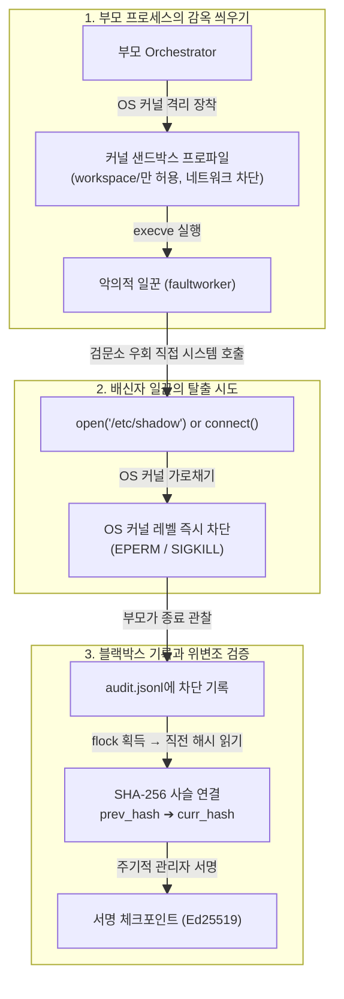

# 004. 프로세스·커널격리와 위변조방지 감사장부 — 배신자 일꾼을 감옥에 가두고, 절대 안 깨지는 블랙박스를 남기는 원리

> **모드**: `[문서작업]` — 소스코드 수정 없이 현재 구현된 OS 커널 수준 격리(macOS Seatbelt·Linux Landlock), 다중 프로세스 파일 잠금(`flock`)과 원자적 파일 교체, SHA-256 해시 사슬 및 서명 체크포인트, 잘린 꼬리 복구(`audit recover`)의 원리를 해설합니다.  
> **기준일**: 2026-11-07 · **기준 커밋**: `33ff98a` (`git log -1 --format=%h -- cmd internal`)  
> **다시 확인하는 법**:
> ```bash
> git rev-parse --short HEAD
> git log -1 --format=%h -- cmd internal
> # 1. 감사 해시 사슬 및 꼬리 복구 단위 시험
> go test -v ./internal/audit/... -run "TestRecover|TestVerifyHashChain"
> # 2. 파일 잠금 및 원자 교체 시험
> go test -v ./internal/storage/... -run "TestAtomic"
> # 3. 결함 워커(faultworker)의 OS 커널 감옥 차단 시나리오 확인
> go run ./cmd/authz-harness run --scenario E2E-58 --output-format explain
> ```

---

## 💡 사용자의 질문 (원문 보존)

> 일꾼이 검문소를 안 거치고 시스템 호출로 직접 파일을 열려고 하면 어떻게 막나? 여러 프로세스가 동시에 장부를 고치다가 컴퓨터가 꺼지면 장부는 어떻게 되나? 감사 기록을 나중에 몰래 고치거나 지우면 어떻게 잡아내나?

---

## 0. 모든 설계 이전에 ‘사람’이 있다 — 착한 일꾼만 오는 것이 아니다

지금까지 살펴본 10단계 검문소(`pep.Gateway`)는 일꾼이 검문소 문을 똑똑 두드리고 들어오는 정상적인 상황을 전제로 합니다.
하지만 해커가 만든 악성 코드나, 공격자에게 완전히 조종당하는 배신자 일꾼(악의적 서브에이전트)을 상상해 봅니다.

- *「배신자 일꾼이 검문소 함수(`gateway.Execute`)를 아예 부르지 않고, Go 언어의 `os.Open("/etc/passwd")`이나 C 라이브러리의 `open()` 시스템 호출을 직접 불러버리면 어쩌지?」*
- *「여러 일꾼 프로세스가 동시에 허가 장부나 감사 장부에 글자를 쓰다가 충돌이 나거나, 기록 도중 갑자기 전원 코드가 뽑히면 파일이 깨져서 통째로 날아가지 않을까?」*
- *「나중에 일꾼이 자기 죄를 감추려고 감사 장부(`audit.jsonl`)를 열어서 자기가 한 행동 몇 줄을 몰래 지우거나 수정하면 어떻게 알아챌 것인가?」*

이 설명서는 애플리케이션 수준의 검문소마저 비웃으며 탈출하려는 일꾼을 **운영체제 커널의 감옥에 가두는 물리적 격리 장치**와, 전원이 꺼져도 깨지지 않고 단 한 글자의 조작도 용납하지 않는 **암호학적 블랙박스(감사 장부)의 비밀**을 밝힙니다.

---

## 1부. 이것은 무엇에 쓰는 장치이고, 왜 이런 모양인가 (용도와 Why)

### 1. 어디에 쓰는 물건인가 (독방 감옥과 위조 방지 블록체인의 비유)

이 장치들은 **「일꾼에게 죄수복을 입혀 통신과 이동이 차단된 독방에 집어넣는 이중 철창(커널 감옥)」**이자, **「도둑이 장부를 찢거나 고치면 앞뒤 지문이 어긋나 스스로 자폭 경보를 울리는 무결성 블랙박스」**입니다.
1. **OS 커널 격리 감옥 (`confinement`)**: 애플리케이션 코드가 아니라 운영체제 커널(macOS `sandbox-exec` Seatbelt / Linux `Landlock`·`seccomp`)에게 부탁하여, 자식 일꾼 프로세스가 허락된 작업 폴더(`workspace/`) 바깥의 디스크나 외부 네트워크 소켓을 물리적으로 열지 못하게 손발을 묶어 버립니다.
2. **동시성 자물쇠와 원자적 교체 (`storage.AtomicFileStore`)**: 여러 프로세스가 동시에 같은 장부를 고칠 때 OS 배타 잠금(`flock`)으로 한 줄로 세우고, 임시 파일에 먼저 쓴 뒤 원자적 이름 바꾸기(`rename`)로 0.0001초 만에 갈아끼워 정전이 나도 파일이 깨지지 않게 합니다.
3. **해시 사슬 블랙박스 (`audit.jsonl`)**: 비트코인 블록체인처럼, 감사 기록의 매 줄마다 직전 줄의 해시값(`prev_hash`)을 물고 새 해시값(`curr_hash`)을 계산하여 한 줄이라도 지우거나 고치면 사슬 전체가 끊어지게 만듭니다.

### 2. 가장 밑바닥의 이유부터 (끝까지 되묻는 Why)

1. **검문소 소프트웨어 코드가 있는데 왜 OS 커널 격리가 또 필요한가? (심층 방어)**
   - 자식 일꾼 프로세스는 독립된 기계어 코드를 실행합니다. 만약 컴파일된 바이너리가 검문소 Go 코드를 무시하고 곧바로 커널 인터럽트(`syscall`)를 때리면, 유저 공간의 Go 검문소는 이를 막을 방법이 없습니다.
   - 그래서 자식을 띄우는 순간(부모의 `exec.CommandContext`), OS 커널에게 "이 자식 프로세스는 오직 `workspace/`만 읽고 쓸 수 있고 외부 인터넷 소켓은 열 수 없다"는 커널 보안 프로파일을 강제로 입혀 보냅니다.
2. **여러 프로세스가 파일에 쓸 때 왜 그냥 열어서 쓰지 않고 임시 파일을 쓰나?**
   - 파일에 데이터를 쓰는 도중에 컴퓨터 전원이 꺼지면, 파일의 절반만 적힌 채 파일 자체가 깨져 버립니다(Corrupted File).
   - 따라서 옆에 임시 파일(`.tmp-xxx`)을 만들어 완벽히 쓴 뒤 디스크 동기화(`fsync`)를 마치고, 운영체제의 원자적 이름 바꾸기(`os.Rename`)를 호출합니다. OS의 `rename`은 성공하거나 실패하거나 둘 중 하나만 존재하므로 파일이 깨지는 일이 물리적으로 불가능합니다.
3. **해시 사슬만 있으면 완벽한가? 왜 서명 체크포인트가 또 필요한가?**
   - 해커가 장부의 마지막 10줄을 통째로 잘라내 버리거나, 파일 자체를 삭제하고 처음부터 가짜 사슬을 다시 계산해서 채워 넣으면 해시 사슬만으로는 이를 알아채기 어렵습니다.
   - 그래서 관리자가 정기적으로 "현재 장부 줄 수와 마지막 해시"를 비밀 서명키(Zone A)로 서명한 **체크포인트 도장(`audit_checkpoint.json`)**을 찍어 둡니다. 해커가 뒤를 잘라내면 체크포인트와 줄 수가 맞지 않아 즉시 들통납니다.

---

## 2부. 처음부터 끝까지 따라가는 물리 격리와 블랙박스 작동 여정

악의적인 워커가 시스템을 파괴하려 할 때 커널 감옥과 블랙박스가 어떻게 반응하는지 보여주는 흐름도입니다.



---

### 1. OS 커널 격리 감옥의 작동 원리 (Seatbelt & Landlock)

부모가 자식 일꾼을 띄울 때 OS 플랫폼에 따라 다음 커널 보호막을 씌웁니다.

- **macOS 환경 (`Seatbelt / sandbox-exec`)**:
  - 부모 프로세스는 자식을 띄우기 직전에 임시 Seatbelt 정책 파일(`.sb`)을 생성합니다:
    ```scheme
    (version 1)
    (deny default)
    (allow file-read* (subpath "/path/to/workspace"))
    (allow file-write* (subpath "/path/to/workspace"))
    (deny network*)
    ```
  - 자식 프로세스는 이 프로파일에 묶인 채 실행되므로, 검문소를 건너뛰고 C 언어로 `/etc/passwd`를 열려고 시도해도 커널이 권한 없음(`EPERM`, `Operation not permitted`) 에러를 던지며 가로막습니다 (시나리오 `E2E-58` 증명).
- **Linux 환경 (`Landlock & seccomp`)**:
  - `confine-exec`라는 신뢰 런처가 자식을 대신 띄우며 리눅스 최신 커널의 `landlock_create_ruleset`과 `prctl`을 호출해 파일시스템 접근 범위를 `workspace/`로 한정하고 네트워크 소켓 생성을 차단합니다.
  - 지원하지 않는 구형 OS 환경이거나 격리를 요구했는데 적용할 수 없으면, 자식을 아예 띄우지 않고 즉시 거부(`CONFINEMENT_UNAVAILABLE`, `16`)합니다.

---

### 2. 다중 프로세스 파일 잠금(`flock`)과 원자적 교체 (`AtomicFileStore`)

부모 프로세스와 여러 자식 워커가 동시에 `.authz-state/public/grants_state.json` 장부를 고치려 할 때 일어나는 일입니다.

```text
[프로세스 A]                                   [프로세스 B]
     │                                              │
     ├─ 1. 장부 자물쇠 파일(.lock) 획득 ─────────────┤ (대기: 잠금 풀릴 때까지 블로킹)
     ├─ 2. 장부 JSON 읽기 및 메모리 수정            │
     ├─ 3. 임시 파일(.tmp-123)에 새 내용 쓰기        │
     ├─ 4. 임시 파일 디스크 동기화 (file.Sync)      │
     ├─ 5. 원자적 이름 바꾸기 (rename tmp to real)  │
     ├─ 6. 부모 디렉터리 동기화 (dir.Sync)          │
     ├─ 7. 자물쇠 파일(.lock) 잠금 해제 ────────────┼─▶ 8. 자물쇠 획득 후 안전하게 읽기 시작!
     ▼                                              ▼
```
- **왜 부모 디렉터리까지 동기화(`dir.Sync`)하나?**  
  파일 내용이 디스크에 내려앉았어도 파일 시스템의 디렉터리 엔트리(이름과 inode 연결 정보)가 디스크에 물리적으로 기록되지 않으면 전원 차단 시 파일 이름이 사라질 수 있습니다. 그래서 부모 폴더까지 `fsync`를 강제합니다.

---

### 3. 블랙박스(`audit.jsonl`)의 4판 해시 사슬과 꼬리 복구 (`audit recover`)

감사 장부의 매 줄은 다음과 같은 암호학적 사슬로 연결됩니다.

```text
[1번째 줄] prev_hash: ""                                      curr_hash: "a1b2..."
                 ▲                                                   │
                 └──────────────── 물고 들어감 ──────────────────────┘
[2번째 줄] prev_hash: "a1b2..."                               curr_hash: "c3d4..."
                 ▲                                                   │
                 └──────────────── 물고 들어감 ──────────────────────┘
[3번째 줄] prev_hash: "c3d4..."                               curr_hash: "e5f6..."
```

#### 기록 도중 전원이 꺼졌을 때: 잘린 꼬리 3종 판정
기록기가 글자를 쓰다가 갑자기 프로세스가 죽으면 파일 맨 끝 줄이 불완전하게 남습니다. 운영자가 `./authz-harness audit recover`를 실행하면 세 가지 상황을 정확히 가려냅니다:
1. **깨진 조각 (`T1`)**: 맨 끝에 `{"time...` 처럼 JSON이 채 끝나지 않고 깨진 쓰레기 바이트가 남은 경우.  
   ➔ **복구**: 깨진 조각을 `audit.jsonl.partial-<시각>` 파일로 안전하게 격리 보관하고, 파일 끝을 마지막 정상 줄바꿈 위치로 잘라낸 뒤 복구 사실(`audit.recover`)을 사슬에 잇습니다.
2. **줄바꿈 누락 (`T2`)**: JSON 데이터는 정상이고 해시 사슬도 완벽한데 마지막 줄바꿈(`\n`)만 빠진 경우.  
   ➔ **복구**: 데이터를 버리지 않고 끝에 `\n` 한 바이트만 덧붙여 정상 기록으로 인정합니다.
3. **악의적 변조 (`T3`)**: JSON은 온전하지만 중간 데이터가 고쳐져 해시 사슬이 깨진 경우.  
   ➔ **복구 불가**: 이것은 정전 사고가 아니라 해커의 침해 사고이므로 복구하지 않고 `AUDIT_INTEGRITY_BROKEN`(`15`) 에러를 울리며 멈춥니다.

---

## 3부. 질문과 답변으로 파고드는 세부 동작 (Q&A)

### Q1. 감사 장부의 해시를 계산할 때 어떤 값들이 들어가나?
- **무슨 일이 일어나는가**:
  단순히 글자 전체를 해시하지 않고, 스키마 4판에 정의된 14개 핵심 칸(`timestamp`, `trace_id`, `actor`, `action`, `resource`, `decision`, `reason`, `prev_hash` 등)을 「글자수:내용」 형태의 정규화 문자열로 엄격하게 조립해 SHA-256 해시를 뽑습니다. 따라서 띄어쓰기 한 칸이나 JSON 키 순서가 바뀌어도 위변조를 정확히 적발합니다.
- (구현: [`audit.go`](../../internal/audit/audit.go) — `ComputeEventHash`, 5부 ② 3번)

### Q2. `audit verify`는 백만 줄의 감사 장부를 어떻게 검증하나?
- **무슨 일이 일어나는가**:
  첫 줄부터 끝 줄까지 스트리밍으로 한 줄씩 읽으며, ① 유효한 JSON인가 ② 원시 토큰 문자열(`eyJ...`)이 실수로 새지 않았는가 ③ `prev_hash`가 윗줄의 `curr_hash`와 일치하는가 ④ 내용물로 다시 계산한 해시가 맞는가를 검사합니다. 100만 줄이라도 메모리에 올리지 않고 1줄씩 순차 검증하므로 메모리가 터지지 않습니다.
- (구현: [`audit.go`](../../internal/audit/audit.go) — `VerifyHashChain`, 5부 ② 3번)

---

## 4부. 배척한 방식과 그 이유

1. **외부 syslog 서버나 원격 보안 관제(SIEM)로만 로그를 쏘는 방식**:
   - **택했다면 무슨 일이 생기는가**: 로컬 디스크 파일 관리가 필요 없어집니다.
   - **그 대신 포기한 것**: 네트워크가 끊기면 감사 기록이 유실되거나 지연이 발생해 로컬 검문소가 멈춰 섭니다. 또한 감사 기록을 확인하기 위해 복잡한 외부 서버를 띄워야 합니다. 이 프로그램은 **로컬 단일 머신에서 즉시 증명 가능한 독립적 원장**을 택했습니다.
2. **원자 교체 없이 `O_TRUNC`나 직접 덮어쓰기를 하는 방식**:
   - **택했다면 무슨 일이 생기는가**: 임시 파일을 만들고 지우는 디스크 I/O가 줄어듭니다.
   - **그 대신 포기한 것**: 전원 차단이나 디스크 풀 에러 발생 시 파일 크기가 0바이트로 잘리거나 중간 내용이 파손되는 재앙이 일어납니다. 이 프로그램은 안전을 위해 **임시 파일 + 원자적 교체(`AtomicWriteFile`)**만 강제합니다.

---

## 5부. 한눈에 보는 요약표와 코드 정본 색인

### ① 핵심 요약 대조표

| 방어 장치 | 안에서 일어나는 일 | 막아내는 위협 | 근거 (구현 위치) |
|---|---|---|---|
| **OS 커널 격리 (`Confinement`)** | macOS Seatbelt 및 Linux Landlock으로 자식 프로세스의 파일시스템/네트워크 권한을 커널 차원에서 박탈 | 검문소를 건너뛰고 시스템 호출을 직접 부르는 악의적 워커 (`G10`) | 5부 ② 1번 |
| **파일 잠금 & 원자 교체** | `flock` 배타 잠금 아래 임시 파일 생성 ➔ `Sync` ➔ `Rename` ➔ 디렉터리 `Sync` 수행 | 다중 프로세스 쓰기 경합, 정전 시 파일 파손 및 0바이트 절단 | 5부 ② 2번 |
| **해시 사슬 & 체크포인트** | 이벤트마다 SHA-256 체이닝, 서명 체크포인트 대조, 잘린 꼬리 복구(`recover`) | 감사 로그 사후 위조, 중간 줄 삭제, 끝 줄 절단 및 재작성 (`G13`) | 5부 ② 3, 4번 |

### ② 어디서 하나 (코드 정본 색인)

1. **OS 커널 격리 어댑터**: [`internal/confinement/confinement.go`](../../internal/confinement/confinement.go) (`Confiner`, `SeatbeltConfiner`, `LandlockConfiner`)
2. **원자적 파일 저장소**: [`internal/storage/atomic.go`](../../internal/storage/atomic.go) (`AtomicFileStore`, `AtomicWriteFile`), [`internal/storage/file.go`](../../internal/storage/file.go) (`WithFileLock`)
3. **감사 기록기 및 해시 검증**: [`internal/audit/audit.go`](../../internal/audit/audit.go) (`JSONLWriter.Log`, `VerifyHashChain`, `RecoverIncompleteTail`)
4. **감사 체크포인트 서명 및 검증**: [`internal/audit/checkpoint/checkpoint.go`](../../internal/audit/checkpoint/checkpoint.go) (`Create`, `Verify`)
