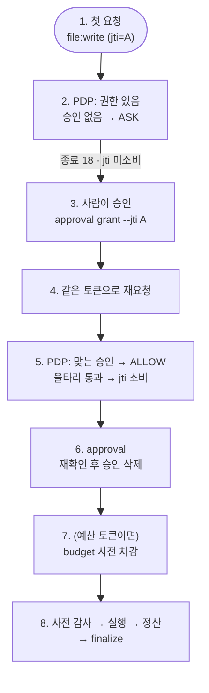

# 005. 사람의 승인·예산·도구 확장 — 허락받은 일이라도 왜 한 번 더 묻고, 몇 번까지만 하게 하고, 네트워크와 명령은 왜 이렇게 좁게 여나

> **모드**: `[문서작업]` — 소스코드 수정 없이 현재 구현된 사람 승인(`ask`)·예산 축소 위임(`Budget`)·도구 확장(`net:fetch`, `exec:run`)의 실제 동작과 이유(Why)를 해설합니다.  
> **기준일**: 2026-11-06 · **기준 커밋**: `bf00fca` (이 문서가 설명하는 `cmd/`와 `internal/`을 마지막으로 바꾼 커밋)  
> **검증 범위**: 동작·순서·소유자·시점을 코드와 대조한 결과와 「미확인」은 5부 ③에 있습니다.  
> **이 문서는 구현된 것만 적는다.** 계획·제안·미래형 약속은 적지 않으며, 현재 코드가 하지 않는 것은 「지금은 없다」고만 씁니다.  
> **이 문서의 규칙**: 본문(0~4부, Q&A, 그림, 5부 ①)은 쉬운 개념·설계·이유가 중심입니다. 파일·타입 이름 같은 고유 이름은 첫 등장에 한마디 설명과 함께 쓰고, 구현의 어디인지는 문단 끝 `(구현: 파일 · 함수, 5부 ② 번호)` 귀띔으로 보조합니다. 기준은 [프로그램 설명서 README의 「설명의 기준」과 「이름의 3층」](README.md)입니다.  
> **겹치는 주제**: 이 세 기능이 끼어 있는 관문 전체 순서(`authn` 토큰 검사 → `authz` 정책 결정 → `boundary` 울타리 → `replay` `jti` 소비 → `approval` 승인 → `budget` 예산 → `precommit_audit` 사전 감사 → `execute` 실행 → `settle` 정산)는 [001편](001-전체요청여정과_5단계관문.md)이, 예산을 자식 토큰에 나눠 주는 교환 단계는 [002편](002-토큰발급_축소위임과_서명키회전.md)이, MCP로 들어오는 `net_fetch`·`exec_run` 호출의 입구 검사는 [004편](004-다단계위임과_MCP도구게이트웨이.md)이 자세히 다룹니다.
>
> **다시 확인하는 법**
> ```bash
> git rev-parse --short HEAD
> git log -1 --format=%h -- cmd internal
> # 1. 승인(ask) 판정·소비, 예산 차감·환급, 도구 분기 시험 실행
> go test -v ./internal/authz/pdp/... -run "TestEvaluateAsk|TestDecideAskAudit"
> go test -v ./internal/authz/pep/...
> # 2. 예산 원장, 네트워크 가드, 실행 가드 시험 실행
> go test -v ./internal/authn/budget/... ./internal/netguard/... ./internal/execguard/...
> # 3. 실행 가드에 등록된 명령 목록 확인 (코드에만 있고 바꾸는 옵션은 없다)
> grep -n -A3 "var registry" internal/execguard/guard.go
> # 4. 승인·예산·도구 시나리오(G11·G14·G15) 실행
> go run ./cmd/authz-harness run --scenario all
> ```

---

## 💡 사용자의 질문 (원문 보존)

> 진행해라

([18번 로드맵 `020`](../로드맵/18-아키텍처-패턴-교보재-및-코드리딩-가이드/instructions/020_설명서_005_승인_예산_도구확장_편.md) 지시서에 따라 집필했습니다.)

---

## 0. 모든 설계 이전에 ‘사람’이 있다 — 권한을 줬는데 왜 또 묻고, 왜 횟수를 세고, 왜 인터넷은 못 쓰게 하나

일꾼에게 「설정 파일을 고쳐도 된다」는 권한을 주었다고 해 봅시다. 그런데 설정 파일은 잘못 고치면 큰일이 나는 파일이라, 일꾼이 실제로 고치려 할 때마다 사람이 「이번 건 맞다」고 한 번 확인해 주고 싶습니다. 또 일꾼이 같은 출입증으로 파일을 수천 번 읽거나 기가바이트 단위로 쓰는 일은 막고 싶습니다. 그리고 일꾼이 도구를 쓸 때, 인터넷 아무 데나 접속하거나 아무 명령이나 실행하게 두고 싶지는 않습니다.

처음 보는 사람은 이런 의문을 품습니다.
- *「허가 장부에 권한이 이미 있는데, 왜 사람 승인을 또 받아야 하나? 그럴 거면 처음부터 권한을 안 주면 되지 않나?」*
- *「승인을 한 번 받았으면 그다음부터는 계속 써도 되지 않나? 왜 한 번 쓰면 사라지나?」*
- *「출입증에 만료 시간이 있는데, 왜 횟수와 바이트 수까지 세나?」*
- *「네트워크 조회를 허락했으면 웹사이트 아무 데나 가도 되지 않나? 왜 내 컴퓨터 안 주소(`127.0.0.1`)만 되나?」*
- *「명령 실행 도구라면서 왜 미리 등록된 명령 하나만 되나?」*

이 설명서는 세 기능이 관문 안의 어디서, 어떤 순서로 무엇을 확인하는지 펼쳐 보이고, 그 흔적이 어디에 남는지 알려 줍니다.

---

## 1부. 왜 이 세 가지가 필요하고, 왜 이런 모양인가

### 가장 밑바닥의 이유부터

1. **권한(`Grant`)이 있는데 왜 사람 승인을 또 받나?**  
   권한은 「이 일꾼은 이 파일을 고칠 수 있는 사람이다」라는 **자격**이고, 승인은 「지금 이 요청 한 건을 해도 된다」는 **건별 허락**입니다. 자격을 아예 안 주면 꼭 필요할 때도 일을 시킬 수 없고, 자격만 주면 일꾼이 언제 몇 번을 하든 막을 수 없습니다. 그래서 권한에 「사람 승인 필요」 표시(`RequiresApproval`)를 붙여 두면, 자격은 있되 실제 실행은 한 건씩 사람이 허락해야 하게 만듭니다.
2. **승인은 왜 한 번 쓰면 사라지나(1회용)?**  
   승인이 남아 있으면 그 승인은 사실상 「권한」과 같아집니다. 사람이 「이번 한 건」을 허락했는데 같은 승인으로 열 번을 할 수 있다면, 사람이 본 것과 실제로 일어난 일이 달라집니다. 그래서 승인은 쓰는 순간 장부에서 지웁니다(소비 = 삭제). 쓰지 않은 승인도 유효 시간(기본 5분, 최대 1시간)이 지나면 사라집니다.
3. **승인을 무엇에 묶나? 「worker-01이 file:write 해도 됨」이면 충분하지 않나?**  
   그렇게 넓게 묶으면, 사람이 A 파일 수정을 허락했는데 같은 승인으로 B 파일을 고칠 수 있습니다. 그래서 승인은 주체·행동·대상·**토큰 일련번호(`jti`)**에 묶이고, 원하면 **보내는 내용의 지문(`arg_hash`)**에도 묶입니다. 지문까지 묶으면 「이 파일에 바로 이 내용을 쓰는 것」만 허락한 셈이 됩니다. 같은 이유로, 승인이 필요한 요청에서는 모든 검사가 끝날 때까지 `jti`를 소비하지 않습니다. 소비해 버리면 승인을 받은 뒤 같은 토큰으로 다시 시도할 수 없기 때문입니다([001편](001-전체요청여정과_5단계관문.md) 1부 6번).
4. **만료 시간이 있는데 왜 예산(호출 횟수·읽기 바이트·쓰기 바이트)까지 세나?**  
   만료 시간은 「언제까지」만 정하고 「얼마나」는 정하지 않습니다. 10분짜리 출입증으로도 1초에 수백 번씩 파일을 읽을 수 있습니다. 그래서 출입증 자체에 쓸 수 있는 양의 상한(`Budget`)을 붙이고, 실제로 쓴 양을 장부(`budget_ledger.json`)에 적어 그 상한을 넘으면 막습니다.
5. **예산은 왜 부모보다 크게 줄 수 없나? 그리고 왜 「몫을 떼어 준다」고 하나?**  
   부모가 자식에게 자기보다 큰 예산을 줄 수 있으면, 자식을 하나 만드는 것만으로 상한을 우회할 수 있습니다. 또 상한만 비교하고 실제 몫을 떼지 않으면, 부모가 자식 열 명에게 각각 자기 전체 예산을 줄 수 있어 합계가 열 배가 됩니다. 그래서 교환할 때 부모의 **남은** 몫에서 자식 몫만큼을 실제로 떼어 자식 칸으로 옮깁니다(`Reserve`). 자식이 만료되면 쓰지 않은 몫은 부모에게 돌아갑니다.
6. **예산 토큰은 왜 여러 번 쓸 수 있나? 다른 토큰은 한 번만 쓰는데?**  
   예산 토큰은 「이 양만큼 반복해서 쓰라」고 만든 토큰이라, 한 번 쓰고 버리는 일회성 표시(`jti` 소비)와 맞지 않습니다. 대신 쓸 때마다 예산 장부에서 깎이므로, 반복 사용의 상한은 예산이 정합니다.
7. **네트워크 조회는 왜 내 컴퓨터 안 주소(`127.0.0.1`, `::1`)의 허용된 포트만 되나?**  
   이 하네스는 「바깥으로 정보가 새어 나가지 않는가」를 시험하는 곳입니다. 인터넷 주소를 허용하는 순간, 일꾼이 읽은 비밀을 바깥 서버에 보내는 길이 열립니다. 그래서 조회 대상은 이 컴퓨터 안의 주소 중 실행할 때 지정한 허용 목록(`--net-allow`)에 있는 것만 받습니다. 목록이 비어 있으면 모두 막습니다.
8. **주소만 맞으면 되지, 왜 이름 풀이(DNS)·되돌려 보내기(리다이렉트)·프록시까지 막나?**  
   검사한 주소와 실제로 접속하는 주소가 달라질 수 있는 모든 길을 막기 위해서입니다. 이름 풀이를 허용하면 검사 때와 접속 때 다른 주소가 나올 수 있고, 리다이렉트를 따라가면 허용 목록 밖으로 끌려갈 수 있으며, 환경변수 프록시를 쓰면 접속이 다른 기계를 거칩니다. 그래서 숫자 주소만 받고, 리다이렉트는 거부하고, 프록시를 끄고, 접속 함수가 검사한 그 주소에만 연결하게 고정했습니다.
9. **명령 실행은 왜 등록된 번호(`echo-safe`) 하나만, 인자도 하나만 되나?**  
   임의 명령을 받으면 그 명령이 무엇이든 할 수 있으므로, 이 프로그램이 지키려는 모든 경계가 의미를 잃습니다. 그래서 실행 파일 경로 대신 코드에 적어 둔 논리 번호(`command_id`)만 받고, 셸을 거치지 않으며, 인자는 정해진 글자(영문·숫자·`_`·`.`·`-`, 64자 이하) 하나 이하만 허용하고, 환경변수를 물려주지 않습니다. 등록 목록은 코드에만 있고 바깥에서 바꾸는 옵션은 일부러 두지 않았습니다. 지금 등록된 것은 `echo-safe`(`/bin/echo`) 하나이며, 왜 그 명령인지는 시험용으로 가장 부작용이 없는 명령을 고른 것 외의 이유를 확인하지 못했습니다.

### 흔한 방식과 이 프로그램의 선택

| 구분 | 흔한 방식 (이 저장소에서 확인하지 않은 일반론) | 이 프로그램(`authz-harness`)의 선택 |
|---|---|---|
| **모양** | 권한이 있으면 바로 실행하고, 사용량 제한은 서버 쪽 요청 속도 제한(rate limit)으로 하며, 도구는 쉘 명령이나 임의 URL을 그대로 받는다. | 권한에 「승인 필요」를 붙이면 주체·행동·대상·`jti`(·내용 지문)에 묶인 1회용 승인이 있어야 실행하고, 토큰마다 예산 장부로 양을 세며, 도구는 루프백 허용 목록 GET과 등록된 실행 번호만 받는다. |
| **얻는 것** | 설정이 간단하고 도구를 자유롭게 쓸 수 있다. | 사람이 허락한 그 한 건만 실행되고, 자식에게 나눠 준 예산의 합이 부모 예산을 넘지 않으며, 도구가 바깥 네트워크나 임의 명령으로 새는 길이 없다. 모든 결과가 정해진 종료 코드(`12`, `18`)와 감사 기록으로 남는다. |
| **포기하는 것** | 건별 허락, 위임 단계별 양 제한, 도구의 누출 경로 차단이 어렵다. | 승인이 필요한 요청은 거절 → 사람 승인 → 재시도의 왕복이 생기고, 예산 토큰을 쓸 때마다 장부 파일을 잠그고 쓰며, 실제 인터넷 조회나 다양한 명령 실행은 할 수 없다. |

---

## 2부. 질문과 답변으로 풀어보는 핵심 동작 (Q&A)

### Q1. 승인이 필요한 권한은 어떻게 만들고, 요청하면 처음에 무슨 일이 일어나나?
- **무슨 일이 일어나는가**:
  1. 관리자가 권한을 줄 때 `grant` 명령에 `--requires-approval`을 붙이면, 허가 장부(`grants_state.json`)의 그 권한에 `requires_approval: true`가 적힙니다. (구현: [`cli/grant.go`](../../internal/cli/grant.go), [`domain/grant.go`](../../internal/domain/grant.go) · `Grant.RequiresApproval`, 5부 ② 1번)
  2. 일꾼이 그 권한으로 일을 요청하면, 관문의 정책 결정(`pdp.Evaluate`)이 일치하는 활성 권한을 모두 모읍니다. 그중 하나라도 「승인 필요」면 더 엄격한 쪽을 따릅니다. 그러고 나서 장부의 승인 목록에서 이 요청에 딱 맞는 승인을 찾습니다(`domain.SelectApproval`). (구현: [`pdp/service.go`](../../internal/authz/pdp/service.go) · `Evaluate`, 5부 ② 2번)
  3. 맞는 승인이 없으면 결론은 「사람에게 물어봐야 함」(`ASK`)입니다. 사유는 이 주체의 승인 상태에 따라 셋 중 하나입니다: 유효 시간이 지난 승인만 있으면 `APPROVAL_EXPIRED`, 다른 요청에 묶인 승인만 있으면 `APPROVAL_MISMATCH`, 아무것도 없으면 `APPROVAL_REQUIRED`. 셋 다 종료 코드는 `18`이고, 감사 장부의 `decision` 칸에는 `ask`가 적힙니다. 파일은 바뀌지 않고 `jti`도 소비되지 않습니다. (구현: [`domain/approval.go`](../../internal/domain/approval.go) · `SelectApproval`, 5부 ② 3번)
- **왜 그렇게 하나**: 거절 이유를 셋으로 나누어야 사람이 「승인이 만료됐다」와 「다른 건을 승인했다」와 「아직 아무도 승인 안 했다」를 구별해 대응할 수 있기 때문입니다. 여러 권한 중 가장 엄격한 쪽을 따르는 이유는, 승인이 필요 없는 권한 하나가 함께 있다는 이유로 승인 요구가 조용히 사라지지 않게 하기 위해서입니다.
- **근거**: 5부 ② 항목 1, 2, 3번

### Q2. 사람은 어떻게 승인을 내리고, 그 승인은 무엇에 묶이나?
- **무슨 일이 일어나는가**:
  1. 사람이 `approval grant --subject worker-01 --action file:write --resource config.txt --jti <토큰 jti>`를 실행합니다. 내용까지 묶으려면 `--arg-hash sha256:<64자리>`를 함께 줍니다. 유효 시간은 `--ttl`로 정하며, 비우면 5분, 1시간을 넘거나 음수면 거부합니다. (구현: [`cli/approval.go`](../../internal/cli/approval.go) · `ApprovalRunner.runGrant`, 5부 ② 4번)
  2. 권한 관리 서비스(`pap.CreateApproval`)가 값을 검사하고, `approval-<나노초>` 번호를 붙여 허가 장부의 승인 목록에 넣습니다. 이때 만료된 승인을 함께 청소합니다. 저장이 끝나면 감사 장부에 `approval.granted`를 남기며, 이 기록이 실패하면 에러를 돌려줍니다. (구현: [`pap/service.go`](../../internal/authz/pap/service.go) · `CreateApproval`, [`state/approval.go`](../../internal/authz/state/approval.go) · `CreateApproval`, 5부 ② 5번)
  3. 승인이 요청에 맞는지는 한 곳의 규칙(`Approval.Matches`)으로만 판정합니다: 주체·행동·대상·`jti`가 모두 같아야 하고, 승인에 지문이 있으면 요청 내용의 지문도 같아야 하며, 지금 시각이 만료 전이어야 합니다. 요청 내용의 지문은 파일 쓰기면 쓸 내용, 네트워크 조회면 정규화된 주소, 명령 실행이면 인자로 계산합니다. (구현: [`domain/approval.go`](../../internal/domain/approval.go) · `Approval.Matches`, 5부 ② 3번)
- **왜 그렇게 하나**: 정책 결정과 실제 소비가 서로 다른 규칙으로 판정하면, 결정에서는 맞다고 했는데 소비에서는 틀리다고 하는 어긋남이 생깁니다. 그래서 두 곳이 같은 함수를 씁니다. 빈 내용은 지문이 빈 문자열이 되므로 내용 바인딩을 걸 수 없으며, 이는 코드에 적힌 알려진 한계입니다.
- **근거**: 5부 ② 항목 3, 4, 5번

### Q3. 승인을 받은 뒤 다시 요청하면 승인은 언제, 어떻게 사라지나?
- **무슨 일이 일어나는가**:
  1. 같은 토큰으로 다시 요청하면 정책 결정이 맞는 승인을 찾아 `ALLOW`와 함께 그 승인 번호(`ApprovalID`)를 돌려줍니다. 이어서 울타리 검사(`boundary`)를 지나고 나면 `jti`가 소비됩니다(`replay`). (구현: [`pdp/service.go`](../../internal/authz/pdp/service.go) · `Evaluate`, 5부 ② 2번)
  2. `jti` 소비 다음 단계(`approval`)가 허가 장부를 잠그고, 그 번호의 승인을 다시 찾아 같은 규칙으로 한 번 더 맞춰 본 뒤, 맞으면 지웁니다. 판정과 소비 사이에 누가 그 승인을 먼저 썼거나 만료됐으면 여기서 막힙니다. 두 프로세스가 같은 승인을 동시에 쓰려 해도 파일 잠금 때문에 한쪽만 성공합니다. (구현: [`state/approval.go`](../../internal/authz/state/approval.go) · `ConsumeApproval`, 5부 ② 5번)
  3. 지운 뒤 감사 장부에 `approval.consumed`(승인 번호 포함)를 남깁니다. 이 기록이 실패하면 요청은 감사 실패(`15`)로 멈추지만, 승인은 이미 지워졌으므로 되살아나지 않습니다. (구현: [`gateway.go`](../../internal/authz/pep/gateway.go) · `gateway.logApprovalConsumed`, 5부 ② 6번)
  4. 승인을 지운 뒤 사전 감사나 실행이 실패해도 승인은 되돌리지 않습니다.
- **왜 그렇게 하나**: 승인을 되돌릴 수 있게 하면 「실패한 척하고 다시 쓰기」로 한 번 허락을 여러 번 쓸 길이 생깁니다. 대신 실패하면 사람이 다시 승인해야 하는 불편을 감수했습니다. 소비 단계를 울타리 검사 뒤에 둔 이유는, 경로가 잘못된 요청 때문에 승인이 헛되이 사라지지 않게 하기 위해서입니다.
- **근거**: 5부 ② 항목 2, 5, 6번

### Q4. 예산은 어디서 생겨서 어떻게 자식에게 나뉘나?
- **무슨 일이 일어나는가**:
  1. 예산은 위임 없이 처음 발급하는 토큰(루트 토큰)에서만 시작합니다. 발급 서비스가 그 토큰의 `jti`로 예산 장부에 칸을 만들고(`Ledger.Init`), 처음 상한(`Initial`)과 남은 양(`Remaining`)을 같은 값으로 적습니다. 예산 값은 호출 횟수(`max_calls`, 1 이상 필수)와 선택적인 읽기·쓰기 바이트 상한입니다. (구현: [`issuer.go`](../../internal/authn/token/issuer.go) · `Service.IssueToken`, [`budget/ledger.go`](../../internal/authn/budget/ledger.go) · `FileLedger.Init`, 5부 ② 7, 8번)
  2. 부모가 자식에게 교환해 줄 때는 먼저 상한끼리 비교하고([002편](002-토큰발급_축소위임과_서명키회전.md) Q2 ⑥), 자식 토큰을 서명한 직후 부모의 **남은** 양에서 자식 몫을 떼어 자식 칸으로 옮깁니다(`Ledger.Reserve`). 부모 칸이 없거나 남은 양이 모자라면 거부합니다(`DELEGATION_BUDGET_EXCEEDED`, `12`). (구현: [`budget/ledger.go`](../../internal/authn/budget/ledger.go) · `FileLedger.Reserve`, 5부 ② 8번)
  3. 장부를 고칠 때마다 먼저 만료된 자식 칸을 찾아, 가장 깊은 자식부터 쓰지 않은 양을 부모에게 돌려주고 그 칸을 「회수됨」으로 표시합니다. 돌려줄 때도 부모의 처음 상한을 넘지 않게 자릅니다. (구현: [`budget/ledger.go`](../../internal/authn/budget/ledger.go) · `reclaimExpiredLocked`, 5부 ② 8번)
- **왜 그렇게 하나**: 상한 비교만으로는 자식 여러 명에게 같은 몫을 중복해 줄 수 있으므로 실제로 떼어 옮깁니다. 만료된 자식의 몫을 돌려주지 않으면, 쓰지도 않은 예산이 만료와 함께 영영 사라져 부모가 일을 계속할 수 없게 됩니다. 깊은 자식부터 돌려주는 이유는 손자 몫이 자식을 거쳐 부모까지 차례로 올라가게 하기 위해서입니다.
- **근거**: 5부 ② 항목 7, 8번

### Q5. 예산 토큰으로 일을 하면 언제 얼마나 깎이나?
- **무슨 일이 일어나는가**:
  1. 관문의 신원 확인 단계(`authn`)가 예산이 붙은 토큰임을 알아보면, 예산 장부가 조립되어 있는지 먼저 봅니다. 없으면 무조건 막습니다(`16`). 예산 토큰은 재사용 방지 장부를 거치지 않습니다. (구현: [`gateway.go`](../../internal/authz/pep/gateway.go) · `gateway.authn`, 5부 ② 6번)
  2. **호출 1회는 모든 행동이 미리 깎고, 쓰기와 명령 실행은 보낼 바이트도 함께 깎습니다**(`budget` 단계): 호출 1회와 쓸 바이트 수(명령이면 인자 길이)를 사전 감사 전에 깎습니다. 이후 어느 단계에서든 실패하면 파이프라인 엔진이 깎은 만큼 되돌립니다(`Refund`). 단, 명령 실행은 일단 시작되면 실패해도 되돌리지 않습니다. 명령이 이미 무언가를 했을 수 있기 때문입니다.
  3. **읽기·조회·명령의 출력 바이트는 실행 직후에 깎습니다**(`settle` 단계): 얼마나 읽을지 미리 알 수 없으므로, 읽은 뒤 읽은 바이트 수를 깎습니다. 모자라면 읽은 내용을 결과에 담지 않고 버린 채 거부합니다(`BUDGET_EXHAUSTED`, `12`). 이때 미리 깎아 둔 호출 1회분은 읽기·조회에서는 되돌리고, 이미 실행된 명령에서는 되돌리지 않습니다. 명령 실행의 출력 바이트도 같은 방식이라, 모자라면 명령은 이미 실행된 뒤에 결과만 거부됩니다. (구현: [`gateway.go`](../../internal/authz/pep/gateway.go) · `gateway.settle`, [`tool.go`](../../internal/authz/pep/tool.go) · `BudgetPlan`, 5부 ② 6번)
  4. 깎을 때는 장부를 잠그고, 남은 양이 모자라면 아무 값도 바꾸지 않은 채 거부합니다. 회수된 칸에서는 깎지도 되돌리지도 않습니다. (구현: [`budget/ledger.go`](../../internal/authn/budget/ledger.go) · `FileLedger.Consume`, `FileLedger.Refund`, 5부 ② 8번)
- **왜 그렇게 하나**: 쓰기는 미리 깎아야 「예산이 모자란데 파일은 이미 바뀐」 일이 생기지 않습니다. 읽기는 부작용이 없으므로 읽은 뒤 바이트를 깎고 모자라면 결과를 버리는 것으로 충분합니다. 명령 실행은 둘 다에 걸쳐 있어, 미리 깎되 시작 뒤에는 되돌리지 않는 쪽을 택했습니다.
- **근거**: 5부 ② 항목 6, 8번

### Q6. 네트워크 조회(`net:fetch`)는 어떤 주소까지 되고, 어디서 막히나?
- **무슨 일이 일어나는가**:
  1. **관문 입구(`input`)**: 주소를 정규 모양으로 바꿉니다(`netguard.ParseTarget`). `http`만, 사용자 정보(`user@`) 없이, 숫자 주소 `127.0.0.1` 또는 `::1`만, 포트 번호 필수, 표기가 정규 모양과 똑같을 때만 받습니다. 역슬래시·공백·제어 문자가 섞이면 거부합니다. 형식이 틀린 주소는 감사 장부에 원문 대신 지문만 남기고 `<invalid-url>`로 적습니다. 조회 요청에 데이터를 실으면 거부합니다. (구현: [`netguard/guard.go`](../../internal/netguard/guard.go) · `ParseTarget`, 5부 ② 9번)
  2. **정책 결정(`authz`)**: 정규화된 `호스트:포트`가 대상(`Resource`)이 되어 일반 파일 요청과 똑같이 토큰 범위(예: `net:fetch:127.0.0.1:18080`)와 권한 장부로 판정합니다.
  3. **울타리(`boundary`)**: 그 `호스트:포트`가 허용 목록에 정확히 있는지 확인합니다(`Guard.Check`). 권한이 있어도 목록에 없으면 막습니다(`EGRESS_DENIED`, `12`). 허용 목록은 자식 워커를 띄울 때 `--net-allow 127.0.0.1:18080,...`로 정하며, 비어 있으면 전부 거부합니다. (구현: [`netguard/guard.go`](../../internal/netguard/guard.go) · `Guard.Check`, `NewGuard`, 5부 ② 9번)
  4. **실행(`execute`)**: 프록시를 끄고, 연결 유지 없이, 접속 함수가 검사한 주소와 다른 곳에 연결하려 하면 거부하도록 고정한 채 GET을 한 번 보냅니다. 리다이렉트는 따라가지 않고 거부하며, 응답이 1MB를 넘거나 5초를 넘기면 가드 상한 초과(`TOOL_LIMIT_EXCEEDED`, `12`)로 멈춥니다. (구현: [`netguard/guard.go`](../../internal/netguard/guard.go) · `Guard.Fetch`, 5부 ② 9번)
- **왜 그렇게 하나**: 1부 7·8번과 같습니다. 가드 상한 초과를 `17`이 아니라 `12`로 둔 이유는, `17`은 부모가 자식을 직접 끊었을 때만 쓰는 번호이고([003편](003-서브프로세스격리와_해시체인감사.md) Q1), 가드 상한은 관문 안의 거부이기 때문입니다.
- **근거**: 5부 ② 항목 9번

### Q7. 명령 실행(`exec:run`)은 무엇을 실행하고, 어디서 막히나?
- **무슨 일이 일어나는가**:
  1. **울타리(`boundary`)**: 실행 번호가 등록 목록에 있는지, 인자가 정해진 글자 모양인지를 프로세스를 띄우지 않고 확인합니다(`execguard.Validate`). 등록되지 않은 번호면 `EXEC_NOT_ALLOWED`, 인자 모양이 틀리면 `EXEC_ARG_REJECTED`이며 둘 다 종료 코드 `12`입니다. (구현: [`execguard/guard.go`](../../internal/execguard/guard.go) · `Validate`, 5부 ② 10번)
  2. **실행(`execute`)**: 실행 직전에 같은 검사를 한 번 더 하고, 등록된 실행 파일을 셸 없이 직접 실행합니다. 작업 폴더를 현재 폴더로 삼고, 환경변수는 하나도 물려주지 않으며, 표준 입력은 비웁니다. 5초를 넘기거나 출력이 64KB를 넘으면 `TOOL_LIMIT_EXCEEDED`(`12`)로 멈춥니다. (구현: [`execguard/guard.go`](../../internal/execguard/guard.go) · `Runner.Run`, 5부 ② 10번)
  3. 실행기는 작업 폴더가 정해진 조립에서만 만들어지고, 없으면 명령 실행 요청은 무조건 막습니다(`16`). (구현: [`builder.go`](../../internal/app/builder.go) · `BuildStack`, 5부 ② 11번)
- **왜 그렇게 하나**: 1부 9번과 같습니다. 환경변수를 비우는 이유는 부모 쪽 비밀이 명령으로 흘러가지 않게 하기 위해서입니다([003편](003-서브프로세스격리와_해시체인감사.md)의 `SanitizeEnv`와 같은 생각이지만, 여기서는 아예 하나도 넘기지 않습니다).
- **근거**: 5부 ② 항목 10, 11번

---

## 3부. 내부 지도 — 한 번의 여정과 직접 확인하는 법

승인이 필요한 쓰기 요청 한 건이 거절 → 승인 → 재시도로 끝나는 흐름입니다.



(구현: [`pdp/service.go`](../../internal/authz/pdp/service.go) — `Evaluate`가 2·5단계를, [`state/approval.go`](../../internal/authz/state/approval.go) — `ConsumeApproval`이 6단계를, [`gateway.go`](../../internal/authz/pep/gateway.go) — `engine.Run`이 돌리는 단계들(`boundary`, `replay`, `approval`, `budget`, `precommit_audit`, `execute`, `settle`)이 5~8단계를 맡습니다, 5부 ② 2·5·6번)

### 어디에 무엇이 남나

| 무엇 | 어디에 | 언제 | 사람이 직접 여는 법 |
|---|---|---|---|
| **「승인 필요」 표시** | `.authz-state/public/grants_state.json`의 권한 항목 `requires_approval` | `grant --requires-approval` 실행 시 | `cat`으로 열어 본다 |
| **살아 있는 승인 목록** | 같은 파일의 `approvals` 목록 | `approval grant` 시 추가, 소비·만료 시 삭제 | `authz-harness approval list --subject <주체>` |
| **승인 대기·발급·소비 기록** | `audit.jsonl`의 `decision: ask`, `approval.granted`, `approval.consumed` | 각 시점 | `grep -E '"ask"\|approval\.' audit.jsonl` |
| **예산 남은 양과 부모-자식 연결** | `.authz-state/public/budget_ledger.json` (재사용 방지 장부와 같은 폴더) | 루트 발급(`Init`), 교환(`Reserve`), 사용(`Consume`)·환급(`Refund`), 만료 회수 시 | `cat`으로 열어 `initial`, `remaining`, `parent_jti`, `reclaimed`를 본다 |
| **도구 요청의 대상과 지문** | `audit.jsonl`의 `resource`(조회는 `호스트:포트`, 실행은 실행 번호)와 `arg_hash`·`result_hash` | 각 관문 기록 시 | `cat audit.jsonl` (주소 원문이 형식 오류면 `<invalid-url>`과 지문만 남는다) |

### 이상이 생기면

| 상황 | 일어나는 일 |
|---|---|
| **승인이 필요한 권한인데 승인이 없음 / 만료됨 / 다른 요청에 묶임** | 정책 결정에서 `ASK`로 멈추고 `APPROVAL_REQUIRED` / `APPROVAL_EXPIRED` / `APPROVAL_MISMATCH`, 종료 코드 `18`. `jti`는 소비되지 않는다. |
| **판정 뒤 소비 전에 다른 요청이 같은 승인을 먼저 씀** | `approval`의 재확인에서 승인을 찾지 못해 `APPROVAL_REQUIRED`(`18`)로 멈춘다. 이 요청의 `jti`는 이미 소비된 뒤다. |
| **승인 소비 뒤 사전 감사나 실행이 실패함** | 요청은 실패하고 승인은 되살아나지 않는다(의도한 동작). |
| **예산 토큰인데 예산 장부가 조립되어 있지 않음** | 토큰 검사 단계에서 `16`으로 막는다. |
| **쓰기 예산 부족** | `budget`에서 `BUDGET_EXHAUSTED`(`12`), 파일은 바뀌지 않는다. |
| **읽기·조회 예산 부족** | 실행 뒤 차감에서 `BUDGET_EXHAUSTED`(`12`), 읽은 내용은 버려진다. |
| **명령 실행 뒤 출력 차감이 모자람** | 명령은 이미 실행되었고 결과만 `BUDGET_EXHAUSTED`(`12`)로 거부된다. 미리 깎은 몫은 되돌리지 않는다. 이미 일어난 명령의 효과는 막지 못한다. |
| **조회 주소가 루프백 숫자 주소가 아니거나 표기가 비정규·이름 주소임** | `input`에서 `EGRESS_DENIED`(`12`), 감사에는 지문만 남는다. |
| **권한은 있으나 허용 목록(`--net-allow`)에 없는 포트** | `boundary`에서 `EGRESS_DENIED`(`12`). |
| **조회 대상이 리다이렉트를 돌려줌, 응답 1MB 초과, 5초 초과** | 각각 `EGRESS_DENIED` 또는 `TOOL_LIMIT_EXCEEDED`(`12`). |
| **등록되지 않은 실행 번호, 허용되지 않은 인자 모양** | `boundary`에서 `EXEC_NOT_ALLOWED` / `EXEC_ARG_REJECTED`(`12`). |
| **네트워크 가드 또는 실행기가 조립되어 있지 않음** | 해당 도구 요청은 `boundary`에서 `16`으로 막는다. |

---

## 4부. 배척한 방식과 그 이유

1. **승인을 여러 번 쓸 수 있게 하거나, 실패하면 승인을 되돌려 주는 방식**:
   - **택했다면 무슨 일이 생기는가**: 사람이 한 건을 허락했는데 여러 건이 실행되거나, 실패를 핑계로 같은 허락을 반복해 쓸 수 있습니다.
   - **그 대신 포기한 것**: 실패 시 다시 승인받아야 하는 불편을 감수하고, 소비 = 삭제와 「되돌리지 않음」을 택했습니다.
2. **토큰 검사 단계에서 `jti`를 바로 소비하는 방식**:
   - **택했다면 무슨 일이 생기는가**: `ASK`로 막힌 요청이 토큰을 써 버려, 승인을 받은 뒤 같은 토큰으로 재시도할 수 없습니다. 그러면 승인을 묶은 `jti`가 쓸모없어집니다.
   - **그 대신 포기한 것**: 검사와 소비를 한 번에 끝내는 단순함을 포기하고, 소비를 모든 검사가 끝난 뒤(`replay`)로 옮겼습니다([001편](001-전체요청여정과_5단계관문.md) 4부 3번).
3. **예산을 토큰 상한끼리만 비교하고 실제 몫은 떼지 않는 방식**:
   - **택했다면 무슨 일이 생기는가**: 부모가 자식 여러 명에게 각각 자기 전체 예산을 줄 수 있어, 합계가 부모 예산을 넘습니다.
   - **그 대신 포기한 것**: 교환할 때마다 장부를 잠그고 고치는 비용을 감수하고, 남은 몫에서 실제로 떼어 옮기는 `Reserve`를 택했습니다.
4. **예산 집행을 정책 결정(PDP)에서도 미리 검사하는 방식**:
   - **택했다면 무슨 일이 생기는가**: 결정 시점에 「남았다」고 판정한 뒤 실제 차감 사이에 다른 요청이 몫을 써 버리면, 두 판정이 서로 다른 결론을 냅니다. 또 순수 계산이어야 할 결정기가 바뀌는 장부를 알아야 합니다.
   - **그 대신 포기한 것**: 결정 단계에서 미리 거절하는 편의를 포기하고, 예산은 관문(PEP)의 차감 한 곳에서만 판정합니다.
5. **도구마다 인터페이스(`ToolHandler`)를 두고 구현을 끼워 넣는 방식**:
   - **택했다면 무슨 일이 생기는가**: 새 도구를 붙이기는 쉬워 보이지만, 도구가 네 개로 고정된 지금은 인터페이스와 어댑터만 늘고, 도구마다 다른 관문 위치(입구 정규화, 울타리, 사전·사후 차감)를 결국 다시 관문 쪽에서 나눠 처리해야 합니다.
   - **그 대신 포기한 것**: 확장의 편의를 포기하고, 관문 코드 안의 도구 종류별 분기(`switch`)를 유지했습니다. 이 결정의 근거는 [015번 보고서](../보고서/015-지속적_수정발생_근본원인_진단_및_과잉설계_제거_구조단순화_보고서.md) §2.3과 17번 로드맵 결정 D-03입니다. 그래서 지금은 도구를 하나 더하려면 도메인 행동·스코프 문법·관문의 여러 분기·MCP 노출을 함께 고쳐야 합니다.
6. **네트워크 조회에 이름 주소·리다이렉트·프록시를 허용하는 방식**:
   - **택했다면 무슨 일이 생기는가**: 검사한 곳과 실제로 접속한 곳이 달라질 수 있어, 허용 목록이 우회됩니다.
   - **그 대신 포기한 것**: 실제 서비스 주소나 바깥 인터넷을 조회하는 능력을 포기했습니다.
7. **명령 실행에 셸이나 실행 파일 경로를 받는 방식**:
   - **택했다면 무슨 일이 생기는가**: 따옴표·세미콜론 같은 셸 문법이나 경로 조작으로 등록하지 않은 명령이 실행될 수 있습니다.
   - **그 대신 포기한 것**: 쓸모 있는 여러 명령을 실행하는 능력을 포기하고, 코드에 고정된 번호 하나만 남겼습니다.

---

## 5부. 한눈에 보는 대조표와 코드 정본

### ① 행동별 안에서 일어나는 일과 지금은 없는 것

| 행동 | 안에서 일어나는 일 | 지금은 없는 것 | 근거 |
|---|---|---|---|
| **승인 필요 판정** (`ASK`) | 일치하는 활성 권한 중 하나라도 승인 필요면 `SelectApproval`로 맞는 승인을 찾고, 없으면 `ASK`(`18`)를 낸다. `jti`는 소비하지 않는다. | 승인을 요청자에게 자동으로 알리거나 대기열에 쌓는 기능은 지금은 없다(사람이 직접 `approval grant`를 실행한다). | 5부 ② 1, 2, 3번 |
| **승인 발급** (`approval grant`) | TTL(기본 5분, 최대 1시간)과 지문 형식을 검사하고 주체·행동·대상·`jti`(·지문)에 묶인 승인을 장부에 넣은 뒤 `approval.granted`를 남긴다. | 승인을 철회하는 명령은 지금은 없다(만료를 기다리거나 장부를 직접 고쳐야 한다). 승인자 신원을 구분해 기록하는 기능은 지금은 없다(감사 `actor`는 `admin` 고정). | 5부 ② 4, 5번 |
| **승인 소비** (`approval`) | 장부를 잠그고 같은 규칙으로 재확인한 뒤 지우고 `approval.consumed`를 남긴다. 이후 실패해도 되돌리지 않는다. | — | 5부 ② 5, 6번 |
| **예산 시작·분배·회수** | 루트 발급에서 `Init`, 교환에서 남은 몫을 떼어 `Reserve`, 장부를 고칠 때마다 만료된 자식 몫을 깊은 순서로 부모에게 회수한다. | 명령줄에서 예산 토큰을 발급하거나 교환하는 옵션은 지금은 없다(시나리오 하네스와 라이브러리 호출에서만 쓴다). | 5부 ② 7, 8번 |
| **예산 차감** | 쓰기·실행은 사전 차감 후 `budget.consumed`를 남기고 실패 시 환급(실행 시작 뒤 제외), 읽기·조회·실행 출력은 사후 차감. | 시간당 사용량처럼 기간 단위로 다시 채워지는 예산은 지금은 없다. | 5부 ② 6, 8번 |
| **네트워크 조회** (`net:fetch`) | `input` 정규화, `authz` 범위·권한, `boundary` 허용 목록, `execute` 고정 주소 GET(리다이렉트 거부, 1MB·5초 상한). | HTTPS, GET 이외의 방식, 루프백 밖 주소, 이름 주소는 지금은 없다. | 5부 ② 9번 |
| **명령 실행** (`exec:run`) | `boundary` 등록 번호·인자 검사, `execute` 셸 없는 직접 실행(환경변수 없음, 64KB·5초 상한). | 등록 번호를 바깥에서 추가하는 옵션은 지금은 없다(의도적으로 두지 않음). 등록된 것은 `echo-safe` 하나다. | 5부 ② 10, 11번 |

### ② 어디서 하나 (코드 정본 색인)

1. **승인 필요 표시가 있는 권한**: [`internal/domain/grant.go`](../../internal/domain/grant.go) (`Grant.RequiresApproval`), [`internal/cli/grant.go`](../../internal/cli/grant.go) (`--requires-approval`) — 구현: P15
2. **3값 정책 결정**: [`internal/authz/pdp/service.go`](../../internal/authz/pdp/service.go) (`Evaluate`, `DecisionAsk`, `Decision.ApprovalID`) — 구현: P15
3. **승인 타입과 단일 판정 규칙**: [`internal/domain/approval.go`](../../internal/domain/approval.go) (`Approval`, `ApprovalBinding`, `Approval.Matches`, `SelectApproval`, `ValidateApprovalTTL`, `ValidateArgHash`, `DefaultApprovalTTL`, `MaxApprovalTTL`), 지문 [`internal/domain/digest.go`](../../internal/domain/digest.go) (`DataDigest`) — 구현: P15
4. **명령줄 승인 러너**: [`internal/cli/approval.go`](../../internal/cli/approval.go) (`ApprovalRunner.runGrant`, `ApprovalRunner.runList`) — 구현: P15
5. **승인 저장·소비**: [`internal/authz/pap/service.go`](../../internal/authz/pap/service.go) (`CreateApproval`), [`internal/authz/state/approval.go`](../../internal/authz/state/approval.go) (`CreateApproval`, `ConsumeApproval`, `ApprovalConsumer`, `pruneExpired`) — 구현: P15
6. **관문의 승인·예산 단계와 도구 분기**: [`internal/authz/pep/gateway.go`](../../internal/authz/pep/gateway.go) (`gateway.approval`, `gateway.budget`, `gateway.settle`, `gateway.refund`, `gateway.logApprovalConsumed`, `ApprovalConsumer`), [`internal/authz/pep/tool.go`](../../internal/authz/pep/tool.go) (`Tool`, `BudgetPlan`) — 구현: P12·P15·P16, 로드맵 19 지시서 030·040
7. **예산 루트 토큰 발급**: [`internal/authn/token/issuer.go`](../../internal/authn/token/issuer.go) (`Service.IssueToken`, `WithBudgetLedger`), 예산 타입 [`internal/domain/budget.go`](../../internal/domain/budget.go) (`Budget`, `Budget.Validate`, `Budget.Within`) — 구현: P12
8. **예산 장부**: [`internal/authn/budget/ledger.go`](../../internal/authn/budget/ledger.go) (`Ledger`, `FileLedger.Init`, `FileLedger.Reserve`, `FileLedger.Consume`, `FileLedger.Refund`, `reclaimExpiredLocked`) — 구현: P12
9. **네트워크 가드**: [`internal/netguard/guard.go`](../../internal/netguard/guard.go) (`ParseTarget`, `NewGuard`, `Guard.Check`, `Guard.Fetch`) — 구현: P16
10. **실행 가드**: [`internal/execguard/guard.go`](../../internal/execguard/guard.go) (`registry`, `Validate`, `NewRunner`, `Runner.Run`) — 구현: P16
11. **가드 조립과 허용 목록 전달**: [`internal/app/builder.go`](../../internal/app/builder.go) (`BuildStack`, `AppConfig.NetAllowList`), [`internal/cli/subagent.go`](../../internal/cli/subagent.go) (`-net-allow`), [`internal/cli/mcp.go`](../../internal/cli/mcp.go) (`--net-allow`, `orchestrator.WorkerArgs`) — 구현: P16
12. **시험**: [`internal/authz/pdp/ask_test.go`](../../internal/authz/pdp/ask_test.go) (`TestEvaluateAsk`, `TestDecideAskAudit`), [`internal/authz/pep/approval_test.go`](../../internal/authz/pep/approval_test.go), [`internal/authz/pep/budget_test.go`](../../internal/authz/pep/budget_test.go), [`internal/authz/pep/tool_dispatch_test.go`](../../internal/authz/pep/tool_dispatch_test.go), [`internal/authn/budget/ledger_test.go`](../../internal/authn/budget/ledger_test.go), [`internal/netguard/guard_test.go`](../../internal/netguard/guard_test.go), [`internal/execguard/guard_test.go`](../../internal/execguard/guard_test.go), 시나리오 G11·G14·G15 (개수는 `go test ./...`와 `run --scenario all`로 확인)

### ③ 검증 범위와 「미확인」

검증 방법: 위 5부 ②의 1~12번 소스 파일을 직접 열어 대조했습니다. 2026-11-06 개정(로드맵 19, 지시서 100-3)에서는 관문 단계 서술(Q1~Q7, 그림, 표, 5부 ②의 6번)을 `bf00fca`의 `gateway.go`·`tool*.go`와 다시 대조했고, 그 밖의 서술은 기준 커밋 `5e77c45`의 대조 그대로입니다. 본문에 적은 상수(승인 기본 5분·최대 1시간, 조회 1MB·5초, 실행 64KB·5초, 인자 글자 규칙, 등록 번호 `echo-safe`)는 코드에서 확인했습니다. macOS(darwin) 환경에서 머리의 `다시 확인하는 법` 1·2번 시험과 4번 시나리오 전체 실행(G11·G14·G15 포함)이 통과함을 확인했습니다. 2026-11-06 재대조(PEP와 무관한 서술): 백틱 식별자·상수·사유 코드가 현재 코드에 있는지 일괄 대조했고 고칠 것은 나오지 않았습니다. 승인 저장소·`netguard`·`execguard` 서술은 의미까지 다시 읽지는 않았습니다. 2026-11-06 재검증([계획 016](../계획/016-설명서_본편_재대조_및_DEMO_GUIDE_재검증.md), 기준 코드 커밋 `64ae8db`): 본문의 식별자·링크, 승인 TTL(기본 5분·최대 1시간), 조회 1MB·5초, 명령 64KB·5초와 등록 명령 `echo-safe`, 감사 `actor`의 `admin`, `StageObserver`가 시험 전용이라는 서술을 코드와 대조했고 `pap`·`netguard`·`execguard` 시험이 통과했습니다. 위 확인으로 본문에서 고친 곳은 없습니다. 확인하지 못한 범위: 「왜」 서술과 일반론 비교표는 코드로 증명할 수 없어 대조하지 않았습니다. `approval` 단계의 잠금·재확인 순서는 줄 단위로 읽지 않았습니다.

| 항목 | 동작 | 순서 | 소유자 | 시점 | 미확인 사항 |
|---|---|---|---|---|---|
| **Q1 (승인 필요 판정·사유 3종, ② 1~3번)** | 확인 | 확인 | 확인 (`pdp.Evaluate`, `domain.SelectApproval`) | 확인 (`authz`, `replay` 앞) | 없음 |
| **Q2 (승인 발급과 바인딩 규칙, ② 3~5번)** | 확인 | 확인 | 확인 (`ApprovalRunner`, `pap.CreateApproval`, `Approval.Matches`) | 확인 (`approval grant` 실행 시) | 없음 |
| **Q3 (승인 재확인·삭제·되돌리지 않음, ② 5, 6번)** | 확인 | 확인 | 확인 (`state.ConsumeApproval`, `gateway.logApprovalConsumed`) | 확인 (`replay` 뒤, `budget` 앞) | 없음 |
| **Q4 (예산 시작·분배·회수, ② 7, 8번)** | 확인 | 확인 | 확인 (`Service.IssueToken`, `FileLedger.Init`/`Reserve`/`reclaimExpiredLocked`) | 확인 (루트 발급·교환·장부 갱신 시) | 없음 |
| **Q5 (예산 사전·사후 차감과 환급, ② 6, 8번)** | 확인 | 확인 | 확인 (`gateway.budget`, `gateway.settle`, `FileLedger.Consume`/`Refund`) | 확인 (`budget`, `settle`) | 없음 |
| **Q6 (네트워크 조회 4단 검사, ② 9번)** | 확인 | 확인 | 확인 (`ParseTarget`, `Guard.Check`, `Guard.Fetch`) | 확인 (`input` · `authz` · `boundary` · `execute`) | IPv6 루프백(`::1`)으로 실제 접속하는 경로는 이번에 직접 실행해 확인하지 않음 (**미확인**) |
| **Q7 (명령 실행 검사와 격리 실행, ② 10, 11번)** | 확인 | 확인 | 확인 (`execguard.Validate`, `Runner.Run`, `BuildStack`) | 확인 (`boundary`, `execute`) | Linux에서 `/bin/echo` 경로와 동작은 macOS 환경이라 직접 확인하지 못함 (**미확인**) |
