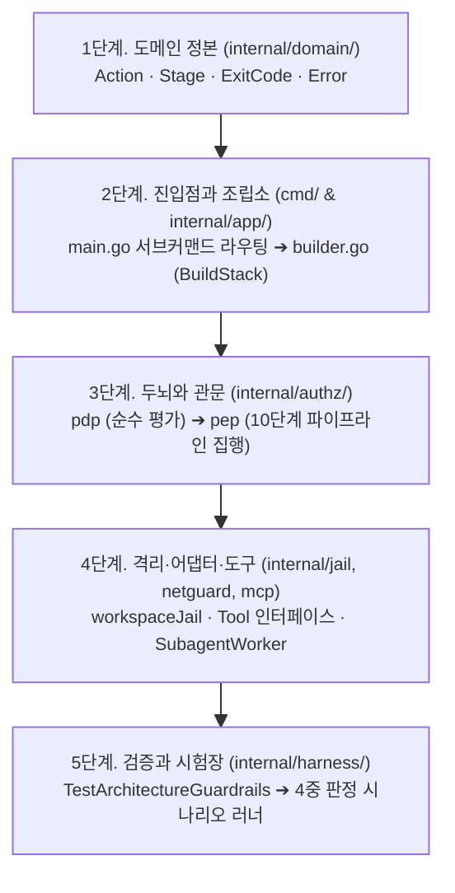
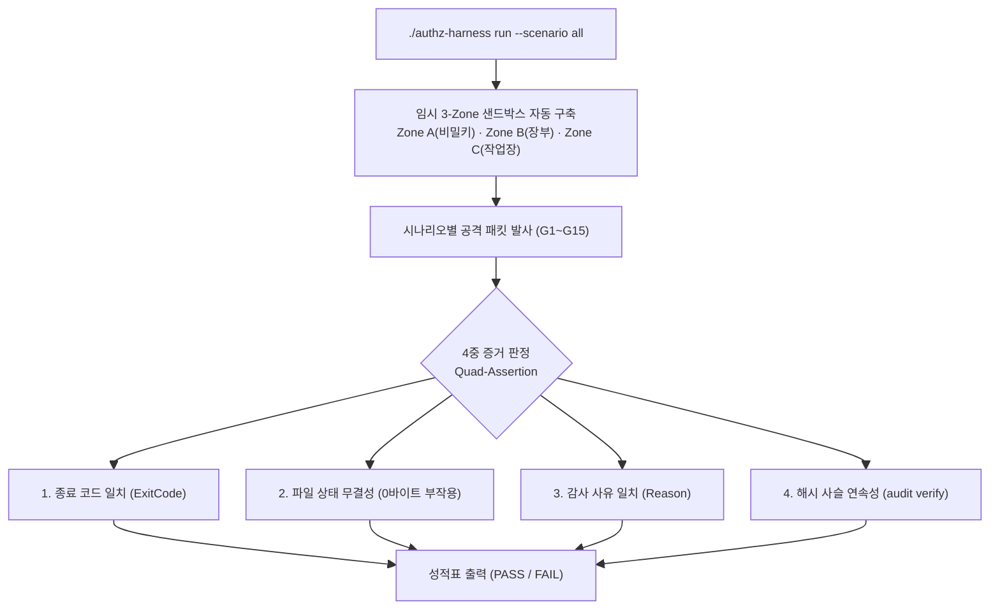

# 005. 아키텍처 배선지도와 빠른 코드인수인계 — 15분 만에 전체 코드를 복기하고 수정하는 정비 지침서

> **모드**: `[문서작업]` — 소스코드 수정 없이 현재 구현된 최단 코드 읽기 순서, 단일 조립소(`BuildStack`), 4대 핵심 엔지니어링 패턴, 자동 충돌 시험장(`harness`)과 위협 지도, 실전 수정 치트시트를 집대성한 개발자 인수인계 지침서입니다.  
> **기준일**: 2026-11-07 · **기준 커밋**: `33ff98a` (`git log -1 --format=%h -- cmd internal`)  
> **다시 확인하는 법**:
> ```bash
> git rev-parse --short HEAD
> git log -1 --format=%h -- cmd internal
> # 1. 소스코드 배선 무결성을 지키는 아키텍처 가드레일 시험
> go test -v ./internal/harness -run "TestArchitectureGuardrails"
> # 2. 전체 패키지 단위 시험 100% 통과 확인
> go test ./...
> # 3. 시나리오 하네스 단일 시나리오 설명 모드 실행
> go run ./cmd/authz-harness run --scenario E2E-01 --output-format explain
> ```

---

## 💡 사용자의 질문 (원문 보존)

> 오랜만에 코드를 다시 열었는데 어디부터 봐야 하나? 부품이 서른 개인데 전체 배선 지도를 보여줘라. 새 도구를 추가하거나 새 검문 단계를 넣으려면 코드 어디를 건드려야 하나? 코드를 잊어버린 개발자가 15분 만에 인수인계받을 수 있는 정비 지침서를 만들어라.

---

## 0. 모든 설계 이전에 ‘사람’이 있다 — 몇 달 만에 내 프로젝트를 다시 열었을 때의 막막함

몇 달 동안 다른 프로젝트를 하다가, 혹은 다른 동료가 짜 둔 `authz-harness` 저장소를 처음 클론받아 열어본 개발자를 상상해 봅니다.
`cmd/` 아래와 `internal/` 아래에 20개가 넘는 패키지가 있고, 수많은 인터페이스와 구조체, 100개가 넘는 시나리오 테스트가 얽혀 있습니다.

- *「실행 파일의 진입점(`main.go`)에서 출발해서 실제 부품들이 어디서 어떻게 조립되어 엮이는가?」*
- *「판정 두뇌(`pdp`)와 집행 관문(`pep`), 그리고 감사 로거(`audit`)는 어떤 설계 원칙으로 분리되어 있으며, 이를 지키기 위해 어떤 자동 검사망이 쳐져 있는가?」*
- *「내일부터 당장 새 도구(예: 데이터베이스 조회 도구 `db:query`)나 새 거부 사유를 추가해야 하는데, 어느 파일 어느 함수를 고쳐야 시스템을 깨뜨리지 않고 정석대로 확장할 수 있는가?」*

이 설명서는 구조를 잊어버린 개발자가 **15분 만에 전체 아키텍처를 머릿속에 복원하고, 안심하고 코드를 수정할 수 있도록 돕는 실전 인수인계 지침서이자 정비 교본**입니다.

---

## 1부. 15분 소스코드 복귀 루트 — 코드를 읽는 최단 경로

이 저장소의 코드를 다시 파악할 때는 아무 파일이나 열지 말고, 다음 **5단계 순서**로 읽어 내려가면 아키텍처가 단번에 잡힙니다.



1. **1단계: 도메인 정본 (`internal/domain/`)**
   - 시스템 전체가 공유하는 최소 어휘 사전입니다.
   - `constants.go`: 9대 표준 종료 코드(`ExitCode`)와 40여 개 표준 거부 사유(`Reason`).
   - `stage.go`: 검문소 10단계(`PEPStages`)와 교환소 8단계(`ExchangeStages`)의 공식 이름과 순서.
   - `error.go`: 문자열 파싱 없이 사유와 종료 코드를 1:1로 묶는 구조화 도메인 에러(`domain.Error`).
2. **2단계: 단일 조립소 (`internal/app/builder.go`의 `BuildStack`)**
   - 12가지 하위 명령이 부품을 직접 조립하지 않고, 오직 `BuildStack` 함수 하나를 거쳐 인스턴스를 받습니다.
   - **관리자 모드(`VerifyOnly: false`)**: 서명 비밀키(Zone A), 토큰 발급기, 권한 관리기(PAP)를 모두 갖춘 완전체 스택 조립.
   - **일꾼 모드(`VerifyOnly: true`)**: 비밀키 경로를 아예 지우고 검증용 공개키, 검문소(PEP), 격리 감옥(Jail)만 갖춘 격리 스택 조립.
3. **3단계: 판단 두뇌와 집행 관문 (`internal/authz/`)**
   - `pdp/service.go`: 디스크와 OS를 일절 모르는 순수 계산 두뇌 `pdp.Evaluate`.
   - `pep/gateway.go`: 10단계 파이프라인 엔진을 돌리고, 4종 도구를 직접 품어 집행하며 단일 출구(`finalize`)로 마감하는 게이트웨이.
4. **4단계: 물리적 격리와 자식 프로세스 (`internal/jail/`, `subagent/`, `orchestrator/`)**
   - `jail/jail.go`: `workspace/` 밖으로 나가는 `..`과 심볼릭 링크를 물리적으로 차단하는 작업장 감옥.
   - `orchestrator/spawner.go`: 환경변수를 비우고 `stdin` 파이프로 토큰을 찔러 넣는 부모 스포너.
   - `subagent/worker.go`: `stdin` 패킷을 받아 검문소로 넘기고 `stdout`으로 돌려주는 자식 워커.
5. **5단계: 아키텍처를 지키는 자동 검사망 (`internal/harness/`)**
   - `architecture_test.go`: 개발자가 실수로 아키텍처 규칙을 위반하지 않았는지 소스코드를 정적 분석하는 가드레일(`TestArchitectureGuardrails`).

---

## 2부. 이 코드베이스를 지탱하는 4대 핵심 엔지니어링 패턴

복잡한 코드를 질서 있게 유지하기 위해 적용된 4가지 핵심 패턴입니다.

### 1. 패턴 ① — 순수 판단 두뇌(`Evaluate`)와 감사 외피(`Decide`) 분리

정책을 결정할 때 디스크를 읽거나 네트워크를 타면 단위 테스트가 불가능해지고 부작용이 섞입니다.
- **안쪽 두뇌 (`pdp.Evaluate`)**: 완벽한 Go 순수 함수(Pure Function)입니다. 파일이나 OS 패키지를 일절 `import`하지 않고, 오직 메모리로 건네받은 출입증 내용과 장부 사본(`SubjectSnapshot`)만 대조해 `ALLOW`, `ASK`, `DENY`를 결정론적으로 계산합니다.
- **바깥 외피 (`pdpService.Decide`)**: 중앙 장부 파일(`grants_state.json`)을 읽어 두뇌에게 스냅샷을 넣어 주고, 두뇌가 내린 판정 결과를 감사 장부(`audit.jsonl`)의 `pdp.decide` 이벤트로 기록하는 부작용(I/O)을 전담합니다.

```text
[바깥 외피: Decide] ──장부 읽기──▶ [grants_state.json]
       │
       ├─ 메모리 스냅샷 전달 ──▶ [순수 두뇌: Evaluate] (No I/O, 디스크 모름)
       │                                │
       │◀────── 판정 결과 반환 (Allow/Deny) ┘
       │
       └── 감사 기록 ─────────▶ [audit.jsonl] (pdp.decide 기록 실패 시 즉시 거부)
```

### 2. 패턴 ② — 선언적 파이프라인 엔진과 검문소의 도구 직접 집행

검문소 10단계를 하드코딩 `if`문으로 나열하지 않고 제네릭 파이프라인 엔진(`pipeline.Engine`)으로 조립했습니다.
- **부작용 등급 검증**: 검사 단계(등급 0) 뒤에만 장부 소비 단계(등급 1)가 오도록 엔진이 기동 시점에 순서를 자동 검증합니다.
- **검문소의 직접 집행 (Zero TOCTOU)**: 검문소(`pep.Gateway`)는 판정만 내리고 끝내지 않고, 8단계(`execute`)에서 도구(`Tool.Execute`)를 직접 호출합니다. 검사와 실행 사이의 시간 간극을 0초로 만들어 심볼릭 링크 바꿔치기 공격을 무력화하고, 7단계 사전감사가 실패하면 0바이트 부작용을 사수합니다.
- **자동 역순 보상 (`refund`)**: 6단계에서 깎은 예산은 뒤 단계에서 에러가 나면 파이프라인 엔진이 자동으로 실행 전 상태로 환급(`Compensate`)해 줍니다.

### 3. 패턴 ③ — 3중 출력 분리(Tri-Separation)와 3대 출구 토큰 비노출

시스템의 모든 출력은 시작점부터 세 갈래로 물리적으로 갈라집니다:
1. **결과 화면 (`stdout`)**: 사람이 보는 최종 터미널 출력.
2. **디버그 로그 (`stderr`)**: 개발자가 보는 운영 관측 로그(`observe.Observer` → `slogadapter`). 로거가 고장 나거나 패닉을 던져도 보호막(`WrapSafe`)이 삼켜서 본래의 권한 판정을 방해하지 않습니다 (Fail-Open).
3. **보안 감사 (`audit.jsonl`)**: 위변조가 불가능한 해시 사슬 증거(`domain.AuditWriter`). 단 1바이트라도 기록에 실패하면 모든 작업을 멈추고 제동을 겁니다 (Fail-Closed).
- **Zero-Leakage 배선**: 감사 로그, 운영 로그, MCP 응답 3대 출구 모두에서 정규식 필터(`domain.RedactRawTokens`)가 원시 JWT 토큰(`eyJ...`)을 실시간으로 감지하여 `[REDACTED]`로 마스킹합니다.

### 4. 패턴 ④ — 소스코드 구조를 컴파일·테스트 시점에 감시하는 아키텍처 가드

사람의 주의력에 기대지 않고, 아키텍처 규칙 위반을 Git 푸시 전과 테스트 시점에 기계적으로 잡아냅니다 ([`architecture_test.go`](../../internal/harness/architecture_test.go)).

| 가드 규칙 번호 | 지키는 아키텍처 불변식 | 위반 시 일어나는 일 |
|---|---|---|
| **`TC-060-01`** | `pdp` 패키지는 `os`, `path/filepath`, `jail` 등 파일시스템 패키지를 일절 `import`할 수 없다 | 판정 두뇌의 순수성이 깨지면 테스트 실패 |
| **`TC-060-02`** | `subagent` 패키지는 비밀키(`keys`), 권한관리(`pap`), 체크포인트 패키지를 직접 `import`할 수 없다 | 자식 일꾼이 비밀 금고를 직접 건드리려 하면 빌드 차단 |
| **`TC-060-03`** | 에러 메시지 문자열(`strings.Contains`)을 파싱하여 분기하는 코드를 전 패키지에서 금지한다 | 도메인 구조화 에러(`domain.Error`)를 쓰지 않고 문자열을 파싱하면 즉시 테스트 실패 |
| **`TC-170-02`** | CLI 하위 명령 러너들은 부품을 직접 조립할 수 없으며 오직 `app.BuildStack`만 호출해야 한다 | 단일 조립소 우회 시도 원천 차단 |

---

## 3부. 자동 충돌 시험장(`harness`)과 위협 방어 지도

이 하네스가 막아내는 15대 공격 그룹(`G1`~`G15`)과 이를 증명하는 시나리오 찾아보기 지도입니다.



### 15대 공격 그룹과 방어 장치 요약

| 공격 그룹 | 공격의 본질 (무엇을 노리나) | 어느 방어 장치가 막아내는가 | 대표 시나리오 |
|:---:|---|---|:---:|
| **`G1`** | 만료되거나 취소된 권한으로 파일 읽기 시도 | 검문소 3단계 `authz` (`GRANT_REVOKED`, 종료 `12`) | `E2E-01`~`05` |
| **`G2`** | 위조된 Ed25519 서명이나 깨진 토큰으로 침입 | 검문소 2단계 `authn` (`TOKEN_INVALID_SIGNATURE`, 종료 `11`) | `E2E-06`~`10` |
| **`G3`** | 이미 사용된 1회용 토큰(`jti`)의 재사용(Replay) 공격 | 검문소 2단계 및 5단계 `replay` (`TOKEN_REPLAY_DETECTED`, 종료 `11`) | `E2E-11`~`15` |
| **`G4`** | 유효기간이 지난 만료 토큰 공격 | 검문소 2단계 `authn` (`TOKEN_EXPIRED`, 종료 `11`) | `E2E-16`~`20` |
| **`G5`** | 부모 권한보다 더 넓은 권한이나 긴 수명 요구 (위임 월권) | 교환소 4차원 단조 축소 검증 (`DELEGATION_SCOPE_EXCEEDED`, 종료 `14`) | `E2E-21`~`25` |
| **`G6`** | `../` 상대경로 이탈 및 바깥을 가리키는 심볼릭 링크 탈출 | 검문소 4단계 `boundary` 작업장 감옥 (`PATH_TRAVERSAL`, 종료 `13`) | `E2E-26`~`30` |
| **`G7`** | 감사 장부 기록 실패 시 몰래 파일 실행 시도 | 검문소 7단계 `precommit_audit` 사전 차단 (`AUDIT_LOG_FAILED`, 종료 `15`) | `E2E-31`~`35` |
| **`G8`** | 거부 시 0바이트 부작용 및 비정상 종료 시 안전 제동 | 단일 출구 `finalize` 및 부모 `classifyExit` | `E2E-36`~`40` |
| **`G9`** | 예산 초과 호출 및 동시성 차감 경합 | 예산 원장 원자적 잠금 및 사전 차감 (`BUDGET_EXHAUSTED`, 종료 `12`) | `E2E-41`~`45` |
| **`G10`** | 검문소를 건너뛰고 C 시스템 호출을 직접 때리는 악의 워커 | OS 커널 격리 감옥 (macOS Seatbelt / Linux Landlock 차단) | `E2E-46`~`50` |
| **`G11`** | 자식 일꾼의 무한 루프 대기 및 출력 폭탄(DoS) | 부모 스포너 타임아웃(10초) 및 1MB 상한 버퍼 (`ExitResourceLimit`, 종료 `17`) | `E2E-51`~`55` |
| **`G12`** | 장기 실행 세션 도중 권한 회수 및 시계 조작 | 가상 시계 드라이버 및 `Window A·B·C` 실시간 제동 검증 | `E2E-56`~`60` |
| **`G13`** | 감사 장부 중간 줄 변조, 끝 줄 절단 및 정전 시 꼬리 파손 | SHA-256 해시 체인 검증 및 `audit recover` 자동 복구 | `E2E-61`~`65` |
| **`G14`** | 사람 승인(`ask`) 건너뛰기 및 다른 요청으로 승인 도용 | 검문소 6단계 승인 1회성 바인딩 및 소비 (`APPROVAL_REQUIRED`, 종료 `18`) | `E2E-66`~`70` |
| **`G15`** | 다중 위임·복합 결합 공격 및 대조군 정상 통과 | 전 계층 결합 파이프라인 및 정상 통과(`HappyPath`) 검증 | `E2E-71`~`75` |

---

## 4부. 실전 수정 치트시트 — 어디를 어떻게 고쳐야 하나

새로운 요구사항이 생겼을 때 건드려야 할 파일과 순서입니다.

### 1. 새로운 도구(Tool)를 추가할 때 (예: `db:query`)
1. **도메인 행동 등록**: [`internal/domain/action.go`](../../internal/domain/action.go)에 `ActionDBQuery Action = "db:query"` 상수를 추가하고 `IsValidAction`, `ParseAction`에 등록합니다.
2. **도구 전략 구현**: [`internal/authz/pep/`](../../internal/authz/pep/) 아래에 새 도구 파일(예: `tool_db.go`)을 만들고 [`pep.Tool`](../../internal/authz/pep/tool.go) 인터페이스 4개 메서드(`Prepare`, `CheckBoundary`, `BudgetPlan`, `Execute`)를 구현합니다.
3. **게이트웨이 도구 맵 바인딩**: [`internal/authz/pep/gateway.go`](../../internal/authz/pep/gateway.go)의 `tools` 맵에 새 도구 인스턴스를 등록합니다.

### 2. 새로운 검문소 단계를 추가할 때
1. **단계 이름 정본 등록**: [`internal/domain/stage.go`](../../internal/domain/stage.go)에 `StageCustom Stage = "custom"` 상수를 정의하고, `PEPStages()` 목록의 올바른 부작용 등급 위치에 추가합니다.
2. **게이트웨이 단계 메서드 작성**: [`internal/authz/pep/gateway.go`](../../internal/authz/pep/gateway.go)에 `func (g *gateway) custom(ctx context.Context, c *Call) error`를 작성합니다.
3. **파이프라인 조립 순서 반영**: `gateway.assemble()`의 `steps` 슬라이스에 새 단계를 끼워 넣습니다.
4. **동기화 시험 확인**: `go test -v ./internal/docsync/...`를 돌려 문서와 코드의 단계 목록이 일치하는지 확인합니다.

### 3. 새로운 거부 사유(Reason)를 추가할 때
1. **사유 상수 등록**: [`internal/domain/constants.go`](../../internal/domain/constants.go)의 `const` 블록에 `ReasonCustomError Reason = "CUSTOM_ERROR"`를 추가합니다.
2. **종료 코드 매핑**: [`internal/domain/error.go`](../../internal/domain/error.go)의 `ExitCodeForReason` switch 문에 해당 사유가 반환할 표준 종료 코드(예: `ExitAuthzDenied`, `12`)를 연결합니다.
3. **문서 동기화 시험 통과**: `go test -v ./internal/docsync/...`의 `TestReasonTablesMatchDomainConstants`가 자동으로 새 사유의 누락 여부를 검사해 줍니다.

---

## 5부. 한눈에 보는 요약표와 코드 정본 색인

### ① 핵심 패키지 역할 대조표

| 패키지 경로 | 계층 | 핵심 역할 | 의존 규칙 (누구를 알고 누구를 모르나) |
|---|:---:|---|---|
| **`internal/domain`** | 최하위 코어 | 시스템 공유 어휘 (상수·에러·인터페이스) | 아무도 모름 (의존성 0개, 순수 Go) |
| **`internal/storage`** | 인프라 코어 | 파일 배타 잠금(`flock`) 및 임시 파일 원자 교체 | OS 패키지만 앎 (`domain`만 참조) |
| **`internal/authz/pdp`** | 인가 두뇌 | 순수 정책 판정 계산 (`Evaluate`) | 파일·OS 일절 모름 (`TC-060-01`) |
| **`internal/authz/pep`** | 집행 관문 | 10단계 검문소 및 4종 도구 직접 집행 | `pdp`, `jail`, `audit`, `pipeline`을 조립하여 사용 |
| **`internal/orchestrator`** | 프로세스 감독 | 환경변수 세척, 자식 프로세스 기동, 1MB 버퍼 수거 | `subagent` 패키지와 OS `exec`을 사용 |
| **`internal/app`** | 단일 조립소 | 12개 명령용 인프라 스택 빌더 (`BuildStack`) | 모든 내부 패키지를 엮어 `AppStack` 생성 |

### ② 어디서 하나 (코드 정본 색인)

1. **단일 조립소**: [`internal/app/builder.go`](../../internal/app/builder.go) (`BuildStack`)
2. **도메인 어휘 및 구조화 에러**: [`internal/domain/constants.go`](../../internal/domain/constants.go), [`internal/domain/error.go`](../../internal/domain/error.go)
3. **파이프라인 제네릭 엔진**: [`internal/pipeline/pipeline.go`](../../internal/pipeline/pipeline.go) (`Engine.Run`, `pipeline.New`)
4. **아키텍처 가드레일 시험**: [`internal/harness/architecture_test.go`](../../internal/harness/architecture_test.go) (`TestArchitectureGuardrails`)
5. **시나리오 하네스 러너 및 평가기**: [`internal/harness/runner.go`](../../internal/harness/runner.go) (`DefaultRunner`), [`internal/harness/assertion.go`](../../internal/harness/assertion.go) (`DefaultEvaluator.Evaluate`)
