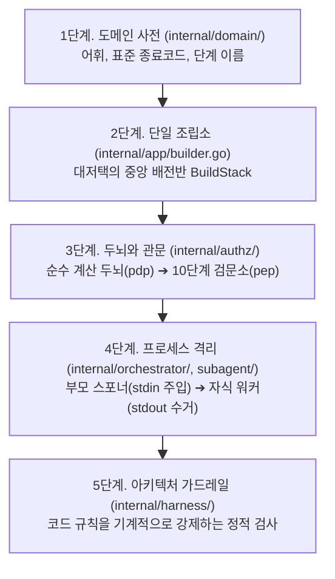

# 005. 아키텍처 배선지도와 빠른 코드인수인계 — 15분 만에 전체 코드를 복기하고 수정하는 정비 지침서

> **모드**: `[문서작업]` — 소스코드 수정 없이 코드 읽는 5단계 최단 순서, 단일 조립소(`BuildStack`), 4대 엔지니어링 패턴, 그리고 "새 도구를 추가하려면 어디를 고쳐야 하나?" 실전 수정 지침을 친절한 문답으로 해설합니다.  
> **기준일**: 2026-11-07 · **기준 커밋**: `d6a365d`  
> **다시 확인하는 법**:  
> ```bash
> # 1. 소스코드 배선 무결성을 지키는 아키텍처 가드레일 시험
> go test -v ./internal/harness -run "TestArchitectureGuardrails"
> # 2. 전체 패키지 단위 시험 100% 통과 확인
> go test ./...
> # 3. 시나리오 하네스 단일 시나리오 설명 모드 실행
> ./authz-harness run --scenario E2E-01 --output-format explain
> ```

---

## 1. 15분 만에 코드 구조를 장악하는 최단 경로

### Q. 오랜만에 코드를 다시 열었는데 패키지가 너무 많아서 막막해. 어디부터 어떤 순서로 읽어야 해?

아무 파일이나 열지 말고, **딱 5단계 순서**로 읽어 내려가면 전체 그림이 15분 만에 맞춰집니다:



1. **1단계: [internal/domain/](../../internal/domain/) (공통 어휘 사전)**
   * `constants.go`: 표준 종료 코드 9종(`ExitCode`)과 거부 사유 40여 종(`Reason`).
   * `stage.go`: 검문소 10단계(`PEPStages`)와 교환소 8단계(`ExchangeStages`)의 공식 이름.
   * `token.go`: 토큰 안에 들어가는 클레임 구조체(`TokenClaims`, `ActorClaim`).
2. **2단계: [internal/app/builder.go](../../internal/app/builder.go) (중앙 배전반 `BuildStack`)**
   * 모든 CLI 명령어들이 제각각 부품을 만들지 않고, 오직 `BuildStack` 함수 하나에서 모든 서비스(인증기, 두뇌, 관문, 감사로거)를 조립받아 갑니다.
3. **3단계: [internal/authz/](../../internal/authz/) (판단 두뇌와 집행 관문)**
   * `pdp/service.go`: 파일/네트워크를 일절 모르는 순수한 수학적 판정 함수 `Evaluate`.
   * `pep/gateway.go`: 10단계 컨베이어 벨트를 돌려 최종 도구를 실행하는 인가 관문.
4. **4단계: [internal/orchestrator/](../../internal/orchestrator/) & [subagent/](../../internal/subagent/) (격리 파이프 통신)**
   * `spawner.go`: `stdin` 파이프로 토큰을 찔러 넣고 자식을 띄우는 부모.
   * `worker.go`: `stdin`으로 받은 요청을 검문소로 밀어 넣고 결과를 반환하는 자식.
5. **5단계: [internal/harness/architecture_test.go](../../internal/harness/architecture_test.go) (아키텍처 감시관)**
   * "PDP는 파일 I/O를 하면 안 된다", "원시 토큰을 로그에 찍으면 안 된다" 같은 아키텍처 규칙을 위반하지 않았는지 정적 분석으로 100% 잡아내는 가드레일.

---

## 2. 이 시스템을 지탱하는 4대 엔지니어링 패턴

### Q. 어떤 설계 패턴을 썼어? 다른 프로그램과 뭐가 달라?

#### 1) 순수 판단 두뇌(`Evaluate`)와 감사 외피(`Decide`)의 완전 분리
* **안쪽 두뇌 ([pdp/service.go](../../internal/authz/pdp/service.go))**: 파일 I/O나 OS 시스템 콜을 일절 `import`하지 않는 순수 함수(Pure Function)입니다. 메모리로 들어온 출입증과 장부 사본만 대조해 결과를 냅니다.
* **바깥 외피**: 디스크에서 장부를 읽어 두뇌에게 넣어주고, 두뇌의 판정 결과를 감사 장부(`audit.jsonl`)에 쓰는 I/O 부작용을 전담합니다. (덕분에 두뇌는 100만 번의 단위 테스트를 0.1초 만에 돌릴 수 있습니다.)

#### 2) 선언적 파이프라인 엔진과 도구 직접 집행
* 미들웨어처럼 함수가 함수를 부르는 복잡한 재귀를 쓰지 않고, 1차원 평면 배열 루프(`pipeline.Engine[Call]`)로 전수 검사를 강제합니다. (실패 시 Saga 역순 보상 환급)

#### 3) 출력의 삼분할 (Tri-Separation)
* **화면 (`stdout`)**: 사용자에게 보여줄 최종 결과 (JSON 등).
* **운영 로그 (`stderr`)**: 개발자가 디버깅할 때 보는 `slog` 운영 로그 (원시 토큰 자동 마스킹).
* **보안 감사 (`audit.jsonl`)**: 절대로 조작할 수 없는 SHA-256 해시 사슬 영구 장부.

#### 4) 기계적 아키텍처 가드레일 (Architecture Guardrails)
* 규칙을 개발자의 기억에 맡기지 않고, `go test`를 돌릴 때 소스코드를 직접 파싱하여 규칙 위반(예: 허락되지 않은 패키지 import)을 컴파일 단계에서 즉시 잡아냅니다.

---

## 3. 실전 정비 치트시트: 새 기능 추가 시 어디를 고쳐야 하나?

### Q. 내가 새로운 툴(예: 데이터베이스 조회 도구 `db:query`)을 추가하려면 어느 파일들을 건드려야 해?

다음 딱 3곳만 순서대로 건드리면 시스템 전체에 완벽하게 녹아듭니다:

```text
[1단계] internal/domain/constants.go
  ➔ ActionDBQuery Action = "db:query" 상수 추가 및 IsValidAction() 등록

[2단계] internal/authz/pep/tool_db.go (신규 작성)
  ➔ Tool 인터페이스 구현:
     • Prepare(): 쿼리 문자열 검증
     • CheckBoundary(): 허용된 DB 호스트인지 격리 검사
     • BudgetPlan(): 예산 차감 방식 설정
     • Execute(): 실제 DB 쿼리 실행 후 Output{Data: ...} 반환

[3단계] internal/authz/pep/tool.go
  ➔ tools 맵에 등록:
     var tools = map[domain.Action]Tool{
         ...
         domain.ActionDBQuery: dbQueryTool{},
     }
```

* **놀라운 점**:
  * 게이트웨이(`gateway.go`)의 10단계 검문소 코드나 파이프라인 엔진(`pipeline.go`)은 **단 한 줄도 수정할 필요가 없습니다!**
  * 새로운 도구는 `Tool` 인터페이스만 만족하면, 기존의 인증 ➔ 인가 ➔ 격리 ➔ 예산 ➔ 감사 ➔ 사후 정산 10개 검문소가 자동으로 감싸서 안전하게 집행해 줍니다.

---

## 4. 코드 정본 찾아보기

- **최상위 조립소 (BuildStack)**: [internal/app/builder.go](../../internal/app/builder.go)
- **순수 판단 두뇌 (PDP Evaluate)**: [internal/authz/pdp/service.go](../../internal/authz/pdp/service.go)
- **인가 집행 관문 (PEP Gateway)**: [internal/authz/pep/gateway.go](../../internal/authz/pep/gateway.go)
- **도구 전략 인터페이스 (Tool)**: [internal/authz/pep/tool.go](../../internal/authz/pep/tool.go)
- **아키텍처 무결성 가드레일 시험**: [internal/harness/architecture_test.go](../../internal/harness/architecture_test.go)
