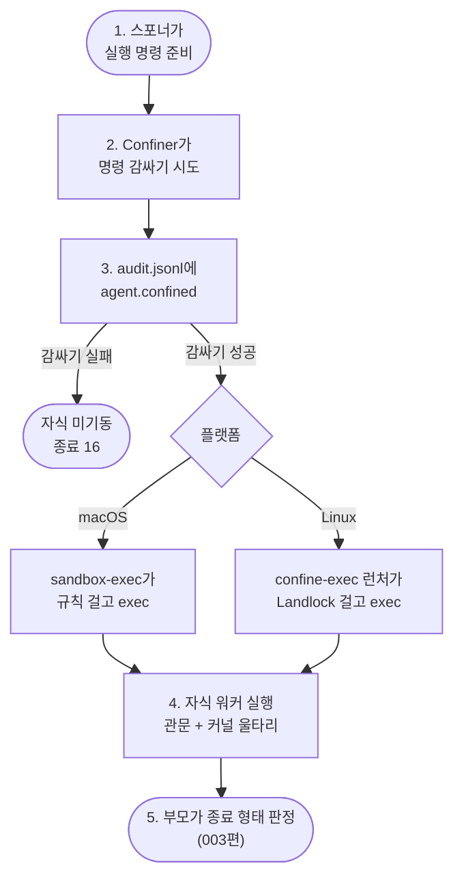
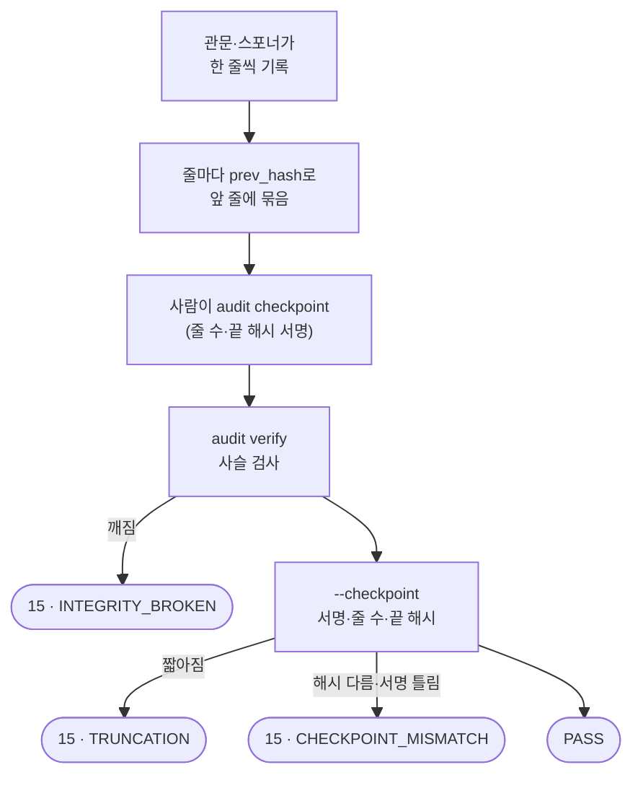

# 006. OS 격리·관측성·감사 체크포인트 — 관문을 건너뛰는 자식은 누가 막고, 운영 로그는 판정과 어떻게 떨어져 있고, 감사 파일 자체는 왜 믿을 만한가

> **모드**: `[문서작업]` — 소스코드 수정 없이 현재 구현된 운영체제 격리(`internal/confinement`), 운영 관측(`internal/observe`), 감사 스키마 v2와 서명 체크포인트(`internal/audit`, `internal/audit/checkpoint`)의 실제 동작과 이유(Why)를 해설합니다.  
> **기준일**: 2026-11-05 · **기준 커밋**: `5f0ab2a` (이 문서가 설명하는 `cmd/`와 `internal/`을 마지막으로 바꾼 커밋)  
> **검증 범위**: 동작·순서·소유자·시점을 코드와 대조한 결과와 「미확인」은 5부 ③에 있습니다. Linux Landlock은 이 문서를 쓴 macOS 환경에서 실행해 보지 못했습니다.  
> **이 문서는 구현된 것만 적는다.** 계획·제안·미래형 약속은 적지 않으며, 현재 코드가 하지 않는 것은 「지금은 없다」고만 씁니다.  
> **이 문서의 규칙**: 본문(0~4부, Q&A, 그림, 5부 ①)은 쉬운 개념·설계·이유가 중심입니다. 파일·타입 이름 같은 고유 이름은 첫 등장에 한마디 설명과 함께 쓰고, 구현의 어디인지는 문단 끝 `(구현: 파일 · 함수, 5부 ② 번호)` 귀띔으로 보조합니다. 기준은 [프로그램 설명서 README의 「설명의 기준」과 「이름의 3층」](README.md)입니다.  
> **겹치는 주제**: 부모가 자식을 띄우는 순서·환경변수 솎아 내기·시간과 출력 상한(`Limits`)·종료 형태 판정은 [003편](003-서브프로세스격리와_해시체인감사.md) Q1이, 해시 사슬을 쓰는 방법(파일 잠금·`prev_hash`/`curr_hash`)은 [003편](003-서브프로세스격리와_해시체인감사.md) Q3·Q4가, 관문 안의 단계 순서와 단일 출구(`finalize`)는 [001편](001-전체요청여정과_5단계관문.md)이 자세히 다룹니다. 관문 안의 네트워크 허용 목록(`--net-allow`)은 [005편](005-승인_예산과_도구확장.md) Q6이 다룹니다.
>
> **다시 확인하는 법**
> ```bash
> git rev-parse --short HEAD
> git log -1 --format=%h -- cmd internal
> # 1. 격리 정책·어댑터·스포너 적용 지점 시험 (macOS에서는 seatbelt 실제 적용까지, Linux 코드는 교차 컴파일까지)
> go test -v ./internal/confinement/... ./internal/orchestrator/... -run "Policy|Noop|Seatbelt|Codec|ApplySelf|CrossCompile|LandlockNetRules|SpawnerConfinement"
> GOOS=linux GOARCH=amd64 go vet ./internal/confinement/
> # 2. 관측 포트(panic 차단·토큰 가림)와 관측이 판정을 바꾸지 않는지 시험
> go test -v ./internal/observe/... ./internal/authz/pep/... -run "WrapSafe|SanitizeAttrs|Adapter|Observer"
> # 3. 감사 스키마 v2와 서명 체크포인트(꼬리 절단·전체 재작성·삭제) 시험
> go test -v ./internal/audit/... -run "SchemaCompat|TailTruncation|FullRewrite|DeleteOrEmpty|Forged|AppendAfter|VerifyDoesNotCreate|RefusesEmpty"
> # 4. 격리(G10·E2E-79)·감사 체크포인트(G13) 시나리오 실행
> go run ./cmd/authz-harness run --scenario all
> # 5. 지금 CLI·MCP 경로가 격리 어댑터를 설정하지 않는다는 것 확인 (하네스 catalog만 나온다)
> grep -rn "confinement\.\(Platform\|WorkerPolicy\)" internal cmd | grep -v _test.go
> # 6. CPU·메모리 상한 코드가 없다는 것 확인 (빈 출력)
> grep -rn "Setrlimit\|RLIMIT" internal cmd
> ```

---

## 💡 사용자의 질문 (원문 보존)

> 다음 진행해라

([18번 로드맵 `030`](../로드맵/18-아키텍처-패턴-교보재-및-코드리딩-가이드/instructions/030_설명서_006_격리_관측성_체크포인트_편.md) 지시서에 따라 집필했습니다.)

---

## 0. 모든 설계 이전에 ‘사람’이 있다 — 장부에 「막았다」고 적혀 있으면, 정말 막은 것인가

관문(`pep.Gateway`)은 출입증을 보고, 허가 장부를 보고, 경로를 보고, 감사 장부(`audit.jsonl`)에 기록을 남깁니다. 그런데 이 모든 검사는 **일꾼이 관문을 거쳐서 일할 때**만 의미가 있습니다. 그리고 감사 장부는 「무슨 일이 있었나」를 알려 주는 유일한 증거인데, 그 장부 파일도 결국 내 컴퓨터의 평범한 파일입니다.

처음 보는 사람은 이런 의문을 품습니다.

- *「일꾼이 관문을 아예 안 거치고 운영체제에 직접 『이 파일 열어 줘』라고 하면, 관문은 아무것도 못 하는 것 아닌가?」*
- *「격리를 켰다는데, 실제로 켜졌는지는 어떻게 아나? 못 켰으면 어떻게 되나?」*
- *「운영 로그(`stderr`)와 감사 장부는 둘 다 기록인데, 왜 따로 있나? 로그를 남기다 에러가 나면 판정이 바뀌나?」*
- *「감사 장부는 해시 사슬로 묶었다던데, 그러면 위변조는 다 잡히는 것 아닌가? 서명 체크포인트는 왜 또 있나?」*

이 세 가지 — 운영체제 격리, 운영 관측, 감사 무결성 — 는 하나의 질문으로 묶입니다. **「감사 장부에 적힌 것을 왜 믿어도 되는가, 그리고 어디까지만 믿어야 하는가」**. 이 설명서는 각 장치가 무엇을 막고 무엇을 막지 못하는지, 그 흔적이 어디에 남는지를 펼쳐 보입니다.

---

## 1부. 왜 이 세 가지가 필요하고, 왜 이런 모양인가

### 가장 밑바닥의 이유부터

1. **관문이 있는데 왜 운영체제 격리가 또 필요한가?**  
   관문은 자식 프로그램 **안에서** 도는 코드입니다. 자식이 정직하면 모든 파일 접근이 관문을 지나지만, 자식이 악의적이거나 망가졌으면 관문 함수를 부르지 않고 운영체제에 직접 파일 열기·소켓 연결을 요청할 수 있습니다. 그 요청은 관문이 볼 수조차 없습니다. 그래서 자식 바깥, 즉 운영체제 커널이 「이 프로세스는 이 폴더 밖에 쓰지 못한다, 비밀 금고(Zone A) 폴더는 읽지 못한다, 소켓을 열지 못한다」를 강제해야 합니다.
2. **그러면 관문은 없어도 되나?**  
   아닙니다. 커널은 「이 폴더에 쓸 수 있다」까지만 알고, 「이 출입증의 범위에 이 파일이 들어가는가」, 「허가가 방금 취소되었는가」는 모릅니다. 관문은 세밀한 판단을, 커널은 관문을 건너뛴 경우의 바깥 울타리를 맡습니다. 둘은 서로를 대신하지 않습니다.
3. **격리를 못 켜면 그냥 격리 없이 돌리면 되지 않나?**  
   그러면 사람은 「격리된 상태로 돌았다」고 믿는데 실제로는 격리가 없는 상태가 됩니다. 기록과 현실이 어긋나는 것이 가장 나쁜 결과이므로, 격리를 필수로 요구했는데 적용할 수 없으면 자식을 아예 띄우지 않고 `CONFINEMENT_UNAVAILABLE`(종료 코드 `16`)로 멈춥니다.
4. **왜 감사 장부와 운영 로그를 나누나?**  
   감사 장부는 「무엇이 허락·거부되었나」의 증거라서, 기록에 실패하면 판정 자체를 실패로 바꿀 만큼 무겁게 다룹니다([001편](001-전체요청여정과_5단계관문.md) Q6). 운영 로그는 「어느 단계에서 몇 밀리초 걸렸나」를 개발자가 보는 용도입니다. 둘을 섞으면, 운영 로그 쪽 문제(로그 라이브러리의 고장, 디스크 부족) 때문에 판정이 바뀌거나, 반대로 증거가 디버그 로그 사이에 묻힙니다. 그래서 사용자 결과는 `stdout`, 운영 로그는 `stderr`, 증거는 `audit.jsonl`로 셋을 나눕니다.
5. **운영 로그가 판정을 바꾸지 않게 하려면?**  
   관문은 운영 로그를 「보고만 하고 답을 받지 않는」 인터페이스로만 부릅니다(돌려받는 값이 없습니다). 그리고 로그 장치가 프로그램을 멈추게 하는 오류(Go의 `panic`)를 내더라도 그 자리에서 삼켜 관문으로 번지지 않게 감쌉니다. 그래서 로그 장치가 고장 나도 판정과 감사 기록은 그대로입니다.
6. **해시 사슬이 있는데 왜 서명 체크포인트가 또 필요한가?**  
   해시 사슬은 각 줄이 앞 줄의 지문을 품고 있어 **중간을 고치거나 지우면** 사슬이 끊깁니다. 그러나 맨 끝 몇 줄을 잘라 내면 남은 사슬은 멀쩡하고, 파일 쓰기 권한이 있는 사람이 처음부터 해시를 다시 계산해 새 파일을 만들어도 사슬은 멀쩡합니다. 해시 계산에는 비밀이 들어가지 않기 때문입니다. 그래서 「어느 시점에 줄이 몇 개였고 마지막 줄의 지문이 무엇이었다」를 **감사 전용 비밀키**로 서명해 둡니다. 비밀키가 없는 사람은 그 서명을 새로 만들 수 없으므로, 잘라 내거나 다시 쓴 파일은 서명과 맞지 않게 됩니다.
7. **그러면 서명 체크포인트로 모든 위변조가 잡히나?**  
   아닙니다. 체크포인트는 **서명한 순간까지의 줄**만 지킵니다. 그 뒤에 덧붙은 줄은 지키지 못하고, 파일을 예전 체크포인트 시점으로 되돌린 뒤 예전 체크포인트를 내밀면(되돌리기) 막지 못합니다. 감사 전용 비밀키를 훔친 사람의 위조도 막지 못합니다. 이 한계는 코드 주석에 적힌 그대로입니다(5부 ② 11번).

### 흔한 방식과 이 프로그램의 선택

| 구분 | 흔한 방식 (이 저장소에서 확인하지 않은 일반론) | 이 프로그램(`authz-harness`)의 선택 |
|---|---|---|
| **모양** | 자식은 애플리케이션 코드의 권한 검사만 믿고 같은 사용자 권한으로 돈다. 로그는 한 스트림에 섞어 쓰고, 감사 로그는 평문 파일이거나 원격 수집기로 보낸다. | 커널 격리(macOS seatbelt, Linux Landlock)를 하나의 포트(`confinement.Confiner`) 뒤에 두고, 필수 모드에서 못 켜면 띄우지 않는다. 출력은 `stdout`/`stderr`/`audit.jsonl` 셋으로 나누고, 운영 로그는 판정에 끼어들 수 없게 감싼다. 감사 장부는 해시 사슬 + Ed25519 서명 체크포인트로 지킨다. |
| **얻는 것** | 설정이 단순하고 플랫폼 차이를 신경 쓰지 않아도 된다. | 관문을 건너뛴 자식도 커널에서 막히는 것을 부모가 직접 관찰해 확인할 수 있다. 로그 장치가 고장 나도 판정은 그대로다. 끝 절단과 전체 재작성이 체크포인트 대조에서 드러난다. |
| **포기하는 것** | 관문을 건너뛴 접근, 로그 쪽 고장의 전파, 끝 절단을 막기 어렵다. | 플랫폼마다 어댑터를 따로 유지해야 하고(macOS 도구는 Apple이 사용 중단 표시를 한 `sandbox-exec`), Linux는 이 환경에서 실행 확인을 못 했다. 체크포인트는 사람이 명령으로 만들어야 하며 자동으로 생기지 않는다. 지금 격리는 하네스 시나리오에서만 켜진다(Q4). |

---

## 2부. 질문과 답변으로 풀어보는 핵심 동작 (Q&A)

### Q1. 부모가 자식을 띄울 때 격리는 언제, 어디서 걸리나?
- **무슨 일이 일어나는가**:
  1. 부모의 스포너(`orchestrator.SubprocessSpawner`, 자식 프로세스를 띄우고 지켜보는 부품)는 실행 명령을 다 준비한 뒤(환경변수 솎아 내기, 프로세스 그룹, 출력 상한 버퍼 — [003편](003-서브프로세스격리와_해시체인감사.md) Q1), 실제로 띄우기 **직전 한 곳**에서 격리 어댑터에게 「이 명령을 감싸 달라」고 부탁합니다(`Confiner.Prepare`). (구현: [`spawner.go`](../../internal/orchestrator/spawner.go) · `SubprocessSpawner.Spawn`, 5부 ② 4번)
  2. 격리 어댑터(`confinement.Confiner`)는 세 가지만 약속합니다: 자기 이름(`Name`: `none`, `darwin-seatbelt`, `linux-landlock`), 지금 이 컴퓨터에서 적용할 수 있는지(`Available`), 그리고 명령 감싸기(`Prepare`). 감싸기는 실행 파일 경로와 인자만 바꾸고 환경변수·입출력은 건드리지 않으며, 감싼 프로그램은 대상 프로그램으로 **자기 자신을 바꿔치기(`exec`)** 해야 합니다. 그래서 부모가 보는 자식 프로세스 번호(PID)는 그대로이고, 시간 초과 때 프로세스 그룹을 끝내는 장치도 그대로 작동합니다. (구현: [`port.go`](../../internal/confinement/port.go) · `Confiner`, 5부 ② 1번)
  3. 어댑터에 넘기는 격리 정책(`confinement.Policy`)은 「보호 루트(`ProtectedRoot`) 아래는 목록에 없으면 읽지도 쓰지도 못한다, 쓰기는 쓰기 목록(`WritePaths`)에만, 네트워크는 기본 금지」라는 허용 목록 방식입니다. 정책이 모호하면(루트가 비었거나 절대 경로가 아니거나, 읽기 경로가 루트 밖이거나, 포트 번호가 범위 밖이면) 감싸기 전에 거부합니다. 정직한 워커용 기본 정책(`WorkerPolicy`)은 작업 폴더·공개 상태 폴더(Zone B)·감사 파일과 그 잠금 파일만 쓰기 목록에 넣고, 비밀 금고 폴더(Zone A)는 어느 목록에도 넣지 않습니다. (구현: [`policy.go`](../../internal/confinement/policy.go) · `Policy.Validate`, `WorkerPolicy`, 5부 ② 1번)
  4. 감싸기를 시도한 직후, 성공했든 실패했든 감사 장부에 `orchestrator.confine` 단계로 `agent.confined` 기록을 남깁니다. 어댑터 이름, 보호 루트, 쓰기 목록 개수, 네트워크 허용 여부가 함께 적힙니다. 이 기록이 실패하면 자식을 띄우지 않고 감사 실패(`15`)로 멈춥니다.
- **왜 그렇게 하나**: 격리 적용 지점을 스포너의 한 곳으로 모아야 「어떤 경로로 띄운 자식은 격리가 빠졌다」는 일이 생기지 않습니다. 감사에는 **부모가 아는 사실(적용했는가, 못 했는가)만** 적습니다. 자식 안에서 커널이 실제로 무엇을 막았는지는 부모가 알 수 없으므로 적지 않고, 그 확인은 시나리오가 부모 쪽에서 직접 관찰해 합니다(Q4).
- **근거**: 5부 ② 항목 1, 4번

### Q2. macOS에서는 격리가 어떻게 걸리나?
- **무슨 일이 일어나는가**:
  1. macOS 어댑터(`SeatbeltConfiner`)는 정책을 macOS 샌드박스 규칙 언어(SBPL)로 바꾼 뒤, 자식 명령을 `/usr/bin/sandbox-exec -p <규칙> <원래 명령>`으로 감쌉니다. `sandbox-exec`은 규칙을 자기에게 걸고 원래 명령으로 바꿔치기하므로 PID가 유지됩니다. (구현: [`seatbelt_darwin.go`](../../internal/confinement/seatbelt_darwin.go) · `SeatbeltConfiner.Prepare`, 5부 ② 2번)
  2. 규칙은 이 순서로 씁니다. seatbelt는 **뒤 규칙이 앞 규칙을 덮기** 때문에 순서가 곧 의미입니다: ① 일단 모두 허용 ② 네트워크 전부 금지(허용 포트가 있으면 `localhost:<포트>`로 나가는 연결만 다시 허용) ③ 쓰기 전부 금지 ④ `/dev/null`·`/dev/tty`와 쓰기 목록만 쓰기 허용 ⑤ 보호 루트 아래 읽기 전부 금지 ⑥ 보호 루트 폴더 **자체의 존재 확인(stat)** 만 허용 ⑦ 읽기 목록과 쓰기 목록은 읽기 허용. 경로는 심볼릭 링크를 풀어 실제 경로로 적습니다(macOS의 `/var`는 실제로 `/private/var`이기 때문). (구현: [`seatbelt_darwin.go`](../../internal/confinement/seatbelt_darwin.go) · `RenderSeatbeltProfile`, 5부 ② 2번)
  3. ⑥이 따로 있는 이유: 루트 아래 읽기를 모두 막았더니, 격리된 정직한 워커가 시작할 때 「루트 폴더가 있나」를 확인하지 못해 「이미 있다」를 잘못 판단하고 기동하지 못했습니다. 그래서 루트 폴더 자체의 존재 확인만 열었고, 루트 안 파일 내용과 목록은 여전히 읽지 못합니다(코드 주석에 실측 기록이 있습니다).
  4. 적용 가능 여부는 프로그램이 처음 물을 때 한 번만 `sandbox-exec`로 빈 규칙을 시험 실행해 봅니다. 이미 샌드박스 안에서 도는 환경(중첩 샌드박스)에서는 이 시험이 실패하므로 「적용 불가」가 됩니다. (구현: `CanApplySeatbelt`, 5부 ② 2번)
- **왜 그렇게 하나**: 「일단 모두 허용」에서 출발하는 이유는, 프로그램이 돌려면 시스템 라이브러리 읽기 같은 수많은 접근이 필요해 이를 일일이 허용하는 목록을 만들기 어렵기 때문입니다. 그 대신 지켜야 할 곳(보호 루트 읽기, 쓰기 전부, 네트워크 전부)을 골라 막습니다. 그 결과 **보호 루트 바깥의 파일 읽기는 macOS에서 막지 않습니다**. 막는 것은 루트 아래 읽기, 쓰기 목록 밖 쓰기, 네트워크입니다. `sandbox-exec`은 Apple이 사용 중단(deprecated) 표시를 한 도구지만, 어댑터 포트 뒤에 있으므로 다른 방식으로 바꿀 때 스포너는 고치지 않아도 됩니다.
- **근거**: 5부 ② 항목 2번

### Q3. Linux에서는 왜 「신뢰 런처」라는 중간 단계가 있나?
- **무슨 일이 일어나는가**:
  1. Linux 커널 격리 장치 Landlock은 「**지금 이 호출을 한 프로세스 자신**에게 규칙을 건다」는 방식만 있습니다. 부모가 자식에게 대신 걸어 줄 수 없습니다. 그래서 Linux 어댑터(`LandlockConfiner`)는 자식 명령을 `authz-harness confine-exec -policy <정책> -- <원래 명령>`으로 감쌉니다. 이 프로그램 자신을 숨은 하위 명령으로 한 번 더 실행해, 그 프로세스가 자기에게 규칙을 건 뒤 원래 명령으로 바꿔치기하는 것입니다. 이 중간 프로그램을 **신뢰 런처**라고 부릅니다. (구현: [`landlock_linux.go`](../../internal/confinement/landlock_linux.go) · `LandlockConfiner.Prepare`, 5부 ② 3번)
  2. 정책은 JSON을 URL 안전 base64 한 덩어리로 바꿔 인자 하나로 넘깁니다. 런처는 그것을 되돌리면서 모르는 필드가 있으면 거부합니다. 그다음 대상 실행 파일 경로를 찾고, 자기에게 규칙을 걸고(`ApplySelf`), 대상으로 바꿔치기합니다. 어느 단계든 실패하면 `stderr`에 사유를 쓰고 `16`으로 끝나며 대상은 실행되지 않습니다. 규칙을 걸기 전에는 어떤 파일도 열지 않습니다. (구현: [`launcher.go`](../../internal/confinement/launcher.go) · `EncodePolicy`, `DecodePolicy`, [`confine_exec.go`](../../internal/cli/confine_exec.go) · `RunConfineExec`, 5부 ② 3번)
  3. 규칙을 거는 일(`ApplySelf`)은: 커널의 Landlock 판(ABI)이 1 미만이면 적용 불가, 네트워크를 막아야 하는데 판이 4 미만이면 적용 불가입니다. 보호 루트가 시스템 읽기 허용 경로(`/usr`, `/lib`, `/lib64`, `/bin`, `/sbin`, `/etc`, `/proc/self`) 아래에 있으면 지킬 수 없으므로 적용 불가입니다. 그다음 시스템 경로와 대상 실행 파일은 읽기·실행, 읽기 목록은 읽기, 쓰기 목록은 읽기·쓰기, `/dev/null`을 허용하고, 허용 포트가 있으면 그 포트로 나가는 TCP 연결만 허용한 뒤, 권한 상승 금지(`PR_SET_NO_NEW_PRIVS`)를 켜고 규칙을 겁니다. (구현: [`landlock_linux.go`](../../internal/confinement/landlock_linux.go) · `ApplySelf`, 5부 ② 3번)
  4. Linux 어댑터의 기본값(`Platform()`)은 런처 경로가 비어 있어서 그대로 쓰면 감싸기가 `16`으로 거부됩니다. 런처 경로를 넣어 주는 일(`WithLauncher`)은 어댑터를 쓰는 쪽이 해야 합니다. (구현: [`port.go`](../../internal/confinement/port.go) · `WithLauncher`, 5부 ② 1번)
  5. Linux가 아닌 곳에서 런처의 규칙 걸기를 부르면 항상 `16`으로 거부합니다. Linux도 macOS도 아닌 운영체제의 기본 어댑터는 「격리 없음」(`NoopConfiner`)입니다. (구현: [`launcher_other.go`](../../internal/confinement/launcher_other.go), [`platform_noop.go`](../../internal/confinement/platform_noop.go), 5부 ② 3번)
- **왜 그렇게 하나**: Landlock은 seatbelt와 달리 **목록에 없는 것은 모두 막는** 방식이라, 시스템 경로를 명시적으로 열어 주지 않으면 대상 프로그램이 뜨지도 못합니다. 그래서 시스템 경로를 열고, 그 아래에 보호 루트가 있으면 지킬 수 없다고 정직하게 거부합니다. 권한 상승 금지를 켜는 이유는 코드 주석에 적혀 있지 않습니다. 일반론으로는 관리자 권한 없는 프로세스가 Landlock 규칙을 걸려면 이 설정이 필요하다고 알려져 있으나, 이 저장소에서 확인하지는 않았습니다.
- **근거**: 5부 ② 항목 1, 3번 (Linux 실제 동작은 5부 ③ 「미확인」)

### Q4. 격리를 적용할 수 없으면 어떻게 되고, 지금 실제로 격리가 켜지는 곳은 어디인가?
- **무슨 일이 일어나는가**:
  1. 스포너 설정에 어댑터도 없고 「격리 필수」(`Require`)도 꺼져 있으면 격리 단계 자체를 건너뜁니다. 이것이 기본값입니다.
  2. 「격리 필수」가 켜져 있는데 어댑터가 없으면, 스포너는 「격리 없음」 어댑터(`NoopConfiner`)로 간주합니다. 이 어댑터는 필수 모드에서 항상 거부합니다. 실제 어댑터(seatbelt·Landlock)가 설정되어 있으면 **필수 여부와 상관없이** 적용할 수 없을 때(중첩 샌드박스, 커널 미지원, 런처 경로 없음) 거부합니다. 거부되면 감사에 `agent.confined`를 `deny`·`CONFINEMENT_UNAVAILABLE`로 남기고, **자식을 띄우지 않은 채** 종료 코드 `16`을 돌려줍니다. (구현: [`spawner.go`](../../internal/orchestrator/spawner.go) · `SubprocessSpawner.Spawn`, [`port.go`](../../internal/confinement/port.go) · `NoopConfiner.Prepare`, 5부 ② 1, 4번)
  3. **지금 격리를 켜는 곳은 하네스 시나리오뿐입니다.** 명령줄 `orchestrate spawn`과 MCP 도구 실행 경로는 스포너에 어댑터를 넣지 않으므로 자식은 격리 없이 돕니다(머리의 「다시 확인하는 법」 5번). 격리를 켜는 시나리오는 G10(E2E-45~49)과 G15의 E2E-79입니다. (구현: [`g10_os_confinement.go`](../../internal/harness/catalog/g10_os_confinement.go), [`g15_tool_egress_exec.go`](../../internal/harness/catalog/g15_tool_egress_exec.go) · `newG15E2E79`, 5부 ② 6번)
  4. 이 시나리오들은 관문을 일부러 건너뛰는 악의 워커(`faultworker`, 시험 전용 별도 프로그램)를 띄워 Zone A 파일 직접 읽기, 샌드박스 밖 직접 쓰기, 부모의 리스너에 직접 연결, 손자 프로세스를 통한 읽기를 시도하게 합니다. 판정은 자식의 종료 코드나 자기 보고가 아니라 **부모가 직접 관찰한 사실**(비밀 표식이 새어 나왔나, 파일이 생겼나, 리스너가 연결을 받았나)로만 합니다. 같은 공격을 격리 없이(대조군: 공격이 성공해야 함)와 격리를 켜고(실험군: 막혀야 함) 두 번 해서 **둘 다 성립할 때만** 통과로 봅니다. (구현: [`faultworker/main.go`](../../internal/harness/faultworker/main.go), 5부 ② 6번)
  5. 하네스는 시작할 때 이 컴퓨터에서 격리를 적용할 수 있는지 물어보고, 적용할 수 없으면 격리가 필요한 시나리오를 「건너뜀」으로 표시합니다. (구현: [`runner.go`](../../internal/harness/runner.go) · `WithConfinementProbe`, 5부 ② 6번)
- **왜 그렇게 하나**: 대조군을 함께 두는 이유는, 정책이 너무 좁아서 정직한 일까지 다 막히는 「가짜 차단」이나, 공격 코드가 애초에 동작하지 않아서 「막힌 것처럼 보이는」 경우를 걸러 내기 위해서입니다. 대조군에서 공격이 실제로 성공해야 실험군의 차단이 격리 덕분이라고 말할 수 있습니다. 명령줄 경로에 격리가 없는 이유는 코드에서 확인되지 않습니다. 「지금은 없다」로 5부 ①에 적습니다.
- **근거**: 5부 ② 항목 1, 4, 6번

### Q5. 네트워크는 전부 막는다면서, 특정 포트만 여는 것은 무엇인가?
- **무슨 일이 일어나는가**:
  1. 격리 정책에는 네트워크 전부 허용(`AllowNetwork`)과 별도로 「나가는 TCP 연결만 열어 줄 포트 목록」(`AllowConnectPorts`)이 있습니다. 둘은 함께 쓸 수 없고, 포트는 1~65535여야 하며, 중복은 지웁니다. 포트를 열어도 **자기가 포트를 여는 일(bind)** 은 계속 막힙니다. (구현: [`policy.go`](../../internal/confinement/policy.go) · `Policy.Validate`, [`netrules.go`](../../internal/confinement/netrules.go) · `landlockNetRules`, 5부 ② 1, 3번)
  2. macOS는 `localhost:<포트>`로 나가는 연결만 엽니다. Linux Landlock은 **주소를 구분하지 못해 포트만** 엽니다. 즉 Linux에서는 같은 포트 번호라면 다른 컴퓨터로 나가는 연결도 커널이 막지 않습니다.
  3. E2E-79 시나리오는 이를 확인합니다: 격리된 정직한 워커가 관문의 네트워크 조회(`net:fetch`)로 허용 포트에서 응답을 받고(정책이 너무 좁지 않다는 확인), 관문을 건너뛰는 악의 워커는 다른 포트에 연결하지 못합니다(대조군에서는 연결됨).
- **왜 그렇게 하나**: 관문 안의 네트워크 가드([005편](005-승인_예산과_도구확장.md) Q6)는 정직한 워커의 조회를 루프백 허용 목록으로 좁히고, 커널 포트 규칙은 관문을 건너뛴 연결을 막습니다. Linux에서 주소까지 묶지 못하는 부분은 관문 안 가드(숫자 루프백 주소만 받음)에 기대고 있으며, 관문을 건너뛴 악의 워커가 같은 포트로 바깥 주소에 연결하는 것은 Linux에서 막지 못합니다.
- **근거**: 5부 ② 항목 1, 3, 6번

### Q6. 시간·출력 상한과 CPU·메모리 상한은?
- **무슨 일이 일어나는가**: 부모는 자식에게 제한 시간(기본 10초), 종료 후 파이프 정리 대기(기본 0.5초), `stdout`·`stderr` 각각의 출력 상한(기본 1MB)을 겁니다(`orchestrator.Limits`). 넘으면 자식의 프로세스 그룹 전체를 강제 종료하고 종료 코드 `17`(`RESOURCE_TIMEOUT` 또는 `RESOURCE_OUTPUT_LIMIT`)과 `agent.limit_exceeded` 감사를 남깁니다. 음수 상한은 거부하고, 0은 기본값으로 채웁니다. 자세한 순서는 [003편](003-서브프로세스격리와_해시체인감사.md) Q1이 다룹니다. (구현: [`limits.go`](../../internal/orchestrator/limits.go) · `Limits.Normalize`, [`termination.go`](../../internal/orchestrator/termination.go) · `classifyExit`, 5부 ② 5번)
- **CPU·메모리 상한은 지금 없습니다.** 운영체제 자원 한도(`setrlimit`)나 cgroup을 거는 코드가 없습니다(머리의 「다시 확인하는 법」 6번). 제한 시간 안에서 CPU를 다 쓰거나 메모리를 크게 잡는 자식은 막지 못합니다.
- **근거**: 5부 ② 항목 5번

### Q7. 운영 로그(`stderr`)는 어떻게 나오고, 왜 판정에 영향을 주지 않나?
- **무슨 일이 일어나는가**:
  1. 관문은 운영 로그를 직접 쓰지 않고 관측 포트(`observe.Observer`)에 알리기만 합니다. 알림은 네 가지입니다: 단계 시작(`OnStageStart`), 단계 끝(통과/막힘, `OnStageEnd`), 실행 전체 끝(`OnExecutionEnd`), 오류(`OnError`). 네 알림 모두 돌려받는 값이 없습니다. 단계 알림에는 대상·주체·걸린 시간(밀리초)·막힌 사유가 붙습니다. (구현: [`observe/port.go`](../../internal/observe/port.go) · `Observer`, [`gateway.go`](../../internal/authz/pep/gateway.go) · `stageHook`, `gateway.finalize`, 5부 ② 7, 9번)
  2. 관문을 만들 때 받은 관측 장치는 **항상** 안전 포장(`WrapSafe`)으로 한 번 감쌉니다. 포장은 관측 장치가 `panic`을 내면 그 자리에서 삼킵니다. 관측 장치가 없으면 아무것도 하지 않는 장치(`NoopObserver`)를 씁니다. (구현: [`observe/port.go`](../../internal/observe/port.go) · `WrapSafe`, [`gateway.go`](../../internal/authz/pep/gateway.go) · `NewGateway`, 5부 ② 7, 9번)
  3. 실제 출력은 기본 어댑터(`slogadapter`)가 Go 표준 로거(`log/slog`)로 씁니다. 단계 시작은 디버그, 단계 통과와 실행 성공은 정보, 막힘과 실패는 경고, 오류는 에러 수준입니다. 쓰기 전에 문자열 값과 에러 값 안의 원시 토큰을 가립니다(`SanitizeAttrs`). (구현: [`slogadapter/adapter.go`](../../internal/observe/slogadapter/adapter.go) · `New`, 5부 ② 8번)
  4. 프로그램 시작 시 표준 로거를 `stderr`로 향하는 텍스트 형식, 정보 수준으로 정합니다. `--verbose`를 주면 디버그 수준까지 나옵니다. 조립 코드(`BuildStack`)는 관측 장치를 따로 받지 않으면 이 표준 로거를 쓰는 기본 어댑터를 붙입니다. (구현: [`main.go`](../../cmd/authz-harness/main.go), [`builder.go`](../../internal/app/builder.go) · `BuildStack`, 5부 ② 9번)
  5. 자식 워커의 `stderr`는 부모의 출력 상한 버퍼에 담깁니다. `orchestrate spawn`은 자식 응답을 해석하지 못했을 때만 그 내용을 `Child Stderr`로 보여 줍니다.
  6. 운영 로그로만 남는 사건이 있습니다: 예산 환급 실패, 차단 감사 기록 실패(이때는 종료 코드도 `15`로 바뀝니다), 완료 감사 기록 실패(이때 결과는 성공으로 돌아갑니다 — [001편](001-전체요청여정과_5단계관문.md) 3부).
- **왜 그렇게 하나**: 관측이 판정에 끼어들 통로를 아예 두지 않기 위해서입니다. 돌려받는 값이 없으니 관측 결과로 분기할 수 없고, `panic`을 삼키니 관측 고장이 관문을 멈출 수 없습니다. 관측 포트가 Go 표준 로거나 외부 추적 라이브러리의 타입을 드러내지 않는 이유는, 관문 코드가 특정 로깅 라이브러리에 묶이지 않게 하기 위해서입니다. 단, 단위 시험 전용 단계 관찰 훅(`StageObserver`)은 `panic`을 삼키지 않습니다. 시험에서 문제를 숨기지 않으려는 것이며 조립 코드는 이것을 붙이지 않습니다.
- **근거**: 5부 ② 항목 7, 8, 9번

### Q8. 감사 장부의 `arg_hash`·`result_hash`는 무엇이고, 원문은 왜 안 남기나?
- **무슨 일이 일어나는가**:
  1. 새로 쓰는 감사 기록은 모두 스키마 4판(`schema_version: 4`)입니다. 2판부터 도입된 칸인 토큰 일련번호(`token_jti`), 실행 주체(`agent_id`), 요청 내용의 지문(`arg_hash`), 결과의 지문(`result_hash`)을 **해시 사슬 계산에 포함**합니다. 1판 기록은 이 네 칸이 해시에 들어가지 않습니다. 3판은 여기에 더해 해시 입력을 항목마다 「글자 수:값」으로 이어 붙여, 항목 사이 경계를 옮겨도 해시가 같아지는 문제를 없앴습니다([ADR 0006](../adr/0006-감사-해시-입력-정규화-v3.md)). 4판은 여기에 파이프라인 단계 값(`stage`)을 해시 입력으로 더해, 단계 값을 고치면 사슬 검증이 잡습니다([ADR 0009](../adr/0009-감사-스키마-v4-단계-보호.md)). 기록하는 쪽이 넘긴 판 번호는 무시하고 항상 현재 판(4)을 씁니다. (구현: [`audit.go`](../../internal/audit/audit.go) · `ComputeEventHash`, `JSONLWriter.Log`, 5부 ② 10번)
  2. 지문은 내용의 SHA-256 값에 `sha256:`을 붙인 것이고, 빈 내용은 빈 문자열입니다(`domain.DataDigest`). 파일 쓰기면 쓸 내용, 네트워크 조회면 정규화된 주소, 명령 실행이면 인자로 계산하며, 같은 함수가 승인 바인딩([005편](005-승인_예산과_도구확장.md) Q2)에도 쓰입니다. (구현: [`digest.go`](../../internal/domain/digest.go) · `DataDigest`, 5부 ② 10번)
  3. 검사(`VerifyHashChain`)는 판 번호가 0~3 밖이면, 1판 기록에 2판 칸이 들어 있으면, 2판 이상 기록 뒤에 더 낮은 판 기록이 오면(판 낮추기) 무결성 파손(`15`)으로 봅니다. (구현: [`audit.go`](../../internal/audit/audit.go) · `VerifyHashChain`, 5부 ② 10번)
- **왜 그렇게 하나**: 원문을 남기면 감사 장부가 비밀(파일 내용, 조회 결과)을 옮겨 담는 통로가 됩니다. 지문만 남기면 「바로 이 내용이었나」는 나중에 대조할 수 있고 원문은 장부에 없습니다. 다만 지문에 소금(salt)을 섞지 않으므로, **짧거나 추측 가능한 내용은 후보를 하나씩 넣어 보는 방식으로 되찾을 수 있습니다**. 「원문이 보이지 않는다」는 「추측할 수 없다」와 다릅니다(코드 주석에 적힌 한계). 2판 칸을 해시에 넣는 이유는, 넣지 않으면 누가 `token_jti`나 지문을 바꿔도 사슬이 끊기지 않기 때문입니다. 판 낮추기를 막는 이유도 같습니다: 2판 기록을 1판으로 바꿔 적으면 그 칸들이 해시 밖으로 빠져나가기 때문입니다.
- **근거**: 5부 ② 항목 10번

### Q9. 서명 체크포인트는 어떻게 만들고, 어떻게 대조하나?
- **무슨 일이 일어나는가**:
  1. **만들기** (`audit checkpoint [--out <파일>]`): 감사 잠금 파일에 공유 잠금을 걸고 장부를 읽기만 합니다. 장부가 없거나 비었으면 거부합니다. 해시 사슬을 먼저 검사해 이미 깨진 장부에는 서명하지 않습니다. 마지막 줄의 `curr_hash`를 꺼냅니다. (구현: [`checkpoint.go`](../../internal/audit/checkpoint/checkpoint.go) · `Create`, 5부 ② 11번)
  2. 감사 전용 키 쌍을 확보합니다(`EnsureKeyPair`). 비밀키는 토큰 서명 키와 같은 Zone A 폴더에 `audit_signing_key.priv.json`(권한 0600)으로, 공개키는 Zone B 폴더에 `audit_verification_key.pub.json`으로 둡니다. 둘 다 없으면 새로 만들고, **하나만 있으면 거부**하고, 둘이 짝이 아니면 거부합니다. 키 번호는 공개키 지문 앞 8바이트로 정합니다(`audit-ckpt-…`). (구현: [`checkpoint.go`](../../internal/audit/checkpoint/checkpoint.go) · `EnsureKeyPair`, [`cli/audit.go`](../../internal/cli/audit.go) · `NewAuditRunner`, 5부 ② 11, 12번)
  3. 「줄 수 · 마지막 해시 · 시각 · 키 번호」를 정해진 한 줄(`audit-ckpt-v1|…`)로 이어 Ed25519로 서명하고, 체크포인트 파일(기본 Zone B의 `audit_checkpoint.json`)에 원자적으로 씁니다.
  4. **대조하기** (`audit verify --checkpoint <파일>`): 해시 사슬 검사 → 체크포인트 파일 읽기 → 공개키 읽기(**대조할 때는 키를 새로 만들지 않습니다**) → 키 번호 일치 → 서명 확인 → 지금 장부의 줄 수가 체크포인트의 줄 수보다 적으면 `AUDIT_TRUNCATION_DETECTED` → 체크포인트가 가리키는 줄의 `curr_hash`가 서명된 값과 다르면 `AUDIT_CHECKPOINT_MISMATCH`(재작성 의심). 체크포인트 파일이나 공개키를 읽지 못하거나 서명이 틀려도 `AUDIT_CHECKPOINT_MISMATCH`입니다. 모두 종료 코드 `15`입니다. (구현: [`checkpoint.go`](../../internal/audit/checkpoint/checkpoint.go) · `Verify`, [`cli/audit.go`](../../internal/cli/audit.go) · `AuditRunner.runVerify`, 5부 ② 11, 12, 13번)
- **왜 그렇게 하나**: 비밀키를 Zone A에 두는 이유는 자식 워커가 그 폴더를 건드리지 못하게 되어 있기 때문입니다. 자식 코드는 체크포인트 패키지를 가져다 쓰지 못하도록 아키텍처 시험(`TC-060-02`)으로 막혀 있고, 격리가 켜진 경우 커널도 Zone A 읽기를 막습니다(Q1). 대조할 때 키를 만들지 않는 이유는, 공개키를 지운 뒤 대조하면 새 키가 생겨 「검증 재료 없음」이 「통과」로 바뀌는 길을 막기 위해서입니다(G13 E2E-63). 키 쌍이 반쪽이면 거부하는 이유도 같습니다: 한쪽만 다시 만들어지면 예전 체크포인트를 영영 확인할 수 없게 되거나, 공격자가 공개키만 바꿔 끼울 수 있기 때문입니다.
- **근거**: 5부 ② 항목 11, 12, 13번

### Q10. 해시 사슬과 서명 체크포인트는 각각 무엇을 잡고 무엇을 못 잡나?

| 일어난 일 | 해시 사슬만 (`audit verify`) | 체크포인트 대조 (`audit verify --checkpoint`) |
|---|---|---|
| 중간 줄의 글자를 고침 | 잡는다 (`curr_hash mismatch`) | 잡는다 (사슬 검사를 먼저 하므로) |
| 중간 줄 하나를 지움 | 잡는다 (`prev_hash mismatch`) | 잡는다 |
| 맨 끝 몇 줄을 잘라 냄 | **못 잡는다** (남은 사슬은 멀쩡) | 체크포인트 이전 줄까지 잘렸으면 잡는다 (`AUDIT_TRUNCATION_DETECTED`) |
| 해시를 처음부터 다시 계산해 파일 전체를 새로 씀 | **못 잡는다** | 잡는다 (체크포인트 줄의 해시가 다름) |
| 장부 파일을 지우거나 비움 | **못 잡는다** (파일이 없으면 통과) | 잡는다 (`AUDIT_TRUNCATION_DETECTED`) |
| 체크포인트 이후에 줄을 덧붙임 | 사슬이 맞으면 통과 | 통과 (체크포인트는 서명 시점까지만 지킨다) |
| 장부와 체크포인트를 둘 다 예전 시점으로 되돌림 | 못 잡는다 | **못 잡는다** (오래된 유효 체크포인트) |
| 감사 전용 비밀키를 훔쳐 체크포인트를 새로 서명 | 못 잡는다 | **못 잡는다** |
| `metadata` 칸이나 `step` 칸만 고침 | **못 잡는다** (해시 계산에 들어가지 않는 칸) | **못 잡는다** |

- **무슨 일이 일어나는가**: 해시 계산에 들어가는 칸은 직전 해시·시각·추적 번호·행위자·행동·대상·결정·사유·성공 여부이고, 2판 이상이면 여기에 `token_jti`·`agent_id`·`arg_hash`·`result_hash`가 더해지고, 3판은 이 모두를 「글자 수:값」으로 이어 붙이고, 4판은 단계 값(`stage`)도 더합니다. 서명 체크포인트가 덮는 줄은 `audit recover`로 줄지 않습니다(복구는 줄을 지우지 않고, 깨진 조각은 옆 파일로 옮기고 줄바꿈만 빠진 온전한 기록에는 줄바꿈만 덧붙이며, 어느 쪽이든 새 줄을 하나 잇습니다). `step`과 `metadata`(위임 부모 `parent_jti`, 상위 호출자 `caller_id` 등)는 들어가지 않습니다. (구현: [`audit.go`](../../internal/audit/audit.go) · `ComputeEventHash`, 5부 ② 10번)
- **근거**: 5부 ② 항목 10, 11번, 시험 `TestTailTruncation`·`TestFullRewrite`·`TestDeleteOrEmpty`·`TestAppendAfterCheckpointOK` (5부 ② 15번)

### Q11. `audit tree`가 보여 주는 위임 계보는 믿어도 되나?
- **무슨 일이 일어나는가**: `audit tree [--trace-id <번호>]`는 한 추적 번호의 기록을 모아, 토큰 교환 기록(`token.exchanged`)의 `metadata`에 있는 부모 `jti` → 자식 `jti`를 이어 나무 모양으로 그립니다. 추적 번호를 주지 않으면 가장 최근 것을 씁니다. 이 명령은 **해시 사슬을 검사하지 않고**, 읽을 수 없는 줄은 조용히 건너뜁니다. (구현: [`cli/audit.go`](../../internal/cli/audit.go) · `AuditRunner.runTree`, [`ui/tree.go`](../../internal/ui/tree.go) · `BuildDelegationTree`, 5부 ② 12번)
- **왜 그렇게 하나**: 이 명령은 보기 전용입니다. 나무를 그리는 재료인 `metadata`는 Q10 표대로 해시로 보호되지 않으므로, 계보가 고쳐지지 않았다는 보증은 이 명령에서 나오지 않습니다. 믿으려면 먼저 `audit verify --checkpoint`로 장부를 확인해야 하고, 그래도 `metadata` 칸의 변조는 잡히지 않습니다.
- **근거**: 5부 ② 항목 10, 12번

### Q12. 자식 워커에 시험용 결함 주입 장치가 있나, 요청 프레임의 모르는 필드는 어떻게 다루는가?
- **무슨 일이 일어나는가**:
  1. **결함 주입 장치는 없다**: 관문을 바깥에서 감싸 허가 장부의 권한을 취소하는 장치나, 요청에 실려 오는 회수 스위치는 없습니다. 조립 코드(`BuildStack`)는 시험 장치를 붙이지 않고, 검증 전용 자식은 공유 허가 장부에 쓰지 않습니다. (구현: [`builder.go`](../../internal/app/builder.go) · `BuildStack`, [`cli/subagent.go`](../../internal/cli/subagent.go) · `SubagentRunner.Run`)
  2. **경합은 시험 코드 안에서만 재현한다**: 회수와 판정 사이의 경합은 시험 전용 `pep.Config.StageObserver`로 재현하고([`toctou_window_test.go`](../../internal/authz/pep/toctou_window_test.go) Window B·C), 회수 뒤 거부는 PAP로 회수한 다음 관문을 부르거나(Window A) 자식을 띄워(`orchestrate_test.go` TC09) 확인합니다.
  3. **엄격한 프레임 해석**: 자식 워커는 요청 프레임을 읽을 때 모르는 필드를 거부합니다(`ExecuteStream`의 `DisallowUnknownFields`). 그래서 이 프로그램이 정의하지 않은 필드(예: `inject_revoke_before_io`)가 실려 와도 조용히 무시되지 않고 `ExitBadInput`(`14`) + `INVALID_ARGUMENTS`로 끝나며, 권한 장부와 대상 파일은 그대로입니다. (구현: [`worker.go`](../../internal/subagent/worker.go) · `ExecuteStream`, [`worker_test.go`](../../internal/subagent/worker_test.go) · `TestSubagentWorker_StrictFrameDecoding`, 5부 ② 14번)
- **왜 이렇게 했나**: 검증만 해야 할 자식이 공유 장부에 쓰면 신뢰 경계를 어기고, 관문 바깥에서 결과를 만드는 출구는 「모든 길은 `finalize` 한 곳」이라는 규칙을 깹니다. 그래서 결함 주입은 실제 실행 경로에 두지 않고 시험 코드 안에서만 합니다(사용자 결정 2026-11-05, [계획 005](../계획/005-결함주입훅_제거_및_subagent_프레임_엄격디코딩.md)). 그 대가로 「검사를 통과한 직후 회수됨」 같은 장면은 실제 자식 프로세스 경로에서는 만들 수 없습니다. 프레임이 모르는 필드를 거부하는 이유는, 무시하면 보낸 쪽이 효과 없는 필드를 보내고도 정상 처리로 착각하기 때문입니다.
- **근거**: 5부 ② 항목 14번

---

## 3부. 내부 지도 — 한 번의 여정과 직접 확인하는 법

**그림 1. 격리 필수 모드로 자식을 띄우는 한 번의 흐름**



(구현: [`spawner.go`](../../internal/orchestrator/spawner.go) — `SubprocessSpawner.Spawn`이 2·3단계를, [`seatbelt_darwin.go`](../../internal/confinement/seatbelt_darwin.go) — `SeatbeltConfiner.Prepare`와 [`landlock_linux.go`](../../internal/confinement/landlock_linux.go) — `LandlockConfiner.Prepare`가 감싸기를, [`confine_exec.go`](../../internal/cli/confine_exec.go) — `RunConfineExec`가 Linux 런처를 맡습니다, 5부 ② 2·3·4번)

**그림 2. 감사 장부를 지키는 두 겹**



(구현: [`audit.go`](../../internal/audit/audit.go) — `JSONLWriter.Log`, `VerifyHashChain`, [`checkpoint.go`](../../internal/audit/checkpoint/checkpoint.go) — `Create`, `Verify`, 5부 ② 10·11번)

### 어디에 무엇이 남나

| 무엇 | 어디에 | 언제 | 사람이 직접 여는 법 |
|---|---|---|---|
| **격리 적용·불가 기록** | `audit.jsonl`의 `step: orchestrator.confine`, `action: agent.confined` (`metadata`에 어댑터 이름·보호 루트·쓰기 목록 개수·네트워크 허용) | 스포너가 감싸기를 시도한 직후 | `grep agent.confined audit.jsonl` |
| **macOS 격리 규칙** | 파일로 남지 않음. 자식 실행 인자(`sandbox-exec -p <규칙>`) 안에만 있음 | 자식 실행 중 | 실행 중 `ps -ww -o args -p <PID>`로 볼 수 있다. 끝나면 남지 않는다 |
| **운영 로그** | 각 프로세스의 `stderr` (자식은 부모의 상한 버퍼) | 관문 단계마다, 오류 시 | 터미널에서 본다. 디버그 수준은 `--verbose` |
| **요청·결과 지문** | `audit.jsonl`의 `arg_hash`, `result_hash` (`schema_version: 4`) | 관문 기록 시, 완료 시 결과 지문 | `cat audit.jsonl` |
| **감사 전용 비밀키** | `.authz-state/private/audit_signing_key.priv.json` (0600, Zone A) | 첫 `audit checkpoint` 실행 시 | 열지 않는다(비밀값) |
| **감사 전용 공개키** | `.authz-state/public/audit_verification_key.pub.json` (Zone B) | 첫 `audit checkpoint` 실행 시 | `cat`으로 `kid`를 본다 |
| **서명 체크포인트** | 기본 `.authz-state/public/audit_checkpoint.json` (`--out`으로 변경) | `audit checkpoint` 실행 시마다 덮어씀 | `cat`으로 `line_count`·`head_hash`·`key_id`를 보고 `audit verify --checkpoint <파일>`로 대조 |

(경로는 `--priv-key-file`·`--pub-jwks-file` 기본값 기준이며, 감사 키와 체크포인트는 그 두 파일이 있는 폴더에 놓입니다.)

### 이상이 생기면

| 상황 | 일어나는 일 |
|---|---|
| **격리 필수인데 어댑터가 없음 / 중첩 샌드박스 / 커널 미지원 / Linux 런처 경로 없음** | 자식을 띄우지 않고 `CONFINEMENT_UNAVAILABLE`, 종료 코드 `16`. 감사에 `agent.confined`(`deny`)가 남는다. |
| **격리 정책이 모호함(루트 비었음·상대 경로·루트 밖 읽기 경로·포트 범위 밖·네트워크 전부 허용과 포트 목록 동시 지정)** | 실제 어댑터가 감싸기 전에 `INVALID_ARGUMENTS`(종료 코드 `14`)로 거부하고, 감사에 `agent.confined`(`deny`)가 남으며, 자식을 띄우지 않는다. `NoopConfiner`는 정책을 검사하지 않는다. |
| **격리 적용 감사 기록 실패** | 자식을 띄우지 않고 `AUDIT_LOG_FAILED`(`15`) 에러를 돌려준다. |
| **Linux 런처가 정책 해석·대상 찾기·규칙 걸기·exec 중 실패** | 런처가 `stderr`에 `confine-exec: …`를 쓰고 `16`으로 끝난다. 대상은 실행되지 않는다. 부모는 이것을 자식의 종료 코드 `16`으로 본다. |
| **관문을 건너뛴 자식이 Zone A 읽기·쓰기 목록 밖 쓰기·소켓 연결을 시도(격리 켜짐)** | 커널이 그 시스템 호출을 거부한다. 감사 장부에는 이 거부가 남지 않는다(부모가 알 수 없는 일). 시나리오는 부모가 관찰한 사실로 판정한다. |
| **격리 없이 띄운 자식(지금의 `orchestrate spawn`·MCP 경로)이 관문을 건너뜀** | 막지 못한다. 관문은 정직한 워커에게만 효과가 있다. |
| **macOS에서 보호 루트 바깥 파일을 읽음** | 막지 않는다(`allow default`). |
| **Linux에서 허용 포트로 다른 컴퓨터에 연결** | 커널은 막지 않는다(포트만 구분). 관문을 거치면 관문 안 가드가 막는다. |
| **자식이 제한 시간 안에서 CPU·메모리를 많이 씀** | 막지 못한다. CPU·메모리 상한은 지금 없다. |
| **관측 장치가 `panic`을 냄** | 포장이 삼키고 판정·감사는 그대로 진행된다. 그 로그 한 줄은 남지 않을 수 있다. |
| **체크포인트 이전 줄까지 감사 장부가 잘리거나 지워짐** | `audit verify --checkpoint`에서 `AUDIT_TRUNCATION_DETECTED`(`15`). 체크포인트 없이 `audit verify`만 하면 잡지 못한다. |
| **장부를 해시까지 다시 계산해 새로 씀** | `audit verify --checkpoint`에서 `AUDIT_CHECKPOINT_MISMATCH`(`15`). |
| **체크포인트 대조 시 공개키·체크포인트 파일이 없음** | `AUDIT_CHECKPOINT_MISMATCH`(`15`). 키를 새로 만들지 않는다. |
| **`audit checkpoint` 시 비밀키·공개키 중 하나만 있음, 또는 짝이 안 맞음** | 체크포인트를 만들지 않고 에러로 끝난다. |
| **자식 워커에 이 프로그램이 정의하지 않은 필드가 실린 프레임이 들어옴** | 프레임을 거부한다(`ExitBadInput` `14`, `INVALID_ARGUMENTS`). 권한 장부와 대상 파일은 그대로다. |

---

## 4부. 배척한 방식과 그 이유

1. **격리를 적용할 수 없으면 조용히 격리 없이 실행하는 방식(침묵 폴백)**:
   - **택했다면 무슨 일이 생기는가**: 중첩 샌드박스나 오래된 커널에서 사람은 격리된 줄 알지만 실제로는 격리가 없습니다. 기록과 현실이 어긋납니다.
   - **그 대신 포기한 것**: 격리를 못 켜는 환경에서는 어댑터를 넣은 자식을 띄울 수 없다는 불편을 감수했습니다. 어댑터도 넣지 않고 필수 모드도 아닐 때(기본값)만 격리 없이 띄우며, 이 선택은 스포너를 조립하는 쪽이 정합니다.
2. **부모가 자식의 종료 코드나 자기 보고로 「격리가 막았다」를 판정하는 방식**:
   - **택했다면 무슨 일이 생기는가**: 악의 워커는 「막혔다」고 거짓말할 수 있고, 공격 코드가 애초에 동작하지 않아도 막힌 것처럼 보입니다.
   - **그 대신 포기한 것**: 시나리오마다 대조군을 하나 더 돌리는 시간과, 부모 쪽에 비밀 표식·리스너 같은 관찰 장치를 두는 복잡함을 감수했습니다. 스포너 감사에도 「적용했다/못 했다」만 적고 「막았다」는 적지 않습니다.
3. **Linux에서 부모가 자식에게 직접 규칙을 걸어 주는 방식**:
   - **택했다면 무슨 일이 생기는가**: Landlock에는 그런 방법이 없습니다. 부모 자신에게 걸면 부모까지 갇힙니다.
   - **그 대신 포기한 것**: 이 프로그램 자신을 숨은 하위 명령(`confine-exec`)으로 한 번 더 실행하는 중간 단계를 두었습니다. 그래서 Linux 어댑터에는 런처 경로를 따로 넣어 줘야 합니다.
4. **운영 로그 실패를 판정 실패로 다루는 방식**:
   - **택했다면 무슨 일이 생기는가**: 로그 장치 고장이나 디스크 문제로 정당한 요청이 거부되고, 관측 코드의 버그가 보안 판정을 바꿉니다.
   - **그 대신 포기한 것**: 관측 장치가 고장 나면 그 로그는 조용히 사라질 수 있습니다. 증거가 필요한 것은 감사 장부에 남기고, 감사 실패는 판정에 반영합니다.
5. **감사 장부에 도구 입력·결과 원문을 그대로 남기는 방식**:
   - **택했다면 무슨 일이 생기는가**: 감사 장부가 파일 내용과 조회 결과를 옮겨 담는 유출 통로가 됩니다.
   - **그 대신 포기한 것**: 장부만 보고 무엇을 썼는지 알 수 없습니다. 지문으로 대조만 할 수 있고, 짧은 내용은 지문에서 추측될 수 있다는 한계도 받아들였습니다.
6. **해시 사슬만으로 무결성을 보증하는 방식**:
   - **택했다면 무슨 일이 생기는가**: 끝 절단, 전체 재작성, 파일 삭제를 잡지 못합니다(Q10).
   - **그 대신 포기한 것**: 감사 전용 키 쌍을 하나 더 관리하고, 사람이 체크포인트를 만들어야 합니다. 되돌리기와 키 탈취는 여전히 막지 못합니다.
7. **체크포인트를 대조할 때 키가 없으면 새로 만드는 방식**:
   - **택했다면 무슨 일이 생기는가**: 공개키를 지우기만 하면 새 키가 생기고, 검증 재료가 없는 상태가 「통과」로 이어질 수 있습니다.
   - **그 대신 포기한 것**: 키 파일을 잃으면 그 키로 서명한 체크포인트는 확인할 수 없습니다.

---

## 5부. 한눈에 보는 대조표와 코드 정본

### ① 행동별 안에서 일어나는 일과 지금은 없는 것

| 행동 | 안에서 일어나는 일 | 지금은 없는 것 | 근거 |
|---|---|---|---|
| **자식 띄우기 + 커널 격리** | 스포너가 실행 직전 한 곳에서 어댑터로 명령을 감싸고 `agent.confined`를 기록한다. macOS는 `sandbox-exec`, Linux는 `confine-exec` 런처가 규칙을 건 뒤 대상으로 exec 한다. 필수 모드에서 못 걸면 띄우지 않고 `16`. | 명령줄 `orchestrate spawn`·MCP 경로의 격리 배선은 지금 없다(하네스 G10·E2E-79에서만 켜진다). 커널이 실제로 막은 사건을 감사에 남기는 기능은 지금 없다. macOS에서 보호 루트 바깥 읽기 차단은 없다. Linux에서 포트별 주소 구분은 없다. | 5부 ② 1~4, 6번 |
| **자원 상한** | 제한 시간·출력 상한을 넘으면 프로세스 그룹 강제 종료, `17`. | CPU·메모리 상한은 지금 없다. | 5부 ② 5번 |
| **운영 로그** | 관문이 관측 포트에 네 가지 알림을 보내고, 안전 포장이 `panic`을 삼키며, `slog` 어댑터가 원시 토큰을 가려 `stderr`에 쓴다. | 외부 추적 시스템(OpenTelemetry 등) 어댑터는 지금 없다. 운영 로그를 파일로 남기는 기능은 지금 없다. | 5부 ② 7, 8, 9번 |
| **감사 기록(4판)** | `token_jti`·`agent_id`·`arg_hash`·`result_hash`와 단계 값(`stage`)까지 길이 접두 방식으로 해시에 넣고, 판 번호 이상·판 낮추기·4판 미만 기록의 단계 칸을 검사에서 잡는다. | `step`·`metadata` 칸의 해시 보호는 지금 없다. 지문의 소금(salt)은 지금 없다. | 5부 ② 10번 |
| **서명 체크포인트** | 사람이 `audit checkpoint`로 줄 수·끝 해시를 Ed25519로 서명하고, `audit verify --checkpoint`로 절단·재작성·삭제를 잡는다. | 체크포인트를 자동·주기적으로 만드는 기능은 지금 없다. 되돌리기 방지(단조 증가 카운터 등)는 지금 없다. 감사 키 회전 명령은 지금 없다. | 5부 ② 11, 12, 13번 |
| **위임 계보 보기 (`audit tree`)** | `token.exchanged`의 `metadata`에서 부모→자식 `jti`를 이어 나무로 그린다. | 그리기 전 해시 사슬 검사는 지금 없다. | 5부 ② 12번 |
| **결함 주입** | 자식 실행 경로에는 결함 주입 장치가 없고, 자식의 요청 프레임은 모르는 필드를 거부한다. | 관문 요청 타입의 결함 주입 스위치가 모두 없는 것은 아니다. 인프로세스 `pep` CLI의 감사 실패 주입(`pep.Request.InjectAuditFailure`)은 지금도 있다. | 5부 ② 14번 |

### ② 어디서 하나 (코드 정본 색인)

1. **격리 포트와 정책**: [`internal/confinement/port.go`](../../internal/confinement/port.go) (`Confiner`, `NoopConfiner`, `LauncherAware`, `WithLauncher`), [`policy.go`](../../internal/confinement/policy.go) (`Policy`, `Policy.Validate`, `WorkerPolicy`) — 구현: P11
2. **macOS seatbelt 어댑터**: [`internal/confinement/seatbelt_darwin.go`](../../internal/confinement/seatbelt_darwin.go) (`SeatbeltConfiner`, `SeatbeltConfiner.Prepare`, `RenderSeatbeltProfile`, `CanApplySeatbelt`) — 구현: P11, 포트 규칙 P16
3. **Linux Landlock 어댑터와 신뢰 런처**: [`internal/confinement/landlock_linux.go`](../../internal/confinement/landlock_linux.go) (`LandlockConfiner`, `LandlockConfiner.Prepare`, `ApplySelf`), [`netrules.go`](../../internal/confinement/netrules.go) (`landlockNetRules`), [`launcher.go`](../../internal/confinement/launcher.go) (`EncodePolicy`, `DecodePolicy`), [`launcher_other.go`](../../internal/confinement/launcher_other.go), [`platform_noop.go`](../../internal/confinement/platform_noop.go), [`internal/cli/confine_exec.go`](../../internal/cli/confine_exec.go) (`RunConfineExec`) — 구현: P11, 포트 규칙 P16
4. **스포너의 격리 적용 지점**: [`internal/orchestrator/spawner.go`](../../internal/orchestrator/spawner.go) (`SpawnConfig.Confiner`, `SpawnConfig.Confinement`, `SubprocessSpawner.Spawn`), [`termination.go`](../../internal/orchestrator/termination.go) (`AuditActionAgentConfined`) — 구현: P11
5. **시간·출력 상한**: [`internal/orchestrator/limits.go`](../../internal/orchestrator/limits.go) (`Limits`, `DefaultLimits`, `Limits.Normalize`), [`limited_buffer.go`](../../internal/orchestrator/limited_buffer.go), [`procgroup.go`](../../internal/orchestrator/procgroup.go) (`configureProcessGroup`), [`termination.go`](../../internal/orchestrator/termination.go) (`classifyExit`) — 구현: P10 (자세히는 [003편](003-서브프로세스격리와_해시체인감사.md) 5부 ②)
6. **격리 시나리오와 악의 워커**: [`internal/harness/catalog/g10_os_confinement.go`](../../internal/harness/catalog/g10_os_confinement.go) (E2E-45~49), [`g15_tool_egress_exec.go`](../../internal/harness/catalog/g15_tool_egress_exec.go) (`newG15E2E79`), [`internal/harness/faultworker/main.go`](../../internal/harness/faultworker/main.go), [`internal/harness/runner.go`](../../internal/harness/runner.go) (`WithConfinementProbe`) — 구현: P11, P16
7. **관측 포트**: [`internal/observe/port.go`](../../internal/observe/port.go) (`Observer`, `NoopObserver`, `WrapSafe`, `SanitizeAttrs`) — 구현: P14
8. **slog 어댑터**: [`internal/observe/slogadapter/adapter.go`](../../internal/observe/slogadapter/adapter.go) (`New`) — 구현: P14
9. **관측 배선과 출력 삼분**: [`internal/authz/pep/gateway.go`](../../internal/authz/pep/gateway.go) (`NewGateway`, `stageHook`, `gateway.finalize`, `gateway.refund`), [`internal/app/builder.go`](../../internal/app/builder.go) (`BuildStack`), [`cmd/authz-harness/main.go`](../../cmd/authz-harness/main.go) (`--verbose`, `slog.NewTextHandler(os.Stderr, …)`), [`internal/cli/orchestrate.go`](../../internal/cli/orchestrate.go) (`Child Stderr` 출력)
10. **감사 스키마 v2~v4와 해시 계산**: [`internal/audit/audit.go`](../../internal/audit/audit.go) (`ComputeEventHash`, `CurrentSchemaVersion`, `JSONLWriter.Log`, `VerifyHashChain`), [`internal/domain/audit.go`](../../internal/domain/audit.go) (`SchemaVersion`, `ArgHash`, `ResultHash`), [`internal/domain/digest.go`](../../internal/domain/digest.go) (`DataDigest`) — 구현: P14
11. **감사 서명 체크포인트**: [`internal/audit/checkpoint/checkpoint.go`](../../internal/audit/checkpoint/checkpoint.go) (`Checkpoint`, `EnsureKeyPair`, `Create`, `Verify`) — 구현: P14-040
12. **감사 명령줄 (`audit checkpoint`/`verify`/`tree`)**: [`internal/cli/audit.go`](../../internal/cli/audit.go) (`NewAuditRunner`, `AuditRunner.runCheckpoint`, `AuditRunner.runVerify`, `AuditRunner.runTree`), [`internal/ui/tree.go`](../../internal/ui/tree.go) (`BuildDelegationTree`)
13. **사유와 종료 코드 대응**: [`internal/domain/constants.go`](../../internal/domain/constants.go) (`ReasonConfinementUnavailable`, `ReasonAuditIntegrityBroken`, `ReasonAuditTruncationDetected`, `ReasonAuditCheckpointMismatch`), [`internal/domain/error.go`](../../internal/domain/error.go) (`ExitCodeForReason`)
14. **자식 워커 요청 프레임 엄격 해석**: [`internal/subagent/worker.go`](../../internal/subagent/worker.go) (`SubagentWorker.ExecuteStream`), [`internal/subagent/protocol.go`](../../internal/subagent/protocol.go) (`SubagentRequest`), [`internal/subagent/worker_test.go`](../../internal/subagent/worker_test.go) (`TestSubagentWorker_StrictFrameDecoding`) — 구현: 계획 005
15. **시험**: [`internal/confinement/policy_test.go`](../../internal/confinement/policy_test.go)의 `TestPolicyValidate`·`TestNoopConfiner`·`TestWorkerPolicy`·`TestPolicyValidate_ConnectPorts`, [`seatbelt_darwin_test.go`](../../internal/confinement/seatbelt_darwin_test.go)의 `TestRenderSeatbelt`·`TestSeatbeltConfiner`·`TestSeatbeltConnectPorts_Live`, [`platform_test.go`](../../internal/confinement/platform_test.go)의 `TestPolicyCodec`·`TestApplySelfNonLinux`·`TestCrossCompileLinux`, [`netrules_test.go`](../../internal/confinement/netrules_test.go)의 `TestLandlockNetRules`, [`internal/orchestrator/spawner_confinement_test.go`](../../internal/orchestrator/spawner_confinement_test.go)의 `TestSpawnerConfinement`, [`internal/observe/port_test.go`](../../internal/observe/port_test.go)의 `TestWrapSafe_SwallowsPanics`·`TestSanitizeAttrs`, [`internal/authz/pep/observer_test.go`](../../internal/authz/pep/observer_test.go)의 `TestObserver_PanicDoesNotStopVerdict`·`TestStageObserver_PanicNotSwallowed`, [`internal/audit/schema_compat_test.go`](../../internal/audit/schema_compat_test.go)의 `TestSchemaCompat_*`, [`internal/audit/checkpoint/checkpoint_test.go`](../../internal/audit/checkpoint/checkpoint_test.go)의 `TestTailTruncation`·`TestFullRewrite`·`TestDeleteOrEmpty`·`TestForgedOrMissingCheckpointInputs`·`TestAppendAfterCheckpointOK`·`TestVerifyDoesNotCreateKeys`, [`internal/harness/architecture_test.go`](../../internal/harness/architecture_test.go)의 `TestArchitectureGuardrails`(TC-060-02), G13 [`g13_audit_observability.go`](../../internal/harness/catalog/g13_audit_observability.go) (E2E-61~66) (개수는 `go test ./...`로 확인)

### ③ 검증 범위와 「미확인」

검증 방법: 5부 ②의 파일을 기준 커밋 `5f0ab2a`에서 직접 읽고 인용한 식별자를 `grep -rn`으로 확인했습니다. macOS(darwin)에서 `go test ./internal/confinement/... ./internal/observe/... ./internal/audit/... ./internal/orchestrator/... ./internal/authz/pep/...`, `GOOS=linux GOARCH=amd64 go vet ./internal/confinement/`, `go run ./cmd/authz-harness run --scenario all`(G10 E2E-45~49·E2E-79 실제 실행·통과, 건너뜀 없음)을 실행했습니다. 「지금은 없다」 항목은 `grep -rn "Setrlimit\|RLIMIT"`(0건), `grep -rn "confinement\.\(Platform\|WorkerPolicy\)" internal cmd`(하네스 catalog만), `grep -rn "WithBeforeIOHook\|InjectRevokeBeforeIO\|inject_revoke_before_io" internal cmd`(0건)로 확인했습니다. 2026-11-06 재대조: 감사 스키마 서술을 4판으로 고치고(`audit.go` 대조) `ORCHESTRATE_CONFINE`을 `orchestrator.confine`으로 바꿨습니다. 그 밖은 식별자 일괄 대조만 했습니다.

| 항목 | 동작 | 순서 | 소유자 | 시점 | 미확인 사항 |
|---|---|---|---|---|---|
| Q1 (격리 적용 지점·정책 검사·`agent.confined`, ② 1·4번) | 확인 | 확인 | 확인 (`SubprocessSpawner.Spawn`, `Policy.Validate`) | 확인 (환경변수·버퍼 준비 뒤, `cmd.Run` 직전) | 없음 |
| Q2 (macOS seatbelt 규칙·exec·프로브, ② 2번) | 확인 (실제 적용 시험·시나리오 통과) | 확인 (규칙 쓰는 순서) | 확인 (`SeatbeltConfiner`) | 확인 | `ps`로 실행 중 규칙 인자를 보는 방법은 직접 실행해 보지 않았다 |
| Q3 (Linux Landlock·신뢰 런처, ② 3번) | **미확인** (코드 읽기와 교차 컴파일·`go vet`만, 실행 환경 없음) | 코드상 확인 | 확인 (`LandlockConfiner`, `RunConfineExec`, `ApplySelf`) | 코드상 확인 | Linux 커널에서 실제로 규칙이 걸리고 막히는지, ABI 판 판별, `PR_SET_NO_NEW_PRIVS` 요구 이유 |
| Q4 (필수 모드 거부·하네스 전용 배선·대조군, ② 1·4·6번) | 확인 (E2E-49 `16`, `TestNoopConfiner`) | 확인 | 확인 | 확인 | 명령줄 경로에 격리를 배선하지 않은 이유 |
| Q5 (포트 단위 허용, ② 1·3·6번) | macOS 확인 (E2E-79, `TestSeatbeltConnectPorts_Live`), Linux **미확인** | 확인 | 확인 | 확인 | Linux에서 포트 규칙의 실제 동작 |
| Q6 (자원 상한, ② 5번) | 확인 | 확인 | 확인 | 확인 | 없음 |
| Q7 (관측 포트·`WrapSafe`·slog·`stderr`, ② 7~9번) | 확인 | 확인 | 확인 (`stageHook`, `slogadapter.New`, `main`) | 확인 | 없음 |
| Q8 (스키마 v2·`DataDigest`, ② 10번) | 확인 | 확인 | 확인 (`ComputeEventHash`, `VerifyHashChain`) | 확인 | 없음 |
| Q9 (체크포인트 생성·대조·키 위치, ② 11·12번) | 확인 | 확인 | 확인 (`Create`, `Verify`, `NewAuditRunner`) | 확인 | 없음 |
| Q10 (잡는 것·못 잡는 것 표, ② 10·11번) | 확인 (절단·재작성·삭제·덧붙임은 시험으로, 되돌리기·키 탈취·`metadata` 변조는 코드 읽기로) | 확인 | 확인 | 확인 | 되돌리기·키 탈취·`metadata` 변조는 실행 시험이 없다(코드 구조로 판단) |
| Q11 (`audit tree`, ② 12번) | 확인 | 확인 | 확인 (`AuditRunner.runTree`) | 확인 | 없음 |
| Q12 (결함 주입 장치 없음·엄격 프레임, ② 14번) | 확인 (`worker.go` `ExecuteStream`, `internal`·`cmd`에서 `WithBeforeIOHook`·`InjectRevokeBeforeIO` 검색 0건) | 확인 | 확인 | 확인 (`TestSubagentWorker_StrictFrameDecoding`) | 없음 |
