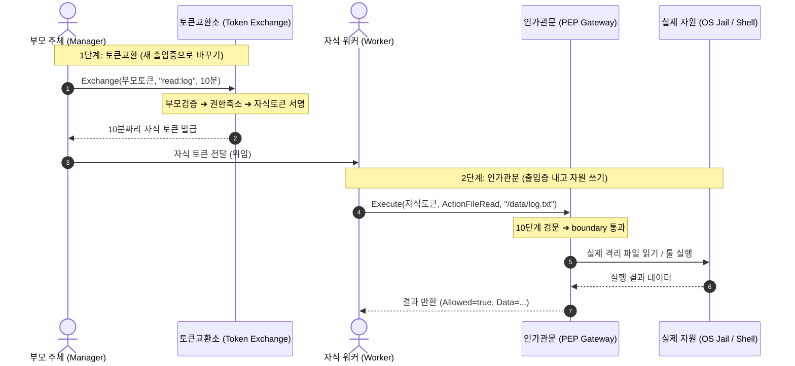

# 006. 파이프라인 엔진, 토큰교환, 그리고 2단계 프로세스 실행의 모든 것

> **모드**: `[문서작업]` — 소스코드 수정 없이 이번 대화 세션에서 다룬 제네릭 파이프라인 엔진(`pipeline.Engine[S]`), 상태봉투(`Call`), 토큰(Token)의 실체와 토큰 교환(`Exchange`), 인가관문(`PEP Gateway`), 그리고 부모-자식-손자 2단계 OS 프로세스 격리 및 표준입출력 통신의 질문·대답 전체를 해설합니다.  
> **기준일**: 2026-11-07 · **기준 커밋**: `34b8b77`  
> **다시 확인하는 법**:  
> ```bash
> # 1. 파이프라인 범용 엔진 시험
> go test -v ./internal/pipeline/...
> # 2. 토큰 교환 8단계 파이프라인 시험
> go test -v ./internal/authn/exchange/... -run "TestExchange"
> # 3. PEP 인가관문 10단계 파이프라인 시험
> go test -v ./internal/authz/pep/... -run "TestGateway"
> # 4. 오케스트레이터 프로세스 스포너(stdin/stdout 격리) 시험
> go test -v ./internal/orchestrator/... -run "TestSpawner"
> ```

---

## 1. `pipeline.Engine[Call]`과 상태봉투(`Call`)

### Q. `pipeline.Engine[Call]`이 뭐야? `Call`이 상태봉투야? 그게 뭐야? Go 문법을 잘 모르는데 특별한 방식이야?

#### 1) `pipeline.Engine[Call]`이란?
한 문장으로 말하면, **"요청을 처리할 때 거쳐야 하는 단계들(입력검증 ➔ 인증 ➔ 인가 ➔ 격리 ➔ 감사 ➔ 실행 ➔ 정산 등)을 정해진 순서대로 실행해 주는 범용 파이프라인 엔진"**입니다.

이 프로젝트에서 요청을 집행하는 관문인 `gateway.go`는 다음 10개 단계를 차례대로 거칩니다:
1. `input` (입력 검증)
2. `authn` (토큰 인증)
3. `authz` (권한 판정)
4. `boundary` (파일 경로/네트워크 격리 경계 검사)
5. `replay` (토큰 재사용 방지)
6. `approval` (사전 승인서 소비)
7. `budget` (예산 차감)
8. `precommit_audit` (실행 직전 감사 기록)
9. `execute` (실제 파일 쓰기/읽기/명령 실행)
10. `settle` (사후 정산)

`pipeline.go`에 있는 `Engine`은 권한이나 토큰이 뭔지 전혀 모르는 순수한 실행기이고, `pep` 패키지가 **"우리는 이 10개 단계로 검사할 것이고, 각 단계마다 전달할 데이터는 `Call`이야"**라며 조립해 둔 결과가 바로 `Engine[Call]`입니다. (구현: `internal/pipeline/pipeline.go`, `internal/authz/pep/gateway.go`)

#### 2) `Call`이 상태봉투인가?
**네, 맞습니다. 정확히 '상태 봉투(State Envelope)' 역할을 합니다.**

`Call` 구조체(`internal/authz/pep/tool.go`)는 다음과 같이 구성되어 있습니다:
```go
type Call struct {
    cfg         *Config          // 게이트웨이 전체 설정/의존성
    req         Request          // 사용자가 요청한 입력값 (토큰, 동작, 경로 등)
    st          *pipelineState   // 단계를 거치며 누적되는 중간 상태
    fetchTarget netguard.Target  // 네트워크 작업 시 정규화된 대상
}
```

* **왜 '상태 봉투'라고 부를까요?**
  * 공장의 컨베이어 벨트를 상상해 보세요.
  * 노란 서류 봉투(`Call`) 하나가 벨트에 올라탑니다.
  * 봉투 안에는 처음 의뢰서(`Request`)가 들어 있습니다.
  * **1단계(authn) 직원**: 토큰을 꺼내 검증한 뒤, 인증된 사용자 정보(`claims`, `subject`)를 봉투 안(`st`)에 메모해서 다시 벨트로 보냅니다.
  * **2단계(authz) 직원**: 앞 사람이 적어둔 사용자 정보를 읽고 권한을 승인한 뒤, 승인 번호(`approvalID`)를 봉투에 메모합니다.
  * **3단계(boundary) 직원**: 안전한 경로(`safePath`)를 검증해 봉투에 적습니다.
  * **마지막(execute) 직원**: 봉투에 쌓인 최종 정보들을 보고 실제 파일/명령을 실행한 뒤 결과(`out`)를 넣습니다.
  * 이처럼 **각 단계 함수들이 이전 단계의 결과를 읽고, 자기 결과를 누적해서 다음 단계로 넘겨주기 위해 들고 다니는 하나의 묶음 주머니**를 소프트웨어 패턴에서 "상태 봉투(State Envelope)" 또는 "컨텍스트(Context Object)"라고 부릅니다.

#### 3) Go 문법 관점에서의 특별함
괴상하거나 마법 같은 특수 문법은 아니고, **Go 1.18부터 정식 도입된 제네릭(Generics, 타입 매개변수)** 문법입니다. (Java의 `List<String>`, C++의 `std::vector<T>`, TypeScript의 `Array<T>`와 동일합니다.)
* `Engine[S any]`는 "어떤 상태 타입(`S`)을 들고 다닐지는 쓰는 쪽에서 결정해라"라는 뜻입니다.
* 이를 사용할 때 `Call`이라는 타입을 괄호 안에 넣어서 구체화한 것입니다 (`Engine[Call]`).
* **장점**: 컴파일 시점에 타입이 고정되어 런타임 타입 캐스팅 에러가 사라지며, 토큰 교환(`Engine[exchangeCall]`)과 관문(`Engine[Call]`)에서 동일한 파이프라인 코드를 안전하게 재사용합니다.

---

### Q. `Call` 구조체 안의 `Config`와 `pipelineState`를 상세히 알고 싶어. 안에서 각각 무엇을 들고 있어?

`Call`은 겉보기엔 단순하지만, **"불변의 시스템 설정(`Config`)"**과 **"단계를 거치며 채워지는 동적 메모장(`pipelineState`)"**이 명확히 분리되어 있습니다:

#### 1) `cfg *Config` (게이트웨이의 고정된 도구함)
게이트웨이가 태어날 때 주입받은 불변의 하위 컴포넌트들입니다 ([internal/authz/pep/gateway.go](../../internal/authz/pep/gateway.go#L63-L76)):
* `Verifier`: Bearer 토큰의 위조 여부를 검증하는 암호학적 검증기.
* `PDP`: 순수 인가 결정 엔진 (판단 두뇌).
* `Jail`: `workspace/` 밖으로 못 나가게 막는 파일 격리 울타리.
* `AuditWriter`: 위변조 불가 감사 장부(`audit.jsonl`) 기록기.
* `Clock`: 가상 시간 시뮬레이션을 위한 결정론적 시계.
* `ApprovalConsumer`: 사람 승인서 소비기.
* `BudgetLedger`: 호출 횟수/바이트 원장.
* `ExecRunner`: 쉘 명령(`exec:run`) 실행기.

#### 2) `st *pipelineState` (검문소를 지나며 채워지는 동적 메모장)
요청이 들어왔을 땐 거의 비어 있다가, 10개 검문소를 거치며 앞 단계 직원이 채우고 뒷 단계 직원이 읽는 누적 상태입니다 ([internal/authz/pep/gateway.go](../../internal/authz/pep/gateway.go#L117-L137)):
* `traceID`: 전체 트랜잭션을 추적하는 고유 식별자.
* `claims`: `authn`(2단계) 직원이 토큰을 까서 확인한 인증된 사용자 명세(`VerifiedClaims`).
* `subject` & `tokenJTI`: 토큰의 주인 ID와 토큰 일련번호.
* `approvalID`: `authz`(3단계) 직원이 "이 작업은 사전 승인서 #123이 있어서 통과시켰음"이라고 메모한 승인 ID (➔ 6단계 `approval` 직원이 이걸 보고 소비함).
* `safePath`: `boundary`(4단계) 직원이 샌드박스 탈옥(`..`)이 없는지 검사하고 확인한 물리적 안전 경로.
* `budgeted`, `consumed`: `budget`(7단계) 직원이 예산을 정상 차감했는지 여부.
* `out`: `execute`(9단계) 직원이 실제 파일을 읽거나 쉘을 실행하고 담아둔 결과 바이트(`Output`).

---

## 2. Go 언어 문법 및 네이밍 규칙

### Q. `var engine *pipeline.Engine[Call]` 문법을 더 설명해줘. `pipeline`은 뭔가? 클래스인가? 왜 소문자인가? `Engine`은 왜 대문자인가? `*`는 뭐야?

```text
var  engine  *pipeline.Engine[Call]
 ↑     ↑     ↑    ↑       ↑
 ①     ②     ③    ④       ⑤
```

| 기호/단어 | 정체 | 설명 |
| :--- | :--- | :--- |
| ① `var` | **키워드** | "지금부터 변수를 선언하겠다"는 선언문 키워드 |
| ② `engine` | **변수명** | 선언할 변수의 이름 (소문자로 시작하므로 이 패키지 내부에서만 씀) |
| ③ `*` | **포인터 타입** | 원본 객체를 통째로 복사하지 않고, 메모리 주소(참조)를 가리킨다는 뜻 |
| ④ `pipeline` | **패키지 이름** | 다른 디렉터리/네임스페이스인 `package pipeline`을 의미 (클래스 아님) |
| ⑤ `Engine` | **구조체(타입) 이름** | `pipeline` 패키지가 외부에 공개(Export)한 타입 이름 |

1. **`pipeline`은 클래스인가? 왜 소문자인가?**:
   * Go에는 `class` 키워드가 없습니다. 디렉터리 단위로 `package`를 만들어 네임스페이스로 씁니다.
   * Go 표준 규약상 **패키지 이름은 반드시 모두 소문자(단일 단어 권장)**로 작성합니다 (`pipeline`, `json`, `token` 등).
2. **`Engine`은 왜 대문자인가? (Go의 접근 제어자)**:
   * Go에는 `public`, `private` 키워드가 없습니다. 대신 **첫 글자의 대/소문자로 공개 여부를 결정(Exported / Unexported)**합니다:
   * **대문자 (`Engine`, `Run`)**: Public (외부 공개). 다른 패키지에서 가져다 쓸 수 있습니다.
   * **소문자 (`engine`, `stepStart`)**: Private (패키지 비공개). 해당 패키지 폴더 안에서만 보입니다.
3. **`*`는 뭐야? (포인터)**:
   * `pipeline.Engine[Call]`은 엔진 객체 실물(값)이고, `*pipeline.Engine[Call]`은 엔진 객체가 메모리 어디에 있는지 가리키는 주소(포인터)입니다.
   * 객체를 통째로 복사하지 않고 8바이트 주소만 넘겨 성능을 높이고, 동일한 인스턴스를 공유하며, `nil` 상태를 표현하기 위해 씁니다.

---

## 3. 토큰교환소와 인가관문: "요청"이 아니라 "교환"이라 부르는 이유

### Q. 토큰교환소와 인가관문이 대체 뭐야? 토큰을 그냥 '요청'하는 게 아니라 왜 굳이 '교환(Exchange)'한다고 해?

#### 1) 토큰을 그냥 달라고(Request) 하지 않는 이유
* 일반적인 로그인 시스템에서는 아이디/비밀번호를 주고 "토큰 주세요"라고 **새로 요청(Request)**합니다.
* 하지만 에이전트 시스템에서는 부모가 이미 **자신의 강력한 마스터 토큰**을 쥐고 있습니다.
* 자식 일꾼에게 일을 시킬 때, 아무것도 없는 상태에서 토큰을 달라고 떼쓰는 게 아닙니다. 부모가 가진 **"큰 출입증(마스터 토큰)"을 창구에 담보로 맡기고, "더 작은 10분짜리 임시 출입증(자식 토큰)"으로 바꿔 가는(Exchange)** 것입니다.
* 그래서 OAuth 2.0 국제 표준(RFC 8693)에서도 이 행위를 `Token Request`가 아니라 **`Token Exchange (토큰 교환)`**이라고 공식 명명했습니다.

#### 2) PEP 게이트웨이도 교환소처럼 작동하나? 내 착각인가?
* **질문하신 직관이 아주 훌륭합니다! 하지만 역할은 명확히 다릅니다 (착각하기 쉬운 이유 해설):**
* **착각하기 쉬운 이유**: 
  1. 둘 다 똑같이 생긴 `pipeline.Engine[S]` 컨베이어 벨트를 씁니다 (`Engine[exchangeCall]` vs `Engine[Call]`).
  2. 둘 다 내부에서 `client_auth`나 `authn` 같은 인증/검증을 거칩니다.
* **결정적 차이점**:
  * **토큰교환소 (`ExchangeService`)**: 결과물로 **"새로운 자식 토큰 문자열(출입증)"**을 찍어서 돌려주는 **발급 창구**입니다. 실제 파일이나 쉘에는 일절 손대지 않습니다.
  * **인가관문 (`PEP Gateway`)**: 이미 발급받은 출입증을 들고 찾아왔을 때, **실제 파일 I/O를 하거나 쉘 도구를 실행해서 "작업 결과(Data)"**를 주는 **현장 검색대**입니다.
* 즉, `ExchangeService`는 출입증을 바꿔주는 곳이고, `PEP Gateway`는 그 출입증을 검사해 문을 열어주는 곳입니다.



### Q. 토큰을 교환(Exchange)하면 부모는 그동안 토큰이 없는 건가?

**아닙니다. 부모의 토큰은 그대로 살아있으며, 부모는 토큰을 빼앗기거나 잃어버리지 않습니다.**

'교환(Exchange)'이라는 단어 때문에 *"내가 가진 토큰을 상대방에게 건네주고 내 손은 빈손이 되는 것 아닌가?"*라고 오해하기 쉽지만, 실제 동작은 전혀 다릅니다.

#### 1) 실생활 비유: "가족카드 발급"
* 부모가 카드사 앱에서 자녀를 위한 **가족 체크카드**를 새로 신청해서 파줬다고 해서, **부모 본인의 신용카드가 사라지거나 정지되지 않는 것**과 같습니다.
* 부모는 여전히 본인 카드로 결제할 수 있고, 자녀는 부모가 떼어준 한도 내에서 자기 카드로 결제합니다.

#### 2) 기술적 실체: 부모 토큰은 '검증 담보(Proof)'일 뿐
OAuth 2.0 Token Exchange(RFC 8693) 및 이 시스템의 `ExchangeService`(`internal/authn/exchange/service.go`)에서 부모 토큰은 다음과 같이 취급됩니다:
1. **읽기 전용 증명서 (Read-Only Credential)**:
   * 부모는 토큰 교환소(`ExchangeService`)에 `ParentToken`을 보낼 때, 원본을 넘겨서 소유권을 양도하는 것이 아니라 **"나 이런 권한을 가진 부모인데, 내 권한 범위 안에서 일꾼용 자식 토큰 하나 새로 찍어줘"**라며 제시(Present)하는 것입니다.
   * 교환소는 부모 토큰의 서명, 만료일(`exp`), 스코프를 **검증(Verify)만 할 뿐, 부모 토큰을 무효화(Revoke)하거나 파기하지 않습니다.**
2. **동시 독립 사용 가능**:
   * 자식이 교환받은 자식 토큰(`child_token`)을 들고 자식 검문소를 통과하는 동안에도, 부모는 자기 토큰(`parent_token`)으로 다른 상위 관리 작업을 동시에 수행할 수 있습니다.

#### 3) 단, 무엇이 달라지는가? (유일한 영향: "지갑 예산 예약")
부모 토큰의 **존재 자체**는 사라지지 않지만, **예산(Budget)이 걸려 있는 경우 지갑의 사용 가능 한도가 일부 홀드(Hold)**됩니다.
* 부모 지갑에 100회 호출 한도가 있을 때 자식에게 30회를 떼어주며 교환(`exchange`)하면:
  * **부모 토큰**: 여전히 유효함
  * **부모의 가용 잔여 예산**: `100 - 30 = 70회`로 줄어듦 (예약 홀드)
  * **자식 토큰**: 부모에게 위임받은 `30회` 지갑을 들고 독립적으로 활동

---

## 4. 토큰(Token)의 실체, jti, 그리고 budget

### Q. 토큰이 대체 뭐야? `jti`는 뭐고, 왜 `budget`이라고 표현해? 일반적인 표현이야?

#### 1) 토큰이란 무엇인가?
* **일상의 비유**: 공인인증서 도장(전자서명)이 찍힌 **1회용 종이 출입증**.
* **코드상의 실체**: 점(`.`) 2개로 연결된 긴 암호문 문자열(JWT, RFC 9068).
* 내용을 까보면 [internal/domain/token.go](../../internal/domain/token.go)의 `TokenClaims`가 들어 있습니다:
  * `iss` (발급자), `sub` (출입증 주인), `exp` (만료시각), `scope` (허용 행위 목록), `epoch` (보안 세대 번호), `act` (위임 계보 도장).
  * 끝부분에 비대칭키 전자서명이 붙어 있어, 단 1글자만 위조해도 즉시 감지됩니다.

#### 2) `jti`는 뭔가? (JWT ID)
* **정체**: **출입증 고유 일련번호 (UUID / 난수 문자열)**입니다. (RFC 7519 §4.1.7 표준 규격)
* **왜 필요한가? (재사용 방지 — Replay Attack 방어)**:
  * 해커가 네트워크에서 출입증을 가로채서 똑같은 걸 100번 쓰려고 할 수 있습니다.
  * 검문소는 출입증을 받을 때마다 적혀 있는 `jti` 번호를 장부(`replay_state.json`)에 기록합니다.
  * 1초 뒤 똑같은 `jti`가 적힌 출입증이 또 들어오면? **"이 일련번호는 이미 사용된 입장권이다!"**라며 차단(5단계 `replay` 검문)합니다.

#### 3) 왜 `budget`(예산)이라고 표현해? 일반적인 표현인가?
* **네, 클라우드와 자율 에이전트 보안에서 매우 표준적이고 널리 쓰이는 표현입니다!**
* **이유**:
  * OpenAI, Anthropic의 LLM API나 클라우드 시스템에서는 에이전트에게 자원을 줄 때 "토큰 사용량 예산(Token Budget)", "컴퓨팅 예산(Compute Budget)"이라고 부릅니다.
  * 이 프로그램에서도 자식 일꾼에게 일을 시킬 때, 무제한으로 디스크를 쓰지 못하게 **"너는 총 3번만 호출할 수 있고, 총 10KB까지만 쓸 수 있어"**라며 마치 용돈 지갑을 쥐여주듯 통제합니다.
  * 그래서 권한(`scope`)과 구분하여 소비 가능한 자원의 상한선을 **`budget`(예산)**이라고 부릅니다.

---

## 5. Tool(Shell) 실행 결과 리턴 및 stdout/stderr 처리

### Q. Tool 실행 결과는 어떻게 리턴되나? 특히 shell 툴이면 어떻게? stdout이나 stderr로 받나?

1. **결과 리턴 구조**:
   * 실행 결과는 공통 `Output` 구조체(`internal/authz/pep/tool.go`)로 묶여 반환됩니다:
     ```go
     type Output struct {
         Data       []byte // 실행 결과 데이터 (바이트 슬라이스)
         BytesRead  int    // 읽은(출력된) 바이트 크기
         BytesWrote int
     }
     ```
   * 이 `Output`은 인가관문 실행이 끝나면 최종적으로 `Result.Data`(`[]byte`)로 전달됩니다.
2. **`stdout` / `stderr` 처리 방식 (`internal/execguard/guard.go`)**:
   * **`stdout` (표준 출력)**: 자식 워커가 메모리 버퍼(`capWriter`)를 `cmd.Stdout`에 꽂아둡니다. 툴이 화면에 출력한 글자들을 메모리 바이트 배열(`[]byte`)로 긁어옵니다. (상한선 `maxBytes` 초과 시 차단)
   * **`stderr` (표준 에러)**: 별도 버퍼로 수거하지 않습니다. 프로세스가 비정상 종료하거나 에러를 내면 Go 표준 라이브러리의 `cmd.Run()` 에러(`err`)로 감지되어, **인가관문 전체가 즉시 실패(Fail-Closed, `ReasonInternalError`) 처리**됩니다.
   * **결론**: **정상 종료 시의 `stdout` 내용만 바이트 배열(`[]byte`) 형태로 반환**됩니다.

---

## 6. 부모-자식-손자 2단계 프로세스 생성과 격리 통신

### Q. 부모-자식, 자식-툴(손자) 통신 전체를 정리해줘. 자식 워커가 부모가 되어 툴을 자식 프로세스로 또 실행시키나? 메인 프로그램이 부모도 되고 자식도 되나?

**네, 맞습니다! 자식 워커가 또 하나의 부모가 되어 툴을 "손자(Grandchild) 프로세스"로 실행시킵니다.**

```text
┌─────────────────────────────────────────────────────────────┐
│ [1단계] 부모 프로세스 (Orchestrator / main)                 │
│   • 역할: 작업 계획, 토큰 축소 위임, 자식 생명주기 관리   │
└──────────────────────────────┬──────────────────────────────┘
                               │ [1차 분기: Self-Spawn]
                               │ • 실행 바이너리: 자기 자신 (authz-harness worker)
                               │ • 입력 통로: stdin 파이프 (토큰, JSON 요청 밀어넣기)
                               │ • 출력 통로: stdout 파이프 (결과 JSON 빨아들이기)
                               ▼
┌─────────────────────────────────────────────────────────────┐
│ [2단계] 자식 워커 (Worker Agent)                            │
│   • 역할: 인가관문(PEP Engine) 실행, OS Sandbox 적용        │
│   • 검사: authn ➔ authz ➔ boundary 통과                     │
└──────────────────────────────┬──────────────────────────────┘
                               │ [2차 분기: Tool Exec]
                               │ • 실행 바이너리: 외부 시스템 도구 (예: /bin/echo, git 등)
                               │ • 입력 통로: 없음 (stdin=nil, CLI 인자만 단발 전달)
                               │ • 출력 통로: stdout 버퍼 캡처 (결과 바이트 배열)
                               ▼
┌─────────────────────────────────────────────────────────────┐
│ [3단계] 손자 툴 프로세스 (Tool Process)                      │
│   • 역할: 실제 쉘/명령어 한 줄 실행 후 즉시 종료          │
└─────────────────────────────────────────────────────────────┘
```

#### 핵심 메커니즘과 보안 불변식:
1. **자기 복제 (Self-Re-execution)**:
   * 배포 시 바이너리 하나(`authz-harness`)만 사용합니다. 부모는 `os.Executable()`(자기 자신의 바이너리)에 `worker` 서브커맨드를 붙여 자식 프로세스를 띄웁니다.
2. **비밀값 전달 시 `stdin` 필수 사용 (Zero Leakage)**:
   * 리눅스/macOS에서 `ps aux` 명령을 치면 CLI 인자(`--token=...`)가 시스템 전체에 노출됩니다.
   * 따라서 부모는 토큰을 명령행 인자로 절대 넘기지 않고, **오직 1:1 메모리 파이프인 `cmd.Stdin`에 단일 JSON 프레임으로 주입**합니다.
3. **자식과 툴 사이의 통신**:
   * 대화형(Interactive) 통신이 아닙니다.
   * `cmd.Stdin = nil`로 입력을 닫아버리고, 명령어 인자(argv)만 넘긴 뒤 끝날 때까지 기다리는 **단발성 배치(One-shot Batch)** 방식입니다.

---

## 7. 파이프라인 엔진의 디자인 패턴과 게이트웨이의 보안적 의미

### Q. 파이프라인 엔진은 어떤 패턴인가? 미들웨어/인터셉터와의 차이는? 우리 게이트웨이는 왜 준비만 해주고 파이프라인에 맡기나? 보안상 어떤 의미가 있나?

#### 1) 파이프라인 엔진의 패턴
* **Pipes & Filters Pattern + Chain of Responsibility + Saga Pattern (보상 트랜잭션)**의 결합입니다.
* **미들웨어와의 차이**:
  * 미들웨어는 `next(ctx)` 형태로 함수가 함수를 부르며 양파 껍질처럼 감싸는 재귀 구조입니다.
  * 우리 엔진은 재귀가 없는 **1차원 평면 배열 루프(`for _, step := range steps`)**로, 각 단계는 앞뒤를 호출하지 않고 오직 상태봉투(`*S`)만 검사합니다.
* **Saga 보상 롤백**:
  * 중간에 8단계에서 실패하면, 앞서 7단계에서 성공했던 자원 차감(예: 예산 소비)을 역순으로 되돌리는 `Compensate` 로직이 기계적으로 발동됩니다.

#### 2) 준비만 해주는 게이트웨이의 보안적 의미 (메커니즘과 정책의 분리)
게이트웨이가 직접 판단하지 않고 정해진 파이프라인에 요청을 밀어 넣는 구조는 다음과 같은 절대적인 보안 이점을 제공합니다:
1. **인가 우회(Bypass)의 수학적 원천 차단**:
   개발자가 편의를 위해 특정 검사(감사, 예산 등)를 건너뛰는 예외 코드를 작성할 수 없으며, 모든 요청은 10개 검문소를 100% 거쳐야 합니다.
2. **실패 시 안전 우선 (Fail-Closed) 물리적 보장**:
   어느 한 단계라도 에러를 내면 엔진 루프가 즉각 중단되어 실제 실행(`execute`) 단계에 도달할 수 없습니다.
3. **도메인 역전으로 얻는 완벽한 테스트 가능성**:
   엔진 자체는 보안이나 토큰을 전혀 모르는 순수 Go 코드이므로, 수백 가지의 순서 역전이나 결함 주입을 독립 단위 테스트로 100% 증명할 수 있습니다.

### Q. pep.gateway를 쓰면 왜 인가bypass를 막을 수 있고 10단계 검문소가 강제되나?

#### 1) 단일 집행 창구(Choke Point)와 진입 경로 강제
* **리소스 접근 전용 관문(Gatekeeper)**:
  `jail`(파일 I/O), `netguard`(네트워크 I/O), `execguard`(프로세스 실행) 등 실제 OS 자원을 건드리는 모든 저수준 액추에이터는 `pep.Gateway` 내부에 은닉(encapsulate)되어 있으며 외부로 직접 노출되지 않습니다.
* **Fail-Closed 인터페이스**:
  외부 요청(CLI, Subagent, MCP 등)은 반드시 `Gateway.Execute()`만을 호출하도록 아키텍처가 결합되어 있어, 검문소를 건너뛰고 자원에 직접 닿는 지름길(Bypass Path) 자체가 존재하지 않습니다.

#### 2) 제네릭 파이프라인 엔진(`pipeline.Engine`)에 의한 순서 및 단계 고정
`pep.gateway`는 내부적으로 단일 파이프라인 엔진(`internal/pipeline`)을 통해 단계를 구동합니다.
* **조립 시점 랭크 검증 (Rank Monotonicity)**:
  각 단계는 성격에 따라 엄격한 순서 등급(`Check/Decide(0) -> Consume(1) -> Record(2) -> Execute(3) -> Settle(4)`)을 부여받습니다. `pipeline.New()`에서 순서가 어긋나거나 등급이 하강하는 조립은 인스턴스 초기화 단계에서 에러를 내며 실패합니다.
* **도중 탈출(Short-Circuit) 불가**:
  `Engine.Run()` 루프는 1번부터 10번 단계까지 순차적으로 `Run`을 실행합니다. 특정 단계를 임의로 건너뛸 수 없으며, 중간 단계 중 단 하나라도 거부(Deny/Error)되면 즉시 중단(Fail-Closed)되고 이전 단계의 보상(Compensate/환급)을 수행한 뒤 빠져나갑니다.

---

### Q. 조립 시점 랭크 검증 상세 — 코딩을 어떻게 했고 어떻게 순서를 강제했나?

#### 1) 단계의 성격(`Kind`)과 정수형 등급(`rank()`) 정의
파이프라인의 각 단계는 단순한 이름표(`ID`)뿐 아니라 보안적 행위의 성격을 나타내는 `Kind`를 반드시 갖습니다. 그리고 이 `Kind`에는 **단조 증가(Monotonic Increase)**해야 하는 정수 랭크(`rank`)가 부여됩니다.

```go
// internal/pipeline/pipeline.go

type Kind string

const (
    Check   Kind = "check"    // 0: 순수 검사 (입력 검증, 인증, 샌드박스 경계 등 - 무비용)
    Decide  Kind = "decide"   // 0: 인가 결정 (PDP 정책 판정 - 무비용)
    Consume Kind = "consume"  // 1: 1회용 자원 소비 (토큰 replay 방지, 승인서 파기, 예산 차감)
    Record  Kind = "record"   // 2: 감사 로그 원장 영구 선기록 (Pre-Commit Audit)
    Execute Kind = "execute"  // 3: 실제 도구 실행 (파일 I/O, 쉘 실행)
    Settle  Kind = "settle"   // 4: 사후 정산 및 마감
)

func (k Kind) rank() (int, bool) {
    switch k {
    case Check, Decide:
        return 0, true
    case Consume:
        return 1, true
    case Record:
        return 2, true
    case Execute:
        return 3, true
    case Settle:
        return 4, true
    }
    return 0, false
}
```

* **보안 불변 원칙**:
  * `Check/Decide` (랭크 0): 돈이나 자원을 쓰지 않는 순수한 메모리 검사.
  * `Consume` (랭크 1): 되돌려야 할 수도 있는 자원(돈/승인서/토큰 1회성)을 쓰는 작업.
  * `Record` (랭크 2): 실행 직전의 빼도 박도 못하는 블랙박스 감사 증거 기록.
  * `Execute` (랭크 3): 실제 부수 효과(Side Effect)가 일어나는 저수준 시스템 호출.
  * `Settle` (랭크 4): 사후 마감.

#### 2) 게이트웨이의 10단계 조립 (`assemble`)
`gateway.go`는 인스턴스를 초기화할 때 10개 단계를 배열로 만들어 전달합니다:

```go
// internal/authz/pep/gateway.go

func (g *gateway) assemble() []pipeline.Step[Call] {
    input      := step(domain.StageInput,          domain.KindCheck,   nil,         g.input)          // Rank 0
    authn      := step(domain.StageAuthn,          domain.KindCheck,   nil,         g.authn)          // Rank 0
    authz      := step(domain.StageAuthz,          domain.KindDecide,  nil,         g.authz)          // Rank 0
    boundary   := step(domain.StageBoundary,       domain.KindCheck,   nil,         g.boundary)       // Rank 0
    replay     := step(domain.StageReplay,         domain.KindConsume, nil,         g.replay)         // Rank 1
    approval   := step(domain.StageApproval,       domain.KindConsume, approved,    g.approval)       // Rank 1
    budgetStep := step(domain.StageBudget,         domain.KindConsume, budgeted,    g.budget)         // Rank 1
    precommit  := step(domain.StagePrecommitAudit, domain.KindRecord,  nil,         g.precommitAudit) // Rank 2
    execute    := step(domain.StageExecute,        domain.KindExecute, nil,         g.execute)        // Rank 3
    settle     := step(domain.StageSettle,         domain.KindSettle,  postCharged, g.settle)         // Rank 4

    return []pipeline.Step[Call]{
        input, authn, authz, boundary, replay, approval, budgetStep, precommit, execute, settle,
    }
}
```

#### 3) 생성자(`pipeline.New`)에서의 기계적 순서 강제 (Fail-Fast)
서버나 하네스가 시작될 때 `NewGateway()`는 `pipeline.New[Call]()`을 호출합니다. 이때 **단 한 번이라도 이전 단계보다 랭크가 떨어지는(`r < prevRank`) 조립이 있으면 즉시 에러를 반환하고 게이트웨이 생성을 거부**합니다.

```go
// internal/pipeline/pipeline.go

func New[S any](steps []Step[S], hook Hook[S]) (*Engine[S], error) {
    if len(steps) == 0 {
        return nil, errors.New("pipeline: empty step list")
    }

    seen := map[string]bool{}
    prevRank, prevID := -1, ""

    for _, st := range steps {
        if st.ID == "" {
            return nil, errors.New("pipeline: empty step ID")
        }
        if seen[st.ID] {
            return nil, fmt.Errorf("pipeline: duplicate step ID %q", st.ID)
        }
        seen[st.ID] = true
        if st.Run == nil {
            return nil, fmt.Errorf("pipeline: step %q has no Run", st.ID)
        }

        // 1. 등록되지 않은 미지의 Kind 거부
        r, ok := st.Kind.rank()
        if !ok {
            return nil, fmt.Errorf("pipeline: step %q has unknown kind %q", st.ID, st.Kind)
        }

        // 2. 핵심: 랭크 역전(하강) 원천 차단
        if r < prevRank {
            return nil, fmt.Errorf("pipeline: step %q (%s) comes after %q with a higher rank", st.ID, st.Kind, prevID)
        }

        prevRank, prevID = r, st.ID
    }

    return &Engine[S]{steps: append([]Step[S](nil), steps...), hook: hook}, nil
}
```

#### 4) 이 코딩 방식이 보장하는 것 (왜 우회가 불가능한가?)
1. **실수 방지 (Human Error 차단)**:
   * 만약 어떤 개발자가 편의를 위해 `execute`(Rank 3) 뒤에 `authz`(Rank 0)를 검사하도록 순서를 바꾸거나, `budget`(Rank 1)을 `authn`(Rank 0)보다 앞에 두도록 코드를 실수로 변경하면, 프로그램이 구동되는 시점(`pipeline.New`)에 다음과 같은 에러를 내며 **아예 프로세스가 뜨지 않습니다**:
     > `pipeline: step "authz" (decide) comes after "execute" with a higher rank`
2. **런타임 오버헤드 없는 검증**:
   * 매 요청마다 순서를 계산하는 것이 아니라, 엔진 객체가 최초 생성(`New`)될 때 1회 검증을 끝내므로 런타임 성능 저하가 없습니다.
3. **런타임 루프의 불변성**:
   * 이렇게 조립된 슬라이스는 불변(`append([]Step[S](nil), steps...)`로 방어적 복사)으로 보관되며, `Engine.Run()`은 단순히 `for _, st := range e.steps`로 순차 실행하므로 중간 단계를 우회하는 점프나 조건 분기가 불가능합니다.

#### 3) '자원 무소비 검사 선행'과 10단계 검문소 체계
10단계 검문소는 **비용이 들지 않는 검사를 먼저 통과해야만 자원 소비와 실제 실행이 가능하도록** 수학적으로 분리되어 있습니다.

| 번호 | 단계 (`domain.Stage`) | 단계 성격 (`Kind`) | 역할 및 인가 우회 방지 장치 |
| :---: | :--- | :---: | :--- |
| 1 | `input` | `Check` | 요청 데이터 정규화 및 파라미터 유효성 검사 |
| 2 | `authn` | `Check` | Bearer JWT 전자서명, 발급자, 대상자(`aud`), 만료(`exp`) 암호학적 검증 |
| 3 | `authz` | `Decide` | 순수 PDP 엔진에 위임하여 정책 명부 대조 및 실시간 취소(`revoke`) 여부 판정 |
| 4 | `boundary` | `Check` | 샌드박스 Jail 밖으로 탈옥(`../`)하려는 경로 조작 및 미허용 명령 차단 |
| 5 | `replay` | `Consume` | 1회용 토큰 고유 식별자(`jti`)의 재사용(Replay Attack) 방지 및 소진 |
| 6 | `approval` | `Consume` | 사전 승인 결재(`approval_id`) 검증 및 1회성 소비 |
| 7 | `budget` | `Consume` | 작업 예산(비용) 사전 차감 (후속 단계 실패 시 자동 환급 보상 연계) |
| 8 | `precommit_audit` | `Record` | 실행 직전 위변조 불가 감사 장부(`audit.jsonl`)에 원장 선기록 (기록 실패 시 중단) |
| 9 | `execute` | `Execute` | **비로소 실제 파일 I/O 또는 쉘 명령 실행** |
| 10 | `settle` | `Settle` | 실행 결과 및 바이트 수에 따른 사후 정산 마감 |

### Q. 보안불변원칙은 표준적인가? Kind의 성격과 그 원칙에 대해 설명해줘.

#### 1) 표준인가, 독자적인가?
* **프로젝트 고유의 선택 (독자적인 점)**:
  * RFC나 NIST 표준 문서에 `Check`, `Decide`, `Consume`, `Record`, `Execute`, `Settle`이라는 6개 키워드가 하나의 세트로 정의되어 있는 것은 아닙니다.
  * 이는 [ADR 0007 5장](../adr/0007-파이프라인-단계-분류-기준.md)에서도 명시하고 있듯이, 이 저장소의 권한 검증 흐름을 엄밀히 분석하여 도출한 자체 아키텍처 규약입니다.
* **지극히 표준적인 점 (기반이 된 컴퓨터 과학 및 보안 표준 원칙들)**:
  1. **부작용(Side-Effect) 제로 검증 우선 원칙 (NIST SP 800-207 Zero Trust Architecture)**:
     인증되지 않거나 인가되지 않은 주체에게는 어떠한 상태 변화(State Mutation)나 자원 소비 기회도 주지 않아야 합니다.
  2. **Checks-Effects-Interactions 패턴 (스마트 컨트랙트 및 금융 보안 표준)**:
     Ethereum(Solidity)이나 금융 거래 시스템에서 해킹(재진입 공격 등)을 방지하기 위해 강제하는 절대 원칙인 **"① 조건 검사(Checks) ➔ ② 내부 상태 변경/소비(Effects) ➔ ③ 외부 시스템 실행/상호작용(Interactions)"**의 순서와 정확히 일치합니다.
  3. **Non-repudiation (부인 방지 / 사전 감사 원칙)**:
     실제 파괴적 작업(Execute)이 일어나기 직전에 감사 로그(Record)가 원장에 물리적으로 기록되지 않으면 실행을 차단하는 원칙입니다.

#### 2) 'Kind' 보안 불변 원칙의 핵심 질문: "세상에 무엇을 남기는가?"
[ADR 0007 2장](../adr/0007-파이프라인-단계-분류-기준.md)에서는 이 원칙을 이렇게 선언합니다:

> **"분류 기준은 '이 단계가 세상에 무엇을 남기는가'다. 이름이나 담당 패키지가 아니라 부작용(Side Effect)으로 나눈다. 거부됐을 때 무엇이 남는지가 보안상 가장 중요한 질문이기 때문이다."**

보안 시스템에서 가장 위험한 취약점은 **"인가되지 않아 거부(Deny)당했는데도 시스템 자원이 깎여 있거나, 샌드박스 내부 정보가 새어나가는 부작용"**입니다. 이를 막기 위해 단계들을 '부작용의 비가역성(되돌릴 수 없음)'에 따라 랭크로 나눈 것입니다.

| 성격 (`Kind`) | 등급 (`rank`) | 핵심 정의 | 거부(Deny/Fail)되었을 때 세상에 남는 것 |
| :--- | :---: | :--- | :--- |
| **`Check` (검사)** | 0 | 상태를 전혀 바꾸지 않고 입력값과 암호학적 서명만 읽음 | **아무것도 남지 않음 (순수 메모리 검사)** |
| **`Decide` (판정)** | 0 | PDP가 정책 장부와 토큰 클레임을 대조해 허가 여부만 결정 | **아무것도 남지 않음 (상태 불변)** |
| **`Consume` (소비)** | 1 | 1회용 티켓(`jti`) 파기, 사람 승인서 소비, 예산 차감 | **자원이 소진됨 (필요시 사가 보상 트랜잭션 발동)** |
| **`Record` (기록)** | 2 | 실행 직전 블랙박스 원장에 해시 체인 선기록 (`precommit`) | **실행하지 않고 중단 (위변조 불가 증거만 남음)** |
| **`Execute` (실행)** | 3 | 실제 파일 읽기/쓰기, 네트워크 호출, 쉘 명령어 실행 | **시스템에 물리적 부작용이 이미 발생함** |
| **`Settle` (정산)** | 4 | 실행이 끝난 뒤에야 알 수 있는 실제 결과(바이트 수 등)로 마감 | **실행 결과를 반환하지 않고 차단/정리** |

#### 3) 왜 '등급이 내려가지 않는 규칙(Monotonicity)'을 강제하는가?
이 원칙의 기술적 백미는 **"등급(Rank)은 절대 내려갈 수 없다 (`r >= prevRank`)"**는 단순한 수학적 부등식 하나로 거대한 보안 구멍들을 기계적으로 틀어막는다는 점입니다.

1. **미인가 요청의 자원 고갈(DoS) 방지**:
   * 만약 `Consume`(예산/승인 차감)이 `Check/Decide`(토큰 검증/인가 판정)보다 먼저 오면, 공격자가 위조된 토큰이나 유효하지 않은 요청을 마구 보낼 때 인증 검사도 통과하지 않은 쓰레기 패킷 때문에 피해자의 예산이 깎이거나 일회용 승인서가 허위 소비되어 서비스 거부(DoS)가 발생합니다.
   * **강제 효과**: 랭크 규칙(`0 ➔ 1`)에 의해, **단 1원의 돈이나 1장의 승인서도 토큰 위조 검사와 PDP 인가 검사를 100% 통과하기 전에는 절대 소비될 수 없습니다.**
2. **경로 스캔 및 정보 유출(Information Leakage) 차단**:
   * 만약 `Boundary`(경로 검사)가 `Authz`(인가 판정)보다 먼저 오면, 공격자가 권한도 없으면서 `../../secret.txt` 같은 경로를 찔러볼 때 인가 여부를 따지기도 전에 "해당 파일이 존재하지 않습니다"라거나 "경로 탈옥입니다"라는 에러를 받아 서버 내부 디렉터리 구조를 역탐지할 수 있습니다.
   * **강제 효과**: 권한이 없는 자에게는 파일의 존재 여부조차 알려주지 않고 3단계 `authz`에서 즉각 문을 닫아버립니다.
3. **부인 방지 및 사고 감사 (Non-repudiation)**:
   * 만약 `Execute`(실행)가 `Record`(감사 기록)보다 먼저 오면, 명령어가 실행된 직후 프로세스가 충돌(Crash)하거나 전원이 꺼질 경우 파일은 이미 변조/삭제되었는데 감사 장부에는 아무런 기록도 남지 않아 원인을 추적할 수 없습니다.
   * **강제 효과**: 랭크 규칙(`2 ➔ 3`)에 의해, **감사 장부에 SHA-256 체인이 영구 기록된 것이 확인되지 않으면 물리적 도구 실행(`Execute`) 단계로의 진입 자체가 불가능**합니다.

---

## 8. 실무 보안 지식과 인가 아키텍처의 현실 적용

### Q. 부모의 토큰 교환과 PEP의 토큰 exchange는 각각 무엇이고 둘의 차이는 무엇인가?

'교환'과 '인가'는 시스템 생애주기에서 완전히 다른 시점과 역할을 담당하는 두 개의 독립된 관문입니다:

1. **부모의 토큰 교환 (`ExchangeService`)**:
   * **역할**: 조폐소 / 새 출입증 발급 창구 (Minting/Delegation)
   * **호출 주체**: 작업을 위임하려는 **부모 주체 (Manager)**
   * **입출력**: 부모 토큰과 위임 스코프를 제시하면, **새로운 자식 토큰 문자열(암호화 서명된 JWT)**을 발급
   * **특징**: 물리적 파일이나 쉘 자원에는 전혀 손대지 않음 ([internal/authn/exchange/service.go](../../internal/authn/exchange/service.go))
2. **PEP 인가관문 (`Gateway`)**:
   * **역할**: 공항 검색대 / 출입문 집행관 (Policy Enforcement Point)
   * **호출 주체**: 실제로 자원을 쓰려는 **자식 워커 (Worker)**
   * **입출력**: 자식 토큰과 실행할 액션을 제시하면, 10단계 검문을 거쳐 **실제 물리적 실행 결과 데이터(`[]byte`)**를 반환
   * **특징**: OS 커널 레벨 격리(Jail) 환경에서 실제 파일/명령을 실행하고 통제함 ([internal/authz/pep/gateway.go](../../internal/authz/pep/gateway.go))

```text
[ 1단계: 부모의 토큰 교환 ]
부모 매니저 ──(부모토큰 + "read 권한만 줘")──> [ ExchangeService ]
                                                    │
자식 워커   <──────(축소된 10분짜리 자식토큰 발급)─────┘
   │
   │ (자식 토큰을 들고 이동)
   ▼
[ 2단계: PEP 인가 집행 ]
자식 워커   ──(자식토큰 + "data.txt 읽어줘")───> [ PEP Gateway ]
                                                    │ (10단계 검문 통과)
                                                    ▼
                                            [ OS Jail / 샌드박스 ] 
                                            (실제 파일 읽기 실행)
                                                    │
자식 워커   <──────(파일 내용 데이터 리턴)─────────────┘
```

---

### Q. 하위권한만 통과시키는 정도(Downscoping)의 구현 능력이면 일반 회사에서 충분한가? 더 알아야 할 실무 보안 지식이 있는가?

#### 1) 현재 수준의 위상
본 하네스에서 구현된 **동적 권한 축소(Downscoping, RFC 8693)**, **PDP/PEP 아키텍처 분리**, **Replay Attack 방어(`jti` 추적)**, **Epoch 기반 실시간 무효화**는 일반 웹 애플리케이션의 단순 RBAC(`hasRole('ADMIN')`) 수준을 훨씬 뛰어넘는 깊이이며, AWS IAM AssumeRole이나 대형 테크 기업의 코어 인프라 레벨 설계에 해당합니다.

#### 2) 네트워크 보안은 외부 업체 영역인가?
* **외부/인프라 영역 (경계 보안)**: WAF, L4/L7 방화벽, DDoS 방어, VPN 등은 인프라팀 및 외부 솔루션 영역입니다.
* **애플리케이션 개발자가 반드시 제어해야 하는 네트워크 영역**:
  * **SSRF (Server-Side Request Forgery)**: 웹훅, 외부 이미지 페치, 에이전트 브라우징 시 `http://169.254.169.254`(AWS 메타데이터)나 사설망 IP(`127.0.0.1`, `10.0.0.0/8`)로의 내부망 침투를 애플리케이션 레벨(Netguard/DNS Pinning)에서 직접 차단해야 함.
  * **Zero Trust mTLS**: 서비스 간 통신(MSA)에서 내부망 신뢰를 배제하고 상호 TLS 및 토큰 검증 수행.

#### 3) 주문결제 시스템에서 반드시 결합해야 할 권한 지식
1. **BOLA / IDOR (Broken Object Level Authorization — 객체 수준 소유권 검증)**:
   * 토큰 자체는 유효하더라도 `GET /api/orders/{id}` 호출 시 **"이 토큰의 주체(`sub`)가 해당 주문 데이터의 진짜 소유자인가?"**를 비즈니스/DB 레벨에서 검증.
2. **멱등성(Idempotency)과 이중 결제 방지**:
   * 네트워크 재시도에 대비하여 `Idempotency-Key` 헤더와 분산 락을 통해 동일 결제의 중복 실행을 원자적(Atomic)으로 차단.
3. **주문 상태 전이(State Machine) 인가**:
   * 결제 대기 ➔ 결제 완료 ➔ 배송 중의 상태 변화에서 동시성 취소/승인 충돌(Race Condition) 방어.
4. **금융/개인정보 마스킹**:
   * 카드번호·CVC 평문 저장 금지(PCI-DSS), 운영 로그(`slog`) 및 감사 로그 내 원시 토큰·민감정보 마스킹.

#### 4) 에이전트 프로그래밍(AI Agent) 보안의 핵심
1. **간접 프롬프트 주입 (Indirect Prompt Injection)**:
   * 외부 문서/웹페이지의 악의적 프롬프트가 주입되더라도, 실제 도구를 실행하는 **PEP 단계에서 화이트리스트 경로/읽기 전용 샌드박스로 물리적 실행을 차단**.
2. **권한 대리자 혼동 방지 (Confused Deputy Problem)**:
   * 관리자 권한을 가진 부모가 에이전트에게 위임할 때 **최소한의 자식 토큰으로 깎아서(Token Exchange) 위임**.
3. **인간 개입 승인 (Human-in-the-loop / Two-Man Rule)**:
   * 쓰기·삭제·결제 등 고위험 액션은 외부 결재 승인서(`approvalID`)가 첨부되어야만 PEP를 통과하도록 통제.
4. **자원 소진 공격 방어 (Denial of Wallet / Budgeting)**:
   * 에이전트의 무한 루프 API 호출을 막기 위해 호출 횟수/비용 상한선(`Budget`)을 토큰에 강제 결속.

#### 5) 내부 권한체계 및 리소스 접근제한 심화 로드맵
* **ABAC / ReBAC (Relationship-Based Access Control)**: Google Zanzibar 논문 기반의 관계형 권한 모델 (OpenFGA, OPA/Rego).
* **분산 세션 및 토큰 즉시 무효화**: Bloom Filter, Redis 블록리스트, Epoch 세대 전환 패턴.
* **DB 레벨 접근 제어**: PostgreSQL Row Level Security (RLS)를 통한 멀티테넌시 데이터 격리.

---

## 9. 코드 정본 색인

- **제네릭 파이프라인 순수 엔진**: [internal/pipeline/pipeline.go](../../internal/pipeline/pipeline.go) (`Engine[S]`, `Step[S]`, `Run`, `Compensate`)
- **PEP 인가관문 10단계 조립소**: [internal/authz/pep/gateway.go](../../internal/authz/pep/gateway.go) (`assemble`, `NewGateway`, `pipelineState`)
- **PEP 도구 인터페이스 및 상태봉투**: [internal/authz/pep/tool.go](../../internal/authz/pep/tool.go) (`Tool`, `Call`, `Output`)
- **쉘 도구 실행 및 stdout 버퍼 캡처**: [internal/authz/pep/tool_exec.go](../../internal/authz/pep/tool_exec.go), [internal/execguard/guard.go](../../internal/execguard/guard.go) (`Run`, `capWriter`)
- **토큰 교환 8단계 파이프라인**: [internal/authn/exchange/service.go](../../internal/authn/exchange/service.go) (`assemble`, `Exchange`, `exchangeCall`)
- **부모-자식 프로세스 스포너 및 stdin 주입**: [internal/orchestrator/spawner.go](../../internal/orchestrator/spawner.go) (`Spawn`, `configureProcessGroup`)
- **토큰 클레임 표준 구조체**: [internal/domain/token.go](../../internal/domain/token.go) (`TokenClaims`, `ActorClaim`, `Budget`)
