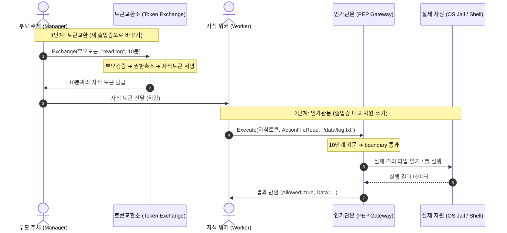

# 006. 파이프라인 엔진, 토큰교환, 그리고 2단계 프로세스 실행의 모든 것

> **모드**: `[문서작업]` — 소스코드 수정 없이 이번 대화 세션에서 다룬 제네릭 파이프라인 엔진(`pipeline.Engine[S]`), 상태봉투(`Call`), 토큰(Token)의 실체와 토큰 교환(`Exchange`), 인가관문(`PEP Gateway`), 그리고 부모-자식-손자 2단계 OS 프로세스 격리 및 표준입출력 통신의 질문·대답 전체를 해설합니다.  
> **기준일**: 2026-11-07 · **기준 커밋**: `34b8b77`  
> **다시 확인하는 법**:  
> ```bash
> # 1. 파이프라인 범용 엔진 시험
> go test -v ./internal/pipeline/...
> # 2. 토큰 교환 8단계 파이프라인 시험
> go test -v ./internal/authn/exchange/... -run "TestExchange"
> # 3. PEP 인가관문 10단계 파이프라인 시험
> go test -v ./internal/authz/pep/... -run "TestGateway"
> # 4. 오케스트레이터 프로세스 스포너(stdin/stdout 격리) 시험
> go test -v ./internal/orchestrator/... -run "TestSpawner"
> ```

---

## 1. `pipeline.Engine[Call]`과 상태봉투(`Call`)

### Q. `pipeline.Engine[Call]`이 뭐야? `Call`이 상태봉투야? 그게 뭐야? Go 문법을 잘 모르는데 특별한 방식이야?

#### 1) `pipeline.Engine[Call]`이란?
한 문장으로 말하면, **"요청을 처리할 때 거쳐야 하는 단계들(입력검증 ➔ 인증 ➔ 인가 ➔ 격리 ➔ 감사 ➔ 실행 ➔ 정산 등)을 정해진 순서대로 실행해 주는 범용 파이프라인 엔진"**입니다.

이 프로젝트에서 요청을 집행하는 관문인 `gateway.go`는 다음 10개 단계를 차례대로 거칩니다:
1. `input` (입력 검증)
2. `authn` (토큰 인증)
3. `authz` (권한 판정)
4. `boundary` (파일 경로/네트워크 격리 경계 검사)
5. `replay` (토큰 재사용 방지)
6. `approval` (사전 승인서 소비)
7. `budget` (예산 차감)
8. `precommit_audit` (실행 직전 감사 기록)
9. `execute` (실제 파일 쓰기/읽기/명령 실행)
10. `settle` (사후 정산)

`pipeline.go`에 있는 `Engine`은 권한이나 토큰이 뭔지 전혀 모르는 순수한 실행기이고, `pep` 패키지가 **"우리는 이 10개 단계로 검사할 것이고, 각 단계마다 전달할 데이터는 `Call`이야"**라며 조립해 둔 결과가 바로 `Engine[Call]`입니다. (구현: `internal/pipeline/pipeline.go`, `internal/authz/pep/gateway.go`)

#### 2) `Call`이 상태봉투인가?
**네, 맞습니다. 정확히 '상태 봉투(State Envelope)' 역할을 합니다.**

`Call` 구조체(`internal/authz/pep/tool.go`)는 다음과 같이 구성되어 있습니다:
```go
type Call struct {
    cfg         *Config          // 게이트웨이 전체 설정/의존성
    req         Request          // 사용자가 요청한 입력값 (토큰, 동작, 경로 등)
    st          *pipelineState   // 단계를 거치며 누적되는 중간 상태
    fetchTarget netguard.Target  // 네트워크 작업 시 정규화된 대상
}
```

* **왜 '상태 봉투'라고 부를까요?**
  * 공장의 컨베이어 벨트를 상상해 보세요.
  * 노란 서류 봉투(`Call`) 하나가 벨트에 올라탑니다.
  * 봉투 안에는 처음 의뢰서(`Request`)가 들어 있습니다.
  * **1단계(authn) 직원**: 토큰을 꺼내 검증한 뒤, 인증된 사용자 정보(`claims`, `subject`)를 봉투 안(`st`)에 메모해서 다시 벨트로 보냅니다.
  * **2단계(authz) 직원**: 앞 사람이 적어둔 사용자 정보를 읽고 권한을 승인한 뒤, 승인 번호(`approvalID`)를 봉투에 메모합니다.
  * **3단계(boundary) 직원**: 안전한 경로(`safePath`)를 검증해 봉투에 적습니다.
  * **마지막(execute) 직원**: 봉투에 쌓인 최종 정보들을 보고 실제 파일/명령을 실행한 뒤 결과(`out`)를 넣습니다.
  * 이처럼 **각 단계 함수들이 이전 단계의 결과를 읽고, 자기 결과를 누적해서 다음 단계로 넘겨주기 위해 들고 다니는 하나의 묶음 주머니**를 소프트웨어 패턴에서 "상태 봉투(State Envelope)" 또는 "컨텍스트(Context Object)"라고 부릅니다.

#### 3) Go 문법 관점에서의 특별함
괴상하거나 마법 같은 특수 문법은 아니고, **Go 1.18부터 정식 도입된 제네릭(Generics, 타입 매개변수)** 문법입니다. (Java의 `List<String>`, C++의 `std::vector<T>`, TypeScript의 `Array<T>`와 동일합니다.)
* `Engine[S any]`는 "어떤 상태 타입(`S`)을 들고 다닐지는 쓰는 쪽에서 결정해라"라는 뜻입니다.
* 이를 사용할 때 `Call`이라는 타입을 괄호 안에 넣어서 구체화한 것입니다 (`Engine[Call]`).
* **장점**: 컴파일 시점에 타입이 고정되어 런타임 타입 캐스팅 에러가 사라지며, 토큰 교환(`Engine[exchangeCall]`)과 관문(`Engine[Call]`)에서 동일한 파이프라인 코드를 안전하게 재사용합니다.

---

### Q. `Call` 구조체 안의 `Config`와 `pipelineState`를 상세히 알고 싶어. 안에서 각각 무엇을 들고 있어?

`Call`은 겉보기엔 단순하지만, **"불변의 시스템 설정(`Config`)"**과 **"단계를 거치며 채워지는 동적 메모장(`pipelineState`)"**이 명확히 분리되어 있습니다:

#### 1) `cfg *Config` (게이트웨이의 고정된 도구함)
게이트웨이가 태어날 때 주입받은 불변의 하위 컴포넌트들입니다 ([internal/authz/pep/gateway.go](../../internal/authz/pep/gateway.go#L63-L76)):
* `Verifier`: Bearer 토큰의 위조 여부를 검증하는 암호학적 검증기.
* `PDP`: 순수 인가 결정 엔진 (판단 두뇌).
* `Jail`: `workspace/` 밖으로 못 나가게 막는 파일 격리 울타리.
* `AuditWriter`: 위변조 불가 감사 장부(`audit.jsonl`) 기록기.
* `Clock`: 가상 시간 시뮬레이션을 위한 결정론적 시계.
* `ApprovalConsumer`: 사람 승인서 소비기.
* `BudgetLedger`: 호출 횟수/바이트 원장.
* `ExecRunner`: 쉘 명령(`exec:run`) 실행기.

#### 2) `st *pipelineState` (검문소를 지나며 채워지는 동적 메모장)
요청이 들어왔을 땐 거의 비어 있다가, 10개 검문소를 거치며 앞 단계 직원이 채우고 뒷 단계 직원이 읽는 누적 상태입니다 ([internal/authz/pep/gateway.go](../../internal/authz/pep/gateway.go#L117-L137)):
* `traceID`: 전체 트랜잭션을 추적하는 고유 식별자.
* `claims`: `authn`(2단계) 직원이 토큰을 까서 확인한 인증된 사용자 명세(`VerifiedClaims`).
* `subject` & `tokenJTI`: 토큰의 주인 ID와 토큰 일련번호.
* `approvalID`: `authz`(3단계) 직원이 "이 작업은 사전 승인서 #123이 있어서 통과시켰음"이라고 메모한 승인 ID (➔ 6단계 `approval` 직원이 이걸 보고 소비함).
* `safePath`: `boundary`(4단계) 직원이 샌드박스 탈옥(`..`)이 없는지 검사하고 확인한 물리적 안전 경로.
* `budgeted`, `consumed`: `budget`(7단계) 직원이 예산을 정상 차감했는지 여부.
* `out`: `execute`(9단계) 직원이 실제 파일을 읽거나 쉘을 실행하고 담아둔 결과 바이트(`Output`).

---

## 2. Go 언어 문법 및 네이밍 규칙

### Q. `var engine *pipeline.Engine[Call]` 문법을 더 설명해줘. `pipeline`은 뭔가? 클래스인가? 왜 소문자인가? `Engine`은 왜 대문자인가? `*`는 뭐야?

```text
var  engine  *pipeline.Engine[Call]
 ↑     ↑     ↑    ↑       ↑
 ①     ②     ③    ④       ⑤
```

| 기호/단어 | 정체 | 설명 |
| :--- | :--- | :--- |
| ① `var` | **키워드** | "지금부터 변수를 선언하겠다"는 선언문 키워드 |
| ② `engine` | **변수명** | 선언할 변수의 이름 (소문자로 시작하므로 이 패키지 내부에서만 씀) |
| ③ `*` | **포인터 타입** | 원본 객체를 통째로 복사하지 않고, 메모리 주소(참조)를 가리킨다는 뜻 |
| ④ `pipeline` | **패키지 이름** | 다른 디렉터리/네임스페이스인 `package pipeline`을 의미 (클래스 아님) |
| ⑤ `Engine` | **구조체(타입) 이름** | `pipeline` 패키지가 외부에 공개(Export)한 타입 이름 |

1. **`pipeline`은 클래스인가? 왜 소문자인가?**:
   * Go에는 `class` 키워드가 없습니다. 디렉터리 단위로 `package`를 만들어 네임스페이스로 씁니다.
   * Go 표준 규약상 **패키지 이름은 반드시 모두 소문자(단일 단어 권장)**로 작성합니다 (`pipeline`, `json`, `token` 등).
2. **`Engine`은 왜 대문자인가? (Go의 접근 제어자)**:
   * Go에는 `public`, `private` 키워드가 없습니다. 대신 **첫 글자의 대/소문자로 공개 여부를 결정(Exported / Unexported)**합니다:
   * **대문자 (`Engine`, `Run`)**: Public (외부 공개). 다른 패키지에서 가져다 쓸 수 있습니다.
   * **소문자 (`engine`, `stepStart`)**: Private (패키지 비공개). 해당 패키지 폴더 안에서만 보입니다.
3. **`*`는 뭐야? (포인터)**:
   * `pipeline.Engine[Call]`은 엔진 객체 실물(값)이고, `*pipeline.Engine[Call]`은 엔진 객체가 메모리 어디에 있는지 가리키는 주소(포인터)입니다.
   * 객체를 통째로 복사하지 않고 8바이트 주소만 넘겨 성능을 높이고, 동일한 인스턴스를 공유하며, `nil` 상태를 표현하기 위해 씁니다.

---

## 3. 토큰교환소와 인가관문: "요청"이 아니라 "교환"이라 부르는 이유

### Q. 토큰교환소와 인가관문이 대체 뭐야? 토큰을 그냥 '요청'하는 게 아니라 왜 굳이 '교환(Exchange)'한다고 해?

#### 1) 토큰을 그냥 달라고(Request) 하지 않는 이유
* 일반적인 로그인 시스템에서는 아이디/비밀번호를 주고 "토큰 주세요"라고 **새로 요청(Request)**합니다.
* 하지만 에이전트 시스템에서는 부모가 이미 **자신의 강력한 마스터 토큰**을 쥐고 있습니다.
* 자식 일꾼에게 일을 시킬 때, 아무것도 없는 상태에서 토큰을 달라고 떼쓰는 게 아닙니다. 부모가 가진 **"큰 출입증(마스터 토큰)"을 창구에 담보로 맡기고, "더 작은 10분짜리 임시 출입증(자식 토큰)"으로 바꿔 가는(Exchange)** 것입니다.
* 그래서 OAuth 2.0 국제 표준(RFC 8693)에서도 이 행위를 `Token Request`가 아니라 **`Token Exchange (토큰 교환)`**이라고 공식 명명했습니다.

#### 2) PEP 게이트웨이도 교환소처럼 작동하나? 내 착각인가?
* **질문하신 직관이 아주 훌륭합니다! 하지만 역할은 명확히 다릅니다 (착각하기 쉬운 이유 해설):**
* **착각하기 쉬운 이유**: 
  1. 둘 다 똑같이 생긴 `pipeline.Engine[S]` 컨베이어 벨트를 씁니다 (`Engine[exchangeCall]` vs `Engine[Call]`).
  2. 둘 다 내부에서 `client_auth`나 `authn` 같은 인증/검증을 거칩니다.
* **결정적 차이점**:
  * **토큰교환소 (`ExchangeService`)**: 결과물로 **"새로운 자식 토큰 문자열(출입증)"**을 찍어서 돌려주는 **발급 창구**입니다. 실제 파일이나 쉘에는 일절 손대지 않습니다.
  * **인가관문 (`PEP Gateway`)**: 이미 발급받은 출입증을 들고 찾아왔을 때, **실제 파일 I/O를 하거나 쉘 도구를 실행해서 "작업 결과(Data)"**를 주는 **현장 검색대**입니다.
* 즉, `ExchangeService`는 출입증을 바꿔주는 곳이고, `PEP Gateway`는 그 출입증을 검사해 문을 열어주는 곳입니다.



---

## 4. 토큰(Token)의 실체, jti, 그리고 budget

### Q. 토큰이 대체 뭐야? `jti`는 뭐고, 왜 `budget`이라고 표현해? 일반적인 표현이야?

#### 1) 토큰이란 무엇인가?
* **일상의 비유**: 공인인증서 도장(전자서명)이 찍힌 **1회용 종이 출입증**.
* **코드상의 실체**: 점(`.`) 2개로 연결된 긴 암호문 문자열(JWT, RFC 9068).
* 내용을 까보면 [internal/domain/token.go](../../internal/domain/token.go)의 `TokenClaims`가 들어 있습니다:
  * `iss` (발급자), `sub` (출입증 주인), `exp` (만료시각), `scope` (허용 행위 목록), `epoch` (보안 세대 번호), `act` (위임 계보 도장).
  * 끝부분에 비대칭키 전자서명이 붙어 있어, 단 1글자만 위조해도 즉시 감지됩니다.

#### 2) `jti`는 뭔가? (JWT ID)
* **정체**: **출입증 고유 일련번호 (UUID / 난수 문자열)**입니다. (RFC 7519 §4.1.7 표준 규격)
* **왜 필요한가? (재사용 방지 — Replay Attack 방어)**:
  * 해커가 네트워크에서 출입증을 가로채서 똑같은 걸 100번 쓰려고 할 수 있습니다.
  * 검문소는 출입증을 받을 때마다 적혀 있는 `jti` 번호를 장부(`replay_state.json`)에 기록합니다.
  * 1초 뒤 똑같은 `jti`가 적힌 출입증이 또 들어오면? **"이 일련번호는 이미 사용된 입장권이다!"**라며 차단(5단계 `replay` 검문)합니다.

#### 3) 왜 `budget`(예산)이라고 표현해? 일반적인 표현인가?
* **네, 클라우드와 자율 에이전트 보안에서 매우 표준적이고 널리 쓰이는 표현입니다!**
* **이유**:
  * OpenAI, Anthropic의 LLM API나 클라우드 시스템에서는 에이전트에게 자원을 줄 때 "토큰 사용량 예산(Token Budget)", "컴퓨팅 예산(Compute Budget)"이라고 부릅니다.
  * 이 프로그램에서도 자식 일꾼에게 일을 시킬 때, 무제한으로 디스크를 쓰지 못하게 **"너는 총 3번만 호출할 수 있고, 총 10KB까지만 쓸 수 있어"**라며 마치 용돈 지갑을 쥐여주듯 통제합니다.
  * 그래서 권한(`scope`)과 구분하여 소비 가능한 자원의 상한선을 **`budget`(예산)**이라고 부릅니다.

---

## 5. Tool(Shell) 실행 결과 리턴 및 stdout/stderr 처리

### Q. Tool 실행 결과는 어떻게 리턴되나? 특히 shell 툴이면 어떻게? stdout이나 stderr로 받나?

1. **결과 리턴 구조**:
   * 실행 결과는 공통 `Output` 구조체(`internal/authz/pep/tool.go`)로 묶여 반환됩니다:
     ```go
     type Output struct {
         Data       []byte // 실행 결과 데이터 (바이트 슬라이스)
         BytesRead  int    // 읽은(출력된) 바이트 크기
         BytesWrote int
     }
     ```
   * 이 `Output`은 인가관문 실행이 끝나면 최종적으로 `Result.Data`(`[]byte`)로 전달됩니다.
2. **`stdout` / `stderr` 처리 방식 (`internal/execguard/guard.go`)**:
   * **`stdout` (표준 출력)**: 자식 워커가 메모리 버퍼(`capWriter`)를 `cmd.Stdout`에 꽂아둡니다. 툴이 화면에 출력한 글자들을 메모리 바이트 배열(`[]byte`)로 긁어옵니다. (상한선 `maxBytes` 초과 시 차단)
   * **`stderr` (표준 에러)**: 별도 버퍼로 수거하지 않습니다. 프로세스가 비정상 종료하거나 에러를 내면 Go 표준 라이브러리의 `cmd.Run()` 에러(`err`)로 감지되어, **인가관문 전체가 즉시 실패(Fail-Closed, `ReasonInternalError`) 처리**됩니다.
   * **결론**: **정상 종료 시의 `stdout` 내용만 바이트 배열(`[]byte`) 형태로 반환**됩니다.

---

## 6. 부모-자식-손자 2단계 프로세스 생성과 격리 통신

### Q. 부모-자식, 자식-툴(손자) 통신 전체를 정리해줘. 자식 워커가 부모가 되어 툴을 자식 프로세스로 또 실행시키나? 메인 프로그램이 부모도 되고 자식도 되나?

**네, 맞습니다! 자식 워커가 또 하나의 부모가 되어 툴을 "손자(Grandchild) 프로세스"로 실행시킵니다.**

```text
┌─────────────────────────────────────────────────────────────┐
│ [1단계] 부모 프로세스 (Orchestrator / main)                 │
│   • 역할: 작업 계획, 토큰 축소 위임, 자식 생명주기 관리   │
└──────────────────────────────┬──────────────────────────────┘
                               │ [1차 분기: Self-Spawn]
                               │ • 실행 바이너리: 자기 자신 (authz-harness worker)
                               │ • 입력 통로: stdin 파이프 (토큰, JSON 요청 밀어넣기)
                               │ • 출력 통로: stdout 파이프 (결과 JSON 빨아들이기)
                               ▼
┌─────────────────────────────────────────────────────────────┐
│ [2단계] 자식 워커 (Worker Agent)                            │
│   • 역할: 인가관문(PEP Engine) 실행, OS Sandbox 적용        │
│   • 검사: authn ➔ authz ➔ boundary 통과                     │
└──────────────────────────────┬──────────────────────────────┘
                               │ [2차 분기: Tool Exec]
                               │ • 실행 바이너리: 외부 시스템 도구 (예: /bin/echo, git 등)
                               │ • 입력 통로: 없음 (stdin=nil, CLI 인자만 단발 전달)
                               │ • 출력 통로: stdout 버퍼 캡처 (결과 바이트 배열)
                               ▼
┌─────────────────────────────────────────────────────────────┐
│ [3단계] 손자 툴 프로세스 (Tool Process)                      │
│   • 역할: 실제 쉘/명령어 한 줄 실행 후 즉시 종료          │
└─────────────────────────────────────────────────────────────┘
```

#### 핵심 메커니즘과 보안 불변식:
1. **자기 복제 (Self-Re-execution)**:
   * 배포 시 바이너리 하나(`authz-harness`)만 사용합니다. 부모는 `os.Executable()`(자기 자신의 바이너리)에 `worker` 서브커맨드를 붙여 자식 프로세스를 띄웁니다.
2. **비밀값 전달 시 `stdin` 필수 사용 (Zero Leakage)**:
   * 리눅스/macOS에서 `ps aux` 명령을 치면 CLI 인자(`--token=...`)가 시스템 전체에 노출됩니다.
   * 따라서 부모는 토큰을 명령행 인자로 절대 넘기지 않고, **오직 1:1 메모리 파이프인 `cmd.Stdin`에 단일 JSON 프레임으로 주입**합니다.
3. **자식과 툴 사이의 통신**:
   * 대화형(Interactive) 통신이 아닙니다.
   * `cmd.Stdin = nil`로 입력을 닫아버리고, 명령어 인자(argv)만 넘긴 뒤 끝날 때까지 기다리는 **단발성 배치(One-shot Batch)** 방식입니다.

---

## 7. 파이프라인 엔진의 디자인 패턴과 게이트웨이의 보안적 의미

### Q. 파이프라인 엔진은 어떤 패턴인가? 미들웨어/인터셉터와의 차이는? 우리 게이트웨이는 왜 준비만 해주고 파이프라인에 맡기나? 보안상 어떤 의미가 있나?

#### 1) 파이프라인 엔진의 패턴
* **Pipes & Filters Pattern + Chain of Responsibility + Saga Pattern (보상 트랜잭션)**의 결합입니다.
* **미들웨어와의 차이**:
  * 미들웨어는 `next(ctx)` 형태로 함수가 함수를 부르며 양파 껍질처럼 감싸는 재귀 구조입니다.
  * 우리 엔진은 재귀가 없는 **1차원 평면 배열 루프(`for _, step := range steps`)**로, 각 단계는 앞뒤를 호출하지 않고 오직 상태봉투(`*S`)만 검사합니다.
* **Saga 보상 롤백**:
  * 중간에 8단계에서 실패하면, 앞서 7단계에서 성공했던 자원 차감(예: 예산 소비)을 역순으로 되돌리는 `Compensate` 로직이 기계적으로 발동됩니다.

#### 2) 준비만 해주는 게이트웨이의 보안적 의미 (메커니즘과 정책의 분리)
게이트웨이가 직접 판단하지 않고 정해진 파이프라인에 요청을 밀어 넣는 구조는 다음과 같은 절대적인 보안 이점을 제공합니다:
1. **인가 우회(Bypass)의 수학적 원천 차단**:
   개발자가 편의를 위해 특정 검사(감사, 예산 등)를 건너뛰는 예외 코드를 작성할 수 없으며, 모든 요청은 10개 검문소를 100% 거쳐야 합니다.
2. **실패 시 안전 우선 (Fail-Closed) 물리적 보장**:
   어느 한 단계라도 에러를 내면 엔진 루프가 즉각 중단되어 실제 실행(`execute`) 단계에 도달할 수 없습니다.
3. **도메인 역전으로 얻는 완벽한 테스트 가능성**:
   엔진 자체는 보안이나 토큰을 전혀 모르는 순수 Go 코드이므로, 수백 가지의 순서 역전이나 결함 주입을 독립 단위 테스트로 100% 증명할 수 있습니다.

---

## 8. 코드 정본 색인

- **제네릭 파이프라인 순수 엔진**: [internal/pipeline/pipeline.go](../../internal/pipeline/pipeline.go) (`Engine[S]`, `Step[S]`, `Run`, `Compensate`)
- **PEP 인가관문 10단계 조립소**: [internal/authz/pep/gateway.go](../../internal/authz/pep/gateway.go) (`assemble`, `NewGateway`, `pipelineState`)
- **PEP 도구 인터페이스 및 상태봉투**: [internal/authz/pep/tool.go](../../internal/authz/pep/tool.go) (`Tool`, `Call`, `Output`)
- **쉘 도구 실행 및 stdout 버퍼 캡처**: [internal/authz/pep/tool_exec.go](../../internal/authz/pep/tool_exec.go), [internal/execguard/guard.go](../../internal/execguard/guard.go) (`Run`, `capWriter`)
- **토큰 교환 8단계 파이프라인**: [internal/authn/exchange/service.go](../../internal/authn/exchange/service.go) (`assemble`, `Exchange`, `exchangeCall`)
- **부모-자식 프로세스 스포너 및 stdin 주입**: [internal/orchestrator/spawner.go](../../internal/orchestrator/spawner.go) (`Spawn`, `configureProcessGroup`)
- **토큰 클레임 표준 구조체**: [internal/domain/token.go](../../internal/domain/token.go) (`TokenClaims`, `ActorClaim`, `Budget`)
